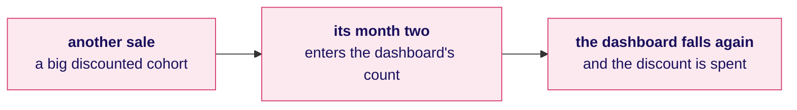
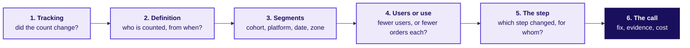
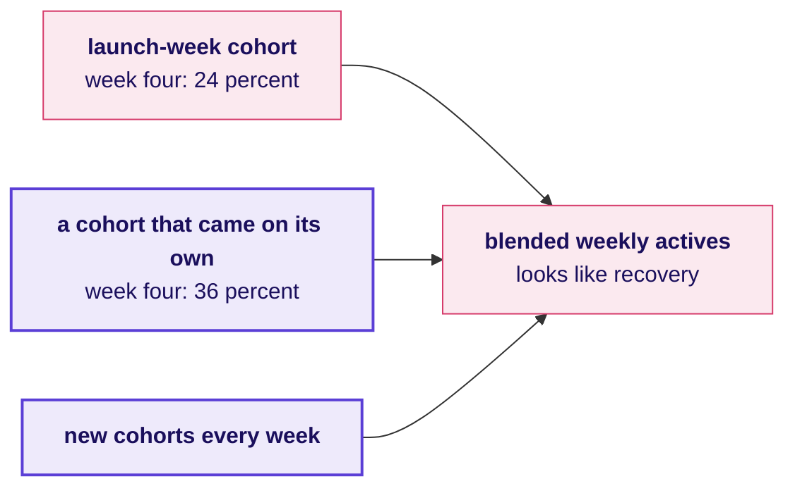

# What does Zomato Gold fix first, and how do you walk an interviewer through it?

Week 4, Day 4. Half two.

Header: WEEK 4  ·  DAY 4  ·  ZOMATO GOLD, CHENNAI, AN ILLUSTRATIVE CASE

## SECTION 4: What is fixed first?
*The morning found two problems, a dashboard that reads 38 because of who it counts and one broken step on Android: which goes first, on what evidence, at what cost, and what does the app team's lead say?*

```notes
Sixty trainer minutes: the fix-first call unguided (30), the interview walk and the AI-company
variant (15), the Kahoot and the close (15). Then the IITGN faculty session W4-3 runs (tentative),
or the weaned-users fallback if it slips.
LIVE, 30 minutes, unguided, in the nine groups. L5. Styles: the case method (the app team's lead
argues from a role card and is partly right), Feynman (the call in one sentence a membership lead
could repeat).
Transition: the task.
```

---

## S38. The task: one call, five lines, one page
*What does a fix-first call carry, and in what order?*

```timeline
label: 1 | title: The call | body: What gets fixed first, in one sentence
label: 2 | title: The evidence | body: The stage, the segment and the date, each with its number
label: 3 | title: The cost | body: Orders a week and rupees, with every assumption named and ranged
label: 4 | title: The objection | body: The app team's lead, answered with the split that settles it
label: 5 | title: What would change it | body: The one fact that would reverse the order | tone: dark
```

Each group writes the five lines for the membership lead on one page, then a second page doing the same for Kalpa's head of Retail-Plus after the lab. Every number comes from the morning's notebooks.

```notes
LIVE, 4 minutes to set up, then 18 minutes of writing. Circulate with one question per group:
which line of your evidence would the app team's lead attack first? Groups that write "fix
retention" with no stage are sent back to the chapter 3 split.
Transition: the app team's lead.
```

---

## S39. The app team's lead: "our checkout is fine"
*What does the app team's lead claim, what is true in it, and what answers it?*


**The claim.** "Carts that start checkout held at 80 percent on every platform, before and after 14 September, so the new flow works." **What is true.** Starting checkout did not break. **What answers it.** Completing the order once checkout has started fell from 72.5 to 55 percent, for members on Android, from the release week. Concede the true part, restate the question, bring the split.

```notes
LIVE, 5 minutes. A learner reads the role card aloud (TRAINER role card); one group answers in
the four moves from Tuesday: restate, answer from the evidence, concede what is true, say what
would change your mind. A response that calls the app team wrong has lost; the chart is right
about the step it measures.
Transition: what each problem costs.
```

---

## S40. What each problem costs, side by side
*How big is each loss, in orders and rupees, and how sure is each number?*

```stats
value: 1,317 | label: orders a week | note: not placed after the release: 22,841 Android member carts in 17 days, at 58 against 44 percent
value: Rs 5.3 lakh | label: of orders a week | note: at Rs 400 an order, an assumption from Rs 300 (Rs 4.0 lakh) to Rs 500 (Rs 6.6 lakh)
value: 0.23 | label: orders per sale-week member | note: in month one, against 0.61 for an organic August member
value: 33 | label: percent, October | note: the dashboard once the sale cohort enters, if it falls as July's did (32 to 34)
```

The release costs orders every week it stays live, and a code fix ends it. The sale cohort's weakness is already bought; what can still change is the next sale's design.

```notes
LIVE, 4 minutes. Read each number with its assumption. The 1,317 assumes the carts that failed
would have converted at the old rate; members who retried and ordered later make it an upper
bound, which orders per active Android member (1.36 in August, 1.20 in September, against iOS
1.34 and 1.40) bear out. Ask which number the membership lead can act on this week.
Transition: the wrong fix.
```

---

## S41. The wrong fix: buy more sale members
*What would "fix retention" with more acquisition do to the number, and to the business?*



**What breaks.** "Retention will recover if we run another sale." The next discounted cohort enters the count at its month two and, if it behaves like this one, pulls the dashboard down again at the discount's cost.

**The rule.** Judge the next sale on its own cohort curve before buying it, and leave search to menu view alone: its 118 percent was never a broken step.

```notes
LIVE, 4 minutes. Two traps of L5: acquiring your way out of a retention problem, and fixing the
skippable stage. If a group asks what a real company did instead: Swiggy went the other way and
weaned away more than 4 million unprofitable Instamart users (its Q1 FY27 letter, the fallback
block's first part). Then the groups finish their page.
Source:
https://nsearchives.nseindia.com/corporate/SWIGGY_30072026154100_Covering_Letter_Letter_to_Shareholders_-_signed.pdf (checked 12 October 2026)
Transition: the call, said in one breath.
```

---

## S42. The call: the Android checkout first
*What does a hire-grade call say, in the order the membership lead needs it?*

**The call.** Fix the last step of the new Android checkout for members first: it loses about 1,317 orders a week, and a code fix ends the loss. **The evidence.** Checkout start to order placed fell from 72.5 to 55 percent for members on Android from the release week; starting checkout held at 80; iOS members (57 to 56) and non-members on Android (52 to 51) held; the fall holds with the cut moved a week either way. **The cost.** About Rs 5.3 lakh of orders a week at Rs 400 an order, Rs 4.0 to 6.6 lakh across the assumption's range. **The second problem.** The sale-week members kept 20 percent in month one against 49 for organic August members; judge the next sale on its own cohort curve before running it. **What would change the order.** If the lost carts were mostly retried and ordered later, the release costs friction rather than orders, and the sale cohort would go first.

```notes
LIVE, 3 minutes. One group reads its call; the room scores it against the five lines. This is the
model, not the only answer: a group that puts the sale cohort first with a reason that holds has
made a defensible call, and the room should hear why.
Transition: the interview.
```

---

## SECTION 5: What does the interviewer hear?
*"Retention dropped; walk me through your investigation." How does a hire-grade candidate order it, and how does the same idea apply to an AI product?*

```notes
LIVE, 15 minutes. L6. Pairs read the transcript in the extras folder: one plays the interviewer,
one the candidate; they score the hire-grade answer on the scorecard's seven lines and swap.
Explorer scene Th4 carries the AI-company variant.
Transition: the order of the walk.
```

---

## S43. The walk: tracking, definition, segments, users, step
*In what order does a strong candidate investigate a retention drop?*



| | A weak answer | A hire-grade answer |
|---|---|---|
| First sentence | "It's probably the sale cohort." | "Before a cause, I'd check the count, then what the number counts." |
| The flat 38 | Accepts it | "Who does month-two retention count, and from when?" |
| The split | Overall conversion | Cohort, platform and date, then fewer users against fewer orders each |
| The close | "Retention dropped." | "One step on Android since 14 September, about 1,317 orders a week; the sale cohort next." |

```notes
LIVE, 6 minutes. The order is Aced's (T2): rule out data issues first, isolate by segment, then
separate fewer users from less use per user. The weak answer names a cause in its first sentence.
Transition: the AI-company variant.
```

---

## S44. The AI variant: judge each cohort at week four
*An AI app's launch week brings its biggest cohort ever. How do you know whether it is habit or novelty?*

| | Launch-week cohort | A cohort that found the app on its own |
|---|---|---|
| Week one | Looks strong: the feature is new | Looks normal |
| Week four (invented numbers) | 24 percent still active | 36 percent still active |
| The blended weekly actives | Climb through the launch and look like recovery later | Keep arriving and prop the blend |



**The call.** Judge each cohort at the age where habit shows, week four or later, and never the blended count of active users, which new cohorts keep propping up. The structure is Chennai's: a mix that hides a fall.

```notes
LIVE, 4 minutes. Programme-written, every number a toy (explorer scene Th4 shows the same toy).
The transfer: a launch cohort is a sale cohort in an AI product.
Transition: the handoff.
```

---

## S45. The handoff: the member who has not left yet
*What does the cohort table get wrong about its newest members, and who picks it up?*

**The handoff line.** "Your cohort table treats a member who has not left yet as if she were retained for ever, and that flatters every curve. The next 120 minutes give that member a name, censored, and show when two curves really differ by more than chance."

The next block is the IITGN faculty session W4-3 on survival curves, censoring and hazard, tentative until IIT Gandhinagar confirms it.

```notes
LIVE, 1 minute. Say the handoff line word for word and stop. If the block has slipped, open the
fallback deck (the weaned-users block). Park any "is the difference real" question for the block.
Transition: the Kahoot.
```

---

## SECTION 6: What does the room carry out?
*Which of the day's calls can the room make in seconds, and what does the day close on before Friday's ticket?*

```notes
LIVE, 15 minutes. The Kahoot (10) and the close (5).
Transition: the Kahoot.
```

---

## S46. Kahoot: eight items, one from Wednesday
*Which of the day's calls can the room make in seconds?*

```cards
icon: users | eyebrow: Items 1 to 4 | title: Cohorts and the blend | body: What a cohort fixes; a blend that holds while cohorts fall; what the dashboard counts; the retention curve's floor | tone: light
icon: filter | eyebrow: Items 5 to 7 | title: The funnel | body: The step that owns a loss; a step above 100 percent; per session against per member | tone: light
icon: rotate-ccw | eyebrow: Item 8 | title: Back to Wednesday | body: Bread to milk, confidence 0.74 and lift 1.04: the verdict in one breath | tone: dark
```

```notes
LIVE, 10 minutes. Ungraded, scored on correctness and speed. The trap item uses a blend other than
38. Read the most-missed item's answer aloud before the close.
Transition: the close.
```

---

## S47. The day in one sentence, and Friday's ticket
*What does Thursday close on, and what is Friday's question?*

**The sentence.** The dashboard was flat because of who it counts: every cohort fell, the newest started lower, and the sale cohort is outside the count until October; the orders were lost in one step, on one platform, after one date.

**The crux lines.** A cohort fixes the entry moment. A blend is a size-weighted average and counts who it counts. Each funnel step divides by the step before, in one named unit. A low step is not a loss until it moves.

**Friday.** Flipkart's Lucknow fulfilment centre must book packer shifts for the festive weeks, and two forecasts sit eighteen points apart: which one goes to the plan, and how wrong could it be? The pre-read ships tonight: the ticket's first lines and five terms.

```notes
LIVE, 4 minutes. Say the sentence twice. The TA lab after the block runs the same method on Kalpa
Retail's Retail-Plus tier. The cohort axis built today is Friday's time axis.
Transition: the faculty block (tentative) or the fallback.
```
