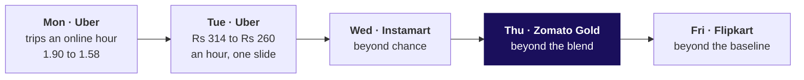
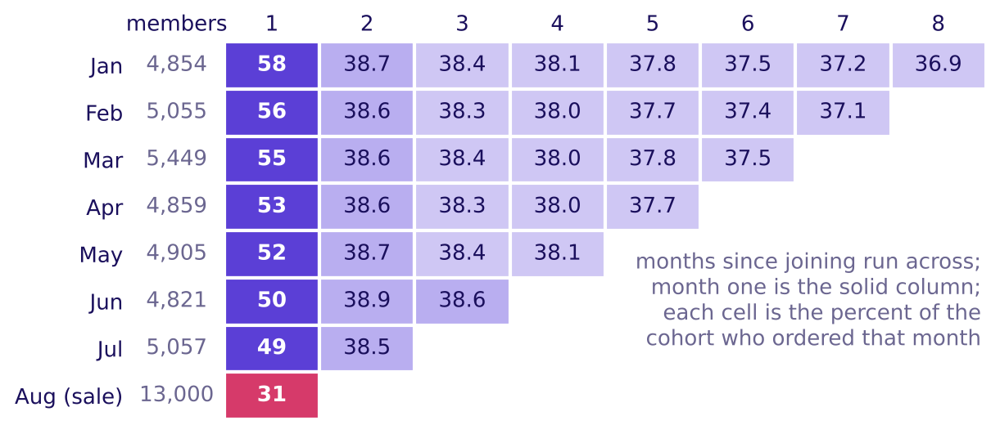
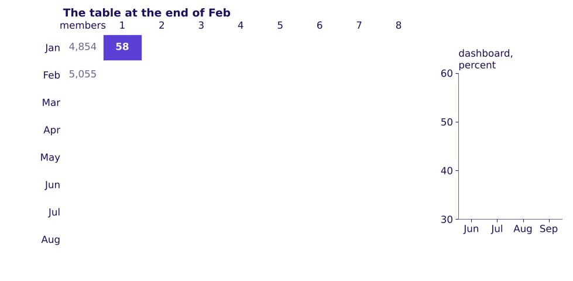
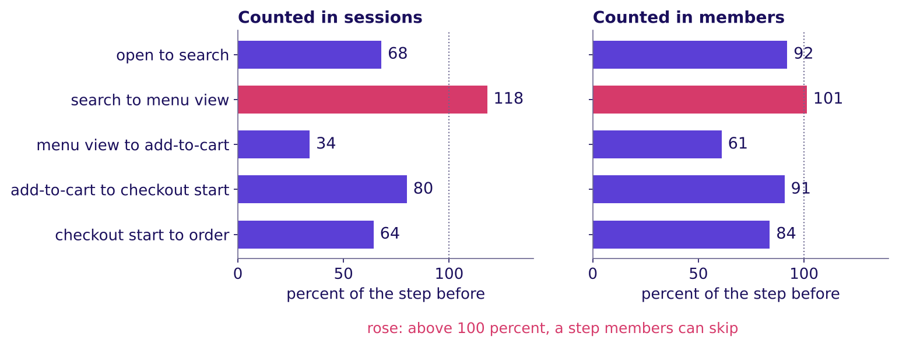

# Who is leaving Zomato Gold in Chennai, and at which step?

Week 4, Thursday. About 12 minutes to read, and 10 more for the self-check.

Zomato Gold, Chennai. The membership dashboard reports month-two retention, the share of members two
or more months past their signup month who ordered in the month, as flat at 38 percent from June to
September 2026, while every signup cohort's own curve falls with age. On 14 September a new checkout
flow shipped on Android, and members' add-to-cart to order on Android fell from 58 to 44 percent.
Illustrative case: the company is real, the situation and the data are synthetic, built for this
class.

---

## What can you do after Thursday?

- You can build a cohort's row by hand and the whole table with one `pivot_table`, counting each
  member's age from the month she joined.
- You can take a flat blended number apart into its cohorts and rebuild it as a size-weighted average
  that lands on the direct count.
- You can read each funnel step over the step before in one named unit, spot a step people can skip,
  and find the step that changed by who, where and when.
- You can size a loss in orders a week and rupees with its assumption ranged, and answer a partly
  right objection by conceding the true part first.

## Where does Thursday sit in the week?

**What was worked, and what was only mentioned.** Thursday counted twelve members by hand, built the
cohort table on all 53,089, rebuilt September's 38 percent from its cohorts, read the funnel in two
units and found the Android checkout's broken step. Censoring was only named.

Each day of Week 4 asks what a number is compared with; Thursday compares a blended number with the
cohorts underneath it.

**What was left out.** The IITGN faculty session after class (tentative) gives the member who has not
left yet a name, censored, and shows when two retention curves really differ.

## Which one picture holds the day?

Call it **the triangle**. Each row is a cohort, the members who joined in one calendar month, and each
column is an age, months since joining. Across a row, members leave: every row drops to about 38.5
percent in month two, then slides about 0.3 points a month. Down the first column, each cohort starts
lower: 58 percent for January, 49 for July and 31 for August. Every later section comes back to it.

---

## Why can a flat average hide falling groups?

**Who needs the answer.** The membership lead, who must say on Friday whether Gold has a cohort
problem or an everyone problem: a wrong call sends the fix to the wrong team.

**The questions on the way.**

- Why can one average hide two groups?
- What does each group keep, month by month?
- What does the dashboard count?
- How does a big new group hold an average up?

A coaching centre takes 10 students in June and 10 in July (invented). In each batch's second month,
6 of June's and 4 of July's come back: 10 of 20, 50 percent, neither batch's rate.

Twelve real members of the case say the same. By months since joining, the four from May kept 3, 2,
1 and 1 of 4; the three from June kept 2, 1 and 1 of 3; the five from the August sale week kept 1 of
5 in month one. The dashboard counts a member from her second month, so the card reads 2 of 7 in
August and in September, with the sale-week members outside the count until October.

A second toy shows the mechanism. Batch A of 100 stood at 50 percent; now A is at 40, and a new batch
B of 400 arrives at 52.5 percent:

$$\frac{100 \times 0.40 + 400 \times 0.525}{500} = \frac{250}{500} = 50\%$$

A large young batch at a high early rate props the blend up while batch A falls.

**WATCH OUT.** Comparing cohorts in one calendar month. In September the sale-week member's month one
sits beside May's month four, and the youngest always looks best. Compare at the same age.

**IN THE FIELD.** Eternal's letter of 22 July 2026 puts Blinkit's customers ordering in the fourth
quarter after acquisition at 46 percent across cohorts, while those cohorts' spend stood at 150
percent of their first quarter's, since those who stay spend more (checked 12 October 2026).

**CALLBACK.** Week 1, Thursday: the monsoon sale lifted Kalpa's total while every segment fell.

**The answer.** An average over groups of different ages names none of them. Fix each member's entry
month first.

## What is the dashboard's 38 made of?

**Who needs the answer.** The membership lead, about to report "nothing changed": if the flat number
hides a weak August cohort, the fix waits a month too long.

**The questions on the way.**

- What does each cohort keep on all 53,089 members?
- What does the dashboard print, counted directly?
- What is September's 38 made of?
- What is outside the count?

**Two ways to build the table, and the call.** A loop over the 241,492 member-months hides the age
rule inside the loop. One `pivot_table`, once each row carries its age, states the rule once, in the
three lines notebook 02 runs. The call is the pivot; a table too big for memory would move it into
SQL as a `GROUP BY` on cohort and age.

The dashboard, counted directly, prints 38.2, 38.0, 37.9 and 37.8 percent from June to September:
7,722 of 20,217 members, then 9,558 of 25,122, 11,359 of 29,943 and 13,218 of 35,000.

**The trap, exactly.** "Month-two retention is 38 percent and flat, so nothing changed." The decision
it misleads: the August cohort gets no action, and October's drop arrives as a surprise.

**The decomposition, and the second route.** A blend is an average weighted by size, where $n_c$ is a
cohort's members and $r_c$ its rate that month:

$$\text{blend} = \frac{\sum_{c} n_c \times r_c}{\sum_{c} n_c}$$

September's seven cohorts give 13,218 orderers of 35,000, 37.8 percent, the direct count to the last
digit. Each month a new cohort enters the count at about 38.5 percent, just above the older cohorts'
slide, so the average holds while every cohort falls.

**What the count leaves out.** The August cohort, 13,000 members, is in its month one and outside the
September count; counting everyone who joined before September gives 17,248 of 48,000, 35.9 percent.
Its 4,973 organic members kept 49 percent in month one, July's rate, and its 8,027 sale-week members
kept 20. If the cohort falls to month two as July's did, 31 to about 20.5, October's dashboard drops
to about 33 percent, 32 to 34 if it enters anywhere from 17 to 24.

**WATCH OUT.** A mean of rates. The eight cohorts' September rates averaged with no weights give 36.9
percent against the true 35.9, because August's 13,000 members get the vote of a 5,000-member cohort.

**IN THE FIELD.** Swiggy's letter of 30 July 2026 shows monthly transacting users up 27.4 percent
while orders per user fell from 4.13 to 3.87, 6.3 percent by our arithmetic; the blend cannot say
whether existing users ordered less or new users ordered little (checked 12 October 2026).

**ORIGIN.** A total that runs against its parts carries E. H. Simpson's name, from his 1951 paper in
the Journal of the Royal Statistical Society (Wikipedia, checked 12 October 2026).

**The answer.** The 38 is a size-weighted average of cohorts at different ages, counted from month
two; every cohort falls, and the weak August cohort is outside it until October.

## Which stage owns the loss?

**Who needs the answer.** The membership lead and the app team's lead, who will say the stage the
room blames is fine: blaming the wrong step sends engineers to one that works.

**The questions on the way.**

- How does a funnel read?
- Why does one step pass 100 percent?
- Per session or per member?
- Whose conversion fell, and where inside the checkout?
- What can the data not show?

**Four ways to look, and the call.** The overall rate says something fell, not where. The lowest
step, menu view to cart at 34 percent, is low every month. Each step over the step before, in one
unit, shows where people stop, and that step split by membership, platform and date shows who and
since when. The call is the last two, after ruling out a tracking change.

On a toy, 100 visits, 40 searches, 20 add-to-carts and 10 checkouts read 40, 50 and 50 percent. If
the 10 checkouts came from 50 sessions of 20 people, checkout is 10 of 50 per session and 10 of 20 per
person: two units, two true numbers.

In September, Gold members' search to menu view reads 118 percent per session: 155,729 sessions
opened a menu and 131,974 searched, because the home carousel opens a menu with no search. Among the
sessions that searched, 89 percent opened a menu. Menu view to cart reads 34 percent per session and
61 per member, both true.

**The split.** Members on Android fell from 58 to 44 percent, breaking in the release week and no
week before it; members on iOS held at 57 to 56, non-members on Android at 52 to 51, and the fall
holds with the cut moved a week either way. Inside the checkout, Android members still started
checkout from 80 percent of carts; completing it fell from 72.5 to 55 percent.

**The trap, exactly.** "The drop is at add-to-cart to order for everyone, so the checkout is broken."
It sits in members on Android after one date; the app team is right about everywhere else.

**WATCH OUT.** A "good" retention number with no definition. Amplitude's day-seven line, 7 percent of
a new cohort returning, is a vendor's top-quarter mark with its method unpublished (checked 12
October 2026).

| What the data cannot show alone | The check | What it found |
|---|---|---|
| The sale-week members were bought on a discount | Organic August members beside July's | 49 against 49; the sale-week members at 20 |
| The newest cohorts are young | Censoring, named | For the faculty session (tentative) |
| Exam months in a student-heavy zone (hypothetical) | September by zone | No zone more than 0.9 points off |
| The release renamed an Android event | The mapping; the cut moved a week | The fall holds |
| Sessions against members | The unit named on every chart | 34 and 61, both true |
| Before and after is not cause | Gold's frequency up about 60 percent after joining | Members join when they expect to order more |

**IN THE FIELD.** Zomato's letter of 19 May 2023 says Gold reached 1.8 million members in Q4 FY23 and
that members' order frequency rose about 60 percent after joining (checked 12 October 2026). It
describes members, not what Gold caused.

**The answer.** Checkout start to order placed, for members on Android, since the 14 September
release: 72.5 to 55 percent.

## What is fixed first, and what does it cost?

**Who needs the answer.** The membership lead, who takes one call to Friday's review.

**The questions on the way.**

- How big is each loss?
- Which goes first, and what would reverse it?

Android members added to a cart 22,841 times in the 17 days after the release. At 58 percent against
44, that is about 1,317 orders a week, about Rs 5.3 lakh at Rs 400 an order, Rs 4.0 to 6.6 lakh as the
order value runs from Rs 300 to Rs 500. The checkout goes first: it loses orders every week it stays
live, and a fix ends it. Orders per active Android member fell from 1.36 in August to 1.20 in
September while iOS rose from 1.34 to 1.40, so the loss did not come back as later orders.

**WATCH OUT.** Two wrong fixes: another sale, whose cohort enters the dashboard at month two and pulls
it down again, and work on search to menu view, a step that never broke.

**IN THE FIELD.** Swiggy weaned away more than 4 million unprofitable Instamart users over three
quarters, and one-month retention of its transacting base rose to 61 percent from 55 (Q1 FY27 letter,
checked 12 October 2026). Part of such a rise comes from who remains.

**The answer.** Fix the Android checkout's last step first, about 1,317 orders a week, and judge the
next sale on its own cohort curve before buying it.

---

## Where does this show up in the work?

| Situation | The decision | What the wrong reading costs |
|---|---|---|
| A subscription app's retention review | Whether a flat number needs action | A weak cohort found a month late |
| A release review | Which step engineers fix first | A sprint on a step that only looked broken |

Tonight's lab meets the same questions at Kalpa Retail's Retail-Plus tier.

## Can you answer these without notes?

1. What does a cohort fix that a blended number cannot?
2. Batch A of 200 stood at 45 percent; now A is at 40 and a new batch B of 300 arrives at 52 percent.
   What does the blend read now?
3. Search to menu view reads 118 percent per session: what is it, and what replaces it?
4. Menu view to cart reads 34 percent per session and 61 per member: which goes on the chart?
5. The app team says checkout starts held at 80 percent: what do you bring?
6. From Wednesday: bread to toned milk read confidence 0.74 and lift 1.04; the verdict?

**Key.** 1: the month each member joined (the triangle). 2: (80 + 156) / 500 = 47.2 percent, up from
45 while batch A fell (the two batches). 3: a step people can skip; menu views among sessions that
searched, 89 percent (the funnel). 4: both, each with its unit named (the funnel). 5: completion fell
from 72.5 to 55 for members on Android from the release week while iOS members and non-members held
(the split). 6: chance, since milk is in 71 percent of carts (Wednesday's notes).

## Which interview questions does Thursday prepare you for?

| The question as asked | The hire-grade line |
|---|---|
| Retention dropped; walk me through your investigation. | The count, what it counts, cohort, platform and date, fewer users against fewer orders, then the step |
| Blended retention is flat while every cohort declines; how? | A large young cohort at a high early rate props the average while every cohort falls |
| How would you use cohort analysis to find a retention issue? | Fix the entry month, read rows for decay and columns for each cohort's start, rebuild the blend |
| The app team says your stage is fine; what do you bring? | The step by membership, platform and date, and the step inside it |
| What denominator do you ask for before trusting a cohort chart? | Per acquired user, per retained user or the total: removing users lifts a per-retained chart |

**The AI-company variant.** An AI app's launch-week cohort looks strong in week one; at week four it
keeps 24 percent against 36 for a cohort that found the app on its own (invented numbers). The
transcript is in `extras/`.

**The guesstimate: riders on the Delhi Metro on a weekday.** Clarify the unit first. DMRC reported 64.06
lakh average daily passenger journeys in 2026 (The Tribune, 9 August 2026) and a record 82,44,903
boardings on 17 September 2026 (Republic World, 18 September 2026), both checked 12 October 2026. One
journey with a change of line can count twice as boardings, so check the unit before validating.

## Which words did Thursday use?

| Term | Plain meaning | Where it appeared | Example |
|---|---|---|---|
| Cohort | Members who joined in the same calendar month | The twelve rows | The May group: 4 members |
| Retention curve | One cohort's share active at each age | The triangle | January: 58, then 38.7 |
| Funnel step | Those who reached a step over those who reached the one before, in one unit | The funnel | Cart to checkout start: 80 percent |
| Skippable step | A step people can bypass, so its rate can pass 100 percent | The funnel | Search to menu view: 118 percent |
| Unit | What a rate counts: sessions or members | The funnel | Menu to cart: 34 per session, 61 per member |

## Where should you read next, and how long does each take?

| Order | Source | Time |
|---|---|---|
| 1 | Mixpanel, "Cohort analysis", https://mixpanel.com/blog/cohort-analysis/ (checked 12 October 2026) | 15 minutes |
| 2 | IBM Technology, "Understanding Data Structures: Time Series, Cross-Sectional, and Panel Data Explained", https://www.youtube.com/watch?v=LoMgvSfKp6Y (checked 12 October 2026) | 12 minutes |
| 3 | Amplitude, "Funnel analysis", https://amplitude.com/blog/funnel-analysis (checked 12 October 2026) | 15 minutes |
| 4 | IBM Technology, "What is Root Cause Analysis (RCA)?", https://www.youtube.com/watch?v=7t3lTYEd_PM (checked 12 October 2026) | 9 minutes |
| 5 | pandas, "10 minutes to pandas", the reshaping section, https://pandas.pydata.org/docs/user_guide/10min.html (checked 12 October 2026) | 10 minutes |
