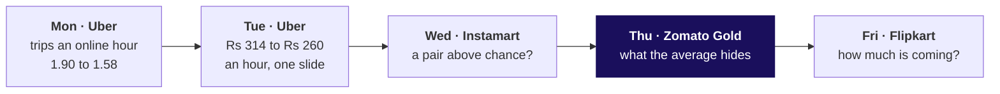
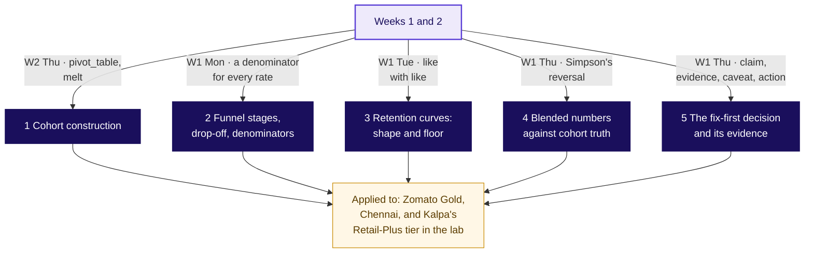

# Who is leaving Zomato Gold in Chennai, and at which step?

Week 4, Thursday. About 20 minutes to read, 10 more for the self-check.

Zomato Gold, Chennai. Gold is the food-delivery app's paid membership, with free delivery. The
membership dashboard reports month-two retention, the share of members two or more months past their
signup month who ordered in the month, as flat at 38 percent from June to September 2026, while every
signup cohort's own curve falls with age. A member with no order in a month is not retained that
month; she is still a member. On 14 September a new checkout flow shipped on Android, and members'
add-to-cart to order on Android fell from 58 to 44 percent. Illustrative case: the company is real,
the situation and the data are synthetic, built for this class.

The notes run in two parts. Part one teaches the day's five topics, in the curriculum's words, on an
invented gym and an invented college. Part two applies them to Zomato Gold.

---

## What can you do after Thursday?

- **Cohort construction.** You can fix each member's joining month, count a cohort's row by age by
  hand, and build the whole table with one `pivot_table`.
- **Retention curves: shape and floor.** You can read how fast a cohort falls, call its floor only
  once two ages agree, and rank cohorts at the same age.
- **Blended numbers against cohort truth.** You can take a flat blended number apart into its cohorts
  and rebuild it as a size-weighted average that lands on the direct count.
- **Funnel stages, drop-off, denominators.** You can read each step over the step before in one named
  unit, spot a step people can skip, and find the step that moved.
- **The fix-first decision and its evidence.** You can choose between two problems, size the loss with
  its assumption ranged, and answer a partly right objection.

## Where does Thursday sit in the week?

Thursday compares a blended number with its cohorts and a funnel with its own past. Censoring was
only named; the IITGN faculty session this afternoon (tentative) takes it up.

## How do the day's five topics connect?

A cohort fixes who joined when (1), so one cohort's share month by month is a curve whose shape and
floor can be read (3). One number over all cohorts is a weighted blend, which a large young cohort
can hold flat while every cohort falls (4). A funnel is the other picture, a chain of steps where each
rate divides by the step before in one unit (2). The fix-first call takes the cohort and the step and
carries its evidence (5).

## Which one picture holds the day?

Call it **the triangle**. Each row is a cohort, the members who joined in one calendar month, and each
column is an age, months since joining. Every Gold row drops to about 38.5 percent in month two, then
slides about 0.3 points a month (a point is the gap between two percentages). Down the first column,
each cohort starts lower: 58 percent for January, 49 for July and 31 for August.

---

**Part one: the five topics, each on an invented gym or college.**

## Cohort construction: what is a cohort, and how is the table built?

**Who needs the answer.** The owner of a neighbourhood gym (invented), who wants a retention offer to
reach the batch that needs it: read by calendar month, the offer goes to the wrong batch.

**The questions on the way.**

- Which batch looks best in April?
- What does each batch keep at each age?
- Why is the table a triangle?
- How does code count the same table?

A **cohort** is everyone who joined in the same month, as a coaching centre runs a June batch and a
July batch. A member keeps her cohort for good. Her **age** in a month is how many months after her
joining month it is. The joining month is **month zero** and is never counted, since everyone visits
the month they join, so **month one** is the first full month after it.

One branch of the gym took ten joiners in each of January, February and March 2026. In April the
owner read the register's April row, 5, 5 and 6 of 10, and called March the best batch. Counted by
age, January kept 8, 6, 5, 5 and 5 of 10 at ages one to five, February 7, 5, 3 and 3, and March 6, 4
and 3. At age one that is 80, 70 and 60 percent: March is the weakest at the same age. April's row
held January at age three, February at age two and March at age one, so its 16 of 30 names no batch.

By June, March's joiners have lived only three ages, so their row is short; a newer cohort's row is
always shorter, which is why a cohort table is a triangle. Named last, the formula, where $c$ is a
cohort and $k$ an age:

$$\text{retention}(c, k) = \frac{\text{members of } c \text{ who visited at age } k}{\text{members of } c}$$

January at age two: 6 ÷ 10 = 60 percent. In code it is Week 2's `melt` and `pivot_table` with one new
line, `age >= 1`, which keeps month zero out of the table (notebook 01).

**WATCH OUT.** Reading one calendar month across cohorts. It mixes ages, and the newest batch, at its
strong first month, always looks best. Compare cohorts at the same age.

**ON GOLD.** SECTION 5 counts twelve Gold members the same way: May's four kept 3, 2, 1 and 1 of 4,
June's three 2, 1 and 1 of 3, and the five from the August sale week 0 of 5 in month one.

**IN THE INTERVIEW.** [S] "Retention dropped; walk me through your investigation." The first move: fix
each member's joining month and compare cohorts at the same age before reading any blended number.

## Retention curves: shape and floor: where does a curve stop falling?

**Who needs the answer.** The gym's owner, who staffs the floor for the regulars: a level read too
early staffs for members who are about to leave.

**The questions on the way.**

- How fast does a batch fall?
- Where does it stop falling?
- When can a floor be called?
- Which batch is strongest, fairly?

A **retention curve** is one cohort's row of the table, drawn by age. Its **shape** is how fast it
falls in its first ages; its **floor** is the level where it stops falling. January reads 80, 60, 50,
50 and 50: it lost 20 points, then 20, then 10, then none, and its floor is 50 percent, the five of
ten who made visiting a habit. February's floor is 30. March reads 60, 40 and 30 and is still falling,
so its floor is not known yet.

**Churn** is the share lost, counted two ways. Counted so far, it is 100 less the retention: January
has lost 20 percent of its joiners by age one, 40 by age two and 50 by age three. Counted month to
month, it divides those who stopped by those still visiting the month before: at age two, 2 of the 8
who visited at age one stopped, 25 percent. A chart that prints a churn number says which of the two
it is.

**The rule we use, this programme's own.** Call a floor only when two ages in a row read the same
share; until then the curve is still falling. After February's age two, 5 of 10, the owner staffed
for five regulars; ages three and four read 3 of 10, two regulars fewer. Ranked fairly, at age two,
the order is January 60, February 50 and March 40, the reverse of April's calendar row. A young
cohort's open end is what the faculty session (tentative) calls censoring.

**ON GOLD.** Every Gold cohort drops to about 38.5 percent in month two and then slides about 0.3
points a month. No two ages read exactly the same, so the floor is called one that erodes slowly;
compared at month one, the cohorts run from 58 down to 31.

**IN THE FIELD.** Eternal, which runs Zomato and Blinkit, says 46 percent of a Blinkit cohort's
customers order in the fourth quarter after joining while its net order value is 150 percent of its
first quarter's: fewer customers, more value (letter of 22 July 2026, checked 12 October 2026). The
customers above the floor carry the business.

**IN THE INTERVIEW.** [F] "How would you use cohort analysis to find a retention issue?" Read each
cohort's shape and floor, rank cohorts at the same age, and look for the cohort whose curve starts
lower or never flattens.

## Blended numbers against cohort truth: how does a flat number hide a fall?

**Who needs the answer.** The gym's owner, who reads one dashboard number each month: a flat number
read as "nothing changed" leaves a falling cohort with no action.

**The questions on the way.**

- What does February's dashboard read?
- What are the cohorts doing under it?
- What is the dashboard's number made of?
- Which quick average is wrong?

The whole gym's dashboard counts a member from the month after she joins. In January it read 50 of
100 older members, 50 percent. In February the older members fell to 40 of 100, and 400 January
joiners, in their month one, visited at 52.5 percent: 250 of 500, still 50 percent. The older members
fell ten points, and the one number over everyone did not move, because 400 joiners at their high
early rate now carry four votes in five.

A **blend** is one rate over several cohorts, and it is their average weighted by size. Named last,
the formula, where $n_c$ is a cohort's members and $r_c$ its rate that month:

$$\text{blend} = \frac{\sum_{c} n_c \times r_c}{\sum_{c} n_c} = \frac{100 \times 0.40 + 400 \times 0.525}{500} = 50\%$$

Rebuilt from its cohorts, the blend lands on the direct count, 250 of 500; a rebuild that misses the
count has left a cohort out or counted one twice.

**WATCH OUT.** The plain mean of the rates, (40 + 52.5) ÷ 2 = 46.25 percent, gives 100 older members
the same vote as 400 joiners. It is neither the count nor the older members' own 40, and it equals
the blend only when every cohort is the same size.

**CALLBACK.** Week 1, Thursday met the same arithmetic as a reversal: a total moved one way while each
segment moved the other.

**ORIGIN.** A total that runs against its parts is called Simpson's paradox, after E. H. Simpson's
1951 paper, "The Interpretation of Interaction in Contingency Tables", in the Journal of the Royal
Statistical Society, Series B,
https://doi.org/10.1111/j.2517-6161.1951.tb00088.x (checked 13 October 2026);
the name came about twenty years later. A flat blend over falling cohorts is its retention form.

**ON GOLD.** The dashboard's 38 is this weighted average over seven cohorts at different ages, and a
new cohort of about 5,000 enters it each month just above the older cohorts' slide (part two).

**IN THE FIELD.** Swiggy's users who order in a month rose 27.4 percent year on year while platform
frequency fell from 4.13 to 3.87 (letter of 30 July 2026, checked 12 October 2026): old users
ordering less, or new ones ordering little? One blended number cannot say.

**IN THE INTERVIEW.** [F] "Blended retention is flat while every cohort declines; how?" A growing young
cohort at its high early rate carries more weight each month, so the average holds while each cohort
falls; the fix is to read the cohorts at the same age.

## Funnel stages, drop-off, denominators: which step owns a loss?

**Who needs the answer.** The dean of a college (invented), who has one admissions team for one fix
this year: a step blamed because it is low sends the team to a step that works.

**The questions on the way.**

- Which step owns this cycle's loss?
- What does each step read?
- Why does one step pass 100 percent?
- Per application or per applicant?

A **funnel** is a chain of steps people pass through, fewer at each: applied, sat a test, shortlisted,
accepted an offer, joined. This cycle the college's main programme counted 1,000, 800, 400, 300 and
240 applications at the five stages. Each **step rate** divides a stage by the stage before, in one
unit: 80, 50, 75 and 80 percent. **Drop-off** is 100 less the step rate: 20, 50, 25 and 20. The
**overall conversion** divides the last stage by the first, 240 of 1,000, 24 percent against 28.8 last
cycle, and the step rates multiply to it: 0.80 × 0.50 × 0.75 × 0.80 = 0.24.

Only one step moved: offer acceptance, from 90 to 75 percent. Shortlisting reads 50 because the
college selects half by design, and it read 50 in both cycles. **A low step is a loss only when it
moves against its own past.**

**WATCH OUT.** A step above 100 percent. The sister programme's test is optional: 300 sat it and 320
were shortlisted, 230 who sat the test and 90 on board marks alone, so "test to shortlist" reads 107
percent. The 107 is an **artefact**, a number made by the way the count is taken; counted among those
who sat the test, the step reads 230 of 300, 77 percent.

**The unit.** This cycle's 1,000 applications came from 900 applicants, so the same 240 joiners are
24 percent of applications and 26.7 percent of applicants. A person can try more than once, so a
funnel read per person reads at least as high, and a chart names its unit. The definitions match
those analytics tools print: step conversion over the previous step, funnel conversion from the first
step, and drop-off as 100 less the step's conversion (HockeyStack's funnel reports, checked 13 October
2026).

**ON GOLD.** Search to menu view reads 118 percent per session because the home carousel opens menus
with no search, and menu view to add-to-cart reads 34 percent per session and 61 per member (part two).

**IN THE INTERVIEW.** [D] "The team that owns the step says it is fine; what do you bring?" The step's
rate against its own past, split by group and date, in a named unit, with a step beside it that held.

## The fix-first decision and its evidence: what does a call carry?

**Who needs the answer.** The college's dean, who has one team for one fix before the next cycle: the
wrong fix leaves the lost students lost for another year.

**The questions on the way.**

- Which of two problems goes first?
- Whom does the loss hurt, and since when?
- How big is it, and what does it cost?
- What answers the objection?

The dean has two problems. 200 of 1,000 applications skip the entrance test every cycle, and offer
acceptance fell from 90 to 75 percent this cycle. The bigger count never moved, so it is how the test
runs; acceptance moved, so it goes first. Split by home state, students from other states went from 87
to 50 percent from the cycle the fee-payment deadline was cut from 21 to 7 days after the offer, while
in-state students, the **comparator** on the same step, held at 92 to 90.

**The size and the cost.** At last cycle's rates the shortlist would have accepted 360; 300 did, so
60 fewer, 5 in-state and 55 from other states. Eight in ten of those who accept join, so that is 48
fewer students, and the joiners counted directly agree: 288 last cycle, 240 this cycle. At a
first-year fee of Rs 1 to 1.5 lakh, an assumption, that is Rs 48 to 72 lakh of fee income a year.

**The page, in five lines.** The call: give other-state offers a longer fee deadline first; the test
waits. The evidence: the step against its own past, the group, the date and the comparator. The
cost: 48 students, Rs 48 to 72 lakh, the assumption ranged. The objection: "our offers go out within
two days" is true, and the fall sits after the offer. What would change it: other-state acceptance
falling before the deadline changed; it read 86 and 87 in the two cycles before.

**WATCH OUT.** Fixing the bigger number because it is bigger. A problem that has read the same for
three cycles lost nothing this cycle.

**ON GOLD.** SECTION 9 writes the same five lines for the membership lead, with the Android checkout
against the sale-week members (part two).

**IN THE INTERVIEW.** [D] "What evidence do you bring when the owning team says its step is fine?" The
step against its own past, the group and the date, a comparator that held, the size with its range,
and the true part of their claim conceded.

---

**Part two: the five topics applied to Zomato Gold.**

## Cohort construction on Gold: who entered when?

**Who needs the answer.** The membership lead, who must say on Friday whether Gold has a cohort
problem, some signup months weaker than others, or an everyone problem, every member changing at
once: a wrong call sends the fix to the wrong team.

**The questions on the way.**

- What does each group of the twelve keep, month by month?
- What does the dashboard count?

Cohort construction, as the gym showed, fixes each member's joining month before any rate. Twelve
members from the case data, counted by months since joining: May's four kept 3, 2, 1 and 1 of 4,
June's three 2, 1 and 1 of 3, and the five from the August sale week 0 of 5 in month one. Each later
group starts lower. Counted from month two, as the dashboard does, the card reads 2 of 7 in August
and in September: the five sale-week members are outside the count until October.

**WATCH OUT.** Comparing cohorts in one calendar month. In September the sale-week member's month one
sits beside May's month four, and the youngest always looks best. Compare cohorts at the same age; to
look for a shock that hit everyone, read one calendar month across all of them.

**The answer.** An average over groups of different ages names none of them: fix each entry month
first.

## Retention curves and blended numbers on Gold: what is the 38 made of?

**Who needs the answer.** The membership lead, about to report "nothing changed": if the flat number
hides a weak August cohort, the fix waits a month too long.

**The questions on the way.**

- What does each cohort keep on all 53,089 members?
- What does the dashboard print, counted directly?
- What is September's 38 made of?
- What is outside the count?

**Two ways to build the table, and the call.** A loop over the 241,492 member-months hides the age
rule inside it; one `pivot_table`, once each row carries its age, states the rule once. The call is
the pivot; a table too big for memory would move to SQL as a `GROUP BY` on cohort and age.

Read as Retention curves: shape and floor taught, every row drops to about 38.5 percent in month two,
then erodes slowly, and each cohort starts lower in month one. Counted directly, the dashboard prints
38.2, 38.0, 37.9 and 37.8 percent from June to September, 13,218 of 35,000 in September. Its name
misleads: it counts every member aged two or more, so it is no cohort's month-two column.

**The trap, exactly.** "Month-two retention is 38 percent and flat, so nothing changed": the August
cohort gets no action, and October's drop arrives as a surprise.

**The decomposition, and the second route.** As Blended numbers against cohort truth showed on the
gym, the 38 is a size-weighted average: September's seven cohorts give 13,218 orderers of 35,000, the
direct count to the last digit. Each month one more cohort of about 5,000 enters at about 38.5
percent, just above the older cohorts' slide, so the average holds; it never sees month one, where
each new cohort starts lower.

**What the count leaves out.** The August cohort, 13,000 members, is outside the September count.
Counting everyone who joined before each month, the four months read 40.9, 40.0, 39.5 and 35.9
percent. August's 4,973 organic members kept 49 percent in month one, its 8,027 sale-week members
20. If the cohort loses July's 10.5 points into month two (49 to 38.5), 31 becomes about 20.5 and
October's dashboard reads about 33 percent, 32 to 34 for anything from 17 to 24.

**WATCH OUT.** A mean of rates: the eight September rates averaged with no weights give 36.9 percent
against the true 35.9, since August's 13,000 get one vote in eight.

**The answer.** The 38 is a size-weighted average of cohorts at different ages, counted from month
two; each new cohort starts lower, and the weak August cohort is outside it until October.

## Funnel stages, drop-off, denominators on Gold: which stage owns the loss?

**Who needs the answer.** The membership lead and the app team's lead, who will say the stage the
room blames is fine: blaming the wrong step sends engineers to one that works.

**The questions on the way.**

- Why does one step pass 100 percent?
- Per session or per member?
- Whose conversion fell, and where inside the checkout?
- What can the data not show?

**Four ways to look, and the call.** The overall rate says something fell, not where; the lowest
step, at 34 percent, is low every month; each step over the step before shows where people stop; and
that step split by membership, platform and date shows who and since when. The call: the last two,
the four funnel rules from the college at work.

A **session** is one visit to the app. In September, Gold members' search to menu view reads 118
percent per session, because the home carousel, the row of restaurants on the home screen, opens a
menu with no search. The 118 is an artefact, like the sister programme's 107; among the sessions that
searched, 89 percent opened a menu. Menu view to add-to-cart reads 34 percent per session and 61 per
member, both true, with the unit named.

**The split.** Members on Android fell from 58 to 44 percent, about 58 for seven weeks, then 45, 43
and 44; members on iOS held at 57 to 56, non-members on Android at 52 to 51. Inside the checkout,
starting held at 80 percent of carts and completing fell from 72.5 to 55: 0.80 × 72.5 = 58 and 0.80 ×
55 = 44. On that same step, iOS members went from 71 to 70 and non-members on Android from 65 to 64.

**The trap, exactly.** "The drop is at add-to-cart to order for everyone, so the checkout is broken."
It sits in members on Android after one date; the app team is right about everywhere else.

**WATCH OUT.** A "good" retention number with no definition: Amplitude, a product-analytics vendor,
puts 7 percent of a cohort back on day seven in the top 25 percent of more than 2,600 companies, with
no method given (its blog, checked 12 October 2026).

| The doubt | The check | What it found |
|---|---|---|
| Sale-week members bought on a discount | Organic August members beside July's | 49 against 49; sale-week 20 |
| Young cohorts, few months on record | Compare only ages all have reached | Censoring, for the faculty session (tentative) |
| Exam months in one zone (hypothetical) | September by zone | No zone 0.9 points off |
| A renamed Android event | Order records against the event log | The same 27,212 September orders |
| The August cohort aged across the cut | Members who joined before August | Android 70.3 to 53.6, iOS 68.6 to 69.3 |
| Sessions against members | The unit named | 34 and 61, both true |
| Joiners order more after joining | Gold's 60 percent | They join expecting to order more |

A cut moved a week keeps the fall: it dates it, and cannot test tracking.

**IN THE FIELD.** Zomato's letter of 19 May 2023 says Gold reached 1.8 million members in Q4 FY23 and
members' order frequency rose about 60 percent after joining (checked 12 October 2026): it describes
members, with no comparison group, so it says nothing about what Gold caused.

**The answer.** Checkout start to order placed, for members on Android, since the 14 September
release: 72.5 to 55 percent.

## The fix-first decision on Gold: what is fixed first, and at what cost?

**Who needs the answer.** The membership lead, who takes one call to Friday's review.

**The questions on the way.**

- How big is each loss?
- Which goes first, and what would reverse it?

The college's page carries over line by line. Android members added to a cart 22,841 times in 17 days
after the release. At 58 percent against 44, that is about 1,317 orders a week if no failed cart came
back; counted in orders placed, which keeps those that did, 1,133 to 1,266, a quarter of Android
members' 5,064 a week: Rs 3.4 to 6.6 lakh of order value at Rs 300 to Rs 500 an order, of which
Zomato keeps its fees. The checkout goes first: a fix ends a weekly loss. Retention cannot see it:
most members it cost an order still ordered that month.

**WATCH OUT.** Two wrong fixes: another sale, whose cohort enters the dashboard at month two and pulls
it down again, and work on search to menu view, a step that never broke.

**IN THE FIELD.** Swiggy let more than 4 million unprofitable Instamart users go, and Instamart's
one-month retention rose from 55 to 61 percent (Q1 FY27 letter, checked 12 October 2026): part of
such a rise is who remains.

**The answer.** Fix the Android checkout's last step first, about 1,133 to 1,317 orders a week; before
another sale, work out whether this one's members, at 0.23 orders each in month one against 0.61 for
an organic member, pay back their discount.

---

## Where does this show up in the work?

| Situation | The decision | What the wrong reading costs |
|---|---|---|
| A subscription app's retention review | Whether a flat number needs action | A weak cohort found late |
| A release review | Which step engineers fix first | Weeks on a step that only looked broken |

The lab meets the same questions at Kalpa Retail's Retail-Plus tier.

## Can you answer these without notes?

1. What does a cohort fix that a blended number cannot?
2. Batch A of 200 stood at 45 percent; now A is at 40 and a new batch B of 300 arrives at 52 percent.
   What does the blend read now?
3. Search to menu view reads 118 percent per session: what is it, and what replaces it?
4. Menu view to add-to-cart reads 34 percent per session and 61 per member: which goes on the chart?
5. The app team says checkout starts held at 80 percent: what do you bring?
6. From Wednesday: bread to toned milk read confidence 0.74 and lift 1.04; the verdict?

**Key.** 1: the month each member joined (Cohort construction). 2: (80 + 156) / 500 = 47.2 percent, up
from 45 while batch A fell (Blended numbers against cohort truth). 3: a step people can skip; menu
views among sessions that searched, 89 percent (Funnel stages, drop-off, denominators). 4: both, each
with its unit named (Funnel stages, drop-off, denominators). 5: completion fell from 72.5 to 55 for
members on Android from the release week while iOS members and non-members held on the same step (The
fix-first decision and its evidence). 6: chance, since milk is in 71 percent of carts (Wednesday's
notes).

## Which interview questions does Thursday prepare you for?

| The question as asked | The hire-grade line, the one that gets the job |
|---|---|
| Retention dropped; walk me through your investigation. | The count, what it counts, cohorts at one age, platform and date, users against use, the step |
| Blended retention is flat while every cohort declines; how? | A new cohort enters each month just above the older ones' slide; the fall is in month one and the uncounted August |
| The app team says your stage is fine; what do you bring? | The step inside theirs, split, with comparators on the same step |
| What denominator do you ask for before trusting a cohort chart? | Per acquired user, per retained user or the total |

**The AI-company variant.** An AI writing assistant, two months after launch: counted active on a
draft kept, its launch cohort keeps 24 percent at week four against 36 for a later weekly cohort
(invented). The transcript is in `extras/`.

**The guesstimate: Delhi Metro riders on a weekday.** The Delhi Metro Rail Corporation (DMRC) counts
a "passenger journey" for each line a rider uses, so a trip with one change counts twice (Deccan
Herald, 30 August 2023). Its daily average of 64.06 lakh (The Tribune, 9 August 2026) and its record
82,44,903 "boardings" on 17 September 2026 (Republic World) look like that same count, each checked
12 October 2026: turn trips into line uses before validating.

## Which words did Thursday use?

| Term | Plain meaning | Example |
|---|---|---|
| Cohort | Members who joined in the same calendar month | The May group: 4 members |
| Age, month zero | Months since joining; the joining month is age zero and is never counted | A January joiner is at age one in February |
| Cohort table | Joining months down the side, ages across, each cell over the whole cohort | The triangle |
| Retention curve | One cohort's share active at each age | January: 58, then 38.7 |
| Floor | The level where a curve stops falling, called once two ages agree | The gym's January: 50 |
| Churn | The share lost, so far or since the month before | January's 25 percent at age two, month to month |
| Blend | One rate over several cohorts, weighted by size | The dashboard's 38 |
| Weighted average | Each rate times its cohort's size, summed, over the total size | 250 of 500 at the gym |
| Mix | Each cohort's share of the count, which moves the blend by itself | 400 joiners, four votes in five |
| Session | One visit to the app | 194,211 in September |
| Step rate | Those who reached a step over those who reached the one before | Add-to-cart to checkout start: 80 percent |
| Drop-off | 100 less the step rate | Shortlisting at the college: 50 |
| Overall conversion | The last step over the first, which the step rates multiply to | 24 percent at the college |
| Artefact | A number made by the counting | Search to menu view: 118 percent |
| Unit | What a rate counts: sessions, members, applications or applicants | 34 per session, 61 per member |
| Comparator | A group on the same step that held, set beside the one that fell | iOS members, 71 to 70 |

## Where should you read next, and how long does each take?

| Order | Source | Topic | Time |
|---|---|---|---|
| 1 | Mixpanel, "Cohort analysis", https://mixpanel.com/blog/cohort-analysis/ (checked 13 October 2026) | Cohort construction; retention curves | 15 minutes |
| 2 | IBM Technology, "Understanding Data Structures: Time Series, Cross-Sectional, and Panel Data Explained", https://www.youtube.com/watch?v=LoMgvSfKp6Y (checked 13 October 2026) | Cohort construction | 12 minutes |
| 3 | Stanford Encyclopedia of Philosophy, "Simpson's Paradox", https://plato.stanford.edu/entries/paradox-simpson/ (checked 13 October 2026), its opening sections | Blended numbers against cohort truth | 15 minutes |
| 4 | Amplitude, "Funnel analysis", https://amplitude.com/blog/funnel-analysis (checked 13 October 2026) | Funnel stages, drop-off, denominators | 15 minutes |
| 5 | HockeyStack, "Funnels Reports", https://docs.hockeystack.com/documentation/funnels (checked 13 October 2026) | Funnel stages, drop-off, denominators | 5 minutes |
| 6 | IBM Technology, "What is Root Cause Analysis (RCA)?", https://www.youtube.com/watch?v=7t3lTYEd_PM (checked 13 October 2026) | The fix-first decision and its evidence | 9 minutes |
| 7 | pandas, "10 minutes to pandas", the reshaping section, https://pandas.pydata.org/docs/user_guide/10min.html (checked 13 October 2026) | Cohort construction, in code | 10 minutes |
