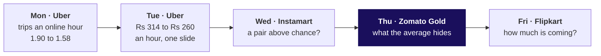

# Who is leaving Zomato Gold in Chennai, and at which step?

Week 4, Thursday. About 12 minutes to read, 10 more for the self-check.

Zomato Gold, Chennai. Gold is the food-delivery app's paid membership, with free delivery. The
membership dashboard reports month-two retention, the share of members two or more months past their
signup month who ordered in the month, as flat at 38 percent from June to September 2026, while every
signup cohort's own curve falls with age. A member with no order in a month is not retained that
month; she is still a member. On 14 September a new checkout flow shipped on Android, and members'
add-to-cart to order on Android fell from 58 to 44 percent. Illustrative case: the company is real,
the situation and the data are synthetic, built for this class.

---

## What can you do after Thursday?

- You can build a cohort's row by hand and the whole table with one `pivot_table`.
- You can take a flat blended number apart into its cohorts and rebuild it as a size-weighted average.
- You can read each funnel step over the step before in one named unit, spot a step people can skip,
  and find the step that changed by who, where and when.
- You can size a loss with its assumption ranged, and answer a partly right objection.

## Where does Thursday sit in the week?

Thursday compares a blended number with its cohorts. Censoring was only named; the
IITGN faculty session after class (tentative) takes it up.

## Which one picture holds the day?

Call it **the triangle**. Each row is a cohort, the members who joined in one calendar month, and each
column is an age, months since joining. Every row drops to about 38.5 percent in month two, then
slides about 0.3 points a month (a point is the gap between two percentages). Down the first column,
each cohort starts lower: 58 percent for January, 49 for July and 31 for August.

---

## Why can a flat average hide falling groups?

**Who needs the answer.** The membership lead, who must say on Friday whether Gold has a cohort
problem, some signup months weaker than others, or an everyone problem, every member changing at
once: a wrong call sends the fix to the wrong team.

**The questions on the way.**

- Why can one average hide two groups?
- What does each group keep, month by month?
- What does the dashboard count?
- How does a big new group hold an average up?

A coaching centre takes 10 students in June and 10 in July (invented). In each batch's second month,
6 of June's and 4 of July's come back: 10 of 20, 50 percent, neither batch's rate.

Twelve members from the case data say the same. By months since joining, May's four kept 3, 2, 1
and 1 of 4, June's three 2, 1 and 1 of 3, and the five from the August sale week 0 of 5 in month one.
Counted from month two, as the dashboard does, the card reads 2 of 7 in August and in September.

A second toy: batch A of 100 stood at 50 percent; now A is at 40, and a new batch B of 400 arrives
at 52.5 percent:

$$\frac{100 \times 0.40 + 400 \times 0.525}{500} = \frac{250}{500} = 50\%$$

A large young batch at a high early rate props the blend up while batch A falls; on the Gold
dashboard the prop is gentler.

**WATCH OUT.** Comparing cohorts in one calendar month. In September the sale-week member's month one
sits beside May's month four, and the youngest always looks best. Compare cohorts at the same age; to
look for a shock that hit everyone, read one calendar month across all of them.

**IN THE FIELD.** Eternal, which runs Zomato and Blinkit, says 46 percent of a Blinkit cohort's
customers order in the fourth quarter after joining while its net order value is 150 percent of its
first quarter's: fewer customers, more value (letter of 22 July 2026, checked 12 October 2026).

**CALLBACK.** Week 1, Thursday: Kalpa's monsoon sale lifted the total while every segment fell.

**The answer.** An average over groups of different ages names none of them: fix each entry month
first.

## What is the dashboard's 38 made of?

**Who needs the answer.** The membership lead, about to report "nothing changed": if the flat number
hides a weak August cohort, the fix waits a month too long.

**The questions on the way.**

- What does each cohort keep on all 53,089 members?
- What does the dashboard print, counted directly?
- What is September's 38 made of?
- What is outside the count?

**Two ways to build the table, and the call.** A loop over the 241,492 member-months hides the age
rule inside it; one `pivot_table`, once each row carries its age, states the rule once. The call is
the pivot; a table too big for memory would move to SQL as a `GROUP BY` on cohort and age.

Counted directly, the dashboard prints 38.2, 38.0, 37.9 and 37.8 percent from June to September,
13,218 of 35,000 in September. Its name misleads: it counts every member aged two or more, so it is no
cohort's month-two column.

**The trap, exactly.** "Month-two retention is 38 percent and flat, so nothing changed": the August
cohort gets no action, and October's drop arrives as a surprise.

**The decomposition, and the second route.** A blend is an average weighted by size, where $n_c$ is a
cohort's members and $r_c$ its rate that month:

$$\text{blend} = \frac{\sum_{c} n_c \times r_c}{\sum_{c} n_c}$$

September's seven cohorts give 13,218 orderers of 35,000, the direct count to the last digit. Each
month one more cohort of about 5,000 enters at about 38.5 percent, just above the older cohorts'
slide, so the average holds; it never sees month one, where each new cohort starts lower.

**What the count leaves out.** The August cohort, 13,000 members, is outside the September count.
Counting everyone who joined before each month, the four months read 40.9, 40.0, 39.5 and 35.9
percent. August's 4,973 organic members kept 49 percent in month one, its 8,027 sale-week members
20. If the cohort loses July's 10.5 points into month two (49 to 38.5), 31 becomes about 20.5 and
October's dashboard reads about 33 percent, 32 to 34 for anything from 17 to 24.

**WATCH OUT.** A mean of rates: the eight September rates averaged with no weights give 36.9 percent
against the true 35.9, since August's 13,000 get one vote in eight.

**IN THE FIELD.** Swiggy's users who order in a month rose 27.4 percent year on year while platform
frequency fell from 4.13 to 3.87 (letter of 30 July 2026, checked 12 October 2026): old users
ordering less, or new ones ordering little?

**ORIGIN.** A total that runs against its parts is called Simpson's paradox, after E. H. Simpson's
1951 paper, "The Interpretation of Interaction in Contingency Tables", in the Journal of the Royal
Statistical Society, Series B,
https://doi.org/10.1111/j.2517-6161.1951.tb00088.x (checked 12 October 2026);
the name came about twenty years later.

**The answer.** The 38 is a size-weighted average of cohorts at different ages, counted from month
two; each new cohort starts lower, and the weak August cohort is outside it until October.

## Which stage owns the loss?

**Who needs the answer.** The membership lead and the app team's lead, who will say the stage the
room blames is fine: blaming the wrong step sends engineers to one that works.

**The questions on the way.**

- How does a funnel read?
- Why does one step pass 100 percent?
- Per session or per member?
- Whose conversion fell, and where inside the checkout?
- What can the data not show?

**Four ways to look, and the call.** The overall rate says something fell, not where; the lowest
step, at 34 percent, is low every month; each step over the step before shows where people stop; and
that step split by membership, platform and date shows who and since when. The call: the last two.

A **session** is one visit to the app. On a toy, 100 sessions, 40 with a search, 20 with an
add-to-cart and 10 with a checkout read 40, 50 and 50 percent, and 10 of 100 from the top. If the 100
sessions came from 20 people and the 10 checkouts from 10 of them, the same checkouts read 10 of 20
people: two units, two numbers.

In September, Gold members' search to menu view reads 118 percent per session, because the home
carousel, the row of restaurants on the home screen, opens a menu with no search. The 118 is an **artefact**, a number made by the counting; among
the sessions that searched, 89 percent opened a menu. Menu view to add-to-cart reads 34 percent per
session and 61 per member, both true.

**The split.** Members on Android fell from 58 to 44 percent, about 58 for seven weeks, then 45, 43
and 44; members on iOS held at 57 to 56, non-members on Android at 52 to 51. Inside the checkout,
starting held at 80 percent of carts and completing fell from 72.5 to 55: 0.80 × 72.5 = 58 and 0.80 ×
55 = 44. On that same step, iOS members went from 71 to 70 and non-members on Android from 65 to 64.

**The trap, exactly.** "The drop is at add-to-cart to order for everyone, so the checkout is broken."
It sits in members on Android after one date; the app team is right about everywhere else.

**WATCH OUT.** A "good" retention number with no definition: Amplitude, a product-analytics vendor,
puts 7 percent of a cohort back on day seven in the top 25 percent of more than 2,600 companies, with
no method given (its blog, checked 12 October 2026).

| The doubt | The check | What it found |
|---|---|---|
| Sale-week members bought on a discount | Organic August members beside July's | 49 against 49; sale-week 20 |
| Young cohorts, few months on record | Compare only ages all have reached | Censoring, for the faculty session (tentative) |
| Exam months in one zone (hypothetical) | September by zone | No zone 0.9 points off |
| A renamed Android event | Order records against the event log | The same 27,212 September orders |
| The August cohort aged across the cut | Members who joined before August | Android 70.3 to 53.6, iOS 68.6 to 69.3 |
| Sessions against members | The unit named | 34 and 61, both true |
| Joiners order more after joining | Gold's 60 percent | They join expecting to order more |

A cut moved a week keeps the fall: it dates it, and cannot test tracking.

**IN THE FIELD.** Zomato's letter of 19 May 2023 says Gold reached 1.8 million members in Q4 FY23 and
members' order frequency rose about 60 percent after joining (checked 12 October 2026): it describes
members, with no comparison group, so it says nothing about what Gold caused.

**The answer.** Checkout start to order placed, for members on Android, since the 14 September
release: 72.5 to 55 percent.

## What is fixed first, and what does it cost?

**Who needs the answer.** The membership lead, who takes one call to Friday's review.

**The questions on the way.**

- How big is each loss?
- Which goes first, and what would reverse it?

Android members added to a cart 22,841 times in 17 days after the release. At 58 percent against 44,
that is about 1,317 orders a week if no failed cart came back; counted in orders placed, which keeps
those that did, 1,133 to 1,266, a quarter of Android members' 5,064 a week: Rs 3.4 to 6.6 lakh of
order value at Rs 300 to Rs 500 an order, of which Zomato keeps its fees. The checkout goes first: a
fix ends a weekly loss. Retention cannot see it: most members it cost an order still ordered that month.

**WATCH OUT.** Two wrong fixes: another sale, whose cohort enters the dashboard at month two and pulls
it down again, and work on search to menu view, a step that never broke.

**IN THE FIELD.** Swiggy let more than 4 million unprofitable Instamart users go, and Instamart's
one-month retention rose from 55 to 61 percent (Q1 FY27 letter, checked 12 October 2026): part of
such a rise is who remains.

**The answer.** Fix the Android checkout's last step first, about 1,133 to 1,317 orders a week; before
another sale, work out whether this one's members, at 0.23 orders each in month one against 0.61 for
an organic member, pay back their discount.

---

## Where does this show up in the work?

| Situation | The decision | What the wrong reading costs |
|---|---|---|
| A subscription app's retention review | Whether a flat number needs action | A weak cohort found late |
| A release review | Which step engineers fix first | Weeks on a step that only looked broken |

The lab meets the same questions at Kalpa Retail's Retail-Plus tier.

## Can you answer these without notes?

1. What does a cohort fix that a blended number cannot?
2. Batch A of 200 stood at 45 percent; now A is at 40 and a new batch B of 300 arrives at 52 percent.
   What does the blend read now?
3. Search to menu view reads 118 percent per session: what is it, and what replaces it?
4. Menu view to add-to-cart reads 34 percent per session and 61 per member: which goes on the chart?
5. The app team says checkout starts held at 80 percent: what do you bring?
6. From Wednesday: bread to toned milk read confidence 0.74 and lift 1.04; the verdict?

**Key.** 1: the month each member joined (the triangle). 2: (80 + 156) / 500 = 47.2 percent, up from
45 while batch A fell (the two batches). 3: a step people can skip; menu views among sessions that
searched, 89 percent (the funnel). 4: both, each with its unit named (the funnel). 5: completion fell
from 72.5 to 55 for members on Android from the release week while iOS members and non-members held
on the same step (the split). 6: chance, since milk is in 71 percent of carts (Wednesday's notes).

## Which interview questions does Thursday prepare you for?

| The question as asked | The hire-grade line, the one that gets the job |
|---|---|
| Retention dropped; walk me through your investigation. | The count, what it counts, cohorts at one age, platform and date, users against use, the step |
| Blended retention is flat while every cohort declines; how? | A new cohort enters each month just above the older ones' slide; the fall is in month one and the uncounted August |
| The app team says your stage is fine; what do you bring? | The step inside theirs, split, with comparators on the same step |
| What denominator do you ask for before trusting a cohort chart? | Per acquired user, per retained user or the total |

**The AI-company variant.** An AI writing assistant, two months after launch: counted active on a
draft kept, its launch cohort keeps 24 percent at week four against 36 for a later weekly cohort
(invented). The transcript is in `extras/`.

**The guesstimate: Delhi Metro riders on a weekday.** The Delhi Metro Rail Corporation (DMRC) counts
a "passenger journey" for each line a rider uses, so a trip with one change counts twice (Deccan
Herald, 30 August 2023). Its daily average of 64.06 lakh (The Tribune, 9 August 2026) and its record
82,44,903 "boardings" on 17 September 2026 (Republic World) look like that same count, each checked
12 October 2026: turn trips into line uses before validating.

## Which words did Thursday use?

| Term | Plain meaning | Example |
|---|---|---|
| Cohort | Members who joined in the same calendar month | The May group: 4 members |
| Blend | One rate over several cohorts, weighted by size | The dashboard's 38 |
| Retention curve | One cohort's share active at each age | January: 58, then 38.7 |
| Session | One visit to the app | 194,211 in September |
| Funnel step | Those who reached a step over those who reached the one before | Add-to-cart to checkout start: 80 percent |
| Artefact | A number made by the counting | Search to menu view: 118 percent |
| Unit | What a rate counts: sessions or members | 34 per session, 61 per member |

## Where should you read next, and how long does each take?

| Order | Source | Time |
|---|---|---|
| 1 | Mixpanel, "Cohort analysis", https://mixpanel.com/blog/cohort-analysis/ (checked 12 October 2026) | 15 minutes |
| 2 | IBM Technology, "Understanding Data Structures: Time Series, Cross-Sectional, and Panel Data Explained", https://www.youtube.com/watch?v=LoMgvSfKp6Y (checked 12 October 2026) | 12 minutes |
| 3 | Amplitude, "Funnel analysis", https://amplitude.com/blog/funnel-analysis (checked 12 October 2026) | 15 minutes |
| 4 | IBM Technology, "What is Root Cause Analysis (RCA)?", https://www.youtube.com/watch?v=7t3lTYEd_PM (checked 12 October 2026) | 9 minutes |
| 5 | pandas, "10 minutes to pandas", the reshaping section, https://pandas.pydata.org/docs/user_guide/10min.html (checked 12 October 2026) | 10 minutes |
