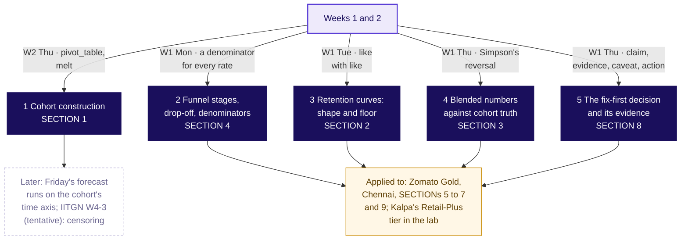
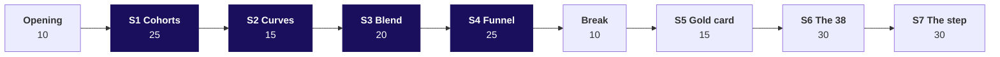

# Day sheet, Week 4 Thursday: who is leaving Zomato Gold in Chennai, and at which step?

**TRAINER ONLY.** Nothing on this page reaches a learner.

Posts to <!-- sync:module:W04/D4 -->Module 2: Applied Machine Learning<!-- /sync:module:W04/D4 -->, on <!-- sync:day-date:W04/D4 -->Thu 29 Oct 2026<!-- /sync:day-date:W04/D4 -->.

<!-- sync:faculty-day:W04/D4 -->
**IITGN faculty block W4-3 (tentative), 120 minutes, after this row's applied core.** Faculty: to be confirmed by IIT Gandhinagar.

TOPIC: Time-to-event thinking: the survival curve, censoring and the hazard, and a comparison of two retention curves.
PICKS UP WHERE THE ROW STOPS: the row builds cohorts and retention curves and stops before survival analysis and tests on retention differences.
CONNECTS TO KALPA: a Retail-Plus member who has not left yet is censored, and treating her as retained for ever flatters the curve.
BY THE END: a learner can read a survival curve, say what censoring is, and say when two retention curves really differ.
DOES NOT REPEAT: cohort construction and the funnel.
<!-- /sync:faculty-day:W04/D4 -->

Your row stops where the faculty block starts: the handoff line (half two, S81), the Kahoot (S83) and
the closing sentence (S84) are the last things you run. Do not preview the block's content; when you
mention it to the room, say it is tentative. If the block cannot run, the fallback deck fills its 120
minutes (`trainer/C2_W04_D04_fallback_note_TRAINER.md`).

Built from the Thursday row of `docs/curriculum/W4_Analyst_craft.md`, the approved Week 4 spine
(`docs/detailing/W04_analyst_craft_spine.md`, section 8, and the acceptance test in section 12), the
concept-first plan for this day (`docs/detailing/W04_concept_first/D4_plan.md`, the requester's
direction of 13 October 2026) and the Thursday case in `docs/detailing/W04_case_file.md`. The case
data and the concept chapters' invented examples are written by
`internal/C2_W04_D04_generate_INTERNAL.py` (seed 20261029), and every number below is in
`internal/C2_W04_D04_facts_INTERNAL.yaml`. Zomato Gold is real; the situation and the data are
synthetic, and every learner file says so. The gym and the college are invented.

## Which five topics does the day teach, and where?

The topics lead the morning and the case carries the day: each of the row's five subtopics is taught
first as its own chapter on an invented example, with its own notebook and drill, then applied to
Zomato Gold. This is the coverage matrix's first table (`internal/C2_W04_D04_coverage_INTERNAL.md`).

| # | Topic, as the row words it | Chapter | Slides | Notebook | Drill and Kahoot | Minutes | Applied in |
|---|---|---|---|---|---|---|---|
| 1 | Cohort construction | SECTION 1, the gym's register | half1 S6 to S12 | 01 cohort construction | c1 Q1 to Q3; Kahoot Q1 | 25 | SECTION 5 (twelve members) and SECTION 6 |
| 2 | Funnel stages, drop-off, denominators | SECTION 4, the college's admissions | half1 S27 to S34 | 04 funnel denominators | c4 Q1 to Q5; Kahoot Q2, Q5, Q7 | 25 | SECTION 7 (the event log) |
| 3 | Retention curves: shape and floor | SECTION 2, the gym's three batches | half1 S13 to S19 | 02 retention curves | c2 Q1 to Q3; Kahoot Q4 | 15 | SECTION 6 (eight curves) |
| 4 | Blended numbers against cohort truth | SECTION 3, the gym's dashboard | half1 S20 to S26 | 03 blended vs cohort truth | c3 Q1 to Q3; Kahoot Q3 | 20 | SECTION 6 (the 38 rebuilt) |
| 5 | The fix-first decision and its evidence | SECTION 8, the college's two problems | half2 S66 to S72 | 08 fix-first evidence | c5 Q1 and Q2; Kahoot Q8 | 10 | SECTION 9 (the Gold page) and the Kalpa page |

The chapters run in the order 1, 3, 4, 2 in the morning, cohorts before the curves read from them
and the blend built over them, then the funnel; topic 5 opens the afternoon, since it needs both the
cohort and the step.

## How do the five topics connect?

Draw this first and keep it up all day; light each node as its chapter ends
(`whiteboards/C2_W04_D04_board_work_STUDENT.md` has every drawing in order).

## How do the minutes move, from the row's agenda and the merged day to this one?

The row's agenda totals 225 minutes; the envelope gives the trainer 240 on a faculty day, two blocks
of 180 with the faculty block taking the afternoon's last 120. The merged day of 12 October 2026 and
the rebuilt day both run 240.

| Row agenda item | Row | Merged day | Rebuilt day, and the sections that carry it |
|---|---|---|---|
| 1. The blended retention number and the head of Retail-Plus's two questions | 10 | 10, the ticket and the board | 10, the opening: the topic, the week map, the five topics, the concept map, the ticket (the Retail-Plus questions open the lab) |
| 2. Cohort construction: who entered when, tracked forward, never blended | 50 | 50, chapter 1 | 50: SECTION 1 (25), SECTION 5 (15), SECTION 6's table (10) |
| 3. The funnel: stages, drop-off per stage, denominators, the stage that owns the loss | 45 | 65, chapter 3 | 55: SECTION 4 (25), SECTION 7 (30) |
| 4. Retention curves: shape, floor, cohort comparison; the blend decomposed | 40 | 45, chapter 2 | 55: SECTION 2 (15), SECTION 3 (20), SECTION 6's curves and blend (20) |
| 5. Guided then unguided: the cohort study and the funnel on the event log, the stage to fix first | 60 | 45: the fix-first call (30), the interview room (15) | 45: SECTION 8 (10), SECTION 9 (25), SECTION 10 (10); the guided items run inside SECTIONs 5 and 7 |
| 6. Kahoot and close | 20 | 15 | 15, SECTION 11 |
| Break | | 10 | 10, after SECTION 4 |
| Total | 225 | 240 | 240 |

## Which questions does the day ask, in the order the trainer asks them?

The day asks **is it a cohort problem or an everyone problem, which step owns the loss, and what is
fixed first?** Ask each question before its answer is shown.

| Part | Topic | Its question | The smaller questions, in order |
|---|---|---|---|
| Opening | All five | What does Thursday teach, and what is it for? | Which five topics, in what order? How do they connect? Where is the ticket going? |
| SECTION 1 | Cohort construction | Who joined when? | Which batch looks best in April? What does each batch keep at each age? Why is the table a triangle? How does code count it? |
| SECTION 2 | Retention curves: shape and floor | Where is the floor? | How fast does a batch fall? Where does it stop? When can a floor be called? Which batch is strongest, fairly? |
| SECTION 3 | Blended numbers against cohort truth | What is a blend made of? | What does February's dashboard read? What are the cohorts doing under it? What is it made of? Which quick average is wrong? |
| SECTION 4 | Funnel stages, drop-off, denominators | Which step owns a loss? | Which step owns this cycle's loss? What does each step read? Why does one pass 100? Per application or per applicant? |
| SECTION 5 | Cohort construction, applied | Who entered when? | Which causes could explain the ticket, and what tests each? What does each group of the twelve keep? What does the dashboard count? |
| SECTION 6 | Curves and the blend, applied | What is the 38 made of? | What does each cohort keep on all 53,089? What does the dashboard print? What is September's 38 made of? What is outside the count? |
| SECTION 7 | The funnel, applied | Which stage owns the loss? | Which step owns it? Why does one step pass 100? Per session or per member? Whose conversion fell, where inside the checkout? What can the data not show? |
| SECTION 8 | The fix-first decision and its evidence | What does a call carry? | Which of two problems goes first? Whom does it hurt, since when? How big, and at what cost? What answers the objection? |
| SECTION 9 | The fix-first decision, applied | What is fixed first? | How big is each loss? Which goes first, and what would reverse it? What answers the app team? |
| SECTION 10 | All five | What does a hire say? | In what order does the walk run? How does an AI product ask it? What comes after the walk? |
| SECTION 11 | All five | What does the room carry? | Which calls can the room make in seconds? What does the day close on? |

**The day's answer, said at the close (half two, S84).** "The dashboard was flat because of who it
counts: every cohort fell after month one, each newer one started lower, and the August cohort is
outside the count until October, when the dashboard reads about 33; the orders were lost in one step,
checkout start to order placed, for members on Android since 14 September, about 1,133 to 1,317
orders a week. Fix the checkout first; before another sale, work out whether this one's members pay
back their discount."

---

## What does the day start from, and where does it stop?

| | |
|---|---|
| **Start from** | Week 2 Thursday's `pivot_table` and `melt`, Week 1 Thursday's reversal (Kalpa's total rose while every segment fell; name the reversal, never its numbers, in front of the room), Monday's habit of naming a metric's denominator, Tuesday's four moves for a partly right objection, and Wednesday's "compared with what?". Open on the day's topic and the five topics, then the ticket as the destination. |
| **Go as far as** | Every learner counts a cohort's row by hand on the gym and on Gold, builds the cohort table with one `pivot_table`, calls a floor only once two ages agree, rebuilds a flat blend as a size-weighted average that lands on the direct count (250 of 500 on the gym, 13,218 of 35,000 on Gold), reads a funnel step over step in a named unit, finds the step that moved by group and date, and makes the fix-first call with its comparator and its cost. |
| **Stop before** | Survival curves, censoring beyond its name, hazard, tests of whether two curves differ and lifetime value, which the faculty block (tentative) owns; causal methods for "does Gold cause more orders", only described. |
| **Comes later** | Friday turns the cohort axis into a forecast's time axis; Week 5 defines its target on a table like today's; Saturday's paper tests the cohort, the blend, the funnel's denominators and the dispute. |
| **Cut first** | From the case chapters only: the release split's weekly view (S62's picture described, the before and after kept), then S64's last four checks to the notes, then the case drill to the lab. A concept drill that does not fit its chapter moves to the lab. Never cut a concept chapter, the blend decomposition or the Kalpa lab. |

---

## How do the morning's 180 minutes run?

| Block | Minutes | Slides | File beside them | What must land | What to cut if late |
|---|---|---|---|---|---|
| Opening | 10 | S1 to S5 | Half one | The day's question; the five topics in the row's words, each with its chapter; the concept map; the ticket as the destination | S2's week map to one sentence |
| SECTION 1, Cohort construction | 25 | S6 to S12 | Notebook 01 afterwards or in the lab; drill c1 | April's 5, 5, 6 of 10 against the ages: 8, 7, 6 at age one, March weakest; the triangle; the formula named last; one `pivot_table` | The drill moves to the lab |
| SECTION 2, Retention curves: shape and floor | 15 | S13 to S19 | Notebook 02; drill c2 | January's floor 50 from age three; February's 50 read too early; age two 60, 50, 40; March's open end | S16's churn table said in one sentence |
| SECTION 3, Blended numbers against cohort truth | 20 | S20 to S26 | Notebook 03; drill c3 | 250 of 500 holds at 50 while the older members fall 50 to 40; the weighted average; 46.25 wrong | S26's origin to one sentence |
| SECTION 4, Funnel stages, drop-off, denominators | 25 | S27 to S34 | Notebook 04; drill c4 | 80, 50, 75, 80 and 24 overall; only acceptance moved; 107 and its 77; 24 per application, 26.7 per applicant | S32's code read, not run |
| Break | 10 | | | The concept map with four nodes lit | |
| SECTION 5, Cohort construction on twelve Gold members | 15 | S35 to S44 | The case-file cards, parts 1 and 2; notebook 05; the guided set, items 1 and 2 | Five causes with a test each; May 3, 2, 1, 1 of 4; June 2, 1, 1 of 3; sale 0 of 5; the dashboard's way 2 of 7 twice | S37's sentence read, not discussed |
| SECTION 6, Retention curves and blended numbers on 53,089 members | 30 | S45 to S54, D1 | Notebook 06; reveals 1 and 2; the case drill | Every row falls; 38.2 to 37.8; 13,218 of 35,000 both ways; August outside; organic 49 against sale-week 20 | D1 stays self-study; the case drill moves to the lab |
| SECTION 7, Funnel stages, drop-off, denominators on the event log | 30 | S55 to S65 | Notebook 07; reveal 3 | The 118 and its 89; 34 per session against 61 per member; 58 to 44 on Android members only; 72.5 to 55 inside the checkout; three of the seven checks | S62's weekly picture described; S64's last four rows to the notes |

## How does the afternoon's first hour run?

| Block | Minutes | Slides | File beside them | What must land |
|---|---|---|---|---|
| SECTION 8, The fix-first decision and its evidence | 10 | S66 to S72 | Notebook 08 in the lab; drill c5 | The test waits since it never moved; other-state acceptance 87 to 50 from the deadline cut, in-state 92 to 90 beside it; 48 students, Rs 48 to 72 lakh; the objection conceded |
| SECTION 9, The fix-first decision on Zomato Gold, unguided | 25 | S73 to S77 | `exercises/unguided/C2_W04_D04_fix_first_STUDENT.md`; the role card | One page of five lines per group, the loss at about 1,133 to 1,317 orders a week with its rupee range, the app team answered with the four moves |
| SECTION 10, The interview room | 10 | S78 to S81 | `extras/C2_W04_D04_interview_STUDENT.md`; `trainer/C2_W04_D04_interview_TRAINER.md` | The walk in order; the AI variant read aloud, with no discussion; the handoff line |
| SECTION 11, Kahoot and close | 15 | S82 to S84 | `kahoot/C2_W04_D04_quiz_STUDENT.md` | The most-missed item said again with its topic; the day's sentence; the crux lines |

**The handoff line (S81).** "Your cohort table treats a member who has not left yet as if she were
retained for ever, and that flatters every curve. The next 120 minutes give that member a name,
censored, and show when two curves really differ by more than chance."

**The activity.** The case file with three reveals runs through SECTIONs 5 to 7 from
`trainer/C2_W04_D04_case_file_TRAINER.md`, whose last section is the answer-key page.

---

## Which traps does the day stage, with the exact wrong number and the check?

| Trap | The wrong number or reading | The decision it would mislead | The check | Deck | Notebook |
|---|---|---|---|---|---|
| The calendar column, on the gym | "March is our best batch: 6 of 10 came in April" | The retention offer sent to the wrong batch | Read the same age: 80, 70, 60 at age one | S7, S8 | 01, cells 3 to 10 |
| The floor called early | February's 50 after age two read as its floor | Staff planned for five regulars where three stay | Two ages in a row must agree: 30 | S17 | 02, cells 7 to 8 |
| The plain mean, on the gym | 46.25 percent, "down 3.75 points" | A fall reported that no group had | Weight by size: 250 of 500, 50 percent | S24 | 03, cells 9 to 10 |
| The lowest step, on the college | "Redesign shortlisting, it loses half" | The admissions team sent to a step that works | Compare each step with its own past: acceptance moved | S28, S29 | 04, cells 3 to 8 |
| The flat blend | "Month-two retention is 38 percent and flat, so nothing changed" | The August cohort gets no action | Take it apart: 13,218 of 35,000 rebuilt from seven cohorts; August outside the count | S48 to S51 | 06, cells 10 to 14 |
| The calendar comparison, on Gold | July "strongest" at 38.5 in September | The follow-up sent to the wrong cohort | Compare at the same age: month one 58 to 49 | S40, S41 | 05, cells 4 to 6 |
| The mean of rates, on Gold | 36.9 percent for September counting August | A number a point off, reported with confidence | Weight by size: 35.9 | S51 notes | The case drill, Q3 |
| The skippable step | Search to menu view at 118 percent, "our best step" | Engineers sent to the wrong step | Menu views among sessions that searched: 89 percent | S58 | 07, cells 3 to 5 |
| The lowest step, on Gold | Menu view to cart at 34 percent read as the loss | A redesign of browsing | A low step is a loss only when it moves | S56, S57 | 07, cell 3 |
| Everyone's checkout | "Add-to-cart to order fell, so checkout is broken for everyone" | A rollback for every platform | Split by membership, platform and date: Android members only | S61, S62 | 07, cell 9 |
| The app team's chart | Starts at 80 percent flat read as "the flow works" | The broken step left live | The step after it: 72.5 to 55 | S63, S74 | 07, cell 11 |
| The bigger count first, on the college | "Fix the test first, 200 applications never sit it" | A cycle spent on a step that never moved | The step that moved goes first | S67, S68 | 08, cells 3 to 5 and 9 |
| Before and after as cause (fallback and caveats) | Gold members order 60 percent more after joining, so Gold works | A Gold push on a selection effect | Who chooses to join: describe, do not claim cause | S64 | |

## Where are the checkpoints?

| After | The check | A room that is behind |
|---|---|---|
| S12 | Drill c1's letters posted; three learners say the gym's age-one row, 80, 70, 60, and why April misled | Recount January's row aloud from the register before SECTION 2 |
| S34 | Drill c4's letters posted; the room names the step that moved and the one only low | Point at S29's one pair of bars that differs |
| S43 | Three learners say the card's two readings: 2 of 7 the dashboard's way, 2 of 12 counting everyone | Recount September's column on the board before SECTION 6 |
| S51 | Every notebook's your-turn cell lands on 13,218 of 35,000 | Pair each stuck learner with a finished one for two minutes |
| S63 | The room says the step, the segment and the date aloud | Rebuild the split on the board from S62's three lines |
| S77 | Every group has one page with the cost and its range | The TA takes the slowest group's call to the board |

## Which plants does the lab find, and what if nobody does?

The full table is in `trainer/C2_W04_D04_lab_note_TRAINER.md`. In one line each: blended retention
near 41 percent for July, August and September (30 of 74, 36 of 88, 49 of 120); every cohort falling;
the August monsoon cohort, 32 members, weakest in month one at 26 of 32; add-to-cart to checkout at
10 of 12 before the window and 7 of 11 inside it; 31 percent of sessions with no search; September's
checkout at 7.8 percent per session and 24.5 per member. No learner file names any of them before a
learner's own cell prints it, and no concept chapter's invented number sits near one of them.

## Which numbers carry the day?

| Number | Value | Facts id |
|---|---|---|
| The gym's register (invented) | 30 joiners; January 8, 6, 5, 5, 5 of 10; February 7, 5, 3, 3; March 6, 4, 3; April's row 5, 5, 6 | toy_gym_roster |
| The gym's floors (invented) | January 50 from age three; February 30; March none yet; churn 20, 25, 16.7, 0, 0 month to month | toy_gym_curves |
| The gym's dashboard (invented) | 50 of 100, then 250 of 500; older 50 to 40; joiners 52.5; plain mean 46.25 | toy_gym_dashboard |
| The second gym (invented) | X 200 at 60 then 55; Y 300 at 40 then 36; Z 500 at 52; blend 48.0 then 47.8 | toy_second_gym |
| The college's funnel (invented) | 1,000, 800, 400, 300, 240; steps 80, 50, 75, 80; overall 24 against 28.8; 900 applicants, 26.7 | toy_college_funnel, toy_college_applicants |
| The sister programme (invented) | 320 of 300 sat the test, 107; among test-takers 230 of 300, 77 | toy_sister_programme |
| The college's two problems (invented) | Test sat 80 every cycle; acceptance 90, 90, 75; other states 86.4, 86.7, 50; in-state 92.1, 92.0, 90.0; 60 fewer acceptances, 48 fewer students; Rs 48 to 72 lakh | toy_college_by_group, toy_college_fee |
| The dashboard, June to September | 38.2, 38.0, 37.9, 37.8 percent | dashboard_jun to dashboard_sep |
| September counted | 13,218 of 35,000 | dashboard_sep_ordered, dashboard_sep_counted |
| Month one by cohort | 58, 56, 55, 53, 52, 50, 49, 31 percent | m1_jan to m1_aug |
| The August cohort | 13,000 members; 4,973 organic at 49, 8,027 sale-week at 20 | cohort_size_aug, aug_organic_members, aug_m1_organic, aug_sale_members, aug_m1_sale |
| Counting everyone, September | 17,248 of 48,000, 35.9 percent | everyone_sep_ordered, everyone_sep_counted, everyone_sep |
| Counting everyone, June to August | 40.9, 40.0, 39.5 percent | everyone_jun, everyone_jul, everyone_aug |
| October's dashboard | about 33 percent, 32 to 34 | oct_dashboard_estimate, oct_dashboard_low, oct_dashboard_high |
| The skippable step | 118 percent; 89 among sessions that searched | search_to_menu_session_sep, search_to_menu_searched_sep |
| Two units | 34 per session, 61 per member | menu_to_cart_session_sep, menu_to_cart_member_sep |
| The release split | 58 to 44 Android members; 57 to 56 iOS; 52 to 51 non-members on Android | atc_to_order_member_android_before and after, and the iOS and non-member ids |
| Inside the checkout | starts 80 to 80; completion 72.5 to 55 | android_members_cart_to_checkout_before and after, android_members_checkout_to_order_before and after |
| The same step, comparators | iOS members 71 to 70; non-members on Android 65 to 64 | checkout_to_order_member_ios_before and after, checkout_to_order_nonmember_android_before and after |
| The cohorts held fixed | Android 70.3 to 53.6; iOS 68.6 to 69.3; orders per ordering member 1.45 to 1.24 on Android | held_checkout_to_order_*, held_orders_per_active_* |
| The tracking check | 27,212 member orders in September in both the order records and the event log | order_records_sep, event_orders_sep |
| Noise and retries | 18,273 starts (under a point); 1,600 for the non-members (2.5 points); recovered within a day 36.5 then 35.1 percent of failures, 701 then 1,189 a week | android_member_starts_after, nonmember_android_starts_after, noise_points_*, retry_within_day_android_* |
| The cost | about 1,133 to 1,317 orders a week, a quarter of 5,064; Rs 3.4 to 6.6 lakh of order value | lost_orders_week_vs_nonmember_android, lost_orders_week_vs_ios, lost_orders_per_week, android_member_orders_week_before, lost_value_per_week_floor_rs, lost_value_per_week_high_rs |

## What are the interview answers, each in one breath?

- **Retention dropped; walk me through it.** The count, then what it counts, then cohort, platform
  and date, then fewer users against less use, then the step that changed, then the call with its
  cost.
- **How would you use cohort analysis?** Fix the entry month, read rows for decay and columns for each
  cohort's start, rank cohorts at the same age, call a floor only once two ages agree, and rebuild the
  blend from the cohorts.
- **Blended flat while every cohort declines; how?** A size-weighted average of cohorts at different
  ages, held by a new cohort entering at about 38.5 each month; what it misses is month one, falling
  cohort after cohort, and the uncounted August cohort.
- **The team that owns the step says it is fine.** Concede that starts held at 80; bring completion,
  72.5 to 55, for Android members from the release week, with iOS members (71 to 70) and non-members on
  Android (65 to 64) on the same step as comparators.
- **The AI-company variant.** Two months after launch, count active on a draft kept and read each
  cohort at week four: the launch cohort keeps 24 against 36 (invented), while the blended count
  stays near the record as new cohorts join.
- **Riders on the Delhi Metro on a weekday.** About 30 lakh people, about 60 lakh trips, about 75
  lakh line uses at a quarter changing lines, against DMRC's 64.06 lakh journeys a day across all
  days, which count each line used; the 82,44,903 record looks like the same count, on a bus-strike day
  (`trainer/C2_W04_D04_guesstimate_TRAINER.md`).

## Which file serves which moment?

| Moment | File |
|---|---|
| The morning | `slides/C2_W04_D04_half1_STUDENT.pptx`; notebooks 01 to 04 for the topics, 05 to 07 for the case |
| The concept drills | `exercises/unguided/C2_W04_D04_c1_cohort_construction_STUDENT.md` to `c4_funnel_denominators`, inside SECTIONs 1 to 4; `c5_fix_first_evidence` inside SECTION 8 |
| The board | `whiteboards/C2_W04_D04_board_work_STUDENT.md`, every drawing in order, opening on the concept map |
| The case file activity | `trainer/C2_W04_D04_case_file_TRAINER.md`; `whiteboards/C2_W04_D04_case_file_cards_STUDENT.md` |
| SECTION 5, with the trainer | `exercises/guided/C2_W04_D04_one_row_STUDENT.md` |
| SECTION 6's close | `exercises/unguided/C2_W04_D04_case_retention_and_blend_STUDENT.md` |
| The afternoon | `slides/C2_W04_D04_half2_STUDENT.pptx`; notebook 08; the fix-first set; `trainer/C2_W04_D04_role_card_TRAINER.md` |
| The interview room | `extras/C2_W04_D04_interview_STUDENT.md`; `trainer/C2_W04_D04_interview_TRAINER.md`; the guesstimate |
| The Kahoot | `kahoot/C2_W04_D04_quiz_STUDENT.md` |
| The lab | Notebook 12; `trainer/C2_W04_D04_lab_note_TRAINER.md`; the Kalpa set; the practice set; the Kaapi and Co. drill, `exercises/practice/C2_W04_D04_kaapi_funnel_STUDENT.md` |
| Tonight | `takehome/`, `study-notes/`, `cheatsheets/`, `preread/` |
| A missing faculty block | `slides/C2_W04_D04_fallback_STUDENT.pptx`; `trainer/C2_W04_D04_fallback_note_TRAINER.md` |
| The explorer | `content/W04/D1/demos/C2_W04_D01_week_explorer_STUDENT.html`, scenes Th1 to Th4, named in the deck notes where each is used |
