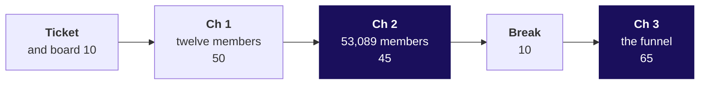

# Day sheet, Week 4 Thursday: who is leaving Zomato Gold in Chennai, and at which step?

**TRAINER ONLY.** Nothing on this page reaches a learner.

Posts to <!-- sync:module:W04/D4 -->Module 2: Applied Machine Learning<!-- /sync:module:W04/D4 -->, on <!-- sync:day-date:W04/D4 -->Thu 29 Oct 2026<!-- /sync:day-date:W04/D4 -->.

<!-- sync:faculty-day:W04/D4 -->
**IITGN faculty block W4-3 (tentative), 120 minutes, after this row's applied core.** Faculty: to be confirmed by IIT Gandhinagar.

TOPIC: Time-to-event thinking: the survival curve, censoring and the hazard, and a comparison of two retention curves.
PICKS UP WHERE THE ROW STOPS: the row builds cohorts and retention curves and stops before survival analysis and tests on retention differences.
CONNECTS TO KALPA: a Retail-Plus member who has not left yet is censored, and treating her as retained for ever flatters the curve.
BY THE END: a learner can read a survival curve, say what censoring is, and say when two retention curves really differ.
DOES NOT REPEAT: cohort construction and the funnel.
<!-- /sync:faculty-day:W04/D4 -->

Your row stops where the faculty block starts: the handoff line (half two, S45), the Kahoot and the
closing sentence are the last things you run. Do not preview the block's content; when you mention
it to the room, say it is tentative. If the block cannot run, the fallback deck fills its 120 minutes
(`trainer/C2_W04_D04_fallback_note_TRAINER.md`).

Built from the approved Week 4 spine (`docs/detailing/W04_analyst_craft_spine.md`, section 8, and
the acceptance test in section 12), the Thursday case in `docs/detailing/W04_case_file.md`, and the
Thursday row of `docs/curriculum/W4_Analyst_craft.md`. The case data is written by
`internal/C2_W04_D04_generate_INTERNAL.py` (seed 20261029), and every number below is in
`internal/C2_W04_D04_facts_INTERNAL.yaml`. Zomato Gold is real; the situation and the data are
synthetic, and every learner file says so.

## Which questions does the day ask, in the order the trainer asks them?

The day asks **is it a cohort problem or an everyone problem, which step owns the loss, and what is
fixed first?** Ask each question before its answer is shown.

| Part | Its question | The smaller questions, in order |
|---|---|---|
| The ticket | What has the analyst been handed, and what is due Friday? | Which causes could explain it, in what order, and what tests each? |
| Chapter 1 | Who entered when? | Why can one average hide two groups? What does each group keep? What does the dashboard count? How does a big new group hold an average up? |
| Chapter 2 | What is the 38 made of? | What does each cohort keep on all 53,089? What does the dashboard print? What is September's 38 made of? What is outside the count? |
| Chapter 3 | Which stage owns the loss? | How does a funnel read? Why does one step pass 100? Per session or per member? Whose conversion fell, where inside the checkout? What can the data not show? |
| The afternoon | What is fixed first? | How big is each loss? Which goes first, and what would reverse it? What answers the app team? |
| The interview room | What does the interviewer hear? | What follows up? How does an AI company ask it? |
| The close | What does the room carry out? | What does the faculty session (tentative) pick up? |

**The day's answer, said at the close (half two, S47).** "The dashboard was flat because of who it
counts: every cohort fell after month one, each newer one started lower, and the August cohort is
outside the count until October, when the dashboard reads about 33; the orders were lost in one step,
checkout start to order placed, for members on Android since 14 September, about 1,223 to 1,317
orders a week. Fix the checkout first; before another sale, work out whether this one's members pay
back their discount."

---

## What does the day start from, and where does it stop?

| | |
|---|---|
| **Start from** | Week 1 Thursday's reversal (Kalpa's total rose while every segment fell), Monday's habit of naming a metric's denominator, Tuesday's four moves for a partly right objection, and Wednesday's "compared with what?". Open on the ticket and let the room say why a flat number might hide a fall. |
| **Go as far as** | Every learner counts a cohort's row by hand, builds the cohort table with one `pivot_table`, rebuilds September's 38 as a size-weighted average that lands on 13,218 of 35,000, reads the funnel step over step in a named unit, finds the step that changed by membership, platform and date, and makes the fix-first call with its cost. |
| **Stop before** | Survival curves, censoring beyond its name, hazard, tests of whether two curves differ and lifetime value, which the faculty block (tentative) owns; causal methods for "does Gold cause more orders", only described. |
| **Comes later** | Friday turns the cohort axis into a forecast's time axis; Week 5 defines its target on a table like today's; Saturday's paper tests the cohort, the blend, the funnel's denominators and the dispute. |
| **Cut first** | The third funnel example (the toy on S29 to one spoken sentence), then the release split's weekly view (S34's picture described, the before and after kept). Never cut the blend decomposition or the Kalpa lab. |

---

## How do the morning's 180 minutes run?

| Block | Minutes | Slides | File beside them | What must land | What to cut if late |
|---|---|---|---|---|---|
| The ticket and the board | 10 | S1 to S4 | Half one; the case-file cards, part 1 | The ask in the ticket's words; each group's ordered causes with a test each | S2's map to one sentence |
| Chapter 1 | 50 | S5 to S15 | The card (cards, part 2); notebook 01; the guided set, items 1 and 2 | May 3, 2, 1, 1 of 4; June 2, 1, 1 of 3; sale 1 of 5; the dashboard's way 2 of 7 twice; the batch toy at 50 percent | S14's two cards to one sentence each |
| Chapter 2 | 45 | S16 to S26 | Notebook 02; reveals 1 and 2; the chapter 2 drill | Every row falls; 38.2 to 37.8; 13,218 of 35,000 both ways; August outside; organic 49 against sale-week 20 | S22's picture described; the drill moves to the lab |
| Break | 10 | | | The week map with "beyond the blend" under Thursday | |
| Chapter 3 | 65 | S27 to S37 | Notebook 03; reveal 3; the guided set, items 3 and 4; the chapter 3 drill | The 118 artefact and its 89; 34 per session against 61 per member; 58 to 44 on Android members only; 72.5 to 55 inside the checkout; six caveats | S29's toy to one sentence; S36's last two rows read aloud |

## How does the afternoon's first hour run?

| Block | Minutes | Slides | File beside them | What must land |
|---|---|---|---|---|
| The fix-first call, unguided | 30 | S38 to S42 | `exercises/unguided/C2_W04_D04_fix_first_STUDENT.md`; the role card | One page of five lines per group, the loss at about 1,317 orders a week with its rupee range, the app team answered with the four moves |
| The interview room | 15 | S43 to S45 | `extras/C2_W04_D04_interview_STUDENT.md`; `trainer/C2_W04_D04_interview_TRAINER.md` | The walk in order; the AI variant read at week four; the handoff line |
| Kahoot and close | 15 | S46 and S47 | `kahoot/C2_W04_D04_quiz_STUDENT.md` | The most-missed item said again; the day's sentence |

**The handoff line (S45).** "Your cohort table treats a member who has not left yet as if she were
retained for ever, and that flatters every curve. The next 120 minutes give that member a name,
censored, and show when two curves really differ by more than chance."

**The activity.** The case file with three reveals runs all morning from
`trainer/C2_W04_D04_case_file_TRAINER.md`, whose last section is the answer-key page.

---

## Which traps does the day stage, with the exact wrong number and the check?

| Trap | The wrong number or reading | The decision it would mislead | The check | Deck | Notebook |
|---|---|---|---|---|---|
| The flat blend | "Month-two retention is 38 percent and flat, so nothing changed" | The August cohort gets no action | Take it apart: 13,218 of 35,000 rebuilt from seven cohorts; August outside the count | S20 to S23 | 02, cells 10 to 14 |
| The calendar comparison | July "strongest" at 38.5 in September | The follow-up sent to the wrong cohort | Compare at the same age: month one 58 to 49 | S8, S9 | 01, cells 6 to 8 |
| The mean of rates | 36.9 percent for September counting August | A number a point off, reported with confidence | Weight by size: 35.9 | S23 notes | The chapter 2 drill, Q3 |
| The skippable step | Search to menu view at 118 percent, "our best step" | Engineers sent to the wrong step | Menu views among sessions that searched: 89 percent | S30 | 03, cells 3 to 5 |
| The lowest step | Menu view to cart at 34 percent read as the loss | A redesign of browsing | A low step is a loss only when it moves | S28, S29 | 03, cell 3 |
| Everyone's checkout | "Add-to-cart to order fell, so checkout is broken for everyone" | A rollback for every platform | Split by membership, platform and date: Android members only | S33, S34 | 03, cell 9 |
| The app team's chart | Starts at 80 percent flat read as "the flow works" | The broken step left live | The step after it: 72.5 to 55 | S35, S39 | 03, cell 11 |
| Before and after as cause (fallback and caveats) | Gold members order 60 percent more after joining, so Gold works | A Gold push on a selection effect | Who chooses to join: describe, do not claim cause | S36 | |

## Where are the checkpoints?

| After | The check | A room that is behind |
|---|---|---|
| S11 | Three learners say the card's two readings: 2 of 7 the dashboard's way, 3 of 12 counting everyone | Recount September's column on the board before chapter 2 |
| S23 | Every notebook's your-turn cell lands on 13,218 of 35,000 | Pair each stuck learner with a finished one for two minutes |
| S35 | The room says the step, the segment and the date aloud | Rebuild the split on the board from S34's three lines |
| S42 | Every group has one page with the cost and its range | The TA takes the slowest group's call to the board |

## Which plants does the lab find, and what if nobody does?

The full table is in `trainer/C2_W04_D04_lab_note_TRAINER.md`. In one line each: blended retention
near 41 percent for July, August and September (30 of 74, 36 of 88, 49 of 120); every cohort falling;
the August monsoon cohort, 32 members, weakest in month one at 26 of 32; add-to-cart to checkout at
10 of 12 before the window and 7 of 11 inside it; 31 percent of sessions with no search; September's
checkout at 7.8 percent per session and 24.5 per member. No learner file names any of them before a
learner's own cell prints it.

## Which numbers carry the day?

| Number | Value | Facts id |
|---|---|---|
| The dashboard, June to September | 38.2, 38.0, 37.9, 37.8 percent | dashboard_jun to dashboard_sep |
| September counted | 13,218 of 35,000 | dashboard_sep_ordered, dashboard_sep_counted |
| Month one by cohort | 58, 56, 55, 53, 52, 50, 49, 31 percent | m1_jan to m1_aug |
| The August cohort | 13,000 members; 4,973 organic at 49, 8,027 sale-week at 20 | cohort_size_aug, aug_organic_members, aug_m1_organic, aug_sale_members, aug_m1_sale |
| Counting everyone, September | 17,248 of 48,000, 35.9 percent | everyone_sep_ordered, everyone_sep_counted, everyone_sep |
| Counting everyone, June to August | 40.9, 40.0, 39.5 percent | everyone_jun, everyone_jul, everyone_aug |
| October's dashboard | about 33 percent, 32 to 34 | oct_dashboard_estimate, oct_dashboard_low, oct_dashboard_high |
| The skippable step | 118 percent; 89 among sessions that searched | search_to_menu_session_sep, search_to_menu_searched_sep |
| Two units | 34 per session, 61 per member | menu_to_cart_session_sep, menu_to_cart_member_sep |
| The release split | 58 to 44 Android members; 57 to 56 iOS; 52 to 51 non-members on Android | atc_to_order_member_android_before and after, and the iOS and non-member ids |
| Inside the checkout | starts 80 to 80; completion 72.5 to 55 | android_members_cart_to_checkout_before and after, android_members_checkout_to_order_before and after |
| The same step, comparators | iOS members 71 to 70; non-members on Android 65 to 64 | checkout_to_order_member_ios_before and after, checkout_to_order_nonmember_android_before and after |
| The cohorts held fixed | Android 70.3 to 53.6; iOS 68.6 to 69.3; orders per ordering member 1.45 to 1.24 on Android | held_checkout_to_order_*, held_orders_per_active_* |
| The tracking check | 27,212 orders in September in both the order records and the event log | order_records_sep, event_orders_sep |
| Noise and retries | 18,273 starts (under a point); 1,600 for the non-members (2.5 points); retries 36.5 then 35.1 percent | android_member_starts_after, nonmember_android_starts_after, noise_points_*, retry_within_day_android_* |
| The cost | about 1,223 to 1,317 orders a week, a quarter of 5,064; Rs 3.7 to 6.6 lakh of order value | lost_orders_per_week_netted, lost_orders_per_week, android_member_orders_week_before, lost_value_per_week_netted_low_rs, lost_value_per_week_high_rs |

## What are the interview answers, each in one breath?

- **Retention dropped; walk me through it.** The count, then what it counts, then cohort, platform
  and date, then fewer users against less use, then the step that changed, then the call with its
  cost.
- **Blended flat while every cohort declines; how?** A size-weighted average of cohorts at different
  ages, held by a new cohort entering at about 38.5 each month; what it misses is month one, falling
  cohort after cohort, and the uncounted August cohort.
- **How would you use cohort analysis?** Fix the entry month, read rows for decay and columns for each
  cohort's start, rebuild the blend from the cohorts.
- **The app team says your stage is fine.** Concede that starts held at 80; bring completion, 72.5 to
  55, for Android members from the release week, with iOS members (71 to 70) and non-members on
  Android (65 to 64) on the same step as comparators.
- **The AI-company variant.** Two months after launch, count active on a draft kept and read each
  cohort at week four: the launch cohort keeps 24 against 36 (invented), while the blended count
  stays near the record as new cohorts join.
- **Riders on the Delhi Metro on a weekday.** About 30 lakh people, about 60 lakh trips, about 75
  lakh line uses at a quarter changing lines, against DMRC's 64.06 lakh journeys a day across all
  days, which count each line used; the 82,44,903 record is the same count on a bus-strike day
  (`trainer/C2_W04_D04_guesstimate_TRAINER.md`).

## Which file serves which moment?

| Moment | File |
|---|---|
| The morning | `slides/C2_W04_D04_half1_STUDENT.pptx`; notebooks 01 to 03 |
| The case file activity | `trainer/C2_W04_D04_case_file_TRAINER.md`; `whiteboards/C2_W04_D04_case_file_cards_STUDENT.md` |
| Chapter 1 and chapter 3, with the trainer | `exercises/guided/C2_W04_D04_one_row_STUDENT.md` |
| Chapter 2's drill | `exercises/unguided/C2_W04_D04_ch2_curves_STUDENT.md` |
| Chapter 3's drill | `exercises/unguided/C2_W04_D04_ch3_funnel_STUDENT.md` |
| The afternoon | `slides/C2_W04_D04_half2_STUDENT.pptx`; the fix-first set; `trainer/C2_W04_D04_role_card_TRAINER.md` |
| The interview room | `extras/C2_W04_D04_interview_STUDENT.md`; `trainer/C2_W04_D04_interview_TRAINER.md`; the guesstimate |
| The Kahoot | `kahoot/C2_W04_D04_quiz_STUDENT.md` |
| The lab | Notebook 04; `trainer/C2_W04_D04_lab_note_TRAINER.md`; the Kalpa set; the practice set |
| Tonight | `takehome/`, `study-notes/`, `cheatsheets/`, `preread/` |
| A missing faculty block | `slides/C2_W04_D04_fallback_STUDENT.pptx`; `trainer/C2_W04_D04_fallback_note_TRAINER.md` |
| The explorer | `content/W04/D1/demos/C2_W04_D01_week_explorer_STUDENT.html`, scenes Th1 to Th4, named in the deck notes where each is used |
