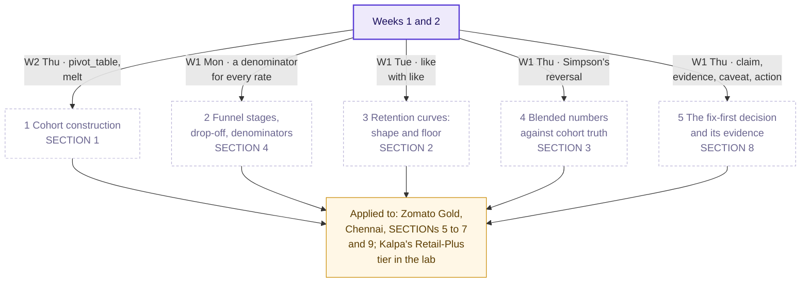
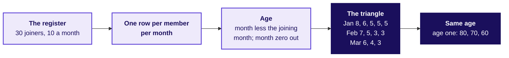
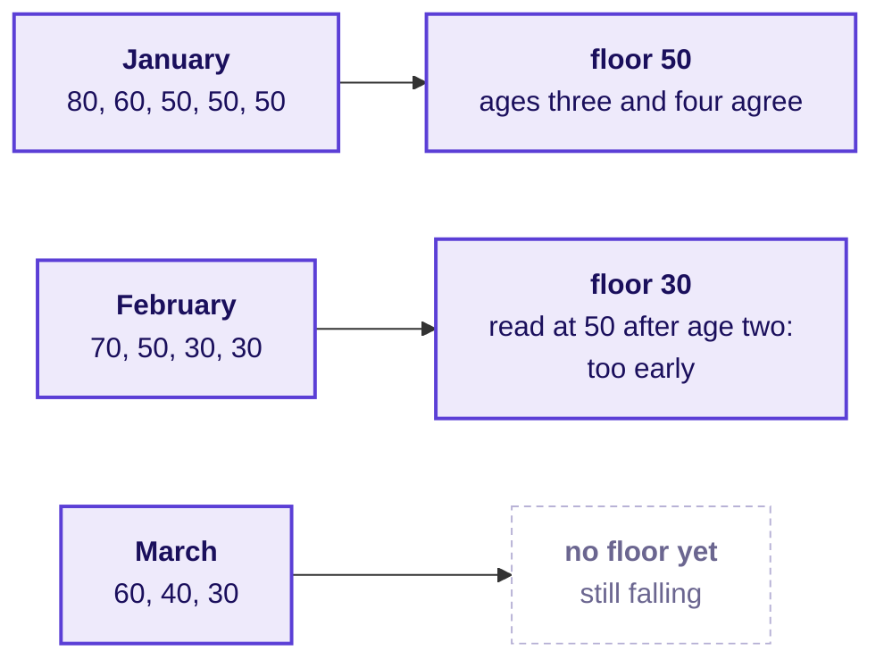
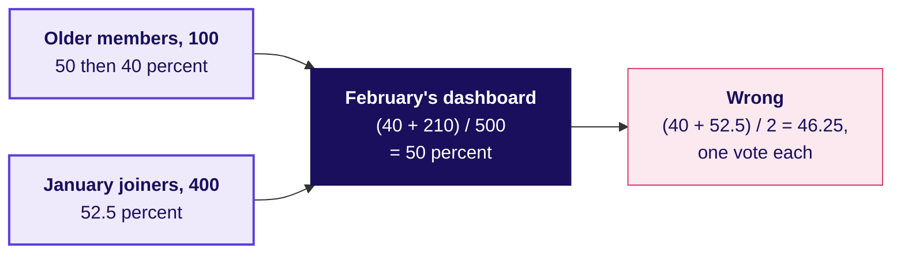
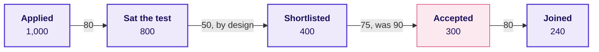
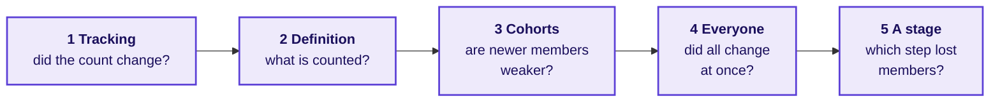
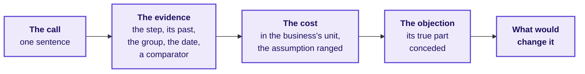
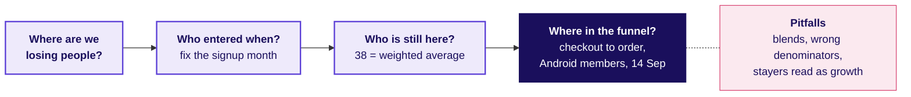

# What goes on the board on Thursday, and in what order?

*Illustrative case: the company is real, the situation and the data are synthetic, built for this class. The gym and the college are invented.*

Zomato Gold, Chennai. The membership dashboard reads month-two retention flat at 38 percent from June
to September 2026 while every signup cohort falls with age, and since a new Android checkout shipped
on 14 September, members' add-to-cart to order on Android has fallen from 58 to 44 percent. The
membership lead asks, by Friday: is it a cohort problem or an everyone problem, which funnel stage
owns the loss, and what is fixed first?

**Who needs the answer.** The trainer, who draws these in order, and you, if you missed a drawing or
want to redraw the board from memory before Friday.

**The questions on the way.** Each heading below asks the question one drawing answers, in the order the drawings go up, and the last asks what stays on the board at the end.

---

## How do the day's five topics connect?

Goes up first and stays up all day. Each topic's node is lit when its chapter ends; the applied node
is lit as the case begins.

---

## Cohort construction: what does each batch keep at each age?

Goes up during SECTION 1, counted aloud from the gym's register, one row at a time.

---

## Retention curves: shape and floor: where does each curve stop falling?

Goes up during SECTION 2, beside the triangle, so that each curve is read as a row of it.

---

## Blended numbers against cohort truth: what is February's 50 made of?

Goes up during SECTION 3: the dashboard's one number first, then the two cohorts under it.

---

## Funnel stages, drop-off, denominators: which step owns the college's loss?

Goes up during SECTION 4, each step divided aloud by the step before.

---

## Which causes could explain the Gold ticket, and what tests each?

Goes up after the break, as SECTION 5 opens the case: the groups' boards, gathered into one.

---

## What is Gold's 38 made of, and where is the loss?

Goes up through SECTIONs 6 and 7, under the five causes, one region at a time.

---

## What does a fix-first page carry?

Goes up in SECTION 8 on the college and is filled again for Gold in SECTION 9.

---

## What is on the board when the day ends?

The concept map with all five topics lit, the three regions answered under the five causes, and the
call for Gold in one line: fix the Android checkout's last step first, about 1,133 to 1,317 orders a
week; before another sale, work out whether the sale-week members, at 0.23 orders each in month one
against 0.61 for an organic member, pay back their discount.

