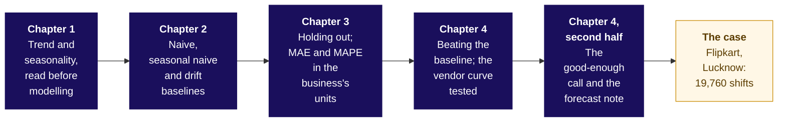

# Forecasting basics: how much does the plan deliver, and how wrong could it be?

Week 4 Friday. Five topics on a chai stall at a hostel gate (invented), then Flipkart's Lucknow fulfilment centre, where the planner books packer shifts for the eight weeks beginning 12 October to 30 November 2026 between a vendor's plus 22 percent and finance's plus 4. Illustrative case: the company is real, the situation and the data are synthetic, built for this class.

## Panel 1: How do the five topics connect, and where does the case use them?

**Crux:** Read the shape, copy it, score the copy on periods it never saw, keep only what beats the copy, and stop when nothing better would change the order.

## Panel 2: Trend and seasonality, read before modelling: what does a series tell?

- A **season** repeats on a fixed beat, up or down; its **length** is the periods before it repeats: 7 days at the invented stall, 52 weeks at Flipkart.
- Read growth at the same point a season apart: a week apart shows a week's change; Monday 110 against 100 a year earlier is 10 percent a year; Monday over Sunday, 100 over 60, is the beat.
- At the stall (invented) the exam fortnight runs about 1.4 times an ordinary one, Diwali week about 0.4; a yearly copy's misses have a typical size of about 4.7 cups.
- `y = T + S + R` when the seasons keep their size; `y = T x S x R` when they grow with the level.

**Crux:** Name the beat and its length before any rule; at Lucknow, about 4 percent a year and a festive peak.

## Panel 3: Naive, seasonal naive and drift baselines: when does a copy fail?

| Rule | Copies | The invented stall's next Sunday | At Lucknow |
|---|---|---|---|
| Naive | the last value, `y[T]` | 103 | the week of 22 June |
| Seasonal naive | one season back, `y[T+h-m]`, h up to m | 61, against 60 sold | the house bot, m = 52 |
| Drift | the line extended, `y[T] + h x (y[T] - y[1]) / (T - 1)` | about 104.7 | a step of 70 a week |
| Festival-aligned | the same distance from last year's festival | Diwali's worst miss 13, not 71 | this programme's extension |

**Crux:** On a strong beat the plainest copy that respects it wins; a calendar copy fails when the festival moves.

## Panel 4: Holding out; MAE and MAPE in the business's units: how is a forecast scored?

- Hide the latest periods, at least as many as the horizon: the stall's (invented) days 12 to 14 from day 11; Lucknow's 13 weeks from 22 June 2026, the plan reaching ten weeks past the data.
- MAE averages the misses' sizes, in the unit the cost is in: the stall's 5.0 cups; MAPE in percent, 4.8, explodes near zero and pulls a rule low.
- A miss here is forecast minus sold; the textbook writes sold minus forecast, so its signs flip.
- Keep the **lean**, the signed average: -1.7 cups, running low. Price it: Rs 150 at Rs 12 short and Rs 6 unsold.
- Same MAE, different rupees: +10, +10 costs Rs 120; +10, -10 costs Rs 180.

**Crux:** Fix the measure before scoring, in the business's unit, and report the size and the direction together.

## Panel 5: Beating the baseline and the good-enough call: when does a forecast earn trust?

- Fit is closeness on seen periods: the stall's (invented) curve fits four days with an error of 0 and misses day 5 by 66.
- The nephew's mean (invented) scores 12.4 cups on hidden days against the seasonal naive's 4.0: it earns no place.
- Good enough is a claim about the decision: improve only while the change is worth the work; the seasonal naive already orders the cans a perfect forecast would.
- The note: the number, the method, the error bar in the unit and in rupees, what would make it wrong.

**Crux:** Nothing goes to the order unless it beats the seasonal naive on hidden periods by enough to pay for itself.

## Panel 6: The case: where does the peak fall, and how many shifts?

| On 13 hidden weeks | MAE | Misses priced |
|---|---|---|
| Festival-aligned | 6,615 | Rs 13.5 lakh |
| Seasonal naive, the house bot | 9,831 | Rs 30.5 lakh |
| Vendor's curve, fitted within 1.4 percent | 16,400 | Rs 11.9 lakh, cheapest only at Rs 25 a late shipment |

The plan books festival-aligned's forecast over 120 a shift, rounded up: 19,760 shifts, 3,625 in the week of 19 October. Error bar: a typical miss of 6,615 shipments a week, about Rs 35,800 if high, Rs 1.65 lakh if low; at the peak the hidden weeks' range means 3,413 to 3,906 shifts. On 2025's festival, with no growth, it missed by 10,575. Beyond the row: the plan quantile, planning to cover 0.82 of weeks, raises it to 20,275.

**Crux:** Copy by distance from Diwali, score on hidden weeks, price both directions, book in whole shifts.

## Panel 7: What does the interviewer listen for?

[S] "How do you evaluate a forecast?" Hold out the latest weeks, as many as the horizon; score in shipments and rupees against the seasonal naive; back-test a festival, since the hidden weeks hold none. [F] "What baseline must any forecast beat, and why?" Naive with no season, the seasonal naive with one, plus growth when it trends: a free copy. [F] "A vendor promises 22 percent growth; how do you test it?" Read the 22 against the same weeks, score its curve on weeks it never saw, and ask for its festival record. Tags: [S] asked everywhere, [F] frequent in GCC and product screens.

**Crux:** Name the hidden weeks, the unit, the copy to beat and the direction that costs more.
