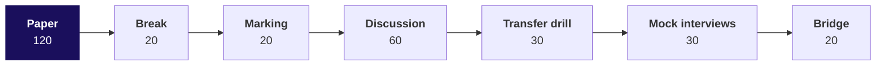

# What should you bring to Saturday, when the week's five methods move to other companies?

Read this on the Friday evening of Week 4: about 10 minutes of reading and two checks to run, so that
Saturday can start on its paper from the first minute.

---

## What does Saturday run, and for how long?

| Part | Minutes | What happens |
|---|---|---|
| The recap paper | 120 | Pen and paper, no AI tools, ungraded: the week's ideas asked the way interviews ask them |
| Break | 20 | |
| Marking | 20 | Papers swapped and marked against the key, read out by the Academic TA |
| The solution discussion | 60 | The most-missed items first, then the week's interview questions answered aloud, with random call-outs |
| The spoken transfer drill | 30 | One-paragraph briefs, one per pair of groups: each day's method at another company the room uses, then at Kalpa's units |
| The mock-interview round | 30 | In pairs, on the week's interview transcripts and scorecards |
| Doubts and the bridge | 20 | What Week 5 picks up |

---

## Which questions will Saturday ask aloud?

These are Saturday's subtopics as the curriculum words them: nine interview anchors, asked in the
solution discussion and the mock-interview round. Read them tonight as questions; the answers are
Saturday's work.

- [S] How would you measure the success of a new feature? Walk your metric design.
- [F] North-star against guardrail, with one example pair.
- [S] Support, confidence, lift: which cannot be fooled by popularity, and why?
- [S] Retention dropped: walk me through your investigation.
- [F] Blended retention is flat while every cohort declines; how?
- [S] What baseline must any forecast beat before it earns trust?
- [F] A pair has lift 4 and support 0.3 percent; act or not?
- [D] Kalpa Financial Services asks 'which customers should we nudge first'; say what stays the same in your method and what changes.
- [D] Two forecasts, eighteen points apart; choose one for the board and present its error.

The tags: [S] a staple asked everywhere, [F] frequent in GCC and product screens, [D] a
differentiator.

| Term in the anchors | What it means, as the week used it |
|---|---|
| North-star, guardrail | The one number a team steers by; the number beside it that must not get worse |
| Support, confidence, lift | How often a pair is bought; how often the second follows the first; that against chance |
| Cohort, blend | A group that joined in the same month; the average across groups of different sizes |
| Baseline | The simplest rule that could be right, which a forecast must beat on periods it never saw |

---

## Which line from each day should you be able to say without notes?

| Day | The case | The line to carry |
|---|---|---|
| Monday | Uber in Hyderabad: trips per peak online hour fell from 1.9 to 1.6 | A scheme gets what it pays for, so pay for the number that measures what you want and set a guardrail beside it |
| Tuesday | Uber in Hyderabad: gross bookings per peak online hour fell from Rs 314 to Rs 260 | The answer goes first, on one slide a person who loses by it can repeat accurately |
| Wednesday | Instamart in Pune: the strip fell from 6.1 to 3.8 percent click-through | A pair earns a slot by beating chance on enough carts, priced in rupees |
| Thursday | Zomato Gold in Chennai: Android add-to-cart to order fell from 58 to 44 percent | A flat blend can hide every group falling, so split by group and by step |
| Friday | Flipkart in Lucknow: festive shifts, with forecasts 18 percentage points apart | A forecast earns the plan by beating a copy of last year on weeks it never saw, priced by direction |

If a line would not come out, re-read that day's cheat sheet before Saturday.

---

## What will the transfer drill ask of every answer?

Each brief moves one day's method to a business it was not built for. A strong answer names three
things that changed, the metric, the constraint and the cost of an error, and says what stayed the
same, which is the method. An answer that only renames the company has not moved anything.

**One question to think about tonight.** Friday's method planned packer shifts against a festival
that moves each year. Pick any business you use that has a yearly peak on a moving date. Which week
would its peak fall in this year, which copy of last year would put it in the wrong week, and which
error costs that business more, too much capacity or too little? Bring the answer as two sentences.

---

## What should you check in your Codespace tonight?

Nothing needs installing, and each check takes under five minutes.

1. Run Restart and Run All on Friday's eight notebooks, 01 to 08. Each ends on its checks passing,
   and if one does not, post its last error line in the cohort channel before Saturday.
2. Save your take-home notebook with its outputs showing, since a notebook that ran but was not saved
   looks empty to everyone else.

---

## Which line, with its number, is worth carrying into Saturday?

> Every number this week was compared with something: a denominator, a slide's ask, chance, a group,
> and a copy of last year, which festival-aligned beat on hidden weeks by missing 6,615 shipments a
> week against the house bot's 9,831.
