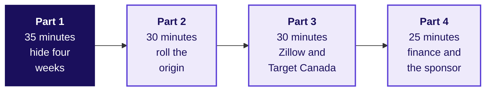
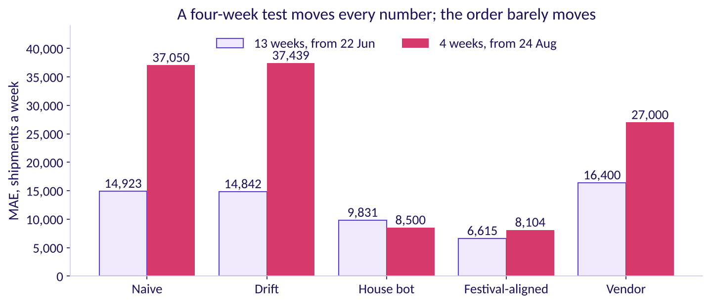
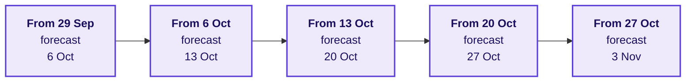
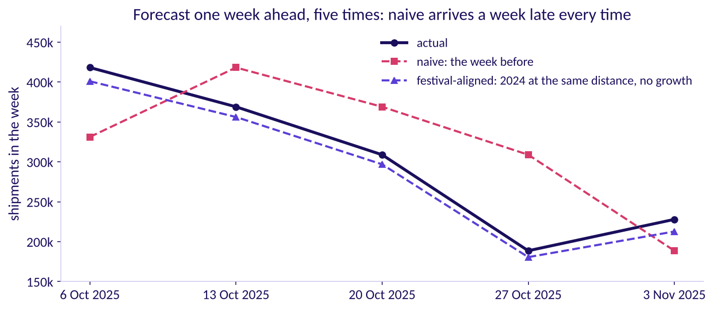

# Flipkart Lucknow: the rolling-origin hour

Week 4, Day 5. Fallback.

Header: WEEK 4  ·  FRIDAY  ·  FLIPKART, LUCKNOW  ·  FALLBACK

---

## S1. Four parts, each testing the morning's choice
*What runs in the next 120 minutes, and in what order?*



This hour runs only if the IITGN faculty session W4-4 (tentative) does not run. Illustrative case: the company is real, the situation and the data are synthetic, built for this class.

```notes
LIVE, 2 minutes, on screen only if the faculty session (tentative) slips. Nothing here teaches
autocorrelation, smoothing or ARIMA: the faculty session (tentative) owns them. Read the four parts.
Each ends on one line a group writes down. Transition:
part 1.
```

---

## S2. Hide four weeks, forecast from 24 August
*What do the rules score when only the last four weeks are hidden?*



Festival-aligned and finance's rule still lead and the house bot stays next, while naive and drift fall below the vendor; every number moves a great deal. The four-week test rests on four misses and on one origin week.

```notes
LIVE, 10 minutes. Groups run notebook 02 with the split moved to 24 August 2026, or read this table.
The vendor's four weeks are its old forecast, made from 22 June, so they are its farthest weeks
ahead. Transition: why naive moved most.
```

---

## S3. Why did naive jump from 14,923 to 37,050?
*What, in the four-week test, made naive's average miss more than double?*

```cards
icon: list | eyebrow: a | title: The last four weeks are harder | body: September ships more than July. | tone: light
icon: list | eyebrow: b | title: The origin week was a dip | body: The week of 24 August shipped 196,600. | tone: light
icon: list | eyebrow: c | title: Four weeks are too few to average | body: Any one miss moves the mean. | tone: light
icon: list | eyebrow: d | title: Naive ignores growth | body: It never adds the 4 percent. | tone: light
```

```notes
LIVE, 4 minutes. Vote, argue for one minute, vote again. a and c are partly true; b is the cause.
Transition: the answer.
```

---

## S4. Answer: the origin week was a dip, 196,600
*How does one origin week set every naive miss?*

```stats
value: 196,600 | label: the week of 24 August 2026 | note: the origin naive repeats four times
value: 41,800 | label: its first miss, too low | note: then 37,100, 33,700 and 35,600, all too low
value: 37,050 | label: naive's MAE on four weeks | note: against 14,923 on thirteen
```

A short test judges the origin as much as the rule. All four of naive's misses are too low, so its MAE is the gap between the dip and the four weeks' average, 233,650. The thirteen-week test started from 218,300, close to its hidden weeks' average of 217,746: luck in the other direction.

```notes
LIVE, 5 minutes. Show the four misses on the board. The house bot and festival-aligned barely move
because they copy last year's weeks and ignore the origin. Transition: the rule this proves.
```

---

## S5. A test shorter than the horizon judges too little
*Why must the hidden weeks reach at least as far ahead as the plan does, ten weeks?*

```cards
icon: ruler | eyebrow: The rule | title: At least as long as the horizon | body: The plan's last week is ten weeks past the data, so the test must reach ten weeks ahead; four cannot (FPP3, section 5.8, checked 12 October 2026). | tone: dark
icon: trending-up | eyebrow: The vendor | title: Its gap grows with the weeks ahead | body: 148 percent worse than festival-aligned on thirteen weeks, 233 percent on its four farthest. | tone: light
icon: shuffle | eyebrow: The luck | title: One origin can flatter or punish | body: A rule that looked fine from 22 June looks poor from 24 August. | tone: light
```

```notes
LIVE, 6 minutes. Each group writes one line: what a four-week test would have let the vendor's
sponsor claim. Transition: part 2, rolling the origin.
```

---

## S6. Roll the origin: one week ahead, five times
*What does a rolling origin show that one hidden block cannot?*



Each forecast is made from the week before and scored, then the origin moves on one week. The twelve rows hold five such steps in 2025: from 29 September to 27 October, forecasting the week after each.

```notes
LIVE, 4 minutes. This is the rolling-origin picture of FPP3's section 5.10 (checked 12 October
2026), on the twelve printed rows. Groups work it by hand. Transition: the five forecasts.
```

---

## S7. Five one-week forecasts, worked by hand
*What do naive and festival-aligned forecast one week ahead through 2025's festival?*

| Week forecast | Naive: the week before | Naive's miss | Festival-aligned | Its miss |
|---|---|---|---|---|
| 6 Oct 2025 | 331,200 | 87,000 too low | 417,040 | 1,160 too low |
| 13 Oct 2025 | 418,200 | 49,200 too high | 370,448 | 1,448 too high |
| 20 Oct 2025 | 369,000 | 60,100 too high | 308,776 | 124 too low |
| 27 Oct 2025 | 308,900 | 120,300 too high | 187,824 | 776 too low |
| 3 Nov 2025 | 188,600 | 39,300 too low | 221,208 | 6,692 too low |

```notes
LIVE, 10 minutes. Each group takes one row and calls out its two misses. Festival-aligned copies
2024's week at the same distance from Diwali, plus 4 percent. Transition: the vote.
```

---

## S8. Which rule swings most through the festival?
*Over the five one-week forecasts, whose average miss is larger, and by how much?*

```cards
icon: list | eyebrow: a | title: Naive, by about ten times | body: The week before is a poor guide when weeks change fast. | tone: light
icon: list | eyebrow: b | title: Naive, by about thirty-five times | body: Every festive week differs sharply from the last. | tone: light
icon: list | eyebrow: c | title: Festival-aligned, narrowly | body: Copying 2024 adds 2024's own noise. | tone: light
icon: list | eyebrow: d | title: A tie: one week ahead, both are close | body: A week is short. | tone: light
```

```notes
LIVE, 3 minutes. Groups add their row's misses to the board first. Transition: the answer.
```

---

## S9. Answer: naive, by about thirty-five times
*What does the rolling origin say about naive near a festival?*



Naive's five misses average 71,180 a week and festival-aligned's 2,040. Near a festival the week before is a poor guide, because the weeks change sharply; last year's week at the same distance from Diwali is a good one.

```notes
LIVE, 3 minutes. 71,180 over 2,040 is about thirty-five: b was the closest option. Transition:
part 3, two real failures.
```

---

## S10. Zillow: a forecast's error outran its guardrail
*What did Zillow's forecasting miss cost, and which guardrail failed?*

| | Zillow Offers, 2021 (Zillow's Q3 2021 shareholder letter, checked 12 October 2026) |
|---|---|
| The forecast | Home prices three to six months ahead, to buy homes and resell them |
| The guardrail | Public targets of plus or minus 200 basis points, 2 percentage points, of breakeven unit economics: what Zillow made or lost on each home it resold was meant to stay near zero |
| The miss | Price forecasts missed in both directions by far more than Zillow had modelled, and unit economics swung about 1,200 basis points, 12 percentage points, from Q2 to an expected minus 500 to minus 700 basis points in Q4 2021; more offers were accepted than planned, and renovation capacity ran short |
| The cost | A write-down of about USD 304 million on homes bought above what they would now sell for; Zillow wound the business down and cut about 25 percent of its workforce |

```notes
LIVE, 10 minutes. The guardrail sat on the margin, and the price forecast's error at a six-month
horizon was wider than the whole band; Zillow did stop, by winding the business down. Groups name
the Lucknow equivalent: a cushion thinner than the forecast's error at the plan's horizon.
Transition: Target Canada.
```

---

## S11. Target Canada: a forecast with no history
*What did Target's buyers have to forecast with in Canada?*

| | Target Canada, 2013 to 2015 (Target's release of 15 January 2015 and Canadian Business, checked 12 October 2026) |
|---|---|
| The decision | Target announced on 15 January 2015 that it would close all 133 Canadian stores, about 17,600 employees |
| The forecasting failure | Its forecasting and replenishment system needed years of sales history the new stores did not have, so buyers used optimistic projections from headquarters, and the item data feeding it was right about 30 percent of the time |
| What followed | Distribution centres overflowed while shelves sat barely stocked |

```notes
LIVE, 10 minutes. The forecasting account is Canadian Business's, through the archived copy the
research ledger cites. The Lucknow version: a vendor model with no Lucknow festival in its record.
Transition: the two side by side.
```

---

## S12. Two failures, and their Lucknow versions
*Which check in today's plan would have caught each failure?*

| The failure | The Lucknow version | The check that catches it |
|---|---|---|
| Zillow: a forecast's error wider than its margin guardrail | The vendor's curve, high on 12 of 13 hidden weeks and climbing | Size the forecast's miss at the plan's horizon, and compare it with the cushion before booking |
| Target Canada: a forecast with no history | A vendor model never scored on a Lucknow festival | Score it on 2025's festival from data to September 2025 before it books a shift; with no history at all, size from the ground up and keep capacity that can stretch |

```notes
LIVE, 10 minutes. Each group writes the check in one line. Transition: part 4, the second
transcript.
```

---

## S13. [D] Finance and the sponsor each want theirs
*How does a candidate choose between two stakeholders' forecasts and present the error? [D] tags a differentiator, a question that separates strong candidates.*

| A weak answer | A hire-grade answer |
|---|---|
| "I would go with the vendor, trimmed toward finance: plus 13 percent." | "I would score both on weeks neither saw, against a copy of last year, in shipments and in rupees." |
| Picks the more senior stakeholder's number | Concedes what is true in each: finance's growth, the vendor's tilt to the cheap side |
| Gives one number with no range | Gives the plan, its error bar in each direction, and what would change it |

```notes
LIVE, 15 minutes. Pairs play the planner and one stakeholder, then swap. The full [D] transcript is
in `extras/C2_W04_D05_interview_transcripts_STUDENT.md`. Transition: the close.
```

---

## S14. Close: the rule that holds without the session
*What survives this hour, whether or not the faculty session (tentative) runs?*

```cards
icon: ruler | eyebrow: The test | title: As long as the plan | body: Hide at least as many weeks as the plan books, from one origin. | tone: light
icon: calendar | eyebrow: The festival | title: Copy by distance from Diwali | body: One week ahead, naive missed by 71,180 through the festival. | tone: light
icon: badge-check | eyebrow: The plan | title: Beat the bot, then price it | body: Nothing books a shift until it beats a copy of last year on hidden weeks. | tone: dark
```

```notes
LIVE, 2 minutes. The faculty session (tentative) picks up autocorrelation and smoothing from here
whenever it runs. Transition: close for the day.
```
