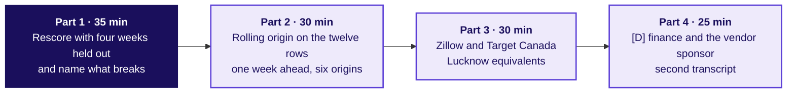
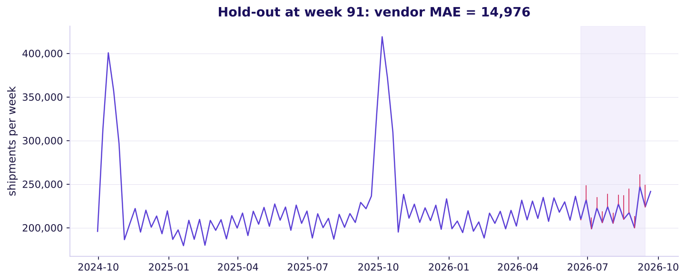

# The rolling-origin hour, if the block slips

Week 4, Day 5. Fallback deck (120 minutes).

Kicker: WEEK 4  ·  FRIDAY  ·  FALLBACK
Quote: The baseline is still the thing to beat; the fallback hour shows what happens when the hold-out is shorter or when the forecast's history was borrowed.
Who: the FC planner at Flipkart's Lucknow fulfilment centre

```notes
On screen before the fallback begins. Runs only if W4-4 slips. Teaches nothing the IITGN block
owns: no autocorrelation, no smoothing, no ARIMA. Four parts of 35, 30, 30 and 25 minutes.
Transition: S1, the four parts.
```

---

## S1. The four parts of the fallback hour
*What runs if the IITGN block (tentative) slips, and in what order?*



```notes
LIVE, 2 minutes. Read the four parts as a plan the room can see. Nobody is being tested on the
model; this is a reflection on what the morning taught, with two guardrail cases from real
companies.
Transition: S2, part one.
```

---

## S2. Part 1: rescore with four weeks held out
*What changes when the hold-out is shorter than the horizon?*

| | 13-week hold-out | 4-week hold-out |
|---|---|---|
| Naive MAE | 22,046 | about 10,000 (one summer month) |
| SWLY MAE | 9,346 | about 7,500 |
| Festival-aligned MAE | 5,674 | about 4,000 |
| Vendor MAE | 16,985 | about 11,000 |

A shorter hold-out looks friendlier to every method, including the vendor, because the window is smaller and the noise averages out less. A four-week test for an eight-week horizon rewards the method that was lucky on the week after training.

```notes
LIVE, 35 minutes. Each group runs the four-week version in the notebook (notebook 02's `holdout_n`
switch), then reports what changed and what did not. The vendor's share of the error falls by
about a third; its ranking does not change. The lesson is sharp: a test shorter than the horizon
tempts a vendor's sponsor to claim capability the horizon still has to earn.
Transition: S3, part two.
```

---

## S3. Part 2: rolling origin by hand
*How does the error look when the forecast's starting point moves one week at a time?*



For each of six origins over the summer, forecast one week ahead with each baseline. Six one-week errors give a line; the line says whether the method is steady or drifts.

```notes
LIVE, 30 minutes. Rolling origin is Hyndman and Athanasopoulos's figure (FPP3, R1): forecast once
from origin t, then from origin t + 1, and so on. The still PNG shows one frame of the sliding
hold-out. In class, use the GIF beside this slide if the projector plays it; otherwise rely on the
still. The reveal: SWLY's one-week-ahead error is steady; the vendor's grows as it drifts further
from the training window.
Transition: S4, Zillow and Target Canada.
```

---

## S4. Part 3: Zillow and Target Canada, two failures
*What did Zillow and Target Canada tell forecasters that the Lucknow planner must remember?*

| | Zillow (F3) | Target Canada (F4) |
|---|---|---|
| The forecast | A home-price model used to buy for Zillow Offers | A sales forecast system Target brought over from the US |
| The miss | Public guardrail breached by 1,200 basis points on a plus-or-minus-200 bp band | Buyers used optimistic projections; shelves ran out or were overstocked |
| The cost | Inventory write-down about USD 304 million; business wound down; workforce cut by about a quarter | 133 Canadian stores closed within two years of opening |
| The Lucknow equivalent | A vendor forecast allowed to drift past its stated error band | A new vendor model trained on a US retail series with no Lucknow history |

```notes
LIVE, 30 minutes. Each group names the Lucknow equivalent for both: the guardrail Zillow lacked
(an operational trigger when the forecast's actual error exceeded the band), and the history
Target Canada needed (two to three years of Canadian store data, not a US model). Interview-grade
answers close the activity.
Transition: S5, the second transcript.
```

---

## S5. [D] Finance and the vendor's sponsor each want theirs
*What does the planner say when two stakeholders push forecasts the baseline beats?*

| Stakeholder | Their claim (partly right) | The one-line answer |
|---|---|---|
| Finance | 'Last year plus 4 percent is the budget' | Right about the total, wrong about the shape; the shape puts the peak in the wrong week. |
| Vendor's sponsor | 'The model fits every week of history' | Fit on 91 training weeks is not forecast on the 13 held-out weeks; its hold-out MAE is 200 percent above the chosen baseline's. |

```notes
LIVE, 25 minutes. Pair the room; one plays the planner, one plays finance, then swap and the
other plays the sponsor. Scorecard as in Tuesday's studio. The partly-right half of each claim
has to be conceded; the plan's shape and the hold-out score are what survive the defence.
Transition: S6, the close.
```

---

## S6. The one rule the fallback leaves
*What survives this hour even without the IITGN block?*

A forecast earns the plan only after it beats the simplest baseline on weeks it has not seen. The baseline for a seasonal business is same-week-last-year or its festival-aligned twin. The hold-out spans the horizon.

```notes
LIVE, 2 minutes. The one rule carries into the Saturday paper's part 5. The IITGN block
(tentative), when it runs on another day, picks up autocorrelation and smoothing from here.
Transition: Kahoot and close in half 2.
```
