# Forecasting basics: how much the plan delivers

Week 4, Day 5. Half one.

Header: WEEK 4  ·  FRIDAY  ·  FORECASTING BASICS  ·  FLIPKART, LUCKNOW

---

## S1. Forecasting basics: how much the plan delivers
*How much does the plan deliver, against a baseline that is hard to beat?*

Friday answers one question with five topics: how much will a plan deliver, and how wrong could its number be? The topics are taught first on a chai stall at a hostel gate, whose cups are invented and small enough to count by hand. Then Flipkart's Lucknow fulfilment centre uses all five to book its festive packer shifts, an illustrative case: the company is real, the situation and the data are synthetic, built for this class. The lab runs the same method on Kalpa Retail's revenue.

```notes
LIVE, 1 minute, on screen as the room sits down. Read the question in the subtitle: it is the row's
Day focus, word for word. Say the order of the day once: five topics on the chai stall, then the
Flipkart case, then Kalpa in the lab. Transition: where Friday sits in the week.
```

---

## S2. Friday asks how much is coming, and how wrong
*Where does today's ticket sit among the week's five?*

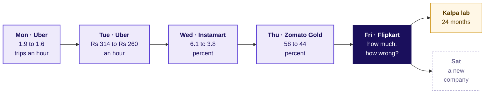

Each day asked what a number is compared with, and each node carries the number its day moved.

```notes
LIVE, 1 minute. Read the earlier nodes with their numbers: each was a number the room produced
on its day. Monday's guardrails bound what a forecast may chase, Thursday's cohorts gave the
week a time axis, and today asks what the plan will be held to. The Kalpa node is the lab after
class. Explorer: the home screen, Friday lit. Transition: the five topics.
```

---

## S3. Five topics, then the case that uses them
*Which topics does Friday teach, in which order, and where is each practised?*

| Chapter | Topic, as the curriculum words it | Minutes | Notebook |
|---|---|---|---|
| 1 | Trend and seasonality, read before modelling | 22 minutes | 01, trend and seasonality |
| 2 | Naive, seasonal naive and drift baselines | 23 minutes | 02, naive, seasonal naive, drift |
| 3 | Holding out; MAE and MAPE in the business's units | 30 minutes | 03, hold-out, MAE, MAPE |
| 4 | Beating the baseline; the vendor curve tested | 20 minutes, shared | 04, beating the baseline, good enough |
| 4 | The good-enough call and the forecast note | the same 20 minutes | 04, the same notebook |
| 5 to 7 | The case: Flipkart's Lucknow fulfilment centre | 102 minutes | 05 to 07, one per case chapter |
| Lab | The same method on Kalpa Retail's revenue | the lab's length | 08 |

```notes
LIVE, 2 minutes. Read the topic column aloud: these are the five subtopics of the curriculum row, in
its order. Subtopics 4 and 5 share chapter 4 because both rest on one decision: a forecast earns
trust by beating the baseline on periods it never saw, and it is good enough when a better one
would change no decision. Say the minutes. The concept map follows. Transition: how the topics join.
```

---

## S4. The topics rest on earlier weeks and feed the case
*How do Friday's five topics connect to each other, to earlier weeks and to the case?*

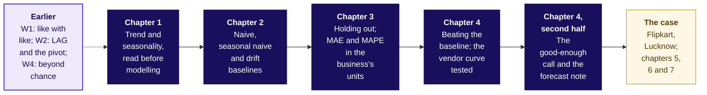

Each lit box is one of the curriculum's five topics, in its order; after the case, Saturday's drill and Week 5's first baseline reuse all five.

```notes
LIVE, 2 minutes. ByteByteGo's move: one connected map before any detail. The dashed box holds what
the chapters reuse, each named again at the point of reuse: Week 2 Thursday's pivot trend view in
chapter 1, Week 2 Wednesday's LAG in chapter 2 (a seasonal copy is LAG by a season), Week 1 Monday's
average that one giant miss can move and Week 1 Tuesday's matched windows in chapter 3, Wednesday's
lift beyond chance in chapter 4, and Thursday's rule to align cohorts and never blend them in the
case's festival alignment. The map returns, with the current chapter lit, at every chapter's close.
Explorer: scene F1. Transition: the destination.
```

---

## S5. The case: two forecasts for one festive window
*Where will the five topics be used, and what must the planner hand in?*

| On the ticket | What it says |
|---|---|
| Company, city, surface | Flipkart's Lucknow fulfilment centre (FC), the warehouse where orders are packed and shipped: outbound shipments a week, and the packer shifts that pack them |
| Before and after | An ordinary week in late 2024 shipped about 210,000; 104 weeks run from the week of 30 September 2024 to 21 September 2026, with a festive peak each year |
| The two forecasts | A vendor's model: the eight festive weeks 22 percent above the same weeks last year; finance: those weeks plus 4 percent; eighteen percentage points apart |
| The data | `weekly_shipments` (week_start, shipments, packer_shifts_worked, overtime_shifts); `vendor_forecast` (week_start, vendor_shipments, kind); `calendar` (week_start, diwali_week, sale_week); `costs` (item, rs, low, high) |
| The ask, due Friday | Which forecast goes to the plan for the eight weeks beginning 12 October to 30 November 2026, how wrong could it be, and how many packer shifts a week |
| Caveats | Diwali moves by weeks each year; a late shipment costs more than an idle shift |

Illustrative case: the company is real, the situation and the data are synthetic, built for this class.

```notes
LIVE, 2 minutes. Show it as the destination: read the two forecasts and the ask, nothing more. Ask
the room what would make either forecast wrong, and write the answers on the board without judging
them; chapter 5 opens on the ticket in full and returns to the list. Transition: chapter 1.
```

---

## SECTION 1: Trend and seasonality, read before modelling: what does a series tell?
*Read a chai stall's cups (invented) for their beat, their climb and their wobble before any rule copies them.*

```notes
LIVE, 1 minute. Concept 1 of 4, 22 minutes. The example runs through all four concept chapters: a
chai stall at a hostel gate, every number invented and labelled invented, 730 days of cups that the
day's own generator wrote. Notebook 01 runs beside the chapter. Transition: who needs the reading.
```

---

## S6. Four readings come before any forecasting rule
*Who needs the reading, and which questions lead to it?*

A **time series** is one number per equal period, in time order: cups a day here, shipments a week at Flipkart, revenue a month at Kalpa. A **forecast** is a number for a period nobody has seen yet.

**Who needs the answer.** The stall's owner orders milk every evening for the next three days, and Flipkart's FC planner books packer shifts weeks ahead; a reading that takes a weekly dip for a fall, or a rise for growth, orders milk that sours and packers who stand idle.

**The questions on the way.** Four, in this order:

```timeline
label: The beat | title: What repeats, how often? | body: A Sunday dip every 7 days.
label: The climb | title: Is the stall growing? | body: The same day, a season apart.
label: The year | title: What repeats yearly? | body: Exams up, Diwali week down.
label: The rest | title: What is left over? | body: A wobble of a few cups. | tone: dark
```

```notes
LIVE, 2 minutes. Read the two definitions, then the four questions; each gets a number before the
next is asked. The stall sells about 100 cups on a weekday; every number in this chapter is
invented. Transition: the vote.
```

---

## S7. Monday sold 100 and Sunday 60: up 67 percent?
*The stall sold 60 cups on Sunday 6 October 2024 and 100 on Monday 7 October (invented). What does that say?*

```cards
icon: trending-up | eyebrow: a | title: Growing fast | body: Monday is 67 percent above the day before. | tone: light
icon: calendar | eyebrow: b | title: The weekly beat | body: Sundays always sell less, and nothing has grown. | tone: light
icon: circle-help | eyebrow: c | title: Cannot tell | body: Two days are too few to say anything. | tone: light
icon: list | eyebrow: d | title: Growing on weekdays | body: Weekdays rose while Sundays did not. | tone: light
```

```notes
LIVE, 3 minutes. Veritasium's move: the misconception on the table first. Vote, two minutes with a
neighbour, vote again, and keep both counts on the board. The plausible wrong number is 100 over 60,
plus 67 percent; the decision it would mislead is two-thirds more milk. Option c is the honest
first instinct; the next slide shows why fourteen days settle it. Transition: the answer.
```

---

## S8. Answer: Sunday always dips; that is the weekly beat
*What do the stall's first fourteen days show?*

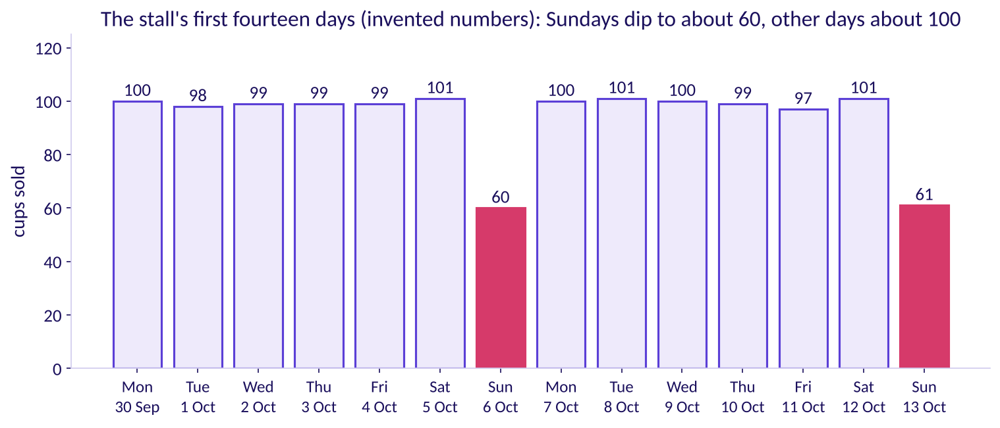

The answer is b. Both Sundays sold about 60 (60 and 61), every other day about 100. A repeat on a fixed beat is a **season**, and its **length** is the number of periods before it repeats: 7 days here, 52 weeks in Flipkart's year. **The plausible wrong number:** plus 67 percent, Monday over Sunday. **The decision it misleads:** two-thirds more milk, which sours. **The check:** Monday against the Monday before, 100 against 100. **The fix:** compare the same point a season apart.

```notes
LIVE, 3 minutes. 3Blue1Brown's move: the picture first, the word season after it. Count the bars
aloud from Monday 30 September. Explorer: scene F1, the season slider. Transition: reading growth
without the beat fooling you.
```

---

## S9. Read growth a season apart: up 10 percent a year
*How is growth read without the weekly beat fooling you?*

| The comparison, 52 weeks apart | 2024 | 2025 | Ratio |
|---|---|---|---|
| Sunday 6 October 2024 against Sunday 5 October 2025 | 60 | 66 | 1.10 |
| Monday 7 October 2024 against Monday 6 October 2025 | 100 | 110 | 1.10 |
| The fourteen days from 30 September 2024, against the fourteen from 29 September 2025 | 1,315 | 1,450 | 1.10 |

Count it aloud: 110 over 100 is 1.10, up 10 percent in a year; 66 over 60 is 1.10 again; the two fortnights give 1,450 over 1,315, about 1.10. The **trend** is the slow climb, read by comparing the same point a season apart, and Sunday's share of an ordinary day stays 0.6 in both years, 60 over 100 and 66 over 110, while the level grows.

```notes
LIVE, 4 minutes. StatQuest's move: tiny numbers, every step said aloud. Ask why this Monday against
last Monday does not show the growth: a week's growth is too small to see under a wobble of a few
cups, so a year apart is the comparison that shows it. Transition: a whole year at once.
```

---

## S10. Seasons can peak or dip; the trend climbs beneath
*What does a whole year look like, and what is a series made of?*

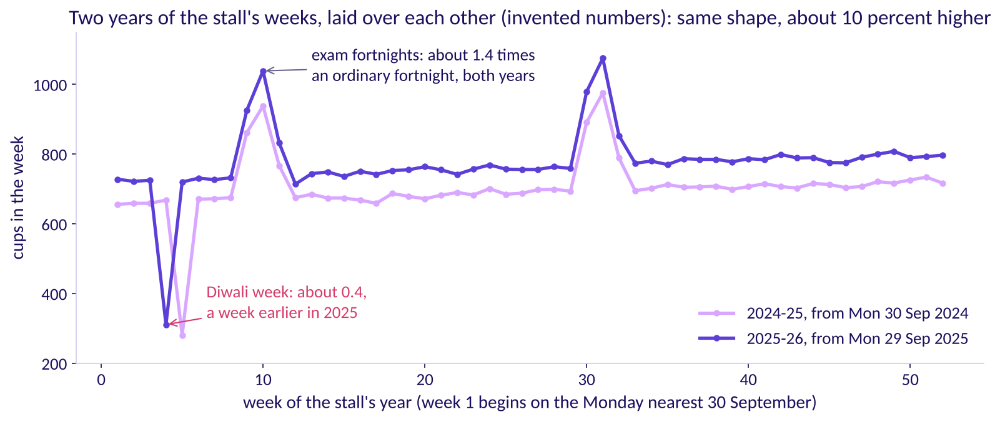

The exam fortnight that closes each semester lifts the stall to about 1.4 times an ordinary fortnight in both years (1.39 and 1.41), and Diwali week drops it to about 0.4 (0.40 both years) as the hostel empties, a week earlier in 2025. Named last: a series is a **trend** times its **seasons** times a **remainder**, the wobble left over, about 4.7 cups either way. Forecasting: Principles and Practice writes it as a sum, y = T + S + R, when the seasons do not grow with the level. A **cycle**, a rise and fall with no fixed length, needs more than two years to see.

```notes
LIVE, 4 minutes. Show the picture, then name the parts. FPP3's words: a trend "exists when there is
a long-term increase or decrease in the data"; seasonality "is always of a fixed and known period",
and "one series can have more than one seasonal pattern"; a cycle shows "rises and falls that are
not of a fixed frequency". Sources: https://otexts.com/fpp3/graphics.html#sec-tspatterns (checked 13 October 2026) and
https://otexts.com/fpp3/decomposition.html#sec-components (checked 13 October 2026). The
stall's seasons grow with its level, since Sunday is always 0.6 of an ordinary day, which FPP3 calls
a multiplicative decomposition. Transition: the same reading in code.
```

---

## S11. The same reading in four lines of pandas
*How does code reproduce the count?*

```python
cups = stall.set_index("date").cups        # one number a day, in order
# the weekly beat: Sunday over Monday, 60 / 100 = 0.6
share = cups["2024-10-06"] / cups["2024-10-07"]
# growth a season apart: 110 / 100 - 1 = 10 percent
growth = cups["2025-10-06"] / cups["2024-10-07"] - 1
# every day against the same weekday 364 days back
yearly = cups / cups.shift(364)
```

`shift(364)` slides the whole series down 364 rows, so each day's row holds the same weekday 52 weeks earlier; Week 2 Wednesday's LAG did the same in SQL. Notebook 01 runs these lines on all 730 days and draws each picture.

```notes
LIVE, 2 minutes. Krish Naik's move: one plain sentence for each line. Why 364 and never a calendar year of days: 364 is
52 whole weeks, so a Monday lands on a Monday and the weekly beat stays in step. Transition: the
rules.
```

---

## S12. Four rules for reading a series
*Which rules does the chapter leave, and what does an interviewer hear?*

1. Read the series' shape before choosing any rule that copies it.
2. A season repeats on a fixed beat, up or down, so count its length before using it.
3. Read growth by comparing the same point a season apart, never neighbours.
4. What is left after the trend and the seasons is the remainder, and a cycle needs years to see.

**In the interview.** "Before any model I plot the series and read its trend, its seasons with their lengths, and what is left, because the baseline I must beat depends on them."

```notes
LIVE, 2 minutes. The rules are the slide a learner photographs. Ask the c1 set's first item aloud:
the mess used 25 kg of rice on a Monday and 40 kg on a Sunday; which comparison reads growth? Key d,
either the same day a week apart or the same week a year apart. Transition: where the reading goes.
```

---

## S13. The reading feeds chapter 2's rules and chapter 5
*Where did the idea come from, and where does it go next?*

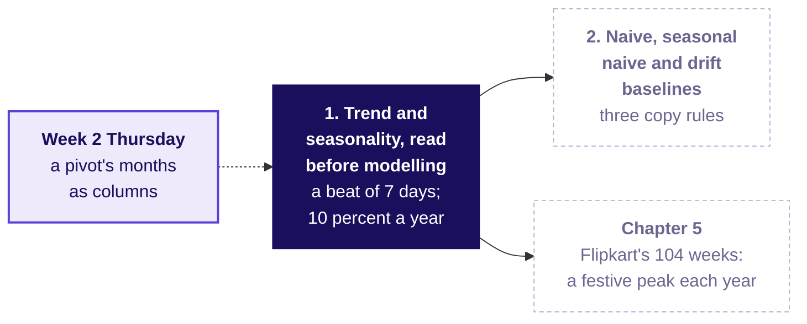

At Flipkart's Lucknow centre the same reading finds a level near 210,000 shipments a week, growth of about 4 percent a year, two seasons (the festive weeks, and the week that holds the first of the month) and a wobble of a few percent.

```notes
LIVE, 1 minute. The idea joins the map. Transition: chapter 2, the rules that copy the past.
```

---

## SECTION 2: Naive, seasonal naive and drift baselines: when does a copy fail?
*Run three copy rules by hand on the stall's days (invented), and see where each one fails.*

```notes
LIVE, 1 minute. Concept 2 of 4, 23 minutes. Notebook 02 runs beside the chapter. Transition: who
needs a rule that runs on paper.
```

---

## S14. Three copy rules, each one line of arithmetic
*Who needs a rule that runs on paper, and which questions lead to it?*

A **baseline** is the simplest rule that could be right, and its job is to be beaten: any cleverer forecast must do better than it.

**Who needs the answer.** The stall's owner, who orders milk tonight with no spreadsheet open, and Flipkart's FC planner, whose tournament sends nothing to the plan that loses to a copy rule.

**The questions on the way.** Four, in this order:

```timeline
label: Copy | title: What does each rule copy? | body: The last day, last season, a line.
label: Sunday | title: Which wins next Sunday? | body: The one that respects the beat.
label: A year | title: What does a yearly copy miss? | body: The year's growth.
label: A festival | title: What breaks when it moves? | body: Every calendar copy. | tone: dark
```

```notes
LIVE, 1 minute. Read the four questions. Transition: the vote.
```

---

## S15. Which rule forecasts next Sunday's cups best?
*The last four days sold 98, 104, 101 and 103, and last Sunday 61 (invented). Which rule lands nearest next Sunday?*

```cards
icon: list | eyebrow: a | title: Naive | body: Repeat the last day: 103. | tone: light
icon: list | eyebrow: b | title: Drift | body: The last day plus the average step: about 105. | tone: light
icon: list | eyebrow: c | title: Seasonal naive | body: Copy last Sunday: 61. | tone: light
icon: list | eyebrow: d | title: All three | body: They land within five cups of each other. | tone: light
```

```notes
LIVE, 3 minutes. The misconception is that the rule with the most arithmetic forecasts best. Vote,
argue, vote again. Transition: the answer.
```

---

## S16. Answer: the seasonal naive, 61 against 60 sold
*What did each rule say for Sunday 19 January 2025, and how far off was it?*

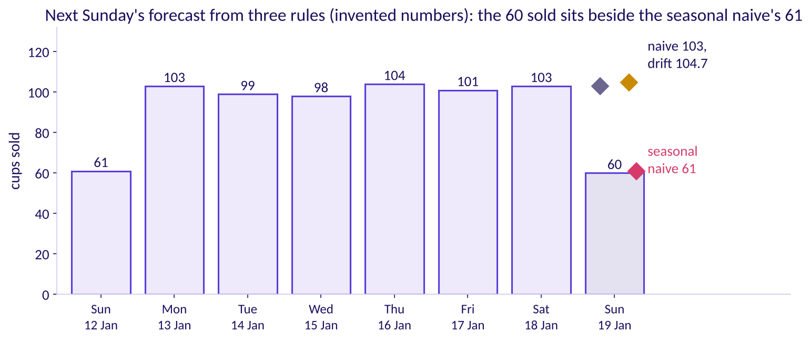

The answer is c. Next Sunday sold 60. **Naive**, the last value repeated, said 103 and missed by 43; **drift**, the last value plus the average step so far, said 104.7 and missed by 44.7; the **seasonal naive**, the value one season back, said 61 and missed by 1. When a beat is strong, the plainest copy that respects it wins.

```notes
LIVE, 3 minutes. Point at the three markers above next Sunday. Ask which rule a shift supervisor
could run in their head: all three, which is why they are baselines. Transition: each rule by hand.
```

---

## S17. Each rule in one line, worked by hand
*How does each rule reach its number, and how does code reach the same?*

| Rule | What it copies | Next Sunday, worked by hand |
|---|---|---|
| Naive | the last value | 103 |
| Drift | the last value plus the average step so far | 103 + (103 - 98) / 3 = 104.7 |
| Seasonal naive | the value one season back, 7 days here | last Sunday's 61 |

```python
four = [98, 104, 101, 103]                      # Wednesday to Saturday (invented)
naive = four[-1]                                # 103
drift = four[-1] + (four[-1] - four[0]) / 3     # 103 + 5 / 3 = 104.7
seasonal_naive = cups.shift(7)                  # every day copies the same day a week back
```

```notes
LIVE, 4 minutes. Work drift aloud: the step from the first day to the last is 5 cups over 3 steps,
about 1.7 a day, added once. Notebook 02 counts each by hand and by code and checks that the two
agree. Transition: a whole year, and a rule that needs one more thing.
```

---

## S18. A yearly copy needs the year's growth added
*What does each rule do around the exams, and what is each rule's formula?*

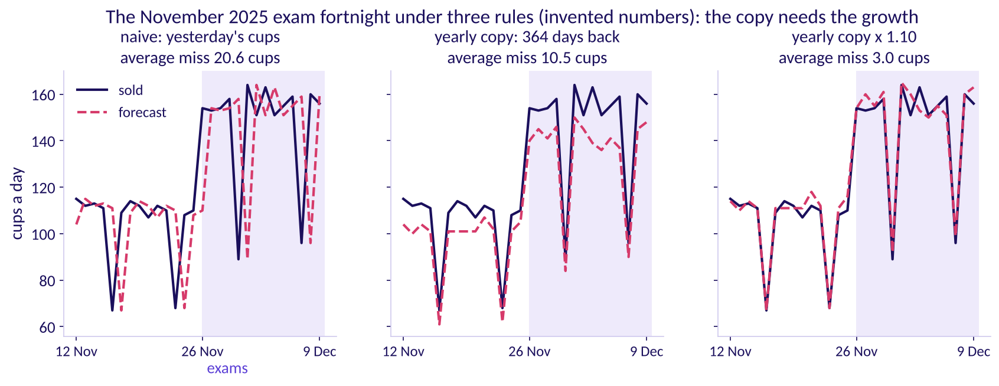

Around the November 2025 exams naive, yesterday's cups, misses by 20.6 cups a day; the yearly copy, the same weekday 364 days back, misses by 10.5, mostly the year's growth; times 1.10 it misses by 3.0. Named last, with T the last period a rule may see, h the periods ahead and m the season's length: **naive**, forecast(T + h) = y(T); **seasonal naive**, forecast(T + h) = y(T + h - m); **drift**, forecast(T + h) = y(T) + h x (y(T) - y(1)) / (T - 1), the line from the first value to the last, extended.

```notes
LIVE, 4 minutes. The worked day: on Wednesday 26 November 2025, the first exam day, the stall sold
154; naive copied Tuesday's 110 and fell 44 short; the yearly copy took the first exam day of 2024,
140, and fell 14 short; 140 x 1.10 = 154. Finance's habit, last year plus 4 percent, is this same
move: the seasonal naive times a growth factor. The formulas are FPP3's, section 5.2:
https://otexts.com/fpp3/toolbox.html#sec-simple-methods (checked 13 October 2026), where the
seasonal naive's general form reaches back whole seasons when h is longer than one. Transition: a
festival that moves.
```

---

## S19. A calendar copy lands a moving festival late
*Diwali came eleven days earlier in 2025. What does a yearly copy do with that?*

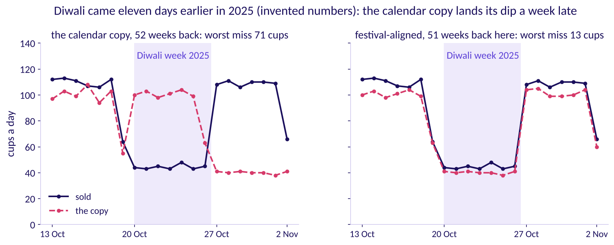

**The plausible wrong number.** The calendar copy says 100 cups for Diwali 2025, Monday 20 October, copied from an ordinary Monday of 2024, when 44 sold, and 40 for Thursday 30 October 2025, copied from Diwali 2024 itself, when 110 sold. **The decision it misleads:** 56 cups of milk sour on one day and the stall runs 70 cups short on another. **The check:** the festival calendar. **The fix:** near the festival, copy the day at the same distance from last year's Diwali. This programme calls that copy **festival-aligned**, its own extension of the seasonal naive; here it misses by at most 13 cups.

```notes
LIVE, 4 minutes. The left panel's dip arrives a week late; the right panel's sits on Diwali week.
Say plainly that festival-aligned is this course's construction, built on the textbook's seasonal
naive, so nobody quotes it as a standard method. Explorer: scene F3, the festival marker.
Transition: the rules.
```

---

## S20. Four rules for choosing a copy rule
*Which rules does the chapter leave, and what does an interviewer hear?*

1. A baseline is the simplest rule that could be right, and every forecast must beat it.
2. Naive repeats the last value, the seasonal naive the value one season back, and drift extends the line from the first value to the last.
3. When a beat is strong, the copy that respects it wins, and a yearly copy needs the year's growth added.
4. A festival that moves breaks every calendar copy, so copy by distance from the festival.

**In the interview.** "Naive, seasonal naive and drift are the baselines any forecast must beat, and on seasonal data the seasonal naive is the one to beat."

```notes
LIVE, 2 minutes. Ask the c2 set's first item aloud: at the mess the last four days used 25, 26, 25
and 27 kg and last Sunday 42 kg; which rule, and what does it say for next Sunday? Key c, the
seasonal naive, 42. Transition: where the rules go.
```

---

## S21. Three rules go to chapter 3's scoring and chapter 5
*Where did the idea come from, and where does it go next?*

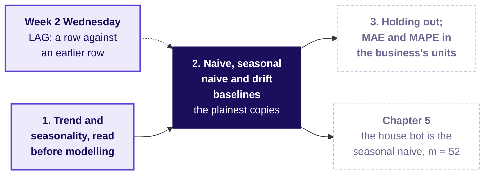

At Flipkart the seasonal naive with m = 52 is "the same week last year", which the tournament calls the **house bot**; finance's rule is the house bot times 1.04, and drift's step is about 70 shipments a week.

```notes
LIVE, 1 minute. The aliases come after the textbook names: seasonal naive first, then same week last
year, then the house bot. Transition: chapter 3, scoring a rule on days it never saw.
```

---

## SECTION 3: Holding out; MAE and MAPE in the business's units: how is a forecast scored?
*Hide the stall's latest days, score a rule on them in cups and in rupees, and say which way it leans.*

```notes
LIVE, 1 minute. Concept 3 of 4, 30 minutes. Notebook 03 runs beside the chapter. Transition: who
needs the score.
```

---

## S22. Score a rule only on days it never saw
*Who needs the score, and which questions lead to it?*

**Who needs the answer.** The stall's owner, who wants to know how wrong the milk order could be before trusting a rule, and Flipkart's regional operations head, who must say yes or no to a vendor's curve before a shift is booked.

**The questions on the way.** Five, in this order:

```timeline
label: Hide | title: Which days do we hide? | body: The latest, as many as the order reaches.
label: Count | title: How is a miss counted? | body: In cups, signs dropped: MAE.
label: Percent | title: When does a percent mislead? | body: On a day that sells almost nothing.
label: Lean | title: Which way is it wrong? | body: Short and over cost differently.
label: Price | title: What does it cost? | body: Rs 12 a cup short, Rs 6 unsold. | tone: dark
```

```notes
LIVE, 1 minute. Read the five questions. A cup unsold wastes about Rs 6 of milk and a cup short
loses about Rs 12 of margin; both are invented. Transition: the vote.
```

---

## S23. Which three days judge a three-day milk order?
*The owner orders milk for the next three days. To judge a rule, which three of the last fourteen days do you hide?*

```cards
icon: calendar | eyebrow: a | title: The last three | body: Days 12, 13 and 14. | tone: light
icon: shuffle | eyebrow: b | title: Three at random | body: So any weekday may be tested. | tone: light
icon: trending-up | eyebrow: c | title: The three busiest | body: The days that cost the most. | tone: light
icon: list | eyebrow: d | title: Any three | body: It makes no difference which. | tone: light
```

```notes
LIVE, 3 minutes. The misconception is that a rule can be judged on the days it has already seen.
Vote, argue, vote again. Transition: the answer.
```

---

## S24. Answer: the last three, as many as the order reaches
*Why the latest days, and what are the origin and the horizon?*

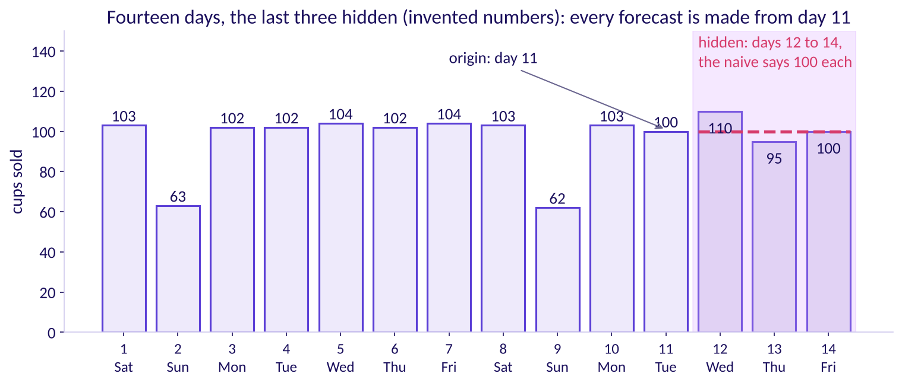

The answer is a. Hide the latest days, at least as many as the forecast must reach ahead: three here. Day 11 is the **origin**, the last day the rule may see; three days is the **horizon**; days 1 to 11 are the **training** days and days 12 to 14 the **hidden** days, also called the hold-out or test set. Tomorrow looks most like the newest days, and a random hole would let a rule borrow days that come after the one it forecasts, which a real tomorrow never offers. The test set should be "at least as large as the maximum forecast horizon required" (Forecasting: Principles and Practice, section 5.8).

```notes
LIVE, 4 minutes. Explorer: scene F2, the split slider. The FPP3 line is section 5.8:
https://otexts.com/fpp3/toolbox.html#sec-accuracy (checked 13 October 2026). Options b and d fail
because a random day has later days in the training set; option c tests the dearest days only, so the
score says nothing about an ordinary order. Transition: counting the misses.
```

---

## S25. MAE 5 cups, MAPE 4.8 percent, leaning 1.7 low
*How is one score made from three misses, and which way does the rule lean?*

| Hidden day | Naive said | Sold | Miss: said minus sold |
|---|---|---|---|
| 12 | 100 | 110 | -10, so 10 cups short |
| 13 | 100 | 95 | +5, so 5 cups unsold |
| 14 | 100 | 100 | 0 |

**MAE** drops the signs and averages: (10 + 5 + 0) / 3 = 5.0 cups. **MAPE** divides each miss by what sold first: (10/110 + 5/95 + 0/100) / 3 = 4.8 percent. The **lean** keeps the signs: -5 / 3 = -1.7, so the rule runs low. Priced, 10 cups short at Rs 12 and 5 unsold at Rs 6 cost Rs 150.

```python
miss = [100 - sold for sold in [110, 95, 100]]                      # -10, +5, 0
mae = sum(abs(m) for m in miss) / 3                                  # 5.0 cups
mape = sum(abs(m) / s for m, s in zip(miss, [110, 95, 100])) / 3     # 0.048, 4.8 percent
lean = sum(miss) / 3                                                 # -1.7: the rule runs low
```

```notes
LIVE, 6 minutes. StatQuest's move: each step aloud. A miss here is what the rule said minus what
sold, so positive means too high; FPP3 writes the error the other way round, sold minus said, which
flips the sign and leaves the size alone. Transition: when a percent misleads.
```

---

## S26. MAPE breaks on a quiet day; MAE keeps the unit
*When does a percent mislead, and which score goes to the milkman?*

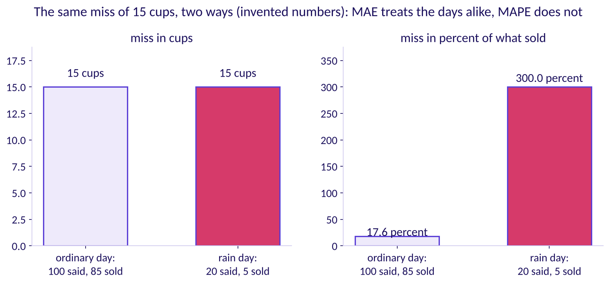

Two invented days, apart from the stall's record, each miss by 15 cups: 15 over 85 is 17.6 percent of a busy day, and 15 over 5 is 300 percent of a rain day when the stall shut after an hour. Named last: **MAE**, the mean absolute error, is the mean of the misses with their signs dropped, in the unit the cost is in; **MAPE**, the mean absolute percentage error, is the mean of each miss over what sold, which compares stalls of different sizes and runs to extremes when a day sells close to zero.

```notes
LIVE, 5 minutes. FPP3, section 5.8: "Mean absolute error: MAE = mean(|e_t|)"; percentage errors have
"the advantage of being unit-free", and the disadvantage of "being infinite or undefined if y_t = 0
for any t in the period of interest, and having extreme values if any y_t is close to zero" (checked
13 October 2026). The milkman hears cups and rupees; MAPE is for comparing this stall with one twice
its size. Transition: two rules with the same score.
```

---

## S27. Same MAE, different rupees: report the lean too
*Two rules both miss by 10 cups a day. Which costs more?*

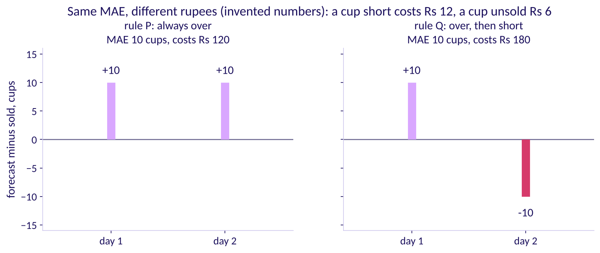

**The plausible wrong number.** "Both rules score MAE 10, so they are equally good." **The decision it misleads:** the cheaper rule dropped for no reason. **The check:** the sign of each miss. Rule P runs 10 over on both days: 20 cups unsold at Rs 6, Rs 120. Rule Q runs 10 over, then 10 short: Rs 60 plus Rs 120, Rs 180. **The fix:** report the MAE and the lean together, and price each direction.

```notes
LIVE, 5 minutes. Predict before revealing the costs: which rule costs more? Most rooms say they cost
the same. Flipkart's case meets this again in chapter 6, where a forecast with a worse MAE costs less
once priced. Transition: the rules.
```

---

## S28. Four rules for scoring a forecast
*Which rules does the chapter leave, and what does an interviewer hear?*

1. Hide the latest periods, at least as many as the forecast must reach ahead, and forecast them all from one origin.
2. Fix the measure before anyone scores, in the unit the cost is in.
3. Keep MAPE for comparing series of different sizes, and never on periods that sell close to zero.
4. Report which way a rule leans beside how far it misses, because a miss short and a miss over cost different amounts.

**In the interview.** [S] "How do you evaluate a forecast?" "I hold out the latest periods, as many as the horizon, fix the error measure in the business's unit before scoring, compare with the naive and the seasonal naive, and price each direction."

```notes
LIVE, 3 minutes. Ask the c3 set's first item aloud: five hidden days missed by 12, -8, 5, -15 and 6
kg; what is the MAE, and which way does the rule lean? Key a, 9.2 kg and no lean. Transition: where
the score goes.
```

---

## S29. Scoring feeds chapter 4 and chapter 6
*Where did the idea come from, and where does it go next?*

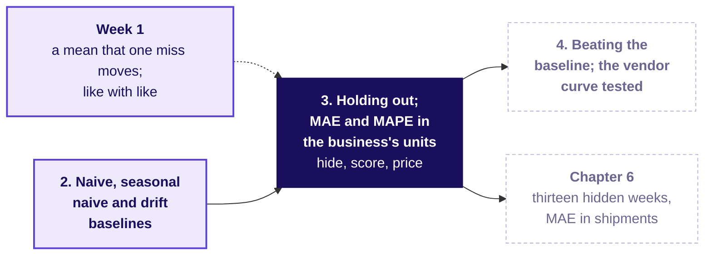

At Flipkart the latest thirteen weeks, 29 June to 21 September 2026, are hidden, the origin is 22 June and the horizon ten weeks; a spare shipment costs Rs 5.42 and a late one Rs 25.

```notes
LIVE, 2 minutes. Week 1 Monday showed that one giant miss moves a mean; Week 1 Tuesday compared like
with like. Ten minutes' break follows. Transition: after the break, chapter 4.
```

---

## SECTION 4: Beating the baseline; the vendor curve tested; the good-enough call and the forecast note: when does it earn trust?
*Watch a perfect fit forecast badly, race a clever rule against the seasonal naive on hidden days, stop improving when the decision stops changing, and write the four-line note.*

```notes
LIVE, 1 minute. Concept 4 of 4, 20 minutes, after the break. Two of the row's subtopics share this
chapter because both rest on one decision. Notebook 04 runs beside it. Transition: who needs the
verdict.
```

---

## S30. A forecast earns trust only on unseen days
*Who needs the verdict, and which questions lead to it?*

**Who needs the answer.** The stall's owner, offered a "model" by a nephew with a laptop, and Flipkart's regional operations head, offered a vendor's curve that fits history within 2 percent.

**The questions on the way.** Four, in this order:

```timeline
label: Fit | title: What does a perfect fit say? | body: About tomorrow, nothing.
label: Race | title: Does the clever rule win? | body: Only on hidden days.
label: Enough | title: Is better worth having? | body: Only if the order changes.
label: Note | title: What goes to the milkman? | body: Four lines. | tone: dark
```

```notes
LIVE, 1 minute. Read the four questions. Transition: the vote.
```

---

## S31. Which forecast for day 5 lands closest?
*The stall sold 100, 104, 98 and 110 cups on four days (invented). Which forecast for day 5 lands closest?*

```cards
icon: trending-up | eyebrow: a | title: The straight line | body: The best line through the four days, about 109. | tone: light
icon: spline | eyebrow: b | title: The exact curve | body: It passes through all four days exactly. | tone: light
icon: list | eyebrow: c | title: Naive | body: Repeat the last day, 110. | tone: light
icon: equal | eyebrow: d | title: All three | body: They land within five cups of each other. | tone: light
```

```notes
LIVE, 2 minutes. The misconception: the model that fits history best will forecast best. Vote.
Transition: the answer.
```

---

## S32. Answer: the exact fit misses by 66, the worst
*What did day 5 sell, and what does that say about fit?*

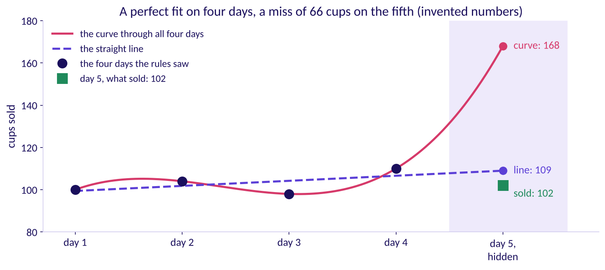

The answer is a, with naive a cup behind. Day 5 sold 102. The curve through all four days fits them perfectly, with an error of 0, and said 168: a miss of 66. The straight line, about 3.1 cups from the four days on average, said 109 and missed by 7; naive said 110 and missed by 8. **Fit** is how close a rule sits to the days it was built on; **forecast error** is how far it misses days it never saw. An interviewer says in-sample and out-of-sample.

```notes
LIVE, 3 minutes. The curve's 168 needs no algebra: the four days' differences are 4, -6 and 12, their
differences -10 and 18, and theirs 28; carry the 28 down and the curve climbs to 168. FPP3, section
5.8: "A model which fits the training data well will not necessarily forecast well. A perfect fit
can always be obtained by using a model with enough parameters" (checked 13 October 2026).
Transition: the nephew's next rule.
```

---

## S33. The nephew's mean loses to the seasonal naive
*On seven hidden days, does the nephew's clever rule beat the baseline?*

| Rule, on the seven hidden days, 10 to 16 March 2025 | MAE |
|---|---|
| The nephew's rule: the mean of the last seven days, 97.6 cups every day | 12.4 cups |
| The seasonal naive: the same day last week, 100 on Monday to 63 on Sunday | 4.0 cups |

The mean ignores the Sunday dip and misses that Sunday by 34.6 cups. Nothing goes to the milk order unless it beats the seasonal naive on days it never saw, by the measure fixed first.

```python
seen, hidden = cups[:7], cups[7:]      # 3 to 9 March, 10 to 16 March
mean_rule = sum(seen) / 7              # 97.6 cups, every day
mae_mean = sum(abs(mean_rule - h) for h in hidden) / 7      # 12.4
mae_seasonal = sum(abs(s - h) for s, h in zip(seen, hidden)) / 7
```

```notes
LIVE, 4 minutes. Both rules are scored on the same seven days by the same measure, fixed before
either ran. Transition: is a better rule worth having?
```

---

## S34. Good enough: a better rule orders the same cans
*Is a better forecast worth having when milk comes in cans of 40 cups?*

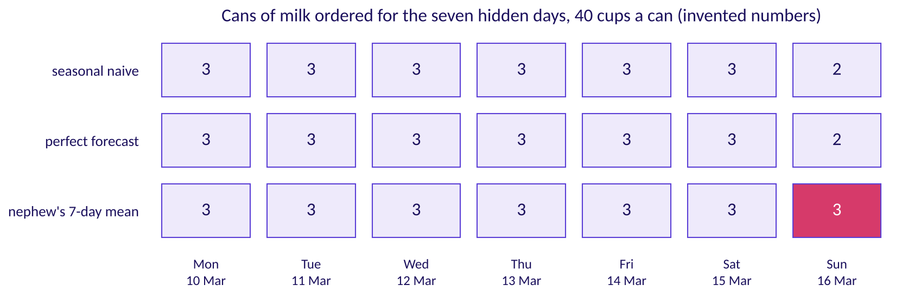

The seasonal naive orders 3 cans a weekday and 2 on Sunday, exactly what a forecast that knew the future would order, on all seven days; the nephew's mean orders a third can on Sunday, Rs 240 of milk that sours. Named last: **good enough** is a claim about the decision, never about the model. A better forecast is worth having only if it would change what gets ordered, so the owner stops improving here.

```notes
LIVE, 3 minutes. Ask the row's mid-session question in its short form: which of three model scores
earns a place, and which changes nothing? The c4 set's second item asks it on Flipkart's numbers.
Transition: the note.
```

---

## S35. The forecast note carries four lines
*What does the owner send the milkman, and what goes in each line?*

| Line | What it says, for the stall |
|---|---|
| The number | 3 cans a day Monday to Saturday, 2 on Sunday |
| The method | the same day last week, the seasonal naive, which beat the nephew's mean on seven hidden days |
| The error bar | 4.0 cups a day on those days: about Rs 24 a day if it runs high, Rs 48 if it runs short |
| What would make it wrong | exams starting early, or the hostel emptying for a holiday |

Flipkart's staffing note in chapter 7 carries the same four lines and one more: a line each to finance and to the vendor's sponsor.

```notes
LIVE, 3 minutes. Notebook 04 prints the note from its variables, so every number in it is the one
the notebook computed. Transition: the rules.
```

---

## S36. Four rules for trusting a forecast
*Which rules does the chapter leave, and which questions does an interviewer ask?*

1. Fit is measured on the days a rule was built on, and it proves nothing about tomorrow.
2. Nothing goes to the order unless it beats the seasonal naive on hidden days, by the measure fixed first.
3. Good enough is a claim about the decision: stop improving when a better forecast would order the same.
4. The note carries the number, the method, the error bar in the unit and in rupees, and what would make it wrong.

**In the interview.** [F] "What baseline must any forecast beat, and why?" [F] "A vendor promises 22 percent growth; how do you test the claim?" Each is answered with the hidden days and the seasonal naive, never with the fit.

```notes
LIVE, 2 minutes. Ask the c4 set's first item aloud: the curve fits all four days and says 168, the
line says 109; which do you trust, and why? Key b. Transition: where the verdict goes.
```

---

## S37. The verdict feeds chapters 6 and 7 and the lab
*Where did the idea come from, and where does it go next?*

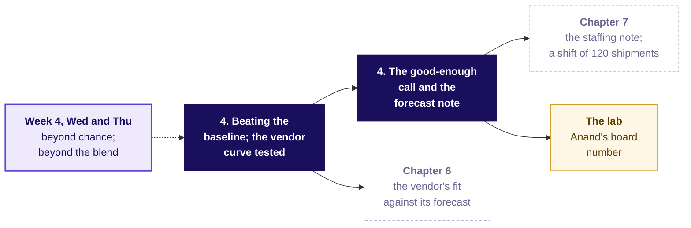

Chapter 6 tests the vendor's curve the same way, its fit on the weeks it was built on against its forecast on thirteen weeks it never saw, and chapter 7 sizes the plan in shifts of 120 shipments.

```notes
LIVE, 1 minute. Wednesday's lift asked for beyond chance and Thursday's cohorts for beyond the blend;
today a forecast must get beyond the copy. The concept block ends here. Transition: the case, read in
full.
```

---

## SECTION 5: Trend, seasonality and baselines on Flipkart's weeks: where is the peak?
*Read the ticket in full, count twelve of Flipkart's weeks by hand, and run the rules on Diwali 2025's week.*

```notes
LIVE, 1 minute. Case part 1 of 3, levels L1 and L2, round one of the tournament. Applies chapters 1
and 2. Twelve printed weeks per table; no laptop opens until notebook 05. Transition: the questions.
```

---

## S38. Four questions, climbed by hand
*Who needs the answer, and which questions lead to it?*

**Applies.** Chapter 1, trend and seasonality, read before modelling; chapter 2, naive, seasonal naive and drift baselines.

**Who needs the answer.** The FC planner, who books shifts weeks ahead and cannot add one on the day: a rule that puts the busiest week in the wrong place books packers for a quiet week.

```timeline
label: Shape | title: Where is the peak? | body: Which week of the season ships the most, in each year?
label: Rules | title: What does each rule copy? | body: Naive, seasonal naive and festival-aligned, each in one line.
label: One week | title: Which lands closest? | body: Three rules for Diwali 2025's own week.
label: The trap | title: Which week moves? | body: Where a copy of last year puts the peak. | tone: dark
```

```notes
LIVE, 1 minute. Read the four questions. Each gets a number before the next is asked.
Transition: the ticket, read in full.
```

---

## S39. Two forecasts for one festive window, 18 points apart
*What has the planner been handed, and what is due Friday?*

| On the ticket | What it says |
|---|---|
| Company, city, surface | Flipkart, the Lucknow fulfilment centre (FC), the warehouse where orders are packed and shipped: outbound shipments and packer shifts |
| The history | 104 weeks, the weeks beginning Monday 30 September 2024 to Monday 21 September 2026; an ordinary week in late 2024 ships about 210,000 |
| The festival | Diwali fell on Thursday 31 October 2024 and Monday 20 October 2025, and falls on Sunday 8 November 2026; the calendar table flags each year's festive sale weeks |
| The two forecasts | A vendor's model promises the window, the eight weeks to staff, 22 percent above the same weeks last year; finance's rule is those weeks plus 4 percent: eighteen percentage points apart. The vendor's sponsor, the manager who brought the model in, backs the 22 |
| The data | `weekly_shipments` (week_start, shipments, packer_shifts_worked, overtime_shifts); `vendor_forecast` (week_start, vendor_shipments, kind: fitted for weeks the model was built on, holdout for its forecasts of the hidden weeks, forecast for the weeks ahead); `calendar` (week_start, diwali_week, sale_week); `costs` (item, rs, low, high) |
| The costs, assumed | A packer packs about 120 shipments a shift; a packer-shift is one packer working one shift. A late shipment costs Rs 25 (range Rs 15 to 40). An idle packer-shift costs Rs 650 (range Rs 500 to 800), so a spare shipment, planned for and never shipped, costs Rs 650 / 120 = Rs 5.42 |
| The ask, due Friday | Which forecast goes to the plan for the eight weeks beginning 12 October to 30 November 2026, how wrong could it be, and how many packer shifts a week |
| Caveats | The festival moves by weeks each year and the sale weeks move with it; two years hold two festivals; a late shipment costs more than an idle shift; peak weeks are capped by the centre's own capacity |

Illustrative case: the company is real, the situation and the data are synthetic, built for this class.

```notes
LIVE, 5 minutes. Read the table top to bottom, then the label line. Today is a tournament in three
rounds: count by hand, score on hidden weeks, then place the festival and size the plan. Point at
the four tables and their columns; every case number today comes from them. Return to the list of
what would make each forecast wrong from S5. Transition: where today ends.
```

---

## S40. Where today ends: 19,760 shifts, a bar in rupees
*What will the planner carry out of the room?*

```cards
icon: badge-check | eyebrow: The plan | title: 19,760 packer shifts | body: Over the eight weeks, peaking at 3,625 in the week of 19 October, from a forecast that keeps each week's distance from Diwali. | tone: dark
icon: ruler | eyebrow: The error bar: how wrong it could be | title: 6,615 shipments a week | body: The forecast's average miss on thirteen weeks it never saw: about Rs 35,800 of idle shifts when it runs that far high, Rs 1.65 lakh of late shipments when that far low. | tone: light
icon: scale | eyebrow: The two forecasts | title: Neither carries the plan | body: The vendor loses to a copy of last year on hidden weeks; finance's rule copies the calendar, which round three tests. | tone: light
```

**The tournament's rule.** Nothing goes to the plan unless it beats the house bot, the seasonal naive (a copy of the same week last year), on the same thirteen hidden weeks, by the same measure: the average miss in shipments, then priced in rupees.

```notes
LIVE, 2 minutes. Show the finished answer once, then earn it. The rule is fixed now, before anyone
scores: mean absolute error in shipments on the thirteen held-out weeks, chapter 3's measure, then
the same misses priced. Groups enter their own one-line rule in round one. Transition: the first
question, voted before anything is shown.
```

---

## S41. Which week of the festive season ships most?
*Two festivals, six weeks each: where does the peak sit, before you see a bar?*

```cards
icon: calendar | eyebrow: a | title: Diwali's own week | body: The festival is the moment people shop. | tone: light
icon: calendar | eyebrow: b | title: The week before Diwali's week | body: The last full week before the festival. | tone: light
icon: calendar | eyebrow: c | title: Two weeks before Diwali's week | body: Early enough for parcels to arrive. | tone: light
icon: calendar | eyebrow: d | title: The week after Diwali's week | body: Gifts bought late, shipped late. | tone: light
```

```notes
LIVE, 3 minutes. Each group holds up a letter. Two minutes for neighbours to argue, then vote again.
Keep both counts on the board. Transition: the twelve weeks.
```

---

## S42. Answer: two weeks before Diwali, in both years
*What did the twelve weeks around two Diwalis ship?*

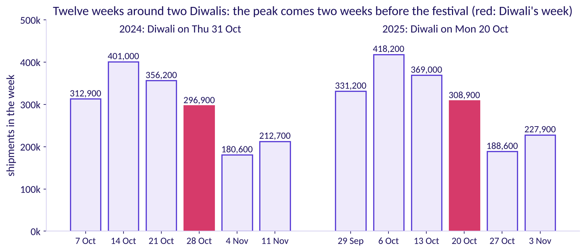

The busiest week is two weeks before Diwali's week both times: 401,000 shipments in the week of 14 October 2024 and 418,200 in the week of 6 October 2025. Both fall in the festive sale, which the calendar table flags in the third and second weeks before Diwali's week. Diwali's own week ships 296,900 and 308,900, and the week after is the lowest. Chapter 1's reading, on Flipkart's weeks: the festival is a yearly season, a peak and then a dip.

```notes
LIVE, 5 minutes. Count aloud left to right, StatQuest style. Parcels leave the centre with the
sale, before the festival, so they arrive in time, which is why the peak comes early. If most of the
room voted a, ask what a customer does on Diwali itself. Transition: three rules on one real week.
```

---

## S43. Which rule lands closest on Diwali 2025's week?
*From the week of 13 October 2025, which rule best forecasts the week of 20 October?*

```cards
icon: list | eyebrow: a | title: Naive | body: Repeat the week of 13 October 2025. | tone: light
icon: list | eyebrow: b | title: Seasonal naive, the house bot | body: Copy the week of 21 October 2024, 52 weeks back. | tone: light
icon: list | eyebrow: c | title: Festival-aligned | body: Copy Diwali 2024's own week, 28 October, and add 4 percent. | tone: light
icon: list | eyebrow: d | title: All three within 10,000 | body: One week ahead, every rule is close. | tone: light
```

Festival-aligned is chapter 2's fix at Flipkart's scale: from five weeks before Diwali's week to four after, copy the week at the same distance from last year's Diwali, otherwise the same calendar week, then add 4 percent, the growth the training weeks show.

```notes
LIVE, 3 minutes. The textbook names first: seasonal naive, which the tournament calls the house bot
and finance calls same week last year. Festival-aligned is this programme's construction. The 4
percent is measured: notebook 06 sets the latest 39 training weeks against the same weeks a year
earlier and gets 4.0 percent, the same figure finance uses. Groups work each rule on the twelve
printed rows before voting; the actual that week was 308,900, held until the vote. Transition: the
answer.
```

---

## S44. Answer: festival-aligned, within 124 shipments
*What did each rule forecast for the week of 20 October 2025, and by how much did it miss?*

| Rule | The week it copies | Forecast | Miss |
|---|---|---|---|
| Naive | 13 October 2025 | 369,000 | 60,100 too high |
| Seasonal naive, the house bot | 21 October 2024 | 356,200 | 47,300 too high |
| Festival-aligned | 28 October 2024, plus 4 percent | 308,776 | 124 too low |

308,900 shipped. The week 52 weeks back looks like "the same week", but in 2024 it was the week before Diwali, and the week before Diwali ships more than Diwali's own week.

```notes
LIVE, 4 minutes. Do the festival-aligned arithmetic aloud: 296,900 times 1.04 is 308,776. Ask
which group's own rule came closest. Transition: the trap hidden in the copy.
```

---

## S45. The copy of last year lands 2025's peak late
*Where does a same-week-last-year copy put the peak when Diwali moves?*

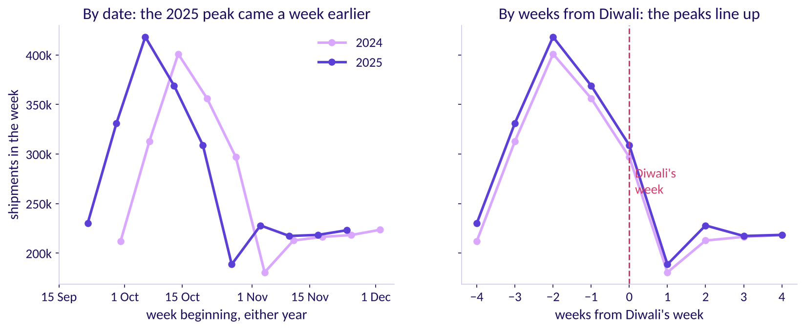

**The plausible wrong number.** The copy books 401,000 for the week of 13 October 2025, its biggest week, while 369,000 shipped; the real peak, 418,200 on 6 October, gets 312,900. **The decision it misleads:** the most packers booked a week after the rush. **The check:** line the years up by weeks from Diwali, as on the right. **The fix:** festival-aligned.

```notes
LIVE, 5 minutes. Diwali's week came one week earlier in 2025, so every calendar copy is a week out;
the stall's dip in chapter 2 moved the same way. As in a Veritasium video, the reveal follows the
vote of S43. Transition: where Diwali falls in 2026.
```

---

## S46. In 2026 Diwali's week moves two weeks later
*Where does Diwali fall in 2026, against the two years the rules copy?*

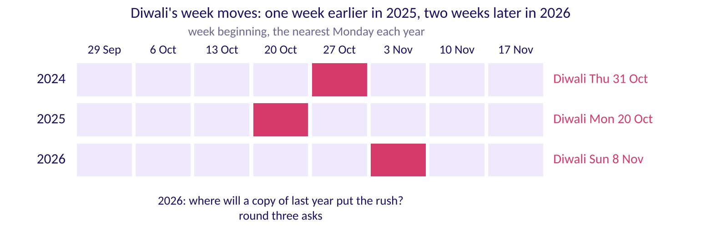

Diwali 2026 falls on Sunday 8 November, so its week begins 2 November, 54 weeks after Diwali 2025's week and two weeks later in the calendar. Hold one question for round three: where will a copy of last year put this year's rush?

```notes
LIVE, 3 minutes. Count the Mondays on the strip with the room. Do not answer where the copy lands:
round three asks it in half two, and the festival calendar card answers it there. Explorer: scene F3,
the Diwali slider. Transition: the real company.
```

---

## S47. Flipkart books its festive capacity weeks ahead
*Which real decisions does a festive forecast feed?*

| | |
|---|---|
| What Flipkart said (6 October 2026) | Ekart, the supply chain behind Flipkart's deliveries, added 14 million cubic feet of warehousing space ahead of The Big Billion Days, Flipkart's yearly festive sale, and more than 2.5 lakh direct and indirect festive employment opportunities were created (Flipkart's announcement, checked 12 October 2026) |
| When it was decided | Before the sale opened, so the space and the people rested on a forecast made weeks earlier |
| What a senior analyst checks | Whether the forecast behind the booking beat a simple copy of last year, and whether it put the festival in the right week |

```notes
LIVE, 2 minutes. These are Flipkart's own published numbers; everything else today is this class's
synthetic data. Read them as decisions already in motion. Transition: the chapter's answers.
```

---

## S48. Chapter 5: the peak sits two weeks before Diwali
*What did counting twelve weeks by hand settle, and what does it leave open?*

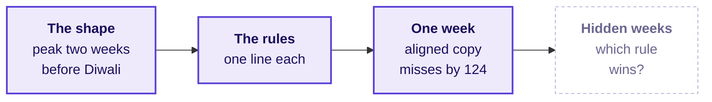

One week cannot crown a rule. **Say it to a shift supervisor:** the computer copied last year's dates, and the festival moved, so its busiest week came at the wrong time. In the M5 forecasting competition, on Walmart's daily sales of 3,049 products, the seasonal naive (there, the same weekday a week earlier) scored 0.847 against 1.752 for naive on M5's weighted scaled error, lower being better, and only 35.8 percent of the competing teams beat it; the winner, a machine-learning method, reached 0.520 (M5 results workbook and accuracy paper, checked 12 October 2026).

```notes
LIVE, 3 minutes. Read the map left to right; the dashed box is chapter 6. Transition: chapter 6, the
hold-out.
```

---

## SECTION 6: Holding out and the vendor curve tested, on thirteen hidden weeks: which rule wins?
*Score every rule and the vendor's curve on thirteen weeks none of them saw, which way each is wrong, and what each direction costs.*

```notes
LIVE, 1 minute. Case part 2 of 3, levels L2 and L3, round two of the tournament. Applies chapters 2, 3
and 4. Notebook 06 runs alongside. Transition: the questions.
```

---

## S49. Five questions before the scoreboard
*Who needs the score, and which questions lead to it?*

**Applies.** Chapter 2, the baselines; chapter 3, holding out, MAE and MAPE in the business's units; chapter 4, beating the baseline and the vendor curve tested.

**Who needs the answer.** The regional operations head, who must say yes or no to the vendor's plus 22 percent before a single shift is booked.

```timeline
label: Hide | title: Which weeks? | body: The last thirteen, forecast from one origin.
label: Count | title: How is a miss counted? | body: The average miss in shipments.
label: Score | title: Which rule wins? | body: Four rules on the hidden weeks.
label: Fit | title: What does a fit say? | body: The vendor on weeks it never saw.
label: Price | title: What do misses cost? | body: Rs 25 late, Rs 5.42 spare (Rs 650 / 120). | tone: dark
```

```notes
LIVE, 1 minute. Read the five questions. Transition: the weeks we hide.
```

---

## S50. Hide the last thirteen weeks, forecast from 22 June
*Which weeks does the test hide, and from which week is every forecast made?*

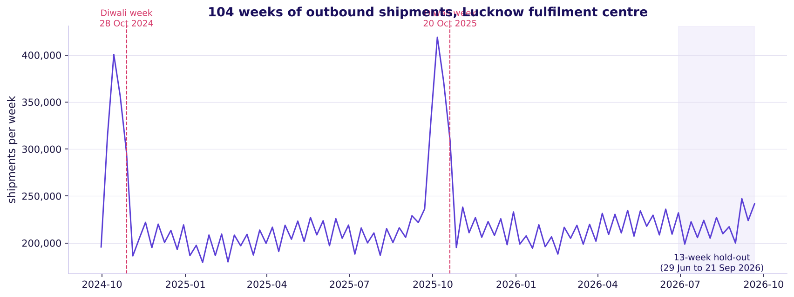

Chapter 3's rule on Flipkart's weeks: the hidden weeks are 29 June to 21 September 2026; the 91 training weeks before them are all a rule may see, and the last, 22 June, is the origin. The plan's last week, 30 November, sits ten weeks after the last week of data, so the horizon is ten weeks and thirteen hidden weeks cover it. The score is MAE in shipments, because the cost is counted per shipment.

```notes
LIVE, 3 minutes. The plan books eight weeks, but its last week is ten weeks past the data, and the
horizon is the farthest week ahead. Point at the August sale inside the hidden weeks: a copy of last
year knows about it, naive does not. Explorer: scene F2, the split slider. Transition: the vote.
```

---

## S51. Which rule scores lowest on hidden weeks?
*Before the scoreboard runs, which rule misses least on thirteen weeks it never saw?*

```cards
icon: list | eyebrow: a | title: Naive | body: Repeat the week of 22 June. | tone: light
icon: list | eyebrow: b | title: Drift | body: The line from the first week through 22 June. | tone: light
icon: list | eyebrow: c | title: The house bot | body: Copy the same week of 2025. | tone: light
icon: list | eyebrow: d | title: Festival-aligned | body: The bot plus 4 percent here, tied with finance's rule. | tone: light
```

```notes
LIVE, 3 minutes. The room answers before the scoreboard runs, as learners do on Brilliant. Option d
names the tie on purpose, and the next slide says why. Transition: the answer.
```

---

## S52. Answer: festival-aligned and finance tie, 6,615
*How did each rule score on the thirteen hidden weeks?*

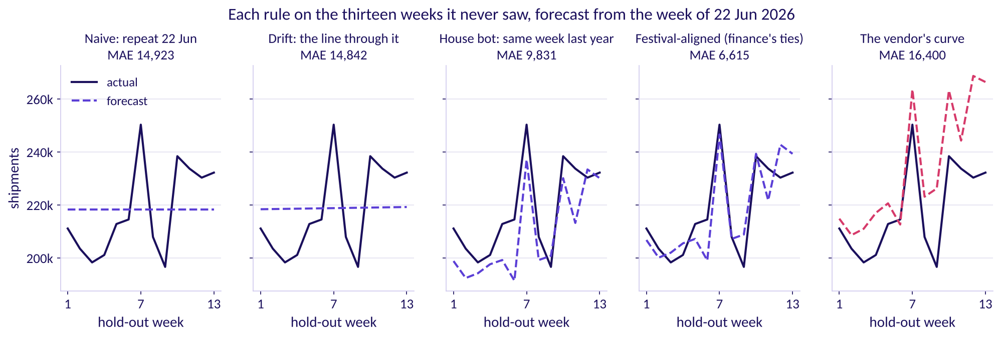

Festival-aligned and finance's rule miss by 6,615 shipments a week, the house bot by 9,831, drift by 14,842 and naive by 14,923. The tie is honest: no hidden week falls between five weeks before a Diwali week and four after, so both rules copy the same week of 2025 and add the same 4 percent. They part only in the festive weeks, which this test does not hold.

```notes
LIVE, 5 minutes. The chart uses Tufte's small multiples, one rule per panel on the same axes. The bot
beats naive because it carries the August sale; it loses to the 4 percent rules because a growing
series makes last year too low, the stall's lesson from chapter 2. Transition: the vendor.
```

---

## S53. Does a curve that fits history beat the bot?
*The vendor's sponsor says its curve sits within 2 percent of every week it was fitted to. Will it beat the house bot on the hidden weeks?*

```cards
icon: list | eyebrow: a | title: Yes, by a wide margin | body: A model that close to history has learned the series. | tone: light
icon: list | eyebrow: b | title: Yes, narrowly | body: It knows the season the bot copies. | tone: light
icon: list | eyebrow: c | title: No, it loses to the bot | body: A fit is drawn through weeks it has seen. | tone: light
icon: list | eyebrow: d | title: It ties festival-aligned | body: Both end near 6,615. | tone: light
```

```notes
LIVE, 3 minutes. Vote first. Then every learner types the vendor's score into notebook 06's empty
cell and reads the number aloud. Chapter 4's curve through four days is the same mistake at a
stall's size. Transition: the answer.
```

---

## S54. Answer: no, it misses by 16,400 a week
*What does the vendor's fit say about its forecast?*

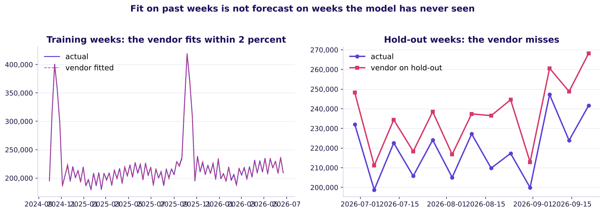

**The plausible wrong number:** "within 2 percent of every week, so its plus 22 can be trusted"; its worst fitted week is 1.4 percent off. **The decision it misleads:** a plan 22 percent above last year. **The check:** its error on weeks it never saw, 16,400 a week, 67 percent worse than the house bot. **The fix:** nothing goes to the plan unless it beats the bot there.

```notes
LIVE, 4 minutes. Read the left of the chart, then the right. A fit is drawn through weeks the model
has seen; a forecast is made for weeks it has not. Transition: which way each rule is wrong.
```

---

## S55. Whose misses cost least, once priced?
*A late shipment costs Rs 25 and a spare one Rs 5.42. Whose thirteen misses cost the least?*

```cards
icon: list | eyebrow: a | title: Festival-aligned | body: The lowest MAE, 6,615. | tone: light
icon: list | eyebrow: b | title: The vendor | body: The highest MAE, 16,400. | tone: light
icon: list | eyebrow: c | title: The house bot | body: MAE 9,831. | tone: light
icon: list | eyebrow: d | title: Naive | body: MAE 14,923. | tone: light
```

```notes
LIVE, 3 minutes. The idle cost is Rs 650 / 120 = Rs 5.42 for each shipment of spare capacity. Ask
which way each rule's misses run before anyone votes: chapter 3's lean, at Flipkart's size.
Transition: the answer.
```

---

## S56. Answer: the vendor's, at Rs 11.9 lakh
*What do the same misses cost in rupees, and why does the order change?*

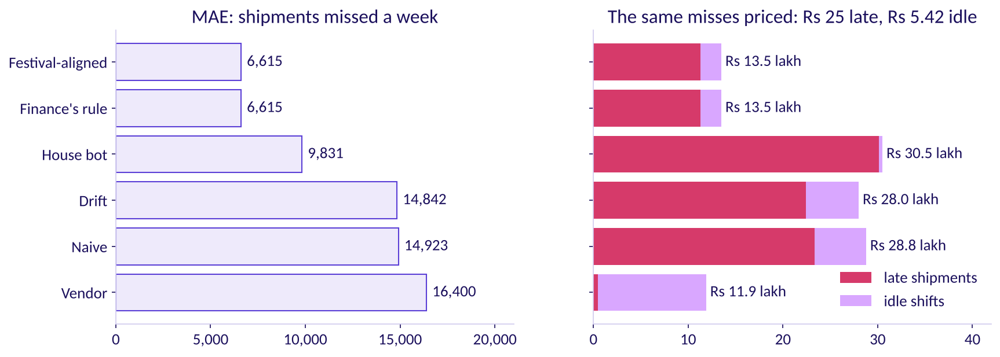

The vendor errs high on 12 of 13 weeks, and a spare shipment is the cheap kind of miss: Rs 11.9 lakh against Rs 13.5 lakh for festival-aligned, each added over the thirteen weeks. The house bot errs low on 11 of 13 weeks and costs Rs 30.5 lakh, more than naive's Rs 28.8 lakh, with a lower MAE. Priced, a forecast that errs high can cost less than one that misses less.

```notes
LIVE, 3 minutes. Let the result stand; it is true of this data. The room should leave with the
reason: a late shipment costs 4.6 times a spare one, the stall's Rs 12 against Rs 6 at Flipkart's
scale. Transition: why the vendor still does not win.
```

---

## S57. Cheap misses do not win the vendor the plan
*If its misses cost least, why does the vendor's curve still lose the plan?*

```cards
icon: ruler | eyebrow: Unsized | title: Nobody chose how high it runs | body: So nobody knows how high it will run in October. | tone: light
icon: trending-up | eyebrow: Growing | title: It climbs with the weeks ahead | body: 3.6 percent too high in hidden weeks 1 to 6, 11.5 percent in weeks 8 to 13. | tone: light
icon: calendar-x | eyebrow: Untested | title: No festival in the test | body: In the festive weeks it copies 2025's calendar, the wrong weeks. | tone: light
icon: badge-check | eyebrow: The fix | title: Send festival-aligned, priced | body: A forecast that beat the bot, with its error bar in rupees each way. | tone: dark
```

```notes
LIVE, 2 minutes. The plan's case rests on two things this hold-out cannot test: the festival's
placement, which chapter 7 tests on 2025's festival, and how high to lean, which the plan quantile
sizes beyond today's row (the fallback hour, and notebook 07's depth section). Transition: the same
score a second way.
```

---

## S58. Second route: 85,996 missed, over 13 weeks
*Does the scoreboard's 6,615 survive a count by hand from the printed misses?*

```stats
value: 40,748 | label: shipments too high | note: festival-aligned above the actual, summed over its 6 high weeks
value: 45,248 | label: shipments too low | note: below the actual, summed over the other 7
value: 6,615 | label: per week | note: (40,748 + 45,248) / 13 = 85,996 / 13
```

Notebook 06's last table prints the thirteen misses; added up, they give the same 6,615. The split also says the forecast errs neither way here: 6 weeks high, 7 low.

```notes
LIVE, 1 minute. Notebook 06 prints the thirteen misses; the last cell adds them. Transition:
chapter 6's answers.
```

---

## S59. Chapter 6: fit is not forecast; price the miss
*What did the hidden weeks settle, and what can they not test?*

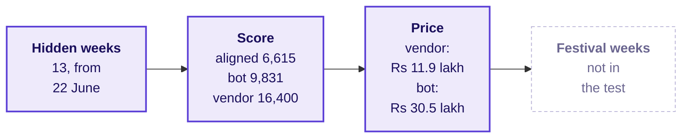

On 1,045 monthly series, statistical methods beat the machine-learning ones at every horizon tested, and even Naive 2, a seasonal random walk, beat half of them one step ahead (Makridakis and colleagues, PLOS ONE, 2018); in the M5 competition machine learning took every top place. Either way the winner was decided on weeks the model never saw (both checked 12 October 2026). Chapter 4's **good enough** asks the afternoon's question: would a better forecast book different shifts?

```notes
LIVE, 1 minute. Lunch follows; the afternoon opens on chapter 7. Transition: lunch, then half two.
```
