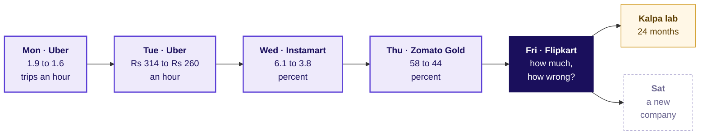
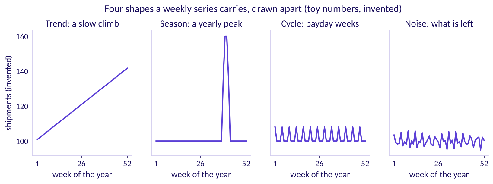
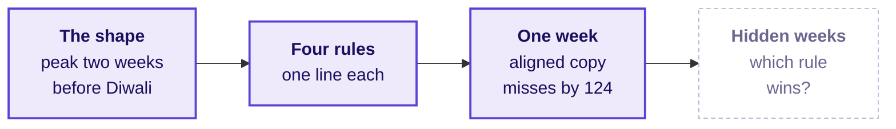
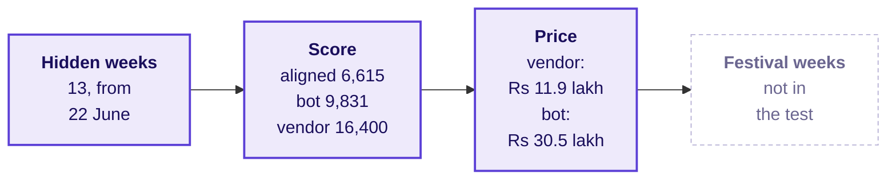
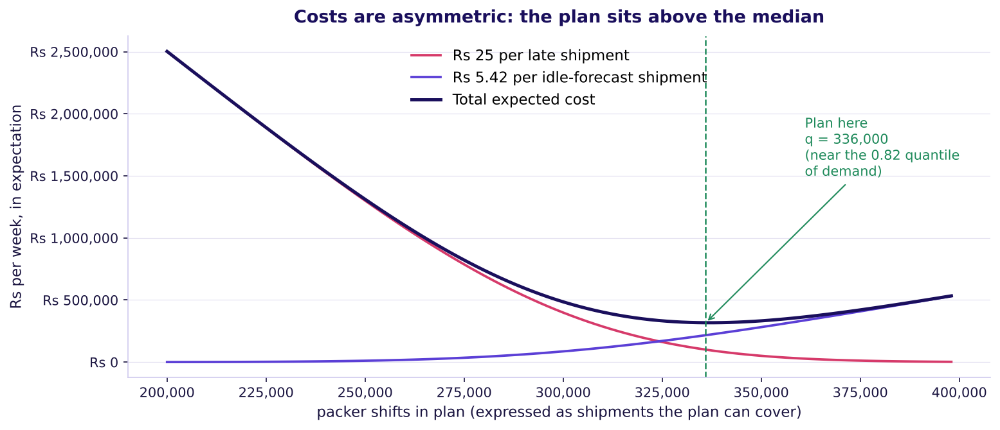
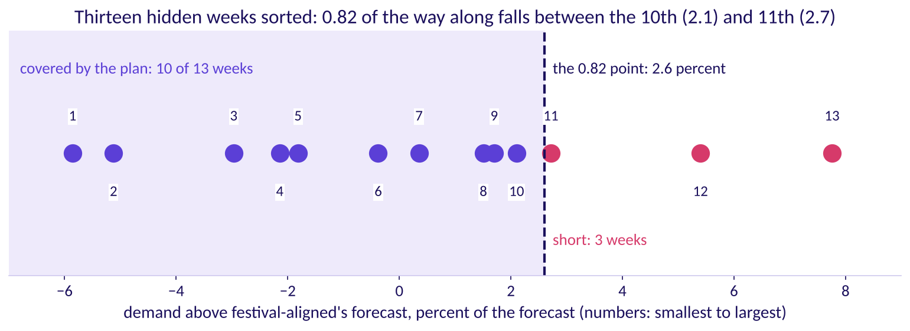

# Flipkart Lucknow: festive forecasts 18 points apart

Week 4, Day 5. Half one.

Header: WEEK 4  ·  FRIDAY  ·  FLIPKART, LUCKNOW  ·  ILLUSTRATIVE CASE

---

## S1. Two forecasts for one festive window, 18 points apart
*What has the planner been handed, and what is due Friday?*

| On the ticket | What it says |
|---|---|
| Company, city, surface | Flipkart, the Lucknow fulfilment centre (FC), the warehouse where orders are packed and shipped: outbound shipments and packer shifts |
| The history | 104 weeks, the weeks beginning Monday 30 September 2024 to Monday 21 September 2026; an ordinary week in late 2024 ships about 210,000 |
| The festival | Diwali fell on Thursday 31 October 2024 and Monday 20 October 2025, and falls on Sunday 8 November 2026; the calendar table flags each year's festive sale weeks |
| The two forecasts | A vendor's model promises the window, the eight weeks to staff, 22 percent above the same weeks last year; finance's rule is those weeks plus 4 percent: eighteen percentage points apart. The vendor's sponsor, the manager who brought the model in, backs the 22 |
| The data | `weekly_shipments` (week_start, shipments, packer_shifts_worked, overtime_shifts); `vendor_forecast` (week_start, vendor_shipments, kind: fitted for weeks the model was built on, holdout for its forecasts of the hidden weeks, forecast for the weeks ahead); `calendar` (week_start, diwali_week, sale_week); `costs` (item, rs, low, high) |
| The costs, assumed | A packer packs about 120 shipments a shift; a packer-shift is one packer working one shift. A late shipment costs Rs 25 (range Rs 15 to 40). An idle packer-shift costs Rs 650 (range Rs 500 to 800), so a spare shipment, planned for and never shipped, costs Rs 650 / 120 = Rs 5.42 |
| The ask, due Friday | Which forecast goes to the plan for the eight weeks beginning 12 October to 30 November 2026, how wrong could it be, and how many packer shifts a week |
| Caveats | The festival moves by weeks each year and the sale weeks move with it; two years hold two festivals; a late shipment costs more than an idle shift; peak weeks are capped by the centre's own capacity |

Illustrative case: the company is real, the situation and the data are synthetic, built for this class.

```notes
LIVE, 5 minutes, on screen as the room sits down. Read the title, then the table top to bottom, then
the label line. Today is a tournament in three rounds: count by hand, score on hidden weeks, then
place the festival and price the plan. Define one word as it appears: a forecast is a number for
a week nobody has seen yet. Point at
the four tables and their columns; every number today comes from them. Ask the room what would
make each forecast wrong, and write the answers on the board without judging them. Transition:
where today sits in the week.
```

---

## S2. Friday asks how much is coming, and how wrong
*Where does today's ticket sit among the week's five?*



Each day asked what a number is compared with, and each node carries the number its day moved.

```notes
LIVE, 2 minutes. Read the earlier nodes with their numbers: each was a number the room produced
on its day. Monday's guardrails bound what a forecast may chase, Thursday's cohorts gave the
week a time axis, and today asks what the plan will be held to. The Kalpa node is the lab after
class. Explorer: the home screen, Friday lit. Transition: where today ends.
```

---

## S3. Where today ends: 20,275 shifts, a bar in rupees
*What will the planner carry out of the room?*

```cards
icon: badge-check | eyebrow: The plan | title: 20,275 packer shifts | body: Over the eight weeks, peaking at 3,719 in the week of 19 October, from a forecast that keeps each week's distance from Diwali. | tone: dark
icon: ruler | eyebrow: The error bar: how wrong it could be | title: 6,615 shipments a week | body: The forecast's average miss on thirteen weeks it never saw: about Rs 35,800 of idle shifts when it runs that far high, Rs 1.65 lakh of late shipments when that far low. | tone: light
icon: scale | eyebrow: The two forecasts | title: Neither carries the plan | body: The vendor loses to a copy of last year on hidden weeks; finance's rule copies the calendar, which round three tests. | tone: light
```

**The tournament's rule.** Nothing goes to the plan unless it beats the house bot, a copy of the same week last year, on the same thirteen hidden weeks, by the same measure: the average miss in shipments, then priced in rupees.

```notes
LIVE, 3 minutes. Show the finished answer once, then earn it. The rule is fixed now, before anyone
scores: mean absolute error in shipments on the thirteen held-out weeks, then the same misses
priced. Groups enter their own hand rule in round one. Transition: chapter 1, counting by hand.
```

---

## SECTION 1: What shape do the weeks have?
*What shape do the 104 weeks have, and what would three simple rules say for one week before any code opens?*

```notes
LIVE, 1 minute. Chapter 1 of 3, level L1, round one of the tournament. Twelve printed weeks per
table; no laptop opens in this chapter. Transition: the questions.
```

---

## S4. Four questions, climbed by hand
*Who needs the answer, and which questions lead to it?*

**Who needs the answer.** The FC planner, who books shifts weeks ahead and cannot add one on the day: a rule that puts the busiest week in the wrong place books packers for a quiet week.

```timeline
label: Shape | title: Where is the peak? | body: Which week of the season ships the most, in each year?
label: Rules | title: What do rules copy? | body: Naive, same week last year, drift and festival-aligned, each in one line.
label: One week | title: Which lands closest? | body: Three rules for Diwali 2025's own week.
label: The trap | title: Which week moves? | body: Where a copy of last year puts the peak. | tone: dark
```

```notes
LIVE, 2 minutes. Read the four questions. Each gets a number before the next is asked.
Transition: the first question, voted before anything is shown.
```

---

## S5. Which week of the festive season ships most?
*Two festivals, six weeks each: where does the peak sit, before you see a bar?*

```cards
icon: calendar | eyebrow: a | title: Diwali's own week | body: The festival is the moment people shop. | tone: light
icon: calendar | eyebrow: b | title: The week before Diwali's week | body: The last full week before the festival. | tone: light
icon: calendar | eyebrow: c | title: Two weeks before Diwali's week | body: Early enough for parcels to arrive. | tone: light
icon: calendar | eyebrow: d | title: The week after Diwali's week | body: Gifts bought late, shipped late. | tone: light
```

```notes
LIVE, 3 minutes. Each group holds up a letter. Two minutes for neighbours to argue, then vote again.
Keep both counts on the board. Transition: the twelve weeks.
```

---

## S6. Answer: two weeks before Diwali, in both years
*What did the twelve weeks around two Diwalis ship?*


The busiest week is two weeks before Diwali's week both times: 401,000 shipments in the week of 14 October 2024 and 418,200 in the week of 6 October 2025. Both fall in the festive sale, which the calendar table flags in the third and second weeks before Diwali's week. Diwali's own week ships 296,900 and 308,900, and the week after is the lowest.

```notes
LIVE, 5 minutes. Count aloud left to right, StatQuest style. Parcels leave the centre with the
sale, before the festival, so they arrive in time, which is why the peak comes early. If most of the room voted a,
ask what a customer does on Diwali itself. Transition: what a weekly series is made of.
```

---

## S7. A weekly series carries four shapes at once
*What do you read off a series before any rule is chosen?*



Read them in this order: the slow climb (trend), the repeat on a fixed beat, yearly here (season), the rise and fall with no fixed length (cycle) and what is left over (noise). A series can carry more than one season. A planner books against the first three and buys a cushion for the fourth. The numbers are invented so each shape stands alone.

```notes
LIVE, 3 minutes. 3Blue1Brown's move: the picture first, the names after. The real series has a
growth of about 4 percent a year (trend), two seasons, the festival each year and the week holding
the 1st of each month, no cycle two years can show, and a wobble of a few percent (noise). The
definitions follow Forecasting: Principles and Practice, section 2.3. Explorer: scene F1, the
season slider. Transition: four rules.
```

---

## S8. Four rules, each a single line of copying
*What does each simple forecasting rule copy from the past?*

| Rule | What it copies | On a canteen's tea (invented) |
|---|---|---|
| Naive | The last value | 50, 52, 49 and 51 cups on four days, so tomorrow is 51 |
| Same week last year: the house bot, or seasonal copy | The same point one season back, here 52 weeks | Sundays sell about 80, so next Sunday is 80 |
| Drift | The line from the first value to the last, extended | 51 plus the average step, (51 - 50) / 3: about 51.3 |
| Festival-aligned | From five weeks before Diwali's week to four after, the week at the same distance from last year's Diwali; otherwise the same calendar week; then plus 4 percent, the growth the two years show | No canteen version: it exists because the festival moves |

```notes
LIVE, 4 minutes. Read each rule as one sentence a shift supervisor could repeat. A baseline is a
simple rule any model must beat, and the house bot is the tournament's. The 4 percent is measured:
notebook 02 sets the latest 39 training weeks against the same weeks a year earlier and gets 4.0
percent, the same figure finance uses. Transition: the three rules on one real week.
```

---

## S9. Which rule lands closest on Diwali 2025's week?
*From the week of 13 October 2025, which rule best forecasts the week of 20 October?*

```cards
icon: list | eyebrow: a | title: Naive | body: Repeat the week of 13 October 2025. | tone: light
icon: list | eyebrow: b | title: Same week last year | body: Copy the week of 21 October 2024, 52 weeks back. | tone: light
icon: list | eyebrow: c | title: Festival-aligned | body: Copy Diwali 2024's own week, 28 October, and add 4 percent. | tone: light
icon: list | eyebrow: d | title: All three within 10,000 | body: One week ahead, every rule is close. | tone: light
```

```notes
LIVE, 3 minutes. Groups work each rule on the twelve printed rows before voting. The actual that
week was 308,900; do not show it until the vote. Transition: the answer.
```

---

## S10. Answer: festival-aligned, within 124 shipments
*What did each rule forecast for the week of 20 October 2025, and by how much did it miss?*

| Rule | The week it copies | Forecast | Miss |
|---|---|---|---|
| Naive | 13 October 2025 | 369,000 | 60,100 too high |
| Same week last year | 21 October 2024 | 356,200 | 47,300 too high |
| Festival-aligned | 28 October 2024, plus 4 percent | 308,776 | 124 too low |

308,900 shipped. The week 52 weeks back looks like "the same week", but in 2024 it was the week before Diwali, and the week before Diwali ships more than Diwali's own week.

```notes
LIVE, 4 minutes. Do the festival-aligned arithmetic aloud: 296,900 times 1.04 is 308,776. Ask
which group's own rule came closest. Transition: the trap hidden in the copy.
```

---

## S11. The copy of last year lands 2025's peak late
*Where does a same-week-last-year copy put the peak when Diwali moves?*


**The plausible wrong number.** The copy books 401,000 for the week of 13 October 2025, its biggest week, while 369,000 shipped; the real peak, 418,200 on 6 October, gets 312,900. **The decision it misleads:** the most packers booked a week after the rush. **The check:** line the years up by weeks from Diwali, as on the right. **The fix:** festival-aligned.

```notes
LIVE, 5 minutes. Diwali's week came one week earlier in 2025, so every calendar copy is a week out.
Veritasium's move: the reveal follows the vote of S9. Transition: where Diwali falls in 2026.
```

---

## S12. In 2026 Diwali's week moves two weeks later
*Where does Diwali fall in 2026, against the two years the rules copy?*


Diwali 2026 falls on Sunday 8 November, so its week begins 2 November, 54 weeks after Diwali 2025's week and two weeks later in the calendar. Hold one question for round three: where will a copy of last year put this year's rush?

```notes
LIVE, 3 minutes. Count the Mondays on the strip with the room. Do not answer where the copy lands:
round three asks it on S28, and the festival calendar card answers it on S29. Explorer: scene F3,
the Diwali slider. Transition: the real company.
```

---

## S13. Flipkart books its festive capacity weeks ahead
*Which real decisions does a festive forecast feed?*

| | |
|---|---|
| What Flipkart said (6 October 2026) | Ekart, the supply chain behind Flipkart's deliveries, added 14 million cubic feet of warehousing space ahead of The Big Billion Days, Flipkart's yearly festive sale, and more than 2.5 lakh direct and indirect festive employment opportunities were created (Flipkart's announcement, checked 12 October 2026) |
| When it was decided | Before the sale opened, so the space and the people rested on a forecast made weeks earlier |
| What a senior analyst checks | Whether the forecast behind the booking beat a simple copy of last year, and whether it put the festival in the right week |

```notes
LIVE, 2 minutes. These are Flipkart's own published numbers; everything else today is this class's
synthetic data. Read them as decisions already in motion. Transition: chapter 1's answers.
```

---

## S14. Chapter 1: the peak sits two weeks before Diwali
*What did counting twelve weeks by hand settle, and what does it leave open?*



One week cannot crown a rule. **Say it to a shift supervisor:** the computer copied last year's dates, and the festival moved, so its busiest week came at the wrong time. In the M5 forecasting competition, on Walmart's daily sales of 3,049 products, the house bot's rule one season back (there, the same weekday a week earlier) scored 0.847 against 1.752 for naive on M5's weighted scaled error, lower being better, and only 35.8 percent of the competing teams beat it; the winner, a machine-learning method, reached 0.520 (M5 results workbook and accuracy paper, checked 12 October 2026).

```notes
LIVE, 2 minutes. Read the map left to right; the dashed box is chapter 2. Transition: chapter 2,
the hold-out.
```

---

## SECTION 2: Which rule wins on hidden weeks?
*How does each rule score on the thirteen weeks it never saw, which way is each wrong, and what does each direction cost?*

```notes
LIVE, 1 minute. Chapter 2 of 3, levels L2 and L3, round two of the tournament. Notebook 02 runs
alongside. Transition: the questions.
```

---

## S15. Five questions before the scoreboard
*Who needs the score, and which questions lead to it?*

**Who needs the answer.** The regional operations head, who must say yes or no to the vendor's plus 22 percent before a single shift is booked.

```timeline
label: Hide | title: Which weeks? | body: The last thirteen, forecast from one origin.
label: Count | title: How is a miss counted? | body: The average miss in shipments.
label: Score | title: Which rule wins? | body: Four rules on the hidden weeks.
label: Fit | title: What does a fit say? | body: The vendor on weeks it never saw.
label: Price | title: What do misses cost? | body: Rs 25 late, Rs 5.42 spare (Rs 650 / 120). | tone: dark
```

```notes
LIVE, 1 minute. Read the five questions. Transition: the weeks we hide.
```

---

## S16. Hide the last thirteen weeks, forecast from 22 June
*Which weeks does the test hide, and from which week is every forecast made?*


The **hidden weeks** (the hold-out, or test set) are kept from every rule: 29 June to 21 September 2026. The 91 **training weeks** before them are all a rule may see; the last, 22 June, is the **origin** every forecast is made from. The plan's last week, 30 November, sits ten weeks after the last week of data, 21 September: that reach, ten weeks, is the **horizon**, and the test should be at least as long (Forecasting: Principles and Practice, section 5.8, checked 12 October 2026).

```notes
LIVE, 4 minutes. Thirteen hidden weeks cover the ten-week horizon with room. The plan books eight
weeks, but its last week is ten weeks past the data, and the horizon is the farthest week ahead. Point at the
August sale inside the hidden weeks: a copy of last year knows about it, naive does not. Explorer: scene F2, the split
slider. Transition: how a miss is counted.
```

---

## S17. MAE: the average miss, counted in shipments
*How is one number made from thirteen misses, and why shipments?*

```stats
value: 8.3 | label: MAE on three invented weeks | note: misses of 10, 5 and 10 shipments, one of them too low: (10 + 5 + 10) / 3
value: shipments | label: the unit | note: a miss is priced per shipment, so the score stays in shipments
value: fixed first | label: the rule | note: the measure is chosen before anyone sees a score
```

Mean absolute error drops each miss's sign and averages. **MAPE**, the mean absolute percentage error, averages misses as percents of what shipped: useful across centres of different sizes, but the costs here are per shipment, and 2 percent of a peak week is twice the shipments of 2 percent of a quiet one. The sign comes back on S22.

```notes
LIVE, 3 minutes. Work the toy aloud. MAPE divides by the actual, so a week that ships almost
nothing makes it explode. Transition: the vote.
```

---

## S18. Which rule scores lowest on hidden weeks?
*Before the scoreboard runs, which rule misses least on thirteen weeks it never saw?*

```cards
icon: list | eyebrow: a | title: Naive | body: Repeat the week of 22 June. | tone: light
icon: list | eyebrow: b | title: Drift | body: The line from the first week through 22 June. | tone: light
icon: list | eyebrow: c | title: The house bot | body: Copy the same week of 2025. | tone: light
icon: list | eyebrow: d | title: Festival-aligned | body: The bot plus 4 percent here, tied with finance's rule. | tone: light
```

```notes
LIVE, 3 minutes. Brilliant's move: the room answers before the scoreboard. Note the tie in d is
announced, not hidden: the next slide says why. Transition: the answer.
```

---

## S19. Answer: festival-aligned and finance tie, 6,615
*How did each rule score on the thirteen hidden weeks?*


Festival-aligned and finance's rule miss by 6,615 shipments a week, the house bot by 9,831, drift by 14,842 and naive by 14,923. The tie is honest: no hidden week falls between five weeks before a Diwali week and four after, so both rules copy the same week of 2025 and add the same 4 percent. They part only in the festive weeks, which this test does not hold.

```notes
LIVE, 5 minutes. Tufte's small multiples: one rule per panel on the same axes. The bot beats naive
because it carries the August sale; it loses to the 4 percent rules because a growing series
makes last year too low. Transition: the vendor.
```

---

## S20. Does a curve that fits history beat the bot?
*The vendor's sponsor says its curve sits within 2 percent of every week it was fitted to. Will it beat the house bot on the hidden weeks?*

```cards
icon: list | eyebrow: a | title: Yes, by a wide margin | body: A model that close to history has learned the series. | tone: light
icon: list | eyebrow: b | title: Yes, narrowly | body: It knows the season the bot copies. | tone: light
icon: list | eyebrow: c | title: No, it loses to the bot | body: A fit is drawn through weeks it has seen. | tone: light
icon: list | eyebrow: d | title: It ties festival-aligned | body: Both end near 6,615. | tone: light
```

```notes
LIVE, 3 minutes. Vote first. Then every learner types the vendor's score into notebook 02's empty
cell and reads the number aloud. Transition: the answer.
```

---

## S21. Answer: no, it misses by 16,400 a week
*What does the vendor's fit say about its forecast?*


**The plausible wrong number:** "within 2 percent of every week, so its plus 22 can be trusted"; its worst fitted week is 1.4 percent off. **The decision it misleads:** a plan 22 percent above last year. **The check:** its error on weeks it never saw, 16,400 a week, 67 percent worse than the house bot. **The fix:** nothing goes to the plan unless it beats the bot there.

```notes
LIVE, 5 minutes. Read the left of the chart, then the right. A fit is drawn through weeks the model
has seen; a forecast is made for weeks it has not. Transition: which way each rule is wrong.
```

---

## S22. Whose misses cost least, once priced?
*A late shipment costs Rs 25 and a spare one Rs 5.42. Whose thirteen misses cost the least?*

```cards
icon: list | eyebrow: a | title: Festival-aligned | body: The lowest MAE, 6,615. | tone: light
icon: list | eyebrow: b | title: The vendor | body: The highest MAE, 16,400. | tone: light
icon: list | eyebrow: c | title: The house bot | body: MAE 9,831. | tone: light
icon: list | eyebrow: d | title: Naive | body: MAE 14,923. | tone: light
```

```notes
LIVE, 3 minutes. The idle cost is Rs 650 / 120 = Rs 5.42 for each shipment of spare capacity.
Ask which way each rule's misses run before anyone votes. Transition: the answer.
```

---

## S23. Answer: the vendor's, at Rs 11.9 lakh
*What do the same misses cost in rupees, and why does the order change?*


The vendor errs high on 12 of 13 weeks, and a spare shipment is the cheap kind of miss: Rs 11.9 lakh against Rs 13.5 lakh for festival-aligned, each added over the thirteen weeks. The house bot errs low on 11 of 13 weeks and costs Rs 30.5 lakh, more than naive's Rs 28.8 lakh, with a lower MAE. Priced, a forecast that errs high can cost less than one that misses less.

```notes
LIVE, 4 minutes. Let the result stand; it is true of this data. The room should leave with the
reason: a late shipment costs 4.6 times a spare one. Transition: why the vendor still does not win.
```

---

## S24. Cheap misses do not win the vendor the plan
*If its misses cost least, why does the vendor's curve still lose the plan?*

```cards
icon: ruler | eyebrow: Unsized | title: Nobody chose how high it runs | body: So nobody knows how high it will run in October. | tone: light
icon: trending-up | eyebrow: Growing | title: It climbs with the weeks ahead | body: 3.6 percent too high in hidden weeks 1 to 6, 11.5 percent in weeks 8 to 13. | tone: light
icon: calendar-x | eyebrow: Untested | title: No festival in the test | body: In the festive weeks it copies 2025's calendar, the wrong weeks. | tone: light
icon: badge-check | eyebrow: The fix | title: Lean high on purpose | body: Raise festival-aligned by an amount the two costs set, which chapter 3 sizes. | tone: dark
```

```notes
LIVE, 3 minutes. The plan's case rests on two things this hold-out cannot test: the festival's
placement and the size of the cushion. Chapter 3 tests the first on 2025's festival and sizes the
second from the costs. Transition: the same score a second way.
```

---

## S25. Second route: 85,996 missed, over 13 weeks
*Does the scoreboard's 6,615 survive a count by hand from the printed misses?*

```stats
value: 40,748 | label: shipments too high | note: festival-aligned above the actual, summed over its 6 high weeks
value: 45,248 | label: shipments too low | note: below the actual, summed over the other 7
value: 6,615 | label: per week | note: (40,748 + 45,248) / 13 = 85,996 / 13
```

Notebook 02's last table prints the thirteen misses; added up, they give the same 6,615. The split also says the forecast errs neither way here: 6 weeks high, 7 low.

```notes
LIVE, 2 minutes. Notebook 02 prints the thirteen misses; the last cell adds them. Transition:
chapter 2's answers.
```

---

## S26. Chapter 2: fit is not forecast; price the miss
*What did the hidden weeks settle, and what can they not test?*



On 1,045 monthly series, statistical methods beat the machine-learning ones at every horizon tested, and even Naive 2, a seasonal random walk, beat half of them one step ahead (Makridakis and colleagues, PLOS ONE, 2018); in the M5 competition machine learning took every top place. Either way the winner was decided on weeks the model never saw (both checked 12 October 2026). **Good enough** is a claim about the decision: a better forecast is worth having only if it books different shifts.

```notes
LIVE, 2 minutes. Ten minutes' break follows. Transition: chapter 3, the festival.
```

---

## SECTION 3: Which forecast books the shifts?
*Which forecast goes to the plan, how many packer shifts a week, and what does being wrong cost in each direction?*

```notes
LIVE, 1 minute. Chapter 3 of 3, levels L3 to L5, round three of the tournament. Notebook 03 runs
alongside. Transition: the questions.
```

---

## S27. Five questions between the scores and a plan
*Who needs the plan, and which questions lead to it?*

**Who needs the answer.** The regional operations head, who answers for late parcels in the festival's busiest weeks: a plan with the peak in the wrong week pays for idle packers and late shipments in the same month.

```timeline
label: Place | title: Where is this year's peak? | body: Which week each forecast makes the busiest.
label: Evidence | title: Did placement matter before? | body: 2025's festival, forecast a month ahead.
label: Windows | title: Plus what, against what? | body: The 22 and the 4 against two windows.
label: Cushion | title: How far above? | body: The cushion two costs justify.
label: Plan | title: How many shifts? | body: Eight weeks, priced. | tone: dark
```

```notes
LIVE, 1 minute. Read the five questions. Transition: round three's reveal.
```

---

## S28. Which week does the bot make 2026's busiest?
*Copying 2025 week for week, which week of 2026 does the house bot book the most packers for?*

```cards
icon: calendar | eyebrow: a | title: 5 October 2026 | body: A week before the window the planner books. | tone: light
icon: calendar | eyebrow: b | title: 19 October 2026 | body: Two weeks before Diwali's week. | tone: light
icon: calendar | eyebrow: c | title: 26 October 2026 | body: One week before Diwali's week. | tone: light
icon: calendar | eyebrow: d | title: 2 November 2026 | body: Diwali's own week. | tone: light
```

```notes
LIVE, 3 minutes. Round three's twist: the house bot itself is wrong about which week Diwali falls
in, and the group that notices wins the plan. Vote, argue, vote again. Explorer: scene F3.
Transition: the answer.
```

---

## S29. Answer: 5 October, two weeks before the peak
*Where does each forecast put this year's busiest week?*


The house bot, finance's rule and the vendor all book their biggest week on 5 October (418,200, 434,928 and 497,900), because each copies 2025's calendar weeks. Festival-aligned books it on 19 October at 434,928, two weeks before Diwali's week of 2 November: finance's number, in the right week. Inside the window, which starts on 12 October, the calendar copies book the most for 12 October and far too little for 19 and 26 October.

```notes
LIVE, 5 minutes. Point at finance's 5 October and festival-aligned's 19 October: the same 418,200
times 1.04, two weeks apart. The vendor's model never knew the festival moved. Transition: did
the placement matter last year?
```

---

## S30. On 2025's festival the bot was a week late
*Forecast from 22 September 2025, how did the copy of 2024 do on 2025's festival?*


A **back-test** forecasts an earlier stretch as if the later weeks were unknown. Over 29 September to 17 November 2025 the house bot missed by 58,250 a week: Rs 79.8 lakh, Rs 69.6 lakh of it late shipments where the rush came before the copy expected it. Festival-aligned missed by 4,034 a week; without the 4 percent, measured only later, it missed by 10,575.

```notes
LIVE, 5 minutes. This back-test is the only festival the data can test the rules on, so it
settles placement and leaves the size of the error open. The vendor has no festive forecast to
score, only its fit. Predict before S31 appears: finance's eight weeks sit 4 percent above the
same calendar weeks of 2025; against 2025's weeks counted from Diwali, are they above or below,
and by roughly how much? Take a show of hands and write the split on the board. Transition: what
plus 22 and plus 4 measure.
```

---

## S31. Plus 22 and plus 4 measure different windows
*How does each forecast compare with last year's eight weeks, counted two ways?*

| 12 Oct to 30 Nov 2026 | Eight weeks | Against 13 Oct to 1 Dec 2025 | Against 29 Sep to 17 Nov 2025 |
|---|---|---|---|
| House bot | 1,983,300 | the same | 13.0 percent below |
| Finance's rule | 2,062,632 | 4.0 percent above | 9.5 percent below |
| Vendor | 2,419,500 | 22.0 percent above | 6.1 percent above |
| Festival-aligned | 2,370,680 | 19.5 percent above | 4.0 percent above |

Last year's same calendar weeks shipped 1,983,300; the same weeks counted from Diwali shipped 2,279,500. Finance's plus 4 is plus 4 only on the calendar weeks: against the weeks counted from Diwali it sits 9.5 percent below, and it books 308,048 shipments fewer than festival-aligned, on the costly side. The vendor's plus 22 sits 2.1 percent above festival-aligned, with its peak on the wrong week.

```notes
LIVE, 6 minutes. The calendar window holds only the tail of 2025's festival, because 2025's peak
came before 13 October; 2026's peak falls inside the window. That is why an honest forecast reads
plus 19.5 against it. Predict before S32 appears: should the plan book the forecast itself, less,
or more, and in about how many weeks of ten should it cover demand? Most rooms say the forecast
itself, covering half. Transition: how far above the forecast to plan.
```

---

## S32. A late shipment costs 4.6 times a spare one
*Why should the plan sit above the forecast, and how far?*



Raise the plan by one shipment. Over 100 weeks, if demand beats the plan in 18, that shipment saves 18 x Rs 25 = Rs 450 and wastes 82 x Rs 5.42 = Rs 444: about even. So the cheapest plan covers demand in 25 / (25 + 5.42), about 0.82, of weeks: the newsvendor rule.

```notes
LIVE, 6 minutes. Work the 100 weeks on the board first, then read the curve: the average cost of
the week of 19 October with each of the thirteen hidden-week misses tried as its demand. The total
is lowest between 2 and 3 percent above the forecast. The rule is named after a seller deciding
how many newspapers to stock. If the late cost rises toward Rs 40, the low point moves right.
Explorer: scene F4. Transition: reading the 0.82 off thirteen weeks.
```

---

## S33. The 2.6 percent sits 0.82 along thirteen weeks
*How far above the forecast is the 0.82 point, on the weeks we hid?*



Sort the thirteen hidden weeks by how far demand came above festival-aligned: from 5.9 percent below to 7.8 percent above. The 0.82 point falls between the 10th week, 2.1 percent, and the 11th, 2.7; read 0.82 of the way along, it is 2.6 percent. The plan covers 10 of the 13 weeks, and the 11th sits just above it.

```notes
LIVE, 4 minutes. Point at the 10th and 11th dots. With thirteen weeks the true point could sit
anywhere from about 2 to 3 percent, and the curve on S32 is nearly flat there. Notebook 03 prints
the sorted list. Transition: the plan in shifts.
```

---

## S34. The plan: 20,275 packer shifts in eight weeks
*How many packer shifts does each week need, and how wrong could the plan be?*

| Week of | Forecast | Plan, plus 2.6 percent | Packer shifts |
|---|---|---|---|
| 12 Oct | 344,448 | 353,404 | 2,946 |
| 19 Oct | 434,928 | 446,236 | 3,719 |
| 26 Oct | 383,760 | 393,738 | 3,282 |
| 2 Nov | 321,256 | 329,609 | 2,747 |
| 9 Nov | 196,144 | 201,244 | 1,678 |
| 16 Nov | 237,016 | 243,178 | 2,027 |
| 23 Nov | 225,992 | 231,868 | 1,933 |
| 30 Nov | 227,136 | 233,042 | 1,943 |

Shifts are the plan over 120, rounded up: 20,275 in all, 515 more than the 19,760 the forecast alone needs. **The error bar:** the forecast missed by 6,615 shipments a week on the hidden weeks, about Rs 35,800 of idle shifts when it ran that far high and Rs 1.65 lakh of late shipments when that far low, and by 4,034 a week on 2025's festival. For 19 October, demand at the hidden weeks' extremes would need 3,413 to 3,906 shifts against the 3,719 booked.

```notes
LIVE, 6 minutes. Walk the first two rows aloud: 344,448 times 1.026 is 353,404, over 120 and rounded
up is 2,946 shifts. A packer-shift is one packer for one shift; how shifts become people depends on the roster,
which the ticket does not give. Transition: what the other plans would cost.
```

---

## S35. Every other plan costs at least Rs 82.2 lakh
*If demand follows the festival-aligned forecast, what does each other plan cost?*

| Plan for the eight weeks | Spare shipments | Shipments short | Cost |
|---|---|---|---|
| House bot | 48,672 | 436,052 | Rs 111.6 lakh |
| Finance's rule | 87,360 | 395,408 | Rs 103.6 lakh |
| Vendor | 310,364 | 261,544 | Rs 82.2 lakh |
| The plan, festival-aligned plus 2.6 percent | 61,639 | 0 | Rs 3.3 lakh |

A scenario, never a measurement: if festival-aligned is right about where the rush falls, this is what booking by each other forecast costs; the 2025 back-test is the evidence that it places the rush well. The cushion's Rs 3.3 lakh is what the insurance costs if demand lands exactly on the forecast.

```notes
LIVE, 4 minutes. The bot's and finance's costs are mostly late shipments in the weeks of 19
October to 2 November. Transition: what the data cannot tell us.
```

---

## S36. What two years of weeks cannot tell us
*Which doubts sit on the plan, and which fact would settle each?*

| The doubt | What we have, and what would settle it |
|---|---|
| The festival moves, and the sale moves with it | One festival, the 2025 back-test; another festival would settle it |
| Two years hold two festivals | Two examples of the festival's shape; only a third year settles it |
| The hidden weeks hold no festive week | The 2025 festival's 4,034 a week; a hold-out that spans a festival would settle it |
| Capacity caps the peak | Overtime reached 1,638 shifts in the week of 6 October 2025 against 5 in the week of 24 November 2025, so peak demand may have run above what shipped; orders that could not ship would settle it |
| Growth of 4 percent a year | Two years' evidence; a third year would settle it |
| A tax change rode on the 2025 festival | Two-wheeler sales to buyers ran at 31.5 lakh in October 2025 against 12.9 lakh in September, part of it credited to cuts in GST, India's goods and services tax (FADA, the Federation of Automobile Dealers Associations, release of 7 November 2025, checked 12 October 2026); a series with the tax change marked would settle it |

```notes
LIVE, 5 minutes. One doubt at a time, each with the fact that would settle it. The FADA figure is
a national series; it shows a festive month confounded by a tax change, a warning for any model
trained on national data. Transition: the two role cards.
```

---

## S37. Close: beat the bot, place the festival, price it
*What do finance and the vendor's sponsor hear, and what does the morning leave on the board?*

```cards
icon: calculator | eyebrow: To finance | title: Right growth, wrong weeks | body: Your 4 percent is the growth two years show. Copied by calendar, it puts the peak on 5 October, before the plan's first week, and sits 308,048 shipments short. | tone: light
icon: trending-up | eyebrow: To the vendor's sponsor | title: A fit, never a forecast | body: Within 1.4 percent on history, and 16,400 a week off on thirteen weeks it never saw. | tone: light
icon: badge-check | eyebrow: The rule | title: Beat the bot, then place the festival | body: Score on hidden weeks in shipments and rupees; copy by distance from Diwali; cover demand in 0.82 of weeks. | tone: dark
```

```notes
LIVE, 3 minutes. Each stakeholder is partly right: concede the true part first. The afternoon
writes the staffing note from these three cards. Transition: lunch, then half two.
```
