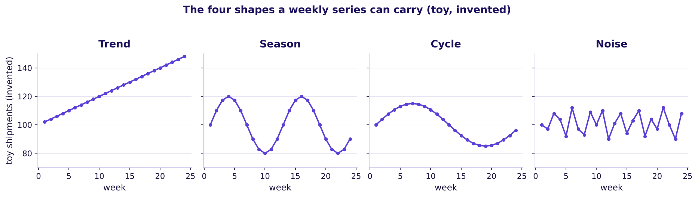
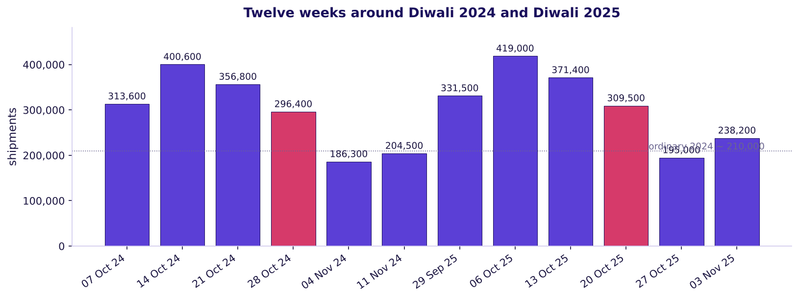
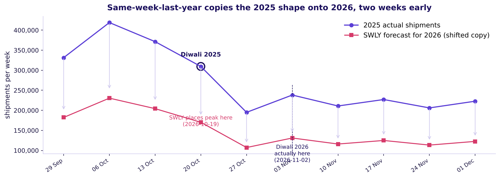
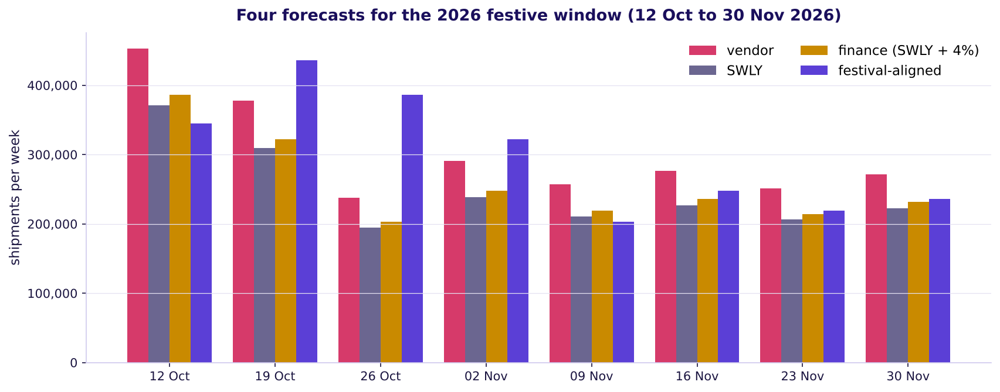

# The forecast that earns the plan's trust

Week 4, Day 5. Half one.

Kicker: WEEK 4  ·  FRIDAY  ·  MORNING
Quote: Two forecasts, eighteen points apart. Which one goes to the staffing plan, and how wrong could it be?
Who: the FC planner at Flipkart's Lucknow fulfilment centre, with the regional operations head copied

```notes
On screen before the clock starts. Leave the ticket up while the room settles. The whole room has
one week to pick a forecast: the vendor's curve promises plus 22 percent, finance's rule says plus
4, and nobody has priced being wrong in each direction. The morning climbs L1 to L5. Tuesday's war
game and Thursday's cohort split are already on the week map.
Transition: the ticket, read as an analyst would read it.
```

---

## S1. Flipkart Lucknow: 104 weeks, two forecasts, one plan
*What does the planner know, and what does the ticket ask by Friday?*

| Measure | Value |
|---|---|
| Company and surface | Flipkart, the Lucknow fulfilment centre, outbound shipments |
| History | 104 weeks of weekly shipments, Mon 30 Sep 2024 to Mon 21 Sep 2026 |
| Ordinary weekly shipments late 2024 | about 210,000 |
| Festive peak each year | three weeks before Diwali at 1.5, 1.9, 1.7 times ordinary; Diwali week at 1.4; the week after at 0.9 |
| The ask, due Friday | which forecast goes to the staffing plan for the eight festive weeks beginning 12 Oct to 30 Nov 2026, how wrong could it be, and how many packers per week |
| Illustrative case | the company is real, the situation and the data are synthetic, built for this class |

```notes
LIVE, 3 minutes. Read the ticket aloud. The company's real festive capacity (14 million cubic
feet of warehouse space added, more than 2.5 lakh festive jobs, F6) is the frame; everything else
is this class's data. Point out that the 104 weeks hold two festive peaks only, and ask whether
two festive peaks make a seasonal pattern. Leave the question open; L4 answers it.
Transition: the week map, with Monday to Thursday's numbers already on their nodes.
```

---

## S2. The week map: Friday asks how much is coming
*Where does the forecasting case sit against the four cases the week already climbed?*

```mermaid
flowchart LR
    M["<b>Mon · Uber Hyderabad</b><br/>trips per online hour<br/>1.9 to 1.6, pay for trips"]
    T["<b>Tue · Uber Hyderabad</b><br/>per-online-hour bookings<br/>Rs 314 to Rs 260"]
    W["<b>Wed · Swiggy Instamart Pune</b><br/>strip click-through<br/>6.1 to 3.8 percent"]
    H["<b>Thu · Zomato Gold Chennai</b><br/>Android checkout<br/>58 to 44 percent"]
    F["<b>Fri · Flipkart Lucknow</b><br/>festive packer headcount<br/>how wrong, in rupees?"]
    S["<b>Sat</b><br/>does the method<br/>survive a change of company?"]
    M --> T --> W --> H --> F --> S
    classDef lit fill:#1A0F5C,stroke:#1A0F5C,color:#FFFFFF
    classDef known fill:#EEEAFB,stroke:#5B3FD6,color:#1A0F5C,stroke-width:2px
    classDef unknown fill:#FFFFFF,stroke:#B8B2D6,color:#6B6690,stroke-dasharray:4 3
    class M,T,W,H known
    class F lit
    class S unknown
```



```notes
LIVE, 2 minutes. Read each node left to right so the room sees that Friday's question joins the
week's chain: Monday chose a north star that bounds the forecast, Thursday gave the forecast a
time axis, and Friday asks what the plan will be held to. Say that today's method survives on
Saturday to Ola or Rapido, Blinkit or Zepto, Amazon India and Swiggy One, and to Kalpa's four
units in the lab.
Transition: today ends with a packer plan and an error bar, which S3 shows now.
```

---

## S3. Today ends on a plan, an error bar, a shift count
*What does a learner leave the room with by the close of the afternoon?*

```cards
icon: chart-line | eyebrow: The plan | title: Festival-aligned baseline with drift | body: Shipments per week for the eight festive weeks, drawn from the series the vendor could not beat on the hold-out.
icon: shield | eyebrow: The error bar | title: Hold-out MAE | body: What the chosen method missed by, on the weeks it never saw, priced in rupees.
icon: badge-check | eyebrow: The staffing call | title: Packers per week | body: Shipments divided by 120, raised toward the 0.82 quantile of the error bar. | tone: dark
```

```notes
LIVE, 2 minutes. The three cards together are what the planner sends up by Friday. The vendor's
plus 22 percent and finance's plus 4 percent are each answered later in the deck: the vendor's
error on hold-out costs trust, and finance's rule is a festival-window naive with drift that
misses the Diwali week. The 0.82 quantile falls out of the two unit costs; L5 derives it.
Transition: the opening question of chapter 1.
```

---

## SECTION 1: What shape do the 104 weeks have?
*What do trend, season, cycle and noise look like, and how do three simple rules forecast one week?*

```notes
LIVE, 40 minutes, counting S4 to S10 at 50 and 60 and S11's hand count on the twelve rows. The
chapter opens on four small panels because we need the room to see the four shapes before any
rule names one. The twelve rows then get counted on the board; the three rules are each one
line of pandas or arithmetic. The industry example sits at the chapter close.
Transition: S4, the four shapes a weekly series can carry.
```

---

## S4. A series is trend plus season plus cycle plus noise
*Which of these four shapes do shipments at a fulfilment centre carry, and in what order should a forecaster read them?*



The four panels are toys, with numbers invented so the shapes are plain, and the real series has to be read in the same order: the long slope first, the yearly repeat second, the slower cycle third, and the week-to-week wobble last.

```notes
LIVE, 3 minutes. 3Blue1Brown's move: start from a picture the eye reads, and let the names arrive
only after the shapes are clear. The toy numbers 100 ± 50 are invented and labelled so, and the
real series lives on slide 7. Ask the room which of the four shapes a planner can plan around
(the first three; noise one has to pay for).
Transition: S5, the misconception the room has to commit to before the shape is drawn.
```

---

## S5. Vote: Diwali week or the week before, which is bigger
*Does the Diwali week carry the biggest shipment of the year, or does the week before beat it?*

**The committed prediction.** On a card, one of the two: the Diwali week is bigger because the festival is on it, or the week before is bigger because the room has to receive its parcels in time to open them.

```timeline
label: Vote 1 | title: The Diwali week itself | body: The festival week carries the peak because sales promotions crown the moment.
label: Vote 2 | title: The week before Diwali | body: Shipments go out in the week before so parcels land on doormats in time.
```

```notes
LIVE, 3 minutes. Veritasium's move: the room commits before any evidence lands. Hand out two cards
or ask for hands. Take the vote on each option, keep both counts on the board. The reveal is on
S6, where the twelve rows show the ramp peaks at ratio 1.9 two weeks before Diwali and the Diwali
week is at 1.4. The reveal lands harder because the vote is honest first.
Transition: S6, the twelve rows the hand count reads.
```

---

## S6. Twelve rows around two Diwalis, counted by hand
*What do shipments do in each of the six weeks around each Diwali, and where is the peak?*



The peak sits two weeks before Diwali in both years at 400,600 shipments in 2024 and 419,000 in 2025, while the Diwali week sits at 296,400 and 309,500. The week after Diwali falls to 186,300 and 195,000.

```notes
LIVE, 5 minutes. Walk the bars left to right. Count aloud: three weeks before Diwali 2024 sits at
313,600 (1.5 times 210,000, that week's ordinary baseline); two weeks before at 400,600 (1.9
times); one week before at 356,800 (1.7); Diwali week at 296,400 (1.4); the week after at 186,300
(0.9); the next ordinary week at 204,500. The 2025 pattern repeats the shape, with growth, and
the peak sits at 419,000 two weeks before Diwali 2025. If the room voted "Diwali week itself" on
S5, hold their vote back and ask what the two drops after the peak tell them about buyer timing.
Transition: S7, where this shape sits in the full 104 weeks.
```

---

## S7. 104 weeks hold two peaks and a hold-out window
*Where does Diwali sit in two years of weekly shipments, and which thirteen weeks will we score forecasts on?*


The lavender band in the summer of 2026 is the hold-out: the last thirteen weeks of history, Mon 29 Jun 2026 to Mon 21 Sep 2026, held back so a forecasting method is scored on weeks it has not seen.

```notes
LIVE, 4 minutes. Point out that two festive peaks is two observations in two years, which L4 will
cash in as a caveat. The hold-out shows no festival, which matters for how we judge forecasts
later: the festive weeks of 2025 are the only festival we can judge a method on. Ask the room
whether the June to September summer dip looks like noise or like a pattern. (It is a pattern,
captured by same-week-last-year.)
Transition: S8, the three simple rules on one week.
```

---

## S8. Three simple rules, one week, worked by hand
*How would naive, same-week-last-year and festival-aligned forecast the Diwali 2025 week?*

| Rule | What it does | Forecast for 2025-10-20 (Diwali week) |
|---|---|---|
| Naive | Carry forward last week's actual | 371,400 shipments (from 2025-10-13) |
| Same-week-last-year | Copy the shipment 52 Mondays earlier | 356,800 shipments (from 2024-10-21) |
| Festival-aligned with drift | Copy the week at the same offset from the previous Diwali week and add 4 percent growth | 308,256 shipments (from 2024-10-28 x 1.04) |

Actual that week: 309,500 shipments. Festival-aligned lands within 1,244; naive is 61,900 high; same-week-last-year is 47,300 high.

```notes
LIVE, 5 minutes. StatQuest's move: say every arithmetic step aloud. Naive just uses last week.
Same-week-last-year reaches 52 Mondays earlier, which is 2024-10-21 (one week before Diwali 2024,
when ratio was 1.7). Festival-aligned looks for "same offset from Diwali": 2025-10-20 is zero
weeks from Diwali 2025 (Mon 20 Oct), so the source is Diwali 2024 week (Mon 28 Oct), with
one year of 4 percent growth added. If the room thinks naive and same-week-last-year did fine,
show the hand check: both over-forecast by about 50,000 shipments.
Transition: S9, the trap the two shifts share.
```

---

## S9. The trap: SWLY lands peaks on the wrong week
*What happens when Diwali moves from one year to the next, and the forecast copies the week with the old date?*



Diwali 2025 fell on Mon 20 Oct and Diwali 2026 falls on Sun 8 Nov (week beginning Mon 2 Nov). The same-week-last-year shift takes the Diwali 2025 week shipments and places them on Mon 19 Oct 2026, two weeks before the real Diwali week.

```notes
LIVE, 4 minutes. The misconception on S5 is the first half of the trap; the second half is this:
the shift ignores the festival. The company bot that uses same-week-last-year still has the peak,
but the peak lands two weeks early. Ask the room what a plan built on that bot would do: hire
packers two weeks before the real need, idle them during the real peak, then run short. L5 prices
that miss in rupees.
Transition: S10, the real company this chapter closes on.
```

---

## S10. Flipkart decided its festive capacity weeks ahead
*Which real company shows the same question as this ticket, and what did it decide about?*

| | |
|---|---|
| The metric at stake | Festive packer and sorter capacity for the Big Billion Days window. |
| What Flipkart's own statement said (F6) | For the 2026 Big Billion Days: 14 million cubic feet of warehouse space added; more than 2.5 lakh festive jobs; 6.3 million concurrent users in a minute. |
| What that implies for the planner | Decisions about packer shifts, warehouse space and jobs are made weeks before the festival, not during it. A forecast off by 10 percent is a staffing miss nobody can fix on the day. |
| What a senior analyst checks | The baseline the vendor's model has to beat before any festive capacity is costed to it. |

```notes
LIVE, 2 minutes. The Flipkart facts are from the company's own announcement, checked 12 October
2026. Read them as decisions already in motion: the warehouse space is built, the jobs are
posted. The forecast is what the planner sends up to decide how many of those jobs are needed
in Lucknow this year. No Kalpa character comments here; this is Flipkart's chapter, so a senior
analyst's check closes it: did the model beat the baseline on weeks it had not seen?
Transition: S11, the chapter's map node is lit; S12 opens chapter 2.
```

---

## SECTION 2: Score each method on the hold-out
*What is the hold-out, what is MAE, and which method wins on weeks the model never saw?*

```notes
LIVE, 45 minutes, counting S12 to S19. Chapter 2 is the heart of the morning: hold out the last
thirteen weeks, score every method the same way, and read the scoreboard. The vendor's fit on
the training weeks is near-perfect; its hold-out MAE is 199 percent above the festival-aligned
baseline. The code-along cell runs in notebook 02.
Transition: S12, the chapter map.
```

---

## S12. Four questions before the scoreboard
*Who needs the hold-out score, and which questions lead there?*

**Who needs the answer.** The FC planner, who has to pick one forecast and defend it, and the regional operations head, who has to say yes or no to the vendor's plus 22 percent before any packer shift is booked.

```timeline
label: Question 1 | title: Why hold out | body: Why hide weeks from a forecasting method, and how many?
label: Question 2 | title: One number | body: What is MAE, and why in shipments not percent?
label: Question 3 | title: The scoreboard | body: Which method wins on the hold-out, and by how much?
label: Question 4 | title: The vendor | body: What does near-perfect fit on training weeks say about forecast accuracy? | tone: dark
```

```notes
LIVE, 1 minute. The four questions get their own slide each; the scoreboard arrives on S17.
Transition: S13, why hold out.
```

---

## S13. Hold out at least as many weeks as the horizon
*How many weeks does a planner hide, and why those weeks?*

```cards
icon: calendar | eyebrow: The horizon | title: Eight festive weeks | body: The 2026 festive window the planner must book, Mon 12 Oct to Mon 30 Nov.
icon: eye-off | eyebrow: The hold-out | title: Thirteen weeks | body: Mon 29 Jun to Mon 21 Sep 2026, hidden from every method.
icon: circle-alert | eyebrow: The rule | title: Hold out >= horizon | body: A shorter test than the horizon rewards a method that was lucky on the week after training. | tone: dark
```

The spine's "22 June to 21 September 2026" counts 14 Mondays; this day's generator uses the 13 Mondays ending Mon 21 Sep 2026, beginning Mon 29 Jun 2026.

```notes
LIVE, 3 minutes. The hold-out rule in one line: a method that cannot forecast your horizon out of
sample is not fit to be your plan. Ask the room what breaks if a model is trained to the week
before the forecast window and scored on four weeks only. Three answers come: luck shows, the
seasonality falls outside the window, and the vendor's quick-win week looks like capability.
Transition: S14, MAE in shipments.
```

---

## S14. MAE: mean absolute error, in the business's unit
*Why score forecasts in shipments rather than in percentages?*

| Toy | Values | MAE |
|---|---|---|
| Three held-out weeks' errors | 10, 5, 10 | (10 + 5 + 10) / 3 = 8.3 |
| Signed errors (plus or minus) | +10, -5, +10 | the sign is kept for L3 |

Rupees come later from the MAE, through the two unit costs: an idle packer-shift costs about Rs 5.42 per over-forecast shipment, a late shipment costs Rs 25 per under-forecast shipment, so a one-shipment miss is not always worth the same.

```notes
LIVE, 4 minutes. Why not MAPE? Because a 10 percent miss on 100,000 shipments is 10,000, and a
10 percent miss on 400,000 shipments is 40,000: the same percent is a very different staffing
decision. MAE in shipments lets the planner multiply by the per-shipment cost and get rupees.
MAPE lives in a trainer's note as an alternative, nothing more. Note that the toy's absolute
error ignores sign, which L3 picks up again.
Transition: S15, predict which method lands lowest.
```

---

## S15. Vendor fits training within 2 percent, misses hold-out
*How well does the vendor's model match the past, and does that tell us how well it will forecast the future?*


On the 91 training weeks the vendor's fitted values sit within 2 percent of the actual every week; on the thirteen hold-out weeks the vendor's MAE is about 16,985, roughly 200 percent above the festival-aligned baseline's.

```notes
LIVE, 4 minutes. Krish Naik's move: the panel on the left is what the vendor's model draws when
asked for its history, and it looks beautiful. The panel on the right is what it does on weeks
it has not seen. The gap between fit and forecast is the lesson of the day. Say that in the
notebook's code cell the vendor's prediction for each hold-out week sits 7 to 15 percent above
the actual: a pattern of over-forecasting that costs idle packer-shifts if trusted.
Transition: S16, predict which baseline wins the scoreboard.
```

---

## S16. Predict: which baseline lands lowest MAE?
*Before the scoreboard runs, which of naive, drift, same-week-last-year or festival-aligned will score best on weeks without a festival?*

```timeline
label: Vote A | title: Naive | body: Last week carries forward.
label: Vote B | title: Drift | body: Last week + the series' average weekly change.
label: Vote C | title: Same-week-last-year | body: 52 Mondays earlier.
label: Vote D | title: Festival-aligned with drift | body: Festival-aligned on festive weeks, SWLY elsewhere.
```

```notes
LIVE, 3 minutes. The hold-out holds no festival, so festival-aligned reduces to SWLY plus drift
on these weeks. The honest answer is: on summer weeks, naive and drift lose to SWLY because the
monthly seasonality SWLY captures. The vote collects the room's intuition; S17 reveals.
Transition: S17, the scoreboard.
```

---

## S17. Answer: the scoreboard
*Which method missed by how much on the hold-out?*


Naive and drift sit on top at about 22,000; the vendor curve is three times worse than festival-aligned; finance's rule and festival-aligned tie near 5,700 because the hold-out holds no festival and finance's plus 4 corrects SWLY's growth gap.

```notes
LIVE, 5 minutes. Walk the ranking from the bottom up. On this hold-out (summer, no festival),
finance's rule and festival-aligned both reduce to a 4 percent growth bump on SWLY, which the
noise cannot beat. Naive and drift lose because the monthly in-month cycle is captured by SWLY
but not by naive. The vendor is three times worse than festival-aligned. Pause here: the room
that voted on S15 can now read how far their intuition landed.
Transition: S18, direction of error, which the signed differences hid in S14.
```

---

## S18. The vendor over-forecasts almost every hold-out week
*Which direction is each method wrong in, and does the direction matter?*

| Method | Over-forecast weeks | Under-forecast weeks | Average direction |
|---|---|---|---|
| Naive | 7 of 13 | 6 of 13 | roughly balanced |
| Same-week-last-year | 11 of 13 | 2 of 13 | over, because of 4% growth |
| Vendor | 13 of 13 | 0 | over, by 10 percent on average |

An MAE of 17,000 is not one number: 13 over-forecasts in a row costs idle packer-shifts, and 13 under-forecasts in a row costs late shipments. The two cost different amounts, which L5 settles.

```notes
LIVE, 3 minutes. Direction matters because the two unit costs are not equal. Spell out the
vendor's pattern: it over-fits the 2025 festive spike and extrapolates upwards everywhere. SWLY
under-forecasts a growing series by about 4 percent, so finance (SWLY + 4 percent) corrects that
and lands close.
Transition: S19, which forecast earns the plan's trust.
```

---

## S19. The lesson: fit is not forecast
*What has chapter 2 earned, and what does it not yet answer?*

Fit on past weeks is a necessary condition for trust and never a sufficient one. The method that goes to the plan has to beat a naive baseline on weeks it has not seen, and the baseline for a seasonal business is same-week-last-year or its festival-aligned twin, not naive.

```notes
LIVE, 2 minutes. Close the chapter on this one rule and read it twice. The industry anchor is
PLOS ONE 2018 (F1): on 1,045 time series, better in-sample fit did not translate to better
out-of-sample forecasts; Naive 2 beat half the machine-learning methods tested. Save the detail
for the study notes.
Transition: S20, chapter 3 opens on the 2026 festive window the plan has to book.
```

---

## SECTION 3: Pick the forecast, price the error
*Which forecast earns the planner's trust, how wrong could it be, and what does being wrong cost in rupees?*

```notes
LIVE, 75 minutes, counting S20 to S30. Chapter 3 is the day's answer. It opens on the forecast
window, picks the forecast, sets its error bar, prices the error in rupees, and ends on the
staffing note.
Transition: S20.
```

---

## S20. The 2026 festive window, eight weeks
*Which eight weeks does the planner have to book packer shifts for?*


Diwali 2024 fell on Mon 28 Oct; Diwali 2025 on Mon 20 Oct; Diwali 2026 falls on Sun 8 Nov, so the Diwali week begins Mon 2 Nov 2026. The 2026 festive window is Mon 12 Oct to Mon 30 Nov, eight weeks that include the ramp-up and the week after.

```notes
LIVE, 3 minutes. Point out that this year's festival is in a different week from either of the
last two years: Diwali 2024 was in October, Diwali 2025 was in October, and Diwali 2026 is in
November. A method that uses the calendar week names rather than the festival position will miss.
Transition: S21, the four forecasts side by side.
```

---

## S21. Four forecasts for the eight festive weeks of 2026
*What do the vendor, SWLY, finance's rule and festival-aligned each say for each of the eight weeks?*



The vendor's forecast and finance's rule each copy the last year's calendar weeks onto this year's, so both put the biggest shipment two weeks before the real Diwali 2026 week. The festival-aligned forecast moves the shape so the peak lands two weeks before Mon 2 Nov 2026, where it actually belongs.

```notes
LIVE, 4 minutes. Each coloured group of bars is one week. The vendor's bars are the tallest
because its 22 percent is applied to the last year's shape, so its peak sits at Mon 19 Oct 2026,
two weeks early. The festival-aligned bars move the peak to Mon 26 Oct 2026, which is -1 week
from Diwali 2026. Ask: which forecast puts the biggest shipment in the right week?
Transition: S22, the predict-then-reveal that catches the bot in the wrong week.
```

---

## S22. Predict: which 2026 week carries the biggest shipment?
*If the room could see only the actual shape, which week would carry the peak?*

```cards
icon: calendar-days | eyebrow: Vote A | title: Mon 12 Oct 2026 | body: Three weeks before Diwali, ratio 1.5 on the shape.
icon: calendar-days | eyebrow: Vote B | title: Mon 19 Oct 2026 | body: Two weeks before Diwali, ratio 1.9. The peak the shape puts there.
icon: calendar-days | eyebrow: Vote C | title: Mon 26 Oct 2026 | body: One week before Diwali, ratio 1.7.
icon: calendar-days | eyebrow: Vote D | title: Mon 2 Nov 2026 | body: Diwali week, ratio 1.4. | tone: dark
```

```notes
LIVE, 3 minutes. Peer instruction: everyone picks, neighbours argue for one minute, then revote.
The right answer is B, Mon 19 Oct 2026, which is -2 weeks from Diwali 2026 (Mon 2 Nov). Reveal:
the vendor also puts its peak two weeks early, but at Mon 19 Oct 2026 by coincidence, not
because its model knows about the festival. L4 will show why that is dangerous.
Transition: S23, the sign the error carries matters now that we have a plan.
```

---

## S23. Answer: the costed miss of a wrong peak week
*What does it cost in rupees if a plan copies last year's calendar weeks and the festival has moved?*

| Direction | What happens | Shipments | Cost per shipment | Cost in rupees |
|---|---|---|---|---|
| Over-forecast in weeks early | Packers booked for weeks before demand lands, idle shifts billed | 93,970 | Rs 5.42 | about Rs 5.10 lakh |
| Under-forecast in Diwali week | Shipments late, promised delivery dates missed | 23,540 | Rs 25 | about Rs 5.88 lakh |
| Total costed miss | | | | about Rs 10.98 lakh over the eight weeks |

```notes
LIVE, 4 minutes. Walk the two rows: the SWLY (bot) forecast places the peak at Mon 19 Oct 2026
but demand peaks at the same week only by chance. Over the eight weeks it over-forecasts by
94,000 shipments in aggregate and under-forecasts by 24,000. The two columns in rupees are the
cost of trusting a method that does not know about the festival; the festival-aligned baseline
cuts both. Note that the Rs 5.42 is 650 divided by 120 packer-shifts per shipment-equivalent, and
Rs 25 is the late-shipment cost; both are labelled assumptions with ranges.
Transition: S24, L4's six caveats before the plan is signed.
```

---

## SECTION 4: What can two years of weeks not tell us?
*Which caveats sit on the forecast, and which fact would settle each?*

```notes
LIVE, keeps the chapter break; S24 to S29 are seven caveat slides.
Transition: S24, the caveats slide.
```

---

## S24. Six caveats, one check for each
*Which questions does the data not answer, and which fact would settle each?*

| Caveat | What it says | The check that would settle it |
|---|---|---|
| The festival moves | And the sale moves with it; a model trained on calendar weeks mislocates both | The 2025 window re-forecast from data to September 2025 by both baselines, errors priced |
| One spike a year | Two Diwalis in 104 weeks is two observations | Said aloud; no in-data check closes it |
| GST cut 2025 | FADA (F5) says October 2025 two-wheeler retail 31,49,846 against 12,87,735 in September, part credited to GST cuts | A national series the vendor trained on may carry it; our centre's series does not report it directly |
| No history | A new model with no Lucknow history is an assumption (Target Canada, F4) | Fit the model on another FC's series first and judge errors there |
| The hold-out holds no festival | So any festival error is judged on 2025 alone | 2025 festive weeks' errors reported separately |
| Capacity clips demand | The series is demand clipped by the centre's capacity in peak weeks | Peak-week shipments as a share of capacity shown beside the series |

```notes
LIVE, 5 minutes. Walk one caveat at a time. The point is honesty: the plan carries each caveat
on the appendix page, so a stakeholder reading it knows which fact would move the number. The
GST cut is a confounder for any vendor model trained on a national retail series; our centre's
series is slow enough that it is unlikely to show it directly. The capacity cap is why the
observed peak sits at 1.9 times ordinary and not higher.
Transition: S25, chapter 5's opening question.
```

---

## SECTION 5: Turn the forecast into packer shifts
*How does the planner pick one forecast and turn its number into shifts per week?*

```notes
LIVE, 30 minutes, counting S25 to S30. The afternoon runs the unguided exercise on the staffing
note, which is set in half 2; this chapter sets the number everyone starts from.
Transition: S25, the cost curve.
```

---

## S25. Asymmetric cost: the plan sits above the median
*Why is the right plan above the forecast's middle, and how far above?*


An idle packer-shift costs about Rs 5.42 per over-forecast shipment and a late shipment costs Rs 25 per under-forecast shipment. The ratio sets the plan quantile at 25 divided by 25 plus 5.42, which is about 0.82. Being short costs about 4.6 times being long.

```notes
LIVE, 4 minutes. Walk the curve: late cost rises as the plan sits below demand, idle cost rises
as it sits above. Their sum has a minimum well above the median. The 0.82 quantile comes from
the ratio of the two unit costs. If the costs change (and they can, within the ranges in the
facts file), the plan moves with them.
Transition: S26, the pick.
```

---

## S26. The chosen forecast: festival-aligned with drift
*Which method goes to the plan, and why this one?*

```cards
icon: badge-check | eyebrow: Chosen | title: Festival-aligned with drift | body: Beats the vendor by 200 percent on the hold-out, places the peak at the right week, and uses the shape of 2025 corrected for growth.
icon: circle-x | eyebrow: Rejected | title: Vendor's plus 22 percent | body: Its hold-out error is three times festival-aligned's, and its 22 percent is a scale of past weeks that already carries the shape at the wrong calendar position.
icon: circle-x | eyebrow: Rejected | title: Finance's plus 4 percent | body: True for the total, wrong for the week-by-week shape; it carries the vendor's calendar error with less scaling.
```

```notes
LIVE, 3 minutes. State the pick in one line: festival-aligned beats both. Finance is partly
right about the total (last year's eight-week total times 1.04 is close to our 6 percent above
festival-aligned total), so finance will argue for the total and have to concede on the shape.
The vendor is wrong on both. L6 says this in interview-grade words.
Transition: S27, the error bar.
```

---

## S27. The error bar: hold-out MAE, priced in rupees
*How wrong could the chosen forecast be, in shipments and in rupees?*

| | Shipments per week | Rupees per week in each direction |
|---|---|---|
| MAE on hold-out (festival-aligned) | 5,674 | Rs 30,760 of idle shifts if over; Rs 1.42 lakh of late shipments if under |
| Over the eight-week festive window | 5,674 x 8 = 45,392 | Rs 2.46 lakh (over) or Rs 11.35 lakh (under), with the asymmetric cost |

The error bar from the hold-out holds no festival; the error on festive weeks is judged separately on the 2025 festive weeks that the method got within 2 percent of actual. The appendix carries both.

```notes
LIVE, 4 minutes. Say that the error bar is honest when it comes from the hold-out, and the
festival error has to be stated separately because the hold-out window did not contain one. The
2025 festive weeks forecast errors are in the trainer notes; the room reads them in the
notebook.
Transition: S28, the plan in packers.
```

---

## S28. The plan in packers: shifts raised to 0.82 quantile
*How many packer shifts does each of the eight weeks need?*

| Week | Festival-aligned forecast (shipments) | Shifts at 120 per shift | Shifts raised to the 0.82 quantile |
|---|---|---|---|
| Mon 12 Oct 2026 | 332,000 | 2,767 | 2,814 |
| Mon 19 Oct 2026 | 419,000 | 3,492 | 3,551 |
| Mon 26 Oct 2026 | 375,000 | 3,125 | 3,178 |
| Mon 2 Nov 2026 | 309,500 | 2,580 | 2,624 |
| Mon 9 Nov 2026 | 198,000 | 1,650 | 1,678 |
| Mon 16 Nov 2026 | 221,000 | 1,842 | 1,873 |
| Mon 23 Nov 2026 | 227,000 | 1,892 | 1,924 |
| Mon 30 Nov 2026 | 233,000 | 1,942 | 1,975 |

The raised plan adds about 1.7 percent on each week, which is the hold-out MAE as a share of weekly shipments at the 0.82 quantile.

```notes
LIVE, 4 minutes. Walk the first and the peak rows aloud. The division by 120 is the packer rate;
the plan quantile adds a cushion that is small on each row and material over the eight weeks.
Note that the Diwali week itself (Mon 2 Nov) is not the peak: the peak is one week before Diwali
at 419,000 shipments, which is where the festival-aligned shape places it. If a stakeholder
challenges the Mon 19 Oct plan, the shape is the answer.
Transition: S29, the finance versus vendor war game as a one-slide answer.
```

---

## S29. The two role cards answered in one line each
*What does the chosen plan say to finance's rule and to the vendor's sponsor?*

```cards
icon: calculator | eyebrow: To finance | title: Right about the total, wrong about the shape | body: 'Last year's eight weeks plus 4 percent' is close to the chosen total; the week-by-week shape places the peak two weeks early.
icon: trending-up | eyebrow: To the vendor | title: Fit on 91 training weeks is not forecast on 13 held-out weeks | body: Within 2 percent on history, 200 percent above the festival-aligned MAE on weeks the model has not seen.
```

```notes
LIVE, 3 minutes. The two cards are the war game's answers, one line each. Hold the shape point
for finance: concede the total, defend the shape. Hold the hold-out point for the vendor: the
appendix carries the fitted-vs-forecast chart.
Transition: S30, the morning's close line.
```

---

## S30. Close: a forecast must beat the baseline first
*What is the one rule the morning leaves on the board?*

A forecast that cannot beat the simplest baseline on weeks it has not seen is not fit to carry a plan. The baseline for a seasonal business is same-week-last-year or its festival-aligned twin, not naive, and the baseline is the hard thing to beat.

```notes
LIVE, 2 minutes. Read the line twice. This is the handoff to chapter 3's close and the
afternoon's unguided exercise. The study notes carry the three rules of thumb: hold out as many
periods as the horizon, measure in the business's unit, and compare with the naive and the
seasonal naive before judging any model.
Transition: half 2, which opens on the staffing note.
```
