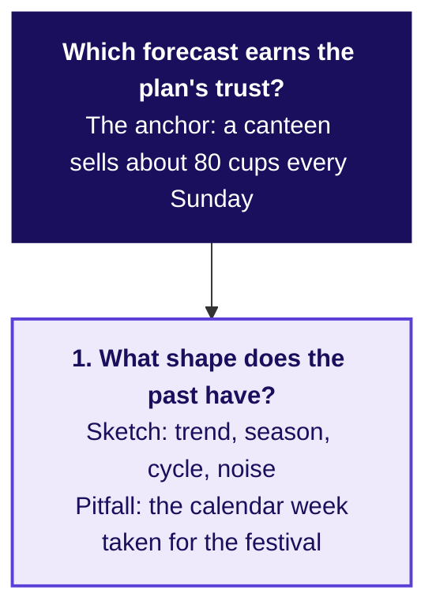
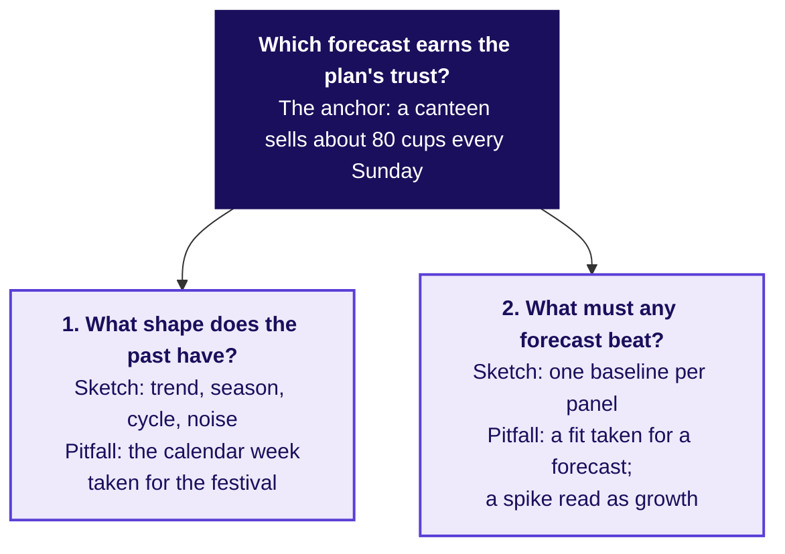
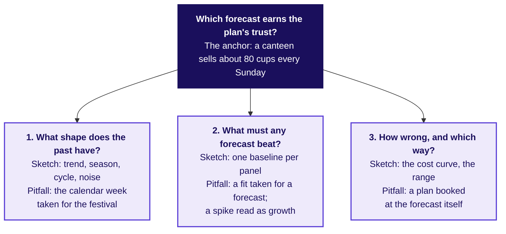
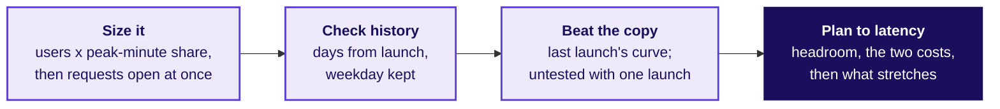
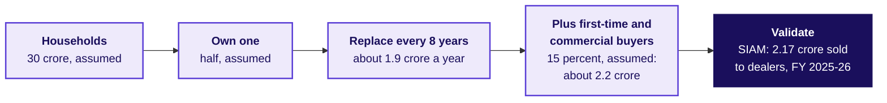

# Flipkart Lucknow: the staffing note and its error bar

Week 4, Day 5. Half two.

Header: WEEK 4  ·  FRIDAY  ·  FLIPKART, LUCKNOW  ·  ILLUSTRATIVE CASE

---

## S1. The morning left a plan, a bar and a share
*What did the three chapters settle before lunch?*

```stats
value: 20,275 | label: packer shifts over eight weeks | note: festival-aligned, raised 2.6 percent, 3,719 in the week of 19 October
value: 6,615 | label: shipments a week, the error bar | note: the forecast's average miss on thirteen hidden weeks: about Rs 35,800 if it runs high, Rs 1.65 lakh if low
value: 0.82 | label: the share of weeks to cover | note: 25 / (25 + 5.42): a late shipment costs 4.6 times a spare one
```

Illustrative case: the company is real, the situation and the data are synthetic, built for this class.

```notes
LIVE, 2 minutes, on screen as the room comes back. The first hour is the trainer's: the staffing
note, the interview room, the Kahoot and Saturday's preview.
Then the IITGN faculty session W4-4 (tentative) runs, or the fallback hour.
Read the three numbers; every group's note starts from them. Transition: the morning on one board.
```

---

## S1a. One board for the day, region one: the past's shape
*Which forecast earns the plan's trust? The board fills one region per chapter.*



Chapter 1 filled this region: both years peak two weeks before Diwali's week, so a copy counts weeks from the festival.

```notes
LIVE, 1 minute. Read the question at the top with its anchor, then region one. The board grows a
region a slide and ends with every pitfall the morning met. Explorer: scene F1.
Transition: region two.
```

---

## S1b. Region two: the copy any forecast must beat
*What must a forecast beat before it books a shift?*



Chapter 2 filled this one: a forecast earns trust only on weeks it never saw, against a copy of last year.

```notes
LIVE, 1 minute. Region two holds the vendor's two mistakes: a close fit, and the 2025 spike read
as growth, which is why its curve climbs with the weeks ahead. Explorer: scene F2. Transition:
region three.
```

---

## S1c. Region three: how wrong, and in which direction
*How wrong could the plan be, and which way costs more?*



Chapter 3 filled the last: a late shipment costs 4.6 times a spare one, so the plan sits 2.6 percent above the forecast.

```notes
LIVE, 1 minute. The finished board is the staffing note's skeleton: one line per region, then the
shifts. Explorer: scenes F3 and F4. Transition: what the note must carry.
```

---

## S2. The staffing note: five lines, one page
*What does each group hand the regional operations head in twenty minutes?*

```cards
icon: file-text | eyebrow: 1 | title: The claim as the title | body: How many shifts, which weeks, from which forecast, in one sentence. | tone: light
icon: calendar | eyebrow: 2 | title: The festival placed | body: Which week is the peak and why: the distance from Diwali, never the calendar. | tone: light
icon: ruler | eyebrow: 3 | title: The error bar in rupees | body: The miss a week in shipments, its cost if high and if low, and the rule's record on 2025's festival. | tone: light
icon: circle-alert | eyebrow: 4 | title: What would make it wrong | body: Three facts that would move the number, each with its check. | tone: light
icon: scale | eyebrow: 5 | title: The two answered | body: One line to finance, one to the vendor's sponsor, conceding the true part. | tone: dark
```

The set is `exercises/unguided/C2_W04_D05_staffing_note_STUDENT.md`: the note's decisions as lettered items, then the note itself.

```notes
LIVE, 20 minutes, unguided, in groups of about four. TAs circulate with the scorer's card from Tuesday:
claim as title, one piece of evidence with its denominator, the caveat in sight, the action with its
cost. A group that splits the difference between 4 and 22 is asked which rule either one beat on
the hidden weeks. Transition: what a strong first line looks like.
```

---

## S3. A note's first line carries the decision
*Which first line lets the operations head act without reading on?*

| A first line that stalls | A first line that decides |
|---|---|
| "Forecasting analysis for the festive season" | "Book 20,275 packer shifts for 12 October to 30 November, peaking at 3,719 in the week of 19 October" |
| "The vendor projects 22 percent growth" | "The vendor's curve lost to a copy of last year on thirteen hidden weeks, so it does not set the plan" |
| "Finance suggests plus 4 percent" | "Finance's 4 percent is the right growth on the wrong weeks: it puts the peak on 5 October, before the plan's first week" |

```notes
LIVE, 3 minutes. Tuesday's rule: the title is the claim. Read each pair aloud and ask which line a
regional head could forward unchanged. Transition: the two people who will object.
```

---

## S4. Finance and the vendor's sponsor are each partly right
*What is true in each objection, and what answers the rest?*

```cards
icon: calculator | eyebrow: Finance | title: "Last year plus 4 is what the budget holds" | body: True: the training weeks grew 4.0 percent. Not true for the weeks: copied by calendar it puts the peak on 5 October, before the plan's first week, and sits 308,048 shipments short. | tone: light
icon: trending-up | eyebrow: The vendor's sponsor | title: "The model fits every week of history" | body: True: within 1.4 percent. That is the problem: on thirteen weeks it never saw it missed by 16,400 a week, 67 percent worse than the copy of last year. | tone: light
```

```notes
LIVE, 3 minutes. Concede the true half first, then answer from the evidence, then say what would
change your mind: a vendor forecast scored on 2025's festival from data to September 2025.
Transition: the interview question.
```

---

## S5. Three of four forecasts book the wrong week
*Which weeks does each forecast book the most packers for?*


The house bot, finance's rule and the vendor put their biggest week on 5 October, a week before the plan's first week; festival-aligned puts it on 19 October, two weeks before Diwali's week.

```notes
LIVE, 2 minutes. The picture every note should be able to describe in one sentence. Transition:
the interview question.
```

---

## S6. "How do you evaluate a forecast?" Two answers
*What separates a weak answer from a hire-grade one?*

| Weak answer | Hire-grade answer |
|---|---|
| "We used a good model and the fit was within 2 percent." | "I hold out the latest weeks as a test set, at least as many as the forecast must reach ahead, and forecast them from one origin." |
| Judges by the fit to history, or a random split | Scores only weeks after the origin, then rolls the origin |
| One number for the error | The error in shipments, then priced each way, each forecast at its own 0.82 point |
| Picks the model with the best story | Sends nothing that loses to a copy of last year |
| Takes the calendar for granted | Checks where the festival falls this year |

```notes
LIVE, 4 minutes. The full transcript, with the clarifying questions and the scorecard, is in
`extras/C2_W04_D05_interview_transcripts_STUDENT.md`; pairs read it and score the hire-grade answer
on the card. Transition: the follow-ups.
```

---

## S7. Three follow-ups that change the question
*What does the interviewer ask next, and what does a strong candidate say?*

```timeline
label: Follow-up 1 | title: MAE or MAPE, and when? | body: Shipments when the cost is per shipment; MASE or WAPE across centres. MAPE explodes near zero, and here it ranks the rules as MAE does.
label: Follow-up 2 | title: The festival moves three weeks: what breaks? | body: Every calendar copy, the seasonal naive and finance's rule; the festival-aligned copy moves with it.
label: Follow-up 3 | title: What did a forecast cost Zillow? | body: Its margin guardrail was 2 percentage points either side of breakeven; price forecasts three to six months out missed by more, the margin swung about 12 percentage points, and Zillow wrote down about USD 304 million. | tone: dark
```

```notes
LIVE, 3 minutes. Each follow-up changes the question so only the reasoning transfers. Zillow's
figures are from its Q3 2021 shareholder letter, checked 12 October 2026: price forecasts three to
six months ahead, a public guardrail of plus or minus 200 basis points (a basis point is a
hundredth of a percent) of breakeven unit economics, a swing of about 1,200 basis points to an
expected minus 500 to minus 700, more homes bought than planned, renovation capacity short, an
inventory write-down of about USD 304 million and the business wound down. The guardrail sat on the
margin, which suggests the forecast's error was wider than the band; and a forecast used to bid wins
where it guesses high, so the homes bought carried its errors one way. Two more follow-ups sit in the transcripts:
the cushion read from the scored weeks, and the overtime that may cap the peak. Transition: the same
idea at an AI company.
```

---

## S8. AI variant: inference capacity for a launch
*How would the same method size servers for an AI product launch?*



**Inference** is the computing a model does each time it answers a user. Size the peak from the ground up as requests open at once, with prompt and answer tokens kept apart; check it against earlier launches lined up by days from launch with the weekday kept; set capacity to the latency target with headroom. The two costs, per request, decide how much to book ahead, and a staged rollout, on-demand capacity, rate limits and a waitlist cover the rest. Written for the programme; it quotes no company's figures.

```notes
LIVE, 3 minutes. Ask the room which cost is the Rs 25 and which the Rs 5.42 here: a timed-out
request, and the idle capacity one request would have used; both are per unit of demand, as the
packer costs are per shipment. Ask what the forecast can be tested on if the feature has never launched: nothing,
so say it is untested and keep capacity that can stretch. The worked sizing (2 lakh users, 1
percent in the peak minute, 1,000 prompt and 500 answer tokens, all invented, about 330 requests open
at once) is in the transcripts. Transition: the guesstimate.
```

---

## S9. Two-wheelers a year: about 2.2 crore, checked
*How do you size a number from nothing, and check it against something known?*



**The range and the catch.** The replacement years alone swing the answer from about 1.7 to 2.9 crore. October 2025's retail registrations were 31.5 lakh (FADA, the Federation of Automobile Dealers Associations), after a quiet September; times twelve that is about 3.78 crore, 74 percent above SIAM's year, a month of registrations set against a year of dealer sales: never annualise a peak month (both releases checked 12 October 2026).

```notes
LIVE, 3 minutes if time allows, in pairs against a three-minute clock. The scorer checks the
structure and the sanity check, never the final number. SIAM's release:
https://www.siam.in/news-&-updates/press-releases/x/605 (checked 12 October 2026). Transition: the
handoff.
```

---

## S10. Handoff: the baseline is the bar to beat
*What does the IITGN faculty session W4-4 pick up from here? It is tentative, and the fallback hour runs if it cannot.*

**The handoff line.** Your baseline is hard to beat, and you now know what any model must beat and on which weeks. The next 120 minutes show how a series remembers itself, autocorrelation, and what a smoothing or ARIMA model would have to do to earn its place above the festival-aligned baseline on the thirteen held-out weeks.

| The word you will hear | What it means here |
|---|---|
| Baseline | It is the simple copy any model must beat on the hidden weeks: festival-aligned, which missed by 6,615 a week. |
| Autocorrelation | It measures how closely each week's shipments follow the week a fixed number of weeks earlier, one back or 52 back. |
| Smoothing | It forecasts from an average of past weeks that gives the most recent weeks the most weight. |
| ARIMA | It forecasts from the series' own past weeks and its own past misses, the pattern autocorrelation measures. |
| Held-out weeks | These thirteen have already picked the rule and set the cushion, so a new model is fairest judged on weeks no choice has used, such as a rolling origin through 2025's festival. |

```notes
LIVE, 2 minutes. Read the handoff line as written, then point at the four words: the faculty
session defines them properly, and this table only says what each one is for.
Park any "is the vendor's model an ARIMA" question for the faculty session (tentative).
Transition: the Kahoot.
```

---

## S11. Kahoot: eight calls, twenty seconds each, item 7 forty
*Which of today's calls can the room make fast?*

| Item | What it tests |
|---|---|
| 1 | Which week a copy of last year uses for Diwali 2026's week |
| 2 | Shipments or percent for the error, and when |
| 3 | A curve that fits every past week within 2 percent |
| 4 | What "good enough" is a claim about |
| 5 | Which weeks to hide, and how many |
| 6 | Thursday's return: a flat blend over falling cohorts |
| 7 | The share of weeks a plan should cover |
| 8 | Plus 4 against which window |

```notes
LIVE, 12 minutes. Kahoot is ungraded. The pack is `kahoot/C2_W04_D05_quiz_STUDENT.md`. Spend two
minutes on item 6 if the room splits: the blend is a size-weighted average of cohort rates.
Transition: Saturday.
```

---

## S12. Close: beat the bot, place the festival, price it
*What does the week close on, and what does Saturday test?*

```cards
icon: badge-check | eyebrow: The rule | title: Beat the bot on hidden weeks | body: In shipments, then rupees, against a copy of last year, before any model earns the plan. | tone: dark
icon: calendar | eyebrow: The calendar | title: Copy by distance from Diwali | body: A calendar copy moved 2025's peak a week late and moves 2026's two weeks early. | tone: light
icon: scale | eyebrow: The cost | title: Cover 0.82 of weeks | body: A late shipment costs 4.6 times a spare one, so the plan sits 2.6 percent above the forecast. | tone: light
```

**Saturday** runs the recap paper and moves each day's method to another company: Friday's goes to Amazon India's festive staffing, then to Kalpa's four units. Tonight: the take-home and Saturday's preview.

```notes
LIVE, 3 minutes. The three cards are the cheat sheet's crux lines, word for word. Transition: the
faculty session (tentative) or the fallback.
```
