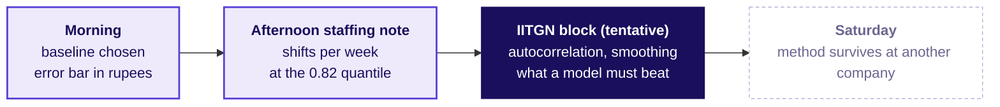

# The staffing note, the interview, and Saturday's bridge

Week 4, Day 5. Half two.

Kicker: WEEK 4  ·  FRIDAY  ·  AFTERNOON
Quote: The plan goes to Friday with its error bar, its cost per direction, and the baseline it had to beat.
Who: the FC planner at Flipkart's Lucknow fulfilment centre, hand-off to the regional operations head

```notes
On screen before the room comes back. The morning's chosen forecast is on the board with its MAE
in rupees. The afternoon is unguided: each group writes the staffing note, then the room reads
the interview transcripts and the AI-company variant, and the handoff lines up Saturday's
transfer drill.
Transition: S1, the morning's result.
```

---

## S1. Where the morning left the plan
*What did chapter 3 land, and what is left for the afternoon?*

```cards
icon: badge-check | eyebrow: Chosen forecast | title: Festival-aligned with drift | body: Beats the vendor by 200 percent on the hold-out; places the peak at the right week.
icon: shield | eyebrow: Error bar | title: Hold-out MAE 5,674 | body: Shipments per week; priced in rupees per direction (Rs 30,760 if over, Rs 1.42 lakh if under).
icon: calculator | eyebrow: Plan quantile | title: 0.82 | body: From 25 over 25 plus 5.42; the plan sits above the median because being short costs 4.6 times being long. | tone: dark
```

The afternoon writes the staffing note each group hands to the regional operations head, with the method, the forecast, the error bar in rupees and three facts that would move it.

```notes
LIVE, 2 minutes. The morning picked the forecast and set its error bar. The afternoon turns that
into a staffing note the room can defend. The transcript follows the note, so the interview
language carries the room's own number.
Transition: S2, the brief for the unguided exercise.
```

---

## S2. The unguided exercise: write the staffing note
*What does each group produce in the next 30 minutes, and who is the reader?*

```cards
icon: file-text | eyebrow: One page | title: Method, forecast, error bar | body: Name the method, give the eight-week shipment forecast, state the hold-out MAE in rupees per direction.
icon: users | eyebrow: Packers per week | title: Shifts raised to 0.82 | body: Shipments divided by 120, raised toward the 0.82 quantile from the error bar.
icon: circle-alert | eyebrow: What would make it wrong | title: Three facts | body: Which facts would move the number: a festival-adjacent GST change, a new vendor without Lucknow history, a capacity-clipped series. | tone: dark
```

```notes
LIVE, 30 minutes, unguided. Groups work in their nine seats; the TAs circulate. The scorecard is
the one from Tuesday's studio: claim as the title, one piece of evidence with its denominator or
one chart, the caveat in plain sight, the action with its cost in rupees and weeks. If a group
splits the vendor's 22 and finance's 4, challenge the choice: "which baseline did either of them
beat on the hold-out?"
Transition: S3, the interview transcript.
```

---

## S3. Interview transcript: how do you evaluate a forecast
*What does a strong answer look like, and what does a weak answer skip?*

| Weak answer | Hire-grade answer |
|---|---|
| "We used ARIMA and the fit was good." | "I hold out as many periods as the horizon, score in the business's unit, and compare with the naive and the seasonal naive before trusting any model." |
| Judges by in-sample fit. | Names the baseline and the hold-out, both set before scoring. |
| Picks a model. | Earns a model's place over a baseline. |
| Reports one number. | Reports MAE in the two directions, since the costs are not the same. |

```notes
LIVE, 5 minutes. Three follow-ups the interviewer uses: 'MAE in shipments or MAPE in percent, and
when' (shipments when the per-shipment cost is the planning cost; percent when sizes vary across
series). 'The festival moves by three weeks this year; what breaks' (SWLY and finance both break;
festival-aligned moves with it). 'What did forecast error cost Zillow, and which guardrail failed'
(the public plus or minus 200 bp was breached, the swing was 1,200, the write-down about USD 304
million, the workforce cut by about a quarter, F3). The weak answer opens on the method; the
hire-grade answer opens on the measure.
Transition: S4, the AI-company variant.
```

---

## S4. AI variant: forecast inference demand for a launch
*How do you forecast requests per minute around an AI product launch?*

| | |
|---|---|
| The spike | The launch window acts like the festival: a known date, a known shape, a short history to learn from. |
| The hold-out | Spans the horizon the capacity plan has to cover; nothing shorter is honest. |
| The baseline | A traffic model for the days around the launch, built from the last launch's shape. The vendor model has to beat it. |
| The asymmetric cost | Over-provisioned capacity is a weekly cost; timeouts in the launch minute cost a product's reputation. The plan sits above the median. |

```notes
LIVE, 3 minutes. This is the programme-written AI variant; no public company's figure is quoted
here. The shape of the method is the same as the festival: find the horizon, hold out, pick a
baseline, measure in the right unit, cost the two directions. The variant works for payments load
on sale day and for ride-hailing surge too.
Transition: S5, the morning handoff into the IITGN block or the fallback.
```

---

## S5. Handoff to the faculty block (W4-4, tentative)
*Where does the afternoon stop, and what will the IITGN block pick up?*



**The handoff line.** Your baseline is hard to beat, and you now know what any model must beat and on which weeks. The next 120 minutes show how a series remembers itself, autocorrelation, and what a smoothing or ARIMA model would have to do to earn its place above the festival-aligned baseline on the thirteen held-out weeks.

<!-- sync:faculty-day:W04/D5 -->
<!-- /sync:faculty-day:W04/D5 -->

Faculty block tentative; confirmation pending from IIT Gandhinagar. If the block slips, the fallback below runs in its place.

```notes
LIVE, 2 minutes. Read the handoff and set the question. The faculty session is tentative until
IIT Gandhinagar confirms (sync block above), and a STUDENT file says tentative beside any
mention of the block. If the block slips, S6 opens the rolling-origin hour.
Transition: S6, the fallback brief.
```

---

## S6. Fallback: the rolling-origin hour
*What runs if the block slips, and what does it earn?*

```timeline
label: Part 1 | title: Shorter hold-out | body: Rescore with four weeks held out instead of thirteen; name what changed and why a test shorter than the horizon misleads.
label: Part 2 | title: Rolling origin | body: Forecast one week ahead from each of six origins; read the errors as a line.
label: Part 3 | title: Zillow and Target Canada | body: Which guardrail failed at Zillow (F3) and what history Target's buyers had (F4); the Lucknow equivalent of each.
label: Part 4 | title: Second transcript | body: Finance and the vendor's sponsor each want theirs in front of the plan.
```

```notes
LIVE, 120 minutes if run. The fallback teaches nothing the block owns: no autocorrelation, no
smoothing, no ARIMA. The row of parts above gives the minute budget by eye (35, 30, 30, 25).
Transition: S7, Kahoot.
```

---

## S7. Kahoot: eight questions in nine minutes
*What does the room take away, and what returns from Thursday?*

| | Question |
|---|---|
| Q1 | The seasonal naive forecast for next November's Diwali week is which number from the twelve rows? |
| Q2 | MAE in shipments versus MAPE in percent: which when, and why? |
| Q3 (trap) | The vendor curve fits every training week within 2 percent; is it a good forecast? |
| Q4 | Good enough is a claim about which of these: the model, the data, the decision, or the week? |
| Q5 | Which thirteen weeks did we hold out, and why those weeks? |
| Return from Thursday | Blended retention stayed flat while every cohort declined; what is the one-sentence mechanism? |
| Bonus 1 | Diwali 2026 falls on Sun 8 Nov; the Diwali week begins on which Monday? |
| Bonus 2 | A plan at the median when the under-cost is 4.6 times the over-cost: which direction is wrong and by how much? |

```notes
LIVE, 9 minutes. Kahoot is daily and ungraded. The trap item (Q3) is already answered on the
scoreboard, but the return question from Thursday is worth two minutes of discussion if the room
is slow: the mechanism is a size-weighted blend of cohort rates, where larger younger cohorts
mask the older cohorts' decline.
Transition: S8, Saturday's preview.
```

---

## S8. Close: Saturday tests the method on new companies
*What does Saturday test, and what carries from today?*

```cards
icon: shuffle | eyebrow: Saturday morning | title: The transfer drill | body: Monday's method at Ola or Rapido, Wednesday's at Blinkit or Zepto, Thursday's at Swiggy One, Friday's at Amazon India. What stays is the method, what changes is the metric, the constraint and the cost of an error.
icon: file-pen | eyebrow: Saturday paper | title: 120 minutes, 43 items | body: Six parts, interview grade, every arithmetic key recomputed on the day's facts.
icon: badge-check | eyebrow: What Friday leaves | title: One rule, one plan | body: A forecast must beat the baseline on weeks it has not seen before it earns the plan; the baseline for a seasonal business is same-week-last-year or its festival-aligned twin. | tone: dark
```

```notes
LIVE, 3 minutes. Hand over Saturday's preview with the three briefs it opens on (Amazon India's
fulfilment centre is the one for today's method). The one-rule line is what the week closes on
in the Saturday paper's part 5.
Transition: close.
```
