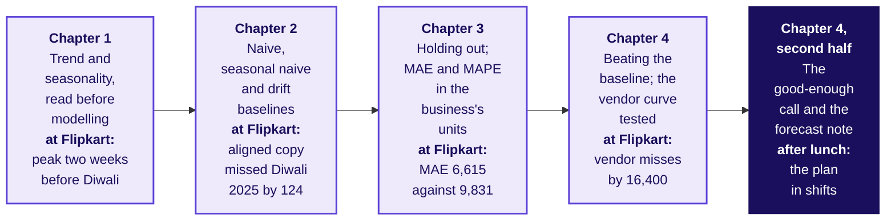
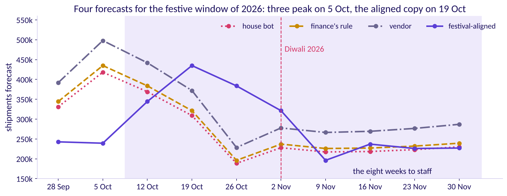
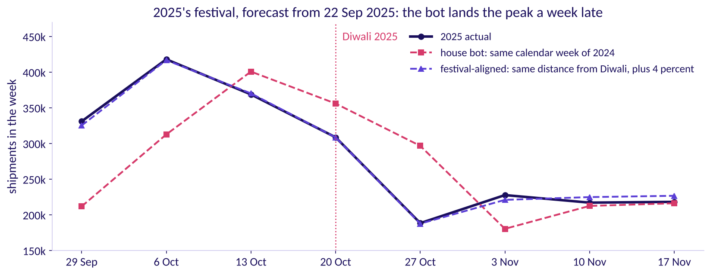
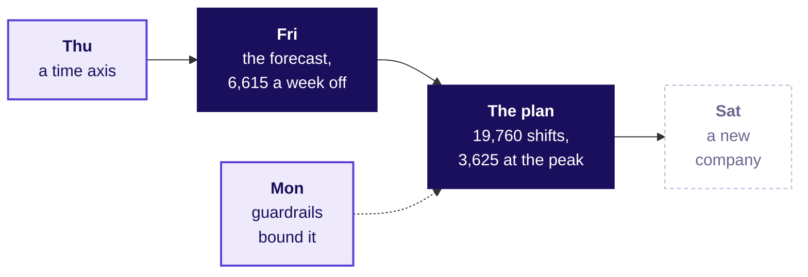
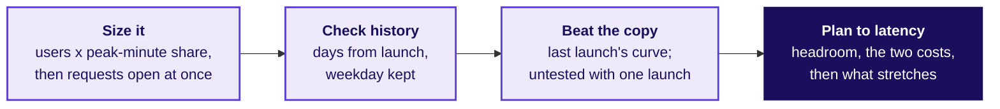
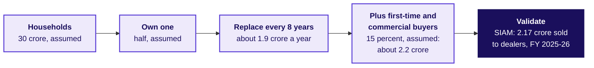

# Forecasting basics: the plan, its error bar and the note

Week 4, Day 5. Half two.

Header: WEEK 4  ·  FRIDAY  ·  FORECASTING BASICS  ·  FLIPKART, LUCKNOW

---

## S1. Five topics, with the morning's case numbers on them
*What did the five topics find on Flipkart's weeks before lunch, and what is left for the plan?*



Illustrative case: the company is real, the situation and the data are synthetic, built for this class.

```notes
LIVE, 2 minutes, on screen as the room comes back. Read the four filled boxes left to right: each is
a morning topic with the number it produced at Flipkart. The lit box is the afternoon: the
good-enough call and the note. The first hour is the trainer's: chapter 7, the staffing note, the
handoff, the Kahoot and the close; then the IITGN faculty session W4-4 (tentative) runs, or the
fallback hour. Transition: chapter 7.
```

---

## SECTION 7: The good-enough call and the staffing note, for the festive window: how many shifts?
*Place this year's festival, test the placement on 2025's, read plus 22 and plus 4 against the right window, and size the plan in shifts with its error bar priced both ways.*

```notes
LIVE, 1 minute. Case part 3 of 3, levels L3 to L5, round three of the tournament. Applies chapters 1
to 4, and chiefly chapter 4's good-enough call and note. Notebook 07 runs alongside. Transition: the
questions.
```

---

## S2. Five questions between the scores and a plan
*Who needs the plan, and which questions lead to it?*

**Applies.** Chapter 1, the windows a growth figure is read against; chapter 2, the calendar copy; chapter 3, a hold-out that holds a festival and the misses priced; chapter 4, the good-enough call and the forecast note.

**Who needs the answer.** The regional operations head, who answers for late parcels in the festival's busiest weeks: a plan with the peak in the wrong week pays for idle packers and late shipments in the same month.

```timeline
label: Place | title: Where is this year's peak? | body: Which week each forecast makes the busiest.
label: Evidence | title: Did placement matter before? | body: 2025's festival, forecast a month ahead.
label: Windows | title: Plus what, against what? | body: The 22 and the 4 against two windows.
label: Plan | title: How many shifts? | body: Eight weeks, with the error bar priced.
label: Enough | title: Is better worth having? | body: Only if it moves a shift. | tone: dark
```

```notes
LIVE, 1 minute. Read the five questions. Transition: round three's reveal.
```

---

## S3. Which week does the bot make 2026's busiest?
*Copying 2025 week for week, which week of 2026 does the house bot book the most packers for?*

```cards
icon: calendar | eyebrow: a | title: 5 October 2026 | body: A week before the window the planner books. | tone: light
icon: calendar | eyebrow: b | title: 19 October 2026 | body: Two weeks before Diwali's week. | tone: light
icon: calendar | eyebrow: c | title: 26 October 2026 | body: One week before Diwali's week. | tone: light
icon: calendar | eyebrow: d | title: 2 November 2026 | body: Diwali's own week. | tone: light
```

```notes
LIVE, 3 minutes. Round three's twist: the house bot itself is wrong about which week Diwali falls
in, and the group that notices wins the plan. Vote, argue, vote again. Explorer: scene F3.
Transition: the answer.
```

---

## S4. Answer: 5 October, two weeks before the peak
*Where does each forecast put this year's busiest week?*



The house bot, finance's rule and the vendor all book their biggest week on 5 October (418,200, 434,928 and 497,900), because each copies 2025's calendar weeks. Festival-aligned books it on 19 October at 434,928, two weeks before Diwali's week of 2 November: finance's number, in the right week. Inside the window, which starts on 12 October, the calendar copies book the most for 12 October and far too little for 19 and 26 October.

```notes
LIVE, 4 minutes. Point at finance's 5 October and festival-aligned's 19 October: the same 418,200
times 1.04, two weeks apart. The vendor's model never knew the festival moved; the stall's
calendar copy in chapter 2 made the same mistake with Diwali's dip. Transition: did the placement
matter last year?
```

---

## S5. On 2025's festival the bot was a week late
*Forecast from 22 September 2025, how did the copy of 2024 do on 2025's festival?*



A **back-test** forecasts an earlier stretch as if the later weeks were unknown: chapter 3's hold-out, placed so that it holds a festival. Over 29 September to 17 November 2025 the house bot missed by 58,250 a week: Rs 79.8 lakh, Rs 69.6 lakh of it late shipments where the rush came before the copy expected it. Festival-aligned missed by 4,034 a week; without the 4 percent, measured only later, it missed by 10,575.

```notes
LIVE, 4 minutes. This back-test is the only festival the data can test the rules on, so it settles
placement and leaves the size of the festive error open. The vendor has no festive forecast to
score, only its fit. Predict before S6 appears: finance's eight weeks sit 4 percent above the same
calendar weeks of 2025; against 2025's weeks counted from Diwali, are they above or below, and by
roughly how much? Write the split on the board. Transition: what plus 22 and plus 4 measure.
```

---

## S6. Plus 22 and plus 4 measure different windows
*How does each forecast compare with last year's eight weeks, counted two ways?*

| 12 Oct to 30 Nov 2026 | Eight weeks | Against 13 Oct to 1 Dec 2025 | Against 29 Sep to 17 Nov 2025 |
|---|---|---|---|
| House bot | 1,983,300 | the same | 13.0 percent below |
| Finance's rule | 2,062,632 | 4.0 percent above | 9.5 percent below |
| Vendor | 2,419,500 | 22.0 percent above | 6.1 percent above |
| Festival-aligned | 2,370,680 | 19.5 percent above | 4.0 percent above |

Last year's same calendar weeks shipped 1,983,300; the same weeks counted from Diwali shipped 2,279,500. Finance's plus 4 is plus 4 only on the calendar weeks: against the weeks counted from Diwali it sits 9.5 percent below, and it books 308,048 shipments fewer than festival-aligned, on the costly side. The vendor's plus 22 sits 2.1 percent above festival-aligned, with its peak on the wrong week.

```notes
LIVE, 5 minutes. Chapter 1 read growth by comparing the same point a season apart; here the same
point is the same distance from Diwali, and Week 1 Tuesday's matched windows are the same idea. The
calendar window holds only the tail of 2025's festival, because 2025's peak came before 13 October;
2026's peak falls inside the window. That is why an honest forecast reads plus 19.5 against it.
Transition: the plan in shifts.
```

---

## S7. The plan: 19,760 packer shifts in eight weeks
*How many packer shifts does each week need, and how wrong could the plan be?*

| Week of | Festival-aligned forecast | Packer shifts, the forecast over 120, rounded up |
|---|---|---|
| 12 Oct | 344,448 | 2,871 |
| 19 Oct | 434,928 | 3,625 |
| 26 Oct | 383,760 | 3,198 |
| 2 Nov | 321,256 | 2,678 |
| 9 Nov | 196,144 | 1,635 |
| 16 Nov | 237,016 | 1,976 |
| 23 Nov | 225,992 | 1,884 |
| 30 Nov | 227,136 | 1,893 |

**The error bar.** The forecast missed by 6,615 shipments a week on the hidden weeks, about 55 shifts: about Rs 35,800 of idle shifts when it runs that far high and Rs 1.65 lakh of late shipments when that far low, and on 2025's festival it missed by 4,034 a week.

```notes
LIVE, 5 minutes. Walk the first two rows aloud: 344,448 over 120, rounded up, is 2,871 shifts, since
a shipment that does not fill a shift still needs one. A packer-shift is one packer for one shift;
how shifts become people depends on the roster, which the ticket does not give. The error bar is
chapter 3's MAE in the business's unit, then priced each way. Transition: is a better forecast
worth having?
```

---

## S8. Good enough: a better forecast must move a shift
*Would a forecast better than festival-aligned book different shifts?*

```stats
value: 27 shifts | label: a week, against the house bot | note: festival-aligned's MAE is 3,216 shipments a week lower: a real difference in packers
value: 82 shifts | label: a week, against the vendor | note: 9,785 shipments a week lower
value: 1 shift | label: at most, for a rule 100 better | note: it moves one shift in 7 of the 8 weeks, against 1,635 to 3,625 booked
```

Chapter 4's call at Flipkart's scale: the decision unit is a shift of 120 shipments, so festival-aligned is good enough, and the next model must earn its place by more than a shift a week. A late shipment costs 4.6 times a spare one, so any margin the planner adds goes above the forecast; how far is the plan quantile, which goes beyond today's curriculum row and runs in the fallback hour.

```notes
LIVE, 4 minutes. Ask the c4 set's second item aloud if it was not sat before lunch: three teams'
models against the house bot's 9,831. The plan quantile is the spine's addition beyond the row's five
subtopics; the fallback deck's part 4 and notebook 07's depth section carry it, so park any "how far
above?" question there by name. Transition: what the other forecasts would cost.
```

---

## S9. Booked by any other forecast: Rs 82.2 lakh or more
*If demand follows the festival-aligned forecast, what does booking by each other forecast cost?*

| Plan for the eight weeks | Spare shipments | Shipments short | Cost |
|---|---|---|---|
| House bot | 48,672 | 436,052 | Rs 111.6 lakh |
| Finance's rule | 87,360 | 395,408 | Rs 103.6 lakh |
| Vendor | 310,364 | 261,544 | Rs 82.2 lakh |

A scenario, never a measurement: if festival-aligned is right about where the rush falls, this is what each calendar-copied plan costs; the 2025 back-test is the evidence that it places the rush well.

```notes
LIVE, 2 minutes. The costs are mostly late shipments in the weeks of 19 October to 2 November.
Transition: what the data cannot tell us.
```

---

## S10. What two years of weeks cannot tell us
*Which doubts sit on the plan, and which fact would settle each?*

| The doubt | What we have, and what would settle it |
|---|---|
| The festival moves, and the sale moves with it | One festival, the 2025 back-test; another festival would settle it |
| The hidden weeks hold no festive week | The 2025 festival's 4,034 a week; a rolling origin through that festival would settle it |
| Capacity caps the peak | Overtime reached 1,638 shifts in the week of 6 October 2025 against 5 in the week of 24 November 2025, so peak demand may have run above what shipped; orders that could not ship would settle it |

```notes
LIVE, 2 minutes. One doubt at a time, each with the fact that would settle it; these are the plan's
"what would make it wrong" line. Transition: the close of round three.
```

---

## S11. Close: beat the bot, place the festival, price it
*What do finance and the vendor's sponsor hear, and what goes to the plan?*



To finance: right growth, wrong weeks, since copied by calendar the 4 percent puts the peak on 5 October and sits 308,048 shipments short. To the vendor's sponsor: a fit of 1.4 percent, and 16,400 a week off on weeks it never saw. The rule: beat the bot on hidden weeks, place the festival, price the miss both ways.

```notes
LIVE, 2 minutes. The forecast joins the week's map as the promise the plan is held to: Thursday's
time axis feeds it and Monday's guardrails bound what it may chase. Each stakeholder is partly
right, so concede the true part first; the staffing note is written from these three lines.
Transition: the note.
```

---

## S12. The staffing note: five lines, one page
*What does each group hand the regional operations head?*

```cards
icon: file-text | eyebrow: 1 | title: The claim as the title | body: How many shifts, which weeks, from which forecast, in one sentence. | tone: light
icon: calendar | eyebrow: 2 | title: The festival placed | body: Which week is the peak and why: the distance from Diwali, never the calendar. | tone: light
icon: ruler | eyebrow: 3 | title: The error bar in rupees | body: The miss a week in shipments, its cost if high and if low, and the rule's record on 2025's festival. | tone: light
icon: circle-alert | eyebrow: 4 | title: What would make it wrong | body: Three facts that would move the number, each with its check. | tone: light
icon: scale | eyebrow: 5 | title: The two answered | body: One line to finance, one to the vendor's sponsor, conceding the true part. | tone: dark
```

The set is `exercises/unguided/C2_W04_D05_staffing_note_STUDENT.md`: the note's decisions as lettered items, then the note itself, which is written in the lab.

```notes
LIVE, 10 minutes, unguided, in groups of about four: the groups decide the lettered items now and
write the five lines in the lab. These are chapter 4's four lines with a fifth for the two
stakeholders. TAs circulate with the scorer's card from Tuesday: claim as title, one piece of
evidence with its denominator, the caveat in sight, the action with its cost. A group that splits
the difference between 4 and 22 is asked which rule either one beat on the hidden weeks.
Transition: what a strong first line looks like.
```

---

## S13. A note's first line carries the decision
*Which first line lets the operations head act without reading on?*

| A first line that stalls | A first line that decides |
|---|---|
| "Forecasting analysis for the festive season" | "Book 19,760 packer shifts for 12 October to 30 November, peaking at 3,625 in the week of 19 October" |
| "The vendor projects 22 percent growth" | "The vendor's curve lost to a copy of last year on thirteen hidden weeks, so it does not set the plan" |
| "Finance suggests plus 4 percent" | "Finance's 4 percent is the right growth on the wrong weeks: it puts the peak on 5 October, before the plan's first week" |

```notes
LIVE, 2 minutes. Tuesday's rule: the title is the claim. Read each pair aloud and ask which line a
regional head could forward unchanged. Transition: the two people who will object.
```

---

## S14. Finance and the vendor's sponsor are each partly right
*What is true in each objection, and what answers the rest?*

```cards
icon: calculator | eyebrow: Finance | title: "Last year plus 4 is what the budget holds" | body: True: the training weeks grew 4.0 percent. Not true for the weeks: copied by calendar it puts the peak on 5 October, before the plan's first week, and sits 308,048 shipments short. | tone: light
icon: trending-up | eyebrow: The vendor's sponsor | title: "The model fits every week of history" | body: True: within 1.4 percent. That is the problem: on thirteen weeks it never saw it missed by 16,400 a week, 67 percent worse than the copy of last year. | tone: light
```

```notes
LIVE, 2 minutes. Concede the true half first, then answer from the evidence, then say what would
change your mind: a vendor forecast scored on 2025's festival from data to September 2025.
Transition: the picture every note should describe.
```

---

## S15. Three of four forecasts book the wrong week
*Which weeks does each forecast book the most packers for?*


The house bot, finance's rule and the vendor put their biggest week on 5 October, a week before the plan's first week; festival-aligned puts it on 19 October, two weeks before Diwali's week.

```notes
LIVE, 1 minute. The picture every note should be able to describe in one sentence. The interview
room that follows is self-study here and runs in the TA lab's first fifteen minutes. Transition: the
handoff.
```

---

## D1. "How do you evaluate a forecast?" Two answers
*What separates a weak answer from a hire-grade one?*

| Weak answer | Hire-grade answer |
|---|---|
| "We used a good model and the fit was within 2 percent." | "I hold out the latest weeks as a test set, at least as many as the forecast must reach ahead, and forecast them from one origin." |
| Judges by the fit to history, or a random split | Scores only weeks after the origin, then rolls the origin |
| One number for the error | The error in shipments, then the same misses priced each way |
| Picks the model with the best story | Sends nothing that loses to a copy of last year |
| Takes the calendar for granted | Checks where the festival falls this year |

```notes
SELF-STUDY, read in the TA lab's first fifteen minutes. The full transcript, with the clarifying
questions and the scorecard, is in `extras/C2_W04_D05_interview_transcripts_STUDENT.md`; pairs read
it and score the hire-grade answer on the card. Transition: the follow-ups.
```

---

## D2. Three follow-ups that change the question
*What does the interviewer ask next, and what does a strong candidate say?*

```timeline
label: Follow-up 1 | title: MAE or MAPE, and when? | body: Shipments when the cost is per shipment; MASE or WAPE across centres. MAPE explodes near zero, and here it ranks the rules as MAE does.
label: Follow-up 2 | title: Suppose the festival moves three weeks: what breaks? | body: Every calendar copy, the seasonal naive and finance's rule; the festival-aligned copy moves with it.
label: Follow-up 3 | title: What did a forecast cost Zillow? | body: Its margin guardrail was 2 percentage points either side of breakeven; price forecasts three to six months out missed both ways by more than Zillow had modelled, the margin swung about 12 percentage points, and Zillow wrote down about USD 304 million. | tone: dark
```

```notes
SELF-STUDY, in the lab. Each follow-up changes the question so only the reasoning transfers.
Zillow's figures are from its Q3 2021 shareholder letter, checked 12 October 2026: price forecasts
three to six months ahead, a public guardrail of plus or minus 200 basis points (a basis point is a
hundredth of a percent) of breakeven unit economics, a swing of about 1,200 basis points to an
expected minus 500 to minus 700, more homes bought than planned, renovation capacity short, an
inventory write-down of about USD 304 million and the business wound down. The guardrail sat on the
margin, which suggests the forecast's error was wider than the band; and a forecast used to bid wins
where it guesses high, so the homes bought carried its errors one way. Two more follow-ups sit in the
transcripts: the cushion read from the scored weeks, and the overtime that may cap the peak.
Transition: the same idea at an AI company.
```

---

## D3. AI variant: inference capacity for a launch
*How would the same method size servers for an AI product launch?*



**Inference** is the computing a model does each time it answers a user. Size the peak from the ground up as requests open at once, with prompt and answer tokens kept apart; check it against earlier launches lined up by days from launch with the weekday kept; set capacity to the latency target with headroom. The two costs, per machine over the booking, decide how much to book ahead, and a staged rollout, on-demand capacity, rate limits and a waitlist cover the rest. Written for the programme; it quotes no company's figures.

```notes
SELF-STUDY, in the lab. Which cost is the Rs 25 and which the Rs 5.42 here: the timeouts a GPU would
prevent, and its rent for the whole booking; both are set per machine, as the packer costs are set
per shipment of a booked shift. What can the forecast be tested on if the feature has never
launched: nothing, so say it is untested and keep capacity that can stretch. The worked sizing (2
lakh users, 1 percent in the peak minute, 1,000 prompt and 500 answer tokens, all invented, about 330
requests open at once) is in the transcripts. Transition: the guesstimate.
```

---

## D4. Two-wheelers a year: about 2.2 crore, checked
*How do you size a number from nothing, and check it against something known?*



**The range and the catch.** The replacement years alone swing the answer from about 1.7 to 2.9 crore. October 2025's retail registrations were 31.5 lakh (FADA, the Federation of Automobile Dealers Associations), after a quiet September; times twelve that is about 3.78 crore, 74 percent above SIAM's year, a month of registrations set against a year of dealer sales: never annualise a peak month (both releases checked 12 October 2026).

```notes
SELF-STUDY, in the lab, in pairs against a three-minute clock. The scorer checks the structure and
the sanity check, never the final number. SIAM's release:
https://www.siam.in/news-&-updates/press-releases/x/605 (checked 12 October 2026). Transition: the
handoff.
```

---

## S16. Handoff: the baseline is the bar to beat
*What does the IITGN faculty session W4-4 pick up from here? It is tentative, and the fallback hour runs if it cannot.*

**The handoff line.** Your baseline is hard to beat, and you now know what any model must beat and on which weeks. The next 120 minutes show how a series remembers itself, autocorrelation, and what a smoothing or ARIMA model would have to do to earn its place above the festival-aligned baseline on the thirteen held-out weeks.

| The word you will hear | What it means here |
|---|---|
| Baseline | It is the simple copy any model must beat on the hidden weeks: festival-aligned, which missed by 6,615 a week. |
| Autocorrelation | It measures how closely each week's shipments follow the week a fixed number of weeks earlier, one back or 52 back. |
| Smoothing | It forecasts from an average of past weeks that gives the most recent weeks the most weight. |
| ARIMA | It forecasts from the series' own past weeks and its own past misses, the pattern autocorrelation measures. |
| Held-out weeks | The thirteen the handoff line names; since they also picked the rule, a new model that beats the baseline there is checked again on a rolling origin through 2025's festival. |

```notes
LIVE, 2 minutes. Read the handoff line as written, then point at the four words: the faculty
session defines them properly, and this table only says what each one is for.
Park any "is the vendor's model an ARIMA" question for the faculty session (tentative).
Transition: the Kahoot.
```

---

## S17. Kahoot: eight calls, twenty seconds each, item 7 forty
*Which of today's calls can the room make fast?*

| Item | What it tests, by the curriculum's topic |
|---|---|
| 1 | Naive, seasonal naive and drift baselines: which week a copy of last year uses for Diwali 2026's week |
| 2 | Holding out; MAE and MAPE in the business's units: shipments or percent, and when |
| 3 | Beating the baseline; the vendor curve tested: a curve that fits every past week within 2 percent |
| 4 | The good-enough call and the forecast note: what "good enough" is a claim about |
| 5 | Holding out; MAE and MAPE in the business's units: which weeks to hide, and how many |
| 6 | Thursday's return: a flat blend over falling cohorts |
| 7 | Holding out; MAE and MAPE in the business's units: the same miss, short or over, priced |
| 8 | Trend and seasonality, read before modelling: which comparison reads growth |

```notes
LIVE, 6 minutes. Kahoot is ungraded. The pack is `kahoot/C2_W04_D05_quiz_STUDENT.md`. Spend a minute
on item 6 if the room splits: the blend is a size-weighted average of cohort rates. Transition:
Saturday.
```

---

## S18. Close: beat the bot, place the festival, price it
*What does the week close on, and what does Saturday test?*

```cards
icon: badge-check | eyebrow: The rule | title: Beat the bot on hidden weeks | body: In shipments, then rupees, against a copy of last year, before any model earns the plan. | tone: dark
icon: calendar | eyebrow: The calendar | title: Copy by distance from Diwali | body: A calendar copy moved 2025's peak a week late and moves 2026's two weeks early. | tone: light
icon: scale | eyebrow: The cost | title: Price the miss both ways | body: A late shipment costs 4.6 times a spare one, so the error bar of 6,615 a week reads Rs 1.65 lakh short or Rs 35,800 over. | tone: light
```

**Saturday** runs the recap paper and moves each day's method to another company: Friday's goes to Amazon India's festive staffing, then to Kalpa's four units. Tonight: the take-home and Saturday's preview.

```notes
LIVE, 2 minutes. The three cards are the cheat sheet's crux lines, word for word. Transition: the
faculty session (tentative) or the fallback.
```
