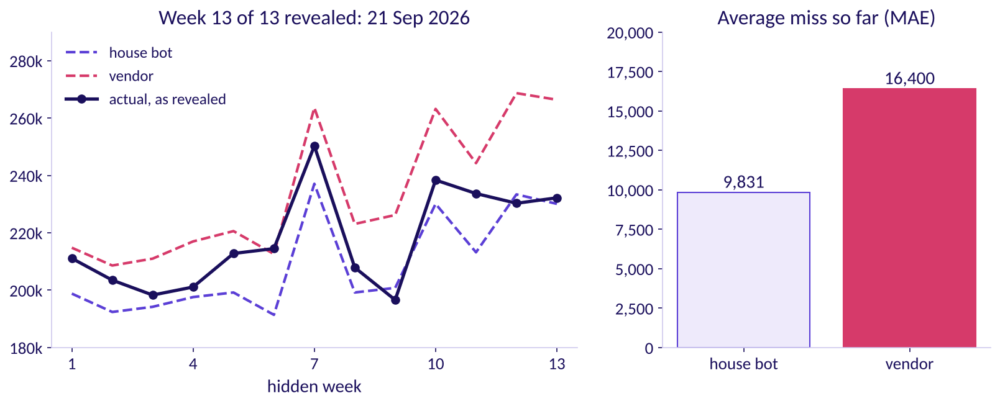

# How much is coming to Flipkart's Lucknow centre this festive season, and how wrong could the forecast be?

Week 4, Friday. About 13 minutes to read, and 10 more for the self-check.

Flipkart's Lucknow fulfilment centre (FC) has 104 weeks of outbound shipments, the
weeks beginning 30 September 2024 to 21 September 2026. Diwali fell on Thursday 31 October 2024 and
Monday 20 October 2025, and falls on Sunday 8 November 2026 (DoPT's holiday lists, checked 12
October 2026). The planner must book packer shifts for
the eight weeks beginning 12 October to 30 November 2026, at about 120 shipments a shift. A vendor's
model promises those weeks 22 percent above last year; finance's rule is last year plus 4 percent.
Illustrative case: the company is real, the situation and the data are synthetic, built for this
class.

---

## What can you do after Friday?

- You can read a festival's shape off weekly shipments and forecast a week by hand.
- You can hide the latest weeks, score every rule on them in shipments, and price each miss.
- You can say, with a number, why a close fit can still forecast badly.
- You can turn a forecast into shifts a week, raised by what two costs choose.

## Where does Friday sit in the week?

**What was worked, and what was only mentioned.** Friday read twelve weeks by hand, scored six
forecasts on hidden weeks, back-tested 2025's festival, priced a plan. Smoothing and ARIMA belong
to the IITGN faculty session W4-4 (tentative).

## Which one picture holds the day?

Call it **the festival plot**. By calendar date, 2024's peak and 2025's peak sit a week apart. By
weeks from Diwali, they sit on top of each other: both years peak two weeks before Diwali's week, in
the festive sale. A rule that copies the calendar puts the rush in the wrong week whenever the
festival moves.

**Say it to a shift supervisor.** "The computer copied last year's dates, but Diwali falls on a
different date this year, so it books the most packers two weeks before the real rush. We count the
weeks from Diwali instead."

---

## What shape do the weeks have, and what would simple rules say for one week?

**Who needs the answer.** The FC planner, who books shifts weeks ahead: a rule that puts the peak in
the wrong week books packers for a quiet week.

**The questions on the way.**

- What does a forecast copy from the past?
- Where is each year's peak?
- What do the rules say for Diwali 2025's own week?

**A toy first.** A canteen sold 50, 52, 49 and 51 cups on four days, so the naive forecast for
tomorrow is 51, and drift, the line from the first day to the last extended one step, is about 51.3.
Its Sundays sell about 80, so next Sunday's forecast is 80, a copy of the same day last week. For
weekly shipments that copy is the same week last year: the seasonal copy, which the tournament calls
the house bot.

$$\text{naive: } \hat{y}_{T+h} = y_T \qquad \text{house bot: } \hat{y}_t = y_{t-52} \qquad \text{festival-aligned: } \hat{y}_t = 1.04 \times y_{\text{same distance from last Diwali}}$$

Read $y_t$ as week $t$'s shipments and $\hat{y}$, y-hat, as a forecast; $T$ is the last week a rule
may see, $h$ the weeks ahead. Festival-aligned matches distance from Diwali from five weeks before
Diwali's week to four after, and the calendar otherwise; 1.04 is the growth the training weeks show, and
finance's rule is the house bot times 1.04.

**The twelve weeks**, six around each Diwali, in shipments:

| Weeks from Diwali's week | -3 | -2 | -1 | Diwali's week | +1 | +2 |
|---|---|---|---|---|---|---|
| 2024 | 312,900 | 401,000 | 356,200 | 296,900 | 180,600 | 212,700 |
| 2025 | 331,200 | 418,200 | 369,000 | 308,900 | 188,600 | 227,900 |

For Diwali 2025's week, which shipped 308,900, naive repeats the week before, 369,000, 60,100 too
high. The house bot copies the week of 21 October 2024, a week before Diwali 2024, 356,200, 47,300 too
high. Festival-aligned copies Diwali 2024's own week, 296,900, times 1.04: 308,776, 124 too low.

**WATCH OUT.** The calendar copy books 401,000 for the week of 13 October 2025, when 369,000 shipped,
and 312,900 for the real peak, 418,200 on 6 October: the most packers a week after the rush. The check
is the festival plot.

**IN THE FIELD.** In the M5 competition, on Walmart's daily sales of 3,049 products, the house bot's
rule, there the same weekday a week earlier, scored 0.847 against naive's 1.752, lower being better;
only 35.8 percent of teams beat it, and the winner reached 0.520 (checked 12 October 2026).

**CALLBACK.** Thursday followed groups of members over time; today forecasts weeks not yet seen.

**The answer.** Both years peak two weeks before Diwali's week; a calendar copy misplaces the peak,
and a copy by distance from Diwali puts it on time.

## How does each rule score on the thirteen weeks it never saw?

**Who needs the answer.** The regional operations head, who says yes or no to a model before a shift
is booked.

**The questions on the way.**

- Which weeks do we hide, and how many?
- How do we count a miss?
- Does a curve that fits history beat the house bot?
- Whose misses cost least, once priced?

**Four ways to judge a forecast.** Fit on past weeks proves nothing: enough knobs fit anything. A
random fifth lets a rule peek at later weeks. Rolling the origin forecasts again from many weeks. The
vendor's file forecasts from one origin, so the fair race is the latest thirteen weeks, 29 June to 21
September 2026: the **hold-out**, forecast from 22 June, the **origin**. The plan's last week sits ten
weeks past the data, the **horizon**.

**Count the miss in the business's unit.** The mean absolute error, MAE, averages the misses with
their signs dropped: three hidden weeks missed by 10, 5 and 10 give 8.3. Here $n$ is the number of
weeks and $\sum$ adds over them.

$$\text{MAE} = \frac{1}{n}\sum_{t} \left| y_t - \hat{y}_t \right|$$

Its animation, `holdout_reveal_STUDENT.gif`, reveals the weeks one by one: the vendor leads in week
1, 3,700 to 12,300, and trails by week 13, 16,400 to 9,831.

| Rule | MAE, shipments a week | Weeks too high | Misses priced, 13 weeks |
|---|---|---|---|
| Festival-aligned | 6,615 | 6 of 13 | Rs 13.5 lakh |
| Finance's rule | 6,615 | 6 of 13 | Rs 13.5 lakh |
| House bot | 9,831 | 2 of 13 | Rs 30.5 lakh |
| Drift | 14,842 | 8 of 13 | Rs 28.0 lakh |
| Naive | 14,923 | 8 of 13 | Rs 28.8 lakh |
| Vendor's curve | 16,400 | 12 of 13 | Rs 11.9 lakh |

Each miss is priced at Rs 25 for a late shipment and Rs 5.42 for a spare one, planned and never
shipped. Festival-aligned and finance's rule tie because no hidden week sits near Diwali, where the
two differ. The second route: festival-aligned's misses add to 40,748 too high and 45,248 too low,
85,996 in all, and 85,996 over 13 is 6,615.

**WATCH OUT.** "The vendor's curve fits two years within 2 percent, so it forecasts well." Its worst
fitted week missed by 1.4 percent; on the hidden weeks it missed by 16,400 a week, too high in 12 of
13 and climbing with the weeks ahead.

**The surprise in rupees.** Priced, the vendor's misses cost least only because it runs high, the
cheap side, and the house bot costs more than naive since its misses run short. Moved to its own
0.82 point, the vendor costs Rs 10.0 lakh against festival-aligned's Rs 8.8 lakh.

**IN THE FIELD.** On 1,045 monthly series, a 2018 PLOS ONE paper by Makridakis and colleagues found
statistical methods beat machine learning at every horizon tested; in M5 machine learning took every
top place. Both were judged on unseen weeks (checked 12 October 2026).

**The answer.** Festival-aligned and finance's rule tie at 6,615 a week, ahead of the house bot's
9,831 and the vendor's 16,400. Good enough is a claim about the decision: a better forecast is worth
having only if it books different shifts.

## Which forecast books the shifts, and what does being wrong cost?

**Who needs the answer.** The regional operations head, who signs the shift plan and answers for late
parcels.

**The questions on the way.**

- Where does each forecast put 2026's busiest week?
- How did the rules do on 2025's festival?
- What do plus 22 and plus 4 measure?
- How far above the forecast should the plan sit?

**The calendar trap, tested.** A **back-test** forecasts an earlier stretch as if the later weeks were
unknown. From 22 September 2025, the house bot missed 2025's eight festive weeks by 58,250 a week, Rs
79.8 lakh, and festival-aligned by 4,034, Rs 4.6 lakh; with none of the 4 percent, measured only
later, it still missed by only 10,575. In 2026 the bot's busiest week is 5 October, two weeks early,
since Diwali 2026's week comes 54 weeks after 2025's; festival-aligned's is 19 October.

**Two windows.** Plus 22 and plus 4 compare with 2025's same calendar weeks, 1,983,300 shipments
holding only the festival's tail. Counted from Diwali, 29 September to 17 November 2025, the weeks
shipped 2,279,500: the vendor sits 6.1 percent above, festival-aligned 4.0 and finance 9.5 below,
308,048 shipments fewer than festival-aligned.

**Where the plan sits.** Raise the plan by one shipment. Over 100 weeks, if demand beats the plan in
18, that shipment saves 18 x Rs 25 = Rs 450 in late shipments and wastes 82 x Rs 5.42 = Rs 444 of idle
shift: about even, so stop there. That is the newsvendor rule:

$$q = \frac{\text{late cost}}{\text{late cost} + \text{spare cost}} = \frac{25}{25 + 5.42} \approx 0.82$$

Sort the thirteen hidden weeks by how far demand came above festival-aligned: 0.82 of the way along
falls between the 10th week, 2.1 percent, and the 11th, 2.7. Read there, the cushion is 2.6 percent,
and the plan, festival-aligned times 1.026, covers 10 of the 13 weeks, the 11th just above it. Shifts are the plan over 120,
rounded up.

| Week of | Forecast | Plan | Packer shifts |
|---|---|---|---|
| 12 Oct | 344,448 | 353,404 | 2,946 |
| 19 Oct | 434,928 | 446,236 | 3,719 |
| 26 Oct | 383,760 | 393,738 | 3,282 |
| 2 Nov | 321,256 | 329,609 | 2,747 |
| 9 Nov | 196,144 | 201,244 | 1,678 |
| 16 Nov | 237,016 | 243,178 | 2,027 |
| 23 Nov | 225,992 | 231,868 | 1,933 |
| 30 Nov | 227,136 | 233,042 | 1,943 |

That is 20,275 shifts, 515 more than the 19,760 the forecast alone needs. The **error bar**, how wrong
the forecast could be, is its average miss, 6,615 shipments a week: about Rs 35,800 of idle shifts
(6,615 x Rs 650 / 120) when it runs that far high, Rs 1.65 lakh of late shipments (6,615 x Rs 25) when that far low.

**Four doubts, each with its check.**

| Doubt | What we have, and what would settle it |
| --- | --- |
| The festival and its sale move | Two festivals; a third |
| The hidden weeks hold no festive week | One back-test; a rolling origin through 2025's festival |
| Capacity caps the peak | Overtime hit 1,638 shifts in the week of 6 October 2025 against 5 on 24 November; orders that could not ship |
| A tax change rode on the 2025 festival | FADA, the vehicle dealers' federation, credits part of October 2025's two-wheeler jump, 31.5 lakh against 12.9 lakh in September, to GST cuts (checked 12 October 2026); a festival with no tax change |

**IN THE FIELD.** On 6 October 2026 Flipkart said Ekart, its supply chain, had added 14 million cubic
feet of warehousing before its festive sale, and more than 2.5 lakh direct and indirect festive
employment opportunities (Flipkart's announcement, checked 12 October 2026): decisions resting on a forecast.

**The answer.** Festival-aligned, raised 2.6 percent, books 20,275 packer shifts, 3,719 in the week
of 19 October, with an error bar of 6,615 shipments a week.

---

Tonight's lab moves the method to Kalpa Retail, where Anand owes the board one number.

## Can you answer these without notes?

1. Diwali's week moves from 20 October to 2 November: which week of last year does the house bot
   copy into 2 November?
2. Five hidden weeks missed by 12, -8, 5, -15 and 6: what is the MAE?
3. A curve fits every past week within 2 percent: what do you ask before trusting it?
4. A late shipment costs Rs 30 and a spare one Rs 5: what share of weeks should the plan cover?
5. Why can a forecast with a higher MAE cost less, once priced?
6. From Thursday: why can blended retention stay flat while each signup month's falls?

**Key.** 1: 3 November. 2: 46 / 5 = 9.2. 3: its score on weeks it never saw, against a copy of last
year. 4: 30 / 35, about 0.86. 5: its misses run to the cheap side. 6: the blend weights groups by
size, so big young groups at their best months hold it up.

## Which interview questions does Friday prepare you for?

| The question as asked | The hire-grade line |
|---|---|
| How do you evaluate a forecast? | "I hold out the latest weeks, at least as many as the forecast must reach ahead, and score the misses in shipments and rupees against the seasonal naive: festival-aligned missed by 6,615 a week, the seasonal naive by 9,831. The hidden weeks hold no festival, so I back-test one." |
| MAE or MAPE? | "Shipments when the cost is per shipment; MASE or WAPE across centres. MAPE explodes near zero; here it ranks the rules as MAE does." |
| The festival moves three weeks: what breaks? | "Every calendar copy; a copy by distance from the festival moves with it." |
| What did forecast error cost Zillow? | "Its margin guardrail was 2 percentage points either side of breakeven; price forecasts three to six months out missed by more, the margin swung about 12 percentage points, and it wrote down about USD 304 million." |

**The AI-company variant.** An AI company booking inference capacity, the computing that answers
users' requests, sizes the launch peak from the ground up as requests open at once, checks it
against earlier launches lined up by days from launch with the weekday kept, and books capacity to a
latency target, adding a GPU while the timeouts it prevents cost more than its rent. The transcripts, with five pain points and their
cases, are in `extras/`.

**The guesstimate: two-wheelers sold in India in a year.** 30 crore households, half owning one,
replaced every 8 years, give about 1.9 crore a year; 15 percent more for first-time and commercial
buyers makes about 2.2 crore, 1.7 to 2.9 as the replacement years swing, against SIAM's 2.17 crore
sold to dealers in FY 2025-26 (checked 12 October 2026). The catch: October 2025 alone registered 31.5
lakh (FADA), and twelve such months make about 3.78 crore, 74 percent above SIAM's year.

## Which words did Friday use?

| Term | Plain meaning | Example |
|---|---|---|
| House bot | A copy of the same week last year | 52 weeks back |
| Festival-aligned | A copy at the same distance from last year's Diwali, plus 4 percent | 19 October 2026 copies 6 October 2025 |
| Hold-out | Hidden weeks, kept out of every forecast and used to score it | 29 June to 21 September 2026 |
| Origin and horizon | The last week a rule may see, and the farthest week a forecast must reach | 22 June 2026; ten weeks |
| Back-test | A rule rerun from an earlier date | From 22 September 2025 |
| MAE and MAPE | The average miss in shipments, and as a percent of what shipped | 6,615 shipments a week |
| Error bar | The typical miss on unseen weeks; 5 of 13 weeks missed by more | 6,615 a week |
| Plan share | The share of weeks the plan should cover | 0.82 |

## Where should you read next, and how long does each take?

| Order | Source | Time |
|---|---|---|
| 1 | Hyndman and Athanasopoulos, Forecasting: Principles and Practice, section 5.2, https://otexts.com/fpp3/toolbox.html#sec-simple-methods (checked 12 October 2026) | 20 minutes |
| 2 | The same book, section 5.8, on forecast accuracy, https://otexts.com/fpp3/toolbox.html#sec-accuracy (checked 12 October 2026) | 20 minutes |
| 3 | IBM Technology, "What is Time Series Analysis?", https://www.youtube.com/watch?v=GE3JOFwTWVM (checked 12 October 2026) | 8 minutes |

The week's explorer, `content/W04/D1/demos/C2_W04_D01_week_explorer_STUDENT.html`, replays the day:
scene F1 builds a series, F2 slides the hidden weeks, F3 moves Diwali, F4 moves the two costs.
