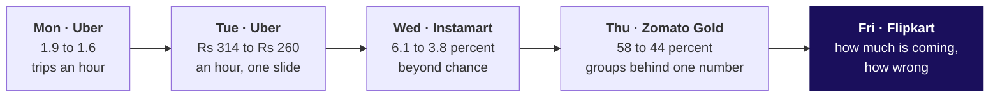
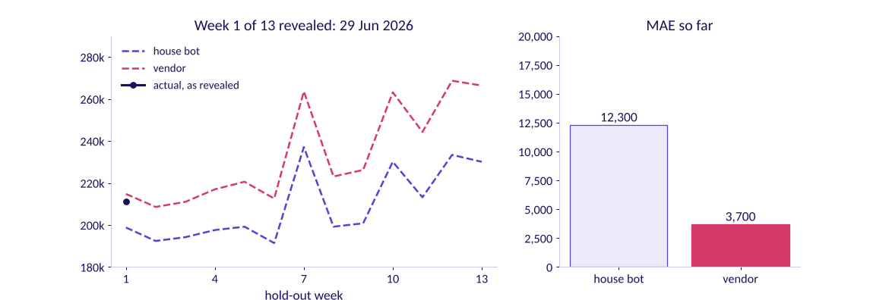

# How much is coming to Flipkart's Lucknow centre this festive season, and how wrong could the forecast be?

Week 4, Friday. About 13 minutes to read, and 10 more for the self-check.

Flipkart, the Lucknow fulfilment centre. The centre has 104 weeks of outbound shipments, the weeks
beginning 30 September 2024 to 21 September 2026. Diwali fell on Thursday 31 October 2024 and Monday
20 October 2025, and falls on Sunday 8 November 2026. The planner must book packer shifts for the
eight weeks beginning 12 October to 30 November 2026, at about 120 shipments a shift. A vendor's
model promises the festive window 22 percent above last year; finance's rule is last year plus 4
percent. Illustrative case: the company is real, the situation and the data are synthetic, built for
this class.

---

## What can you do after Friday?

- You can read a festival's shape off a weekly series and forecast one week by hand with four
  copying rules.
- You can hide the latest weeks, score every rule on them in shipments, and price each miss.
- You can say, with a number, why a curve that fits history can still forecast badly.
- You can turn a forecast into shifts a week with an error bar, raised by an amount two costs choose.

## Where does Friday sit in the week?

**What was worked, and what was only mentioned.** Friday read twelve weeks by hand, scored six
forecasts on hidden weeks, back-tested 2025's festival and priced a plan. Smoothing and ARIMA were
only mentioned: the IITGN faculty session W4-4 (tentative) asks what such a model must beat.

Friday asks what a forecast is compared with: the simplest copy of the past, on weeks it never saw.

## Which one picture holds the day?

Call it **the festival plot**. By calendar date, 2024's peak and 2025's peak sit a week apart. By
weeks from Diwali, they sit on top of each other: both years peak two weeks before Diwali's week. A
rule that copies the calendar puts the rush in the wrong week whenever the festival moves, and
Diwali moves every year.

**Say it to a shift supervisor.** "The computer copied last year's dates, but Diwali falls on a
different date this year, so its busiest week comes two weeks before the real one. We count the
weeks from Diwali instead."

---

## What shape do the weeks have, and what would simple rules say for one week?

**Who needs the answer.** The FC planner, who books shifts weeks ahead and cannot add a packer on the
day: a rule that puts the peak in the wrong week books packers for a quiet week.

**The questions on the way.**

- What does a forecast copy from the past?
- Where is each year's peak?
- What do the rules say for Diwali 2025's own week?

**A toy first.** A canteen sold 50, 52, 49 and 51 cups on four days, so the naive forecast for
tomorrow is 51. Its Sundays sell about 80, so next Sunday's forecast is 80, a copy of the same day
last week. Every rule today copies something from the past and says what it copies.

$$\text{naive: } \hat{y}_{T+h} = y_T \qquad \text{same week last year: } \hat{y}_t = y_{t-52}$$

$$\text{drift: } \hat{y}_{T+h} = y_T + h \cdot \text{average weekly change} \qquad \text{festival-aligned: } \hat{y}_t = 1.04 \times y_{\text{same distance from last Diwali}}$$

Here $y_T$ is the last week a rule may see and $h$ the weeks ahead. The house bot is the
same-week-last-year rule; finance's rule is the house bot times 1.04.

**The twelve weeks**, six around each Diwali, in shipments:

| Weeks from Diwali's week | -3 | -2 | -1 | Diwali's week | +1 | +2 |
|---|---|---|---|---|---|---|
| 2024 | 312,900 | 401,000 | 356,200 | 296,900 | 180,600 | 212,700 |
| 2025 | 331,200 | 418,200 | 369,000 | 308,900 | 188,600 | 227,900 |

For Diwali 2025's week, which shipped 308,900, naive repeats the week before, 369,000, 60,100 too
high. The house bot copies the week of 21 October 2024, a week before Diwali 2024, 356,200, 47,300 too
high. Festival-aligned copies Diwali 2024's own week, 296,900, times 1.04: 308,776, 124 too low.

**WATCH OUT.** The calendar copy books 401,000 for the week of 13 October 2025, when 369,000 shipped,
and 312,900 for the real peak, 418,200 on 6 October: the most packers a week after the rush. The check
is the festival plot.

**IN THE FIELD.** On Walmart's sales in the M5 competition, the same-period copy scored 0.847 against
1.752 for plain naive, lower being better, and beat the random forest benchmark's 1.010 (M5 "Scores
and Ranks" workbook, checked 12 October 2026).

**CALLBACK.** Thursday gave the week a time axis; today it runs forward.

**The answer.** Both years peak two weeks before Diwali's week; a calendar copy misplaces the peak,
and a copy by distance from Diwali puts it on time.

## How does each rule score on the thirteen weeks it never saw?

**Who needs the answer.** The regional operations head, who says yes or no to a model before a shift
is booked.

**The questions on the way.**

- Which weeks do we hide, and how many?
- How do we count a miss?
- Does a curve that fits history beat the house bot?
- Whose misses cost least, once priced?

**Four ways to judge a forecast.** Fit on past weeks proves nothing, since a curve with enough knobs
fits anything. Hiding a random fifth of weeks lets a rule peek at later weeks. Rolling the origin a
week at a time gives many small tests, more work than a morning holds. Hiding the latest weeks, at
least as many as the plan books, tests what the plan will meet. The call: the last thirteen, 29 June
to 21 September 2026, forecast from 22 June; a third year of data would make rolling worth it.

**Count the miss in the business's unit.** The mean absolute error, MAE, averages the misses with
their signs dropped: three hidden weeks missed by 10, 5 and 10 give 8.3.

$$\text{MAE} = \frac{1}{n}\sum_{t} \left| y_t - \hat{y}_t \right|$$

The scoreboard, each miss priced at Rs 5.42 for a shipment planned and not shipped and Rs 25 for a
shipment late:

| Rule | MAE, shipments a week | Weeks too high | Misses priced |
|---|---|---|---|
| Festival-aligned | 6,615 | 6 of 13 | Rs 13.5 lakh |
| Finance's rule | 6,615 | 6 of 13 | Rs 13.5 lakh |
| House bot | 9,831 | 2 of 13 | Rs 30.5 lakh |
| Drift | 14,842 | 8 of 13 | Rs 28.0 lakh |
| Naive | 14,923 | 8 of 13 | Rs 28.8 lakh |
| Vendor's curve | 16,400 | 12 of 13 | Rs 11.9 lakh |

Festival-aligned and finance's rule tie because no hidden week sits near Diwali, where the two
differ. The second route: festival-aligned's misses add to 40,748 too high and 45,248 too low, 85,996
in all, and 85,996 over 13 is 6,615.

**WATCH OUT.** "The vendor's curve fits two years within 2 percent, so it forecasts well." Its worst
fitted week missed by 1.4 percent; on the hidden weeks it missed by 16,400 a week, too high in 12 of
13, climbing from 3.6 percent too high in the first six to 11.5 in the last six. The check is a score
on weeks the curve never saw.

**The surprise in rupees.** Priced, the vendor's misses cost least, since spare capacity is the cheap
miss, and the house bot costs more than naive, since its misses run short. The vendor still loses:
nobody chose how high it runs, it runs higher the further it looks, and no festive week was tested.
A plan should lean high on purpose, by an amount the two costs choose.

**IN THE FIELD.** On 1,045 monthly series, a 2018 PLOS ONE paper by Makridakis and colleagues found
statistical methods beat machine learning at every horizon, and the best fits to the past did not
forecast best (checked 12 October 2026). Zillow priced homes on forecasts three to six months ahead
inside a public guardrail of plus or minus 200 basis points of breakeven; in 2021 its margins swung
about 1,200 basis points, and it wrote down about USD 304 million and cut about 25 percent of its
workforce (Q3 2021 shareholder letter, checked 12 October 2026).

**The answer.** Festival-aligned and finance's rule tie at 6,615 a week, ahead of the house bot's
9,831 and the vendor's 16,400. A fit is no forecast, and a miss is priced by its direction.

## Which forecast books the shifts, and what does being wrong cost?

**Who needs the answer.** The regional operations head, who signs the shift plan and answers for late
parcels in the busiest weeks.

**The questions on the way.**

- Where does each forecast put 2026's busiest week?
- How did the rules do on 2025's festival?
- What do plus 22 and plus 4 measure?
- How far above the forecast should the plan sit?
- What can two years of weeks not tell us?

**The calendar trap, tested.** Forecast from 22 September 2025, the house bot missed 2025's eight
festive weeks by 58,250 a week, Rs 79.8 lakh, and festival-aligned by 4,034, Rs 4.6 lakh. In 2026 the
bot's busiest week is 5 October, two weeks early, since Diwali 2026's week comes 54 weeks after 2025's;
festival-aligned's is 19 October.

**Two windows.** Plus 22 and plus 4 compare with 2025's same calendar weeks, 13 October to 1 December,
1,983,300 shipments holding only the festival's tail. Counted from Diwali, 29 September to 17 November
2025, the eight weeks shipped 2,279,500. Against those, the vendor sits 6.1 percent above,
festival-aligned 4.0 above, and finance's rule 9.5 below, 308,048 shipments short.

**Where the plan sits.** A shipment planned and not shipped costs Rs 650 / 120 = Rs 5.42 of an idle
shift; a shipment late costs Rs 25. The cheapest plan covers demand in this share of weeks:

$$q = \frac{25}{25 + 5.42} \approx 0.82$$

Festival-aligned's thirteen hidden-week misses put the 0.82 point 2.6 percent above the forecast, so
the plan is festival-aligned times 1.026, and shifts are the plan over 120, rounded up.

| Week of | Forecast | Plan | Packer shifts |
|---|---|---|---|
| 12 Oct | 344,448 | 353,404 | 2,946 |
| 19 Oct | 434,928 | 446,236 | 3,719 |
| 26 Oct | 383,760 | 393,738 | 3,282 |
| 2 Nov | 321,256 | 329,609 | 2,747 |
| 9 Nov | 196,144 | 201,244 | 1,678 |
| 16 Nov | 237,016 | 243,178 | 2,027 |
| 23 Nov | 225,992 | 231,868 | 1,933 |
| 30 Nov | 227,136 | 233,042 | 1,943 |

That is 20,275 shifts, 515 above the forecast alone, about Rs 3.3 lakh if all sat idle. The error bar
is 6,615 shipments a week: Rs 35,832 of idle shifts if high, Rs 1.7 lakh of late shipments if low. If
demand follows festival-aligned, the house bot's plan costs Rs 111.6 lakh, finance's Rs 103.6 lakh and
the vendor's Rs 82.2 lakh.

**WATCH OUT.** A plan at the forecast itself is short in about half the weeks, and short is the side
that costs 4.6 times as much.

**Five doubts, each with its check.**

| Doubt | What would settle it |
| --- | --- |
| The festival moves, and the sale with it | Tested once: the 2025 back-test |
| Two years give two festivals and one growth rate | A third year |
| The hidden weeks hold no festive week | The 2025 festival's 4,034 a week |
| Capacity caps the peak | Overtime of 1,638 shifts in the week of 6 October 2025: demand may have run above what shipped |
| A tax change rode on the 2025 festival | FADA credits part of October 2025's two-wheeler jump, 31,49,846 against 12,87,735 in September, to GST cuts (release of 7 November 2025, checked 12 October 2026) |

**IN THE FIELD.** Flipkart's announcement of 6 October 2026 says Ekart added 14 million cubic feet of
warehousing space ahead of The Big Billion Days and created more than 2.5 lakh festive jobs (checked
12 October 2026), decisions resting on a forecast made weeks earlier.

**The answer.** Festival-aligned raised 2.6 percent: 20,275 packer shifts, 3,719 in the week of 19
October, an error bar of 6,615 shipments a week, the festival's placement resting on one back-test.
Tonight's lab asks the same at Kalpa, where Anand must give the board one revenue number.

---

## Can you answer these without notes?

1. Diwali's week moves from 20 October to 2 November: which week of last year does the house bot
   copy into 2 November?
2. Five hidden weeks missed by 12, -8, 5, -15 and 6: what is the MAE?
3. A curve fits every past week within 2 percent: what do you ask before trusting it?
4. A late shipment costs Rs 30 and an idle one Rs 5: what share of weeks should the plan cover?
5. Why can a forecast with a higher MAE cost less, once priced?
6. From Thursday: why can blended retention stay flat while each signup month's falls?

**Key.** 1: 3 November, two weeks after last year's Diwali. 2: 46 / 5 = 9.2. 3: its score on weeks it
never saw, against a copy of last year. 4: 30 / 35, about 0.86. 5: its misses run to the cheap side.
6: the blend weights groups by size, so big young groups at their best months hold it up.

## Which interview questions does Friday prepare you for?

| The question as asked | The hire-grade line |
|---|---|
| How do you evaluate a forecast? | "I hide the latest weeks, as many as the plan covers, and score the misses in shipments against a copy of last year: festival-aligned missed by 6,615 a week, the house bot by 9,831." |
| MAE or MAPE? | "Shipments when the cost is per shipment; percent only across series of different sizes, never near zero." |
| The festival moves three weeks: what breaks? | "Every calendar copy; a copy by distance from the festival moves with it." |
| What did forecast error cost Zillow? | "A 200-basis-point band swung about 1,200, and about USD 304 million was written down; the forecast inside the band failed." |

**The AI-company variant.** An AI company booking inference capacity for a launch treats the launch as
the festival: line the last launch up by days from launch day, hide as many days as the plan covers,
beat the last launch's shape, and plan above the forecast, since a timeout costs more than an idle
server. The transcripts are in `extras/`.

**The guesstimate: two-wheelers sold in India in a year.** 30 crore households, half owning one,
replaced every 8 years, give about 1.9 crore a year; 15 percent more for first-time buyers gives about
2.16 crore, against SIAM's 2,17,05,974 for FY 2025-26 (checked 12 October 2026). The catch: October
2025's retail alone was 31,49,846 (FADA), and twelve such months make about 3.78 crore, 74 percent too
high. Never annualise a festive month.

**Five pain points, each with its case.** A close fit taken for a forecast: PLOS ONE, above. A
forecast with no history: Target Canada's system could not forecast new stores, and Target closed 133
stores with about 17,600 staff (Target's release of 15 January 2015, checked 12 October 2026). A
guardrail breached by the forecast it bounded: Zillow, above. A calendar week taken for a festival:
FADA counts its 42-day festive window from Navratri each year. A model never compared with the
simplest copy: Amazon Science records a Prime Video test where a bestseller list beat a deep-learning
recommender (checked 12 October 2026).

## Which words did Friday use?

| Term | Plain meaning | Example |
|---|---|---|
| Origin | The last week a forecast may see | 22 June 2026 |
| Hidden weeks | Weeks kept out of every forecast, then used to score it | 29 June to 21 September 2026 |
| House bot | A copy of the same week last year | 52 weeks back |
| Festival-aligned | A copy at the same distance from last year's Diwali, plus 4 percent | 19 October 2026 copies 6 October 2025 |
| MAE | The average miss with signs dropped | 6,615 shipments a week |
| Plan share | The share of weeks the plan should cover | 0.82 |

## Where should you read next, and how long does each take?

| Order | Source | Time |
|---|---|---|
| 1 | Hyndman and Athanasopoulos, Forecasting: Principles and Practice, section 5.2, https://otexts.com/fpp3/toolbox.html#sec-simple-methods (checked 12 October 2026) | 20 minutes |
| 2 | The same book, section 5.8, on forecast accuracy, https://otexts.com/fpp3/toolbox.html#sec-accuracy (checked 12 October 2026) | 20 minutes |
| 3 | IBM Technology, "What is Time Series Analysis?", https://www.youtube.com/watch?v=GE3JOFwTWVM (checked 12 October 2026) | 8 minutes |

The week's explorer replays the day: F1 builds a series, F2 slides the hidden weeks, F3 moves Diwali,
F4 moves the two costs.
