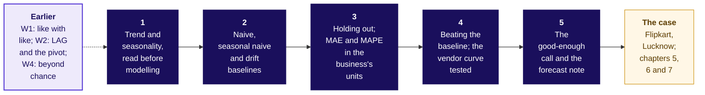

# Forecasting basics: how much does the plan deliver, against a baseline that is hard to beat?

Week 4, Friday. About 12 minutes to read, and 10 more for the self-check.

Friday teaches five topics, in the curriculum's order, on a chai stall at a hostel gate (invented),
whose cups are small enough to count by hand. Then Flipkart's Lucknow fulfilment centre (FC) uses all
five to book packer shifts for the eight festive weeks beginning 12 October to 30 November 2026,
between a vendor's model 22 percent above last year and finance's rule of last year plus 4 percent.
Illustrative case: the company is real, the situation and the data are synthetic, built for this
class.

---

## What can you do after Friday?

- Read a series' trend and seasons before choosing any rule.
- Run naive, seasonal naive and drift by hand, and say when each copy fails.
- Hide the latest periods and score a rule in the business's unit, both ways.
- Say why a close fit proves nothing until a rule beats the baseline.
- Stop improving when a better forecast would not change the decision, and write the note.

## Which map holds the day?

Each topic needs the one before it: read, copy, score, beat, stop.

---

## Trend and seasonality, read before modelling: what does a series tell you before any rule is chosen?

**Who needs the answer.** The stall's owner (invented), who orders milk for three days at a time,
and the FC planner, who books shifts weeks ahead.

**The questions on the way.** What repeats, and how often? Is the stall growing? What is left?

A **time series** is one number per equal period, in time order; a **forecast** is a number for a
period nobody has seen. The invented stall sold 60 cups on Sunday 6 October 2024 and 100 on Monday.
Up 67 percent? No: both Sundays of its first fortnight sold about 60 and every other day about 100. A
repeat on a fixed beat is a **season**, and its **length** is the periods before it repeats: 7 days
at the stall, 52 weeks in Flipkart's year.

Read growth at the same point a season apart. Monday 6 October 2025 sold 110 against 100 a year
earlier: up 10 percent; the two fortnights total 1,450 against 1,315. Sunday stays 0.6 of a Monday in
both years, so the beat keeps its shape while the level, the **trend**, climbs. Seasons go both ways:
the exam fortnight runs about 1.4 times an ordinary one and Diwali week about 0.4, a dip. What is left
is the **remainder**: about 4.7 cups either way, except where Diwali moved, up to 70.

$$y_t = T_t + S_t + R_t$$

Forecasting: Principles and Practice writes a series as this sum when the seasons keep their size,
and as a product when they grow with the level, as the stall's do (section 3.2, checked 13 October
2026). A **cycle**, a rise and fall with no fixed length, needs more than two years to see.

**At Flipkart.** A level near 210,000 shipments a week, growth of about 4 percent a year, a festive
peak each year.

## Naive, seasonal naive and drift baselines: what does each copy, and when does the copy fail?

**Who needs the answer.** The owner, who needs a rule a person can run on paper, and the planner,
whose house bot is one of these rules.

**The questions on the way.** What does each rule copy? Which wins on a beat? Where does it fail?

A **baseline** is the simplest rule that could be right, and its job is to be beaten. Forecast the
invented stall's Sunday 19 January 2025 from the four days before it, 98, 104, 101 and 103, and last
Sunday's 61:

- **Naive** repeats the last value: 103, which misses the 60 sold by 43.
- **Drift** extends the line from the first value to the last: 103 + (103 - 98) / 3, about 104.7.
- **Seasonal naive** copies one season back, last Sunday: 61, a miss of 1.

With $T$ the last period a rule may see, $h$ the periods ahead and $m$ the season's length
(Forecasting: Principles and Practice, section 5.2, checked 13 October 2026):

$$\hat{y}_{T+h} = y_T \qquad \hat{y}_{T+h} = y_{T+h-m} \qquad \hat{y}_{T+h} = y_T + h\,\frac{y_T - y_1}{T - 1}$$

A yearly copy carries last year's level: on the stall's first exam day of 2025, which sold 154, the
copy of the same weekday 364 days back said 140, and times the year's 1.10 it said 154. A copy fails
when the season moves. Diwali came eleven days earlier in 2025, so the calendar copy put Diwali's 40
cups on a day that sold 110, a worst miss of 71. Copying the day at the same distance from last
year's festival misses by at most 13. This programme calls that **festival-aligned**: its own
extension of the seasonal naive. Drift suits a plain climb: on twelve weekly totals it said 686 for a
week that sold 688.

**At Flipkart.** The seasonal naive with $m = 52$ is "the same week last year", which the tournament
calls the house bot; finance's rule is the house bot times 1.04.

## Holding out; MAE and MAPE in the business's units: how is a forecast scored honestly?

**Who needs the answer.** The owner, before trusting a rule, and the regional operations head, before
a vendor's curve books a shift.

**The questions on the way.** Which periods do we hide? How is a miss counted? Which way is it wrong?

Hide the latest periods, at least as many as the forecast must reach ahead. The invented stall's milk
order reaches three days, so days 12 to 14 of a fortnight are **hidden**, day 11 is the **origin**,
the last day a rule may see, and three days is the **horizon**. The test set should be "at least as
large as the maximum forecast horizon required" (Forecasting: Principles and Practice, section 5.8,
checked 13 October 2026).

Naive says 100 for each hidden day; they sold 110, 95 and 100. A **miss** is the forecast minus what
sold: -10, +5 and 0.

$$\text{MAE} = \frac{1}{n}\sum_t \left|\text{miss}_t\right| \qquad \text{MAPE} = \frac{1}{n}\sum_t \frac{\left|\text{miss}_t\right|}{y_t}$$

Here $n$ is the number of hidden periods. The MAE is 5.0 cups and the MAPE about 4.8 percent; the
**lean**, the misses averaged with their signs, is -1.7 cups. Priced at Rs 12 a cup short and Rs 6 a
cup unsold, the three days cost Rs 150. MAPE divides by what sold, so a near-empty day swamps it: a
15-cup miss is 300 percent of a rain day's 5 cups. Keep MAE for the order and MAPE for comparing
stalls of different sizes.

**WATCH OUT.** Misses of +10, +10 and of +10, -10 share an MAE of 10 and cost Rs 120 and Rs 180.
Report the MAE and the lean together.

**At Flipkart.** The latest thirteen weeks, 29 June to 21 September 2026, are hidden; the origin is
22 June; the horizon is ten weeks. A spare shipment costs Rs 5.42 and a late one Rs 25.

## Beating the baseline; the vendor curve tested: why is a close fit no proof?

**Who needs the answer.** The owner, offered a "model" by a nephew, and the operations head, offered
a vendor's curve that fits history within 2 percent.

**The questions on the way.** What does a perfect fit say about tomorrow? Does the clever rule win?

**Fit** is how close a rule sits to the periods it was built on; **forecast error** is how far it
misses periods it never saw. A curve through the invented stall's four days, 100, 104, 98 and 110,
fits them with an error of 0 and says 168 for day 5, which sold 102: a miss of 66. The straight line
says 109 and misses by 7. By hand: the differences are 4, -6 and 12, theirs -10 and 18, and theirs
28; carry them down and the curve climbs to 168. "A model which fits the training data well will not
necessarily forecast well" (Forecasting: Principles and Practice, section 5.8, checked 13 October
2026).

The nephew's second rule, the mean of the last seven days, misses seven hidden days by 12.4 cups; the
seasonal naive by 4.0. Nothing goes to the order unless it beats the seasonal naive on hidden
periods, by the measure fixed before either ran.

**At Flipkart.** The vendor's curve fits its 91 weeks within 1.4 percent and misses the thirteen
hidden weeks by 16,400 a week, 67 percent worse than the house bot's 9,831. In the M5 competition,
on Walmart's daily sales of 3,049 products, only 35.8 percent of teams beat the seasonal naive
(checked 12 October 2026).

## The good-enough call and the forecast note: when do you stop improving, and what do you send?

**Who needs the answer.** The owner, deciding whether a better rule is worth having, and the milkman,
who reads the order.

**The questions on the way.** Would a better forecast change the order? What goes in the note?

Milk comes in cans of 40 cups (invented). On the seven hidden days the seasonal naive orders 3 cans a
weekday and 2 on Sunday, exactly what a forecast that knew the future would order; the nephew's mean
orders a third can on Sunday, Rs 240 of milk that sours. **Good enough** is a claim about the
decision, never about the model: stop improving when a better forecast would order the same.

| The note's line | For the invented stall |
|---|---|
| The number | 3 cans a day Monday to Saturday, 2 on Sunday |
| The method | the same day last week, the seasonal naive, which beat the nephew's mean |
| The error bar | 4.0 cups a day: about Rs 24 if it runs high, Rs 48 if short |
| What would make it wrong | exams starting early, or the hostel emptying for a holiday |

**At Flipkart.** The decision unit is a shift of 120 shipments. The house bot misses by 27 more shifts
a week than festival-aligned and the vendor by 82; a rule 100 shipments better moves one shift in 7 of
the 8 weeks. The staffing note adds one line, to finance and to the vendor's sponsor.

---

## The case: how much is coming to Flipkart's Lucknow centre, and how wrong could the forecast be?

**Who needs the answer.** The FC planner, who books the shifts, and the regional operations head, who
answers for late parcels in the busiest weeks.

**The questions on the way.** Where is the peak? Which rule wins on hidden weeks? How many shifts?

The centre has 104 weeks of outbound shipments, from the week of 30 September 2024. Diwali fell on
Thursday 31 October 2024 and Monday 20 October 2025, and falls on Sunday 8 November 2026 (DoPT's
holiday lists, checked 12 October 2026).

**Chapter 5.** Both years peak two weeks before Diwali's week, in the festive sale: 401,000 and
418,200 shipments. For Diwali 2025's week, which shipped 308,900, naive said 369,000, 60,100 too
high; the seasonal naive 356,200, 47,300 too high; festival-aligned 308,776, 124 too low.

**Chapter 6.** Every rule forecast the thirteen hidden weeks from 22 June 2026:

| Rule | MAE, shipments a week | Weeks too high | Misses priced |
|---|---|---|---|
| Festival-aligned | 6,615 | 6 of 13 | Rs 13.5 lakh |
| Finance's rule | 6,615 | 6 of 13 | Rs 13.5 lakh |
| Seasonal naive, the house bot | 9,831 | 2 of 13 | Rs 30.5 lakh |
| Naive | 14,923 | 8 of 13 | Rs 28.8 lakh |
| Vendor's curve | 16,400 | 12 of 13 | Rs 11.9 lakh |

The two 4 percent rules tie because no hidden week sits near Diwali. Priced, the vendor costs least
only because it errs high, the cheap side; nobody sized that tilt, and in the festive weeks it copies
2025's calendar.

**Chapter 7.** From 22 September 2025 the house bot missed 2025's festive weeks by 58,250 a week and
festival-aligned by 4,034. In 2026 the calendar copies put the busiest week on 5 October, before the
window opens; festival-aligned puts it on 19 October. Plus 22 and plus 4 compare with 2025's same
calendar weeks, 1,983,300 shipments holding the festival's tail; counted from Diwali those weeks
shipped 2,279,500, and finance sits 9.5 percent below them. The plan books festival-aligned's
forecast, each week over 120 shipments a shift, rounded up:

| Week of | 12 Oct | 19 Oct | 26 Oct | 2 Nov | 9 Nov | 16 Nov | 23 Nov | 30 Nov |
|---|---|---|---|---|---|---|---|---|
| Packer shifts | 2,871 | 3,625 | 3,198 | 2,678 | 1,635 | 1,976 | 1,884 | 1,893 |

The **error bar** is 6,615 shipments a week, about 55 shifts: about Rs 35,800 of idle shifts when it
runs that far high, Rs 1.65 lakh of late shipments when that far low. Two doubts stay open: two
years hold only two festivals, and capacity may cap the peak, since overtime hit 1,638 shifts in the
week of 6 October 2025. How far above the forecast a plan should sit, the plan quantile, goes beyond
Friday's five topics: the fallback hour and notebook 07's depth section raise the plan to 20,275
shifts.

**The answer.** Festival-aligned books 19,760 packer shifts, 3,625 in the week of 19 October, with an
error bar of 6,615 shipments a week.

---

## Can you answer these without notes?

1. The hostel mess (invented) used 25 kg of rice on Monday and 40 kg on Sunday: which comparison
   reads growth?
2. Diwali's week moves from 20 October to 2 November: which week of last year does the house bot
   copy into 2 November?
3. Naive missed three hidden days by -10, +5 and 0 cups: what are the MAE and the lean?
4. A curve fits every past week within 2 percent: what do you ask before trusting it?
5. Why is a forecast 100 shipments a week better than festival-aligned hardly worth having?
6. From Thursday: why can blended retention stay flat while each signup month's falls?

**Key.** 1: the same day a week back, or the same week a year back. 2: 3 November. 3: 5.0 cups, and
-1.7, running low. 4: its score on periods it never saw, against the seasonal naive. 5: it moves at
most one shift a week, against 1,635 to 3,625 booked. 6: the blend weights groups by size, so big
young groups at their best months hold it up.

## Which interview questions does Friday prepare you for?

| The question as asked | The hire-grade line |
|---|---|
| [S] How do you evaluate a forecast? | "I hold out the latest weeks, as many as the horizon, and score the misses in shipments and rupees against the seasonal naive; the hidden weeks hold no festival, so I back-test one." |
| [F] What baseline must any forecast beat, and why? | "The seasonal naive: on seasonal data it is the plainest copy that respects the beat." |
| [F] A vendor promises 22 percent growth: how do you test it? | "Score its curve on weeks it never saw against the seasonal naive: here it fitted within 1.4 percent and missed by 16,400 a week." |

**The AI-company variant.** An AI company booking inference capacity, the computing that answers
users' requests, lines the last launch up by days from launch, hides as many days as the plan covers
and beats the last launch's shape before booking. The transcripts are in `extras/`.

## Which words did Friday use?

| Term | Plain meaning | Example |
|---|---|---|
| Trend, season, remainder | The slow climb; the repeat on a fixed beat; what is left | 10 percent a year; 7 days; 4.7 cups |
| Naive, seasonal naive, drift | The last value; one season back; the line extended | 103; 61; 104.7 |
| Festival-aligned | This programme's extension: a copy at the same distance from last year's festival | 19 October 2026 copies 6 October 2025 |
| Hold-out, origin, horizon | The hidden periods; the last period a rule may see; how far ahead it must reach | Days 12 to 14; day 11; three days |
| MAE, MAPE, lean | The average miss's size; as a percent; with signs kept | 5.0 cups; 4.8 percent; -1.7 |
| Error bar | The typical miss on unseen periods, in the unit and in rupees | 6,615 shipments a week |

## Where should you read next, and how long does each take?

| Order | Source | Time |
|---|---|---|
| 1 | Hyndman and Athanasopoulos, Forecasting: Principles and Practice, section 2.3, time series patterns, https://otexts.com/fpp3/graphics.html#sec-tspatterns (checked 13 October 2026) | 10 minutes |
| 2 | The same book, section 5.2, simple forecasting methods, https://otexts.com/fpp3/toolbox.html#sec-simple-methods (checked 13 October 2026) | 20 minutes |
| 3 | The same book, section 5.8, forecast accuracy, https://otexts.com/fpp3/toolbox.html#sec-accuracy (checked 13 October 2026) | 20 minutes |

The week's explorer, `content/W04/D1/demos/C2_W04_D01_week_explorer_STUDENT.html`, replays the day.
