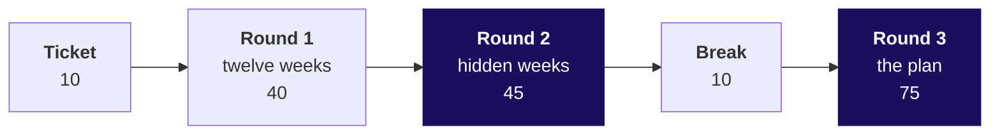

# Day sheet, Week 4 Friday: which forecast books Flipkart Lucknow's festive shifts, and how wrong could it be?

**TRAINER ONLY.** Nothing on this page reaches a learner.

Posts to <!-- sync:module:W04/D5 -->Module 2: Applied Machine Learning<!-- /sync:module:W04/D5 -->, on <!-- sync:day-date:W04/D5 -->Fri 30 Oct 2026<!-- /sync:day-date:W04/D5 -->.

<!-- sync:faculty-day:W04/D5 -->
**IITGN faculty block W4-4 (tentative), 120 minutes, after this row's applied core.** Faculty: to be confirmed by IIT Gandhinagar.

TOPIC: Time series foundations: autocorrelation, stationarity, exponential smoothing, and ARIMA at recognition depth; why a seasonal-naive baseline is hard to beat.
PICKS UP WHERE THE ROW STOPS: the row builds baselines by hand and stops before exponential smoothing, ARIMA and any fitted model.
CONNECTS TO KALPA: the vendor's curve against the seasonal naive on Anand's six held-out months.
BY THE END: a learner can read an autocorrelation plot, explain smoothing as a weighted memory, and say what a fitted model would have to beat.
DOES NOT REPEAT: the hold-out and the error in rupees.
<!-- /sync:faculty-day:W04/D5 -->

Your row stops where the faculty block starts: the handoff line (half two, S10), the Kahoot and the
closing (S11 and S12) are the last things you run. Do not preview the block's content; when you
mention it to the room, say it is tentative. If the block cannot run, the fallback deck fills its 120
minutes (`trainer/C2_W04_D05_fallback_note_TRAINER.md`).

Built from the approved Week 4 spine (`docs/detailing/W04_analyst_craft_spine.md`, section 9, and the
acceptance test in section 12), the Friday case in `docs/detailing/W04_case_file.md`, and the Friday
row of `docs/curriculum/W4_Analyst_craft.md`. The case data is written by
`internal/C2_W04_D05_make_data_INTERNAL.py` (seed 20261030), and every number below is in
`internal/C2_W04_D05_facts_INTERNAL.yaml`, whose header lists where the facts depart from the case
file. Flipkart is real; the situation and the data are synthetic, and every learner file says so.

## Who runs this day, and in which slots?

| Slot | Minutes | Who runs it | What runs |
|---|---|---|---|
| Morning | 180 | The trainer, with the TA on the floor | The ticket, then the tournament's three rounds (chapters 1 to 3), with a 10-minute break before round three |
| Afternoon, first hour | 60 | The trainer | The staffing note, the interview room, the Kahoot and the close |
| IITGN block | 120 | IITGN faculty (tentative) | W4-4, or the fallback deck if it cannot run |
| Practice lab | The lab's length | The TA | Notebook 04 on Kalpa, the Kalpa board set, then the practice set |

## Which questions does the day ask, in the order the trainer asks them?

The day asks **which forecast goes to the staffing plan, how wrong could it be in shipments and in
rupees, and how many packer shifts a week?** Ask each question before its answer is shown.

| Part | Its question | The smaller questions, in order |
|---|---|---|
| The ticket | What has the planner been handed, and what would make either forecast wrong? | Plus 22 or plus 4? What is the tournament's rule? |
| Chapter 1 | What shape do the weeks have, and what would simple rules say for one week? | Which week ships most? What does each rule copy? Which rule lands Diwali 2025's week? Where does the calendar copy put the peak? |
| Chapter 2 | How does each rule score on the thirteen weeks it never saw? | Which weeks are hidden? How is a miss counted? Does a close fit beat the bot? Whose misses cost least, priced? |
| Chapter 3 | Which forecast books the shifts, and what does being wrong cost? | Where is 2026's busiest week? How did the rules do on 2025's festival? What do plus 22 and plus 4 measure? How far above the forecast should the plan sit? What can two years not tell us? |
| The afternoon | What does the staffing note say, line by line? | Which forecast, how many shifts, what error bar, what would move it, what to finance and to the sponsor? |
| The interview room | How do you evaluate a forecast? | MAE or MAPE? The festival moves three weeks? What did Zillow's forecast cost? |

**The day's answer, said at the close (half two, S12).** "Nothing books a shift until it beats a copy
of last year on hidden weeks. Festival-aligned, raised 2.6 percent because a late shipment costs 4.6
times a spare one, books 20,275 packer shifts, 3,719 in the week of 19 October, with an error bar of
6,615 shipments a week."

---

## What does the day start from, and where does it stop?

| | |
|---|---|
| **Start from** | Thursday's cohort table, which gave the week a time axis; today the axis runs forward. Open on the ticket and let the room say what would make either forecast wrong. |
| **Go as far as** | Every learner reads the festival's shape by hand, scores six forecasts on thirteen hidden weeks in shipments and rupees, back-tests the 2025 festival, sets the plan's cushion from the two costs, and writes the staffing note with its error bar. |
| **Stop before** | Exponential smoothing, ARIMA, autocorrelation and any fitted model, which the faculty block (tentative) owns; the rolling origin, which only the fallback runs. |
| **Comes later** | Saturday's paper tests the hold-out, the festival trap and the plan share; Week 5 turns the customer table into a model; the forecast returns in the capstone as the plan line. |
| **Cut first** | Drift (S8's fourth row and notebook 02's drift line, kept as one spoken sentence), then MAPE (keep MAE), then the cost curve's picture on S32 (keep the 0.82 arithmetic). Never cut the hold-out, the vendor against the baseline, the festival trap or the Kalpa lab. |

---

## How do the morning's 180 minutes run?

| Block | Minutes | Slides | File beside them | What must land | What to cut if late |
|---|---|---|---|---|---|
| The ticket | 10 | Cover, S1 to S3 | half one; `trainer/C2_W04_D05_tournament_TRAINER.md` | The ask in the ticket's words; the tournament's rule fixed before anyone scores | S2's map to one sentence |
| Round one, chapter 1 | 40 | S4 to S14 | The twelve rows; notebook 01 | Both peaks two weeks before Diwali's week; festival-aligned within 124 on Diwali 2025's week; the calendar copy a week late in 2025 | S7's four panels to one sentence; notebook 01's last cell |
| Round two, chapter 2 | 45 | S15 to S26 | Notebook 02; the wall scoreboard | Thirteen hidden weeks from 22 June; 6,615 against 9,831 against 16,400; the vendor fits within 1.4 percent; priced, the vendor costs least and still loses | Drift's panel; S25's second route to one sentence |
| Break | 10 | | | The scoreboard stays on the wall | |
| Round three, chapter 3 | 75 | S27 to S37 | Notebook 03; the festival calendar card; the two role cards | The bot's 2026 peak on 5 October; 58,250 against 4,034 on 2025's festival; plus 4 is minus 9.5 against the festival's weeks; the 0.82 share; 20,275 shifts; the objections answered | S35 to its last row; S36 to three doubts |

The slides' notes carry about 130 minutes of talk; the other 40 are notebook work, about 3 minutes in
round one, 6 in round two and 30 in round three with the role cards.

## How does the afternoon's first hour run?

| Block | Minutes | Slides | File beside them | What must land |
|---|---|---|---|---|
| The staffing note, unguided | 30 | S1 to S5 | `exercises/unguided/C2_W04_D05_staffing_note_STUDENT.md`; the role cards | Five lines per group: the shifts, the peak and why, the error bar priced both ways, three facts that would move it, one line to each stakeholder |
| The interview room | 15 | S6 to S10 | `extras/C2_W04_D05_interview_transcripts_STUDENT.md`; `trainer/C2_W04_D05_interview_scorecards_TRAINER.md`; `trainer/C2_W04_D05_guesstimate_TRAINER.md` | The hire-grade structure; the three follow-ups; the AI-company variant; the handoff line said as written |
| Kahoot and close | 15 | S11 and S12 | `kahoot/C2_W04_D05_quiz_STUDENT.md` | The three closing lines; tonight's take-home and Saturday's preview |

**The handoff line (S10).** "Your baseline is hard to beat, and you now know what any model must
beat and on which weeks. The next 120 minutes show how a series remembers itself, autocorrelation,
and what a smoothing or ARIMA model would have to do to earn its place above the festival-aligned
baseline on the thirteen held-out weeks."

---

## Which traps does the day stage, with the exact wrong number and the check?

| Trap | The wrong number or reading | The decision it would mislead | The check | Deck | Notebook |
|---|---|---|---|---|---|
| The calendar copy in 2025 | 401,000 booked for the week of 13 October 2025, when 369,000 shipped; the real peak, 418,200 on 6 October, given 312,900 | The most packers a week after the rush | Line the years up by weeks from Diwali: the festival plot | S9 to S11 | 01, cells 8 to 11 |
| Fit taken for forecast | "Within 2 percent of every past week": 1.4 percent at worst on 91 fitted weeks | The vendor's curve sent to the plan | Score on the hidden weeks: 16,400 a week, 12 of 13 too high | S20, S21 | 02, cells 11 to 13 |
| MAE alone | "16,400 is the vendor's error", as if both directions cost the same | A ranking that ignores which misses hurt | Price each direction: the vendor's misses cost Rs 11.9 lakh, the least | S22 to S24 | 02, cells 14 and 15 |
| The calendar copy in 2026 | The house bot's busiest week on 5 October 2026 | The most packers booked two weeks before the rush | The festival calendar card: Diwali's week is 2 November 2026 | S28, S29 | 03, cells 6 and 7 |
| Plus 4 on the wrong window | Finance's plus 4 read as "4 percent more than last festival" | A window 308,048 shipments short | Count last year's weeks from Diwali: finance sits 9.5 percent below | S31 | 03, cells 8 and 9 |
| The plan at the median | The forecast itself booked as the plan | Short in about half the weeks, at 4.6 times the cost of spare | The 0.82 share from Rs 25 and Rs 5.42, read off the thirteen weeks | S32 to S34 | 03, cells 9 to 12 |
| The month-aligned copy (lab) | Kalpa's October 2025 spike copied into October 2026 | A board number with Diwali in the wrong month | Diwali falls on 8 November 2026: festival-aligned moves the spike | | 04, the second your-turn cell |

## Where are the checkpoints?

| After | The check | A room that is behind |
|---|---|---|
| S10 | Three learners say naive's, the house bot's and festival-aligned's forecasts for Diwali 2025's week: 369,000, 356,200, 308,776 | Redo the hand count on the twelve rows before chapter 2 |
| S19 | Every notebook prints the scoreboard with festival-aligned and finance's rule at 6,615 | Pair each stuck learner with a finished one for two minutes |
| S21 | Every your-turn cell prints the vendor's 16,400 | The TA types the line on the projector |
| S34 | The room reads the week of 19 October aloud: 434,928, then 446,236, then 3,719 shifts | Walk 344,448 x 1.026 = 353,404, over 120, up to 2,946 on the board |

## Which plants does the lab find, and what if nobody does?

The full table is in `trainer/C2_W04_D05_lab_note_TRAINER.md`. In one line each: both Octobers stand
1.45 and 1.56 times their neighbours; the first year sits 3.5 percent below the second; the vendor
fits its 18 months within 1.8 percent and misses the six hidden months by Rs 38.8 lakh against the
seasonal copy's Rs 11.7 lakh; its next six months are 22 percent above the year before; the
month-aligned copy puts the spike in October 2026, where Diwali falls on 8 November. No learner file
names any of them before a learner's own cell prints it.

## Which numbers carry the day?

| Number | Value | Facts id |
|---|---|---|
| The two forecasts | plus 22 and plus 4 percent, eighteen points apart | ticket.vendor_promise_pct, ticket.finance_rule_pct, ticket.points_apart |
| Diwali's weeks | 28 Oct 2024, 20 Oct 2025, 2 Nov 2026 | ticket.diwali_2024, ticket.diwali_2025, ticket.diwali_2026 |
| Diwali 2025's week by hand | 308,900 shipped; 369,000, 356,200 and 308,776 forecast | hand_count.diwali25_actual, hand_count.naive, hand_count.bot, hand_count.aligned |
| Hidden-week MAE | 6,615, 6,615, 9,831, 14,842, 14,923, 16,400 | holdout.aligned_mae, holdout.finance_mae, holdout.bot_mae, holdout.drift_mae, holdout.naive_mae, holdout.vendor_mae |
| Priced misses | Rs 13.5, 30.5, 28.0, 28.8 and 11.9 lakh | holdout.aligned_cost_rs, holdout.bot_cost_rs, holdout.drift_cost_rs, holdout.naive_cost_rs, holdout.vendor_cost_rs |
| The vendor's fit and climb | 1.4 percent; 3.6 then 11.5 percent too high | holdout.vendor_fit_max_pct, holdout.vendor_first6_pct, holdout.vendor_last6_pct |
| 2025's festival | 58,250, 60,488 and 4,034 a week | backtest_2025.bot_mae, backtest_2025.finance_mae, backtest_2025.aligned_mae |
| The two windows | 1,983,300 and 2,279,500 | window_2026.calendar_2025_total, window_2026.festival_2025_total |
| The share and the cushion | 0.82; 2.6 percent | ticket.plan_quantile, holdout.cushion_pct |
| The plan | 20,275 shifts; 3,719 at the peak | plan.shifts_total, plan.peak_week_shifts |
| The error bar | the forecast's 6,615 a week; about Rs 35,800 if it runs high, Rs 1.65 lakh if low | error_bar.week_shipments, error_bar.week_idle_rs, error_bar.week_late_rs |
| The fair price | each forecast at its own 0.82 point: festival-aligned Rs 8.8 lakh, the vendor Rs 10.0 lakh | interview.own_raised_cost_aligned_rs, interview.own_raised_cost_vendor_rs |
| The peak week's range | 3,413 to 3,906 shifts needed against 3,719 booked | interview.peak_low_shifts, interview.peak_high_shifts, plan.peak_week_shifts |
| The horizon | ten weeks, 21 September to the week of 30 November | ticket.horizon_weeks |

## What are the interview answers, each in one breath?

- **How do you evaluate a forecast?** Hold out the latest weeks, at least as many as the forecast
  must reach ahead (ten here), forecast them from one origin, then roll the origin; score the misses
  in shipments and priced by direction against the seasonal naive: festival-aligned 6,615, the
  seasonal naive 9,831, the vendor 16,400; at each forecast's own 0.82 point, Rs 8.8 lakh against the
  vendor's Rs 10.0 lakh.
- **MAE or MAPE?** MAE in shipments when the cost is per shipment; MASE or WAPE across centres of
  different sizes, since MAPE explodes near zero and punishes forecasts that land high.
- **The festival moves three weeks?** Every calendar copy breaks; a copy by distance from the festival
  moves with it, and the sale's distance from the festival gets checked.
- **Zillow?** A margin guardrail of plus or minus 200 basis points around breakeven; price forecasts
  six months ahead missed by far more, the margin swung about 1,200 basis points, about USD 304
  million was written down and the business wound down: the forecast's error was wider than the band.
- **The AI-company variant?** Size the peak in tokens a second from the ground up, check it against
  earlier launches by days from launch with the weekday kept (untested with fewer than two), and set
  capacity to a latency target with headroom, booking above the forecast because a timeout costs more
  than an idle GPU.
- **Two-wheelers a year?** About 2.2 crore from households, ownership and replacement, against
  SIAM's 2,17,05,974 sold to dealers; never annualise October's 31,49,846 registrations
  (`trainer/C2_W04_D05_guesstimate_TRAINER.md`).

## Which file serves which moment?

| Moment | File |
|---|---|
| The morning | `slides/C2_W04_D05_half1_STUDENT.pptx`; notebooks 01 to 03 |
| The tournament | `trainer/C2_W04_D05_tournament_TRAINER.md`; `trainer/C2_W04_D05_role_cards_TRAINER.md`; `trainer/C2_W04_D05_festival_calendar_card_TRAINER.md` |
| Round one's drill | `exercises/guided/C2_W04_D05_same_week_rule_STUDENT.md`; `exercises/unguided/C2_W04_D05_ch1_shapes_STUDENT.md` |
| Round two's drill | `exercises/unguided/C2_W04_D05_ch2_scoreboard_STUDENT.md` |
| The afternoon | `slides/C2_W04_D05_half2_STUDENT.pptx`; the staffing note set |
| The interview room | `extras/C2_W04_D05_interview_transcripts_STUDENT.md`; `trainer/C2_W04_D05_interview_scorecards_TRAINER.md` |
| The Kahoot | `kahoot/C2_W04_D05_quiz_STUDENT.md` |
| The lab | Notebook 04; `trainer/C2_W04_D05_lab_note_TRAINER.md`; the Kalpa board set; the practice set |
| Tonight | `takehome/`, `study-notes/`, `cheatsheets/`, `preread/` (Saturday's preview) |
| A missing faculty block | `slides/C2_W04_D05_fallback_STUDENT.pptx`; `trainer/C2_W04_D05_fallback_note_TRAINER.md` |
