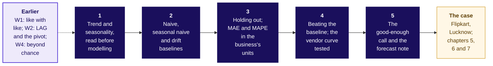
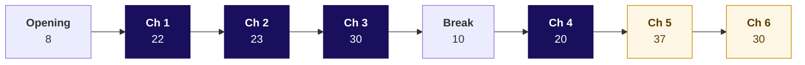

# Day sheet, Week 4 Friday: forecasting basics, five topics on the chai stall, then Flipkart Lucknow's festive shifts

**TRAINER ONLY.** Nothing on this page reaches a learner.

Posts to <!-- sync:module:W04/D5 -->Module 2: Applied Machine Learning<!-- /sync:module:W04/D5 -->, on <!-- sync:day-date:W04/D5 -->Fri 30 Oct 2026<!-- /sync:day-date:W04/D5 -->.

<!-- sync:faculty-day:W04/D5 -->
**IITGN faculty block W4-4 (tentative), 120 minutes, after this row's applied core.** Faculty: to be confirmed by IIT Gandhinagar.

TOPIC: Time series foundations: autocorrelation, stationarity, exponential smoothing, and ARIMA at recognition depth; why a seasonal-naive baseline is hard to beat.
PICKS UP WHERE THE ROW STOPS: the row builds baselines by hand and stops before exponential smoothing, ARIMA and any fitted model.
CONNECTS TO KALPA: the vendor's curve against the seasonal naive on Anand's six held-out months.
BY THE END: a learner can read an autocorrelation plot, explain smoothing as a weighted memory, and say what a fitted model would have to beat.
DOES NOT REPEAT: the hold-out and the error in rupees.
<!-- /sync:faculty-day:W04/D5 -->

Your row stops where the faculty block starts: the handoff line (half two, S16), the Kahoot (S17)
and the close (S18) are the last things you run. Do not preview the block's content; when you
mention it to the room, say it is tentative. If the block cannot run, the fallback deck fills its 120
minutes (`trainer/C2_W04_D05_fallback_note_TRAINER.md`).

Built from the approved concept-first plan (`docs/detailing/W04_concept_first/D5_plan.md`), the Week
4 spine (`docs/detailing/W04_analyst_craft_spine.md`), the Friday case in
`docs/detailing/W04_case_file.md` and the Friday row of `docs/curriculum/W4_Analyst_craft.md`. The
data is written by `internal/C2_W04_D05_make_data_INTERNAL.py` (seed 20261030): the case's tables,
byte-identical to the merged pack's, and the invented chai stall and hostel mess. Every number below
is in `internal/C2_W04_D05_facts_INTERNAL.yaml`, the stall's and the mess's under `toy_` ids. Flipkart
is real; the situation and the data are synthetic, and every learner file says so.

## Which topics does the day teach, in which chapter, and where is each practised?

The five topics are the row's subtopics, word for word and in the row's order. Chapters 1 to 4 teach
them on the chai stall (invented); chapters 5 to 7 apply them to the case.

| # | Topic, as the row words it | Taught in | Minutes | Concept notebook | Applied in | Exercise items | Kahoot |
|---|---|---|---|---|---|---|---|
| 1 | Trend and seasonality, read before modelling | Chapter 1, half one S6 to S13 | 22 | 01 | Chapters 5 and 7 | c1 set Q1 to Q3; staffing note Q4; practice Q1 | Q8 |
| 2 | Naive, seasonal naive and drift baselines | Chapter 2, S14 to S21 | 23 | 02 | Chapters 5, 6 and 7 | c2 set Q1 to Q3; guided same week rule Q1, Q3; practice Q2, Q5 | Q1 |
| 3 | Holding out; MAE and MAPE in the business's units | Chapter 3, S22 to S29 | 30 | 03 | Chapters 6 and 7 | c3 set Q1 to Q4; guided Q2; scoreboard Q1, Q2; Kalpa board Q1; practice Q3, Q6 | Q2, Q5, Q7 |
| 4 | Beating the baseline; the vendor curve tested | Chapter 4, S30 to S33 | 10 of chapter 4's 20 | 04 | Chapter 6 | c4 set Q1, Q2; scoreboard Q3; Kalpa board Q2; practice Q4 | Q3 |
| 5 | The good-enough call and the forecast note | Chapter 4, S34 to S37 | 10 of chapter 4's 20 | 04 | Chapter 7 and the staffing note | c4 set Q2, Q3; staffing note Q1 to Q3 and the note; Kalpa board Q3 | Q4 |

Chapter 4 carries topics 4 and 5 together because both rest on one decision: a forecast earns trust by
beating the baseline on periods it never saw, and it is good enough when a better one would change no
order.

## How do the topics connect?

The same map is half one's S4, the notes' first picture, the cheat sheet's first panel and the board's
first drawing.

The hooks, each named at the point of reuse: Week 2 Thursday's pivot trend view in chapter 1; Week 2
Wednesday's LAG in chapter 2, since a seasonal copy is LAG by a season; Week 1 Monday's average that
one giant miss can move and Week 1 Tuesday's matched windows in chapter 3; Wednesday's lift beyond
chance in chapter 4; Thursday's rule to align cohorts and never blend them in the case's festival
alignment.

## How did the trainer's 240 minutes move from the merged pack to this one?

| Block | Before, the merged pack | After, this pack |
|---|---|---|
| The topic, the week map, the topics, the concept map, the ticket | 10 (the ticket and its rule) | 8 (half one S1 to S5) |
| Concept chapters 1 to 4 on the chai stall | 0 | 95 (22, 23, 30 and 20) |
| The case's first part: the twelve weeks and the rules | 40 (round one) | 37 (chapter 5) |
| The case's second part: the hidden weeks and the vendor | 45 (round two) | 30 (chapter 6) |
| Break | 10 | 10 |
| The case's third part: the festival placed and the plan | 75 (round three, with the cushion) | 33 (chapter 7, half two; the cushion moves to the fallback hour) |
| The afternoon's opening board | 3 | 2 |
| The staffing note in groups | 27 | 15 |
| The interview room | 15 | 0 here; it moves to the lab in full |
| The handoff, the Kahoot and the close | 15 | 10 |
| **The trainer's minutes** | **240** | **240** |

The morning runs 180 (8 + 95 + 37 + 30 + 10) and the afternoon's first hour 60 (2 + 33 + 15 + 10).

## Who runs this day, and in which slots?

| Slot | Minutes | Who runs it | What runs |
|---|---|---|---|
| Morning | 180 | The trainer, with the TA on the floor | The opening, concept chapters 1 to 4 on the stall, a 10-minute break after chapter 3, then case chapters 5 and 6 |
| Afternoon, first hour | 60 | The trainer | Chapter 7, the staffing note in groups, the handoff, the Kahoot and the close |
| IITGN block | 120 | IITGN faculty (tentative) | W4-4, or the fallback deck if it cannot run |
| Practice lab | The lab's length | The TA | The interview room in pairs (15 minutes), the four concept sets' items 2 and 3 (20 minutes), notebook 08 on Kalpa, the Kalpa board set, the practice set, the staffing note's prose |

## Which questions does the day ask, in the order the trainer asks them?

The day asks **how much will the plan deliver, and how wrong could its number be, against a baseline
that is hard to beat?** Ask each question before its answer is shown.

| Part | Its question | The smaller questions, in order |
|---|---|---|
| Chapter 1 | What does a series tell you before any rule is chosen? | What repeats, how often? Is the stall growing? What repeats yearly? What is left over? |
| Chapter 2 | What does each copy rule copy, and when does it fail? | What does each rule copy? Which wins next Sunday? What does a yearly copy miss? What breaks when the festival moves? |
| Chapter 3 | How is a forecast scored honestly? | Which days do we hide? How is a miss counted? When does a percent mislead? Which way is it wrong? What does it cost? |
| Chapter 4 | When does a forecast earn trust, and what do you send? | What does a perfect fit say? Does the clever rule win? Is better worth having? What goes to the milkman? |
| Chapter 5 | Where is Flipkart's peak, and what do three rules say for one week? | Where is the peak? What does each rule copy? Which lands closest? Which week moves? |
| Chapter 6 | Which rule wins on thirteen hidden weeks? | Which weeks? How counted? Which rule wins? What does a fit say? What do misses cost? |
| Chapter 7 | How many packer shifts, and how wrong could the plan be? | Where is this year's peak? Did placement matter in 2025? Plus what, against which window? How many shifts? Is better worth having? |

**The day's answer, said at the close (half two, S18).** "Nothing books a shift until it beats a copy
of last year on hidden weeks. Festival-aligned books 19,760 packer shifts, 3,625 in the week of 19
October, with an error bar of 6,615 shipments a week, priced both ways."

---

## What does the day start from, and where does it stop?

| | |
|---|---|
| **Start from** | Thursday's cohort table, which gave the week a time axis; today the axis runs forward. Open on the topic, the week map and the concept map, then the ticket in one slide as the destination. |
| **Go as far as** | Every learner reads a series' trend and seasons, runs the three baselines by hand, scores a rule on hidden periods in the business's unit both ways, says why a fit proves nothing, writes the four-line note, and applies all five to the case's 19,760 shifts. |
| **Stop before** | Exponential smoothing, ARIMA, autocorrelation and any fitted model, which the faculty block (tentative) owns; the rolling origin and the plan quantile, which only the fallback hour and notebook 07's depth section run, labelled beyond the row. |
| **Comes later** | Saturday's paper tests the hold-out, the festival trap and the plan share; Week 5 turns the customer table into a model; the forecast returns in the capstone as the plan line. |
| **Cut first** | From the case chapters only, never a concept chapter: S47 (Flipkart's capacity announcement) to one sentence, then S58 (the second route) to one sentence, then drift's row of S52's scoreboard, then S57's cards to one line. Never cut a concept chapter, the hold-out, the vendor against the baseline, the festival trap or the Kalpa lab. |

---

## How do the morning's 180 minutes run?

| Block | Minutes | Slides | Notebook | What must land | What to cut if late |
|---|---|---|---|---|---|
| Opening | 8 | Half one S1 to S5 | | The day's question; the five topics read aloud from S3; the map; the ticket in one slide | Nothing |
| Chapter 1 | 22 | SECTION 1, S6 to S13 | 01 | Plus 67 percent is the beat; 10 percent a year read a season apart; seasons up and down; a remainder of 4.7 cups | Never cut |
| Chapter 2 | 23 | SECTION 2, S14 to S21 | 02 | 103, 104.7 and 61 against 60 sold; the yearly copy needs growth; the moving festival's 71 against 13 | Never cut |
| Chapter 3 | 30 | SECTION 3, S22 to S29 | 03 | Hide the latest three; MAE 5.0, MAPE 4.8 percent, lean -1.7, Rs 150; MAPE's 300 percent; Rs 120 against Rs 180 | Never cut |
| Break | 10 | After S29 | | | |
| Chapter 4 | 20 | SECTION 4, S30 to S37 | 04 | Fit 0, miss 66; 4.0 against 12.4; the same cans; the four-line note | Never cut |
| Chapter 5 | 37 | SECTION 5, S38 to S48 | 05 | The full ticket; both peaks two weeks before Diwali's week; festival-aligned within 124; the calendar copy a week late | S47 to one sentence |
| Chapter 6 | 30 | SECTION 6, S49 to S59 | 06 | 6,615 against 9,831 against 16,400; the vendor's 1.4 percent fit; priced, the vendor costs least and still loses | S58, then drift's row, then S57 |

## How does the afternoon's first hour run?

| Block | Minutes | Slides | File beside them | What must land |
|---|---|---|---|---|
| The morning on one map | 2 | Half two S1 | | The five topics with the case's numbers on them |
| Chapter 7 | 33 | SECTION 7, S2 to S11 | Notebook 07; the festival calendar card; the role cards | The bot's 2026 peak on 5 October; 58,250 against 4,034 on 2025's festival; plus 4 is 9.5 percent below the festival's weeks; 19,760 shifts, 3,625 at the peak; a better forecast must move a shift |
| The staffing note in groups | 15 | S12 to S15 | `exercises/unguided/C2_W04_D05_staffing_note_STUDENT.md` | The lettered items in groups; the five-line note's prose finishes in the lab |
| The handoff, the Kahoot, the close | 10 | S16 to S18 | `kahoot/C2_W04_D05_quiz_STUDENT.md` | The handoff line said as written; eight items; the day's answer |

The interview room's slides (D1 to D4) stay in half two as self-study and run in the lab in pairs.

**The handoff line (S16).** "Your baseline is hard to beat, and you now know what any model must
beat and on which weeks. The next 120 minutes show how a series remembers itself, autocorrelation,
and what a smoothing or ARIMA model would have to do to earn its place above the festival-aligned
baseline on the thirteen held-out weeks."

---

## Which traps does the day stage, with the exact wrong number and the check?

| Trap | The wrong number or reading | The decision it would mislead | The check | Deck | Notebook |
|---|---|---|---|---|---|
| The beat read as growth | Plus 67 percent, Monday's 100 over Sunday's 60 at the stall (invented) | Two-thirds more milk, which sours | The same point a season apart: 100 against 100 | S7, S8 | 01 |
| The calendar copy on the stall | 40 cups copied onto a day that sold 110 | Milk 70 cups short | Copy by distance from the festival: worst miss 13 | S19 | 02 |
| MAE alone, on the stall | "MAE 10 is the error" for both rules | Milk ordered at the forecast when the misses run short | The lean: Rs 120 against Rs 180 | S27 | 03 |
| The perfect fit | "Fits 100 percent of history; order for 168" | Two cans of milk that sour | The score on hidden days: a miss of 66 | S31, S32 | 04 |
| The calendar copy in 2025 | 401,000 booked for the week of 13 October 2025, when 369,000 shipped | The most packers a week after the rush | Line the years up by weeks from Diwali | S45 | 05 |
| Fit taken for forecast | "Within 2 percent of every past week": 1.4 percent at worst on 91 fitted weeks | The vendor's curve sent to the plan | Score on the hidden weeks: 16,400 a week | S53, S54 | 06 |
| MAE alone, at Flipkart | "16,400 is the vendor's error", as if both directions cost the same | A ranking that ignores which misses hurt | Price each direction: the vendor's misses cost Rs 11.9 lakh, the least | S55, S56 | 06 |
| The calendar copy in 2026 | The house bot's busiest week on 5 October 2026 | The most packers booked two weeks before the rush | The festival calendar card: Diwali's week is 2 November 2026 | Half two S3, S4 | 07 |
| Plus 4 on the wrong window | Finance's plus 4 read as "4 percent more than last festival" | A window 308,048 shipments short | Count last year's weeks from Diwali: 9.5 percent below | Half two S6 | 07 |
| The month-aligned copy (lab) | Kalpa's October 2025 spike copied into October 2026 | A board number with Diwali in the wrong month | Diwali falls on 8 November 2026 | | 08, the second your-turn cell |

## Where are the checkpoints?

| After | The check | A room that is behind |
|---|---|---|
| Chapter 2 | Three learners say naive's, drift's and the seasonal naive's forecasts for next Sunday: 103, 104.7 and 61 | Redo the three lines on the board before chapter 3 |
| Chapter 3 | Every notebook prints MAE 5.0 and MAPE 4.8 percent | Pair each stuck learner with a finished one for two minutes |
| Chapter 4 | Every notebook prints 168 and 109 | Carry the differences down on the board: 4, -6, 12; -10, 18; 28 |
| S44 | Three learners say the three rules' forecasts for Diwali 2025's week: 369,000, 356,200, 308,776 | Redo the hand count on the twelve rows before chapter 6 |
| S52 | Every notebook prints the scoreboard with festival-aligned and finance's rule at 6,615 | Pair each stuck learner with a finished one |
| S54 | Every your-turn cell prints the vendor's 16,400 | The TA types the line on the projector |
| Half two S7 | The room reads the week of 19 October aloud: 434,928, then 3,625 shifts | Walk 344,448 over 120, up to 2,871, on the board |

## Which plants does the lab find, and what if nobody does?

The full table is in `trainer/C2_W04_D05_lab_note_TRAINER.md`. In one line each: both Octobers stand
1.45 and 1.56 times their neighbours; the first year sits 3.5 percent below the second; the vendor
fits its 18 months within 1.8 percent and misses the six hidden months by Rs 38.8 lakh against the
seasonal copy's Rs 11.7 lakh; its next six months are 22 percent above the year before; the
month-aligned copy puts the spike in October 2026, where Diwali falls on 8 November. No learner file
names any of them before a learner's own cell prints it.

## Which numbers carry the day?

| Number | Value | Facts id |
|---|---|---|
| The stall's beat and growth (invented) | Sunday 0.6 of a Monday; 10 percent a year | toy_ch1_share, toy_ch1_growth |
| The three baselines on the stall | 103, 104.7 and 61 against 60 sold | toy_ch2_naive, toy_ch2_drift, toy_ch2_last_sunday, toy_ch2_next_sunday |
| The stall's score | MAE 5.0 cups; MAPE 4.8 percent; lean -1.7; Rs 150 | toy_ch3_mae, toy_ch3_mape, toy_ch3_lean, toy_ch3_cost |
| Fit against forecast | 0 against a miss of 66; the line's 109 | toy_ch4_miss_curve, toy_ch4_line |
| The baseline race and the cans | 4.0 against 12.4 cups; the same cans | toy_ch4_snaive_mae, toy_ch4_mean7_mae, toy_ch4_cans_differ_snaive |
| The two forecasts | plus 22 and plus 4 percent, eighteen points apart | ticket.vendor_promise_pct, ticket.finance_rule_pct, ticket.points_apart |
| Diwali 2025's week by hand | 308,900 shipped; 369,000, 356,200 and 308,776 forecast | hand_count.diwali25_actual, hand_count.naive, hand_count.bot, hand_count.aligned |
| Hidden-week MAE | 6,615, 6,615, 9,831, 14,842, 14,923, 16,400 | holdout.aligned_mae, holdout.finance_mae, holdout.bot_mae, holdout.drift_mae, holdout.naive_mae, holdout.vendor_mae |
| Priced misses | Rs 13.5, 30.5, 28.0, 28.8 and 11.9 lakh | holdout.aligned_cost_rs, holdout.bot_cost_rs, holdout.drift_cost_rs, holdout.naive_cost_rs, holdout.vendor_cost_rs |
| 2025's festival | 58,250, 60,488 and 4,034 a week | backtest_2025.bot_mae, backtest_2025.finance_mae, backtest_2025.aligned_mae |
| The two windows | 1,983,300 and 2,279,500 | window_2026.calendar_2025_total, window_2026.festival_2025_total |
| The plan | 19,760 shifts; 3,625 at the peak | plan.base_shifts_total, plan_weeks.base_shifts_10_19 |
| Good enough at Flipkart | 27 and 82 shifts a week; a rule 100 better moves one shift in 7 of 8 weeks | good_enough.bot_gap_shifts, good_enough.vendor_gap_shifts, good_enough.better_weeks_moved |
| The error bar | 6,615 a week; about Rs 35,800 if it runs high, Rs 1.65 lakh if low | error_bar.week_shipments, error_bar.week_idle_rs, error_bar.week_late_rs |
| Beyond the row | 0.82; 2.6 percent; 20,275 shifts | ticket.plan_quantile, holdout.cushion_pct, plan.shifts_total |

## What are the interview answers, each in one breath?

- **[S] How do you evaluate a forecast?** Hold out the latest weeks, at least as many as the forecast
  must reach ahead (ten here), from one origin; score the misses in shipments and priced by direction
  against the seasonal naive: festival-aligned 6,615, the seasonal naive 9,831, the vendor 16,400.
  The hidden weeks hold no festival, so back-test one: 4,034 against the bot's 58,250 on 2025's.
- **[F] What baseline must any forecast beat, and why?** The seasonal naive, since on seasonal data it
  is the plainest copy that respects the beat; on the stall it missed by 4.0 cups where the nephew's
  mean missed by 12.4.
- **[F] A vendor promises 22 percent growth; how do you test the claim?** Score its curve on weeks it
  never saw against the seasonal naive (16,400 against 9,831, after a 1.4 percent fit), and read the
  22 against the right window: on the calendar weeks festival-aligned is 19.5 percent up too.
- **[D] Finance and Marketing each want their forecast in front of the board?** Concede the true part
  of each, then present the forecast that beat the baseline on hidden periods with its error bar in
  rupees each way; the lab's interview room drills it.
- **The AI-company variant?** Size the peak from the ground up as requests open at once, check it
  against earlier launches by days from launch with the weekday kept, and set capacity to a latency
  target with headroom.
- **Two-wheelers a year?** About 2.2 crore, 1.7 to 2.9 as the replacement years swing, against
  SIAM's 2,17,05,974 sold to dealers; never annualise October's 31,49,846 registrations
  (`trainer/C2_W04_D05_guesstimate_TRAINER.md`).

## Which file serves which moment?

| Moment | File |
|---|---|
| The morning | `slides/C2_W04_D05_half1_STUDENT.pptx`; notebooks 01 to 06; `whiteboards/C2_W04_D05_board_work_STUDENT.md` |
| The concept checks | `exercises/unguided/` c1 to c4 sets, item 1 of each live, items 2 and 3 in the lab |
| The case's tournament | `trainer/C2_W04_D05_tournament_TRAINER.md`; `trainer/C2_W04_D05_role_cards_TRAINER.md`; `trainer/C2_W04_D05_festival_calendar_card_TRAINER.md` |
| Chapter 5's drill | `exercises/guided/C2_W04_D05_same_week_rule_STUDENT.md` |
| Chapter 6's drill | `exercises/unguided/C2_W04_D05_ch2_scoreboard_STUDENT.md` |
| The afternoon | `slides/C2_W04_D05_half2_STUDENT.pptx`; notebook 07; the staffing note set |
| The interview room, in the lab | `extras/C2_W04_D05_interview_transcripts_STUDENT.md`; `trainer/C2_W04_D05_interview_scorecards_TRAINER.md` |
| The Kahoot | `kahoot/C2_W04_D05_quiz_STUDENT.md` |
| The lab | Notebook 08; `trainer/C2_W04_D05_lab_note_TRAINER.md`; the Kalpa board set; the practice set |
| Tonight | `takehome/`, `study-notes/`, `cheatsheets/`, `preread/` (Saturday's preview) |
| A missing faculty block | `slides/C2_W04_D05_fallback_STUDENT.pptx`; `trainer/C2_W04_D05_fallback_note_TRAINER.md` |
