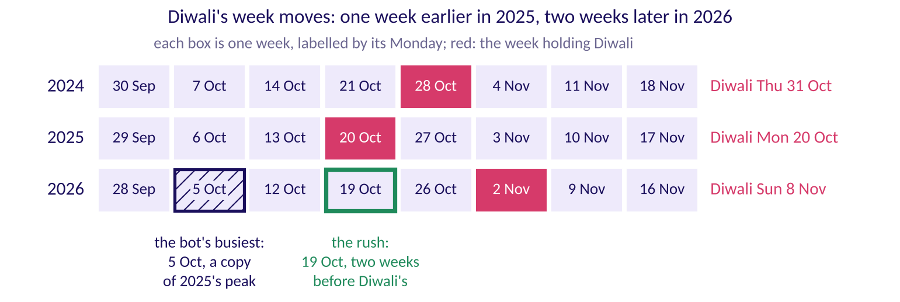

# The festival calendar card

**TRAINER ONLY until half two's S4.** Print the card below large and keep it face down. In chapter 5,
round one, half one's S46 shows the room where Diwali falls in each year and stops there. In chapter
7, round three, ask the room "Which week does the bot put Diwali in this year?", take the vote on half
two's S3, and turn the card on S4: it adds the house bot's copy to the strip S46 showed.

## What does the card say?

| Year | Diwali | The week it falls in | Weeks after the last Diwali's week |
|---|---|---|---|
| 2024 | Thursday 31 October 2024 | The week of 28 October 2024 | |
| 2025 | Monday 20 October 2025 | The week of 20 October 2025 | 51 |
| 2026 | Sunday 8 November 2026 | The week of 2 November 2026 | 54 |

- **What the house bot copies.** It copies 52 weeks back. Into Diwali 2026's week, 2 November 2026,
  it copies the week of 3 November 2025, two weeks after Diwali 2025.
- **Where the house bot puts the peak.** Its busiest 2026 week is 5 October, a copy of 6 October
  2025, which was 2025's peak two weeks before that year's Diwali.
- **Where the peak should go.** Two weeks before Diwali's week, as in both years: the week of 19
  October 2026.

## Where are the dates from?

The three dates are the Government of India's gazetted Diwali holidays in the DoPT holiday lists for
2024, 2025 and 2026, as reproduced by staffnews.in; DoPT's own site refused the connection on the day
of the check:

- https://www.staffnews.in/2023/07/list-of-holidays-2024-dopt-order-reg-gazetted-and-restricted-holidays.html (checked 12 October 2026)
- https://www.staffnews.in/2024/07/holidays-to-be-observed-in-central-government-offices-year-2025.html (checked 12 October 2026)
- https://www.staffnews.in/2025/07/list-of-holidays-2026-dopt-order-reg-closed-and-restricted-holidays.html (checked 12 October 2026)

The programme's facts file locks Monday 9 November 2026 as the Monday after Diwali, a holiday.

## What do you say when you turn it?

"The house bot copies the calendar. Diwali came one week earlier in 2025 than in 2024, and comes two
weeks later in 2026 than in 2025. So the bot's busiest week is 5 October, and the rush comes in the
week of 19 October. The group that put the peak there first wins the plan."
