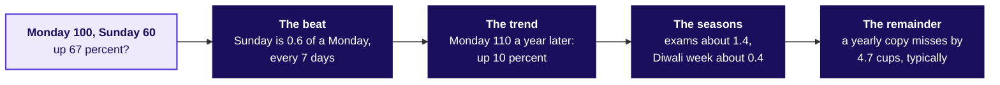
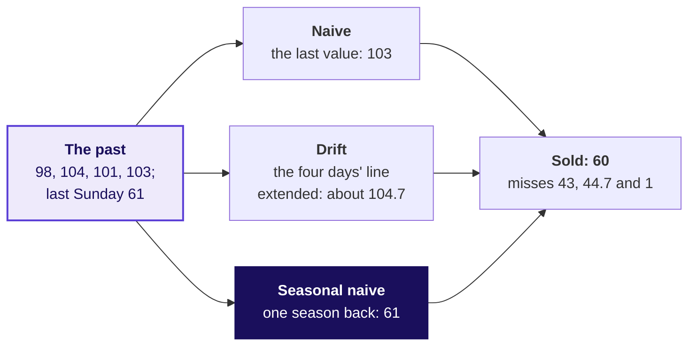
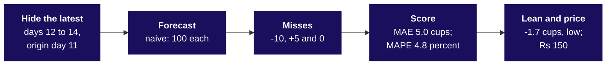
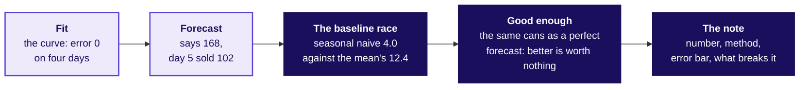
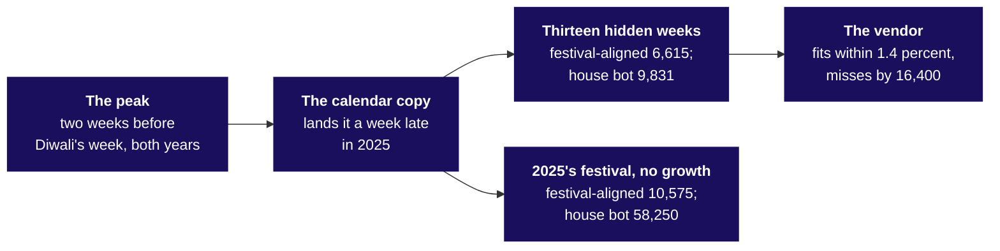
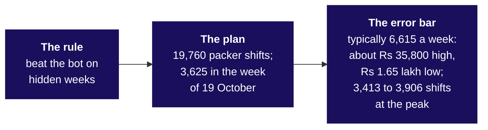

# What goes on the board on Friday, and in what order?

*The chai stall is invented, as every number about it is. Illustrative case: the company is real, the
situation and the data are synthetic, built for this class.*

Friday teaches five topics on a chai stall at a hostel gate (invented), then uses them on Flipkart's
Lucknow fulfilment centre, where the planner books packer shifts for the eight festive weeks beginning
12 October to 30 November 2026, between a vendor's plus 22 percent and finance's plus 4.

**Who needs the answer.** The trainer, who draws these in order, and you, if you missed a drawing or
want to redraw the board from memory before Saturday.

**The questions on the way.** Each heading below asks the question one drawing answers, in the order
the drawings go up, and the last asks what stays on the board at the end.

---

## How do the five topics connect, and where does the case use them?

Goes up first and stays up all day. The five topics are lit as each chapter teaches them.

```mermaid
flowchart LR
    E["<b>Earlier weeks</b><br/>like with like;<br/>LAG; beyond chance"] -.-> T1
    T1["<b>Chapter 1: Trend and seasonality,</b><br/><b>read before modelling</b>"] --> T2["<b>Chapter 2: Naive, seasonal naive</b><br/><b>and drift baselines</b>"]
    T2 --> T3["<b>Chapter 3: Holding out; MAE and MAPE</b><br/><b>in the business's units</b>"]
    T3 --> T4["<b>Chapter 4: Beating the baseline;</b><br/><b>the vendor curve tested</b>"]
    T4 --> T5["<b>Chapter 4, second half: the good-enough</b><br/><b>call and the forecast note</b>"]
    T5 --> C["<b>The case</b><br/>Flipkart, Lucknow,<br/>chapters 5 to 7"]
    classDef lit fill:#1A0F5C,stroke:#1A0F5C,color:#FFFFFF
    classDef known fill:#EEEAFB,stroke:#5B3FD6,color:#1A0F5C,stroke-width:2px
    classDef kalpa fill:#FFF7E6,stroke:#C98A00,color:#5C3D00
    class T1,T2,T3,T4,T5 lit
    class E known
    class C kalpa
```

---

## Trend and seasonality, read before modelling: what does the invented stall's fortnight say?

Drawn during chapter 1, from the invented stall's first fourteen days.

---

## Naive, seasonal naive and drift baselines: what does each rule say for next Sunday?

Drawn during chapter 2. The invented stall's last four days sold 98, 104, 101 and 103, and last
Sunday 61; next Sunday sold 60.

---

## Holding out; MAE and MAPE in the business's units: how is a rule scored?

Drawn during chapter 3, on the invented stall's fourteen days, the last three hidden.

---

## Beating the baseline, the good-enough call and the note: when does a forecast earn trust?

Drawn during chapter 4.

---

## The case: where is Flipkart's peak, and which rule wins on hidden weeks?

Drawn across chapters 5, 6 and 7.

Its animation, `C2_W04_D05_holdout_reveal_STUDENT.gif`, reveals the hidden weeks one at a time, from
`C2_W04_D05_holdout_reveal_first_STUDENT.png` to the still above: the vendor leads in week 1, 3,700
to 12,300, and trails by week 13, 16,400 to 9,831.

---

## What is on the board when the day ends?

The concept map with all five topics lit, and the plan beside it.

