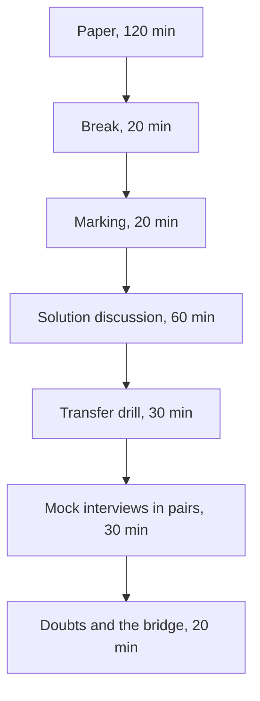

# Week 4 Saturday: the discussion guide

**TRAINER ONLY.** Posts to <!-- sync:module:W04/SAT -->Module 2: Applied Machine Learning<!-- /sync:module:W04/SAT -->, on <!-- sync:day-date:W04/SAT -->Sat 31 Oct 2026<!-- /sync:day-date:W04/SAT -->.

The Academic TA leads the day. The paper the room sits is the Word file in `paper/`; the key in
`answer-key/` carries every item's key, tag, level, day, interview anchor, why the key holds, why
each wrong option fails, the bank items folded into each item, and the answers to the stretch page.
The transfer drill and the mock-interview round each have a run sheet in this folder, with the sheet
the room holds beside it.

This paper puts the week's five tickets back to the room: Uber's peak-hour guarantee in Hyderabad on
Monday and Tuesday, Swiggy Instamart's bought-together strip in Pune, Zomato Gold's members in Chennai
and Flipkart's festive packer plan in Lucknow, each with the Kalpa finding the lab made beside it.
Items also lean on public cases (Wells Fargo, Delhi Metro, Amazon's letter, NPCI's UPI count, DMart,
Flipkart, Swiggy and the M5 competition), and Part 6 carries the method to Kalpa's other four units.
The afternoon turns what the paper found into answers each learner can say aloud, then moves the
week's methods to companies the room has not worked on.

---

## The shape of the day



| Block | Duration | What happens |
|---|---|---|
| The paper | 120 min | The room sits 39 items in six parts with pen and paper, no notes and no assistant, paced at 118 minutes, and anyone who finishes early turns to the untimed stretch page. |
| Break | 20 min | Papers stay face down on the desks. |
| Marking | 20 min | Learners swap papers and mark them against the key the Academic TA reads out, and the TA enters the ticks by seat in the item-analysis workbook. |
| The solution discussion | 60 min | The most-missed items come first (25 min), then ten anchors are answered aloud as interview answers with random call-outs (30 min), and the step-one ratings are set against the work last (5 min). |
| The transfer drill | 30 min | Eight one-paragraph briefs, four at companies the room uses and four at Kalpa's other units, each answered aloud on one grid; the run sheet is `C2_W04_SAT_transfer_drill_TRAINER.md`. |
| The mock-interview round | 30 min | In pairs, on the week's interview transcripts and their AI-company variants: each learner asks the other one anchor and one follow-up and scores the answer on the card, then they swap; the run sheet is `C2_W04_SAT_mock_round_TRAINER.md`. |
| Doubts and the bridge | 20 min | Open doubts come first, then the bridge to Week 5, when the customer table becomes a model and Rohan Desai's lending question arrives. |

The day runs 300 minutes and teaches nothing new.

---

## The paper, 120 minutes

Hand out the Word paper face down and start the time together. Step one on the first page comes
before any item: each learner rates the six parts from 1 to 4 on the answer sheet, as they are today.
Laptops closed and phones away for the whole sitting. Announce the time left at 60 minutes and at 15
minutes.

Say three things once, before the start. The four company cases are illustrative: the companies are
real, and the situations and the data are synthetic, built for this class. Every public fact an item
needs is printed on the page with its source, so nobody needs to know Wells Fargo or Delhi Metro to
answer. Part 6's units are Kalpa's, as invented as Kalpa Retail. Anyone who finishes early turns to
the stretch page, which is untimed and uncounted; its first four follow-ups come back in the
mock-interview round, so a learner who writes them now has rehearsed.

If a learner asks what an item means during the sitting, the only answer is that every number the
item needs is on the page. Write the item number and the question on a slip: an item two careful
readers take two ways goes to the tracker's owner after the day, with the question beside it.

## Marking, 20 minutes

1. Papers swap along the row, so nobody checks their own paper.
2. Read the key part by part from the key file: letters in runs of five; the word-bank and match
   letters one at a time (Q1, Q2 and Q35 to Q38); the four numbers one at a time (Q17, Q18, Q22 and
   Q23); the two worked items slowly (Q29 and Q30); and each ordering item's sequence slowly, twice
   (Q8 and Q12, four letters each, since three of Q8's seven lines and two of Q12's six steps are
   left out).
3. The marker ticks or crosses each item on the answer sheet, writes each part's ticks in the box
   beside that part's rating and their total as Items right, out of 39, and hands the paper back, so
   each learner reads their rating against their score part by part.
4. The key's rule settles the edge cases: every correct letter and no other on the four
   more-than-one items (Q7, Q9, Q13 and Q34); the letter on a word-bank or match item; both numbers
   on Q29; on Q30, the four numbers to the nearest lakh with November named as the spike's month,
   with the working left to the discussion; and the whole sequence on Q8 and Q12. There is no partial
   credit, because the programme has set no rule for it.
5. The Academic TA enters each paper by seat in
   `answer-key/C2_W04_SAT_item_analysis_TRAINER.xlsx`, never by name: the ticks in the Marks sheet,
   1 for a tick, 0 for a cross and a blank for an item left empty, and the six step-one ratings in
   the Ratings sheet. Its Discussion sheet gives the most-missed order the discussion takes, and any
   item it flags goes to the tracker's owner with the room's rate, because the fault may sit in the
   item rather than in the room.

Say once, at the start, that the key decides every tick, and reading somebody else's answer against
it is the exercise. The key's guessing line puts a score of 10 or below within reach of guessing
alone, so a paper there is a conversation for the TA-led lab in Week 5, never a result.

---

## The solution discussion, 60 minutes

### Most-missed first, 25 minutes

Take the order from the workbook's Discussion sheet: the five most-missed items, from the top, at
about five minutes each. The candidate list below gives, for each likely miss, the wrong answer most
papers will hold, the question to put to the room before anyone reads the key, and the repair to
listen for; an item outside it that the sheet ranks higher takes its place, and the key file's "Why
each answer holds" section has the reason behind every wrong option. If the entry is not finished
when the discussion opens, read the list instead, ask for hands, and write the counts on the board.
For each item, ask "a cross on item 25?", call one person who crossed it to say what they wrote and
why it looked right, then put the question below to the room before reading the repair.

| Item | What most papers get wrong | Ask the room | The repair, said aloud |
|---|---|---|---|
| Q4, six drivers' rows | Most mark (c), the right 1.19 told to the city head as a 37 percent fall, or (d), reading 1.31 as the six's fall and quoting the city's 1.58. | "Add the six drivers' trips and hours before and after. Then: what did the whole city's rate do, on Exhibit 1A?" | Summed, trips fell from 114 to 88 while hours rose from 60 to 74, so the six went from 1.90 to 1.19 trips an hour; 1.31 averages each driver's own rate and gives a 10-hour week the weight of a 16-hour week. The six were picked to show the mechanism, E and F, two outer-zone drivers, adding 10 hours and losing 30 trips, so the city head hears the city's own 1.90 to 1.58, about 17 percent, with E and F as where the hours went. The note is a number hit while the outcome got worse. |
| Q6, the silent change | Most mark (c), the right 36 percent with a satisfaction guardrail, or (a), the change log with 57 percent. | "What share of 0.11 is 0.04? And would any customer have felt remittance accounts join the count?" | 0.04 of 0.11 is about 36 percent; 0.04 over the other 0.07, 57 percent, sets one part against the other. A dated change log, with the year's ratio printed on both definitions, shows a change of what is counted. A satisfaction guardrail cannot, since counting existing remittance accounts changed nothing a customer saw, and the order says staff changed contact details so the surveys missed customers anyway. |
| Q7, the definition sheet | Most tick (a), the head of Retail-Plus's own proposal, or leave out (e). | "Of the window's placements, how many reached a member as a delivered order?" | None did: placements rose 1.22 times while booked value per member fell to 0.96, so reorders placed fails the proxy test. The sheet keeps the exclusions (c), the revenue guardrail (d) and add-to-cart as the leading input (e), and last quarter's audited revenue (b) is a lagging number. |
| Q8, the slide's four slots | Most keep (c) and (g), the claim and the evidence on bookings per driver-week, or put (a), every driver moved from Monday, in the action slot. | "Bookings per driver-week rose 0.8 percent. What did each driver-week buy to get there? And which action answers the caveat?" | About four more online hours, while each hour earned Rs 260 against Rs 314, so c and g read the flattering denominator, and the scheme pays per online hour. The caveat leaves part of the fall to the season; a test on half the drivers, picked at random, runs the old pay and the new in the same weeks, so the difference is the redesign's, and a city-wide switch leaves nothing to compare. The stem prints the template's order, so the key is e, b, d, f. |
| Q9, two elements | Most tick (d), Rs 82 a completed trip, in place of (c), or (b), rider requests, in place of (a). | "What did the Rs 1.9 crore buy that the six weeks before did not have?" | The 6,700 extra trips, so the price of what riders got is Rs 2,836 an extra trip; Rs 82 spreads the money over every trip, though the weeks before carried 224,200 with no top-up. What riders got is the wait, 4.8 to 4.6 minutes; requests are what riders asked for. |
| Q10, the defence that concedes nothing | Most mark (d), conceding the season and answering with trips per hour sliding to 1.56, or (a), the right evidence with nothing conceded. | "If the monsoon's end thinned demand, what would trips per hour do? And what would requests do?" | Trips per hour would slide either way, so 1.58 to 1.56 cannot answer finance. Requests back inside their old range, 41,161 to 42,602 against 41,155 to 42,719, while trips per hour stayed at 1.56 against 1.90, say riders asked as often as before and each hour still carried fewer trips. The statement is false: concede the season's part, show that evidence, then say what would change your mind, a city with the same rains and no scheme where trips per hour fell as far. |
| Q12, the estimate's order | Most keep (f), moving the answer up to about 6,450, or (c), the check against 2.13 rider requests an hour. | "The chain says 0.60 driver-hours a trip and the case says 0.53. Does the city need more drivers than the chain says, or fewer?" | Fewer: each trip took fewer driver-hours than the chain assumed, so the answer falls toward 5,000 at the case's own 1.90 trips an hour, and f multiplies where it should divide. Step c divides trips by requests, and requests ran above trips (251,910 against 224,200), so it pulls the answer to about 3,900 for the wrong reason. The order is clarify (b), the formula (d), the working aloud (e), then the check (a). |
| Q13, five checks on four numbers | Most tick (b), the 63 million, (d), households set against users, or (e), the September average set against Diwali day. | "For each check, is it the source's own number, in the same unit and the same period as the estimate?" | The post's own words, printed in the stem, say 6.3 million, and 63 sits in its web address, so (b) runs ten times high. Two million people over four is 5 lakh households, and an estimate of UPI users counts people, so (d) sets households against people. UPI's 802 million a day is sound against an ordinary day and wrong against a festival day, so (a) holds and (e) does not. DMart over the average of 415 and 500 stores is about Rs 146 crore a store, a rough check, since 58 of the 85 new stores opened in the last quarter. |
| Q14, Delhi Metro's two counts | Most mark (c), taking a boarding as one gate entry, or (d), a bracket. | "A rider changes line once. How many journeys does DMRC count?" | Two, since DMRC counts a journey for each line a rider uses, so the 64.06 lakh average runs above the trips riders take. The 82,44,903 was one record day during a bus strike, never an ordinary weekday. An estimate of trips is checked against trips, or the published count is converted first. |
| Q15, the strip by slot | Most mark (a), the habits story with slot 1 first, or (c), the right diagnosis with slot 3 first. | "Which row in Exhibit 3B clicks less after the switch? Then: in which slot did milk push out the most clicks?" | None does: milk held at 1.2 percent and other items rose from 6.2 to 6.4, so milk's share, 2 to 50 percent of impressions, moved the strip to 3.8. Slot 1 loses about 4.76 clicks per 100 impressions to milk, slot 2 about 2.85 and slot 3 about 1.35, so slot 1 is re-ranked first; slot 3 clicks lowest because it is the third slot, before and after. |
| Q16, heavy buyers | Most mark (a), both pairs, reading the per-cart lifts against the 1.5 rule. | "Which column is the lift the 1.5 rule should read, and why?" | The last, with chance counted within each cart's size and each customer counted once, because heavy buyers repeat a pair across many carts and big carts hold any pair by chance. Chips and cold drink keeps its slot at 1.95; onions and tomatoes falls to 1.38 and loses it. |
| Q20, two high-lift pairs | Most mark (d), sending Instamart's pair straight into the strip, or (b), holding both pairs for another quarter of carts. | "Add one basket to Kalpa's pair: what does its lift become? And what would more Instamart carts tell you that 100 do not?" | Kalpa's lift moves to 6 with one basket more and to 2 with one fewer, so it is counted again. Instamart's 100 carts already beat the 22 chance gives, so more carts add nothing; what the pair lacks is a test of whether showing sauce sells sauce, and the strip would show it only beside ice cream, about 2,400 of 60,000 cart-page views a day. Both stay on the watch list, Instamart's in a test with its rule fixed first. |
| Q21, the bundle slot's worth | Most mark (d), Rs 2,625, pricing the discount on the new adds alone, or (b), Rs 5,250. | "On how many adds is the Rs 3 discount paid?" | All 750, the 375 that would have happened anyway included: 375 new adds at Rs 10 of margin is Rs 3,750, less 750 times Rs 3, Rs 2,250, leaves Rs 1,500 a day. |
| Q24, the honest headline | Most mark (b), the right headline with 40.5, or (c), the right 37.8 blamed on the new cohort. | "Without cohort C, how many of June's 4,000 existing members retained?" | 460 of A and 1,050 of B, 1,510 of 4,000, about 37.8 percent; 40.5 averages cohorts of 1,000 and 3,000 as if they were equal. C's 47.5 sits above both existing cohorts in June, so C holds the blend up, and comparing C's June with A's May sets two months side by side. Both existing cohorts fell, and a large new cohort in its first month hid it. |
| Q25, the flow two ways | Most mark (a), the lowest step as the loss, or (c), a double-counting log. | "How can more sessions reach a menu than searched?" | The home carousel opens menus with no search, so search is a step members can skip and 118 percent is the flow itself. Per member, menu to cart converts 61 percent, against 34 per session, because a member browses menus across several sessions. A step's level says little; the loss is where a rate changed. |
| Q26, the Android checkout | Most mark (a), 3,198 orders a week, or (c), the right weekly number blamed on the August sale cohort. | "3,198 orders over how many days? And did iOS and web members fall too?" | Over 17 days, so about 1,317 a week, Rs 4.0 to 6.6 lakh at Rs 300 to Rs 500 an order. iOS members went from 57 to 56 and web members held at 55 while Android members fell from 58 to 44 from the release date, so the break is the Android member path; the sale cohort's members use every platform, and fixing the checkout ends a weekly loss. With iOS members as the comparator the fall is 13 points, about 1,223 a week, and the option's 1,317 is against the members' own old rate, as it says. |
| Q27, the weaned cohort | Most mark (b), the right 40 and 80 percent with the acquisition-quarter question. | "The third-quarter cell went from 40 to 80 percent. Whose behaviour changed?" | Nobody's: dropping the five weak users halved the base. Before reading a published cohort chart's shape, ask what each cell divides by, users who joined or users kept, and whether it counts users, orders or spend; the acquisition quarter is a second question. 60 percent is the fourth quarter, 3 of 5. |
| Q28, the window's 11 carts | Most mark (a), closing on "only 3 fewer", or (b), keeping it open on 10 to 7 as proof. | "At the old rate, how many of the window's 11 carts would have checked out?" | About 9, 10 of 12 applied to 11, and 7 did, so about 2 checkouts are missing in three weeks; 10 to 7 ignores that carts fell from 12 to 11. That is a reason to flag the step with its dates and counts and read the next three weeks, never to close it and never to rebuild; the flat blend cannot see a step inside a session. |
| Q30, the festival's month | Most give October 2026 the spike, copying October 2025, or give November's festival copy and leave October out. | "In which week of 2026 does Diwali fall, and which month holds it? Then what does October 2026 copy?" | The week beginning 2 November, so November holds Diwali. The seasonal naive gives October Rs 427.6 lakh and November Rs 297.0 lakh, which puts the spike in October. The festival-aligned baseline swaps last year's two months: November gets October 2025's Rs 427.6 lakh times 1.04, about Rs 444.7 lakh, and October gets November 2025's Rs 297.0 lakh times 1.04, about Rs 308.9 lakh. An answer that also says part of the run-up may land in late October is right: November 2024, straight after a Diwali on 31 October, showed no lift. |
| Q31, the sponsor's curve | Most mark (c), weeks the curve never saw with the naive as the bar, or (d), the seasonal naive over the two fitted years. | "Which bar on Exhibit 5C did every other entry clear, and which beat both machine-learning benchmarks? And what do two fitted years measure?" | Every other entry beat the naive's 1.752, so beating it proves little; the seasonal naive's 0.847 beat both machine-learning benchmarks, so it is the bar. Two years the curve was fitted on score its fit however many weeks they hold, so the test is the seasonal naive on weeks the curve never saw. |
| Q32, the priced misses | Most mark (a), the right errors with the vendor booked at plus 22 percent, or (b), the right conclusion on signed misses. | "Which side does the vendor err on, and which side is the cheap one? Then: what does a signed average do to 40,748 high and 45,248 low?" | High, on the cheap side: a spare shipment costs Rs 5.42 and a late one Rs 25, so the vendor's Rs 11.9 lakh, against Rs 13.5 and 30.5 lakh, comes from erring cheap by an amount nobody chose. At each forecast's own 0.82 point, festival-aligned and the copy cost about Rs 8.8 lakh each and the vendor Rs 10.0 lakh. Signed misses cancel; the mean absolute error is 6,615, 9,831 and 16,400. |
| Q33, the board sentence | Most mark (a), finance's rule with the honest error bar, or (c), festival-aligned with its error stretched to the festive months. | "Which month holds Diwali this year, from Exhibit 5A, and did any of April to September hold one?" | November, and none did. Finance's rule copies October 2025's festival into an October 2026 with no Diwali, and the board books stock and staff by month. Festival-aligned books Rs 19.69 crore with the spike in November, Rs 2.08 crore under the plan line, and its miss of about Rs 3.5 lakh a month was measured on six months with no Diwali, so the sentence says the spike month itself is untested. |
| Q39, the plan share at Amazon | Most mark (a), Lucknow's 0.82 with the right method, or (c), the right 0.65 with the calendar copy. | "Which cost goes on top of the fraction, and what is it here? And why did Lucknow copy last year by Diwali?" | The late cost: Rs 10 over Rs 10 plus Rs 5.42 is about 0.65, below Lucknow's 0.82 because a late shipment costs less here. What carries over is the method: hold out the latest weeks, align last year's weeks to the festival, which moves, price both directions of miss and set the share from the two costs. |

When a learner connects an item to Kalpa, discuss what the room found in the labs and nothing beyond
it: Monday's reorders up 1.22 times with booked value at 0.96 and none delivered; Wednesday's charger
in 84.5 percent of consumer baskets, the screen protector's lift of 0.97 and the car pair on 2
baskets; Thursday's flat 41 percent and the window's 7 checkouts from 11 carts; and Friday's festival
in November with the vendor's Rs 38.8 lakh a month. The paper names those because the room has
already found them, and it prints Thursday's blend without its number so that Q22 and Q23 keep
theirs. When a learner asks about a real company, keep to what each item's source reports
and add nothing: the four company cases' numbers are synthetic, so no answer says what Uber, Swiggy,
Zomato or Flipkart actually saw.

### The anchors aloud, 30 minutes

Ask each anchor as an interviewer would: name the person, then the question, then wait. Give sixty
seconds. Ask the room for the one sentence that would make the answer stronger, and read the answer
below only if nobody gets there. Each anchor takes three minutes. Anchors 1, 2 and 4 to 10 are the
Saturday row's nine; anchor 3 is Tuesday's, since Part 2 has no anchor in the Saturday row. The items
under each anchor descend from it, and anchor 10 comes last because it opens the transfer drill.

#### 1. [S] How would you measure the success of a new feature? Walk your metric design.

*Items 3, 4 and 7.*

Start from the decision the feature exists to change, then write the outcome it should move as a
definition nobody can argue with: numerator, denominator, window and exclusions. Add the leading
input the team can act on this week, one guardrail for each cheap way of hitting the number, the
baseline the result is read against, and the decision rule, fixed before launch. Hyderabad is the
worked answer: the guarantee's goal was riders picked up faster, so its number is completed peak
trips per enrolled driver online at peak each week, guarded by the share of offers accepted, the
rider's wait by zone and the top-up per completed trip. Peak online hours, the number the launch note
celebrated, rose 24 percent while trips per online hour fell from 1.90 to 1.58. Listen for the answer
that names engagement with no denominator and no window, because it cannot say whether the 24
percent is good news. The follow-up to ask: what would make you switch the feature off? (A guardrail
crossing its line, or the north star flat against the baseline.)

#### 2. [F] North-star against guardrail, with one example pair.

*Items 1, 3 and 7.*

A north star names the outcome the plan exists to move, and a guardrail is a number that must not
get worse while the north star rises, so each guardrail catches one cheap way of hitting it. The lab's
pair at Kalpa: delivered orders per active customer per month, guarded by revenue per active
customer, because reorders per Retail-Plus member rose 1.22 times while their booked value per member
fell to 0.96 and none of the window's placements became a delivered order. Listen for a guardrail
that is only a second goal, and push until the learner names the cheap way it catches. The follow-up
to ask: can the people measured move your guardrail? At Wells Fargo staff changed customers' contact
details so the satisfaction surveys missed them (Q5 and Q6), and a guardrail the measured can
redirect guards nothing.

#### 3. [S] Present a recommendation to a non-technical stakeholder in two minutes.

*Items 8, 9 and 11. From Tuesday's row.*

Two minutes holds one claim. The title states it so the reader could act on the title alone: the
guarantee is paying for online hours that carry no trips. One number with its denominator carries
it: bookings per peak online hour fell from Rs 314 to Rs 260 at the same Rs 165 fare. The caveat sits
on the page, the monsoon ending inside the six weeks with no weeks from last year to compare, and the
action names its cost and who signs: pay per completed peak trip with an acceptance floor, tested on
half the drivers, picked at random, for six weeks, which the city head signs, because the test
answers the caveat. Every other number goes to an appendix page headed by the question its owner
will ask. Listen for a topic title, for "peak online hours up 24 percent" as the headline, which is
Monday's trap sold a second time, and for a title on bookings per driver-week, the flattering
denominator. The follow-up to ask: the
finance partner says the fall is the monsoon's end; what do you say? (Concede the season's part, then
show weekly requests back in their old range while trips per hour stayed at 1.56 against 1.90, as in
Q10.)

#### 4. [S] Support, confidence, lift: which cannot be fooled by popularity, and why?

*Items 16 to 19.*

Support is the share of all baskets that hold both items, confidence is the share of A's baskets that
also hold B, and lift is that confidence divided by B's own share, which is the pair's count over the
count chance alone gives. Confidence is the one a popular partner fools, and lift is the one it
cannot fool, because lift divides by the partner's popularity. In Set 1, 165 of 200 case baskets hold
the charger, a confidence of 0.825, and the charger is in 85 percent of all baskets, so the lift is
0.97, slightly below chance; Wednesday's lab found the same shape on Kalpa's own baskets, the screen
protector toward the charger at a confidence of 0.82 and a lift of 0.97. The strong answer adds
lift's two weak spots: a thin support, which is anchor 5, and heavy buyers, who repeat a pair across
many carts (Q16). The follow-up to ask: which of the three reads the same in both directions? (Support
and lift; confidence does not.)

#### 5. [F] A pair has lift 4 and support 0.3 percent; act or not?

*Item 20.*

Not as a campaign yet. A lift resting on a handful of baskets moves by luck: Kalpa's car phone mount
and car charger read a lift of 4.0 on 2 of 812 baskets, so one basket more makes it 6 and one fewer
makes it 2. A real pair can still fail as a slot: Instamart's ice cream and chocolate sauce sit in 100
of 40,000 carts against the 22 chance gives, and the strip would show them only beside ice cream,
about 2,400 of 60,000 cart-page views a day. So the pair goes on a watch list with a test: a random
half of shoppers in two zones see the suggestion, for a length fixed before day one, with the decision
rule set in advance. Listen for "lift above 1, so act" and for "drop it", since both skip the
evidence. The follow-up to ask: how many ice-cream carts does the test need? (Stretch 2: about 1,105
an arm to see a rise from 6.25 to 9.45 percent, and about 4,014 if half the adds would have come
anyway.)

#### 6. [S] Retention dropped: walk me through your investigation.

*Items 25, 26 and 28.*

Define the metric and its window first, then rule out a data fault, since a logging change shipped
with a release moves every number on the same day. Then segment before naming any cause: one cohort
or everyone, one platform or all, one step of the flow or the whole of it. Find the step that changed,
for whom and from when, beside comparators on the same step, and size it in the business's unit a
week with a range. At Zomato Gold the step was completing a started checkout, for Android members,
from 14 September, 72.5 to 55 percent, while iOS members and non-members on the same new checkout
held, so the break sits in what only members see, at about 1,317 orders a week, Rs 4.0 to 6.6 lakh.
Aced's guide runs its sample answer on a fall in post views the same way, defining the metric first,
and its commentary rules out a data issue first and keeps fewer users apart from fewer views per user
(checked 13 October 2026). Listen for an answer that names a cause in its first sentence. The
follow-up to ask: the app team says the stage you blamed is fine; what do you bring? (The step's
conversion by date with its counts, the comparators on the same step, and the weeks that would
confirm it.)

#### 7. [F] Blended retention is flat while every cohort declines; how?

*Items 22 to 24 and 27.*

A blended rate is the cohorts' rates weighted by their sizes, so it moves with the mix as well as
with behaviour. When each new signup month arrives large and in its strong first months, it holds the
blend up while every older cohort falls. Set 2 shows it on three cohorts: A falls from 50 to 46
percent and B from 38 to 35, C enters at 47.5, and the blend reads 41 percent in both months, where
June without C would read 1,510 of 4,000, about 37.8 percent. Zomato
Gold's dashboard held month-two retention at 38 percent while each signup month's month one fell from
58 percent in January to 49 in July, and August's sale cohort started at 31. The fix is to fix each
member's entry month and read every cohort at the same age. Listen for "Simpson's paradox" said as a
label with no weights behind it, and ask for the weights. The follow-up to ask: what happens to the
blend when signups slow? (The new cohorts stop propping it up, and it starts to fall with the cohorts
it was hiding.)

#### 8. [S] What baseline must any forecast beat before it earns trust?

*Items 29 to 31.*

Two baselines, each scored on periods the forecast never saw: the naive, which repeats the last
period, and the seasonal naive, which copies the same period a year earlier and is the hard one
wherever the season repeats on the calendar. When the festival moves, the fair seasonal baseline
copies last year by distance from the festival: Diwali fell on 20 October 2025 and falls on 8 November
2026, so a same-month copy carries October's spike into a month with no festival. Lucknow's thirteen
hidden weeks scored the naive at 14,923 shipments a week, the same-week copy at 9,831, finance's rule
and festival-aligned at 6,615 each and the vendor's curve at 16,400. M5 made the same point at scale:
on days no entry had seen, the seasonal naive's 0.847 beat both machine-learning benchmarks on the
exhibit, and only 1,972 of the 5,507 teams beat it. Listen for an answer that scores a model on its fit to the past. The
follow-up to ask: why did finance's rule and festival-aligned tie on the hidden weeks? (None of those
weeks held a festival, so only a festival can separate the two.)

#### 9. [D] Two forecasts, eighteen points apart; choose one for the board and present its error.

*Items 32 and 33.*

Choose on the honest test, then present the error in the board's unit. Anand's two forecasts sit
eighteen points apart, the vendor's 22 percent above last year at Rs 23.09 crore and finance's 4
percent at Rs 19.69 crore. On six months neither had seen, festival-aligned missed by about Rs 3.5
lakh a month and the vendor by Rs 38.8 lakh, so the board gets Rs 19.69 crore, festival-aligned, with
the spike in November, Rs 2.08 crore under the plan line of Rs 21.77 crore. The error bar is Rs 3.5
lakh a month, about Rs 21 lakh if all six months missed the same way, and the sentence says what the
bar could not test: none of the six months held a Diwali. Listen for splitting the difference at Rs
21.39 crore, which tests neither forecast and keeps the vendor's October spike, and for an error bar
stretched to the festive months it was never measured on. The follow-up to ask:
finance's rule books the same Rs 19.69 crore, so why not finance's? (It copies October 2025's
festival into an October 2026 with no Diwali, and the board books stock and staff by month.)

#### 10. [D] Kalpa Financial Services asks 'which customers should we nudge first'; say what stays the same in your method and what changes.

*Items 34 to 39; this anchor opens the transfer drill.*

What stays is the method: the metric written with its numerator, denominator and window, a guardrail
the people measured cannot move, a baseline test before any lift is trusted, and each direction of
error priced. What changes is the metric, the constraint and the cost of an error. For Rohan Desai a
nudge toward a loan is a credit decision, and a wrong one that ends in default costs twenty times a
wrongful rejection, so the bar for nudging sits far toward caution; on the Retail tables a wasted
nudge cost a small discount and some annoyance. Listen for the answer that renames baskets as
portfolios and stops there: it has not transferred until it names the cost that changed. The
follow-up to ask: what would change back on the Retail tables? (The price of each error, and with it
where the bar sits.)

### Running random call-outs without losing the room

| Do | Do not |
|---|---|
| Name the person, then the question, then wait. | Ask the room and take the first hand. |
| Give sixty seconds, and let the silence run. | Rescue somebody at fifteen seconds. |
| Take a wrong answer, write it on the board, and ask the room to repair it. | Correct it yourself. |
| Come back to the same person later with an easier one. | Leave somebody who struggled sitting with it. |

Call on somebody whose paper you have not read, so the call is cold, and when an answer is wrong,
take the next answer from somebody else before correcting it, so the room does the work.

### Ratings against the work, 5 minutes

Close the discussion on the workbook's Ratings sheet. Its table for the room sets each part's mean
step-one rating beside the part's right rate, and counts the seats that rated a part 3 or 4 and got
under half of it right. Read out the parts where confidence ran ahead of the work, by part and never
by seat, and say what that costs at work: a part rated high and answered badly is where a number would
have shipped wrong from somebody sure it was right. Those parts open the first TA-led lab of Week 5.

---

## The transfer drill and the mock-interview round, 60 minutes

The two blocks have their own run sheets in this folder: `C2_W04_SAT_transfer_drill_TRAINER.md`
with its brief sheet `C2_W04_SAT_transfer_briefs_STUDENT.md`, and `C2_W04_SAT_mock_round_TRAINER.md`
with its card `C2_W04_SAT_mock_card_STUDENT.md`. Print the brief sheet and the card before the day,
one of each per learner. Anchor 10 hands over to the drill, and the drill's last minutes hand over to
the pairs.

---

## Doubts and the bridge, 20 minutes

Take open doubts first, for about twelve minutes. Then hand out the bridge page,
`C2_W04_SAT_week5_bridge_STUDENT.md`, and close on Monday: the customer table the room has queried
for four weeks becomes the input to a model, Marketing asks for a score per customer for buying again,
and Rohan Desai asks whether the same machinery could score loan applicants. Every Week 4 habit
carries over, and the week's first test is the one Friday taught: show the baseline before any model.
End on the sentence, and put it on the board:

```
A model earns its place the way a forecast did: on data it never saw, against the dumbest honest baseline, with each error priced.
```

---

## After the session

Collect the marked papers. The workbook's Tags sheet gives the room's rate per tag and per part, and
its Seats sheet each seat's rate per tag; with the key file's list of items by tag, level, day and
part, the tags show which kind of thinking slipped, and the days point at where each gap came from.
That count by topic is what is kept, and it goes to the first session of Week 5 so it knows what to
revisit.

Any item where more than half the papers gave the same wrong answer points at the teaching and
belongs in a follow-up issue for the build team, with the slips the room handed in during the sitting.
The paper carries no marks, ranks nobody, and is never read out by name.
