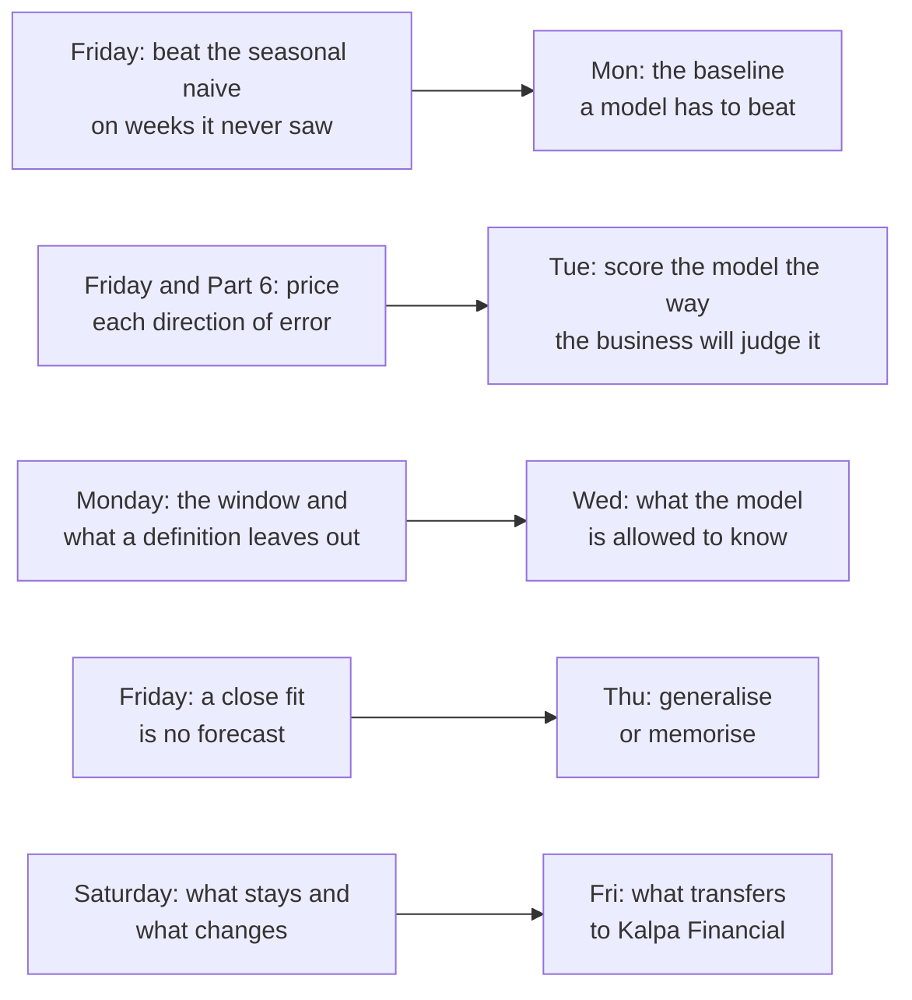

# What carries from Week 4 into Week 5, when the customer table becomes a model?

For four weeks you have queried, reconciled and summarised Kalpa's customer table. In Week 5 the same
table becomes the input to a model: Kalpa's marketing team asks for a score per customer for how
likely each one is to buy again, and Rohan Desai, head of risk at Kalpa Financial Services, asks
whether the same machinery could score people who apply for a loan. Each day opens on a case at a
company you use, as this week's did, and Kalpa carries the same method as the client.

**Who needs the answer.** You, on Monday morning, so the first model of the programme starts from
the habits this week gave you.

**The questions on the way.**

- Which Week 4 habit does each Week 5 day lean on?
- What arrives on Monday?
- What do you do before Monday?

---

## Which Week 4 habit does each Week 5 day lean on?

| Day | The day's question | The Week 4 habit it leans on |
|---|---|---|
| <!-- sync:day-date:W05/D1 -->Mon 02 Nov 2026<!-- /sync:day-date:W05/D1 --> | Framing the propensity model, and the baseline it has to beat | Friday's rule: nothing earns trust until it beats the dumbest honest baseline on data it never saw, the way festival-aligned beat the vendor's curve on Lucknow's thirteen hidden weeks. |
| <!-- sync:day-date:W05/D2 -->Tue 03 Nov 2026<!-- /sync:day-date:W05/D2 --> | Scoring the model the way the business will judge it, in two businesses | Friday's priced misses and Part 6's lending brief: a late shipment cost about 4.6 times a spare one in Lucknow, and a wrong nudge toward a loan costs twenty times a wrongful rejection. |
| <!-- sync:day-date:W05/D3 -->Wed 04 Nov 2026<!-- /sync:day-date:W05/D3 --> | What the model is allowed to know | Monday's definition sheet: a number is only as honest as its window and its exclusions, and the comparison window started after the monsoon sale so the sale sat in neither. |
| <!-- sync:day-date:W05/D4 -->Thu 05 Nov 2026<!-- /sync:day-date:W05/D4 --> | Generalise or memorise, and the honest tuned model | Friday's vendor curve, which fitted its training weeks within 1.4 percent and missed the hidden weeks by 16,400 shipments a week. |
| <!-- sync:day-date:W05/D5 -->Fri 06 Nov 2026<!-- /sync:day-date:W05/D5 --> | The committee memo, and what transfers to Kalpa Financial | Today's drill: the method stays, and the metric, the constraint and the cost of an error are rewritten for the new business. |

## What arrives on Monday?

Kalpa's thread in Week 5 opens on the marketing team's ask: "Which members do we nudge? Nudging
everyone costs Rs 40 each and annoys the ones who were going to buy anyway. Give us a score per
customer for how likely they are to buy again in the next ninety days." Kavya Nair, the senior
analyst, adds the condition that runs all week: "Before you show me any model, show me the dumbest
possible baseline and what beating it would prove."

You have answered that condition three times already. Friday's naive and seasonal naive were the
dumbest honest forecasts, Wednesday's chance count was the baseline every pair had to beat, and
Thursday's cohorts read at the same age were the honest comparison a blend kept hiding. A model is
the next tool for the same question, and it is held to the same test.

## What do you do before Monday?

- Write the week's five crux lines from memory, one for each day: which number a scheme should pay
  for; what goes on one slide; which measure popularity cannot fool; why a flat blend can hide falling
  cohorts; and what a forecast must beat before the plan trusts it. Check each against that day's
  notes afterwards.
- Install nothing: Week 5 runs in the same environment, with scikit-learn already loaded.
- Bring the answer you gave in today's drill. On Friday of Week 5 the committee memo carries a
  paragraph for Rohan on what changes and what stays when the same work moves to lending, and
  today's grid is its first draft.
