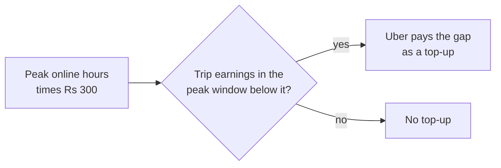
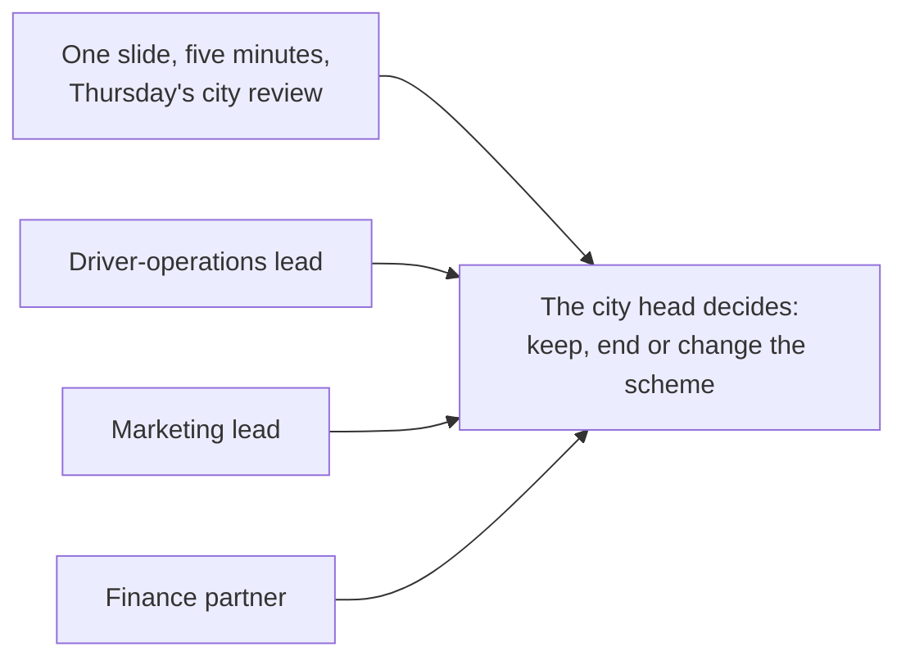
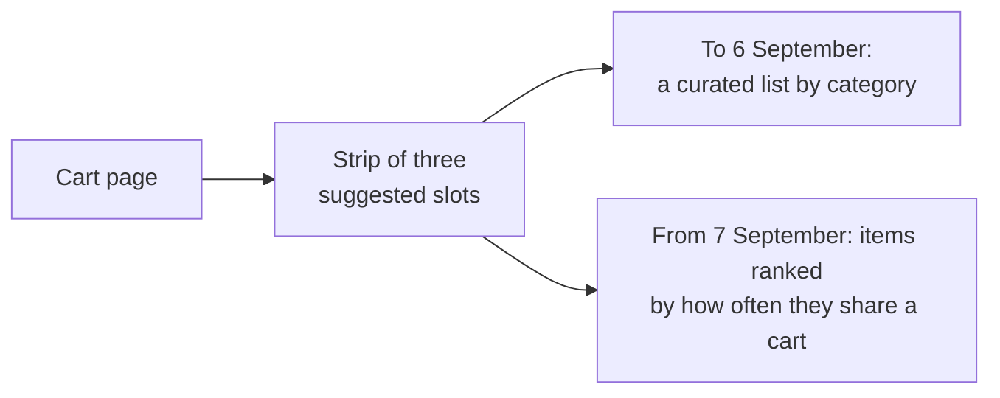
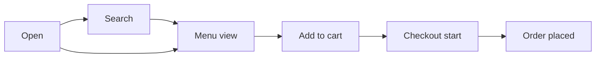
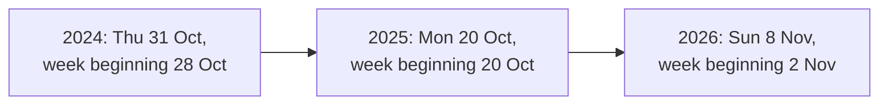
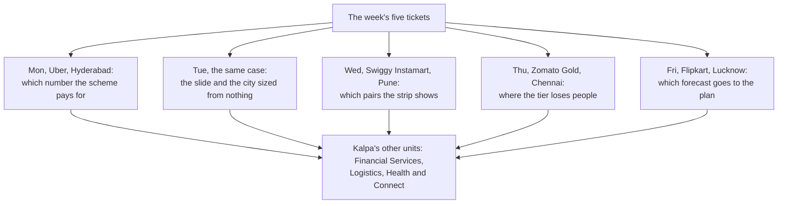

# Week 4 recap paper

Saturday 31 October 2026 · 120 minutes · 39 items in 6 parts · pen and paper, no assistant, no notes

Name: ____________________    Marked by: ____________________    Items right: ____ of 39

## What this paper is for

This week you took five tickets at companies the room uses: Uber's peak-hour guarantee in Hyderabad, twice; Swiggy Instamart's bought-together strip in Pune; Zomato Gold's members in Chennai; and Flipkart's festive packer plan in Lucknow. Each day the same method ran again on Kalpa Retail in the lab. This paper puts the week's calls back to you: which number a scheme should pay for, what goes on one slide and how a number sized from nothing is checked, which pairs beat chance, where a membership loses people, which forecast goes to the plan, and what changes when the method moves to another company. The room's score in each part, set beside the rating you give that part in step one, tells Monday's session where to start.

## How this paper works

- 120 minutes in one sitting. Each part gives its minutes as a guide, not a limit.
- Every item names its format beside its number, and a word bank or a match table names it once, above its items: circle one letter, circle every correct letter, write the letter from the word bank, write the matching letter, write the word or number, show the working and the answer, or write the letters in order.
- Every item also names its level, easy, medium or hard, so you can plan your time. A hard item is several steps on an exhibit, never an obscure fact.
- A wrong answer costs nothing, so answer every item on the line under it.
- Pen and this paper only: no laptop, no phone, no notes and no assistant.
- Afterwards the papers are swapped and marked against the key, and the discussion takes the items the room missed most. The paper is ungraded and ranks nobody; the room's rates by part and by tag set Monday's revision.
- Parts 1 to 5 open on the week's cases at Uber, Swiggy Instamart, Zomato Gold and Flipkart, and each is an illustrative case: the company is real, the situation and the data are synthetic, built for this class. The Kalpa items continue the labs at Kalpa Retail, where Meera Raghavan is the CEO and Anand Iyer the finance controller; the head of Retail-Plus, the merchandising team and the app team are named by role. Part 6 moves to Kalpa's other units: Rohan Desai, head of risk at Kalpa Financial Services; Dr Priya Menon, COO of Kalpa Health; Ananya Bose, COO of Kalpa Connect; and the head of operations at Kalpa Logistics, named by role. Items that use a public case (Wells Fargo, Delhi Metro, Flipkart, NPCI's UPI count, DMart, Amazon, Swiggy and the M5 competition) give the source beside the fact, and every number an item needs is on the page.

## Step one, before Part 1

Before you read any item, rate yourself from 1 to 4 on each part in the table below, as you are today. The comparison between your rating and your score in each part is the most useful thing this paper produces for Monday.

- 1: I have not used this
- 2: I can follow it when someone shows me
- 3: I can do it alone on a small problem
- 4: I can find and fix mistakes in someone else's version

Your ratings: Part 1 ___ · Part 2 ___ · Part 3 ___ · Part 4 ___ · Part 5 ___ · Part 6 ___

## The paper at a glance

| Part | What it shows | Items | Minutes | Easy | Medium | Hard |
|---|---|---|---|---|---|---|
| 1. Which number should the plan chase, and which should a scheme pay for? | whether you can choose the number a plan chases and a scheme pays for, and read what happened where one was gamed | Q1 to Q7 (7) | 19 | 3 | 2 | 2 |
| 2. Can the number survive the room, and can you size a city from nothing? | whether you can put one claim on one slide, answer an objection to it, and size a number from nothing and check it | Q8 to Q14 (7) | 23.5 | 1 | 5 | 1 |
| 3. Which pairs beat chance, and what is a slot worth? | whether you can choose the pairs a strip should show and put a rupee value on a slot | Q15 to Q21 (7) | 21.5 | 0 | 4 | 3 |
| 4. Where is the tier losing people? | whether you can tell where a membership loses people and decide what to fix first | Q22 to Q28 (7) | 23 | 0 | 5 | 2 |
| 5. Which forecast earns the plan's trust? | whether you can choose the forecast that goes to the plan and say how wrong it could be | Q29 to Q33 (5) | 19 | 1 | 2 | 2 |
| 6. What changes when the method moves company? | whether you can carry the week's methods to another company and say what changes there | Q34 to Q39 (6) | 12 | 4 | 1 | 1 |
| Total | | 39 | 118 | 9 | 19 | 11 |

---

## Part 1. Which number should the plan chase, and which should a scheme pay for? (Q1 to Q7)

*What it shows: whether you can choose the number a plan chases and a scheme pays for, and read what happened where one was gamed. 7 items, about 19 minutes.*

On Monday 31 August 2026 Uber's Hyderabad city team launched a peak-hour earnings guarantee for enrolled drivers: a floor of Rs 300 per peak online hour, with Uber paying the gap between a driver's trip earnings in the peak window and the floor as a top-up. The launch note's goal was more drivers on the road at peak, so riders are picked up faster. Exhibit 1A sets the six weeks after the launch against the six weeks before. The city head must decide whether to extend the scheme to two more cities. Illustrative case: the company is real, the situation and the data are synthetic, built for this class. In the lab the same method ran on Kalpa Retail, where the head of Retail-Plus had proposed reorders per member as the growth plan's number.

**Exhibit 1A.** How the guarantee pays, and Uber Hyderabad's peak numbers, the six weeks beginning 20 July 2026 against the six beginning 31 August 2026, the launch day.

| Measure | Six weeks before | Six weeks after |
|---|---|---|
| Peak online hours, all enrolled drivers | 118,000 | 146,300 |
| Completed peak trips | 224,200 | 230,900 |
| Trips per peak online hour | 1.90 | 1.58 |
| Rider requests at peak | 251,910 | 256,556 |
| Rider requests per peak online hour | 2.13 | 1.75 |
| Offers accepted over offers shown | 0.86 | 0.73 |
| Median rider wait at peak, minutes | 4.8 | 4.6 |
| Top-up paid | Rs 0 | Rs 1.9 crore |

**Word bank 1.** Write the letter of the word or phrase that completes each statement. Each is used once at most, and some are not used.

| Letter | Word or phrase |
|---|---|
| a | proxies |
| b | window |
| c | leading inputs |
| d | baseline |
| e | guardrails |
| f | target |

#### Q1 · Easy · write the letter from Word bank 1 · Complete the north-star line

The metric a plan exists to move is the north-star, and the metrics that catch harmful ways of hitting it are called ____.

Answer: ____________________

#### Q2 · Medium · write the letter from Word bank 1 · Complete the definition

A complete metric definition names its numerator, its denominator, its ____ and its exclusions.

Answer: ____________________

#### Q3 · Easy · circle one letter · Judge the statement

The city team's dashboard puts rider requests per peak online hour, zone by zone, beside its north star, completed peak trips per enrolled driver online at peak each week. Statement: a leading indicator moves after the north-star metric has already moved. True or false, and why?

a) True: requests per online hour fell from 2.13 to 1.75 over the six weeks after the north star had moved, which is how it confirms the north star.
b) True: a leading indicator is read once the quarter's result is in, which is why the dashboard keeps it on the page beside the north star it explains.
c) False: it moves first, while the team can act; requests per online hour by zone say where to send drivers before the week's trips are in.
d) False: a leading indicator moves in the same week as the north star, since both are counted from that week's completed peak trips in every zone.

**Exhibit 1B.** Six drivers, one week from the six before the launch, the week beginning 10 August 2026, and one week from the six after it, the week beginning 21 September 2026. Shamshabad and Rajendranagar are two of the city's three outer zones.

| Driver | Zone | Week | Peak online hours | Offers shown | Offers accepted | Completed trips |
|---|---|---|---|---|---|---|
| A | Jubilee Hills | before | 10 | 24 | 21 | 21 |
| A | Jubilee Hills | after | 11 | 25 | 22 | 22 |
| B | Banjara Hills | before | 9 | 20 | 17 | 17 |
| B | Banjara Hills | after | 10 | 21 | 18 | 18 |
| C | Gachibowli | before | 11 | 25 | 22 | 22 |
| C | Gachibowli | after | 12 | 26 | 23 | 23 |
| D | Madhapur | before | 10 | 22 | 19 | 19 |
| D | Madhapur | after | 11 | 23 | 20 | 20 |
| E | Shamshabad | before | 10 | 21 | 18 | 18 |
| E | Shamshabad | after | 16 | 14 | 4 | 3 |
| F | Rajendranagar | before | 10 | 20 | 17 | 17 |
| F | Rajendranagar | after | 14 | 12 | 3 | 2 |

#### Q4 · Hard · circle one letter · Read six drivers

The city team's note to the city head reads: "Peak online hours up 24 percent: supply target met. We recommend extending the guarantee to two more cities." What do the six drivers in Exhibit 1B show, and which number answers the note?

a) Averaged driver by driver, the six fell only to 1.31, less than the totals say, so the reply tells the city head the guarantee cut trips per hour 31 percent across the city.
b) Summed, the six fell from 1.90 to 1.19 trips an hour, further than the city's 1.58 on Exhibit 1A, so the reply quotes 1.58 and shows E and F as where hours went.
c) Summed, the six fell from 1.90 to 1.19 trips an hour, so the reply tells the city head the guarantee cut trips per hour 37 percent across the city.
d) Averaged driver by driver, the six fell only to 1.31, less than the totals say though further than the city's 1.58, so the reply quotes 1.58 and shows E and F as where hours went.

**Exhibit 1C.** Wells Fargo's cross-sell metric, as the SEC's order of February 2020 (Release 34-88257) describes it, checked 13 October 2026.

| Line | What the order found |
|---|---|
| What it counted | Accounts and products per retail bank household |
| Use | No usage condition: an unused debit card, the largest product category, could stay in the count for up to four years |
| How staff were judged | Against sales goals, with the number of products sold a significant criterion in their evaluations |
| What staff did | Opened accounts customers had not asked for; moved customers' money into new accounts so they counted as funded; changed contact details so satisfaction surveys would not reach customers |
| The 2013 change | Remittance accounts were added to the count without investors being told, giving 0.04 of that year's 0.11 rise in the ratio |

#### Q5 · Easy · circle one letter · Judge the statement on a case

Statement: any target changes the behaviour of the people who are paid to hit it. Judge it on Exhibit 1C. True or false, and why?

a) False: a target changes behaviour only where its rules leave a gap, and the order describes rules that some staff broke, never the target itself.
b) False: staff were paid on sales, so the cross-sell count moved only when the bank itself changed the definition, as it did in 2013.
c) True: the count rose because customers bought more products, and staff behaviour followed the customers' new demand for accounts.
d) True: staff judged on products sold opened accounts nobody asked for, staged funding and dodged the surveys, each to move their count.

#### Q6 · Medium · circle one letter · Size the 2013 change

Exhibit 1C's last row is the 2013 change. What share of Wells Fargo's 2013 rise in the ratio came from the change of definition alone, and what would have shown it to investors?

a) About 57 percent, 0.04 against the other 0.07; a dated log of each change to what is counted, with that year's ratio also on the old definition.
b) About 36 percent, 0.04 of the 0.11 rise in the ratio; a dated log of each change to what is counted, with that year's ratio also on the old definition.
c) About 36 percent, 0.04 of the 0.11 rise in the ratio; a guardrail on customer satisfaction, read from the surveys the bank sends to its retail customers.
d) About 57 percent, 0.04 against the other 0.07; a guardrail on customer satisfaction, read from the surveys the bank sends to its retail customers.

**Exhibit 1D.** Kalpa Retail's Retail-Plus tier, 120 members, as Monday's lab found it: 10 to 30 September 2026 against 20 August to 9 September 2026.

| Measure | Window over comparison |
|---|---|
| Reorders placed per member | 1.22 times |
| Booked value of those placements per member | 0.96 times |
| Placements in the window that became a separate delivered order | None: every one was an auto-reorder the app placed, then cancelled, merged into a later order or left pending |

#### Q7 · Hard · circle every correct letter · Mark the definition sheet

Meera Raghavan, Kalpa Retail's CEO, wants one number for the growth plan and the numbers that stop it being gamed. The head of Retail-Plus proposed reorders per member, and the lab found Exhibit 1D. Which lines of the plan's definition sheet are right? Mark every correct option.

a) North star: reorders placed per Retail-Plus member per month, which the window shows rising 1.22 times
b) Leading input: last quarter's audited revenue, broken down by store and by member tier
c) Exclusions: placements cancelled, merged into a later order or still pending, so a reorder nobody received never counts
d) Guardrail: revenue per active customer, read each month beside the north star on the same members
e) Leading input: add-to-cart events per active app member, counted each week from the app's event log

---

## Part 2. Can the number survive the room, and can you size a city from nothing? (Q8 to Q14)

*What it shows: whether you can put one claim on one slide, answer an objection to it, and size a number from nothing and check it. 7 items, about 23.5 minutes.*

On Tuesday the city head asked for Monday's answer on one slide at Thursday's city review: five minutes, with the driver-operations lead, the marketing lead and the finance partner in the room, each of whom loses something under Monday's redesign of the pay. The number the slide must explain is in Exhibit 2A. In the afternoon the city head asked a second question with no dataset: roughly how many drivers must be online at the weekday evening peak to keep the median rider wait under five minutes. Illustrative case: the company is real, the situation and the data are synthetic, built for this class. In the lab each learner presented Kalpa's north star on one slide to a Kalpa head, then sized Anand's new-store question against DMart.

**Exhibit 2A.** Who sits in Thursday's review, and the same peak bookings read three ways, Uber Hyderabad, the six weeks before the launch and the six weeks after.

| Read | Six weeks before | Six weeks after |
|---|---|---|
| Bookings per peak online hour | Rs 314 | Rs 260 |
| Bookings per active driver-week | Rs 5,817 | Rs 5,861 |
| Bookings per completed trip | Rs 165 | Rs 165 |

#### Q8 · Medium · write the letters in order · Build the slide

Tuesday's one-slide template has four slots, from the top: the claim, written as the title; the evidence; the caveat; and the action. Four of these seven lines fill the four slots and three would spoil the slide. Leave those three out and write the other four in slot order, from the top.

a) The action: move every driver in every zone to the redesigned pay from Monday, which the city head signs
b) The evidence: bookings per peak online hour fell from Rs 314 to Rs 260 at the same Rs 165 fare
c) The claim, as the title: bookings per active driver-week rose 0.8 percent, so the scheme pays its way
d) The caveat: the monsoon ended inside the six weeks after the launch, and there are no weeks from last year to compare with
e) The claim, as the title: the guarantee is paying for online hours that carry no trips
f) The action: test the redesigned pay on half the drivers, picked at random, for six weeks, which the city head signs
g) The evidence: bookings per active driver-week rose from Rs 5,817 to Rs 5,861 at the same Rs 165 fare

Order: ____________________

#### Q9 · Hard · circle every correct letter · Keep two elements

A second draft argues that riders got little for the Rs 1.9 crore of top-up. Which two elements carry that claim? Mark both; every other element moves to an appendix page headed by the question a named role will ask.

a) Median rider wait at peak, 4.8 to 4.6 minutes
b) Rider requests at peak, 251,910 to 256,556
c) Top-up for each extra trip: Rs 2,836, for a trip worth Rs 165
d) Top-up for each completed trip: Rs 82, for a trip worth Rs 165
e) The top-up split: 61 percent to driver-weeks under half acceptance

#### Q10 · Medium · circle one letter · Judge the defence

At the review the finance partner says: "The monsoon ended inside your six weeks, so what your slide shows is the season, not your scheme." In the last three of the six weeks after the launch, weekly peak rider requests ran from 41,161 to 42,602, against 41,155 to 42,719 in the six weeks before, and trips per peak online hour ran at 1.56. Statement: the strongest reply concedes nothing, since any concession hands the objector the meeting. True or false, and why?

a) True: concede nothing, and answer the objection from the stem: weekly requests came back inside their old range while trips per hour stayed at 1.56 against 1.90.
b) True: concede nothing, and answer the objection from the stem: trips per hour kept sliding, to 1.56 in the last three weeks against 1.58 over all six.
c) False: grant that the rains ended inside the window, then show weekly requests back inside their old range while trips per hour stayed at 1.56 against 1.90.
d) False: grant that the rains ended inside the window, then show trips per hour kept sliding, to 1.56 in the last three weeks against 1.58 over all six.

#### Q11 · Easy · circle one letter · Judge the memo

A colleague cites Amazon's 2017 letter to shareholders, which says Amazon's meetings start with a six-page memo read in silence, use no slides, and that a great memo probably takes a week or more to write. Statement: the city head's Thursday review should get a memo in place of the one slide. True or false, and why?

a) True: a memo forces full sentences where bullets hide the reasoning, so it beats a slide in any meeting, whatever the slot it is given.
b) True: a memo can carry all three appendix pages in its body, so no role's question is left without its answer in the room.
c) False: the letter says Amazon reads its memos after the meeting has ended, so a memo would leave the room no time to argue at the review.
d) False: the ask is one slide in five minutes, and the letter itself says a great memo probably takes a week or more to write.

#### Q12 · Medium · write the letters in order · Order the estimate

The city head's afternoon ask is roughly how many drivers must be online at the weekday evening peak to keep the median rider wait under five minutes. Four of these six steps make the estimate, and two would spoil it. Leave those two out and write the other four in the order they run.

a) Set the chain's 0.60 online driver-hours per completed trip beside the case's 0.53 before the launch, and move the answer down to about 5,000 to 5,700
b) Ask whether it is drivers online at one moment or across the window, which window, which product, and the city's median or every zone's
c) Set the chain against Exhibit 1A's 2.13 rider requests per peak online hour before the launch, and move the answer down to about 3,900
d) Write the formula: drivers online equal trips to serve in an hour, over trips one online driver completes in an hour, times a buffer for the busiest half hour
e) Work it aloud: about 8,330 evening trips an hour over 1.68 trips per online driver-hour is about 4,960, and 15 percent more for the busiest half hour is about 5,700
f) Set the chain's 0.60 online driver-hours per completed trip beside the case's 0.53 before the launch, and move the answer up to about 6,450

Order: ____________________

#### Q13 · Medium · circle every correct letter · Check four sources

Before the review, a colleague lines up five checks on four numbers. Three come from published sources: NPCI counted 24.07 billion UPI transactions in September 2026, "averaging 802 million daily transactions" (Outlook Money, 2 October 2026); "Flipkart recorded 6.3 million concurrent users in a minute" (Flipkart Stories, 9 October 2026); and DMart's FY26 total revenue was Rs 66,968 crore, with 85 stores added to reach 500 (Avenue Supermarts, 2 May 2026). The fourth is a city invented for a drill. Which checks are sound? Mark every correct option.

a) UPI, September 2026: 24.07 billion transactions over the month's 30 days, 802 million a day, set against an estimate of payments a day
b) Flipkart, 9 October 2026: 63 million concurrent users in a minute as the festive season opened, set against an estimate of users online at peak
c) DMart, FY26: Rs 66,968 crore over the year's average of 415 and 500 stores, about Rs 146 crore a store, set against an estimate of revenue a store
d) A city of two million people, invented for a drill: 5 lakh households at four people to a household, set against an estimate of the city's UPI users
e) UPI, September 2026: the same 802 million a day, set against an estimate of the payments made on Diwali day itself

**Exhibit 2B.** Delhi Metro's two published counts and how DMRC counts a journey, each in the words its source uses, checked 13 October 2026.

| Count | Value | When | Source |
|---|---|---|---|
| Average daily passenger journeys | 64.06 lakh | the current average, August 2026 | The Tribune, 9 August 2026, citing DMRC |
| Passenger boardings | 82,44,903 | 17 September 2026, DMRC's highest-ever day, during a bus strike | Republic World, 18 September 2026, quoting DMRC |
| How a journey is counted | One for each line, or corridor, a passenger uses to reach the destination | PTI's report of DMRC's method, 30 August 2023 | Deccan Herald, reporting PTI |

#### Q14 · Medium · circle one letter · Read the metro counts

A pair's chain puts Delhi Metro at about 60 lakh rider trips on a weekday, each trip counted once from the gate where the rider enters to the gate where they leave (invented). They set it against Exhibit 2B, call their estimate 6 to 27 percent low, and raise it. Which reading of the check is right?

a) Trips are set against line uses: DMRC counts a journey for each line a rider uses, so 64.06 lakh exceeds the trips, and 17 September was a record day.
b) The estimate is 6 percent low on an ordinary day and 27 percent low at the city's true peak, so the pair should raise the whole chain by about a fifth.
c) A boarding is one rider entering at one gate, so the 82,44,903 boardings are the count to set trips against, since journeys count each change of line.
d) The check is sound, since DMRC's average day and its record day bracket the estimate between 64.06 lakh and 82.45 lakh trips.

---

## Part 3. Which pairs beat chance, and what is a slot worth? (Q15 to Q21)

*What it shows: whether you can choose the pairs a strip should show and put a rupee value on a slot. 7 items, about 21.5 minutes.*

Swiggy Instamart's cart page in Pune shows a strip of three suggested items under the cart. Until 6 September 2026 the strip was a curated list by category; from Monday 7 September it ranked items by how often they sit in the same cart as the items already in it, counted over the previous four weeks. The strip's click-through, clicks over impressions, fell from 6.1 percent in the three weeks before the switch to 3.8 percent in the three weeks after. The category manager and the growth lead want the pairs the strip should show and a rupee value on a slot. Illustrative case: the company is real, the situation and the data are synthetic, built for this class. In the lab Kalpa Retail's merchandising team wanted every product paired with the Rs 199 phone charger, "because it is in 80 percent of baskets".

**Exhibit 3A.** Swiggy Instamart, Pune: the strip before and after the switch, and the ticket's headline numbers.

| Measure | Value |
|---|---|
| Carts in the September sample | 40,000 carts from 12,000 customers in eight zones |
| Carts holding toned milk | 71 percent |
| Strip click-through, 17 August to 6 September | 6.1 percent |
| Strip click-through, 7 to 27 September | 3.8 percent |

**Exhibit 3B.** Click-through by slot on the strip, the three weeks before the switch on 7 September 2026 and the three weeks after. Before the switch, milk was suggested only in slot 3, on 2 percent of the strip's impressions.

| Slot | Milk's share of the slot's impressions, after | Click-through on milk, after | Click-through on other items, before | Click-through on other items, after |
|---|---|---|---|---|
| Slot 1 | 70 percent | 1.4 percent | 7.5 percent | 8.2 percent |
| Slot 2 | 50 percent | 1.1 percent | 6.1 percent | 6.8 percent |
| Slot 3 | 30 percent | 0.9 percent | 4.9 percent | 5.4 percent |
| The strip | 50 percent, from 2 before | 1.2 percent, 1.2 before | 6.2 percent | 6.4 percent |

#### Q15 · Hard · circle one letter · Read the strip by slot

The growth lead's draft for the category manager reads: "Shoppers clicked the strip less after the monsoon, so the strip needs a redesign." Using Exhibit 3B, which reading holds, and which slot is fixed first?

a) Shoppers clicked less after the monsoon, and slot 1 fell furthest, from 7.5 percent, so slot 1's suggestions are redesigned first.
b) Neither milk nor other items click less; milk went from 2 to 50 percent of impressions, so slot 1, at 70 percent milk, is re-ranked first.
c) Neither milk nor other items click less; milk went from 2 to 50 percent of impressions, so slot 3, where milk clicks least, at 0.9 percent, is re-ranked first.
d) Shoppers clicked less after the monsoon, and slot 3's milk clicks least, at 0.9 percent, so slot 3's suggestions are redesigned first.

**Exhibit 3C.** Two pairs in September 2026's 40,000 Pune carts from 12,000 customers. The top tenth of customers, 1,200 of them, place 38 percent of all carts and 73 percent of the carts that hold chips and cold drink together.

| Pair | Carts with the first item | Carts with the second item | Carts with both | Lift with chance counted within each cart's size | The same, with each customer also counted once |
|---|---|---|---|---|---|
| Chips and cold drink | 4,800 | 4,920 | 2,000 | 2.48 | 1.95 |
| Onions and tomatoes | 8,800 | 8,000 | 3,000 | 1.38 | 1.38 |

#### Q16 · Medium · circle one letter · Award the strip's slots

The strip gives a slot only to a pair with a lift of at least 1.5. Exhibit 3C holds two pairs' counts and their lifts recomputed for cart size and for heavy buyers. Which pairs keep a slot?

a) Both: per cart they read 3.39 and 1.70, both above 1.5, and the recomputed lifts only restate the same carts.
b) Neither: 73 percent of the chips-and-cold-drink carts come from a tenth of the customers, so its lift belongs to a few heavy buyers.
c) Chips and cold drink only: it holds 1.95 after both corrections, while onions and tomatoes falls from 1.70 to 1.38.
d) Onions and tomatoes only: at 1.70 per cart it clears 1.5 on the most carts, 3,000, while chips and cold drink rests on a tenth of the customers.

### Set 1

**Situation.** A round sample of 1,000 Kalpa consumer baskets, with Business orders left out (illustrative counts): the phone charger is in 850 of them, a phone case is in 200, and both are in 165.

**Exhibit 3D.** Set 1's round counts, as the situation gives them.

| Baskets | Count |
|---|---|
| All consumer baskets in the sample | 1,000 |
| With the phone charger | 850 |
| With a phone case | 200 |
| With both | 165 |

#### Q17 · Medium · write the word or number · Compute the confidence

The confidence of 'case, then charger' is ____ (three decimals).

Answer: ____________________

#### Q18 · Medium · write the word or number · Compute the lift

The lift of the pair is ____ (two decimals).

Answer: ____________________

#### Q19 · Medium · circle one letter · Make the call to merchandising

What do you tell merchandising about bundling the case with the charger?

a) Promote it, since more than 80 percent of the case buyers also put a charger into the same basket as the case.
b) Collect another quarter of baskets first, since 1,000 baskets cannot support any lift at all.
c) Drop it: the lift is below 1, so case buyers take a charger slightly less often than shoppers in general.
d) Promote it at a deeper discount, since the pairing is already the strongest one in the data.

**Exhibit 3E.** Two pairs with a high lift. Ice cream is in 4 percent of Pune carts.

| Pair | Where | Holding both | Out of | Lift |
|---|---|---|---|---|
| Car phone mount and car charger | Kalpa Retail, the lab's consumer baskets | 2 baskets | 812 | 4.0 |
| Ice cream and chocolate sauce | Swiggy Instamart, Pune, September | 100 carts | 40,000 | 4.6 |

#### Q20 · Hard · circle one letter · Judge two high-lift pairs

Statement: a pair with a lift of about 4 and a support of about 0.25 percent belongs on a watch list, to be counted again or tested, before it belongs in a campaign. Judge it on both pairs in Exhibit 3E. True or false, and why?

a) True: Kalpa's lift rests on 2 baskets, so one basket moves it by half; Instamart's 100 carts beat chance, yet no test shows the suggestion sells more.
b) True: both pairs sit at the same support of 0.25 percent, and ice cream is in only 4 percent of carts, so both wait a quarter of carts before any test.
c) False: a lift of 4 is four times what chance gives, and a lift that far above 1 earns a campaign slot whatever the pair's support turns out to be.
d) False: Instamart's 100 carts are over four times the 22 chance gives, so its pair earns a campaign beside the 4 percent of carts holding ice cream now.

#### Q21 · Hard · circle one letter · Price the bundle slot

Swiggy's shareholder letter for April to June 2025 describes Maxxsaver, a discount unlocked once a cart passes a set size, as handing part of the larger basket's margin back to the user. A growth lead proposes a bundle slot on the same logic, with these invented numbers: 30,000 cart-page views a day; 5 percent of views click the slot; half the clicks add the item; the item sells for Rs 30 and earns Rs 10 of margin before a Rs 3 bundle discount; and half of the adds would have happened anyway, through search or habit. What is the slot worth a day?

a) Rs 22,500: the 750 adds a day at the item's Rs 30 price, the sales the slot rings up at the till
b) Rs 5,250: the 750 adds a day at the Rs 7 left after the discount, every add counted as new
c) Rs 1,500: the 375 new adds' Rs 10 of margin, less the Rs 3 discount paid on all 750 adds
d) Rs 2,625: the 375 new adds at the Rs 7 left after the discount, paid on those adds alone

---

## Part 4. Where is the tier losing people? (Q22 to Q28)

*What it shows: whether you can tell where a membership loses people and decide what to fix first. 7 items, about 23 minutes.*

Zomato Gold's membership dashboard for Chennai reports month-two retention flat at 38 percent in June, July, August and September 2026: of the members two or more months past their signup month, the share who ordered in the month. Exhibit 4A gives each signup month's own month-one rate. The August cohort was grown by a sale week on a discounted first month. On Monday 14 September 2026 a new checkout flow shipped on Android. The membership lead asks whether it is a cohort problem or an everyone problem, which step of the order flow owns the loss, and what should be fixed first. Illustrative case: the company is real, the situation and the data are synthetic, built for this class. In the lab the head of Retail-Plus put the same questions about Kalpa Retail's tier.

**Exhibit 4A.** Zomato Gold, Chennai: the order flow a member walks through, and members by signup month in 2026 with the share who ordered in month one, the calendar month after signup. September's 5,089 members, too new for a month-one rate, bring January to September to 53,089.

| Signup month | Members | Ordered in month one |
|---|---|---|
| January | 4,854 | 58 percent |
| February | 5,055 | 56 percent |
| March | 5,449 | 55 percent |
| April | 4,859 | 53 percent |
| May | 4,905 | 52 percent |
| June | 4,821 | 50 percent |
| July | 5,057 | 49 percent |
| August | 13,000 | 31 percent |

### Set 2

**Situation.** In May, cohort A has 1,000 members at 50 percent retention and cohort B has 3,000 at 38 percent. In June, A retains 46 percent and B retains 35 percent, and a new cohort C of 2,000 members retains 47.5 percent.

**Exhibit 4B.** Set 2's three cohorts, as the situation gives them.

| Cohort | Members | Retention in May | Retention in June |
|---|---|---|---|
| A | 1,000 | 50 percent | 46 percent |
| B | 3,000 | 38 percent | 35 percent |
| C | 2,000 | not yet joined | 47.5 percent |

#### Q22 · Medium · write the word or number · Compute May's blend

Blended retention in May is ____ percent.

Answer: ____________________

#### Q23 · Medium · write the word or number · Compute June's blend

Blended retention in June is ____ percent.

Answer: ____________________

#### Q24 · Medium · circle one letter · Choose the honest headline

What is the honest headline for June, and what would June's blend read without cohort C?

a) Both existing cohorts fell and a large new cohort in its first month hid it; without C, June's blend reads about 37.8 percent.
b) Both existing cohorts fell and a large new cohort in its first month hid it; without C, June's blend reads about 40.5 percent.
c) The new members are the weaker ones, since C retains less than A did in May; without C, June's blend reads about 37.8 percent.
d) The new members are the weaker ones, since C retains less than A did in May; without C, June's blend reads about 40.5 percent.

**Exhibit 4C.** Zomato Gold members in Chennai, September 2026: the order flow counted in sessions and in members.

| Step | Sessions that reached it | Members who reached it |
|---|---|---|
| Open | 194,211 | 49,822 |
| Search | 131,974 | 45,865 |
| Menu view | 155,729 | 46,477 |
| Add to cart | 52,948 | 28,351 |
| Checkout start | 42,358 | 25,740 |
| Order placed | 27,212 | 21,574 |

#### Q25 · Hard · circle one letter · Read the flow two ways

The membership lead's chart for September reads "search to menu view: 118 percent" and "menu view to add-to-cart: 34 percent, the biggest loss". Exhibit 4C counts the same flow two ways, for September alone. Which reading holds?

a) Menu view to add-to-cart is the loss: at 34 percent it is the lowest step of the flow, so the menu pages are the first thing to fix.
b) Every step should be divided by the 194,211 sessions that opened the app, which puts search at 68, menu view at 80 and add-to-cart at 27 percent.
c) A step above 100 percent means the event log counts menu views twice, so every count after search is suspect until the log is rebuilt.
d) Search is a step members can skip, going from Open straight to a menu, so that step tops 100 percent; per member, menu to cart is 61 percent.

**Exhibit 4D.** Add-to-cart to order, per session, 1 August to 13 September 2026 against 14 to 30 September. Starting checkout held at 80 percent of carts on every platform; completing a started checkout went from 72.5 to 55 percent for Android members, 71 to 70 for iOS members and 65 to 64 for non-members on Android. Every Android session moved to the new checkout on 14 September.

| Who | Platform | Before 14 September | From 14 September |
|---|---|---|---|
| Members | Android | 58 percent | 44 percent |
| Members | iOS | 57 percent | 56 percent |
| Members | Web | 55 percent | 55 percent |
| Non-members | Android | 52 percent | 51 percent |

#### Q26 · Hard · circle one letter · Find the fix and its cost

The app team says the new Android checkout cannot be at fault, since non-members use the same checkout and held at 51 percent. Android members reached add-to-cart in 22,841 sessions from 14 to 30 September, 17 days. What is fixed first, and what does the loss cost a week, at Rs 300 to Rs 500 of order value an order?

a) The member path of the new Android checkout, from 14 September: about 3,198 orders a week lost against the old rate, about Rs 9.6 to 16.0 lakh of order value.
b) The member path of the new Android checkout, from 14 September: about 1,317 orders a week lost against the old rate, about Rs 4.0 to 6.6 lakh of order value.
c) The August sale cohort, with its 31 percent month one: about 1,317 orders a week lost against the old rate, about Rs 4.0 to 6.6 lakh of order value.
d) The August sale cohort, with its 31 percent month one: about 3,198 orders a week lost against the old rate, about Rs 9.6 to 16.0 lakh of order value.

**Exhibit 4E.** An invented cohort of ten users: how many were active in each quarter after joining, before and after its five weakest users were weaned away.

| Quarter after joining | 1 | 2 | 3 | 4 |
|---|---|---|---|---|
| All ten users, active | 7 | 5 | 4 | 3 |
| The five kept after the weakest five are weaned away, active | 5 | 5 | 4 | 3 |

#### Q27 · Medium · circle one letter · Read the weaned cohort

Swiggy's shareholder letter for July to September 2025 says it "weaned away certain users from the platform with low potential Lifetime values", and it prints a table of Instamart cohort spend indexed to one cohort's first quarter. Exhibit 4E is invented. A deck shows this cohort's third quarter after the weakest five are weaned away and calls it strong retention. What does the third quarter read for the ten who joined and for the five kept, and what do you ask before trusting a published cohort chart?

a) 40 percent of the users who joined and 80 percent of those kept; ask what each cell divides by, users who joined or kept, and whether it counts users, orders or spend.
b) 40 percent of the users who joined and 80 percent of those kept; ask whether the cohort was acquired in a sale quarter, which would explain a strong cohort.
c) 40 percent of the users who joined and 60 percent of those kept; ask what each cell divides by, users who joined or kept, and whether it counts users, orders or spend.
d) 40 percent of the users who joined and 60 percent of those kept; ask whether the cohort was acquired in a sale quarter, which would explain a strong cohort.

**Exhibit 4F.** Kalpa Retail's Retail-Plus tier in the app, as Thursday's lab found it. Blended retention, the members who joined before the month and opened the app in it, held at the same rate in July, August and September 2026.

| Stretch of 2026 | Carts | Checkouts | Add-to-cart to checkout |
|---|---|---|---|
| Before 20 August | 34 | 28 | 82 percent |
| 20 August to 9 September | 12 | 10 | 83 percent |
| 10 to 30 September, the auto-reorder window | 11 | 7 | 64 percent |

#### Q28 · Medium · circle one letter · Answer the app team

The app team says the auto-reorder feature has been fixed and asks the head of Retail-Plus to close the ticket, since blended retention has not moved. Which reply holds on Exhibit 4F?

a) Close it: 7 checkouts from 11 carts is only 3 fewer than the 10 from 12 before, within the noise three weeks of carts can carry, so the step can be left alone.
b) Keep it open: checkouts fell from 10 to 7 against the three weeks before, 30 percent fewer, so the feature is probably still breaking the checkout step.
c) Rebuild checkout now: 7 of 11 against 10 of 12 is a 19-point fall, the largest move in the tier's funnel, and a full three-week window is enough to act on.
d) Keep it open: 7 of 11 carts checked out against 10 of 12 before, about 2 checkouts short at the old rate; flag the step, then read the next three weeks.

---

## Part 5. Which forecast earns the plan's trust? (Q29 to Q33)

*What it shows: whether you can choose the forecast that goes to the plan and say how wrong it could be. 5 items, about 19 minutes.*

Flipkart's Lucknow fulfilment centre has 104 weeks of outbound shipments, the weeks beginning 30 September 2024 to 21 September 2026. The planner must book packer shifts for the eight festive weeks beginning 12 October to 30 November 2026, and a packer packs about 120 shipments a shift. Finance's rule is the same weeks last year plus 4 percent; a vendor's curve promises 22 percent more. Diwali's dates are in Exhibit 5A. Illustrative case: the company is real, the situation and the data are synthetic, built for this class. In the lab Anand Iyer, Kalpa Retail's finance controller, had the same choice for the board: two forecasts eighteen points apart.

**Exhibit 5A.** Diwali in the Government of India's holiday lists for 2024, 2025 and 2026 (DoPT, as reproduced by staffnews.in, checked 13 October 2026).

| Year | Diwali | The week it falls in |
|---|---|---|
| 2024 | Thursday 31 October 2024 | the week beginning 28 October 2024 |
| 2025 | Monday 20 October 2025 | the week beginning 20 October 2025 |
| 2026 | Sunday 8 November 2026 | the week beginning 2 November 2026 |

#### Q29 · Easy · show the working, then the answer · Give two baselines

Diwali fell in October in both 2024 and 2025. A retailer booked Rs 3.2 crore in October 2024, its Diwali month, and Rs 2.1 crore in September 2025 (illustrative numbers). At the end of September 2025, give the naive forecast and the seasonal naive forecast for October 2025.

Working:

Answer: ____________________

**Exhibit 5B.** Kalpa Retail's revenue in October and November, Rs lakh, from Friday's lab.

| Month | 2024 | 2025 |
|---|---|---|
| October | 415.1 | 427.6 |
| November | 286.8 | 297.0 |

#### Q30 · Hard · show the working, then the answer · Set October and November

Anand's board line needs October and November 2026. Using Exhibits 5A and 5B, give the seasonal naive for both months, then a seasonal baseline with Friday's 4 percent growth that puts the festival in its own month, and say which month should carry the festival's spike.

Working:

Answer: ____________________

**Exhibit 5C.** The M5 forecasting competition, 2020: Walmart's daily unit sales of 3,049 products, every entry scored on 28 days it never saw. From the official scores workbook and the accuracy paper, checked 13 October 2026.

| Entry | Average error, lower is better |
|---|---|
| The winning team | 0.520 |
| Seasonal naive, the same day of the week before | 0.847 |
| Multilayer perceptron, a machine-learning benchmark | 0.977 |
| Random forest, a machine-learning benchmark | 1.010 |
| Naive, the last day seen | 1.752 |

#### Q31 · Medium · circle one letter · Answer the sponsor

The vendor's sponsor says: "Our curve fits two years of Lucknow's weeks within 2 percent, and machine learning won M5, so the curve should go to the plan." Using Exhibit 5C, which reply holds?

a) A fit is no forecast: on M5's unseen days the seasonal naive, 0.847, beat both machine-learning benchmarks; the curve goes only if it beats it on weeks it never saw.
b) The winning team's 0.520 beat the naive's 1.752 by far on M5; the curve goes if it beats the naive over the same two years, a far larger test than a few held-back weeks.
c) A fit is no forecast: on M5's unseen days every other entry beat the naive, 1.752; the curve goes if it beats the naive on weeks it never saw.
d) The winning team's 0.520 beat the seasonal naive's 0.847 on M5; the curve goes if it beats the seasonal naive over the same two years, a far larger test than a few held-back weeks.

**Exhibit 5D.** Lucknow's thirteen hidden weeks, beginning 29 June to 21 September 2026. An idle packer-shift costs Rs 650 for 120 shipments, Rs 5.42 for each shipment planned and not shipped, and a late shipment costs Rs 25; both are assumptions.

| Forecast | Shipments forecast too high, summed | Shipments forecast too low, summed | Weeks too high, of 13 |
|---|---|---|---|
| Festival-aligned, last year's weeks matched by Diwali plus 4 percent | 40,748 | 45,248 | 6 |
| Same week last year | 7,300 | 120,500 | 2 |
| The vendor's curve | 211,300 | 1,900 | 12 |

#### Q32 · Hard · circle one letter · Price the misses

What is each forecast's mean absolute error a week, which costs least on these weeks with its misses priced, and what follows for the plan?

a) 6,615, 9,831 and 16,400 a week; festival-aligned, with the smallest error, also costs least once its misses are priced, so the plan books its numbers exactly as they stand.
b) About 346, 8,708 and 16,108 a week; the vendor costs least, about Rs 11.9 lakh, only because it errs high, the cheap side, so each is first set at the plan share its two costs give.
c) About 346, 8,708 and 16,108 a week; festival-aligned, with the smallest error, also costs least once its misses are priced, so the plan books its numbers exactly as they stand.
d) 6,615, 9,831 and 16,400 a week; the vendor costs least, about Rs 11.9 lakh, only because it errs high, the cheap side, so each is first set at the plan share its two costs give.

**Exhibit 5E.** Kalpa Retail's forecasts for October 2026 to March 2027, as Friday's lab found them. Each forecast's average miss is on April to September 2026, six months it never saw. October 2025 to March 2026, a year before the forecast months, booked Rs 18.93 crore.

| Forecast | Six months, Rs crore | Against a year earlier | Average miss a month, Rs lakh |
|---|---|---|---|
| The same month last year | 18.93 | level | 11.7 |
| Finance's rule, the same month last year plus 4 percent | 19.69 | 4 percent above | 3.5 |
| Festival-aligned, matched by Diwali, plus 4 percent | 19.69 | 4 percent above | 3.5 |
| The vendor's curve | 23.09 | 22 percent above | 38.8 |
| The plan line | 21.77 | 15 percent above | not a forecast |

#### Q33 · Medium · circle one letter · Choose the board sentence

Anand asks which number goes in front of the board for October 2026 to March 2027, and how wrong it could be. Using Exhibits 5A and 5E, which sentence answers him?

a) "Rs 19.69 crore, finance's rule, spike in October, Rs 2.08 crore under plan; it missed by about Rs 3.5 lakh a month on six unseen months, none with a Diwali."
b) "Rs 19.69 crore, festival-aligned, spike in November, Rs 2.08 crore under plan; it missed by about Rs 3.5 lakh a month on six unseen months, none with a Diwali."
c) "Rs 19.69 crore, festival-aligned, spike in November, Rs 2.08 crore under plan; its miss of about Rs 3.5 lakh a month on unseen months holds for the festive months too."
d) "Rs 19.69 crore, finance's rule, spike in October, Rs 2.08 crore under plan; its miss of about Rs 3.5 lakh a month on unseen months holds for the festive months too."

---

## Part 6. What changes when the method moves company? (Q34 to Q39)

*What it shows: whether you can carry the week's methods to another company and say what changes there. 6 items, about 12 minutes.*

This afternoon's spoken drill hands each pair of groups a one-paragraph brief, at another company the room uses or at one of Kalpa's other units, and each answer says what carries over from the week and what does not. This part puts the same move to you on paper. Kalpa Financial Services is Rohan Desai's payments and lending business; Kalpa Logistics moves parcels, and its head of operations is named by role; Kalpa Health, whose COO is Dr Priya Menon, runs laboratories and patient service centres that test US patients and bill US payers in dollars; and Kalpa Connect, whose COO is Ananya Bose, runs telecom and subscriptions. The briefs are illustrative.

**Exhibit 6A.** The week's five tickets, each found at one company, and the Kalpa units this part carries them to.

#### Q34 · Medium · circle every correct letter · Say what stays

Rohan Desai, head of risk at Kalpa Financial Services, asks which customers to nudge first toward a second product, where a wrong nudge in lending costs twenty times a wrongful rejection. What stays the same from the retail method? Mark every correct option.

a) writing the metric's definition down before reading any number
b) attaching a guardrail the measured team cannot move
c) the rupee amount each kind of wrong nudge costs
d) testing against a baseline before trusting a lift

**Match table 1.** Each numbered row opens a Kalpa brief. Write the letter of the method that answers it. Each letter is used once at most, and two are not used.

| Item | To match | Letter | Match |
|---|---|---|---|
| Q35 (Easy) | Kalpa Logistics' head of operations: the on-time delivery rate has risen since dispatchers were allowed to move a parcel's promised date once a delay was known. | a | the second product most customers already hold |
| Q36 (Easy) | Dr Priya Menon: which step between a test booked and a visit completed loses the most dollars, metro area by metro area? | b | cohorts by start month, each read at the same age |
| Q37 (Easy) | Ananya Bose: blended monthly churn has held steady for four months while subscribers who joined since the spring seem to cancel sooner. | c | the average of each row's own rate across the table |
| Q38 (Easy) | Rohan Desai: which second product should a customer be offered first, beyond what any customer takes up anyway? | d | a definition the people measured cannot change after the fact |
|  |  | e | each funnel step over the step before, in one unit |
|  |  | f | lift above a support floor, on enough customers to trust it |

Answers: Q35 ____    Q36 ____    Q37 ____    Q38 ____

#### Q39 · Hard · circle one letter · Set the plan share

Amazon India, a fulfilment centre's festive packer plan (illustrative case: the company is real, and every number below except Amazon's own figure is hypothetical). Amazon says its Great Indian Festival 2025 drew over 276 crore customer visits, 70 percent of them from tier 2 and 3 cities. Suppose its centre in a tier 2 city pays Rs 650 for an idle packer-shift of 120 shipments, as Lucknow does, while a late shipment costs it Rs 10, against Lucknow's Rs 25. What share of weeks should its plan cover, and what carries over from Lucknow unchanged?

a) About 0.35; the festival-aligned copy, the held-out latest weeks and pricing both directions carry over.
b) About 0.35; the copy of last year's calendar weeks carries over, the plainest baseline any plan has.
c) About 0.65; the copy of last year's calendar weeks carries over, the plainest baseline any plan has.
d) About 0.65; the festival-aligned copy, the held-out latest weeks and pricing both directions carry over.

---

## Stretch: untimed, and not marked

For anyone who finishes early. Nothing here is counted. Stretch 1 to 4 are the kind an interviewer asks after your first answer, so write the answer you would say. Stretch 5 is a quick check on the week's material, answered on the line.

### Stretch 1

In Hyderabad the 180 drivers in the idle tail completed 33,440 peak trips in the six weeks after the launch, about 31 trips and 39 peak online hours a driver a week. If the redesign drives all of them off the app, who carries those trips, and how many more peak online hours does that take at the other drivers' 1.90 trips an hour?

### Stretch 2

A growth lead wants to test one suggestion: half the shoppers in two zones, picked at random, see a second item beside the first. With invented numbers, today 5 percent of carts holding the first item also hold the second, and a rise to 8 percent would pay for the slot. How many carts holding the first item does each half need, at 5 percent significance and 80 percent power, and what happens to that count if only half of the rise is new buying?

### Stretch 3

An AI writing assistant launched two months ago, and its weekly active users hit a record in launch week and are still near it. Is the product sticking?

### Stretch 4

A planner reads where the plan should sit, against the chosen forecast, from the same thirteen weeks that chose the forecast. Is that circular, and what would you do instead?

### Stretch 5

True or false: MAPE divides each miss by that month's actual value, so a Rs 10 lakh miss counts for more in a Rs 90 lakh month than in a Rs 120 lakh month.

Answer: ____________________
