# Should we even build a model?

Week 5, Day 1.

Header: WEEK 5  ·  MONDAY  ·  REGRESSION AND CLASSIFICATION

```notes
LIVE, 1 minute. Read the title as a real question. Marketing wants a score per customer by Friday;
before anyone fits anything, the day asks whether a model is the right tool at all, what it is
allowed to know, and what it has to beat. Seal the envelope now: write TEST SET, DO NOT OPEN UNTIL
FRIDAY on a card, seal it, tape it to the wall. Say nothing about it yet. Transition: the week.
```

---

## S1. Regression and classification, framed first
*Six topics on tiny invented tables, then one real bank's 41,188 calls.*

```cards
icon: ruler | eyebrow: The topics | title: Six chapters | body: Each taught on a table small enough to count by hand, invented for teaching. | tone: light
icon: phone | eyebrow: The case | title: A Portuguese bank | body: Whom should the campaign call? UCI Bank Marketing, real public data. | tone: light
icon: store | eyebrow: The decision | title: Kalpa's Rs 40 nudge | body: Marketing wants a 90-day repeat score; Kavya wants the baseline first. | tone: dark
```

```notes
LIVE, 1 minute. Three layers, always in this order: the idea on numbers you can count, the idea on
real data, the idea as a Kalpa decision. Line to land: the business question decides whether a
model exists at all. Transition: where the week sits.
```

---

## S2. Week 5 is where the models start
*The programme's twenty weeks, this week lit.*

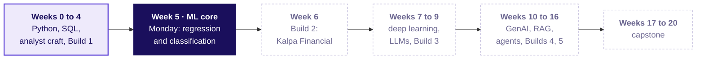

```notes
LIVE, 1 minute. Weeks 0 to 4 built the analyst: Python, SQL, statistics, metrics, forecasting with
a naive baseline (Week 4 Friday). Week 5 turns that analyst into someone who can frame, build and
defend a model. Week 6 is Build 2: the same machinery in Rohan's lending book at Kalpa Financial.
ME1 runs this week as a continuous activity; say its scope aloud and nothing more. Transition: the
one picture the week grows.
```

---

## S3. One picture grows all week
*Monday's state: what is known, the cut, the outcome.*


```notes
LIVE, 2 minutes. Draw this on the board and leave it up all week. Left of the purple line: what is
known. The line itself: the moment the prediction is made. Right of it: where the answer lives.
Tuesday adds the threshold, Wednesday drops a column to the wrong side, Thursday adds the error
curve, Friday the drift. Nightly self-check: redraw it from memory. Question to ask: where does a
customer's next order sit on this picture? Transition: today's ticket.
```

---

## S4. The ticket: whom the bank should call first
*One slide, the destination the six topics lead to.*

| On the ticket | What it says |
|---|---|
| Company | a Portuguese retail bank, phone campaigns for a term deposit |
| Data | UCI Bank Marketing: 41,188 calls, May 2008 to November 2010 |
| The ask | rank clients by chance of a yes, so agents call the best first |
| Kalpa's twin | Marketing's Rs 40 nudge: who buys again within 90 days? |
| The condition | Kavya: "show me the dumbest possible baseline first" |

```notes
LIVE, 2 minutes. Real bank, real public data, CC BY 4.0. Kalpa is the decision layer: same shape,
our costs. Read Kavya's line twice. Question to ask: what would the dumbest possible model do here?
Take two answers, write them on the board, do not settle it; case 2 does. Transition: the six
topics that get us there.
```

---

## S5. Six topics, six chapters, then the case
*The curriculum's words, in its order.*

| # | The topic, in the curriculum's words | Chapter | Min | Notebook |
|---|---|---|---|---|
| 1 | Prediction, rule or query: when a business question is a modelling problem | Is this an ML problem at all | 15 | ch01 |
| 2 | Input, target, prediction time; the repeat-purchase target | What do we know, and when | 22 | ch02 |
| 3 | Train, validation, test; the seed; the baseline | Don't peek at the exam paper | 20 | ch03 |
| 4 | Linear regression: fit, coefficients in units, residuals | Drawing the best line | 22 | ch04 |
| 5 | Logistic regression: probability, direction, strength | From a line to a probability | 22 | ch05 |
| 6 | Where each model fails; the residual tells | What the leftovers confess | 18 | ch06 |

```notes
LIVE, 1 minute. Read column two once: these are the words to search later. The chapter names are
the ones learners remember. Case chapters 7, 8 and 9 apply them to the bank. Break after chapter 4.
Transition: how they join.
```

---

## S6. How the six topics join
*What each rests on, what it feeds.*

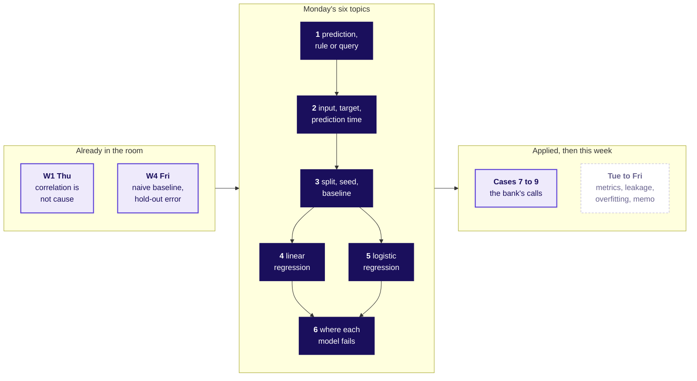

```notes
LIVE, 1 minute. Framing (1, 2, 3) comes before any fitting. Both model families rest on the split
and the baseline. Chapter 6 is where both fail. Week 4 Friday's naive forecast was already a
baseline; today it gets its name. Transition: chapter 1.
```

---

## SECTION 1: Is this an ML problem at all: does it need a model?
*Prediction, rule or query: when a business question is a modelling problem · also searched as: machine learning problem framing, when to use ML*

```notes
LIVE, 15 minutes for the chapter, including the six-question sort. Notebook ch01. The
misconception to stage: "we have data, so it is an ML problem". Transition: six questions.
```

---

## S7. Six questions Marketing brought, invented
*Each one arrived with the word "AI" attached.*

| # | Kalpa's question (invented) |
|---|---|
| 1 | How many members bought in September? |
| 2 | Which members will buy again in the next 90 days? |
| 3 | Remind every member whose cart was abandoned yesterday |
| 4 | What was the average basket in Pune last quarter? |
| 5 | How much will each member spend next quarter? |
| 6 | Hold any order above Rs 50,000 from a member who joined this week |

```notes
LIVE, 3 minutes. Pairs sort the six into query, rule or prediction in two minutes, on paper.
Prediction to ask for first: how many of the six need a trained model? Collect the count from five
pairs. Click: notebook ch01, cell 4 prints the table. Transition: the count.
```

---

## S8. How many of the six need a model?
*Commit to a number before the next slide.*

```stats
value: 6 | label: all of them | note: "it is all data"
value: 4 | label: most | note: anything about members
value: 2 | label: two | note: only the future ones
value: 0 | label: none | note: rules do everything
```

```notes
LIVE, 1 minute. Hands up per option. Most rooms pick 4 or 6. Transition: the three tests.
```

---

## S9. Answer: two of six, after three tests
*Ask them in order; only the last needs learning.*

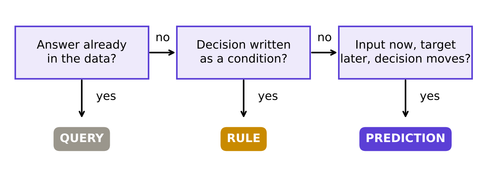

**The rule.** Input known now, target known later, a decision that moves with the score: then a model.

```notes
LIVE, 4 minutes. Walk the six through the tests aloud. 1 and 4: query. 3 and 6: rule. 2 and 5:
prediction; 2 asks "will they" (classification), 5 asks "how much" (regression). Line to land: the
decision makes the problem, the data only makes a dataset. Interview line [S]: when is a business
problem an ML problem? Transition: when a rule stops being enough.
```

---

## S10. A rule wins until its misses cost money
*Google's first rule, and Uber's ETA.*

```cards
icon: book-open | eyebrow: Google, Rules of ML | title: Launch without ML first | body: A heuristic gets you about half the gain, Zinkevich estimates. | tone: light
icon: car | eyebrow: Uber, DeepETA | title: Keep the rule, predict its error | body: The routing engine's ETA stays; the model predicts how wrong it will be. | tone: light
icon: scale | eyebrow: The flip | title: Kalpa's numbers | body: A Rs 1,200 missed buyer against a Rs 40 nudge makes ranking pay. | tone: dark
```

```notes
LIVE, 3 minutes. Google Rules of ML, rule 1: "Don't be afraid to launch a product without machine
learning" (developers.google.com/machine-learning/guides/rules-of-ml, verified 28 October 2026).
Uber DeepETA (uber.com/blog/deepeta-how-uber-predicts-arrival-times, verified 28 October 2026):
the model predicts the residual of the routing engine, which had to be beaten first. Kalpa's Rs
40 and Rs 1,200 are the row's invented numbers. Question to ask: which of Kalpa's two rules would
you replace with a model first, and what would have to be true? Transition: chapter 2.
```

---

## SECTION 2: What do we know, and when: what may the model read?
*Input, target, prediction time; the repeat-purchase target · also searched as: features and labels, supervised learning setup*

```notes
LIVE, 22 minutes. Notebook ch02. The misconception to stage: "use the latest table, it is the
freshest". Transition: four members.
```

---

## S11. Eight orders, four members, one cutoff
*Invented. Purple is history; amber decides the target; grey is too late.*


```notes
LIVE, 4 minutes. Draw the line at 30 June on the board first, then place the eight dots. The
prediction time is the morning Marketing sends the nudge. The window is 90 days because that is
what Marketing's budget covers. Click: notebook ch02, the timeline cell. Transition: who counts.
```

---

## S12. Which members buy again inside the window?
*Count before the next slide: none, one, two or four?*

| Member | Orders before 30 June | Next order |
|---|---|---|
| M1 | 10 April | 20 July |
| M2 | 2 May, 15 June, 28 June | none |
| M3 | 1 June | none |
| M4 | 25 April | 15 October |

```notes
LIVE, 2 minutes. Pairs answer. Trap to watch: M4 bought again, so many say two. Transition: answer.
```

---

## S13. Answer: one member, M1
*M4 bought again, after the window closed.*

| Member | Orders before | Days since last | Spend before, Rs | Repeat in 90 days |
|---|---|---|---|---|
| M1 | 1 | 81 | 800 | 1 |
| M2 | 3 | 2 | 1,900 | 0 |
| M3 | 1 | 29 | 950 | 0 |
| M4 | 1 | 66 | 500 | 0 |

```notes
LIVE, 4 minutes. The target is a definition: "buys again" means inside these ninety days. Every
input column is computed only from orders on or before the cutoff. Line to land: freeze the
reference date, then build both sides from it. Transition: the trap.
```

---

## S14. The trap: count orders on the whole log
*M1 shows two orders. One of them is the answer.*

| Member | Orders before cutoff | Orders all time | Repeat in 90 days |
|---|---|---|---|
| M1 | 1 | **2** | 1 |
| M4 | 1 | **2** | 0 |

**The check.** Ask of every column: would I know this value on 30 June?

```notes
LIVE, 4 minutes. The all-time count includes 20 July, the very purchase we predict. Offline the
model looks brilliant; the first real morning it collapses. Fix: inputs from history only, target
from the window only. This is the same question Wednesday asks of every column. Interview line [F]:
where is the 90-day flag computed, and as of which date? Transition: chapter 3.
```

---

## SECTION 3: Don't peek at the exam paper: which slice, and when?
*Train, validation, test; the seed; the baseline · also searched as: train validation test split, baseline model*

```notes
LIVE, 20 minutes. Notebook ch03. The misconception to stage: "the test set is just more validation
data". Transition: three slices.
```

---

## S15. Three slices, three jobs
*Practice papers, mock exams, the board exam.*

| Slice | At school | For a model |
|---|---|---|
| train | practice papers you study | rows the model learns from |
| validation | mock exams, as often as you like | rows you compare models on |
| test | the board exam, sat once | rows you score the chosen model on, once |

```notes
LIVE, 3 minutes. The school story lands with this room. Stress "sat once": a board paper seen in
advance proves nothing about the student. Interview line [S]: which slice is spent once, and why?
Transition: what the seed does.
```

---

## S16. The seed is the shuffle
*Twenty invented members, two seeds, two different exam papers.*


```notes
LIVE, 4 minutes. Purple train, lilac validation, amber test; Y marks a member who came back. Same
rule, different seed, different members in each slice. Writing random_state=42 is what lets a
teammate get your slices and your baseline. Stratify keeps one Y in every test of four. Click:
notebook ch03, the two-seed cell. Transition: the dumbest model.
```

---

## S17. Saying "no" to all twenty scores how much?
*5 of 20 came back. Commit: 25, 50, 75 or 95 percent?*

```bar
label: came back | value: 5 | caption: 5 members
label: did not | value: 15 | caption: 15 members
```

```notes
LIVE, 1 minute. Pairs commit. Transition: the answer.
```

---

## S18. Answer: 75 percent, knowing nothing
*15 of 20 right by saying "no" to everyone.*

```stats
value: 75% | label: majority class | note: the bar for "will they"
value: mean | label: the average | note: the bar for "how much"
value: 1 | label: rule to beat | note: a cheap rule, where one exists
```

**The flip.** Where a cheap rule exists, it replaces the majority class as the bar.

```notes
LIVE, 4 minutes. A model that scores 75 here learned the share who came back and nothing else.
Baselines: majority class for classification, the mean for regression, and a simple rule when one
is available. Interview line [F]: why start with a baseline, and what does beating it prove?
Transition: chapter 4. Break after chapter 4.
```

---

## SECTION 4: Drawing the best line: which line is best?
*Linear regression: fit, coefficients in units, residuals · also searched as: linear regression explained, least squares*

```notes
LIVE, 22 minutes. Notebook ch04. The misconception to stage: "the best line joins the first and
last points". Transition: six members.
```

---

## S19. Six members of one Kalpa store
*Invented. Visits last month against spend this month.*

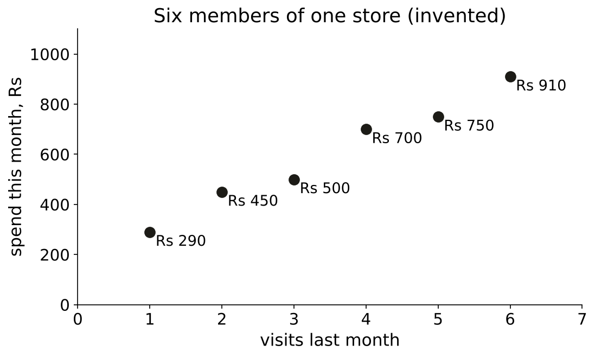

```notes
LIVE, 3 minutes. Everyone draws a line by eye on paper. Most join the first and last points:
slope (910 minus 290) / 5 = Rs 124 per visit. Write 124 on the board. Transition: which line wins.
```

---

## S20. Which line leaves the smallest squares?
*Mean line, first-to-last by eye, or a third line?*

| Line | Equation |
|---|---|
| the mean | spend = Rs 600 |
| by eye, first to last | spend = Rs 166 + Rs 124 x visits |
| a third line | to be found |

```notes
LIVE, 2 minutes. Prediction first. Then explain "squared": each miss drawn as a square, so big
misses count far more than small ones. Transition: the answer.
```

---

## S21. Answer: least squares, 5,200 against 5,480
*The red squares are the misses, drawn as area.*


```notes
LIVE, 5 minutes. Least squares: spend = Rs 180 + Rs 120 x visits. Squares: 257,200 for the mean,
5,480 by eye, 5,200 for least squares. The formula, named last: slope = sum of dx times dy / sum
of dx squared = 2,100 / 17.5 = 120. Click: notebook ch04, the hand calculation, then scikit-learn
agreeing. Transition: reading it.
```

---

## S22. Rs 120 per visit, read with care
*The coefficient in the target's own units.*

```stats
value: Rs 120 | label: per extra visit | note: an association, across members
value: Rs 180 | label: at zero visits | note: beyond the data; quote carefully
value: -10 to +40 | label: residuals, Rs | note: small, mixed signs, no pattern
```

```notes
LIVE, 4 minutes. Say it for Marketing: "members who visit once more spend about Rs 120 more, in
this data". Whether a nudge that causes a visit adds Rs 120 needs an experiment (Week 1 Thursday).
Kahoot Q5 previews this sentence. Transition: the code, three lines.
```

---

## S23. The same line in three lines of code
*scikit-learn agrees with the hand count to the rupee.*

```python
from sklearn.linear_model import LinearRegression
lin = LinearRegression().fit(store[["visits"]], store["spend_rs"])
lin.coef_[0], lin.intercept_        # (120.0, 180.0)
```

```notes
LIVE, 2 minutes. Run it in ch04 on the projector. The check cell asserts hand and code agree. The
bridge course met fitting; spend no more time on mechanics. Break now, 10 minutes. Transition:
chapter 5.
```

---

## SECTION 5: From a line to a probability: what does 0.73 mean?
*Logistic regression: probability, direction, strength · also searched as: logistic regression, sigmoid, odds*

```notes
LIVE, 22 minutes. Notebook ch05. The misconception to stage: "a line on 0s and 1s gives a
probability". Transition: twelve members.
```

---

## S24. A straight line through yes and no
*Twelve invented members: visits, and whether they came back.*

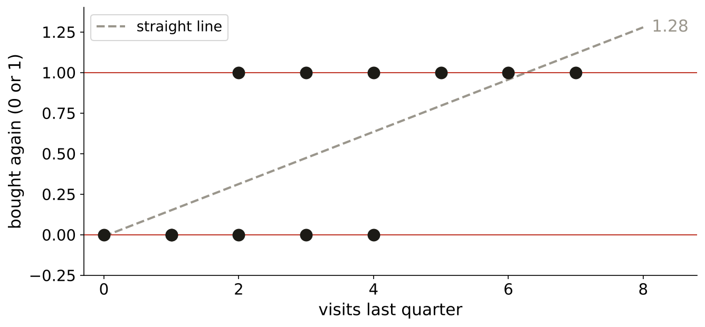

```notes
LIVE, 3 minutes. Dots sit at 0 or 1 only. The dashed line is ordinary least squares on them.
Question to ask: what will this line predict for a member with 8 visits? Transition: commit.
```

---

## S25. What does the line say at 8 visits?
*About 0.9, exactly 1, or more than 1?*

```stats
value: 0.9 | label: option a | note: "nearly certain"
value: 1.0 | label: option b | note: "certain"
value: > 1 | label: option c | note: "more than certain"
```

```notes
LIVE, 1 minute. Hands per option. Transition: the S.
```

---

## S26. Answer: 1.28, so bend the line into an S
*The S stays between 0 and 1 wherever you ask it.*


```notes
LIVE, 5 minutes. The line says 1.28 at 8 visits and -0.01 at 0: impossible probabilities. Logistic
regression keeps a line underneath, z = a + b x visits, and squeezes it: p = 1 / (1 + exp(-z)).
Here z = -3.20 + 1.05 x visits. Click: ch05, the fit cell, model and formula agree at 0.73.
Transition: what 0.73 means.
```

---

## S27. 0.73 means 73 of 100 members like this one
*A statement about a group, never a promise about one member.*

```stats
value: 0.73 | label: 4 visits | note: about 73 in 100 come back
value: 0.49 | label: 3 visits | note: about a coin flip
value: 0.04 | label: 0 visits | note: about 4 in 100
```

```notes
LIVE, 3 minutes. Interview line [F]: what does a logistic output of 0.71 mean? Model answer: among
customers who look like this one, about 71 in 100 do the thing, if the model is calibrated; it is
never "this customer is 71 percent likely" as a promise. Transition: direction and strength.
```

---

## S28. Direction is the sign; strength is exp(b)
*Each extra visit multiplies the odds by 2.85.*

| Visits | p | Odds p / (1 - p) | Ratio to the row above |
|---|---|---|---|
| 2 | 0.25 | 0.33 | |
| 3 | 0.49 | 0.94 | 2.85 |
| 4 | 0.73 | 2.69 | 2.85 |
| 5 | 0.88 | 7.67 | 2.85 |

**The trap.** "Each visit adds 1.05 to the probability" reads a log-odds coefficient as a slope.

```notes
LIVE, 5 minutes. b = 1.05 is positive: more visits, more likely. exp(1.05) = 2.85: the odds
multiply by 2.85 per visit, at every step. The probability step is not constant: 0.25 to 0.49,
then 0.88 to 0.96. Click: ch05, the odds-ratio check. Transition: chapter 6.
```

---

## SECTION 6: What the leftovers confess: what did the fit miss?
*Where each model fails; the residual tells · also searched as: residual plot, regression diagnostics*

```notes
LIVE, 18 minutes, including the four-plot match drill if time allows. Notebook ch06, the one
concept chapter on real data: UCI Auto MPG. The misconception: "a line that looks close is right".
Transition: 392 cars.
```

---

## S29. 392 cars, one straight line
*Real data: UCI Auto MPG, 1970s and early 1980s cars.*

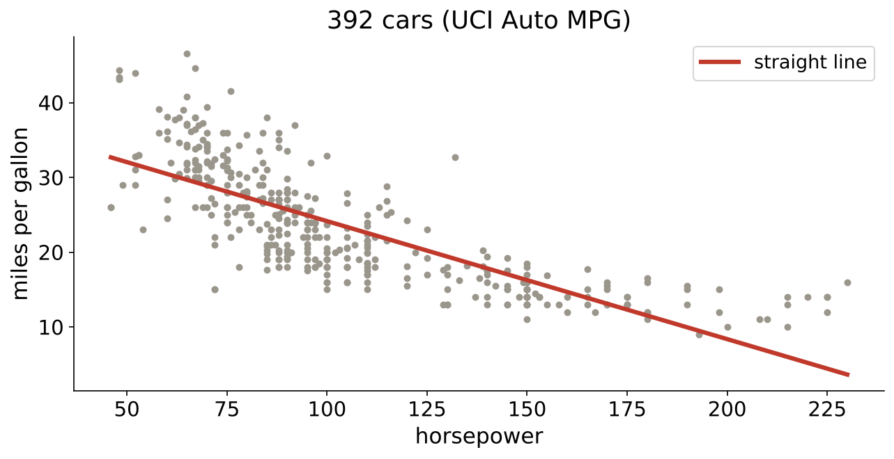

```notes
LIVE, 3 minutes. 398 cars; six have "?" for horsepower and are dropped, a decision recorded in the
notebook. The line: mpg = 39.94 minus 0.158 x horsepower. From a distance it looks fine. Question:
if the truth bends, what will the misses look like? Transition: commit.
```

---

## S30. What shape will the residuals take?
*Even scatter, a bow, or below zero everywhere?*

```cards
icon: shuffle | eyebrow: Option a | title: Even scatter | body: Misses spread evenly above and below zero. | tone: light
icon: smile | eyebrow: Option b | title: A bow | body: Above at both ends, below in the middle. | tone: light
icon: arrow-down | eyebrow: Option c | title: Below everywhere | body: The line overshoots every car. | tone: light
```

```notes
LIVE, 1 minute. Hands per option. Transition: the answer.
```

---

## S31. Answer: a bow, +2.7 at one end, -2.2 in the middle
*Mean residual in five horsepower bands.*


```notes
LIVE, 4 minutes. Low-power cars beat the line by 2.7 mpg on average, the middle band sits 2.2 below
it, the top band climbs back to +0.8. A pattern in residuals is a shape the model missed; random
scatter is what a good fit leaves. Click: ch06, the bow cell. Transition: the fix.
```

---

## S32. Add horsepower squared, and the bow flattens
*Every band within 1 mpg; typical miss 4.89 to 4.36.*

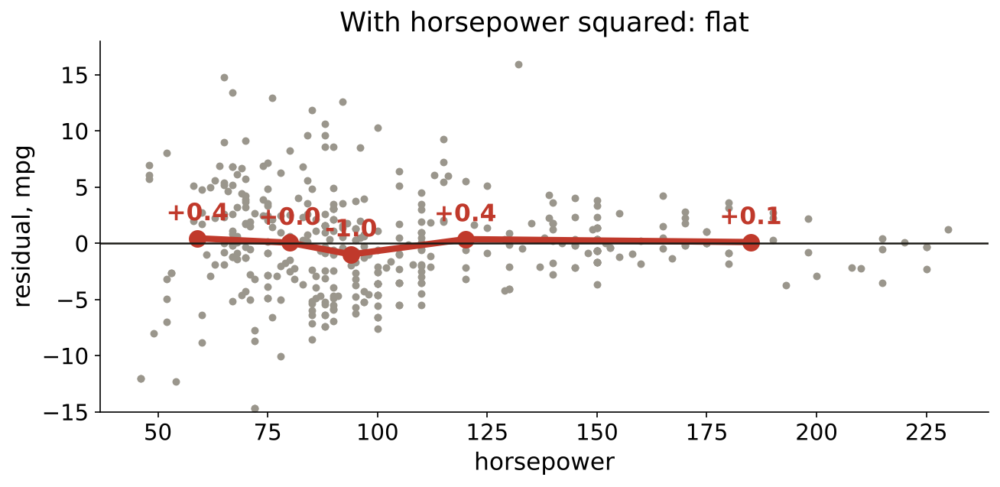

```notes
LIVE, 3 minutes. One extra column, horsepower squared, lets the line bend. Band means now 0.44,
0.05, -0.99, 0.36, 0.10. Wednesday turns this move into feature engineering; today it is only the
cure the residuals asked for. Transition: where the cure fails.
```

---

## S33. The cure fails outside the data
*Past about 190 horsepower the curve predicts mileage rising.*

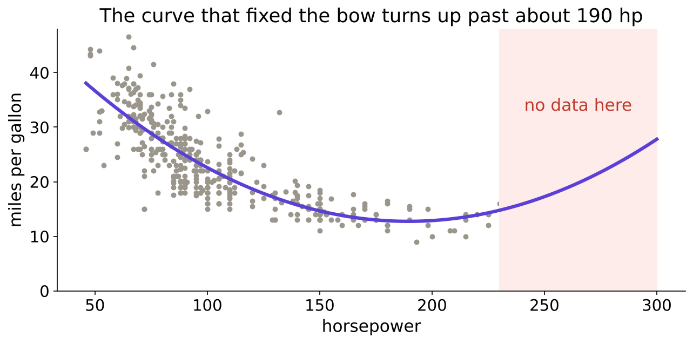

```notes
LIVE, 3 minutes. At 300 hp the curve says 27.8 mpg, the line says minus 7.4. Both are nonsense,
because no car in the data has 300 hp. Rule: never quote a fit outside the range it was fitted on.
Transition: the failure table.
```

---

## S34. Where each model fails
*Read the residuals, and know the range.*

| Model | Fails when | You see it as |
|---|---|---|
| straight line | the truth bends | a bow in the residuals |
| line plus a squared term | you leave the data's range | predictions turn the wrong way |
| logistic regression | the chance rises at both ends of an input | one S cannot hold both ends |
| any model | inputs are missing or wrong | six cars with "?" horsepower |

```notes
LIVE, 3 minutes. Mid-session drill if minutes allow: match four residual plots (bow, fan, bands,
flat) to their diagnoses; the practice set carries the plots. Interview line: what does a pattern
in the residuals tell you? Transition: the case.
```

---

## SECTION 7: Whom should the bank call: who is worth a call?
*Case chapter. Applies: Prediction, rule or query; Input, target, prediction time; Train, validation, test; the seed; the baseline*

```notes
LIVE, 41 minutes, including the guided notebook, 20 of them. Notebook case01, then guided.
Transition: the bank.
```

---

## S35. 41,188 calls; one in nine said yes
*A Portuguese bank's term-deposit campaigns, 2008 to 2010.*

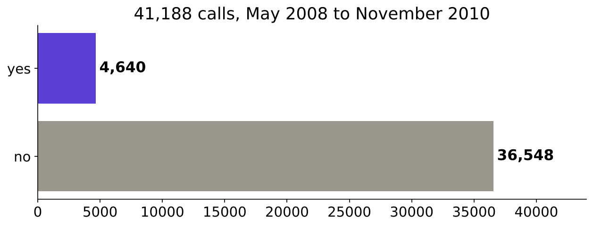

```notes
LIVE, 4 minutes. Prediction first: what share said yes? Options half, a quarter, one in nine, one
in thirty. Answer 4,640 of 41,188, 0.1127. Source: UCI Bank Marketing, Moro, Rita and Cortez,
CC BY 4.0, archive.ics.uci.edu/dataset/222/bank+marketing (verified 28 October 2026). Click:
case01, the count cell. Transition: the same question at Kalpa.
```

---

## S36. The bank and Kalpa ask the same question
*Different action, same shape.*

| | The bank | Kalpa Retail |
|---|---|---|
| Action | an agent's call | a Rs 40 nudge |
| Target | `y`, known when the call ends | repeat within 90 days |
| Input | client table, morning of the call | customer table, day of the nudge |
| Decision | whom to call first | whom to nudge |

```notes
LIVE, 3 minutes. The three tests of chapter 1 pass for both: input now, target later, a list
that changes with the score. Transition: which columns are allowed.
```

---

## S37. 13 columns known on the morning of the call
*Seven about the client, six about campaigns so far.*

| Group | Columns | Today |
|---|---|---|
| profile | age, job, marital, education, default, housing, loan | used |
| history | contact, month, day_of_week, campaign, previous, poutcome | used |
| other feeds | seven more columns | Wednesday audits them |
| target | y | predicted |

```notes
LIVE, 4 minutes. Do not explain the seven other columns today; if asked, point at the timeline and
say Wednesday asks the prediction-time question of each one. Click: case01, the groups cell, two
PASS lines. Transition: the split.
```

---

## S38. The week's split, test sealed first
*Seed 42, stratified: 11.3 percent yes in every slice.*


```notes
LIVE, 4 minutes. Test is cut first, 20 percent, and sealed. The rest splits 75 to 25. Show the
trap from case01: five unseeded splits give held-out yes shares between about 0.114 and 0.119, so
two teammates quote baselines on different rows. Transition: the envelope.
```

---

## S39. The envelope stays sealed until Friday
*TEST SET. DO NOT OPEN UNTIL FRIDAY.*

```cards
icon: mail | eyebrow: Monday | title: Sealed | body: 8,238 rows nobody scores a model on this week. | tone: dark
icon: hand | eyebrow: Tuesday to Thursday | title: Every peek points here | body: Choices are made on validation, as often as needed. | tone: light
icon: mail-open | eyebrow: Friday | title: Opened once | body: The chosen model is scored once; that number goes in the memo. | tone: light
```

```notes
LIVE, 2 minutes. Point at the card taped to the wall since the start of the day. Line to land: the
test set is spent once. Every time someone asks "can we just check it on test?" this week, point at
the envelope. Transition: the guided notebook.
```

---

## S40. Guided: frame it, split it, score the baseline
*Five TODO cells, built together; the answer sits last.*

```timeline
label: Step 1 | title: Frame | body: input, target, prediction time
label: Step 2 | title: Columns | body: the 13 known that morning
label: Step 3 | title: Target | body: y as 0 and 1
label: Step 4 | title: Split | body: seed 42, test sealed
label: Step 5 | title: Baseline | body: accuracy on validation
```

```notes
LIVE, 20 minutes. Notebook guided_frame_and_split. Trainer types, room mirrors. The progress cell
prints TODO until each step is filled, then PASS. Expected: 4,640 ones; 24,712 / 8,238 / 8,238;
baseline 0.8874. Do not open the answer cell until every pair has tried step 5. Transition: case 2.
```

---

## SECTION 8: Beat the dumbest model: does it beat nothing?
*Case chapter. Applies: Train, validation, test; the seed; the baseline; Logistic regression: probability, direction, strength*

```notes
LIVE, 25 minutes. Notebook case02. Transition: the baseline.
```

---

## S41. What does calling nobody score?
*Commit: 0.50, 0.75, 0.887 or 1.00?*

```stats
value: 0.50 | label: option a | note: a coin flip
value: 0.75 | label: option b | note: the toy table's number
value: 0.887 | label: option c | note: one minus the share of yes
value: 1.00 | label: option d | note: never wrong
```

```notes
LIVE, 1 minute. Pairs commit. Transition: the answer.
```

---

## S42. Answer: 0.8874, right 7,310 times in 8,238
*The bar every model this week has to clear.*

```stats
value: 0.8874 | label: call nobody | note: 7,310 right of 8,238
value: 0.8971 | label: logistic model | note: 7,390 right of 8,238
value: +80 | label: the edge | note: under one point of accuracy
```

```notes
LIVE, 4 minutes. By hand (share of no) and by DummyClassifier: the same 0.8874, a PASS line. The
logistic model on the 13 columns: 0.8971. Line to land: one point above doing nothing. Click:
case02, cells 5 and 7. Transition: the picture.
```

---

## S43. 80 more right answers, drawn honestly
*Side by side they look the same; the gap is what the model adds.*

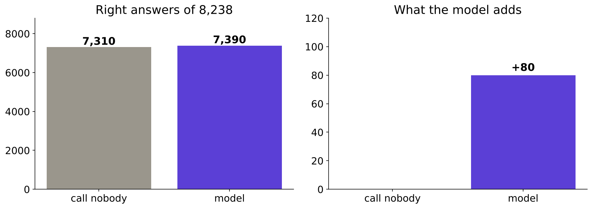

```notes
LIVE, 3 minutes. Left: full height, identical-looking bars. Right: only the gap. Tuesday asks how
many of the 928 clients who said yes this model put on the call list; do not answer it today.
Kahoot Q4 and the return question set it up. Transition: what the model outputs.
```

---

## S44. Probabilities centred on the base rate
*Mean 0.114 against a share of yes of 0.113.*

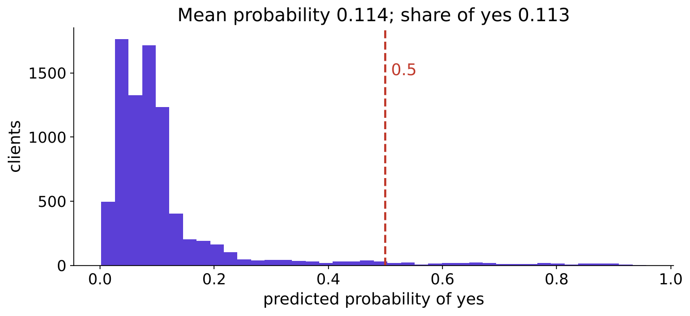

```notes
LIVE, 3 minutes. Most clients score low, a few high. The 0.5 line is where today's accuracy reads
the probability as yes; Tuesday moves that line. Transition: one coefficient.
```

---

## S45. One coefficient for the campaign manager
*`campaign`: calls already made to this client this campaign.*

```stats
value: x 0.93 | label: odds per extra call | note: about 7 percent lower
value: negative | label: direction | note: more calls, fewer yeses
value: 0.9334 | label: measured | note: on all 8,238 clients, a second route
```

**For Marketing.** Calling the same client again and again goes with a falling chance of a yes.

```notes
LIVE, 5 minutes. Coefficient -0.069 per call after undoing the scaling; exp gives 0.933. Second
route: add one call to every validation client and measure the odds ratio: 0.9334 for every row,
a PASS. Say "association, other columns held"; causation needs an experiment. Interview [F]:
explain one coefficient in the business's words. Transition: the caveat.
```

---

## S46. The caveat: three very different years
*A random split mixes them, so part of the score is the calendar.*

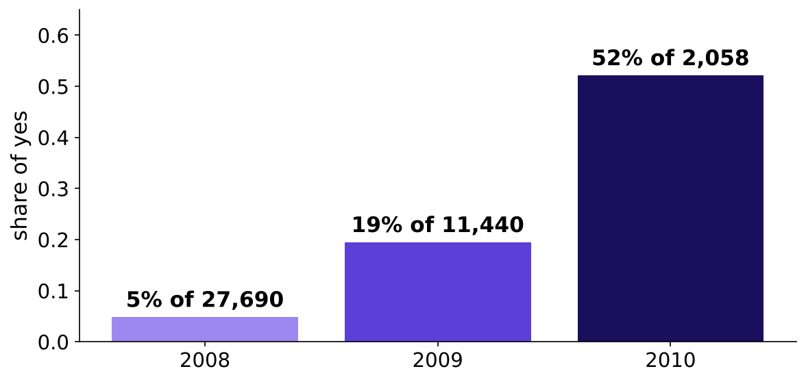

```notes
LIVE, 4 minutes. 2008: 4.8 percent yes of 27,690 calls; 2009: 19.5 percent of 11,440; 2010: 52.1
percent of 2,058. The month column is in our 13, so the model partly learns "when". Friday splits
by time and shows what that costs. The trap sentence: "our model is 89.7 percent accurate", true
and misleading. The fix: "under one point above calling nobody, on a random split". Transition:
the peek.
```

---

## SECTION 9: The peek: what did the peek buy?
*Case chapter. Applies: Train, validation, test; the seed; the baseline*

```notes
LIVE, 15 minutes. Notebook case03. Never cut this chapter (the row says so). Transition: the loop.
```

---

## S47. The junior's loop: 60 versions, one slice
*Keep whichever scores best on the held-out rows.*

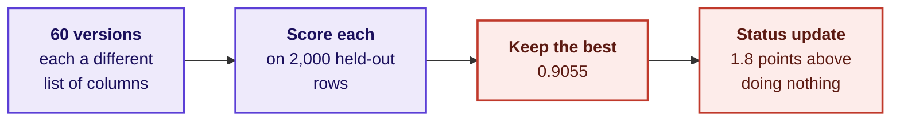

```notes
LIVE, 3 minutes. The real envelope stays sealed: 2,000 validation rows play the test's part and
the other 6,238 are a fresh slice. Prediction: on fresh rows, the chosen version scores 0.906
again, about 0.897, about 0.887, or 0.80? Transition: the answer.
```

---

## S48. Answer: 0.897 on fresh rows, the honest edge
*The extra 0.8 points were luck the loop picked.*

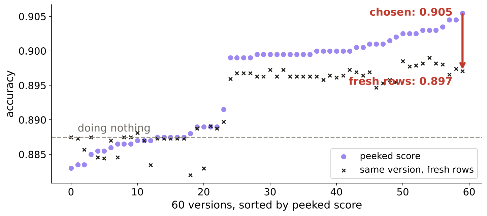

```notes
LIVE, 5 minutes. The chosen version: 0.9055 on the peeked slice (doing nothing there 0.8875), 0.8971
on fresh rows (doing nothing 0.8873). Reported edge 1.80 points, real edge 0.98. Line to land: a
test score used to choose anything becomes a validation score. Kahoot Q3 is this slide. Click:
case03, the scatter. Transition: the rule.
```

---

## S49. The test slice is spent once
*Choose on validation as often as you like; score the test at the end.*

```cards
icon: repeat | eyebrow: Validation | title: Choose here | body: Columns, settings, models: compare as often as needed. | tone: light
icon: lock | eyebrow: Test | title: Score once | body: The chosen model, once, with its seed, then report. | tone: dark
icon: triangle-alert | eyebrow: Peeked | title: Cut a fresh slice | body: A peeked test is validation now; hold out new rows. | tone: light
```

```notes
LIVE, 3 minutes. Interview [S]: train, validation, test, what is each for and which is spent once?
The full answer opens on the job of each slice and ends on what to do after a peek. Transition: the
interview corner.
```

---

## S50. Five interview questions from today
*The shape of a good answer, never a script.*

| Tag | Question | A good answer opens on |
|---|---|---|
| [S] | When is a business problem an ML problem? | input now, target later, decision moves |
| [S] | Train, validation, test: which is spent once? | each slice's job, then test |
| [F] | What does a logistic output of 0.71 mean? | 71 in 100 similar customers |
| [F] | Why start with a baseline? | a score means nothing without its bar |
| [D] | Your model ties the baseline by Friday | the clarifying question, then the offer |

```notes
LIVE, 5 minutes. Cold-call three people for the 30-second version of one each. The [D] answer
opens with a question: tie on what metric, on which slice? Then: show both numbers, ship the
baseline rule with its cost, ask for time for features, name the next check date. Tags: [S] staple,
[F] frequent in GCC and product screens, [D] differentiator. Transition: the seat.
```

---

## S51. Six seats; today the senior ML engineer decides
*The target, the baseline, the split, the validation.*

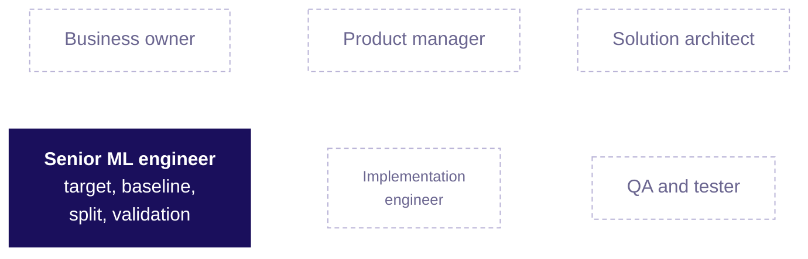

```notes
LIVE, 2 minutes. Each day this week lights one seat. Today's questions are the senior ML
engineer's: what exactly is predicted, from what, known when; what is the bar; which rows score
it. Ask: which of today's mistakes would this seat have caught? (the all-time count, the unseeded
split, the peek). Transition: the quiz.
```

---

## S52. Quiz: five questions and one return question
*Kahoot, ungraded.*

| # | What it asks |
|---|---|
| 1 | Prediction, rule or query: five Kalpa questions, fast |
| 2 | Which split tunes, which is spent once |
| 3 | Validation rose after peeking at test: what is now broken |
| 4 | The baseline on a 96 to 4 flag scores what |
| 5 | Rs 240 per unit of recency: finish the sentence for Marketing |
| R | Week 4 Friday: the vendor curve fit two years perfectly; good forecast? |

```notes
LIVE, 10 minutes. Keys in the trainer guide. The return question first, as a warm-up. Q4's 96 to
4 is the row's invented Kalpa flag: the answer is 96 percent. Transition: the close.
```

---

## S53. What you can do now, and what comes next
*Tonight: the practice set. Tomorrow: what accuracy hides.*

```cards
icon: circle-check | eyebrow: Now | title: Frame, split, baseline | body: Sort a question, fix a cutoff, seal a test, beat a bar. | tone: light
icon: book-open | eyebrow: Tonight | title: Practice set | body: Ten problems and eighteen checks, about two and a half hours. | tone: dark
icon: calendar | eyebrow: Tomorrow | title: The metric trap | body: How many of the 928 yeses did the model find? | tone: light
```

```notes
LIVE, 5 minutes. The take-home is mandatory; the practice lab with the TAs follows the faculty
block (tentative). Return question for tomorrow: your model only tied the baseline; what do you tell
Marketing? Point at the envelope once more on the way out.
```
