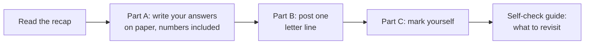
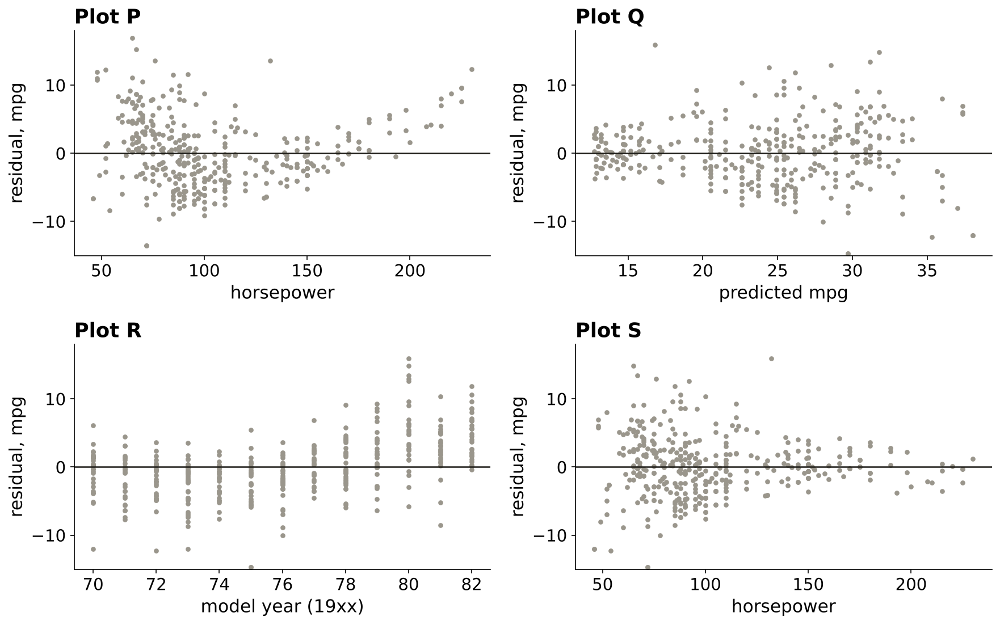
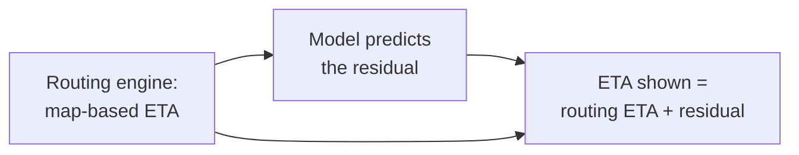
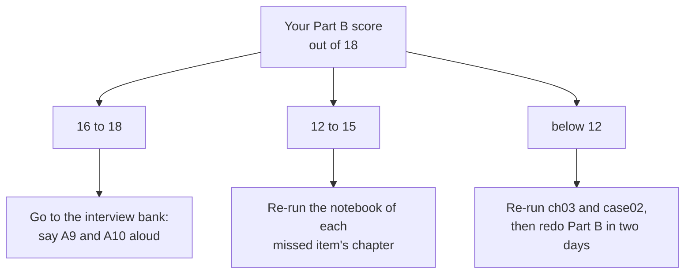
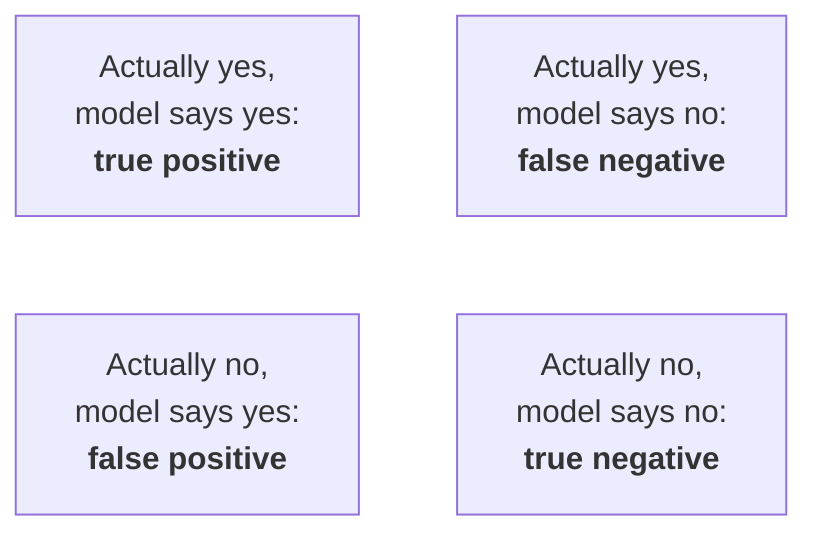

# Practice set: regression and classification, framed first

Week 5, Monday. About two and a half hours, done alone, with the key at the end.

## How do you use this set?

| Part | What | Minutes |
|---|---|---|
| Recap | one page of pictures and rules | 10 |
| A | ten problems: three warm-ups, four medium, three interview grade | 100 |
| B | eighteen self-check questions | 25 |
| C | the key and the model solutions, read after you finish | 15 |



Each problem names the seat it is answered from: business owner, product manager, solution architect, senior ML engineer, implementation engineer, or QA and tester. Two problems are under-specified on purpose; a strong answer opens with the one question worth asking before any number.

<div class="page-break"></div>

## What does the day come down to?


| Idea | The rule | The condition that flips it |
|---|---|---|
| Query, rule or prediction | a model earns its place when the input is known now, the target later, and the decision moves with the score | a rule stays right until its misses cost more than a model would |
| Prediction time | every input comes from the left of the cut; the target from the window right of it | none: a column from the right of the cut is a leak |
| Three slices | train learns, validation chooses, test is scored once | a peeked test is validation now; cut a fresh slice |
| Baseline | majority class for "will they", the mean for "how much" | a cheap rule, where one exists, is the stronger bar |
| Linear regression | the least-squares line leaves the smallest sum of squared residuals; read the slope in the target's units | the slope is an association unless an experiment backs it |
| Logistic regression | `p = 1 / (1 + exp(-(a + b x)))`; sign is direction, `exp(b)` is the odds multiplier | one S holds one direction; a chance that rises at both ends breaks it |
| Residuals | a pattern is a shape the model missed | a flat plot vouches only for the data's range |


<div class="page-break"></div>

## Part A: ten problems

### A1. Which of Rohan's questions needs a model? (warm-up, 5 minutes)

**Seat:** product manager. Rohan Desai, head of risk at Kalpa Financial Services, sends five questions (invented).

| # | Rohan's question |
|---|---|
| 1 | How many loan applications did we decline in September? |
| 2 | Which approved borrowers will miss a payment in the next six months? |
| 3 | Decline any application with no PAN on file |
| 4 | How much will each borrower repay next quarter? |
| 5 | What is the average loan size in Hyderabad this year? |

1. Sort each into query, rule or prediction.
2. For each prediction, say whether it is regression or classification.
3. For question 3, name one fact that would turn it into a prediction problem.

*In the interview:* "When is a business problem a machine learning problem? Use one of these five to show it."

### A2. Does 99.4 percent beat doing nothing? (warm-up, 5 minutes)

**Seat:** senior ML engineer. A payments app's fraud team (illustrative, numbers invented) reports on its validation slice:

| Validation slice | Rows |
|---|---|
| genuine payments | 9,950 |
| fraudulent payments | 50 |
| the model's accuracy | 99.4 percent |

1. What accuracy does "call every payment genuine" score?
2. Does the model beat it, and by how many rows?
3. Write one sentence for the product manager who saw "99.4 percent".

*In the interview:* "Why start with a baseline, and what does beating it prove?"

### A3. What does this logistic output say? (warm-up, 5 minutes)

**Seat:** senior ML engineer. Kalpa's repeat model, one input only (invented):

```text
intercept               -1.87
previous_purchases       0.69     (exp = 1.99)
```

1. Compute the chance of buying again for a member with 0 previous purchases, and for one with 4.
2. State the direction and the strength in one sentence each.
3. The member with 4 purchases scores about 0.71. Say what 0.71 means to Marketing.

*In the interview:* "What does a logistic output of 0.71 mean?"

### A4. Who bought again? (medium, 10 minutes)

**Seat:** solution architect. Marketing asks for "members who buy again within 90 days" of a nudge sent on 31 March 2026. The window runs to 29 June. The order log (invented):

| Member | Order date | Status |
|---|---|---|
| K1 | 12 Feb | delivered |
| K1 | 20 Apr | returned |
| K2 | 3 Mar | delivered |
| K2 | 5 Apr | delivered |
| K3 | 15 Jan | delivered |
| K3 | 2 Jul | delivered |
| K4 | 25 Mar | delivered |
| K4 | 10 May | cancelled |
| K5 | 1 Apr | delivered |

A teammate's query:

```sql
select customer_id,
       count(*) as orders_total,
       case when count(*) > 1 then 1 else 0 end as repeat_90d
from orders
group by customer_id;
```

1. Before computing anything, what one question do you ask Marketing?
2. Name the two lines that leak and say what each borrows from the future.
3. With your answer to question 1 assumed (state it), compute each member's honest flag.
4. What breaks if this query runs on 15 May, before the window closes?

*In the interview:* "Where is the 90-day repeat flag computed, from which table, as of which date?"

### A5. Minutes per item at a dark store (medium, 10 minutes)

**Seat:** senior ML engineer, explaining to the store manager. Kalpa's Bengaluru dark store, five orders (invented):

| Items in the order | 2 | 4 | 6 | 8 | 10 |
|---|---|---|---|---|---|
| Packing minutes | 5 | 7 | 10 | 11 | 14 |

1. Fit the least-squares line by hand: slope and intercept.
2. Read the slope in the manager's words.
3. Compute the sum of squared residuals for your line and for the flat mean line.
4. The manager asks for the packing time of a 30-item order. What do you say?

*In the interview:* "Explain one coefficient of a model you built to someone who has never seen a regression."

### A6. Four residual plots, four confessions (medium, 10 minutes)

**Seat:** QA and tester. Four residual plots from UCI Auto MPG's 392 cars: plot P is the straight line on horsepower; Q, R and S are the line with horsepower squared, plotted against different things.



Match each plot to one diagnosis; one diagnosis is spare.

| | Diagnosis |
|---|---|
| a | an input the model does not use still carries signal |
| b | the misses grow with the prediction |
| c | the straight line missed a curve |
| d | the test set was peeked at |
| e | centred on zero across the range: no shape left for this input |

1. Post your match as P?, Q?, R?, S?.
2. For the plot that says "an input is missing", name the input and what the fix would be.

*In the interview:* "You fit a regression and the residual plot is not flat. What do you look for, in order?"

### A7. The 0.906 in the status update (medium, 10 minutes)

**Seat:** senior ML engineer. A junior at the bank's analytics team (UCI Bank Marketing) posts:

```text
validation accuracy (seed 42)          0.8971
tried 25 column lists on the test set
best test accuracy                      0.9060   <- reporting this one
```

1. What is 0.9060 now an estimate of?
2. What does the team report today, and what does it do before the next test score?
3. Calling nobody scores 0.8874. By how much did the reported edge grow over the validation edge?

*In the interview:* "Train, validation, test: what is each for, and which is spent once?"

### A8. Booking.com: a regression or a classification? (interview grade, 15 minutes)

**Seat:** product manager with the senior ML engineer. Booking.com's KDD 2019 paper describes "a regression predicting the length of a stay, turned in to a multiclass classification problem", and prefers set-ups "where simple models can do significantly better than trivial models". Suppose the two set-ups scored as below on validation (the numbers are invented for this problem).

| Set-up | Trivial baseline | Simple model |
|---|---|---|
| regression: nights of stay | mean: off by 1.9 nights on average | linear: off by 1.7 nights |
| classification: 1, 2, 3, 4 or more nights | majority class: right 41 percent | logistic: right 58 percent |

1. What do you ask the product team before you compare the two rows?
2. By Booking's own rule, which set-up looks stronger, and how do you compare gains that are in different units?
3. Name one fact that would make you keep the regression anyway.

*In the interview:* "Marketing wants a model; walk me through how you decide what exactly it predicts."

### A9. The model ties the baseline on Thursday (interview grade, 15 minutes)

**Seat:** senior ML engineer, talking to the business owner. The bank's validation slice, from class:

| Option | Accuracy on 8,238 calls |
|---|---|
| call nobody | 0.8874 |
| one-line rule: call clients whose last campaign succeeded | 0.8988 |
| logistic model on 13 columns | 0.8971 |

Marketing wants the score by Friday.

1. What do you ask before you answer?
2. What do you ship on Friday, and what do you say about the model?
3. What two numbers sit side by side in your message?
4. What result would make you ship the model instead?

*In the interview:* "Marketing wants the score by Friday and your model only ties the baseline. What do you tell them?"

### A10. Uber's ETA, Kalpa's delivery promise (interview grade, 15 minutes)

**Seat:** solution architect. Uber's DeepETA post (10 February 2022): "We then use machine learning to predict the residual between the routing engine ETA and real-world observed outcomes." The new model had to improve mean absolute error "significantly over the incumbent XGBoost model" and "return an ETA within a few milliseconds at most".



1. For the residual model, name the input, the target and the prediction time.
2. What is the baseline the model must beat, and on which two measures?
3. Kalpa Logistics wants a delivery promise at checkout. Frame it the same way: the rule that stays, the target, and the baseline.
4. Name one change upstream that would silently change the residual model's target.

*In the interview:* "How would you predict delivery time for a quick-commerce order at checkout?"

<div class="page-break"></div>

## Part B: eighteen self-check questions

Post one line in this shape (the letters here are an example, not the key): `1x 2x 3x ... 18x`, with several letters where a question asks for all that apply.

**B1.** Which question needs a trained model?
- a) What share of members bought twice last quarter?
- b) Flag every order above Rs 50,000 from a week-old member
- c) Which members will lapse in the next sixty days?
- d) What was the median delivery time in Pune last month?

**B2.** The validation slice is for:
- a) training the final model on more rows than train holds
- b) comparing models and settings, as often as needed
- c) reporting the final score once the model is frozen
- d) checking that the seed gives the same split each time

**B3.** A churn flag is 92 to 8 on validation (invented). "Nobody churns" scores:
- a) 8 percent
- b) 50 percent
- c) 100 percent
- d) 92 percent

**B4.** A logistic model scores a member 0.71. The right reading:
- a) of 100 similar members, about 71 buy again, if calibrated
- b) this member will buy again; the model is 71 percent sure
- c) the next basket will be 71 percent of the last basket
- d) 71 percent of all members will buy again within the window

**B5.** A linear regression gives visits a coefficient of Rs 120. For Marketing:
- a) each visit causes Rs 120 more spend, so push for one more visit
- b) one more visit goes with about Rs 120 more spend, in this data
- c) visits explain Rs 120 of the average member's monthly spend
- d) a member with zero visits still spends Rs 120 every month

**B6.** The least-squares line is "best" because it:
- a) passes through as many of the points as possible
- b) joins the first and the last point of the data
- c) leaves the smallest sum of squared residuals
- d) has the smallest slope that still fits the data

**B7.** Residuals against horsepower are positive at both ends and negative in the middle. This says:
- a) a straight line misses a curve in the data
- b) the data has outliers to remove before fitting
- c) the model is overfitting its training rows
- d) horsepower has no link with mileage at all

**B8.** After choosing a setting by its test score, the test score is now:
- a) still unbiased, since no test row was trained on
- b) pessimistic, since the model is less finely tuned
- c) equal to the validation score in expectation
- d) optimistic, because the choice was made on it

**B9.** A nudge goes out on 30 June. Which inputs may the model read? Select all that apply.
- a) orders placed on or before 30 June
- b) whether the member ordered in July
- c) days since the last order before 30 June
- d) the member's spend in the 90 days after 30 June

**B10.** Which make a split reproducible and honest? Select all that apply.
- a) a stated random seed
- b) stratifying on the target
- c) scoring the test slice after every change
- d) cutting the test slice before any modelling

**B11.** Which belong beside a classifier's validation accuracy? Select all that apply.
- a) the majority class's accuracy
- b) a one-line business rule's accuracy
- c) the model's accuracy on its own training rows
- d) the best test score from earlier runs

**B12.** "The bank's model, at 89.7 percent accuracy, has learned a lot about who says yes."
- a) True, because 89.7 percent is near ninety
- b) True, because it is right on most calls
- c) False, since calling nobody scores 88.7
- d) False, because above 85 means overfitting

**B13.** "A logistic coefficient is the change in probability per unit of input."
- a) True, because it is fitted like a line's slope
- b) True, because the model outputs a probability
- c) False, because logistic models have no coefficients
- d) False, it moves the log-odds per unit

**B14.** M4 ordered on 25 April and again on 15 October. "With a 30 June cutoff, M4's 90-day repeat flag is 1."
- a) True, because M4 did buy again
- b) True, because any later order counts
- c) False, the order falls after the window
- d) False, because M4 had one earlier order only

**B15.** Assertion: the test slice should be scored only once. Reason: every choice made with a score makes that score optimistic.
- a) A and R true; R explains A
- b) A and R true; R does not explain A
- c) A true; R false
- d) A false; R true

**B16.** Assertion: for spend = 180 + 120 x visits, Rs 180 is a safe forecast for a member with zero visits. Reason: the least-squares line passes through the mean of x and the mean of y.
- a) A and R true; R explains A
- b) A and R true; R does not explain A
- c) A true; R false
- d) A false; R true

**B17.** Match each slice to its job (one job is spare): 1 train, 2 validation, 3 test. Jobs: p) learn the coefficients; q) choose between models; r) report once at the end; s) tune the seed until the score is best.
- a) 1q 2p 3r
- b) 1p 2q 3r
- c) 1p 2r 3q
- d) 1r 2q 3p

**B18.** Match each residual pattern to what it says (one meaning is spare): 1 a bow; 2 a fan; 3 a trend against a column the model leaves out. Meanings: p) a missing curve; q) the misses grow with the prediction; r) an input left out; s) nothing left to learn.
- a) 1p 2q 3r
- b) 1q 2p 3r
- c) 1p 2s 3r
- d) 1r 2q 3p

<div class="page-break"></div>

## STOP. Part C starts here: the key and the model solutions

### The key

| Item | Key | Item | Key | Item | Key |
|---|---|---|---|---|---|
| B1 | c | B7 | a | B13 | d |
| B2 | b | B8 | d | B14 | c |
| B3 | d | B9 | a, c | B15 | a |
| B4 | a | B10 | a, b, d | B16 | d |
| B5 | b | B11 | a, b | B17 | b |
| B6 | c | B12 | c | B18 | a |

Part A answers, in one line each: A1 query, prediction (classification), rule, prediction (regression), query. A2 0.995; no, 10 rows short. A3 0.13 and 0.71. A4 ask whether a returned order counts; K1 0 or 1 by that answer, K2 1, K3 0, K4 0, K5 outside the table. A5 slope 1.1 minutes per item, intercept 2.8; 0.8 against 49.2. A6 Pc, Qb, Ra, Se. A7 a second validation score; the edge grew from 0.97 to 1.86 points. A8 the decision first; classification by its gain over trivial. A9 the clarifying question, then ship the rule. A10 the routing engine is the rule that stays.

### Model solutions to Part A

**A1.** Questions 1 and 5 are queries: the answer already sits in the data. Question 3 is a rule: someone wrote the decision as a condition. Question 2 is a prediction, classification (will they miss a payment); question 4 is a prediction, regression (how much). Question 3 turns into a prediction problem when the business wants to approve some no-PAN applicants who will repay, so it needs a score for who is safe, for example once a regulator allows another identity document. *What the interviewer listens for:* the three tests named in order, and regression against classification read from "how much" against "will they". *The common wrong answer:* "all five, since we have the data"; the data makes a dataset, the decision makes the problem.

**A2.** "Call every payment genuine" scores 9,950 / 10,000 = 0.995. The model's 0.994 is right on 9,940 rows and wrong on 60; the baseline is wrong on 50, so the model is 10 rows worse than doing nothing. For the product manager: "Our model is right 99.4 percent of the time, and saying 'genuine' to everything is right 99.5 percent of the time, so on this measure it has not yet learned anything useful." *Listens for:* the baseline computed before any judgement. *Common wrong answer:* "99.4 is excellent"; an absolute score has no meaning without its bar.

**A3.** At 0 purchases, `z = -1.87`, `p = 1 / (1 + exp(1.87)) = 0.13`. At 4, `z = -1.87 + 4 x 0.69 = 0.89`, `p = 0.71`. Direction: positive, more previous purchases go with a higher chance of buying again. Strength: each extra purchase multiplies the odds by about 2. For Marketing: "Of 100 members who look like this one, about 71 buy again within 90 days, if the model is calibrated." *Listens for:* odds, never "adds 0.69 to the probability". *Common wrong answer:* "this member is 71 percent certain to buy", which turns a group rate into a promise.

**A4.** Ask first: "Does a returned or a cancelled order count as buying again?" The leaking lines: `count(*) as orders_total` counts orders after 31 March, so the feature includes the target's own purchase; `case when count(*) > 1` defines the target on the whole log with no cutoff and no window. Assume delivered orders only count: K1 0 (its April order was returned), K2 1 (5 April is inside the window), K3 0 (2 July is after 29 June), K4 0 (its May order was cancelled). K5 has no order on or before 31 March, so it cannot "buy again" and does not belong in the table at all; a member's first order is a different question. Counting returns as purchases makes K1 a 1. Run on 15 May, the window is still open, so members who will buy in June get a false 0. *Listens for:* the clarifying question, a frozen reference date, and both sides built from it. *Common wrong answer:* "compute it fresh from the latest table each run"; fresh is right for scoring inputs, wrong for the target.

**A5.** Mean items 6, mean minutes 9.4. `dx`: -4, -2, 0, 2, 4; `dy`: -4.4, -2.4, 0.6, 1.6, 4.6. `slope = 44 / 40 = 1.1` minutes per item; `intercept = 9.4 - 1.1 x 6 = 2.8` minutes. For the manager: "Each extra item adds about one minute of packing, on top of about three minutes for any order." Predictions 5.0, 7.2, 9.4, 11.6, 13.8; residuals 0, -0.2, 0.6, -0.6, 0.2; sum of squares 0.8 against 49.2 for the mean line. A 30-item order is three times the largest order seen, so the honest answer is "about 36 minutes if the line holds, and we have never seen an order that big; let me check orders over 10 items first." *Listens for:* units, and refusing to extrapolate silently. *Common wrong answer:* quoting 35.8 minutes as a fact.

**A6.** P is c, the bow of a straight line on a curve. Q is b, the misses fan out as predicted mileage rises. R is a: the residuals climb with model year, from about -2 mpg in the mid-1970s to about +5 in 1980 to 1982, so newer cars beat the model; add `model_year` as an input. S is e: centred on zero at every horsepower once the squared term is in (its spread narrows at high horsepower, where there are few cars). Spare: d, a peek never shows in a residual plot. *Listens for:* the pattern named before the fix. *Common wrong answer:* reading Q's fan as "the model is wrong everywhere".

**A7.** 0.9060 is now a second validation score: it was used to choose among 25 column lists, so it is optimistic by however much the choosing bought. Report the validation score (0.8971, seed 42) today, and before the next test score cut a fresh held-out slice that no choice has touched. The validation edge is 0.8971 - 0.8874 = 0.97 points; the reported edge is 0.9060 - 0.8874 = 1.86 points, nearly double. *Listens for:* "the test set is spent once" with its reason. *Common wrong answer:* "it is still unbiased because no test row was trained on"; choosing by it leaks the same way.

**A8.** Ask first: "What decision does the prediction feed: a price, a room allocation, an email?" A decision that needs the exact night count favours regression; one that only needs a bucket favours classification. On Booking's rule, compare each simple model's gain over its own trivial baseline: regression cuts the error by 0.2 of 1.9 nights, about 11 percent; classification lifts accuracy from 41 to 58 percent, 17 points, which also removes 29 percent of the baseline's errors (59 to 42). The classification set-up shows the bigger gain over trivial, so it is preferred. Keep the regression if the decision needs the night count itself, for example pricing a long-stay discount by the night. *Listens for:* the decision before the metric, and gains read against each set-up's own baseline. *Common wrong answer:* comparing 1.7 nights with 58 percent directly.

**A9.** Ask first: "Ties on what measure, and on which slice?" Today's measure is accuracy on the validation slice; Tuesday shows accuracy flatters on 89 to 11 data. Ship the one-line rule on Friday: it scores 0.8988 against the model's 0.8971, costs nothing to run and is easy to explain. Say: "The model has not yet beaten a rule the campaign team can run today; I am asking for the week to test it on the measure that matches the campaign's cost." Side by side: 0.8874 for calling nobody and 0.8988 for the rule, with the model's 0.8971 beside them. Ship the model when it beats the rule on validation by more than the noise of the slice, on the measure that matches the cost of a wasted call against a missed yes. *Listens for:* the clarifying question, the baseline and the rule named, a date for the next check. *Common wrong answer:* "ship it, it is no worse"; a model that ties costs maintenance and trust for nothing.

**A10.** Input: the routing engine's ETA and the trip's features known when the request is made; target: the actual arrival time minus the routing engine's ETA; prediction time: the moment the ETA is shown. The baseline is the incumbent XGBoost model, and the new one had to beat it on mean absolute error and answer within a few milliseconds. For Kalpa Logistics: the rule that stays is the distance-and-slot promise the checkout already shows; the target is the actual delivery time minus that promise; the baseline is the promise itself (a residual of zero) and then a simple regression on the residual. Upstream risk: if the routing engine or the promise rule changes, every residual changes meaning overnight, so the model must be retrained with the rule's version recorded. *Listens for:* the residual framing and the latency constraint. *Common wrong answer:* predicting delivery minutes from scratch and throwing away a rule that already works.

### One line on every option of Part B

| Item | a | b | c | d |
|---|---|---|---|---|
| B1 | a query: the answer is in the data | a rule: the condition is written | key: future, unknown, decision moves | a query over last month |
| B2 | that is train's job | key | that is the test slice's job | the seed is fixed in code, no slice needed |
| B3 | the share of the minority | a coin flip, which ignores the 92 | never wrong is impossible here | key: 92 of 100 are "no churn" |
| B4 | key: a group rate, if calibrated | turns a rate into a promise | confuses probability with basket size | confuses one member's score with the base rate |
| B5 | reads association as cause | key | a coefficient is a slope, not a share | the intercept is beyond the data |
| B6 | lines rarely pass through points | the eye's line, beaten by least squares | key | the slope is whatever fits; size is no criterion |
| B7 | key | outliers scatter, they do not bow | overfitting shows in train against validation | a bow says there is a link, curved |
| B8 | no training on rows is needed to leak | choosing makes it higher, not lower | it is now biased upward | key |
| B9 | key | July is after the cut | key | the window is the target |
| B10 | key | key | that spends the test many times | key |
| B11 | key | key | training accuracy flatters the model | earlier test scores were peeks |
| B12 | near ninety means nothing alone | most calls are "no" anyway | key | high accuracy is not overfitting by itself |
| B13 | it is fitted on log-odds | the output is a probability; the coefficient is not | the model has one per input | key |
| B14 | it bought, outside the window | the window is 90 days, not forever | key | earlier orders do not define the target |
| B15 | key | R is exactly why A holds | R is true | A is true |
| B16 | A is false | A is false | A is false, R true | key |
| B17 | train and validation swapped | key | validation and test swapped | train and test swapped |
| B18 | key | bow and fan swapped | a fan is not "nothing left" | bow and trend swapped |

<div class="page-break"></div>

## What should you revisit?



| Missed | Revisit |
|---|---|
| B1, B9, B14 | chapters 1 and 2, notebooks ch01 and ch02 |
| B2, B8, B10, B15, B17 | chapter 3 and case 3, notebooks ch03 and case03 |
| B3, B11, B12 | case 2, notebook case02 |
| B5, B6, B16 | chapter 4, notebook ch04, and the explorable |
| B4, B13 | chapter 5, notebook ch05 |
| B7, B18 | chapter 6, notebook ch06 |

## Where do you read further?

- UCI Bank Marketing, the dataset page and its variable notes: https://archive.ics.uci.edu/dataset/222/bank+marketing (verified 28 October 2026)
- UCI Auto MPG, the dataset page: https://archive.ics.uci.edu/dataset/9/auto+mpg (verified 28 October 2026)
- Google, Rules of Machine Learning, rules 1, 4 and 14: https://developers.google.com/machine-learning/guides/rules-of-ml (verified 28 October 2026)
- scikit-learn 1.9.1 user guide, linear models: ordinary least squares and logistic regression: https://scikit-learn.org/stable/modules/linear_model.html (verified 28 October 2026)
- StatQuest video index: "The Essence of Linear Regression" and "Logistic Regression": https://statquest.org/video_index.html (verified 28 October 2026)

## Tomorrow's ten-minute pre-read: what accuracy hides



| Term | One line |
|---|---|
| Confusion matrix | the four boxes above, counted on the validation slice |
| Precision | of the clients the model said yes to, the share who said yes |
| Recall | of the clients who said yes, the share the model found |
| Threshold | the probability above which the model's answer becomes "call" |
| Base rate | the share of yes before any model: 0.113 at the bank |
