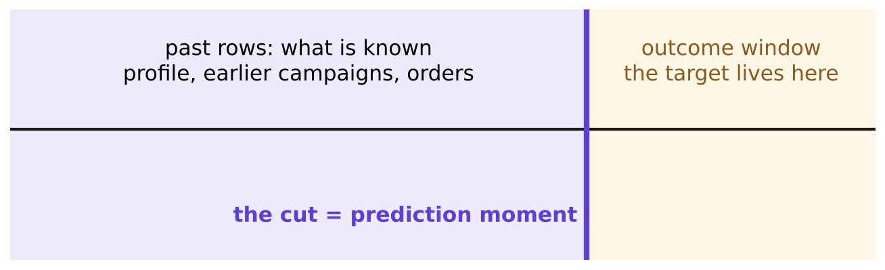
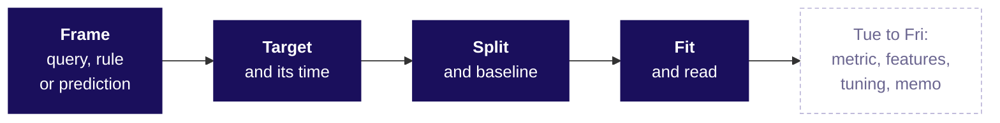

# Cheat sheet: Week 5 Monday, regression and classification

## Today's hard terms

| Term | Plain meaning | Rule or formula | Trap |
|---|---|---|---|
| Query, rule, prediction | the answer exists; the decision is a condition; the future is scored | a model needs input now, target later, decision moves | "we have data, so it is ML" |
| Prediction time | the moment the score is made | inputs on or before it, target after it | counting the whole log |
| Target | what the model is scored against | repeat = a delivered order in the 90 days after the cutoff | a later order outside the window still counts as 0 |
| Train, validation, test | learn, choose, report | test is spent once | a peeked test is validation now |
| Seed | the fixed shuffle | `random_state=42`, written down | trying seeds until the score is best |
| Baseline | the score of knowing nothing | majority class; the mean; a cheap rule | a 0.89 model beside a 0.887 baseline |
| Least squares | the line with the smallest squared misses | `slope = sum(dx*dy) / sum(dx^2)` | joining first and last point |
| Coefficient, linear | target units per input unit | Rs 120 per visit | read as a cause |
| Logistic regression | a line squeezed into 0 to 1 | `p = 1 / (1 + exp(-(a + b x)))` | a line on 0/1 gives 1.28 |
| Odds multiplier | strength of a logistic input | `exp(b)`; 1.05 gives 2.85 | "adds b to the probability" |
| Residual | actual minus predicted | a pattern is a missed shape | a fit quoted outside its range |

## Three that stick

- Uber's DeepETA keeps the routing engine's ETA and predicts only how wrong it will be (uber.com blog, 10 February 2022, verified 28 October 2026).
- Google's Rules of ML, rule 1: "Don't be afraid to launch a product without machine learning" (verified 28 October 2026).
- At the bank, a one-line rule (call clients whose last campaign succeeded) scores 0.8988 on validation against the model's 0.8971.

## When to use what

| If the question is | Use | Unless |
|---|---|---|
| already answered in the data | a query | never a model |
| a decision someone can write down | a rule | its misses cost more than a model |
| "how much" | linear regression, beside the mean | the residuals bow: add the curve |
| "will they" | logistic regression, beside the majority class | a one-line rule ties it: ship the rule |

## The ML process, Monday lit

## Everything so far, one line a day

| Day | The one line | Day | The one line |
|---|---|---|---|
| W1 Mon | The revenue tree and the first honest numbers: refuse the average when one customer buys in bulk | W2 Fri | Excel for analysts: one number reaches the leadership deck |
| W1 Tue | Which lever moved: compare like with like windows and denominators | W3 | Build 1: a Kalpa Health sub-problem scoped, built and defended |
| W1 Wed | Can we trust the numbers: profile, clean, reconcile, recompute | W4 Mon | Metric design: the number the plan chases, and what stops it being gamed |
| W1 Thu | Real or noise, cause or coincidence: the chance reference and the one-page note | W4 Tue | One slide, five minutes, three people paid to disagree |
| W1 Fri | The week rebuilt alone, and the note defended aloud | W4 Wed | Market basket: which pairs lift frequency, and what each is worth |
| W2 Mon | The revenue tree as queries the warehouse runs every Monday | W4 Thu | Cohort and funnel: where the loss actually happens |
| W2 Tue | Booked against collected: joining payments without lying | W4 Fri | Forecasting against a baseline that is hard to beat |
| W2 Wed | Window functions: top members, falling spend, the running total against plan | **W5 Mon** | **Frame it, fix the prediction time, seal the test, beat the baseline, read both models, read the residuals** |
| W2 Thu | pandas groupby, merge and reshape: the customer table Marketing refreshes |  |  |
