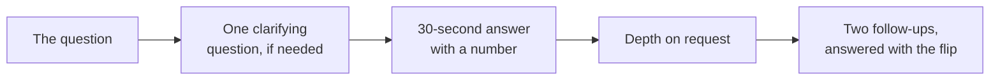

# Interview questions: regression and classification, framed first

Week 5, Monday. Twenty-eight questions in five groups. Each carries the 30-second answer, the depth an interviewer pulls for, their two likely follow-ups, what they listen for and the answer that loses the room. Say the 30-second version aloud; never memorise the depth, rebuild it from your own numbers.

Tags, this programme's calibration for 0 to 3 year candidates in India: **[S]** a staple asked everywhere, **[F]** frequent in GCC and product-company screens, **[SV]** a service-major screen opener, **[D]** a differentiator.

## Screening staples

### Q1. [S] When is a business problem a machine learning problem?
- **30 seconds:** when three things hold: an input known at the moment of the decision, a target known only later, and a decision that changes with the prediction. If the answer is already in the data it is a query; if someone can write the decision as a condition it is a rule.
- **Depth:** of six Kalpa questions in class, two needed a model: the 90-day repeat (classification) and next-quarter spend (regression). Google's first Rule of ML says to launch without ML when a heuristic gets half the gain.
- **Follow-ups:** "When does a rule stop being enough?" (when its misses cost more than a model's build and upkeep). "Give a case where you chose a rule."
- **Listens for:** the decision named before the data.
- **Loses the room:** "whenever we have enough data".

### Q2. [S] Train, validation, test: what is each for, and which is spent once?
- **30 seconds:** train is where the model learns, validation is where I compare models and settings as often as I like, and test is scored once, on the model I chose, at the end.
- **Depth:** on the bank's 41,188 calls the week cuts test first (8,238 rows, sealed), then splits the rest 24,712 to 8,238, seed 42, stratified. A test score used to choose anything becomes a second validation score.
- **Follow-ups:** "What if someone already peeked?" (treat it as validation and hold out fresh rows). "Why not cross-validate instead?" (a fair question; Thursday's answer, and the test slice still stays sealed).
- **Listens for:** "spent once" with its reason.
- **Loses the room:** "test is just more validation data".

### Q3. [S] What is a baseline, and why start with one?
- **30 seconds:** the dumbest honest answer: the majority class for "will they", the mean for "how much", or a one-line rule. A score means nothing until it sits beside its baseline.
- **Depth:** calling nobody at the bank is right 88.74 percent of the time; the logistic model is right 89.71 percent, 80 more right answers in 8,238. A one-line rule, call clients whose last campaign succeeded, scores 89.88.
- **Follow-ups:** "Which baseline is strongest here?" (the rule). "What does beating it prove?" (that the inputs carry signal beyond the base rate).
- **Listens for:** the baseline computed before the model is praised.
- **Loses the room:** "89.7 percent is good".

### Q4. [SV] How do you tell whether a question needs regression or classification?
- **30 seconds:** "how much" is regression, a number; "will they" is classification, a category, usually with a probability.
- **Depth:** next-quarter spend in rupees is regression; buys again within 90 days is classification. The same business question can be set up either way, as Booking.com's length-of-stay example shows, and the decision it feeds picks the set-up.
- **Follow-ups:** "Can you turn a regression into a classification?" (bucket the target, and say what precision you give up). "Which is easier to explain?"
- **Listens for:** the decision deciding the set-up.
- **Loses the room:** "classification when the target is text".

### Q5. [S] What does a random seed do in a split, and why state it?
- **30 seconds:** it fixes the shuffle, so everyone who reruns the notebook gets the same rows in each slice, the same baseline and the same score.
- **Depth:** five unseeded splits of the bank's file gave a held-out share of yes between about 0.114 and 0.119; seed 42 gives 0.1126 every time. Two teammates quoting "validation accuracy" on different rows are quoting different things.
- **Follow-ups:** "Should you try several seeds?" (to see the noise, yes; to pick the best, never). "Does stratifying replace the seed?" (no, it fixes the share, the seed fixes the rows).
- **Listens for:** reproducibility tied to the baseline.
- **Loses the room:** "the seed makes the model more accurate".

### Q6. [S] What is a residual?
- **30 seconds:** what the model missed by on one row: actual minus predicted.
- **Depth:** on six invented Kalpa members the least-squares line leaves residuals of -10, +30, -40, +40, -30 and +10 rupees; their squares add to 5,200, against 257,200 for the mean line.
- **Follow-ups:** "Why look at them if the fit is good?" (patterns show what the fit missed). "What should good residuals look like?" (centred on zero, no shape, against every input).
- **Listens for:** residuals used as a diagnostic, not only a score.
- **Loses the room:** "the error rate".

### Q7. [SV] What is the difference between linear and logistic regression?
- **30 seconds:** linear regression predicts a number with a straight line; logistic regression predicts a probability by passing a line through an S-shaped function that stays between 0 and 1.
- **Depth:** a line fitted to twelve invented 0/1 outcomes says 1.28 at 8 visits, an impossible probability; the S says 0.73 at 4 visits. Linear coefficients are in the target's units; logistic ones are in log-odds.
- **Follow-ups:** "Why is it called regression?" (it regresses the log-odds on the inputs). "Can logistic regression be used for more than two classes?" (yes, multinomial).
- **Listens for:** the output's range and the coefficient's units.
- **Loses the room:** "logistic is for small data".

### Q8. [S] What does stratifying a split do?
- **30 seconds:** keeps the share of each class the same in every slice.
- **Depth:** with 11.3 percent yes at the bank, a stratified split gives 0.1126 or 0.1127 in train, validation and test; without it, a slice can drift and move the baseline you must beat.
- **Follow-ups:** "When does it matter most?" (rare classes and small slices). "What do you stratify a regression on?" (bins of the target, if at all).
- **Listens for:** the link to a stable baseline.
- **Loses the room:** "it balances the classes 50 to 50".

## Technical depth

### Q9. [F] What does a logistic output of 0.71 mean?
- **30 seconds:** among customers who look like this one, about 71 in 100 do the thing, if the model is calibrated.
- **Depth:** it is a group rate. A promise about one customer would need certainty the model never has. Calibration is checked by comparing the mean prediction with the observed rate: the bank's model averages 0.114 against a true 0.113.
- **Follow-ups:** "And if it is not calibrated?" (rank is still usable, the number is not). "Would you act on 0.71?" (depends on the costs, which is Tuesday's threshold).
- **Listens for:** "of 100 similar", and "if calibrated".
- **Loses the room:** "the model is 71 percent sure about this customer".

### Q10. [F] A logistic coefficient for previous purchases is 0.69. Read it for a stakeholder.
- **30 seconds:** each extra previous purchase goes with roughly double the odds of buying again, other inputs held, because exp(0.69) is about 2.
- **Depth:** the change in probability is not constant: from 0.13 at zero purchases to 0.71 at four. Direction is the sign; strength is exp(coefficient). At the bank, each extra call in a campaign multiplies the odds of a yes by 0.93.
- **Follow-ups:** "Why odds and not probability?" (the model is linear in log-odds). "Is it causal?" (an association inside this fit until an experiment says more).
- **Listens for:** odds, direction, "other inputs held".
- **Loses the room:** "it adds 0.69 to the probability".

### Q11. [F] Why does least squares square the residuals?
- **30 seconds:** squaring makes misses above and below count alike and makes big misses count much more than small ones, and it gives one best line with a closed-form answer.
- **Depth:** slope = sum of (x - mean x)(y - mean y) / sum of (x - mean x) squared: 2,100 / 17.5 = Rs 120 per visit on six invented members. The eye's first-to-last line leaves 5,480 squared rupees against least squares' 5,200.
- **Follow-ups:** "When would you not square?" (outliers you do not want to dominate: absolute error). "Where does the formula come from?" (setting the derivative of the squared error to zero).
- **Listens for:** the trade-off of punishing large misses.
- **Loses the room:** "to make the numbers positive".

### Q12. [F] The residual plot bows. What does it tell you, and what do you do?
- **30 seconds:** the straight line missed a curve; add the curve, for example a squared term, and re-check the residuals.
- **Depth:** on 392 cars from UCI Auto MPG, mileage on horsepower leaves mean residuals of +2.7, 0.0, -2.2, -1.7 and +0.8 mpg across five horsepower bands. Adding horsepower squared brings every band within 1 mpg and the typical miss from 4.89 to 4.36.
- **Follow-ups:** "What if the plot fans out instead?" (the error grows with the prediction; report it, transform the target). "What does the squared term do outside the data?" (it turned upward past about 190 horsepower, so never quote it there).
- **Listens for:** diagnosis before fix, and the fix's own limit.
- **Loses the room:** "remove the outliers".

### Q13. [F] Why not fit a straight line to a 0/1 target?
- **30 seconds:** it predicts values below 0 and above 1, which are not probabilities, and its errors are not shaped like a line's.
- **Depth:** on twelve invented members, the line says 1.28 at 8 visits and -0.01 at none. The logistic S cannot leave 0 to 1.
- **Follow-ups:** "Is a linear probability model ever used?" (sometimes, for a quick read of effects in the middle of the range). "What else bounds the output?" (any link function; logistic is the common one).
- **Listens for:** the impossible number, quoted.
- **Loses the room:** "it is fine if accuracy is good".

### Q14. [F] Your test score rose after you tried several feature sets against it. What is that score now?
- **30 seconds:** a second validation score, optimistic by however much the choosing bought; I report validation and hold out fresh rows for the final number.
- **Depth:** in class, the best of 60 column lists read 0.9055 on a 2,000-row slice, 1.8 points above doing nothing; the same version scored 0.8971 on 6,238 fresh rows, the honest one-point edge.
- **Follow-ups:** "No test row was trained on, so where is the leak?" (in the choice). "How do you prevent it in a team?" (seal the test, log every score, one owner).
- **Listens for:** selection as leakage.
- **Loses the room:** "it is still unbiased".

### Q15. [F] What is the prediction time, and how do you build inputs against it?
- **30 seconds:** the moment the score is made. Every input comes from data on or before it, and the target from the window after it.
- **Depth:** with a 30 June cutoff and a 90-day window, an invented member who ordered on 20 July is a 1; one who ordered on 15 October is a 0. Counting orders on the whole log hands the model the answer.
- **Follow-ups:** "And at scoring time?" (the same code, run on today's cutoff). "How do you test it?" (assert no input's date is after the cutoff).
- **Listens for:** a frozen reference date.
- **Loses the room:** "use the latest table so it is fresh".

### Q16. [F] The intercept is Rs 180. Can you quote it as the spend of a member with zero visits?
- **30 seconds:** only with care: no member in the data made zero visits, so it is the line extended beyond its data.
- **Depth:** a least-squares line passes through the means, so the intercept is set by the slope and the means; quoted outside the range it can be absurd, as a mileage line at 300 horsepower predicts minus 7 mpg.
- **Follow-ups:** "When is the intercept meaningful?" (when zero is inside the data). "How would you make it meaningful?" (centre the input).
- **Listens for:** range awareness.
- **Loses the room:** "yes, that is what it means".

### Q17. [F] A coefficient's sign surprises you. What do you check, in order?
- **30 seconds:** the data and units first, then whether other inputs move with this one, then whether the relationship differs across the range or the period.
- **Depth:** a sign is read "other inputs held", so two inputs that rise together can share the effect in ways that flip one sign. On a random split mixing years, the bank's month column also carries the calendar, since yes ran 5 percent in 2008 and 52 percent in 2010.
- **Follow-ups:** "Would you drop the input?" (not before understanding it). "Would you show the sign to the business?" (with the caveat, and the single-input fit beside it).
- **Listens for:** an ordered check, not a fix.
- **Loses the room:** "the model is wrong, flip it".

## ML case and scenario

### Q18. [D] Marketing wants the score by Friday and your model only ties the baseline. What do you tell them?
- **Clarify first:** "Ties on what measure, and on which slice?"
- **30 seconds:** I show the two numbers side by side, say the model has not earned its keep yet, offer the baseline rule as Friday's ship with its cost, and name the date of the next check.
- **Depth:** at the bank, a one-line rule scores 0.8988 and the model 0.8971; the rule ships, the model keeps working on the measure that matches the campaign's costs, which accuracy is not.
- **Follow-ups:** "Marketing says ship it anyway." (a tie costs upkeep and trust for nothing). "What would change your mind?" (beating the rule by more than the slice's noise).
- **Listens for:** the clarifying question, the rule, a date.
- **Loses the room:** "it is no worse, so ship it".

### Q19. [D] Walk me through framing Kalpa's 90-day repeat model, from the ask to the split.
- **30 seconds:** the decision (whom to nudge at Rs 40), the prediction time (the day of the nudge), the target (a delivered order in the next 90 days), inputs from orders on or before the cutoff, the baseline, then a seeded, stratified split with the test sealed.
- **Depth:** in the warehouse with a 30 June cutoff, 110 of 205 members with history bought again, 0.537, so the majority class there is "buys again" and the baseline nudges everyone.
- **Follow-ups:** "Does a returned order count?" (ask Marketing; it changes the flag). "Who owns the cutoff date?" (the solution architect, in one config value).
- **Listens for:** decision first, the baseline before the model.
- **Loses the room:** opening on the algorithm.

### Q20. [D] A model scores 96 percent accuracy on a 96 to 4 flag. Is it ready?
- **30 seconds:** not yet: saying "no" to everyone also scores 96 percent, so this number alone shows the model learned the base rate and maybe nothing else.
- **Depth:** I ask how many of the 4 percent it actually found; that count is Tuesday's matrix, and it usually rewrites the story.
- **Follow-ups:** "What would you report instead?" (the baseline beside the score, then the counts). "When is accuracy fine?" (balanced classes and equal error costs).
- **Listens for:** the baseline reflex.
- **Loses the room:** "96 is high".

### Q21. [D] How would you predict delivery time at checkout for a quick-commerce order?
- **Clarify first:** "What does the promise drive: the customer's choice, rider allocation, or a refund?"
- **30 seconds:** keep the existing distance-and-slot estimate as the baseline, predict how wrong it will be (the residual), and add the correction, as Uber's DeepETA does with its routing engine.
- **Depth:** inputs known at checkout; the target is actual minus promised; the model must beat the incumbent on mean absolute error and answer in milliseconds.
- **Follow-ups:** "What if the routing rule changes?" (every residual changes meaning; version the rule). "How do you score it?" (by hold-out weeks, never a random split of orders).
- **Listens for:** the residual framing and the latency budget.
- **Loses the room:** "a deep model from scratch".

### Q22. [D] One question can be a regression or a classification. How do you choose?
- **30 seconds:** by the decision it feeds, and then by which set-up lets a simple model beat a trivial baseline by the clearest margin.
- **Depth:** Booking.com turned a length-of-stay regression into a multiclass classification and prefers set-ups "where simple models can do significantly better than trivial models".
- **Follow-ups:** "How do you compare gains in different units?" (each against its own baseline, as a share of the baseline's error). "When keep the regression?" (when the decision needs the exact number).
- **Listens for:** problem design as a choice.
- **Loses the room:** "whichever gets higher accuracy".

## Techno-functional and client-facing

### Q23. [F] Explain a coefficient in rupees to Marketing without promising a cause.
- **30 seconds:** "Members who visit once more spend about Rs 120 more, in this data. It tells us who to look at, and an experiment would tell us whether a nudge that adds a visit adds the rupees."
- **Depth:** the slope is an association across members; a randomised nudge to half the members is the test of cause (Week 1 Thursday).
- **Follow-ups:** "Can we budget on Rs 120?" (as a ceiling until the experiment). "Why not?" (members who visit more differ in other ways).
- **Listens for:** the number, the unit and the caveat in plain words.
- **Loses the room:** "each visit causes Rs 120".

### Q24. [SV] The client asks why you will not score the test set again. Explain it in their words.
- **30 seconds:** "It is the board exam. If we keep checking it while we tune, our final number turns into a practice score and stops telling you how the model will do on next month's customers."
- **Depth:** our peek demo showed a 1.8-point edge shrink to 1.0 on fresh rows.
- **Follow-ups:** "Then how do you know it works?" (validation for choices, the sealed test once). "When will we see it?" (Friday, once).
- **Listens for:** an analogy with a number behind it.
- **Loses the room:** "it is best practice".

### Q25. [F] Where is the 90-day repeat flag computed, from which table, as of which date?
- **30 seconds:** in the warehouse, from the orders table, over the 90 days after each reference date, with every input computed as of that date only.
- **Depth:** the honest SQL filters history to `order_date <= cutoff` and the window to `cutoff < order_date <= cutoff + 90 days`; computing as of today gives false zeros to members whose window has not closed.
- **Follow-ups:** "Why not in pandas?" (one definition shared by training and scoring lives best in the data layer). "Which statuses count?" (a business decision, written down).
- **Listens for:** the reference date and the window.
- **Loses the room:** "from the latest table each run".

### Q26. [SV] The client wants "AI" for something a rule can do. How do you push back?
- **30 seconds:** I show what the rule scores, what a model would have to add to pay for itself, and offer the rule now with a review date.
- **Depth:** at the bank, a one-line rule matched the model on accuracy; Google's Rules of ML put a heuristic at about half of a model's gain.
- **Follow-ups:** "What if they insist?" (build both, compare on validation). "What would justify the model?" (a gap in rupees larger than its cost).
- **Listens for:** the client's goal kept, the tool changed.
- **Loses the room:** "a model is always better".

## Behavioural, with a technical core

### Q27. [S] Tell me about a time a number looked too good.
- **Shape:** the number, why it looked wrong, the check, what changed.
- **From this week:** "A model read orders counted on the whole log and scored perfectly; I asked whether each input was known on the nudge date, rebuilt the inputs from history only, and the score fell to an honest level I could defend."
- **Follow-ups:** "How did you tell the team?" (both numbers side by side, the leak named). "What do you do differently now?" (the prediction-time check on every column).
- **Listens for:** "I" statements and a specific check.
- **Loses the room:** a story with no number.

### Q28. [D] Tell me about a time you shipped something simpler than you were asked for.
- **Shape:** the ask, the simpler option, the evidence, the outcome, the trade-off you accepted.
- **From this week:** "Asked for a call-list model, I showed a one-line rule matched it on validation accuracy, shipped the rule for Friday and kept the model in validation against the measure that matched the campaign's costs."
- **Follow-ups:** "Did anyone push back?" (yes; the two numbers settled it). "When would you have shipped the model?" (once it beat the rule by more than the slice's noise).
- **Listens for:** judgement with numbers.
- **Loses the room:** "I always use the best model".
