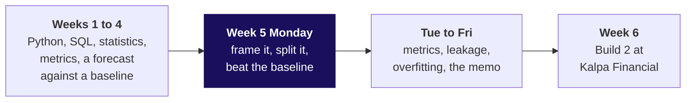
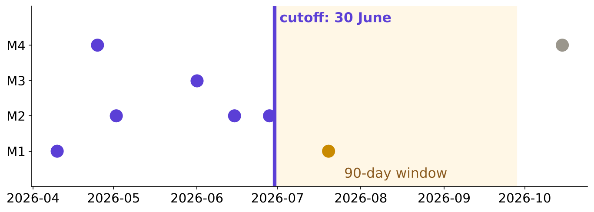
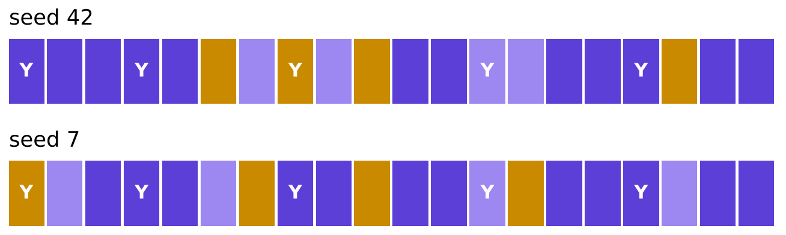
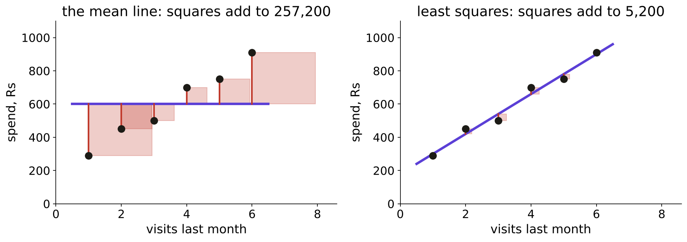
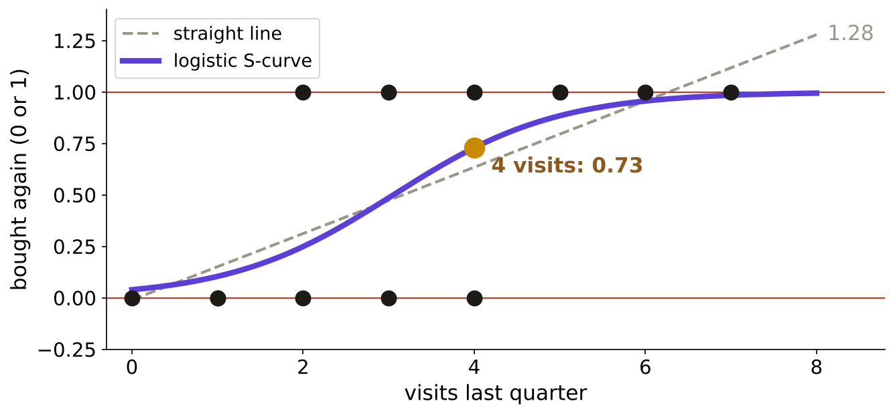
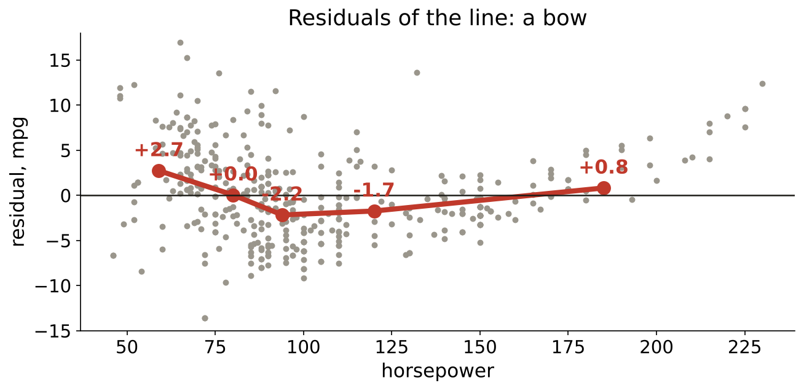
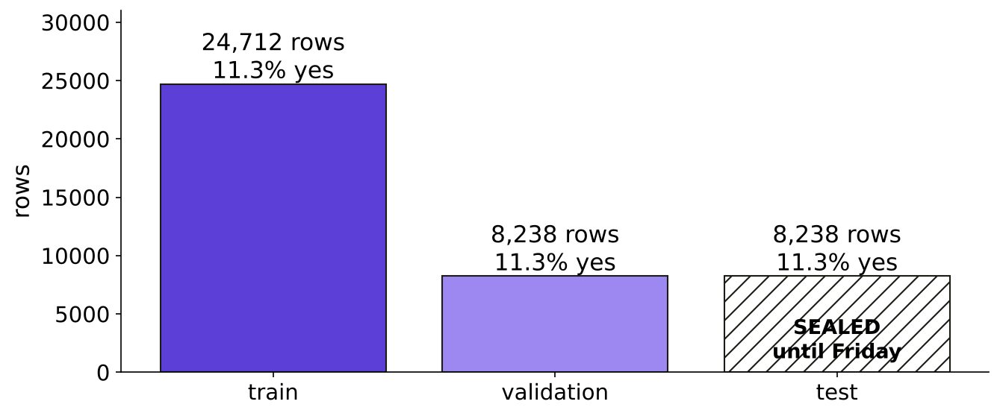

# Study notes: regression and classification, framed first

Week 5, Monday. Read after class, before Tuesday. About thirty minutes.

## Where does Monday sit?

The day in one sentence: before anyone fits a model, decide whether the question needs one, fix what the model may know and when, seal a test slice, and find the dumbest honest score the model has to beat; then read both model families in the business's units and look at what they miss.

The picture that grows all week, in its Monday state:

## 1. Is this an ML problem at all?

*Prediction, rule or query: when a business question is a modelling problem.*

**The idea in three lines.** If the answer already sits in the data, it is a query. If someone can write the decision as a condition, it is a rule. Only when the input is known now, the target is known later, and the decision moves with the score does a model earn its place.

**Worked example (invented).** Six Kalpa questions: "How many members bought in September?" and "Average basket in Pune last quarter?" are queries; "Remind every abandoned cart" and "Hold big orders from new members" are rules; "Which members buy again in 90 days?" (classification, will they) and "How much will each spend next quarter?" (regression, how much) are predictions. Two of six.

**The trap.** "We have the data, so it is ML." The decision makes the problem; the data only makes a dataset.

**The flip.** A rule stays right until its misses cost money. With a Rs 40 nudge against a Rs 1,200 missed buyer (the row's invented costs), ranking members starts to pay.

**Interview line.** "A business question is a modelling problem when the input is known at decision time, the target later, and the decision changes with the prediction."

## 2. What do we know, and when?

*Input, target, prediction time; the repeat-purchase target.*

**The idea in three lines.** Fix the prediction time first: the morning the nudge goes out. Inputs come only from data dated on or before it. The target comes only from the window after it, here 90 days.

**Worked example (invented).** Cutoff 30 June, window to 28 September. M1 ordered on 20 July: target 1. M4 ordered again on 15 October: target 0, because that order falls after the window. M2 ordered three times before the cutoff and never after: target 0.

**The trap.** Counting orders on the whole log: M1 shows two orders, and one of them is the purchase the model is meant to predict. Offline the model looks brilliant; on the first real morning it collapses.

**The check.** Ask of every input column: would I know this value on the morning of the nudge?

**Interview line.** "I freeze a reference date, build every input from data on or before it, and define the target only from the window after it."

## 3. Don't peek at the exam paper

*Train, validation, test; the seed; the baseline.*

**The idea in three lines.** Train is the practice papers, validation the mock exams you may sit as often as you like, test the board exam sat once. The seed fixes the shuffle, so everyone gets the same slices. The baseline is the score of knowing nothing: the majority class for "will they", the mean for "how much".

**Worked example (invented).** Twenty members, five came back. Saying "no" to all twenty is right 15 times: 75 percent from nothing. Seeds 42 and 7 put different members in the test slice, so they give different baselines unless the seed is written down.

| Slice | Its job | How often |
|---|---|---|
| train | the model learns | every fit |
| validation | compare models and settings | as often as you need |
| test | report the chosen model | once |

**The trap.** "Test is just more validation." A test score used to choose anything turns into a validation score.

**Interview line.** "Train learns, validation chooses, test is spent once; I state the seed, and I report the model next to its baseline."

## 4. Drawing the best line

*Linear regression: fit, coefficients in units, residuals.*

**The idea in three lines.** Each residual is actual minus predicted. Least squares picks the line whose squared residuals add up smallest. Its slope is read in the target's units per unit of input.

**Worked example (invented).** Six members of one store, visits against spend: (1, 290), (2, 450), (3, 500), (4, 700), (5, 750), (6, 910). `slope = sum of dx*dy / sum of dx^2 = 2,100 / 17.5 = Rs 120 per visit`; `intercept = 600 - 120 x 3.5 = Rs 180`. The squared residuals add to 5,200; the eye's first-to-last line leaves 5,480; the flat mean line leaves 257,200.

**The trap.** "Each visit causes Rs 120 more spend." It is an association across members; cause needs an experiment. And Rs 180 at zero visits lies outside the data.

**Interview line.** "Least squares minimises the sum of squared residuals; I read each coefficient in the target's units as an association, and I look at the residuals before I trust the line."

## 5. From a line to a probability

*Logistic regression: probability, direction, strength.*

**The idea in three lines.** Logistic regression keeps a line underneath, `z = a + b x`, and squeezes it through `p = 1 / (1 + exp(-z))`, which never leaves 0 to 1. The sign of `b` is the direction. `exp(b)` is the strength: the multiplier on the odds `p / (1 - p)` per unit of input.

**Worked example (invented).** Twelve members, visits against "bought again". A straight line says 1.28 at 8 visits, an impossible probability. The S fits `z = -3.20 + 1.05 x visits`: 0.73 at 4 visits. `exp(1.05) = 2.85`, so each extra visit nearly triples the odds; the probability step varies (0.25 to 0.49 from 2 to 3 visits, 0.88 to 0.96 from 5 to 6).

**The trap.** "Each visit adds 1.05 to the probability." It adds 1.05 to the log-odds.

**What 0.73 means.** Of 100 members who look like this one, about 73 buy again, if the model is calibrated. It is never a promise about one member.

**Interview line.** "A logistic output of 0.71 means about 71 in 100 similar customers do the thing, if calibrated; the sign is the direction and exp of the coefficient multiplies the odds."

## 6. What the leftovers confess

*Where each model fails; the residual tells.*

**The idea in three lines.** A pattern in the residuals is a shape the model missed. A bow means a curve; a fan means the misses grow with the prediction; a trend against a column the model leaves out means that column carries signal. Random scatter around zero is what a good fit leaves.

**Worked example (real: UCI Auto MPG, 392 cars).** Mileage on horsepower with a straight line leaves band means of +2.7, 0.0, -2.2, -1.7 and +0.8 mpg from low to high horsepower: a bow. Adding horsepower squared brings every band within 1 mpg, and the typical miss falls from 4.89 to 4.36 mpg.

**The trap.** The squared term fixes the bow inside the data and fails outside it: past about 190 horsepower it predicts mileage rising again, 27.8 mpg at 300 horsepower.

| Model | Fails when | You see it as |
|---|---|---|
| straight line | the truth bends | a bow |
| line with a squared term | you leave the data's range | predictions turn the wrong way |
| logistic regression | the chance rises at both ends of an input | one S cannot hold both ends |

**Interview line.** "I plot residuals against each input and against the prediction; a bow means the shape is wrong, a fan means the spread changes, and I never quote a fit outside its range."

## The case: whom should the bank call?

A Portuguese bank phoned 41,188 clients from May 2008 to November 2010 to sell a term deposit (UCI Bank Marketing, Moro, Rita and Cortez, CC BY 4.0). 4,640 said yes, 0.1127.

| Step | What the room did | The number |
|---|---|---|
| Frame | input: 13 columns known on the morning of the call; target: `y`; prediction time: before the agent dials | 7 profile and 6 history columns |
| Split | test cut first and sealed; the rest 75 to 25 | 24,712 / 8,238 / 8,238, seed 42 |
| Baseline | call nobody | 0.8874 on validation |
| Model | logistic regression on the 13 columns | 0.8971, 80 more right answers in 8,238 |
| One coefficient | `campaign`, calls already made this campaign | odds x 0.93 per extra call |
| Caveat | the random split mixes years | 5 percent yes in 2008, 19 in 2009, 52 in 2010 |
| The peek | best of 60 column lists on a 2,000-row slice | 0.9055 peeked, 0.8971 on fresh rows |

**What the peek teaches.** Choosing the luckiest of 60 versions on one slice nearly doubled the edge on paper, 1.8 points against the honest 1.0. The test slice is spent once.

**The six seats on this case.**

| Seat | What it asks of the bank's model |
|---|---|
| Business owner | does the list change whom we call, and is the build worth one point? |
| Product manager | what does the campaign team see on the morning of the call? |
| Solution architect | where is `y` joined, and as of which date are the inputs read? |
| Senior ML engineer (Monday's seat) | what is predicted, from what known when, against which baseline, on which rows? |
| Implementation engineer | does seed 42 give the same 8,238 rows on every laptop? |
| QA and tester | does a model on shuffled labels fall to the baseline? (it does: 0.8874) |

## Three companies that framed it first

| Company | What they did | Source |
|---|---|---|
| Uber, DeepETA (2022) | kept the routing engine's ETA as the rule and trained a model to predict its residual, how wrong it would be; the new model had to beat the incumbent XGBoost model on mean absolute error and answer within a few milliseconds | uber.com/blog/deepeta-how-uber-predicts-arrival-times (verified 28 October 2026) |
| Google, Rules of ML | rule 1: "Don't be afraid to launch a product without machine learning"; a heuristic gets about half of a model's gain; rule 14: start with an interpretable model, such as linear or logistic regression | developers.google.com/machine-learning/guides/rules-of-ml (verified 28 October 2026) |
| Booking.com, KDD 2019 | turned a length-of-stay regression into a multiclass classification, and prefers set-ups "where simple models can do significantly better than trivial models" | kdd.org/kdd2019/accepted-papers/view/150-successful-machine-learning-models-6-lessons-learned-at-booking.com (verified 28 October 2026) |

The Kalpa twin: Marketing's Rs 40 nudge asks the bank's question of Kalpa's members. In Kalpa's warehouse, with a 30 June cutoff, 110 of 205 members with history bought again within 90 days (0.537), so there the majority class is "buys again" and the dumbest model nudges everyone.

## Check yourself without writing anything

1. Say the three tests that make a question a prediction, in order.
2. Redraw the timeline and put "orders in July" on the right side of it.
3. Say what 75 percent means for twenty members of whom five came back.
4. Say the slope of the six-member line and the one word you put after it for Marketing.
5. Say what 0.73 means, starting with "of 100".
6. Say what a bow in residuals asks you to add, and where that fix stops working.
7. Say why 0.9055 was not the bank model's score.

## Read and watch next

- StatQuest video index, "The Essence of Linear Regression" and "Logistic Regression": https://statquest.org/video_index.html (verified 28 October 2026)
- scikit-learn 1.9.1, linear models, ordinary least squares and logistic regression: https://scikit-learn.org/stable/modules/linear_model.html (verified 28 October 2026)
- UCI Bank Marketing, the variable notes for the 21 columns: https://archive.ics.uci.edu/dataset/222/bank+marketing (verified 28 October 2026)
