# The metric trap

Week 5, Day 2.

Header: WEEK 5  ·  TUESDAY  ·  THE METRIC TRAP
Quote: The model is about 90 percent accurate. How many repeat buyers did it actually find?
Who: Kavya Nair, senior analyst, Kalpa Retail

```notes
LIVE, 1 minute. Read Kavya's question aloud and leave it on screen. Do not answer it: the whole
morning is the answer. Ask the room for a guess: of 928 real buyers, how many did Monday's model
find at its default setting? Write three guesses on the board; chapter 7 reveals 174.
```

---

## S1. Week 5 of 20: the machine learning core
*Today turns Monday's score into a decision someone pays for.*

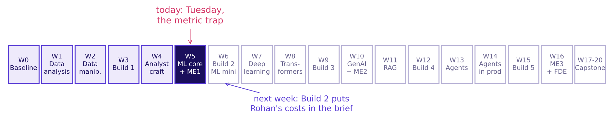

```notes
LIVE, 1 minute. Monday framed the problem and scored a baseline. Today asks what the score is
worth in rupees. Next week, Build 2 hands the room Rohan Desai's lending brief with exactly
today's constraint written in. Point at W6 and say: what you learn today is graded there.
```

---

## S2. The week's picture gains two humps and a line
*Draw this from memory tonight: past rows, the cut, the call, the outcome, then the humps.*

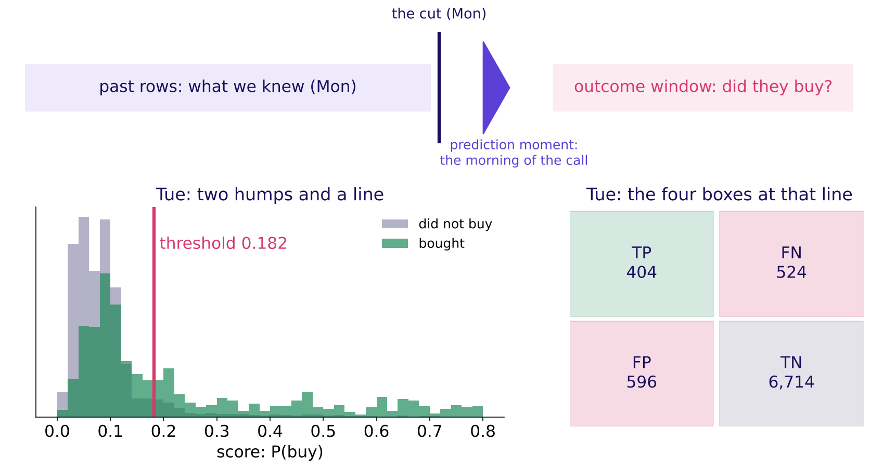

```notes
LIVE, 2 minutes. Monday drew the top strip: past rows, the cut, the prediction moment, the outcome
window. Tuesday adds the bottom: every client gets a score, buyers and non-buyers form two humps,
and the threshold is a vertical line. Everything right of the line is called. The four boxes are
what the line produces. Ask: if I slide the red line left, which boxes grow?
```

---

## S3. Today's ticket: 89.7 percent, and the buyers found
*One question for the day, priced in rupees.*

| On the ticket | What it says |
|---|---|
| The data | A Portuguese bank's phone campaign: 41,188 calls, May 2008 to November 2010 |
| The claim | Monday's model is 89.7 percent accurate |
| The prices | A wasted nudge Rs 40; a missed buyer about Rs 1,200 (Anand, Finance) |
| The ask | Pick the metric, set the threshold, explain Rohan's |

```notes
LIVE, 2 minutes. The bank's call is Kalpa's nudge: same decision, whom to contact. Kalpa's prices
come from Anand Iyer in Finance and are applied to the bank's calls. Rohan Desai, head of risk at
Kalpa Financial Services, will ask in the afternoon whether the same model can score loans.
Ask: what single number would you ask for before believing 89.7 percent?
```

---

## S4. Six topics, six chapters, then three case chapters
*The curriculum's words, in its order, each with the chapter and notebook that teach it.*

| # | The topic, in the curriculum's words | Chapter | Min | Notebook |
|---|---|---|---|---|
| 1 | The confusion matrix, cell by cell | Four boxes that tell the truth | 18 | ch01 |
| 2 | Precision, recall and F1 derived | Of those we flagged, of those we missed | 20 | ch02 |
| 3 | Class imbalance against accuracy | Why 89 percent can mean zero | 15 | ch03 |
| 4 | Choosing the metric from business cost; the 1-in-N test (course construction) | What does each mistake cost? | 22 | ch04 |
| 5 | Threshold selection as a business decision | Where to draw the line | 20 | ch05 |
| 6 | The transfer: the same model, a lending business, the opposite threshold | Same model, opposite threshold | 15 | ch06 |

```notes
LIVE, 1 minute. Read the second column once: these are the words to search for later. The six
concept chapters use tiny invented tables you can count by hand. Then three case chapters run the
same ideas on the bank's 8,238 validation clients: case01, case02, case03. Chapter 6 opens the
afternoon, after the financial services story.
```

---

## S5. How the six topics join, and where they are used
*Each box rests on the one before it.*

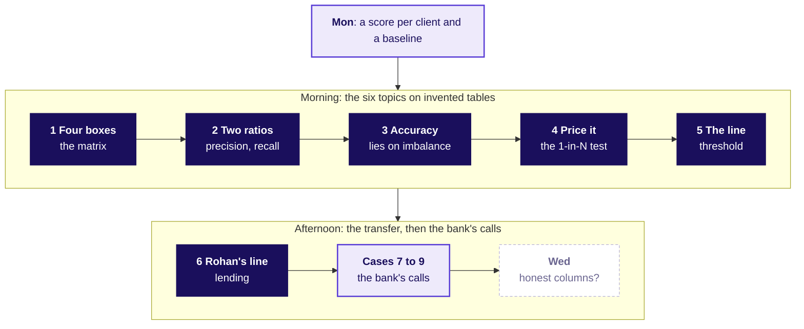

```notes
LIVE, 2 minutes. Walk it left to right. Monday gave a probability per client. The matrix counts
outcomes at one line; the two ratios read the matrix; accuracy is the ratio that lies here; the
prices pick the ratio and the line; Rohan's prices flip the line. The cases apply all six to the
bank's real file. Wednesday asks whether the columns behind the score were known in time.
```

---

## SECTION 1: Four boxes that tell the truth: where did each land?
*The confusion matrix, cell by cell · also searched as: confusion matrix explained, true positive false positive*

```notes
LIVE, 18 minutes for the chapter. Open notebook ch01 and run the first cell: twenty invented Kalpa
customers. Prediction before anything: how many sit in "nudged and came back"? Take three answers.
```

---

## S6. Two labels per customer make four boxes
*What the model said, against what happened: twenty invented customers.*

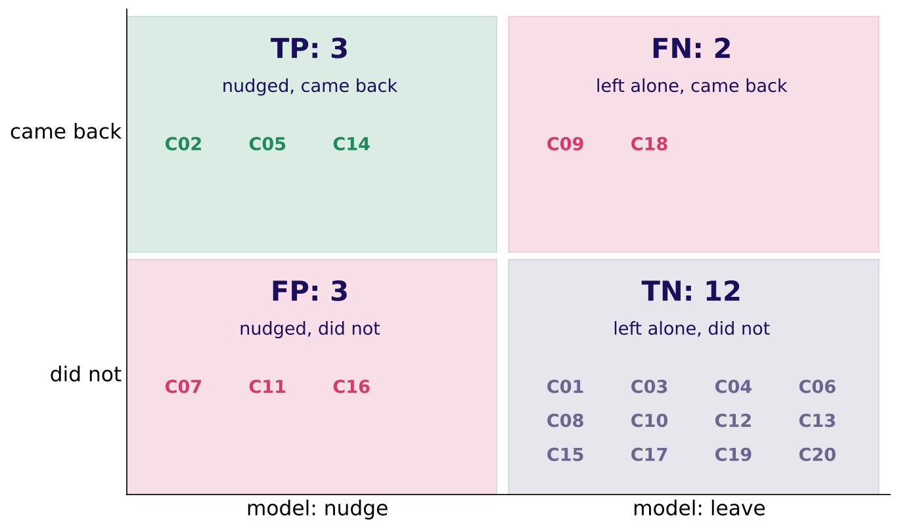

```notes
LIVE, 6 minutes. Count three boxes aloud with the room before showing the picture: C02, C05 and C14
were nudged and came back. The misconception to stage: "the model was right 15 times, so it is
good". Ask which 5 it got wrong and what each wrong one cost. Click: notebook ch01, the loop cell.
```

---

## S7. Each box is a sentence about a customer
*Two boxes are free; two carry Anand's prices.*

| Box | In Kalpa's words | Count | Cost each |
|---|---|---|---|
| TP | nudged and came back | 3 | none |
| FP | nudged, did not come back | 3 | Rs 40 |
| FN | left alone, a repeater missed | 2 | Rs 1,200 |
| TN | left alone, did not come back | 12 | none |

The bill of mistakes: 3 x Rs 40 + 2 x Rs 1,200 = Rs 2,520.

```notes
LIVE, 5 minutes. Have two learners read one row each aloud as a sentence about a person. The line
to land: every metric today is a ratio of these four cells, and the bill is two of them priced.
Interview line: "Read this matrix aloud in the business's words."
```

---

## S8. scikit-learn prints the true negatives top-left
*Rows are the truth, columns the prediction, sorted 0 then 1.*

```python
confusion_matrix(came_back, model_says_nudge)
# [[12  3]     top-left 12 is TN, not TP
#  [ 2  3]]    bottom-right 3 is TP
```

**What breaks.** Reading 12 as the true positives tells Marketing the model found twelve repeaters. The check: the bottom row must sum to the five real repeaters.

```notes
LIVE, 5 minutes. Show the printout first and ask which number is the true positives. Most of the
room says 12. Then run the notebook's labelled DataFrame cell. Fix: always print the matrix with
row and column labels. This is a two-minute trap; do not let it become a syntax lecture.
```

---

## SECTION 2: Of those we flagged, of those we missed: which denominator?
*Precision, recall and F1 derived · also searched as: precision vs recall, F1 score, harmonic mean*

```notes
LIVE, 20 minutes for the chapter. Notebook ch02. Prediction: which is bigger here, the share of
flags that landed or the share of repeaters found?
```

---

## S9. Same numerator, two denominators
*Precision divides by the column of flags; recall by the row of real repeaters.*

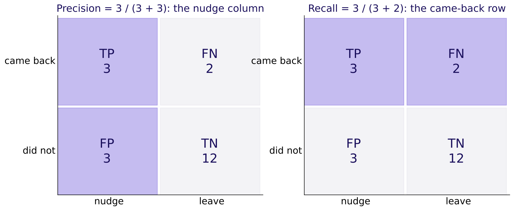

```notes
LIVE, 7 minutes. Draw the 2 by 2 on the board, shade the column, then the row. Say each as a
sentence first: "of those we flagged, 3 of 6 came back" and "of those who came back, 3 of 5 were
flagged". The formula comes after the sentence. Interview anchor [S], asked aloud here: precision,
recall and F1 from a confusion matrix.
```

---

## S10. The wrong denominator divides by everyone
*The most common slip, shown exactly.*

```stats
value: 0.15 | label: wrong: 3 of 20 customers | note: the share of everyone flagged and right, which nobody asked for
value: 0.50 | label: right: 3 of 6 flagged | note: the share of nudges that landed
```

```notes
LIVE, 4 minutes. Marketing reading 0.15 would cut a campaign whose nudges land half the time. The
check: precision's denominator equals the number flagged. Fix: say "of those we flagged" before
writing any fraction.
```

---

## S11. F1 punishes the weaker of the two
*A model that flags one customer and is right: plain mean 0.60, F1 0.33.*

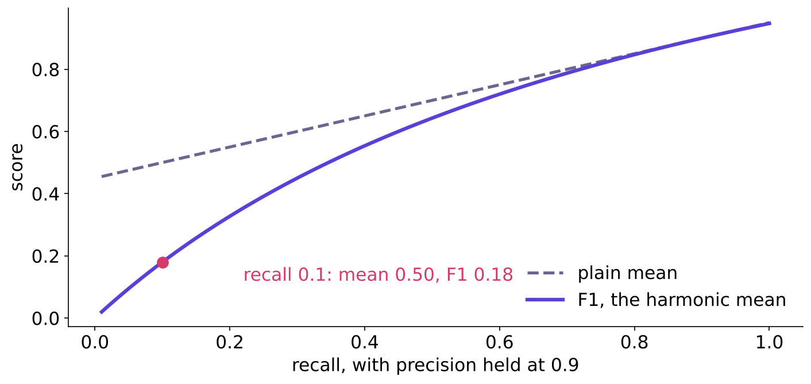

```notes
LIVE, 6 minutes; CUT FIRST if the room is late (keep one sentence: F1 stays low when either ratio
is low). The harmonic mean is pulled to the smaller number. Ask: when would one number be the wrong
thing to report? Answer: when the two errors cost different amounts, which chapter 4 prices.
```

---

## S12. Three ratios, named last
*Each answers one business question.*

| Ratio | The question | Formula | Here |
|---|---|---|---|
| Precision | Of those we flagged, how many were right? | `TP / (TP + FP)` | 0.50 |
| Recall | Of those who were real, how many did we flag? | `TP / (TP + FN)` | 0.60 |
| F1 | One grade, low if either is low | `2PR / (P + R)` | 0.55 |

```notes
LIVE, 3 minutes. Rule with its flip: F1 is a fair single number only while the two errors cost
about the same. Kalpa's do not.
```

---

## SECTION 3: Why 89 percent can mean zero: what does it reward?
*Class imbalance against accuracy · also searched as: accuracy paradox, imbalanced classification, base rate*

```notes
LIVE, 15 minutes for the chapter. Notebook ch03. Prediction: the rule "say no to everyone" is right
on how many of these hundred customers?
```

---

## S13. Saying no to everyone is right 89 times in 100
*Eleven green repeaters, all missed; 89 grey customers, all "correct".*

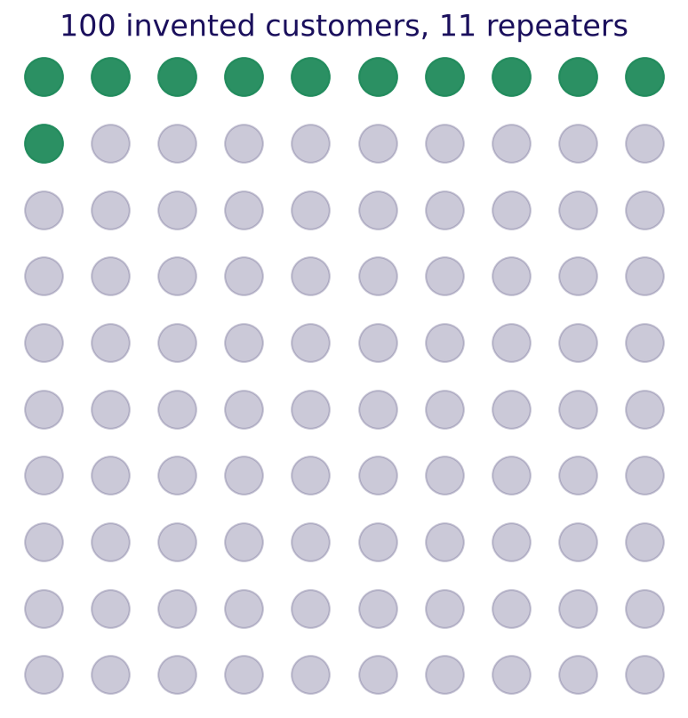

```notes
LIVE, 5 minutes. Point at the grey dots: accuracy counts every one of them as a win. The model
learned the base rate and nothing else. Interview anchor [S], asked aloud here: accuracy is 96
percent on a 96 to 4 split; good model? The shape of a good answer: ask for the base rate and the
true-positive cell first.
```

---

## S14. The more accurate rule has the bigger bill
*Ranked by accuracy, the useless rule wins.*

```stats
value: 89% | label: say no to everyone | note: 0 of 11 repeaters found; bill Rs 13,200
value: 85% | label: a model that flags 20 | note: 8 of 11 repeaters found; bill Rs 4,080
```

```notes
LIVE, 5 minutes. The trap: "ship the say-no rule, it is more accurate". Check: recall and the bill
beside accuracy. Ask the business owner's question: which rule would you pay for?
```

---

## S15. The accuracy you get for doing nothing
*Accuracy stops lying as the outcome nears 50:50.*

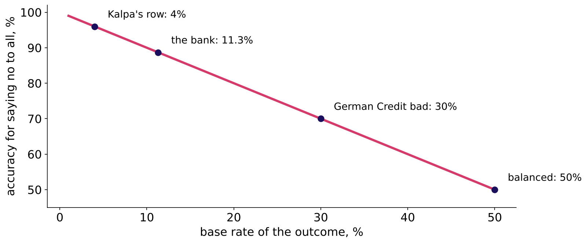

```notes
LIVE, 5 minutes. The rule with its flip: accuracy misleads when one class dominates; near 50:50,
and when both errors cost the same, it becomes a fair summary again. German Credit's 30 percent bad
rate, tonight's lab, sits in the middle.
```

---

## S16. Drill: four matrices, precision and recall, fast
*Twelve minutes in pairs: precision, recall, and one sentence each.*

| Matrix | TP | FP | FN | TN |
|---|---|---|---|---|
| A, a fraud screen | 40 | 160 | 10 | 9,790 |
| B, a churn list | 300 | 100 | 300 | 4,300 |
| C, a loan book | 630 | 90 | 70 | 210 |
| D, Monday's model at 0.5 | 174 | 94 | 754 | 7,216 |

```notes
LIVE, 12 minutes (the row's first mid-session drill, trimmed from 15). Answers: A precision 0.20,
recall 0.80; B 0.75 and 0.50; C 0.875 and 0.90; D 0.649 and 0.188. Ask one pair per matrix to say
it as a sentence about people. D is the bank's real matrix; chapter 7 returns to it.
```

---

## SECTION 4: What does each mistake cost?: when does a nudge pay?
*Choosing the metric from business cost; the 1-in-N test (course construction) · also searched as: cost-sensitive evaluation, choosing a metric*

```notes
LIVE, 22 minutes for the chapter. Spotlight seat today: the business owner. Every slide in this
chapter asks the owner's question: what does each mistake cost, in rupees? Notebook ch04.
```

---

## S17. Thirty Rs 40 nudges equal one Rs 1,200 buyer
*Nudge 31 lookalikes; if one comes back, Kalpa breaks even.*

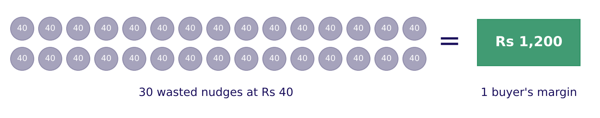

```notes
LIVE, 6 minutes. Prediction before the picture: above what chance of coming back does a nudge pay,
1 in 2, 1 in 10, 1 in 31 or 1 in 100? Then count the coins. The line to land: one buyer pays for
thirty wasted nudges, so act above about 1 in 31.
```

---

## S18. The 1-in-N test, named last
*Rights per wrong equals damage over saving.*

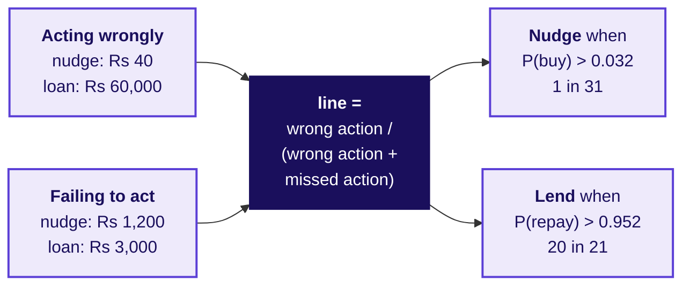

```notes
LIVE, 5 minutes. Write both lines on the board, on the same quantity: the chance of the good
outcome. The 1-in-N name is this course's own; outside, search "expected cost threshold" or
"cost-sensitive threshold". The formula assumes honest probabilities; case 2 checks that.
```

---

## S19. Three businesses, three lines
*The metric follows the dearer mistake.*

| Business | Acting wrongly | Failing to act | Act above | Leads |
|---|---|---|---|---|
| Kalpa nudge | Rs 40 | Rs 1,200 | P(buy) 0.032 | recall |
| Stripe fraud block | 2.08 dollars | 38.92 dollars | P(fraud) 0.051 | fraud recall |
| Kalpa Financial loan | Rs 60,000 | Rs 3,000 | P(repay) 0.952 | precision |

```notes
LIVE, 6 minutes (the row's second drill, folded in). Stripe's own guide: one missed fraud wipes
out 18.71 good sales and its break-even precision is 5.07 percent (Stripe, verified 28 October
2026). Interview anchor [S], asked aloud here: precision or recall for fraud, and why?
```

---

## S20. Same accuracy, bills Rs 5,800 apart
*Three invented models on chapter 1's twenty customers.*

```stats
value: Rs 6,000 | label: flags nobody | note: 75 percent accurate
value: Rs 2,520 | label: chapter 1's model | note: 75 percent accurate
value: Rs 200 | label: flags ten | note: 75 percent accurate
```

```notes
LIVE, 5 minutes. The trap: choosing the metric by habit. Accuracy calls these three equal; Anand's
prices separate them. Ask the owner's question: which one do you fund?
```

---

## SECTION 5: Where to draw the line: which line is cheapest?
*Threshold selection as a business decision · also searched as: classification threshold tuning, decision threshold*

```notes
LIVE, 20 minutes for the chapter. Notebook ch05, then the explorable.
```

---

## S21. Slide the line, watch the bill
*Twenty invented scores: the bill is lowest at 0.032, Rs 360.*

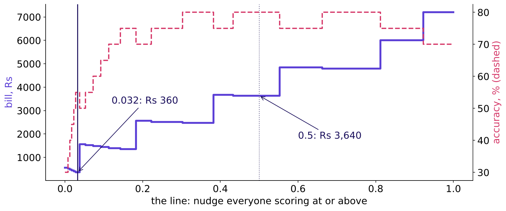

```notes
LIVE, 6 minutes. Prediction first: 0.5, 0.2, 0.032 or nudge everyone? The default 0.5 costs Rs
3,640, ten times the bill at 0.032. Point at the dashed accuracy line: it peaks at 0.31 to 0.55,
far from the cheapest line.
```

---

## S22. Accuracy peaks where the bill does not
*The plausible wrong threshold, shown exactly.*

| Line | List | Repeaters caught | Accuracy | Bill |
|---|---|---|---|---|
| 0.5, best accuracy | 4 | 3 of 6 | 80% | Rs 3,640 |
| 0.032, from the prices | 15 | 6 of 6 | 55% | Rs 360 |

```notes
LIVE, 4 minutes. The trap: "0.5 is the best threshold, 80 percent accurate". Check: the bill at the
chosen line. Fix: choose from the prices; report accuracy only as a by-product.
```

---

## S23. The line climbs as acting gets dearer
*One curve turns a price ratio into a threshold.*


```notes
LIVE, 4 minutes. Rs 40 SMS gives 0.032; a Rs 400 hamper 0.25; equal costs 0.5; Rohan's loan 0.952.
Rule with its flip: the line falls when missing is dearer, rises when acting is dearer.
Interview anchor [F], asked aloud here: how do you set a threshold when the two errors cost
differently?
```

---

## S24. The explorable: drag the line on the bank's scores
*It opens on the wrong default: 0.5, and 754 buyers left alone.*

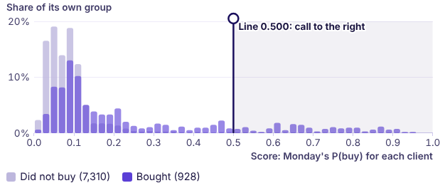

```notes
LIVE, 6 minutes. Open demos/C2_W05_D02_threshold_explorer_STUDENT.html. Before any click, each
learner types a guess of the cheapest line and locks it. Click 1: read the default aloud, 174 found
and Rs 904,800 of missed margin. Click 2: drag the line left and watch the bill fall until about
0.03. Click 3 waits for case 2: tighten the ratio from 30:1 to 8:1. Keep the loan switch for
chapter 6. If the projector fails, show the case02 notebook's bill chart instead.
```

---

## S25. Financial services enters: Rohan's business
*Fifteen minutes on how a lender makes and loses money, before chapter 6.*

```cards
icon: landmark | eyebrow: The business | title: Lending and payments | body: Interest earned, defaults lost, regulation on every decision. | tone: light
icon: user | eyebrow: The decider | title: Rohan Desai, head of risk | body: Kalpa Financial Services; returns as Build 2's stakeholder. | tone: light
icon: book-open | eyebrow: Read after class | title: The dossier and its card | body: In 3_study_material_for_students. | tone: dark
```

```notes
LIVE, 15 minutes. Run the domain story from 4_trainer_only/C2_W05_D02_domain_story_TRAINER.md
(built by a separate session); the learner files are C2_W05_D02_domain_financial_services_STUDENT
and C2_W05_D02_financial_services_card_STUDENT. End on Rohan's two prices: Rs 60,000 for a false
approval, Rs 3,000 for a wrongful rejection.
```

---

## SECTION 6: Same model, opposite threshold: where is Rohan's line?
*The transfer: the same model, a lending business, the opposite threshold · also searched as: credit risk threshold, cost matrix*

```notes
LIVE, 15 minutes for the chapter, ten of them a hand count. Notebook ch06. Prediction: lend when
P(repay) is above 0.05, 0.50, 0.83 or 0.95?
```

---

## S26. One default wipes out twenty good loans
*Rs 60,000 lost on one default; Rs 3,000 of interest earned on each good loan.*

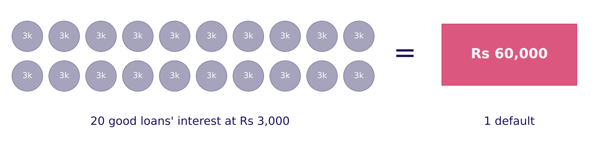

```notes
LIVE, 4 minutes. Hand count on the board: 20 x 3,000 = 60,000. So Rohan needs at least 20 repayers
in every 21 approvals. The dearer mistake changed sides: in Retail it was the miss, here it is the
approval.
```

---

## S27. Two lines at opposite ends of one axis
*Said on the same quantity: the chance of the good outcome.*


```notes
LIVE, 4 minutes. Say it exactly: nudge when P(buy) is above 0.03; lend when P(repay) is above
0.95. Never compare 0.03 on P(buy) with 0.05 on P(default): that is two quantities. Explorable:
flip the switch to the loan and drag the line to the right end.
```

---

## S28. Copying Retail's line approves every defaulter
*Twenty invented applicants, five lines.*

| Line | Lends | Defaults approved | Good turned away | Bill |
|---|---|---|---|---|
| Retail's 0.032, copied | 20 | 6 | 0 | Rs 360,000 |
| 0.5, the default | 18 | 4 | 0 | Rs 240,000 |
| 0.952, Rohan's | 8 | 0 | 6 | Rs 18,000 |
| Reject everyone | 0 | 0 | 14 | Rs 42,000 |

```notes
LIVE, 4 minutes. The trap: reusing Marketing's code and threshold. The model is fine; the line was
set for the wrong business. Interview anchor [D], asked aloud here: the same model in retail and in
lending, why are the thresholds opposite, and how do you explain that to each business?
```

---

## S29. Say it to Rohan in one sentence
*The transfer note's core.*

> "We lend only when at least 20 in 21 applicants like this one repay, because one default costs the interest on twenty good loans."
> The model is the same; your prices move the line.

```notes
LIVE, 3 minutes. Ask two learners to say it to a neighbour playing Rohan. The flip: if Rohan's loss
on a default halves to Rs 30,000, his line falls to 10 in 11, about 0.91.
```

---

## SECTION 7: The do-nothing matrix: who did it find?
*Case step 1 · applies chapters 1, 2 and 3 · also searched as: confusion matrix sklearn, accuracy paradox*

```notes
LIVE, 15 minutes for the chapter. Notebook case01: run the first cell (the bank's file downloads
once, then reads from the cache) and read the row count, 41,188.
```

---

## S30. A bank's 41,188 calls stand in for Kalpa's nudge
*Same decision: whom to contact, from what is known that morning.*

| Fact | Value |
|---|---|
| Source | UCI Bank Marketing, CC BY 4.0, Moro, Rita and Cortez (2014) |
| Calls | 41,188, May 2008 to November 2010 |
| Bought (subscribed) | 11.27 percent |
| Scored today | 8,238 validation clients, 928 buyers |

```notes
LIVE, 3 minutes. The test slice stays sealed in Monday's envelope until Friday. Everything today is
on validation. Kalpa's prices are applied to the bank's calls; the bank's own prices are unknown.
```

---

## S31. Call nobody: 88.74 percent right, 0 buyers found
*Monday's model at 0.5: 89.71 percent right, 174 of 928 found.*

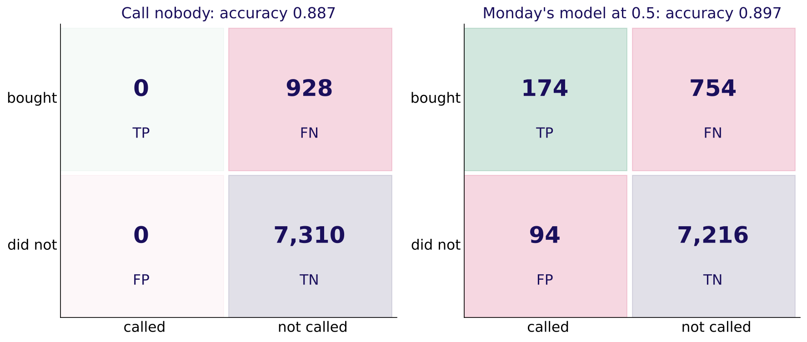

```notes
LIVE, 5 minutes. Prediction first: how accurate is calling nobody? Then the reveal: 88.74. The
empty column is the day's picture. Monday's model: precision 0.649 (its calls are good), recall
0.188 (it misses four buyers in five). Accuracy moved by one point and told you none of this.
```

---

## S32. Most buyers score below 0.5
*754 of 928 buyers sit left of the default line.*

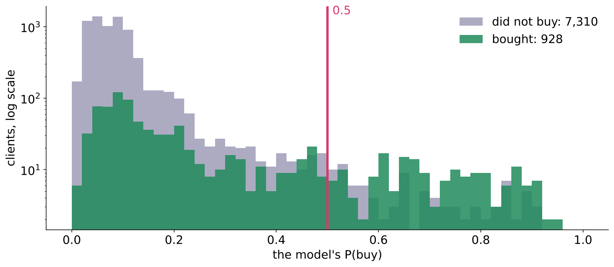

```notes
LIVE, 3 minutes. The two humps overlap heavily; the 0.5 line cuts off almost all of the green.
Ask: where would you move the line, and what would it cost? That is case 2.
```

---

## S33. The trap: "89.7 percent accurate, ready to ship"
*True and misleading, on the bank's real numbers.*

| Step | On this file |
|---|---|
| The claim | 89.7 percent accurate |
| What it hides | 754 of 928 buyers left alone, about Rs 9.05 lakh of margin |
| The check | recall, 0.188, beside the do-nothing 88.74 percent |
| The fix | report the matrix and recall with every accuracy |

```notes
LIVE, 4 minutes. Have the room write the corrected sentence to Marketing in one line. Kavya's
review: a matrix, a recall, and the do-nothing number beside the claim.
```

---

## SECTION 8: The cost threshold: what does 1 in 31 call?
*Case step 2 · applies chapters 4 and 5 · also searched as: cost-sensitive evaluation, expected cost threshold*

```notes
LIVE, 20 minutes for the chapter. Notebook case02. Prediction: which of four lines has the lowest
bill on the bank's clients?
```

---

## S34. Four ways to set the line, sized in rupees
*On 8,238 clients at Rs 40 and Rs 1,200.*

| Option | Called | Buyers found | Bill |
|---|---|---|---|
| Keep 0.5 | 268 | 174 | Rs 908,560 |
| F1 threshold, 0.154 | 1,226 | 454 | Rs 599,680 |
| Cost threshold, 0.032 | 7,438 | 913 | Rs 279,000 |
| Call everyone | 8,238 | 928 | Rs 292,400 |

```notes
LIVE, 5 minutes. The cost line calls nine clients in ten. F1's line sits far higher because F1
treats a Rs 40 waste and a Rs 1,200 miss as equal. The call: ship the cost line; the price ratio
is the fact that would change it.
```

---

## S35. The bill bottoms out at 0.032
*Rs 279,000 at the cost line; Rs 292,400 for calling everyone.*

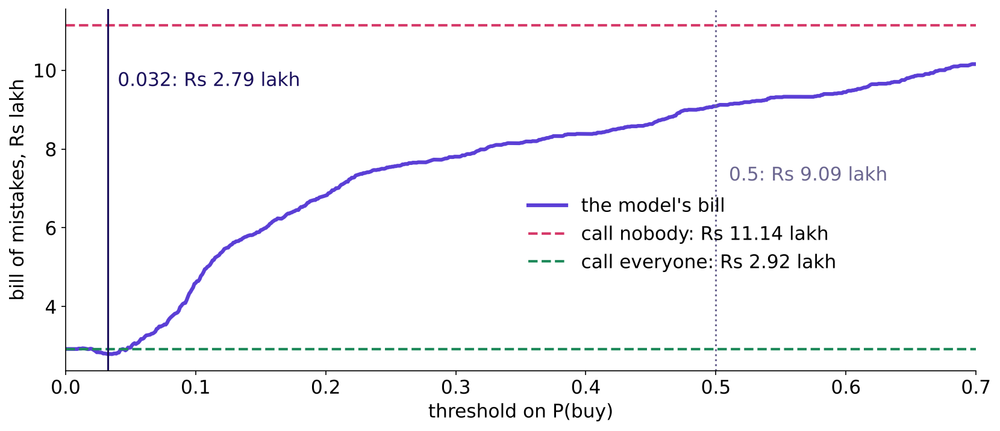

```notes
LIVE, 4 minutes. Point at how close the violet minimum sits to the green call-everyone line. Ask:
how much is the model saving us here, really?
```

---

## S36. The trap: Rs 6.3 lakh saved against the wrong rival
*Price the free rules before crediting the model.*

```stats
value: Rs 629,560 | label: saved against the default 0.5 | note: misleading: nobody ships 0.5 once the prices are known
value: Rs 13,400 | label: saved against calling everyone | note: 4.6 percent of that rule's bill
value: 1.2% | label: of the buyer margin at stake | note: Rs 13,400 of Rs 11.1 lakh
```

```notes
LIVE, 4 minutes. The trap: the arithmetic is right, the comparison is wrong. If Kalpa funded a
model on the Rs 6.3 lakh, it would pay for a saving a spreadsheet rule already gets. Fix: report
the saving against the cheaper of call-nobody and call-everyone.
```

---

## S37. At 30 to 1 the model barely matters
*Tighten the ratio and the model's saving climbs to 38 percent.*

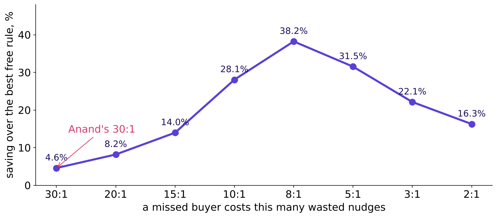

```notes
LIVE, 4 minutes. Explorable: drag the ratio slider from 30:1 to 8:1 and watch the gap open. The
rule with its flip: at an extreme ratio the cheap action wins almost everywhere; the model earns
its keep when the ratio tightens or a budget binds.
```

---

## S38. Stripe sets its line the same way
*The model shapes the curve; the policy picks the point.*

| Stripe's worked example | Value |
|---|---|
| Sale, margin | 26 dollars at 8 percent: 2.08 dollars profit |
| A missed fraud costs | 38.92 dollars, which is 18.71 good sales |
| Break-even precision | 1 / (1 + 18.71) = 5.07 percent |

Source: Stripe, primer on machine learning for fraud protection (verified 28 October 2026).

```notes
LIVE, 3 minutes. Same arithmetic as Anand's, in dollars. Stripe's own words: "The model controls
the shape of the precision-recall curve. The policy controls where on the curve we're operating."
```

---

## SECTION 9: The budget: which 1,000 to call?
*Case step 3 · applies chapters 2, 4 and 5 · also searched as: precision at k, lift chart, cumulative gains*

```notes
LIVE, 18 minutes for the chapter. Notebook case03. Marketing can afford 1,000 calls in this slice.
Prediction: how many buyers sit in the top 1,000 by score?
```

---

## S39. A budget is a line in disguise
*1,000 calls means calling everyone above the 1,000th score, 0.182.*

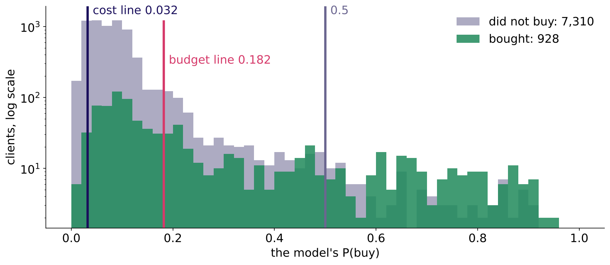

```notes
LIVE, 3 minutes. The cost rule says act above 0.032 and asks for 7,438 calls; the budget allows
1,000, which is the line at 0.182. When both hold, the stricter binds: here, the budget.
```

---

## S40. The top 1,000 hold 404 buyers; a random 1,000, 112
*Precision at 1,000 is 0.404 against a 0.113 base rate.*

```stats
value: 404 | label: buyers in the top 1,000 by score | note: precision at 1,000 is 0.404; bill Rs 652,640
value: 112 | label: buyers in a random 1,000 | note: the base rate; bill Rs 1,014,264
```

```notes
LIVE, 4 minutes. About 3.6 times a random list, and about Rs 3.6 lakh off the bill in this slice.
The line to land: under a budget the ranking carries the decision, and this is where the model
earns its keep.
```

---

## S41. Precision at k is where the model earns its keep
*The curve falls as the list grows; the gap to random is the model's value.*


```notes
LIVE, 4 minutes. Read the left chart at 500 calls (0.540) and 1,000 (0.404). On the right, the
violet curve above the dashed diagonal is everything the model adds over a random list.
```

---

## S42. The trap: 544 buyers from twice the calls
*Compare two lists only at the same number of calls.*

| List | Buyers | Precision | Nudge spend per buyer |
|---|---|---|---|
| Top 1,000 | 404 | 0.404 | Rs 99 |
| Top 2,000 | 544 | 0.272 | Rs 147 |

Razorpay: catching more by reviewing more "is a threshold change, not proof that the model improved" (verified 28 October 2026).

```notes
LIVE, 4 minutes. A colleague claims "35 percent more buyers". It is the same model with a lower
line. Razorpay's fraud team compares models at the same alert volume for exactly this reason.
```

---

## S43. Flipkart's trust team read the top 250 by hand
*A review budget is a precision at k.*

| Flipkart and CMU, ratings fraud (BIRDNEST) | Value |
|---|---|
| Ratings scanned | 3.3 million, from 1.1 million users |
| Accounts sent for review | the top 250 by suspicion score |
| Found to be fraud | 211 of 250, over 84 percent; all of the first 50 |

Source: Hooi and others, arXiv 1511.06030 (verified 28 October 2026).

```notes
LIVE, 3 minutes. The team could investigate 250 accounts, so the paper reports precision at 250.
Same shape as Marketing's 1,000 calls.
```

---

## S44. The guided memo: claim, evidence, caveat, action
*Notebook guided: steps 1 to 3 together, steps 4 and 5 on your own.*

```cards
icon: file-text | eyebrow: To Kavya | title: The metric memo | body: The metric, the line, the matrix, what it hides. | tone: light
icon: landmark | eyebrow: To Rohan | title: The transfer note | body: His line on P(repay), and why it sits high. | tone: light
icon: check-check | eyebrow: The check | title: PASS lines | body: Each step prints PASS when your number is right. | tone: dark
```

```notes
LIVE, 20 minutes: 12 guided (steps 1 to 3 on the projector), 8 unguided (step 4 and the two
paragraphs). Collect two memos and read their caveat lines aloud: the best ones say that at 30:1
calling almost everyone is nearly as cheap, so the model's value shows under the budget.
```

---

## S45. Five interview anchors from today's row
*Each with the shape of a good answer.*

| Tag | Question | A good answer opens with |
|---|---|---|
| [S] | Precision, recall and F1 from a matrix | the two sentences, then the fractions |
| [S] | 96 percent on a 96 to 4 split: good? | the base rate and the TP cell |
| [S] | Precision or recall for fraud? | what each mistake costs |
| [F] | Threshold when errors cost differently? | cost ratio, then the line, then the check |
| [D] | Retail and lending: why opposite? | the dearer mistake changed sides |

```notes
LIVE, 3 minutes. Tags: [S] staple, [F] frequent in product and GCC screens, [D] differentiator.
The bank carries full model answers with the interviewer's two follow-ups.
```

---

## S46. Six seats ask six questions of one threshold
*Today's spotlight: the business owner.*

| Seat | Their question about the line |
|---|---|
| Business owner | What does each mistake cost, in rupees? |
| Product manager | What does the customer see when we are wrong? |
| Solution architect | Where does the threshold live, and who changes it? |
| Senior ML engineer | Are the probabilities honest enough for the formula? |
| Implementation engineer | How is it configured and logged? |
| QA | Which test proves the right line is in force? |

```notes
LIVE, 2 minutes. A good interview answer names the one or two seats that decide and says why the
others do not bind. Today the business owner decides the line; the senior ML engineer decides
whether the formula can be trusted.
```

---

## S47. Quiz 1 of 5: buyers found at 0.5
*TP 174, FP 94, FN 754, TN 7,216.*

| Option | Buyers found |
|---|---|
| A | 7,216 |
| B | 268 |
| C | 928 |
| D | 174 |

```notes
KEY D. B is everyone called; C is every buyer; A is the true negatives.
```

---

## S48. Quiz 2 of 5: recall from four cells
*TP 30, FP 20, FN 70, TN 880.*

| Option | Recall |
|---|---|
| A | 0.60 |
| B | 0.30 |
| C | 0.03 |
| D | 0.91 |

```notes
KEY B: 30 of 100 real positives. A is precision (30 of 50); C divides by everyone; D is accuracy.
```

---

## S49. Quiz 3 of 5: 96 percent on a 96 to 4 outcome
*What did the model learn?*

| Option | It learned |
|---|---|
| A | the base rate and nothing else |
| B | a strong signal for repeat buyers |
| C | how to rank the top 4 percent |
| D | the cost of a missed buyer |

```notes
KEY A. Saying no to everyone scores 96 on a 96 to 4 outcome, so the accuracy alone shows nothing
learned beyond the base rate.
```

---

## S50. Quiz 4 of 5: a miss Rs 1,200, a false nudge Rs 40
*Which metric leads, and roughly where is the line?*

| Option | Metric and line |
|---|---|
| A | precision; near 0.97 |
| B | recall; near 0.03 |
| C | accuracy; at 0.50 |
| D | F1; near 0.50 |

```notes
KEY B: 40 / 1,240 = 0.032. A has the ratio upside down; D treats the errors as equal.
```

---

## S51. Quiz 5 of 5: Rs 60,000 against Rs 3,000
*A false approval against a wrongful rejection: which way does the line move?*

| Option | The line on P(repay) |
|---|---|
| A | it falls to about 0.05 on P(repay) |
| B | it stays at 0.50 |
| C | it rises toward 0.95 on P(repay) |
| D | it depends only on the model |

```notes
KEY C: 60,000 / 63,000 = 0.952. A states the default-risk line (0.048) on the wrong quantity.
```

---

## S52. Monday's return question: the model tied the baseline
*What do you tell Marketing?*

| Option | What you say |
|---|---|
| A | ship it, since it is no worse than the rule |
| B | it has not earned its keep; ship the rule |
| C | it scores 89 percent, so it is ready to use |
| D | retrain it until accuracy passes 95 percent |

```notes
KEY B. A tie costs maintenance and trust for no gain; offer the rule with its cost and name the
date of the next check.
```

---

## S53. What you can now do
*Five moves, each with a number from today.*

| You can | Today's number |
|---|---|
| Read a matrix in business words | 174 of 928 buyers found |
| Expose accuracy on imbalance | 88.74% for calling nobody |
| Set the line from two prices | 1 in 31, 0.032 |
| Say when the model matters | under a budget: 0.404 against 0.113 |
| Move the line to lending | 20 in 21, 0.952 on P(repay) |

```notes
LIVE, 1 minute. Ask each learner to redraw the week's picture with today's two humps and line.
```

---

## S54. Tonight, and tomorrow
*The practice set is two to three hours; the lab runs with the TAs.*

| What | Where | Minutes |
|---|---|---|
| Practice set | 2_take_home_mandatory | 150 |
| Practice lab, German Credit's 5:1 matrix | with the TAs | extra |
| Financial services dossier and card | 3_study_material_for_students | 25 |
| Wednesday: are the columns honest? | pre-read at the end of the practice set | 10 |

```notes
LIVE, 1 minute. The IITGN faculty session W5-2 (tentative) on ROC curves, precision-recall curves
and expected cost follows; today named ROC and AUC and stopped before them on purpose.
```
