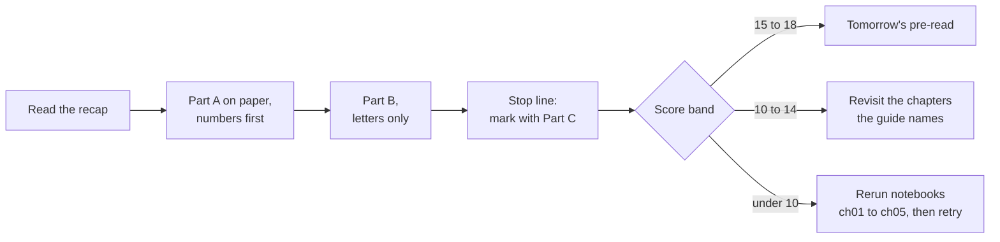
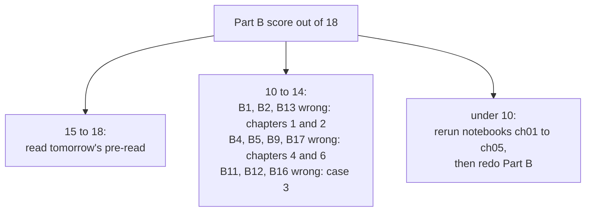
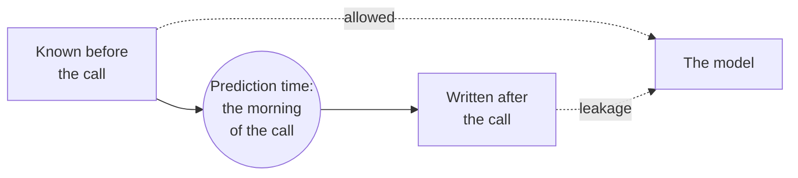

# The metric trap: practice set

Week 5, Tuesday. Two and a half hours, the key and model solutions inside.

## How do you use this set?

| Part | What | Minutes |
|---|---|---|
| Recap | one page of pictures and rules | 10 |
| Part A | ten problems: three warm-ups, four medium, three interview-grade | 100 |
| Part B | eighteen self-check questions | 25 |
| Checking | Part C: the key, the model solutions, the score bands | 15 |



Every problem names the seat it is answered from: business owner, product manager, solution architect, senior ML engineer, implementation engineer or QA. Where a scenario leaves out a fact you need, the first line of a good answer is the question you would ask.

<div class="page-break"></div>

## What does the day come down to, on one page?


| Idea | The rule | The condition that flips it |
|---|---|---|
| The confusion matrix | Every metric is a ratio of four counts: TP, FP, FN, TN | A matrix with rows and columns unlabelled is unread; scikit-learn puts TN top-left |
| Precision | `TP / (TP + FP)`: of those we flagged, how many were right | Leads when a false action is the dear mistake |
| Recall | `TP / (TP + FN)`: of those who were real, how many we flagged | Leads when a miss is the dear mistake |
| F1 | `2PR / (P + R)`, low when either is low | Fair only while the two mistakes cost about the same |
| Accuracy on imbalance | Saying no to everyone scores `1 - base rate` | Stops misleading near 50:50 with equal costs |
| The line from prices | `threshold = cost of acting wrongly / (cost of acting wrongly + cost of failing to act)` | Needs honest probabilities; a budget can bind first |
| The 1-in-N test | rights per wrong equals damage over saving: one Rs 1,200 buyer pays for 30 Rs 40 nudges, so act above 1 in 31 | Changes the moment either price changes |
| The transfer | nudge when P(buy) is above 0.032; lend when P(repay) is above 0.952 | The dearer mistake changed sides |


<div class="page-break"></div>

## Part A: ten problems

### A1. Kalpa Retail's May pilot: what did the nudge find? (warm-up, about 5 minutes)

*Seat: business owner. The numbers are invented for practice.*

Kalpa Retail nudged customers in a May pilot. Marketing's dashboard shows the matrix below for 10,000 customers.

| | Model: nudge | Model: leave |
|---|---|---|
| Came back within 90 days | 120 | 280 |
| Did not come back | 480 | 9,120 |

1. Say each of the four cells as a sentence about customers.
2. Compute precision and recall, each as "x of y".
3. At Anand's prices (Rs 40 a wasted nudge, Rs 1,200 a missed repeater), what is the bill of mistakes, and which cell drives it?

**Interview question.** "Here are the four cells. Read them aloud in the business's words and compute recall."

### A2. The payments app's churn model: is 97.1 percent good? (warm-up, about 5 minutes)

*Seat: senior ML engineer. The numbers are invented for practice.*

Kalpa Financial Services' payments app team posts this line in the channel:

```
churn_model_v3   validation accuracy 0.971   (threshold 0.5)   ready for launch
```

1. Before you reply, what one fact do you ask for, and why that one?
2. The team answers that 2.9 percent of users churned in the validation window. What accuracy does a rule that predicts "stays" for everyone score?
3. Write the two-line reply to the channel.

**Interview question.** "Accuracy is 97 percent on a 97 to 3 split. Good model?"

### A3. Anand halves the miss cost: where does the line go? (warm-up, about 5 minutes)

*Seat: business owner.*

Finance revises a missed repeater's margin from Rs 1,200 to Rs 600; a nudge still costs Rs 40. The table is the bank's validation slice from case 2 (measured).

| Miss : waste | Threshold | Called | Model bill | Best free rule | Saving |
|---|---|---|---|---|---|
| 30:1 | 0.032 | 7,438 | Rs 279,000 | Rs 292,400 | 4.6% |
| 15:1 | 0.062 | 5,233 | Rs 251,560 | Rs 292,400 | 14.0% |

1. Derive the new threshold with the 1-in-N test, as "act above 1 in N".
2. How many fewer clients are called, and why does the model's saving over the free rule grow?
3. Which metric still leads, and what changed in how much it leads?

**Interview question.** "Your miss cost just halved. Recompute the threshold and tell me which metric takes over."

### A4. Stripe's break-even precision, at a fatter margin (medium, about 10 minutes)

*Seat: business owner, with the product manager. The first three lines are Stripe's own example (Stripe, Radar technical guide, verified 28 October 2026).*

| Stripe's worked example | Value |
|---|---|
| Average sale, margin | 26 dollars at 8 percent: profit 2.08 dollars |
| Loss on a fraudulent sale | goods 23.92 dollars plus a 15 dollar chargeback fee: 38.92 dollars |
| Break-even precision | 1 / (1 + 38.92 / 2.08) = 1 / (1 + 18.71) = 5.07 percent |
| Also in the guide | 33 percent of consumers said they would not shop again after a false decline |

1. Show that 5.07 percent is the 1-in-N test in Stripe's units.
2. A merchant sells the same 26 dollar item at a 20 percent margin. Recompute the loss on a fraud, the ratio and the break-even precision.
3. The last row says a false decline can lose a customer, which the example leaves out. Which way does that move the blocking line, and which seat raises it?

**Interview question.** "Your fraud model blocks payments. How do you decide the block threshold for a merchant with thin margins against one with fat margins?"

<div class="page-break"></div>

### A5. Marketing wants 0.5: read the bill chart (medium, about 10 minutes)

*Seat: senior ML engineer. The chart is the bank's validation slice at Anand's prices (measured).*


Marketing says: "Use 0.5. Above 0.5 the model is confident, and we only want confident calls."

1. Read the bill at 0.5, at 0.032 and for calling everyone.
2. Why is the violet curve almost on the green line near the left edge, and what does that say about the model's value at these prices?
3. Name two facts that would make the model matter more, and say what each would do to the line.

**Interview question.** "Why not just use 0.5?"

### A6. German Credit's documented cost matrix (medium, about 10 minutes)

*Seat: business owner (a head of risk). Measured on OpenML credit-g, 300 held-out applicants, a logistic model on all twenty columns.*

The dataset's documentation says it is five times worse to class a bad customer as good than to class a good customer as bad. The model gives P(good) for each applicant.

| Lend when P(good) is at or above | Approved | Bad approved | Good rejected |
|---|---|---|---|
| 0.50 | 226 | 47 | 31 |
| 0.70 | 180 | 29 | 59 |
| 0.833 | 128 | 13 | 95 |
| Approve everyone | 300 | 90 | 0 |
| Reject everyone | 0 | 0 | 210 |

1. Derive the line on P(good) from the 5:1 matrix.
2. Compute the cost in matrix units (5 per bad approved, 1 per good rejected) for every row.
3. Which line ships, and what single fact would change your answer?

**Interview question.** "A dataset ships with a cost matrix. How do you turn it into a decision rule?"

### A7. Two fraud models, two alert volumes (medium, about 10 minutes)

*Seat: QA. The numbers are invented for practice; the rule is Razorpay's (Vulcan post, 10 September 2026, verified 28 October 2026).*

| Model | Alerts per week | Fraud caught | |
|---|---|---|---|
| Current | 2,000 | 300 | |
| Candidate, as reported | 3,500 | 420 | "40 percent more fraud caught" |
| Candidate, cut to 2,000 alerts | 2,000 | 280 | from the same run |

1. Is the candidate better? Answer from the table, with precision at each volume.
2. Razorpay compares detection "at the same alert volume". What error does that rule prevent?
3. What does the review team's capacity have to do with the threshold?

**Interview question.** "A new model catches 40 percent more fraud. What do you check before you believe it?"

### A8. Rohan's prices on a real lending book (interview-grade, about 15 minutes)

*Seat: business owner, with the senior ML engineer. Measured on German Credit's 300 held-out applicants, priced at Rohan's Rs 60,000 per false approval and Rs 3,000 per wrongful rejection.*

| Rule | Approved | Bad approved | Good rejected | Bill |
|---|---|---|---|---|
| Approve everyone | 300 | 90 | 0 | Rs 5,400,000 |
| Model at P(repay) 0.952 | 43 | 3 | 170 | Rs 690,000 |
| Model at P(repay) 0.98 | not shown | not shown | not shown | Rs 585,000 |
| Reject everyone | 0 | 0 | 210 | Rs 630,000 |

1. Derive Rohan's line and check the 0.952 row's bill.
2. Why does rejecting everyone nearly beat the model on this book?
3. What do you ask Rohan before you take this table to his committee?
4. Write the three-sentence note to Rohan.

**Interview question.** "The same model in retail and in lending: why are the thresholds opposite, and how do you explain that to each business?"

<div class="page-break"></div>

### A9. 1,000 calls a day: design the list (interview-grade, about 15 minutes)

*Seats: solution architect, implementation engineer, QA. Measured on the bank's validation slice.*


Kalpa Marketing will make 1,000 calls a day from the scored customer table. Three proposals arrive: (i) call everyone above the cost line of 0.032, (ii) call the top 1,000 by score each day, (iii) call a random 1,000 so the results are "unbiased".

1. Size each proposal on this slice: calls, buyers found, precision.
2. Pick one, and name the fact that would change the pick.
3. Where does the number 1,000 (or the threshold) live in the system, who may change it, and what is logged each day?
4. Which test proves the deployed scorer uses the right cut, and which daily number would show it had silently reverted to 0.5?

**Interview question.** "Marketing can only afford 1,000 calls. Walk me from the model's score to the call list, and tell me how you would know it broke."

### A10. Payment fraud: "block anything above 0.5" (interview-grade, about 15 minutes)

*Seats: product manager and business owner. PhonePe's engineers write that payments fraud systems must run "at very high precision", and report the fraud rate on consumer-to-consumer transactions falling 40 percent and daily complaints 38 percent (PhonePe Tech, 28 July 2022, verified 28 October 2026). The table is invented for practice: 100,000 transfers, 500 of them fraud.*

| Block when score is at or above | Blocked | Fraud caught | Precision | Recall |
|---|---|---|---|---|
| 0.3 | 1,600 | 400 | 0.25 | 0.80 |
| 0.5 | 689 | 310 | 0.45 | 0.62 |
| 0.7 | 293 | 205 | 0.70 | 0.41 |
| 0.9 | 83 | 75 | 0.90 | 0.15 |

The head of fraud operations says: "Block anything above 0.5."

1. What do you ask before agreeing?
2. Suppose a blocked genuine transfer costs Rs 150 (a support call and some trust) and a missed fraud costs Rs 2,000. Which line has the lowest bill?
3. Now suppose a blocked genuine transfer loses the customer, worth Rs 1,000. Which line wins now, and what does that say about PhonePe's choice?
4. Write one paragraph to the head of fraud operations.

**Interview question.** "Precision or recall for fraud, and why?"

<div class="page-break"></div>

## Part B: eighteen self-check questions

Write the letter, or the letters where the question says choose all that apply.

**B1.** Of 600 customers flagged, 120 bought; 400 buyers exist in all, among 10,000 customers. What is precision?

- A. 0.30  B. 0.20  C. 0.012  D. 0.25

**B2.** Same matrix. What is recall?

- A. 0.20  B. 0.012  C. 0.30  D. 0.25

**B3.** True or false, with the reason: "A churn model with 97 percent accuracy on a 3 percent churn outcome has learned something."

- A. True: 97 percent clears the usual 95 bar
- B. True: accuracy counts both classes fairly
- C. False: accuracy is never a useful metric
- D. False: saying no to all also scores 97

**B4.** A miss costs Rs 900 and a false alarm Rs 100. Act when P(positive) is above:

- A. 0.10  B. 0.11  C. 0.50  D. 0.90

**B5.** A coupon costs Rs 50 and a buyer brings Rs 450 of margin. Send the coupon when at least 1 in how many would buy?

- A. 9  B. 10  C. 50  D. 450

**B6.** Which statements about F1 hold? Choose all that apply.

- A. It rises when true negatives rise
- B. It is the harmonic mean of precision and recall
- C. It is the right single number whatever the costs
- D. It weighs FP and FN mistakes equally

**B7.** Assertion: at Rs 40 against Rs 1,200, the cost line calls about nine clients in ten on the bank's file. Reason: most clients' scores sit above 0.032, since the scores cluster around the 11 percent base rate.

- A. Both true; the reason explains it
- B. Both true; the reason does not explain it
- C. Assertion true, reason false
- D. Assertion false, reason true

**B8.** Match each seat to its question. Seats: 1 business owner, 2 senior ML engineer, 3 QA, 4 solution architect. Questions: p what does each mistake cost; q are the probabilities honest; r which test proves the line is in force; s where does the threshold live.

- A. 1q, 2p, 3s, 4r  B. 1s, 2q, 3r, 4p  C. 1p, 2q, 3r, 4s  D. 1p, 2r, 3q, 4s

**B9.** A false approval costs Rs 60,000 and a wrongful rejection Rs 3,000. Lend when P(repay) is above:

- A. 0.048  B. 0.050  C. 0.500  D. 0.952

**B10.** True or false, with the reason: "Retail's line at 0.032 and Rohan's at 0.952 show that lending needs a more accurate model."

- A. True: a line that high needs a sharper, more accurate model
- B. True: lending scores come from a different, harder dataset
- C. False: the dearer mistake changed sides, so the line moved
- D. False: both businesses should keep the default line of 0.5

**B11.** Marketing can afford exactly 1,000 calls. Which number goes on the dashboard?

- A. recall over all buyers  B. accuracy at 0.5  C. F1 at 0.5  D. precision at 1,000

**B12.** A colleague's new setting finds 544 buyers in 2,000 calls; ours found 404 in 1,000, from the same model. What can you conclude?

- A. nothing yet: compare at equal calls
- B. list B, because it finds 140 more buyers now
- C. list A, because 0.404 beats 0.272
- D. they tie, since recall is about equal

**B13.** `confusion_matrix(y_true, y_pred)` prints `[[7216, 94], [754, 174]]`. The 754 is:

- A. false positives  B. false negatives  C. true negatives  D. true positives

**B14.** True or false, with the reason: "On a 50:50 outcome where both mistakes cost the same, accuracy is a fair summary."

- A. True: there is no free score or cost gap
- B. False: accuracy misleads on every outcome
- C. True: F1 and accuracy are then the same
- D. False: precision is the better summary

**B15.** Assertion: the F1-maximising line on the bank's file (0.154) leaves a larger bill than the cost line (0.032). Reason: the bank's file holds 41,188 calls.

- A. Both true; the reason explains it
- B. Both true; the reason does not explain it
- C. Assertion true, reason false
- D. Assertion false, reason true

**B16.** Assertion: at a 30:1 cost ratio the model saves under 5 percent over calling everyone on the bank's file. Reason: a model with AUC 0.76 is too weak to be useful anywhere.

- A. Both true; the reason explains it
- B. Both true; the reason does not explain it
- C. Assertion true, reason false
- D. Assertion false, reason true

**B17.** Which facts would raise Kalpa's nudge line? Choose all that apply.

- A. The nudge becomes a Rs 400 gift hamper
- B. A missed buyer's margin rises to Rs 2,000
- C. The daily budget falls to 500 calls
- D. The bank's base rate doubles next quarter

**B18.** Stripe's break-even precision of 5.07 percent means:

- A. the model catches 5 percent of all the fraud
- B. 5 percent of all payments are fraudulent
- C. the block line on P(fraud) sits at 0.95
- D. blocking pays once 1 in 20 blocks is fraud

<div class="page-break"></div>

---

**STOP. Everything below is the key. Finish Parts A and B before reading on.**

---

## Part C: the key and the model solutions

### Part B key

| Item | Key | Item | Key | Item | Key |
|---|---|---|---|---|---|
| B1 | B | B7 | A | B13 | B |
| B2 | C | B8 | C | B14 | A |
| B3 | D | B9 | D | B15 | B |
| B4 | A | B10 | C | B16 | C |
| B5 | B | B11 | D | B17 | A, C |
| B6 | B, D | B12 | A | B18 | D |

### Part B, one line on every option

| Item | A | B | C | D |
|---|---|---|---|---|
| B1 | recall (120 of 400) | key: 120 of 600 flagged | divides by everyone | right flags over wrong flags (120 of 480) |
| B2 | precision | divides by everyone | key: 120 of 400 buyers | right over wrong flags |
| B3 | a fixed bar ignores the base rate | true of accuracy, and beside the point | too strong: near 50:50 it is fair | key: the free score is 97 |
| B4 | key: 100 / (100 + 900) | the ratio 100 / 900, not the share | the equal-cost line | the line with the costs swapped |
| B5 | wrongs per right; the group is one more | key: 9 wasted coupons per buyer, so 1 in 10 | the coupon price, not a count | the margin, not a count |
| B6 | false: TN is in neither ratio | key | false: it ignores unequal costs | key: it adds FP and FN with equal weight |
| B7 | key: scores cluster near 0.11, above 0.032 | the reason does explain it | the reason is true | the assertion is measured true (7,438 of 8,238) |
| B8 | seats and questions swapped | the owner's question went to the architect | key | QA and the ML engineer swapped |
| B9 | the default-risk line on the wrong quantity | the rounded default line, same slip | the equal-cost line | key: 60,000 / 63,000 |
| B10 | the line comes from prices, not the model | the same model can serve both | key | 0.5 is the line for equal costs only |
| B11 | recall's denominator ignores the budget | flatters on imbalance | treats costs as equal | key: what the 1,000 calls deliver |
| B12 | key: same model, a lower line | more calls, more buyers, lower precision | true at each k, but a line change is no model change | recall differs: 0.435 against 0.586 |
| B13 | FP is 94 | key: row 1 is the truth "bought", column 0 "not called" | TN is 7,216 | TP is 174 |
| B14 | key | too strong | they differ in general | precision answers a narrower question |
| B15 | the row count has nothing to do with the bill | key: both true, unrelated | the reason is true | the assertion is measured true |
| B16 | the reason is false | the reason is false | key: under a budget the same model triples precision | the assertion is measured true (4.6 percent) |
| B17 | key: acting gets dearer | lowers the line: missing gets dearer | key: a smaller budget binds a stricter cut | the cost line on honest probabilities does not move |
| B18 | that would be recall | that is the base rate | that would be a 1-in-1.05 test | key: 1 / (1 + 18.71) is about 1 in 20 |

### A1. Model solution

- TP 120: nudged and came back. FP 480: nudged, did not come back, Rs 40 each. FN 280: left alone, came back or was lost, Rs 1,200 each. TN 9,120: left alone, did not come back.
- Precision 120 of 600 = 0.20; recall 120 of 400 = 0.30.
- Bill: 480 x Rs 40 + 280 x Rs 1,200 = Rs 19,200 + Rs 336,000 = Rs 355,200. The FN cell drives it: missed repeaters are 95 percent of the bill.
- What the interviewer listens for: the two sentences before the fractions, and the observation that the dear cell is the one the model is weakest on.
- Common wrong answer: precision as 120 of 10,000.

### A2. Model solution

- Ask first: what share of users churned in the validation window? Accuracy means nothing until the base rate is beside it.
- Saying "stays" to everyone scores 97.1 percent, exactly the model's number: the model may have learned only the base rate.
- Reply: "97.1 percent is what predicting no churn for everyone scores. Please post the matrix and the recall at your threshold before launch."
- Follow-ups an interviewer asks: "and if recall is 0.05?" (it finds one churner in twenty; the threshold or the model needs work); "which metric would you report instead?" (recall at a chosen line, with the cost of each mistake).
- Common wrong answer: "97 percent is excellent."

### A3. Model solution

- `40 / (40 + 600) = 0.0625`: act above 1 in 16, since one Rs 600 buyer pays for 15 Rs 40 nudges.
- Called falls from 7,438 to 5,233, about 2,200 fewer. The saving grows (4.6 to 14.0 percent) because, with a smaller gap between the prices, the model's ranking decides more of the bill and calling everyone is no longer nearly free.
- Recall still leads, since a miss is still 15 times dearer, but less heavily: the line rose, so precision starts to count.
- Common wrong answer: halving the threshold to 0.016, which moves it the wrong way.

### A4. Model solution

- 1-in-N: one fraud costs 18.71 sales' profit, so blocking pays once at least 1 in 19.71 blocked payments is fraud: 1 / 19.71 = 5.07 percent.
- At 20 percent: profit 5.20 dollars, goods 20.80, loss on a fraud 20.80 + 15 = 35.80 dollars; ratio 35.80 / 5.20 = 6.88; break-even precision 1 / 7.88 = 12.7 percent. The fat-margin merchant can afford fewer blocks per fraud, so its line sits higher.
- A lost customer makes a false decline dearer, which raises the blocking line further. The product manager raises it, since it is what the customer sees.
- What the interviewer listens for: the line is a business policy per merchant, derived from two prices, and one price was missing from the first calculation.
- Common wrong answer: one threshold for every merchant.

### A5. Model solution

- From the chart: 0.5 costs about Rs 9.09 lakh, 0.032 about Rs 2.79 lakh, calling everyone Rs 2.92 lakh.
- The curve meets the green line on the left because at 30:1 a call is so cheap that calling nearly everyone is close to optimal: the model saves Rs 13,400, 4.6 percent of the free rule's bill. Confidence is the wrong criterion; the prices decide.
- Facts that make the model matter: a tighter ratio (a dearer nudge or a cheaper miss) raises the line and widens the gap; a budget on calls makes the ranking decide which calls are made.
- Follow-up: "So should we skip the model?" At these prices and with no budget, the honest answer is that a call-everyone rule is nearly as cheap, and the model's value appears under the budget.
- Common wrong answer: "0.5, because the model is more accurate there."

### A6. Model solution

- Line on P(good): `5 / (5 + 1) = 0.833`; lend only when at least 5 in 6 applicants like this one are good.
- Costs: 0.50: 47 x 5 + 31 = 266. 0.70: 29 x 5 + 59 = 204. 0.833: 13 x 5 + 95 = 160. Approve everyone: 90 x 5 = 450. Reject everyone: 210.
- Ship 0.833: lowest cost, and it beats both free rules. The fact that would change it is the cost ratio (a different book's loss on default) or evidence that the probabilities are off, which a calibration check would show.
- Common wrong answer: computing 5 x good rejected + 1 x bad approved, the weights swapped.

### A7. Model solution

- At 2,000 alerts the current model catches 300 (precision 0.150) and the candidate 280 (precision 0.140). At equal volume the candidate is slightly worse. The "40 percent more" came from 1,500 extra alerts at precision 0.080 for the extra 120.
- The rule prevents crediting a model for a threshold move: more alerts always catch more fraud.
- The review team's capacity is the budget, so it sets the threshold; models are compared at that capacity.
- Common wrong answer: "420 beats 300, ship it."

### A8. Model solution

- `60,000 / 63,000 = 0.952`. Check: 3 x Rs 60,000 + 170 x Rs 3,000 = Rs 180,000 + Rs 510,000 = Rs 690,000.
- This book is 30 percent bad. At 20:1, one bad approval costs as much as 20 good rejections, and the model is not sharp enough at the top to find many applicants above 0.952 safely, so turning everyone away is close to optimal; the very top slice (0.98) just beats it.
- Ask Rohan: is Kalpa's book anywhere near 30 percent bad, and is Rs 60,000 the loss after recoveries? On a book with a 3 percent default rate the same line approves far more people.
- Note: "We lend only when at least 20 in 21 applicants like this one repay, because one default costs the interest on twenty good loans. On this public book that line approves almost nobody, because three applicants in ten default. Before we use it on Kalpa's book we need your default rate and your loss after recoveries."
- Follow-ups: "Why is Retail's line at the other end?" (there the dearer mistake is the miss); "What would lower my line?" (a smaller loss on default, or a cheaper rejection).
- Common wrong answer: "the model is broken because rejecting everyone is almost as cheap."

### A9. Model solution

- On the slice: (i) 7,438 calls, 913 buyers, precision 0.123, over budget; (ii) 1,000 calls, 404 buyers, precision 0.404; (iii) about 112 buyers, precision about 0.112.
- Pick (ii). The fact that would change it: a need to measure the nudge's causal effect, which calls for a small random holdout beside the top 1,000, never a fully random list.
- The number 1,000 and the model version live in one configuration value owned by Marketing with an approval from Finance, read by the scoring job; the job logs the date, the cut-off score of the 1,000th customer, the count called and the model version.
- Test: feed a row scored just above the day's cut-off and assert it is called, and one just below and assert it is not. Daily number: the count called and the cut-off score; a revert to 0.5 shows as about 268 calls per 8,238 and a cut-off of 0.5 instead of about 0.18.
- Common wrong answer: random calls "to be fair", which throws away 290 buyers in this slice.

### A10. Model solution

- Ask: what does a blocked genuine transfer cost (support, a lost customer), what does a missed fraud cost on average, and can a block be softened to a step-up check that costs less?
- At Rs 150 and Rs 2,000: 0.3 costs 1,200 x 150 + 100 x 2,000 = Rs 380,000; 0.5 costs Rs 436,850; 0.7 Rs 603,200; 0.9 Rs 851,200. The line at 0.3 wins.
- At Rs 1,000 per false block: 0.3 costs Rs 1,400,000; 0.5 Rs 759,000; 0.7 Rs 678,000; 0.9 Rs 858,000. The line at 0.7 wins. When a false block loses a customer, precision leads, which is why PhonePe designs for very high precision.
- Paragraph: "The right line depends on what a wrong block costs us. If it costs a support call, block from 0.3 and catch 80 percent of fraud; if it costs the customer, block from 0.7 and accept catching 41 percent. Give me the two prices and I will set the line and show the bill."
- Common wrong answer: "Recall, always, because fraud is bad."

## What should you revisit, by score?



## Where do you read more?

- StatQuest, "Machine Learning Fundamentals: The Confusion Matrix", https://www.youtube.com/watch?v=Kdsp6soqA7o (verified 28 October 2026)
- Google Machine Learning Crash Course, "Thresholds and the confusion matrix", https://developers.google.com/machine-learning/crash-course/classification/thresholding (verified 28 October 2026)
- MLU-Explain, "Precision and Recall", https://mlu-explain.github.io/precision-recall/ (verified 28 October 2026)
- Stripe, Radar technical guide, https://stripe.com/guides/primer-on-machine-learning-for-fraud-protection (verified 28 October 2026)
- scikit-learn, "Tuning the decision threshold for class prediction", https://scikit-learn.org/stable/modules/classification_threshold.html (verified 28 October 2026)

<div class="page-break"></div>

## Tomorrow's ten-minute pre-read: what is the model allowed to know?

Wednesday audits the columns behind Monday's score. Five terms, one line each.

| Term | One line |
|---|---|
| Feature | a column the model reads to make its prediction |
| One-hot encoding | turning a category such as `job` into one 0/1 column per value, so the model reads no false order |
| Scaling | putting numeric columns on a common scale, such as mean 0 and spread 1, so no column dominates by its units |
| Prediction time | the moment the score is used: here, the morning of the call |
| Data leakage | a column that would not be known at prediction time, so the offline score borrows from the future |


