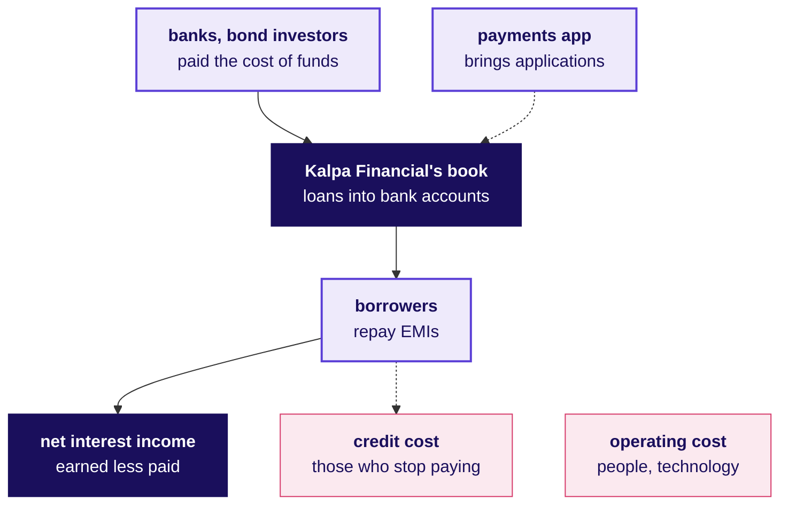
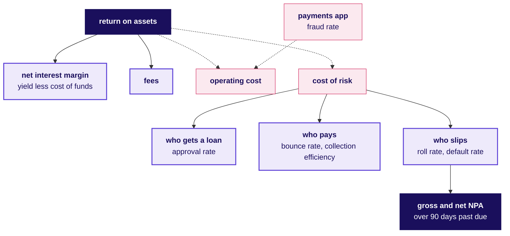

# How does a lender like Kalpa Financial make money, who asks for which number, and which rules bind its data?

**Week 5, Tuesday · Financial services enters the programme · Indian lending and payments, and the real companies Kalpa Financial resembles**

This is the business you work in for Build 2: how a lender earns on borrowed money, who asks the data team for what, each metric as a formula with its trap, the words a risk meeting assumes, and the rules that decide which data a model may touch.

About a 20 minute read · 2 diagrams and 9 tables

> Kalpa Group, Kalpa Financial Services and Rohan Desai are fictional. PhonePe, Bajaj Finance, Tata Capital and the other real companies here are likenesses of how a business like Kalpa Financial works, and none of them is Kalpa's model; every fact about them, and every rule, was checked on 28 October 2026 against the source listed in section 12. An illustrative number is a round number chosen for easy arithmetic, neither Kalpa's data nor any real company's.

---

## 1. What happens at Kalpa Financial in one working day, and who makes it happen?

A delivery rider in Pune pays for tea with Kalpa's payments app in the morning, and by the evening the same app has lent the rider Rs 50,000 for a bike repair. Kalpa Financial Services runs both halves of that day: a payments app and a consumer lending book across India. The numbers below are illustrative.

**Who needs the answer.** Rohan Desai, head of risk at Kalpa Financial, reads the day's numbers every evening. An analyst who cannot say where in this day a number was made cannot tell him whether it is safe to lend on.

**The questions on the way.**

1. What happens between "apply" and money in the bank account?
2. What goes wrong in a lender's day, and who fixes it?

At lunch the rider taps "loan". Before signing, the app shows a Key Fact Statement: the amount, the annual percentage rate (APR), every charge and the monthly instalment, the EMI. The rider consents to sharing data for this loan, the lender pulls a credit bureau report, and a credit model scores the application. Of 1,000 applications that day, 400 are approved, an approval rate of 40 percent. The Rs 50,000 lands in the rider's own bank account, and for at least a day it can be handed back, with the interest for those days, without penalty.

Meanwhile collections calls borrowers whose EMI auto-debit bounced, the fraud team reviews card payments the model flagged, treasury borrows from banks to fund tomorrow's loans, and compliance answers a complaint that goes to RBI if it waits more than 30 days.

In the evening Rohan reads one page: approvals, bounces, accounts that slipped a bucket in days past due, and the month's losses. Then he hears that Kalpa Retail has a model scoring its customers, and asks whether the same machinery could score his loan applicants, where approving a defaulter costs Rs 60,000 and rejecting a good borrower costs Rs 3,000 of lost interest.

---

## 2. Which real companies work the way Kalpa Financial does, and what does each teach?

When someone takes a loan inside a payments app, the app can be the shop window while another company's balance sheet lends the money.

**Who needs the answer.** Rohan, whenever a Kalpa number is set beside a real one: a platform that arranges loans and a lender that holds them earn different lines and carry different losses.

**The questions on the way.**

1. Which real companies have the shape of Kalpa Financial's two halves?
2. Which real team is the GCC like?

| Company | What it shows | Checked fact |
|---|---|---|
| PhonePe | A payments app that arranges loans for lenders | Its loans page calls it "a platform facilitating loan transactions between borrowers and RBI-registered NBFCs or Banks" that "does not lend directly"; with Google Pay it carried 79 percent of UPI transactions in May 2026 (Outlook Business, 17 June 2026, from NPCI data). |
| Bajaj Finance | A consumer lender at scale, holding loans on its own books | In the quarter to 30 September 2026 it booked 13.45 million new loans on assets under management of Rs 5,84,624 crore, with gross NPA at 1.06 percent and net NPA at 0.42 percent (Kotak Neo, 19 October 2026, reporting the results). |
| Tata Capital | A group's lending arm, as Kalpa Financial is the Kalpa Group's | In the quarter to 30 June 2026 it managed Rs 2.91 lakh crore with credit costs of 1 percent, cost of funds of 7.28 percent and a return on assets of 2.3 percent, serving about 8.8 million customers (its Q1 FY27 media call, 28 July 2026). |
| The four credit bureaus | Where every lender reads and writes repayment history | RBI's list of credit information companies, as on 18 August 2026, names CRIF, Equifax, Experian and TransUnion CIBIL. |
| JPMorganChase in India | A global bank's GCC, as the team you join is Kalpa's | Its corporate centres in Mumbai, Bengaluru and Hyderabad support the firm's technology and business operations globally (its India page). |

The scale behind the payments half: UPI carried 2,407 crore transactions worth Rs 29.37 lakh crore in September 2026 (FinTech BizNews, 1 October 2026, from NPCI data).

The story does not say which licence Kalpa Financial holds, so section 7 uses the rules an NBFC lender like Bajaj Finance or Tata Capital works under.

---

## 3. How does a lender make money, and where does each rupee go?

A lender is a shop whose stock is money: it buys money from banks and bond investors, sells it to borrowers at a higher price, and loses some of what it sold when borrowers stop paying.

**Who needs the answer.** Treasury and finance own this page, and Rohan owns its biggest leak. Interest earned, reported without the cost of funds and the losses, describes a lender that does not exist.

**The questions on the way.**

1. Where does the money come from, and where does it go?
2. How much of Rs 100 lent is left at the end of a year?
3. Where do Rohan's Rs 60,000 and Rs 3,000 sit on that page?

Profit is net interest income plus fees, less operating cost and credit cost.

| Line, for Rs 100 lent over one year | Rs, illustrative | What it is |
|---|---|---|
| Interest earned | 16 | The yield on the loan book |
| Less interest paid on borrowed money | 8 | The cost of funds; Tata Capital's was 7.28 percent |
| Net interest income | 8 | An 8 percent net interest margin |
| Plus fees | 1 | Processing fees and charges disclosed in the Key Fact Statement |
| Less operating cost | 4 | Staff, technology, branches, collections |
| Less credit cost | 2 | Provisions and write-offs for borrowers who stop paying, a 2 percent cost of risk |
| Profit before tax | 3 | About Rs 2.2 after tax, a return on assets near Tata Capital's 2.3 percent |

Rohan's two costs land on different lines. Approving a borrower who defaults lands in credit cost, as lent money that does not come back; rejecting one who would have repaid lands in net interest income, as margin never earned. Tuesday's transfer chapter works out what that difference does to the threshold.

---

## 4. Who decides what at Kalpa Financial, and what does each of them ask the data team?

On a Monday morning at a lender, four people want a number, and each loses something different when it is wrong.

**Who needs the answer.** Every trainee who sends Kalpa Financial a number, since a figure built for collections and read by treasury reaches a decision it was never built for.

**The questions on the way.**

1. Who owns which part of the lending day?
2. What does each ask, and what does a wrong answer cost?

| Role | Owns | Asks the data team | A wrong number costs | At Kalpa |
|---|---|---|---|---|
| Head of risk | Credit policy, losses, the approval threshold | Whom do we approve, and what will this book lose? | Defaults that eat the year's margin, or good borrowers turned away | Rohan Desai |
| Business head | Growth of the book and the app | Can we lend more without more losses? | Growth bought with next year's write-offs | Not named |
| Collections head | Recoveries with a fixed team | Whom do we call first today? | Calls spent on borrowers who would have paid anyway | Not named |
| Fraud operations | Blocking fraud on payments | Which flagged payments do we review? | Fraud let through, or genuine customers blocked | Not named |
| Product head of the app | Users, payments, the loan journey | Why do users drop off the loan screen? | A journey fixed in the wrong place | Not named |
| Finance and treasury | Cost of funds, the books, provisions | Does your loss forecast match what we provision? | Provisions restated in front of the board | Not named |
| Compliance and grievance | Rules, complaints, the regulator | Can you show consent and an audit trail for this data? | A regulatory finding | Not named |
| Data and AI team at the GCC | Models and whether they are trusted | Show the baseline, the error bill and what breaks it. | Trust, which one wrong number can lose | Kavya Nair and the trainees |

---

## 5. Which numbers run a lender, and how is each one worked out?

When this month's losses rise, three suspects line up: riskier people were approved, the same people paid worse, or collections recovered less, and the metric tree says which.

**Who needs the answer.** Rohan, treasury and the collections head, who each own a branch; a metric on the wrong base sends the fix to the wrong team.

**The questions on the way.**

1. Which tree does every lending number hang off?
2. How is each of the ten metrics worked out, and what trap does it hide?

Return on assets is the margin plus fees, less operating cost and cost of risk, as in section 3, and every risk metric below is a branch of cost of risk. The worked numbers are illustrative.

| Metric | Formula | Worked | The trap | Who asks |
|---|---|---|---|---|
| Approval rate | Approved / applications decided | 400 / 1,000 = 40 percent | Applications abandoned before a decision change the base; say which base | Business head |
| Bounce rate | EMI debits that failed / EMI debits presented | 60 / 1,000 = 6 percent | A bounce cured the same week still counts; pair it with cures | Collections head |
| Collection efficiency | Amount collected / amount due in the month | Rs 94 lakh / Rs 1 crore = 94 percent | Lenders differ on whether arrears and prepayments count, so ask the definition before comparing | Collections head |
| Roll rate | Accounts that moved to a worse days-past-due bucket / accounts in the earlier bucket | 30 of 200 at 1 to 30 days moved to 31 to 60: 15 percent | Read it bucket by bucket; one blended number hides where the slide starts | Head of risk |
| Default rate, by vintage | Loans of one month's batch that reached 90+ days past due within 12 months / loans in the batch | 45 / 1,000 = 4.5 percent | On the whole book, fast growth adds young loans that cannot have defaulted yet, so the rate falls while risk does not | Head of risk |
| Gross NPA ratio | Loans over 90 days past due / gross loans | Rs 2 crore / Rs 100 crore = 2 percent | Write-offs leave the numerator, so a lender writing off more shows a lower ratio | Finance, the board |
| Net NPA ratio | (Gross NPAs less provisions held on them) / (gross loans less those provisions) | (2 less 1.2) / (100 less 1.2) = 0.81 percent | It falls when provisions rise, with no change in who pays | Finance |
| Cost of risk | Annual provisions and write-offs / average loan book | Rs 2 crore / Rs 100 crore = 2 percent | A quarter's figure must be annualised before it is compared | Head of risk, treasury |
| Net interest margin | (Interest earned less interest paid) / average interest-earning assets | (16 less 8) / 100 = 8 percent | Divided by the closing book, it falls whenever lending grows inside the quarter; divide by the average | Treasury |
| Fraud rate | Fraudulent transactions / all transactions, by count and by value | 50 in 10,000 = 0.5 percent | Labels arrive weeks late, so this month's rate is always too low at first | Fraud operations |

---

## 6. Which words will you hear in a risk meeting, and what do they mean?

In the first meeting someone says "the March vintage is rolling into SMA-2", and the room nods.

**Who needs the answer.** Any trainee in a Kalpa Financial meeting, where these words arrive with no definition.

**The questions on the way.**

1. Which words describe the loan and its price?
2. Which describe a borrower slipping, and which the rules?

| Word | What it means |
|---|---|
| NBFC | A non-banking financial company: a lender registered with RBI that is not a bank |
| Book, AUM | All loans the lender holds and manages |
| EMI | The fixed monthly instalment of interest and principal |
| APR | The annual percentage rate, interest plus fees as one yearly rate |
| KFS | The Key Fact Statement shown before signing: amount, APR, charges, schedule |
| Cooling-off | The first days in which a digital loan can be returned without penalty |
| Cost of funds | What the lender pays for the money it lends |
| NII, NIM | Net interest income, and the same as a share of the average book |
| Bureau pull | Reading an applicant's history from a credit bureau |
| Credit score | The bureau's number for how likely a person is to repay |
| Thin file | An applicant with little or no bureau history |
| Underwriting | Deciding whether to lend, how much and at what price |
| Cut-off | The score below which the lender declines |
| DPD | Days past due, counted from the missed EMI |
| Bucket | A DPD band: 1 to 30, 31 to 60, 61 to 90, over 90 |
| SMA-1, SMA-2 | RBI's special mention tags: overdue more than 30 days, and more than 60 |
| NPA | A loan overdue more than 90 days |
| Cure | A late borrower who pays up and returns to current |
| Roll rate | The share of a bucket that moves to the next worse bucket in a month |
| Vintage | All loans disbursed in one month, tracked together |
| Provision | Money set aside for losses expected on the book |
| Write-off | A loan removed from the books as unrecoverable |
| LSP | A lending service provider: a firm doing parts of the lending journey for the lender |
| DLA | A digital lending app, the lender's or its LSP's |
| DLG | A default loss guarantee, an LSP covering part of a portfolio's losses |
| Account aggregator | An NBFC that moves a person's financial records between regulated institutions, only with that person's explicit consent |

---

## 7. Which rules bind Kalpa Financial's data, and what do they forbid an analyst or an AI system?

The loan app asked for the rider's camera once, to match a face against an ID, and never asked for the contact list. A rule decided both.

**Who needs the answer.** Compliance signs off every dataset the team touches, and Rohan answers to the regulator for every model; a model built on forbidden data is withdrawn with the data.

**The questions on the way.**

1. Which rules bind a loan from application to recovery?
2. What does each forbid or require of the data team?

| Rule, as RBI or the government issued it | What it requires of the data team or an AI system |
|---|---|
| Fair practices: RBI's NBFC Responsible Business Conduct Directions, 28 November 2025 | Every application is acknowledged; terms reach the borrower in writing in a language they understand, with a Key Fact Statement showing the APR; rate changes apply only forward, after notice; recovery never harasses and calls only inside a daytime window the directions fix, a rule on the lender and its agents that a voice bot calling for the lender meets too; penal charges carry no interest |
| Digital lending: chapter III of RBI's NBFC Credit Facilities Directions, 28 November 2025, which carries the Digital Lending Directions of 8 May 2025 | Money moves only between the borrower's and the lender's bank accounts; data is collected as needed, with prior explicit consent and an audit trail; the app may not read files, contacts or call logs, and may use camera, microphone or location once, for KYC; all data stays on servers in India; age, occupation and income are recorded before lending; cooling-off lasts at least a day; DLG cover stays within 5 percent of the amount disbursed; a complaint unanswered in 30 days can go to RBI |
| Credit bureaus: RBI's four registered credit information companies and its Credit Information Reporting Directions | Every digital loan is reported to the bureaus whatever its tenor, fortnightly or more often, and RBI moved in December 2025 towards weekly reporting |
| KYC: RBI's NBFC Know Your Customer Directions, 28 November 2025 | Customer due diligence comes before any account relationship; video KYC counts as face to face; KYC is refreshed every two, eight or ten years by risk; identity records are kept at least five years after the relationship ends |
| Asset classification: RBI's NBFC Income Recognition, Asset Classification and Provisioning Directions, 28 November 2025 | A loan overdue more than 90 days is an NPA, tagged SMA-1 at 30 days and SMA-2 at 60 on the way; it returns to standard only when every arrear is paid, which fixes how the team labels a default |
| Personal data: the Digital Personal Data Protection Act, 2023, and its Rules, notified 14 November 2025 | Each use of personal data has a stated purpose and consent the person can withdraw; access, correction and erasure requests are answered within 90 days; people hit by a breach are told without delay; penalties run up to Rs 250 crore for failing to keep data safe; most duties apply 18 months after notification |

Kalpa Financial lends in India, so these rules bind it; a US lender's rules are outside this dossier.

---

## 8. Where do analytics, ML, NLP and agents pay for themselves in lending, and how is that measured?

PhonePe's engineers set out to build fraud prevention "at very high precision", checked their labels by phoning senders, and cut the fraud rate on consumer-to-consumer transactions by 40 percent (PhonePe engineering blog, 28 July 2022).

**Who needs the answer.** Rohan, who funds a model from the losses it prevents, and the business head, who pays for every good customer it turns away.

**The questions on the way.**

1. Which problems pay for a model, and how is the payoff counted?
2. What does each cost when it is wrong?

| Use | The business problem | Technique in outline | Value counted as | When it is wrong |
|---|---|---|---|---|
| Credit approval | Whom to lend to, at what limit | A classifier on application and bureau data, with a threshold set from the two error costs | Losses avoided less good borrowers lost, per 1,000 applications | A defaulter costs Rs 60,000; a good borrower turned away costs Rs 3,000 |
| Fraud on payments | Stop fraud in milliseconds | A classifier on each transaction; flagged ones reviewed or blocked | Fraud caught at a fixed number of alerts | Fraud let through, or a genuine customer blocked |
| Collections | Whom to call first with a fixed team | A ranking by expected recovery | Rupees recovered per call against calling by days past due | Calls spent on people who would have paid |
| KYC and documents | Read IDs and bank statements | NLP and vision extraction, checked by a person | Minutes per application | A wrong field approved into the books |
| Complaints | Route and answer complaints inside 30 days | Text classification and drafted replies | Complaints resolved before RBI escalation | A reply that breaks a rule |
| Agents | Schedule calls, prepare a case file, draft a reply | An agent with tools, a person approving each action that touches a borrower | Analyst hours saved | An action the rules forbid, taken in the lender's name |

---

## 9. Which technical problems does Kalpa Financial's data team meet, and how do you choose a fix?

The data team knows how every approved loan turned out and nothing about the applicants it turned away, which is the first problem a lending model meets.

**Who needs the answer.** The data team, and Rohan, who signs off each fix.

**The questions on the way.**

1. Which problems are particular to lending data?
2. How is each fix sized and chosen?

| Problem | Options, sized | Best fit for Kalpa's team | What would change the call |
|---|---|---|---|
| Outcomes exist only for approved applicants | Train on approved loans and say so (free); approve a small random slice of borderline applicants to learn how they repay (each default costs Rs 60,000) | Train on approved loans, state the gap, and widen approvals only in a capped test | The board asking how the model treats people it never approved |
| A default shows only months later | Wait for a 12-month outcome (labels a year old); use 30+ days past due within 6 months as an early label (fresher, noisier) | The early label, checked against the 12-month one on older vintages | The two labels ranking borrowers differently |
| Fraud labels arrive weeks late, and some never | Confirmed disputes only (late); add analyst-reviewed samples (costs analyst hours) | Both, comparing models at the same number of alerts, as Razorpay does | Reviewers too few to sample every week |
| Fraud is about half a percent of payments | Threshold from the two costs; the top k by score, sized to the review team | The top k, reported as precision at k | Blocking becoming automatic, with no reviewer |
| A fixed collections team | Call by days past due (a rule); call by expected recovery (a model) | Run both at the same number of calls for a month and compare rupees recovered | A rule requiring every account in a bucket to be contacted |
| Data the rules forbid | Drop contacts, call logs and files; use bank statements through an account aggregator with consent | Bureau, application and Kalpa's own app history, each with its consent and purpose recorded | The consented data adding nothing the bureau already holds |

---

## 10. How does an everyday scene turn into metrics and a data problem?

Five moments from an ordinary week on a phone each carry a lending number and a modelling problem.

**Who needs the answer.** A trainee asked in an interview to "take a scene from your phone and turn it into a lending problem".

**The questions on the way.**

1. Which metrics hide in an ordinary moment?
2. Which data or AI problem sits underneath?

| Scene | The metrics | The data or AI problem hidden in it |
|---|---|---|
| A UPI payment fails at a tea stall and the customer pays cash | Payment success rate, users active this month | Which failures make a user stop opening the app |
| An EMI auto-debit bounces because the salary came late | Bounce rate, cures, entries into SMA-1 | Who cures alone, and who needs a call |
| A pay-later offer appears at an online checkout | Approval rate, default rate by vintage | Scoring a thin-file applicant inside a checkout |
| A loan app asks for the contact list | Consent rate, drop-off on the screen | A feature the digital lending rules forbid |
| A borrower complains about collection calls | Complaints per 1,000 accounts, days to resolve | An agent that schedules calls inside the permitted window and logs each one |

---

## 11. Which questions will an interviewer in lending ask?

At a fintech in Bengaluru the interviewer opens with a confusion matrix and then asks where you would set the cut-off for a loan.

**Who needs the answer.** Every trainee facing a bank, an NBFC, a fintech or a GCC that serves one; the answers belong in the Build 2 work.

**The questions on the way.**

1. Which staples does every lending screen open with?
2. Which questions separate a candidate?

The ten, staples first:

1. [S] What is an NPA, and when does a loan become one?
2. [S] Precision or recall for a credit-approval model, and why?
3. [S] Walk me through net interest margin and cost of risk for a lender.
4. [F] Defaults on the book fell this quarter while lending doubled. What do you check before reporting good news?
5. [F] Defaults show up months after a loan is made. How do you build the label?
6. [F] You only see outcomes for loans you approved. How does that bias the model?
7. [F] The fraud team can review 500 alerts a day. How do you set the cut-off and report performance?
8. [D] A feature from the phone's contact list lifts the model's score. What do you do?
9. [D] How would you prove that a collections ranking beats calling by days past due?
10. [D] Design an agent for the collections team: what may it do alone, and where must a person decide?

Tags: [S] staple asked everywhere · [F] frequent in GCC and product screens · [D] differentiator. This programme's own calibration for 0-3 year Indian-market candidates.

---

## 12. Where do you read next, and what does each source add?

The evening before Build 2 opens, an hour of reading in the right order covers the rules and one real lender's quarter.

**Who needs the answer.** A trainee preparing for Build 2 or a lending interview, reading in this order.

**The questions on the way.**

1. Which rules are worth reading in the original?
2. Which company sources show the numbers?

The path, rules first:

1. RBI, NBFC Credit Facilities Directions, 2025, chapter III on digital lending: the rules a loan app works under, checked 28 October 2026. https://www.rbi.org.in/Scripts/BS_ViewMasDirections.aspx?id=12957
2. RBI, NBFC Responsible Business Conduct Directions, 2025: fair practices, the Key Fact Statement and recovery conduct, checked 28 October 2026. https://rbi.org.in/Scripts/BS_ViewMasDirections.aspx?id=12942
3. RBI, NBFC Income Recognition, Asset Classification and Provisioning Directions, 2025: the 90-day rule and the SMA tags, checked 28 October 2026. https://www.rbi.org.in/scripts/BS_ViewMasDirections.aspx?id=12948
4. PIB, "DPDP Rules, 2025 Notified", 17 November 2025: the data law in plain words, its rights and penalties, checked 28 October 2026. https://static.pib.gov.in/WriteReadData/specificdocs/documents/2025/nov/doc20251117695301.pdf
5. Tata Capital, Q1 FY27 results media call, 28 July 2026: a lender's quarter told by its own CEO, checked 28 October 2026. https://www.tatacapital.com/hindi/content/dam/tata-capital/pdf/investors-and-financial-reports/financials/tcl/media-conference-call-transcript-q1-fy-27-v2.pdf
6. PhonePe engineering, "Building PhonePe's Real-Time Transaction Model to prevent Frauds: A Journey", 28 July 2022: a fraud model and its labels, checked 28 October 2026. https://tech.phonepe.com/building-phonepes-real-time-transaction-model-to-prevent-frauds-a-journey/
7. Razorpay, "Vulcan", 10 September 2026: why fraud labels arrive late and how to compare models fairly, checked 28 October 2026. https://razorpay.com/blog/vulcan-how-razorpay-built-a-foundation-model-for-payment-decisions
