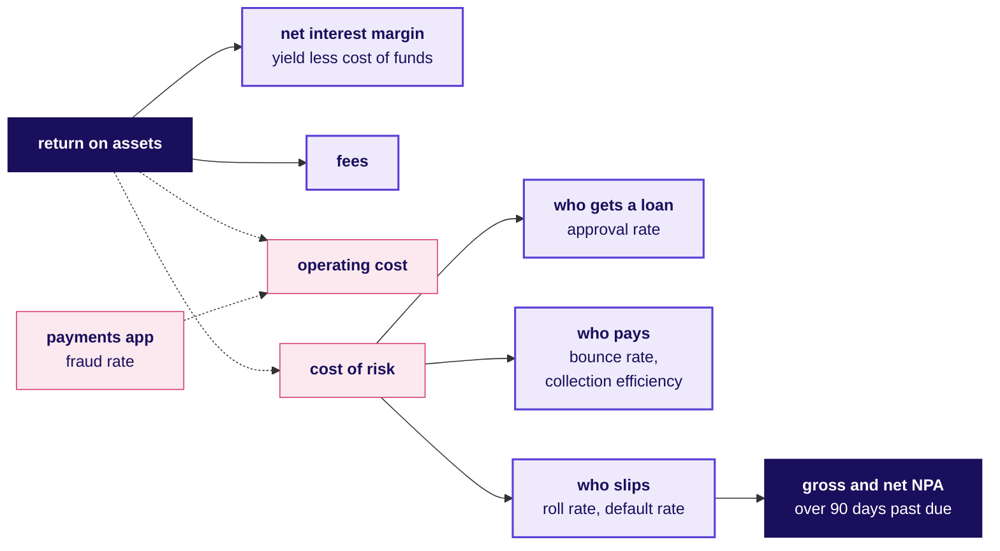

# Financial services card: how does a lender earn, and how is each number worked out?

Lending and payments at Kalpa Financial, the domain of Build 2: the tree every number hangs off, ten formulas, twenty words and the rules that bind the data. Kalpa is fictional; the dossier carries the worked numbers and the sources, checked on 28 October 2026.

## Which tree does every lending number hang off?

**Return on assets = net interest margin + fees, less operating cost, less cost of risk.** A default lands in cost of risk as money lent that does not come back; a good borrower turned away lands in the margin as interest never earned.

## How is each of the ten metrics worked out?

| Metric | Formula |
|---|---|
| Approval rate | Approved / applications decided |
| Bounce rate | EMI debits that failed / EMI debits presented |
| Collection efficiency | Amount collected / amount due in the month, arrears rule stated |
| Roll rate | Accounts moved to a worse DPD bucket / accounts in the earlier bucket |
| Default rate, by vintage | Loans of one month's batch at 90+ DPD within 12 months / loans in the batch |
| Gross NPA ratio | Loans over 90 days past due / gross loans |
| Net NPA ratio | (Gross NPAs less their provisions) / (gross loans less those provisions) |
| Cost of risk | Annual provisions and write-offs / average loan book |
| Net interest margin | (Interest earned less interest paid) / average interest-earning assets |
| Fraud rate | Fraudulent transactions / all transactions, by count and by value |

**Quote every rate with its base and its window.** A default rate on a fast-growing book falls because young loans have not had time to default.

## Which rules bind the data?

| Rule | What the data team does |
|---|---|
| Fair practices: RBI NBFC conduct directions, 2025 | Shows the KFS and APR before signing, writes in the borrower's language, and never harasses; recovery calls only in the permitted daytime window |
| Digital lending: RBI NBFC credit facilities directions, 2025 | Takes only needed data, with explicit consent and an audit trail; never reads files, contacts or call logs; keeps data in India |
| Credit bureaus: RBI's four CICs | Reports every digital loan, fortnightly or more often |
| KYC: RBI NBFC KYC directions, 2025 | Runs due diligence first and keeps records at least five years past the relationship |
| NPA: RBI NBFC IRACP directions, 2025 | Labels NPA past 90 days, SMA-1 past 30 and SMA-2 past 60 |
| DPDP Act, 2023, and Rules, 2025 | States a purpose for each use, lets consent be withdrawn, answers requests in 90 days; penalties reach Rs 250 crore |

## Which twenty words should you say fluently?

| Word | What it means |
|---|---|
| NBFC | A lender registered with RBI that is not a bank |
| AUM | All loans the lender holds and manages |
| EMI | The fixed monthly instalment |
| APR | Interest plus fees as one yearly rate |
| KFS | The Key Fact Statement shown before signing |
| Cooling-off | The first day or more in which a digital loan can be returned |
| Cost of funds | What the lender pays for the money it lends |
| NIM | Net interest income over the average book |
| Bureau pull | Reading an applicant's credit bureau history |
| Thin file | Little or no bureau history |
| Cut-off | The score below which the lender declines |
| DPD | Days past due since the missed EMI |
| SMA-1, SMA-2 | Overdue more than 30 days, more than 60 |
| NPA | Overdue more than 90 days |
| Cure | A late borrower back to current |
| Roll rate | Share of a bucket moving one bucket worse |
| Vintage | Loans disbursed in one month, tracked together |
| Provision | Money set aside for expected losses |
| Write-off | A loan removed from the books as lost |
| LSP | A firm doing part of the lending journey for the lender |

**Check the consent and the purpose of a column before it enters a model.**

