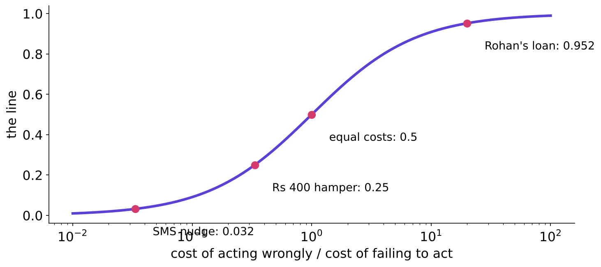
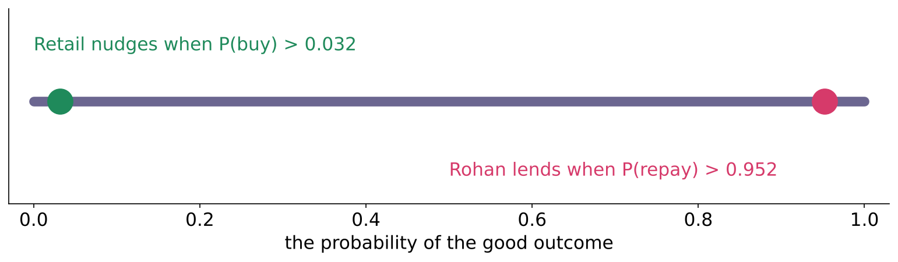
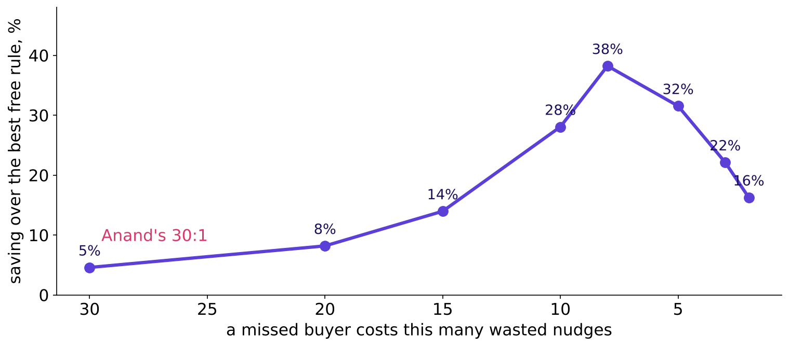
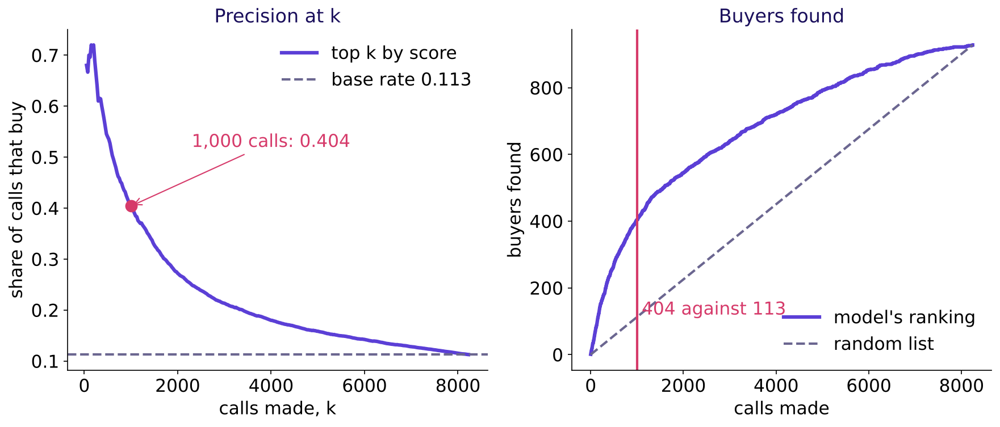

# The metric trap: study notes

Week 5, Tuesday 3 November 2026. Scoring the model the way the business will judge it, in two businesses. Reading time about 30 minutes.

## What can you do after Tuesday?

- You can read any confusion matrix aloud as four sentences about people, and say which two cells cost money.
- You can compute precision, recall and F1 from four counts and say which business question each answers.
- You can expose an accuracy figure on an imbalanced outcome by putting the do-nothing accuracy beside it.
- You can set a threshold from two prices with the 1-in-N test and say when a budget overrides it.
- You can say when a model barely matters and when it earns its keep, with a number for each.
- You can move the same model to a lending business and explain, on the same quantity, why the line sits at the other end.

## Where does Tuesday sit?

Tuesday worked six ideas on tiny invented tables in the morning and ran them on a Portuguese bank's 41,188 phone calls in the afternoon (UCI Bank Marketing, CC BY 4.0). ROC curves and AUC were named and left for the IITGN faculty session (tentative); cost-sensitive training was left out entirely.

| Before | Today | After |
|---|---|---|
| Monday: the split, the 88.7 percent baseline, a probability per client | the matrix, the ratios, accuracy's trap, prices, the line, the transfer | Wednesday: are the columns honest? Build 2: Rohan's lending brief with this exact constraint written in |

The outcome tie: in Build 2 next week, the first question on Rohan Desai's lending brief is where the approval line sits and what each mistake costs; Tuesday is that answer.

## What is the one picture to redraw?

**The two humps and the line.** Every client has a score. Buyers and non-buyers form two overlapping humps. The threshold is a vertical line, everything right of it is acted on, and the four boxes are what the line produces. Redraw it tonight from memory under Monday's timeline.

The running thread through these notes is Monday's model on the bank's validation slice: 8,238 clients, 928 buyers.

## Chapter 1: what do the four boxes say?

**The idea in three lines.** Each customer carries two labels: what the model said and what happened. Two labels with two values make four boxes, true positive, false positive, false negative and true negative. Every metric of the day is a ratio of those four counts.

**Worked example.** Twenty invented Kalpa customers: 3 nudged and came back (TP), 3 nudged and did not (FP, Rs 40 each), 2 left alone who came back (FN, Rs 1,200 each), 12 left alone who did not (TN). The bill of mistakes is `3 x 40 + 2 x 1,200 = Rs 2,520`.

**The thread.** Monday's model at 0.5: TP 174, FP 94, FN 754, TN 7,216.

**WATCH OUT.** scikit-learn's `confusion_matrix` prints `[[TN, FP], [FN, TP]]`, so its top-left cell is the true negatives. The tell: a "true positive" count larger than the number of real positives.

**IN THE FIELD.** PhonePe's fraud team validated its labels by sampling flagged transfers and phoning the senders, because a matrix is only as honest as its truth column (PhonePe Tech, 28 July 2022, verified 28 October 2026).

**Interview line.** "Read this matrix aloud in the business's words, then tell me which cell costs most."

## Chapter 2: which question does each ratio answer?

**The idea in three lines.** Precision asks, of those we flagged, how many were right: `TP / (TP + FP)`. Recall asks, of those who were real, how many we flagged: `TP / (TP + FN)`. F1, `2PR / (P + R)`, stays low when either is low and weighs both mistakes equally.

**Worked example.** On the twenty: precision 3 of 6 = 0.50, recall 3 of 5 = 0.60, F1 0.55. A model that flags one person and is right has precision 1.0 and recall 0.2: the plain mean says 0.60, F1 says 0.33.

**The thread.** At 0.5 the bank model's precision is 0.649 and its recall 0.188: its calls are good and it misses four buyers in five.

**WATCH OUT.** Dividing by everyone: 3 of 20 = 0.15 is the share of all customers flagged and right, which nobody asked for.

**IN THE FIELD.** Stripe defines the two as the business sees them: "The precision of our policy is the fraction of transactions we block that are actually fraudulent"; recall "is the fraction of all fraud that is caught by our policy" (Stripe, Radar technical guide, verified 28 October 2026).

**Interview line.** "Precision, recall and F1 from this matrix, and which one matters here?"

## Chapter 3: why can 89 percent mean zero?

**The idea in three lines.** On an imbalanced outcome the rule that never acts is right on the whole majority, so its accuracy equals `1 - base rate`. A useful model can score lower accuracy than a useless one. Accuracy stops misleading near 50:50 when both mistakes cost the same.

**Worked example.** One hundred invented customers, 11 repeaters. Saying no to all: 89 percent accurate, 0 of 11 found, bill Rs 13,200. A model that flags 20 and finds 8: 85 percent accurate, bill Rs 4,080.

**The thread.** Calling nobody on the bank's slice is 88.74 percent accurate; Monday's model is 89.71. The one-point gain hid a recall of 0.188.

**CALLBACK.** Week 1 Monday: a rate is meaningless until its denominator and comparison are named.

**IN THE FIELD.** Razorpay notes that fraud may be confirmed "only when a dispute appears weeks later, and some fraud is never reported", so the positive class is rare and late, which is exactly where accuracy flatters (Razorpay engineering blog, 10 September 2026, verified 28 October 2026).

**Interview line.** "Accuracy is 96 percent on a 96 to 4 split. Good model?" Ask for the base rate and the true-positive cell first.

## Chapter 4: what does each mistake cost?

**The idea in three lines.** Price the two mistakes. One Rs 1,200 buyer pays for thirty Rs 40 nudges, so a nudge pays whenever at least 1 in 31 lookalikes would buy. The course's 1-in-N test, written as a formula and named last: `threshold = cost of acting wrongly / (cost of acting wrongly + cost of failing to act)`.

**Worked example.** Three businesses: Kalpa's nudge, 40 against 1,200, acts above P(buy) 0.032 and recall leads; Stripe's fraud block, 2.08 dollars of lost profit against 38.92 dollars of fraud loss, acts above P(fraud) 0.051; Rohan's loan, Rs 60,000 against Rs 3,000, lends above P(repay) 0.952 and precision leads.

**WATCH OUT.** Choosing the metric by habit. Three invented models all 75 percent accurate carry bills of Rs 6,000, Rs 2,520 and Rs 200.

**IN THE FIELD.** Stripe's guide works the same arithmetic: "one fraudulent sale costs you the profit of $38.92 / $2.08 = 18.71 legitimate sales, and your break-even precision is 1 / (1 + 18.71) = 5.07%" (verified 28 October 2026).

**ORIGIN.** The threshold that minimises expected cost is standard decision theory; the "1-in-N" name is this course's own construction, so search for "expected cost threshold" or "cost-sensitive threshold" outside it.

**Interview line.** "Precision or recall for fraud, and why?" Ask for the two prices first.

## Chapter 5: where do you draw the line?

**The idea in three lines.** The model ranks; the business draws the line. On twenty invented scores the bill is Rs 3,640 at 0.5, Rs 560 for nudging everyone and Rs 360 at 0.032. Accuracy peaks somewhere else, so a line chosen by accuracy is a line chosen by the wrong rule.

**Worked example.** Keep the Rs 1,200 margin and raise the price of acting: a Rs 40 SMS gives 0.032, a Rs 400 hamper 0.25, a Rs 1,200 visit 0.5.

**WATCH OUT.** The formula needs honest probabilities. A model trained to "balance" the classes inflates every score, and the formula then calls nearly everyone.

**IN THE FIELD.** scikit-learn 1.9 ships `FixedThresholdClassifier` to set a line and `TunedThresholdClassifierCV` to tune one, and its guide states that `predict` uses 0.5 by default (scikit-learn user guide 3.3, verified 28 October 2026).

**Interview line.** "Why not just use 0.5?" Because 0.5 is the line for equal costs.

## Chapter 6: why does the same model sit at the other end in lending?

**The idea in three lines.** In lending the dear mistake is the approval: one Rs 60,000 default wipes out twenty Rs 3,000 good loans. So Rohan lends only when at least 20 in 21 applicants like this one repay, P(repay) above 0.952. Same formula, same quantity, opposite end.

**Worked example.** Twenty invented applicants: copying Retail's 0.032 approves everyone and costs Rs 360,000; Rohan's 0.952 approves 8 and costs Rs 18,000; rejecting everyone costs Rs 42,000.

**WATCH OUT.** Comparing 0.03 on P(buy) with 0.05 on P(default): two quantities. Say both lines on the chance of the good outcome.

**IN THE FIELD.** German Credit ships with its own cost matrix: classing a bad customer as good is five times worse than the reverse, which puts the line at P(good) 5 in 6, 0.833 (UCI and OpenML records, verified 28 October 2026). Tonight's lab runs it.

**Interview line.** "The same model in retail and in lending: why are the thresholds opposite?"

## What did the bank's calls show?

| Case | Question | Answer from the run |
|---|---|---|
| 1 | Did the 89.7 percent model find anyone? | 174 of 928 buyers at 0.5; calling nobody is 88.74 percent accurate |
| 2 | What does 1 in 31 call? | 7,438 clients, 913 of 928 buyers, bill Rs 279,000 against Rs 292,400 for calling everyone: 4.6 percent saved |
| 3 | Which 1,000 to call? | the top 1,000 by score hold 404 buyers against about 112 at random; the bill falls by about Rs 3.6 lakh |

The rule with its flip: at 30 to 1 a call is so cheap that calling nearly everyone is close to optimal, and the model barely matters. It earns its keep when the ratio tightens (38 percent saving at 8 to 1) or a budget binds.

**IN THE FIELD.** Flipkart's trust team hand-labelled the 250 accounts a CMU model ranked most suspicious: 211 were fraud, over 84 percent, and all of the first 50 were (Hooi and others, arXiv 1511.06030, verified 28 October 2026). A review budget is a precision at k.

**WATCH OUT.** "The new setting finds 544 buyers against 404" compares 2,000 calls with 1,000. Compare lists at the same number of calls.

## Which seat decides the line?

| Seat | Their question about Tuesday's decision | Decides here? |
|---|---|---|
| Business owner | What does each mistake cost, in rupees? | yes: the prices set the line |
| Product manager | What does a customer see when we are wrong? | for fraud and lending, yes; for a Rs 40 nudge, little |
| Solution architect | Where does the threshold or the budget live, and who changes it? | no, but it must be one configuration value |
| Senior ML engineer | Are the probabilities honest enough for the formula? | yes: a "balanced" model breaks it |
| Implementation engineer | How is the cut configured and logged each day? | no |
| QA | Which test proves the right line is in force? | no, but the test ships with the line |

## Where does this decide something with a cost attached?

- A collections team can phone 300 overdue borrowers a day, so it ranks by risk and reports precision at 300, never accuracy.
- A payments app blocks transfers above a fraud score; when a false block loses a customer, the line rises and precision leads.
- A clinic's screening test sends positives for a cheap confirmation, so recall leads and the line sits low.

## Try this yourself, with no code

1. A miss costs Rs 2,000 and a false alarm Rs 200. Where is the line, as 1 in N?
2. A model is 92 percent accurate on an 8 percent outcome. What do you ask for first?
3. Rohan's loss after recoveries falls to Rs 30,000. Where does his line move?
4. From Monday: your model only ties the baseline. What do you tell Marketing?

Self-check: (1) `200 / 2,200`, 1 in 11, about 0.09; re-read chapter 4 if missed. (2) The true-positive cell, since saying no scores 92; chapter 3. (3) `30,000 / 33,000 = 0.91`, 10 in 11; chapter 6. (4) It has not earned its keep yet: ship the rule, with its cost, and name the next check; Monday's notes.

## Where is this tested?

| Question | What is tested | A weak answer |
|---|---|---|
| Precision, recall and F1 from a matrix | the two denominators | divides by everyone |
| 96 percent on 96 to 4: good? | the do-nothing comparison | "96 is high" |
| Precision or recall for fraud? | prices before a metric | "recall, always" |
| Threshold when errors cost differently? | the derivation and its assumption | "maximise F1" |
| Retail against lending: why opposite? | the dearer mistake changed sides | "lending needs a better model" |

## Which terms did Tuesday use?

| Term | Plain meaning | Example from today |
|---|---|---|
| Confusion matrix | counts of each pair of prediction and truth | TP 174, FP 94, FN 754, TN 7,216 |
| Precision | of those flagged, the share right | 174 of 268, 0.649 |
| Recall | of those real, the share flagged | 174 of 928, 0.188 |
| F1 | harmonic mean of the two | 0.291 at 0.5 |
| Base rate | the share of positives | 11.26 percent of validation clients bought |
| Threshold | the score at or above which we act | 0.032 for the nudge |
| 1-in-N test | act when at least 1 in N would come good, N set by the prices | 1 in 31 |
| Precision at k | the share of positives in the top k | 0.404 at 1,000 |

## Where do you go deeper, in order?

| Step | What | Time |
|---|---|---|
| 1 | StatQuest, "Machine Learning Fundamentals: The Confusion Matrix", https://www.youtube.com/watch?v=Kdsp6soqA7o (verified 28 October 2026) | one short video; length not checked |
| 2 | Google MLCC, "Classification: Accuracy, recall, precision, and related metrics", https://developers.google.com/machine-learning/crash-course/classification/accuracy-precision-recall (verified 28 October 2026) | 20 minutes |
| 3 | MLU-Explain, "Precision and Recall", https://mlu-explain.github.io/precision-recall/ (verified 28 October 2026) | 15 minutes |
| 4 | Stripe, Radar technical guide, https://stripe.com/guides/primer-on-machine-learning-for-fraud-protection (verified 28 October 2026) | 20 minutes |
| 5 | scikit-learn, "Tuning the decision threshold for class prediction", https://scikit-learn.org/stable/modules/classification_threshold.html (verified 28 October 2026) | 15 minutes |
