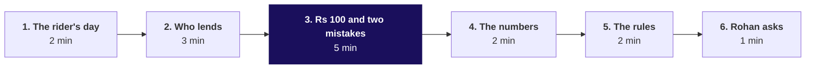
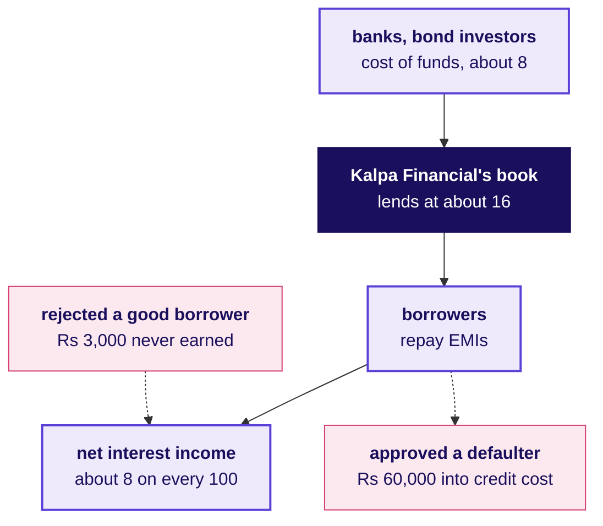

# How does a lender like Kalpa Financial make money, and where do Rohan's two costs land?

**TRAINER ONLY.** The talk track for the 15-minute financial services story, told just before chapter 6, *Same model, opposite threshold*. No laptop opens. The learner reads the same business at depth in `3_study_material_for_students/C2_W05_D02_domain_financial_services_STUDENT.md` (the dossier) and keeps `C2_W05_D02_financial_services_card_STUDENT.pdf` (the card), which goes out at the day's close.

**Who needs the answer.** The room, before Rohan's question reaches it. Chapter 6 asks them to set a loan threshold in a business none of them has worked in, and a learner who cannot say where a default and a wrongful rejection land on a lender's page sets it by rote.

**The questions on the way.** Ask each aloud before its part answers it.

1. What happens at Kalpa Financial in one day?
2. Who actually lends the money when you borrow inside a payments app?
3. Where do Rs 100 lent go, and where does each mistake land?
4. Which numbers does a head of risk read every evening?
5. Which data may a lending model never touch?
6. What does Rohan ask?

---

## What must the 15 minutes land, and what must they never say?

| | |
|---|---|
| **Slot** | 15 minutes, after chapter 5 and before chapter 6; the room already owns the matrix, precision and recall, imbalance, the 1-in-N test and the nudge threshold |
| **Start from** | Nothing about lending: assume the room has paid with UPI and has never read a lender's results |
| **Go as far as** | Every learner can say how a lender earns (cost of funds, net interest income, credit cost), which line a default hits and which line a wrongful rejection hits, what an NPA is, and two rules that bind lending data |
| **Stop before** | Rohan's threshold. The story never divides Rs 60,000 by Rs 3,000, never says "20 in 21" or 0.95, and never says which way the threshold moves; chapter 6 does that by hand |
| **Hands over to** | Rohan's question, read as the last line, which opens chapter 6 |
| **Cut first** | Part 4 to its one question, then part 5 to the contact-list question; never cut part 3 |

**What never gets said.**

- The loan threshold, its ratio or its direction, in any numbers, invented ones included.
- Anything Build 2's data is built for groups to find: which application column is written after the decision, and whether the lending campaign's lift is cause or mix.
- That Kalpa is modelled on a real company. Say "Kalpa is fictional, and these are real companies that look like parts of it."
- What licence Kalpa Financial holds. The story does not say; the dossier treats it like an NBFC lender.

---

## Part 1: What happens at Kalpa Financial in one day? (2 minutes)

**Say.**

- "Kalpa Financial Services runs two things: a payments app and a consumer lending book across India. Rohan Desai is its head of risk."
- "A delivery rider in Pune pays for tea with the app in the morning. At lunch the rider taps 'loan', sees a Key Fact Statement with the APR and every charge, agrees to share data for this loan, and a model scores the application against a credit bureau report."
- "Rs 50,000 lands in the rider's own bank account by the evening. Meanwhile collections calls borrowers whose EMI bounced, and treasury borrows from banks to fund tomorrow's loans."

**Ask the room.** "When you borrow inside a payments app, whose money is it?"

- Listen for: a bank or an NBFC behind the app.
- Likely wrong answer: "The app's own money."
- Correct it in part 2, with PhonePe's own words.

---

## Part 2: Who actually lends the money when you borrow inside a payments app? (3 minutes)

**Say.**

- "PhonePe's loans page says it is 'a platform facilitating loan transactions between borrowers and RBI-registered NBFCs or Banks' and that it 'does not lend directly'. The app is the shop window; a lender's balance sheet carries the loan."
- "Bajaj Finance is a lender at scale: 13.45 million new loans in the quarter to September 2026, gross NPA 1.06 percent."
- "Tata Capital is the Tata group's lending arm, the way Kalpa Financial is the Kalpa Group's. In the quarter to June 2026 its credit costs were 1 percent and its cost of funds 7.28 percent. Hold that 7.28; it comes back in part 3."
- "Kalpa Financial has both halves in one house: the app and the book."

**Ask the room.** "If the app only arranges the loan, who loses money when the borrower stops paying?"

- Listen for: the lender whose book holds the loan.
- Likely wrong answer: "The app, because the customer is its customer."
- Correct it: the loss sits on the balance sheet that lent; the app loses the customer's trust and its fee.

---

## Part 3: Where do Rs 100 lent go, and where does each mistake land? (5 minutes)

This is the part that chapter 6 stands on. Build the board drawing box by box as you say each line.

**Say.**

- "A lender is a shop whose stock is money. It buys money from banks and bond investors at the cost of funds, about 7 to 8 rupees a year on every 100. It lends at, say, 16. The gap, 8 rupees, is net interest income." Numbers are illustrative; say so.
- "Out of that 8 come staff and technology, about 4 here, and the loans that stop paying, about 2. What is left is profit, about 3 before tax."
- "Now Rohan's two mistakes. Approve someone who defaults, and Rs 60,000 of lent money does not come back: that lands in credit cost. Reject someone who would have repaid, and Rs 3,000 of interest is never earned: that lands in net interest income."
- Point at both boxes on the board and stop there.

**Ask the room.** "Which of these two mistakes would the evening dashboard show Rohan, and which would it never show him?"

- Listen for: the default shows up as a loss on the book; the good borrower turned away leaves no row anywhere, since the lender never learns how that person would have repaid.
- Likely wrong answer: "Both, because both cost money."
- Correct it: only a loan that was made has an outcome to record, so the default shows on the books and the turned-away borrower never does.

**Draw: the money and the two mistakes, six boxes.** The dossier's section 3 carries the fuller drawing.

Leave the drawing up: chapter 6 works its hand count beside it.

---

## Part 4: Which numbers does a head of risk read every evening? (2 minutes)

**Say.**

- "Rohan's page has three rows of worry: who got a loan (approval rate), who is paying (bounce rate, collection efficiency) and who is slipping (roll rate between buckets of days past due)."
- "RBI's rule fixes the end of the slide: a loan overdue more than 90 days is a non-performing asset, an NPA. Before that it is tagged SMA-1 past 30 days and SMA-2 past 60."
- "Every one of these feeds the cost of risk, the 2 rupees in part 3."

**Ask the room.** "A lender doubled its lending this quarter and its default rate on the whole book fell. Good news?"

- Listen for: the new loans are too young to have defaulted, so the base grew before the defaults could.
- Likely wrong answer: "Yes, the new customers are better."
- Correct it: compare loans of the same age, one month's batch against another, which lenders call a vintage. Do not stage this with numbers; the dossier's metric table carries it.

---

## Part 5: Which data may a lending model never touch? (2 minutes)

**Say.**

- "RBI's digital lending rules, now in chapter III of its NBFC credit facilities directions of 28 November 2025, say a loan app may not read your files, contacts or call logs. It may use the camera, microphone or location once, for KYC, with consent."
- "Data is collected only as needed, with explicit consent and an audit trail, and stays on servers in India."
- "India's data protection law adds a stated purpose for every use, and penalties up to Rs 250 crore for failing to keep data safe."
- "Recovery may never harass, and collection calls stay inside a daytime window RBI fixes. A voice bot calling for the lender meets the same rule."

**Ask the room.** "A data scientist finds the phone's contact list makes the model more accurate. May the team use it?"

- Listen for: no, the digital lending rules forbid reading contacts, so the feature and the model built on it go.
- Likely wrong answer: "Yes, if the user clicked accept."
- Correct it: the rule names contacts and call logs as off limits for the app; consent does not reopen them.

---

## Part 6: What does Rohan ask? (1 minute)

**Say, as the last line.** "Rohan heard that Retail has a model scoring its customers. His question is whether the same machinery could score his loan applicants, where approving a defaulter costs Rs 60,000 and rejecting a good borrower costs Rs 3,000 of lost interest. Same model. What changes?"

Then open chapter 6. Do not answer.

---

## If the room asks

| Question | Answer |
|---|---|
| Is Kalpa Financial a bank or an NBFC? | The story does not say. The dossier uses the rules an NBFC lender like Bajaj Finance or Tata Capital works under. |
| Where do Rohan's Rs 60,000 and Rs 3,000 come from? | They are Rohan's figures in the story. The story does not break them down; part 3 shows which line each lands on. |
| Why does PhonePe not lend itself? | Its page says it arranges loans for RBI-registered NBFCs and banks. Its reasons are not on that page, so do not guess. |
| How big is UPI now? | 2,407 crore transactions worth Rs 29.37 lakh crore in September 2026, as FinTech BizNews reported from NPCI's data on 1 October 2026. |
| Do these rules apply to a US lender? | No. Kalpa Financial lends in India; US lending rules are outside today's story. |
| Which credit bureaus are there? | RBI's list of 18 August 2026 names four: CRIF, Equifax, Experian and TransUnion CIBIL. |

## Which facts does the story use, and where was each checked?

Every fact below was checked on 28 October 2026; URLs and the line per fact sit in `4_trainer_only/C2_W05_D02_domain_sources_INTERNAL.md`.

| Fact as said | Source |
|---|---|
| PhonePe is a platform for RBI-registered NBFCs or banks and does not lend directly | PhonePe, secured-loans page |
| Bajaj Finance booked 13.45 million new loans in the quarter to 30 September 2026; gross NPA 1.06 percent | Kotak Neo, 19 October 2026, reporting the results |
| Tata Capital's credit costs were 1 percent and cost of funds 7.28 percent in the quarter to 30 June 2026 | Tata Capital, Q1 FY27 media call, 28 July 2026 |
| NPA past 90 days; SMA-1 past 30 and SMA-2 past 60 | RBI, NBFC Income Recognition, Asset Classification and Provisioning Directions, 2025 |
| No files, contacts or call logs; camera, microphone or location once for KYC; consent with an audit trail; data in India | RBI, NBFC Credit Facilities Directions, 2025, chapter III |
| No harassment in recovery; calls inside a daytime window; the rule covers the lender's agents | RBI, NBFC Responsible Business Conduct Directions, 2025 |
| DPDP penalties up to Rs 250 crore for failing to keep data safe | PIB, "DPDP Rules, 2025 Notified", 17 November 2025 |
