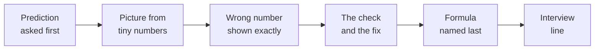

# W05 Tuesday trainer guide: the metric trap

Posts to <!-- sync:module:W05/D2 -->Module 2: Applied Machine Learning<!-- /sync:module:W05/D2 -->, on <!-- sync:day-date:W05/D2 -->Tue 03 Nov 2026<!-- /sync:day-date:W05/D2 -->. Deck: `1_in_class_training_content/slides/C2_W05_D02_slides_STUDENT.pptx` (64 slides; numbers below are the slide numbers printed bottom right).

## 1. The story in two lines

| Real case | Kalpa's decision |
|---|---|
| A Portuguese bank's phone campaign (UCI Bank Marketing, 41,188 calls, 11.3 percent buy). Calling nobody scores 88.74 percent; Monday's model at 0.5 scores 89.71 percent and finds 174 of 928 buyers. | Anand's Rs 40 nudge against a Rs 1,200 buyer sets the line at 1 in 31 (0.032), where the model barely beats calling everyone; Marketing's 1,000-call budget is where it earns its keep (precision at 1,000: 0.404 against 0.113). Rohan's Rs 60,000 against Rs 3,000 puts his line at P(repay) 0.952. |

## 2. The run table

| Block | Min | Slides | Open | What must land | Cut if late |
|---|---|---|---|---|---|
| Open: roadmap, week picture, ticket, topics, map | 8 | 1 to 6 | explorer `#story`, `#map` | Kavya's question: how many of 928 buyers were found? | the map walk to 30 seconds |
| Ch 1 Four boxes | 18 | 7 to 10 | ch01, explorer `#p1` | every cell said as a customer sentence; sklearn's top-left is TN | the sklearn trap to 2 minutes |
| Ch 2 Two ratios | 20 | 11 to 15 | ch02, explorer `#p2` | same numerator, two denominators | F1's arithmetic (slide 14) first |
| Ch 3 Accuracy | 15 | 16 to 19 | ch03, explorer `#p3` | say-no scores 89 and finds 0 | the free-accuracy curve |
| Drill 1: four matrices | 12 | 20 | paper | precision and recall in under a minute each | matrix C |
| Ch 4 What each mistake costs | 22 | 21 to 25 | ch04, explorer `#p4` | 30 x Rs 40 = Rs 1,200, so 1 in 31 | the Stripe row to one sentence |
| Ch 5 Where to draw the line | 20 | 26 to 30 | ch05, explorer `#p5` | the line comes from the prices | the `#p5` budget toggle (case 3 shows it) |
| *Break between blocks* | | | | | |
| Financial services story | 15 | 31 | `C2_W05_D02_domain_story_TRAINER.md`, explorer `#p6` steps 1 and 2 | how a lender earns and loses; Rohan's two prices | shrink to 10, never drop |
| Ch 6 Same model, opposite threshold | 15 | 32 to 36 | ch06, explorer `#p6` from step 3 | 20 in 21, said on P(repay) | never cut |
| Case 1 The do-nothing matrix | 15 | 37 to 41 | case01, explorer `#case` chapter 7 | the empty column on real data | never cut the reveal |
| Case 2 The cost threshold | 20 | 42 to 47 | case02, explorer `#case` chapter 8 | 0.032 calls 9 in 10 and saves 4.6 percent | the Stripe slide 47 |
| Case 3 The budget | 18 | 48 to 53 | case03, explorer `#case` chapter 9 | 404 of the top 1,000 against about 112 at random | the Flipkart slide 53 |
| Guided memo and transfer note | 20 | 54 | guided | memo to Kavya, note to Rohan | the memo finishes at home |
| Interview corner, quiz, close | 12 | 55 to 64 | Kahoot | the five anchors as questions | the six seats slide 56 |

Each block is 115 minutes of plan inside 120. The IITGN faculty block follows (section 9).

## 3. Taught before, teach today, do not teach today

| Taught before | Teach today | Do not teach today |
|---|---|---|
| Monday: framing, the seeded split, the 88.7 percent baseline, the logistic model's probability | The confusion matrix, cell by cell | ROC and AUC: name them only; the faculty block W5-2 (tentative) covers them |
| Week 4: expected value in rupees, cross-sell costs | Precision, recall and F1 derived | Precision-recall curves and PR-AUC as methods |
| Week 1: denominators, like with like | Class imbalance against accuracy | Multi-class metrics |
| | Choosing the metric from business cost; the 1-in-N test | Cost-sensitive learning as a method: `class_weight`, resampling, SMOTE |
| | Threshold selection as a business decision | Calibration beyond one sentence (Friday's split by time shows it break) |
| | The transfer to lending, the opposite threshold | Feature audit and leakage (Wednesday), regularisation (Thursday) |

## 4. The interview anchors, asked aloud

| Tag | Question | Asked at |
|---|---|---|
| [S] | Precision, recall and F1 from a confusion matrix | block 1, minute 30 (slide 12) |
| [S] | Accuracy is 96 percent on a 96 to 4 split; good model? | block 1, minute 48 (slide 17) |
| [S] | Precision or recall for fraud, and why? | block 1, minute 85 (slide 24) |
| [F] | How do you set a threshold when the two errors cost differently? | block 1, minute 105 (slide 29) |
| [D] | The same model in retail and in lending: why are the thresholds opposite, and how do you explain that to each business? | block 2, minute 27 (slide 35) |

## 5. How to teach each chapter

| Chapter | Picture to draw | Prediction to ask | Misconception staged | Wrong number and fix | Click | Interview line |
|---|---|---|---|---|---|---|
| 1 Four boxes | 2 by 2, twenty names in it | How many in "nudged and came back"? (3) | "15 right of 20, so it is good" | Reading sklearn's 12 as TP; fix: the bottom row sums to 5 real repeaters | ch01 loop cell, then the labelled DataFrame; `#p1` layout toggle to scikit-learn's printout | "Read this matrix in the business's words." |
| 2 Two ratios | shade the column, then the row | flags that landed or repeaters found, which is bigger? (recall 0.60) | precision over all rows | 3 of 20 = 0.15; fix: "of those we flagged" first, 3 of 6 = 0.50 | ch02 F1 chart | precision, recall, F1 from a matrix |
| 3 Accuracy | 100 dots, 11 green | say-no is right on how many? (89) | "higher accuracy is better" | say-no 89 percent with a Rs 13,200 bill against a model at 85 percent and Rs 4,080 | ch03 free-accuracy curve | "96 percent on 96 to 4?" ask for the TP cell |
| 4 Costs | 30 coins, one note | a nudge pays above what chance? (1 in 31) | "F1 balances, so use F1" | three models all 75 percent accurate, bills Rs 6,000, Rs 2,520, Rs 200 | ch04 three-stories table | "Precision or recall for fraud?" |
| 5 The line | the step curve of the bill | cheapest of 0.5, 0.2, 0.032, everyone? (0.032) | "keep the line where accuracy peaks" | 0.5 at 80 percent accuracy and Rs 3,640 against 0.032 at Rs 360 | `#p5`: commit the prediction, drag the line, read the trace | "Why not 0.5?" |
| 6 Transfer | one axis, two dots at each end | lend above 0.05, 0.5, 0.83 or 0.95? (0.95) | "lending needs a different model" | Retail's 0.032 copied: Rs 360,000 against Rs 18,000 | `#p6`: play to step 5, then the loss slider | the [D] anchor |
| Case 1 | two real matrices side by side | how accurate is calling nobody? (88.74) | "89.7 percent, ready to ship" | 754 of 928 buyers left alone, Rs 9.05 lakh | case01 humps chart | "Is 89 percent good on an 11 percent outcome?" |
| Case 2 | the bill curve and the two free lines | which of four options is cheapest? (cost line) | "the cost line saves Rs 6.3 lakh" | that saving is against 0.5; against calling everyone it is Rs 13,400, 4.6 percent | `#case` chapter 8: the ratio slider from 30 to 1 to 8 to 1 | "When does the model stop mattering?" |
| Case 3 | precision at k against the base rate | buyers in the top 1,000? (404) | "more buyers found means a better model" | 544 from 2,000 calls; fix: compare at equal k, spend per buyer Rs 99 against Rs 147 | case03 gains chart | "With a fixed budget, which metric?" |

Notes that save a chapter:
- The bank's real costs are unknown; Kalpa's prices are applied to the bank's calls. Say so once, in case 1.
- The row's planted numbers (thresholds 0.12 and 0.85, the 96 to 4 flag) belonged to Kalpa v6 data that was never generated. The room derives 0.032 and 0.952 from the prices, and the bank's own base rate is 11.3 percent. If a learner quotes the row's 0.12, the answer is that 0.12 would be right at a ratio of about 7 to 1.
- If a learner asks about `class_weight="balanced"` as the fix for imbalance: it is cost-sensitive learning, which is out of scope today, and it breaks the 1-in-N formula because it inflates every probability (the mean prediction rises from about 0.11 to about 0.42 on this file, so the formula calls everyone). Park it for the faculty block.
- The formula assumes honest probabilities. One sentence today; Friday's split by time shows them break.
- If a learner says "the model is pointless at 30:1": right on this file, and the budget is the condition that flips it. That is the rule with its flip, and it is the day's best answer.

## 6. The spotlight seat: the business owner

| Where | Ask the business owner's question |
|---|---|
| Chapter 1 | Which two boxes cost you money, and how much each? |
| Chapter 4 | Of these three models with the same accuracy, which do you fund? |
| Case 2 | Is Rs 13,400 worth a model build, a monitoring job and a retrain each quarter? |
| Case 3 | You have 1,000 calls: what is the model worth against a random list, in rupees? |

Ask it in the owner's voice, then have one learner answer in rupees and one name the seat that would object (usually the senior ML engineer: are the probabilities honest?).

## 7. The quiz, ready to type into Kahoot

| # | Question | A | B | C | D | Key |
|---|---|---|---|---|---|---|
| 1 | TP 174, FP 94, FN 754, TN 7,216: how many buyers did the model find? | 7,216 | 268 | 928 | 174 | D |
| 2 | TP 30, FP 20, FN 70, TN 880: what is recall? | 0.60 | 0.30 | 0.03 | 0.91 | B |
| 3 | 96 percent accuracy on a 96 to 4 outcome: what did the model learn? | the base rate and nothing else | a strong signal for repeat buyers | how to rank the top 4 percent | the cost of a missed buyer | A |
| 4 | A miss costs Rs 1,200, a false nudge Rs 40: which metric leads, and where is the line? | precision; near 0.97 | recall; near 0.03 | accuracy; at 0.50 | F1; near 0.50 | B |
| 5 | A false approval costs Rs 60,000, a wrongful rejection Rs 3,000: where does the line go? | it falls to about 0.05 on P(repay) | it stays at 0.50 | it rises toward 0.95 on P(repay) | it depends only on the model | C |
| Return | Monday: your model only tied the baseline; what do you tell Marketing? | ship it, since it is no worse than the rule | it has not earned its keep; ship the rule | it scores 89 percent, so it is ready to use | retrain it until accuracy passes 95 percent | B |

Drill 1 answers (slide 20): A precision 0.20, recall 0.80; B 0.75 and 0.50; C 0.875 and 0.90; D 0.649 and 0.188.

## 8. The practice-lab run sheet for the TAs

The lab is `2_take_home_mandatory/C2_W05_D02_practice_lab_STUDENT.ipynb`, solutions in `4_trainer_only/C2_W05_D02_practice_lab_solutions_TRAINER.ipynb`. It runs about 90 minutes after the faculty block, and it is extra practice beyond the take-home's hours.

1. Ten minutes: re-run `case03` on the projector and read precision at 1,000 aloud.
2. Then the lab: German Credit (OpenML credit-g), its documented 5 to 1 matrix, then Rohan's 20 to 1.

| TODO | Expected | Three commonest wrong answers | Never cut |
|---|---|---|---|
| 1 The 5:1 line on P(good) | 5 / 6 = 0.833 | 1/6 = 0.167 (ratio upside down); 0.5; 0.2 (on P(bad) without saying so) | yes |
| 2 Matrix at 0.833 on the 300 test applicants | approved 128; bad approved 13; good rejected 95 | counting "approved" as P(bad) above the line; mixing up good-rejected and bad-approved; using all 1,000 rows | yes |
| 3 Cost in matrix units | 0.5: 266; 0.833: 160; approve all: 450; reject all: 210 | 5 x good-rejected + 1 x bad-approved (weights swapped); forgetting the reject-all rule; adding the true cells | yes |
| 4 Rohan's 20:1 line and bill | 0.952; approves 43, 3 bad; Rs 690,000 against Rs 630,000 for rejecting everyone | expecting the model to win; using 0.833 again; quoting Rs without the reject-all comparison | the comparison, yes |
| 5 Integration: approvals by checking account | groupby table: the "no checking" group is approved most | grouping on the wrong column; reading counts as rates | can cut |
| 6 QA: a second seed and calibration | seed 7: cost 196 against 210 for the best free rule; the top calibration bin over-predicts, 0.965 against 0.933 | changing the threshold along with the seed; reading the calibration table as counts | can cut |

Cut order if the lab runs long: step 6, then step 5. The write-up's five lines are never cut.

## 9. The IITGN faculty block, and what fills it if it does not run

<!-- sync:faculty-day:W05/D2 -->
**IITGN faculty block W5-2 (tentative), 120 minutes, after this row's applied core.** Faculty: to be confirmed by IIT Gandhinagar.

TOPIC: Curves and costs: ROC and AUC, the precision-recall curve, expected cost and the threshold that minimises it, and calibration.
PICKS UP WHERE THE ROW STOPS: the row names ROC and AUC and stops before them, and before cost-sensitive learning.
CONNECTS TO KALPA: Anand's two error costs and Rohan's flipped ratio; the course's 1-in-N test is the expected-cost threshold said in plain words.
BY THE END: a learner can draw both curves from a score table, say when AUC misleads on an imbalanced outcome, and derive the threshold from two costs.
DOES NOT REPEAT: the confusion matrix and the three metrics.
<!-- /sync:faculty-day:W05/D2 -->

Your row stops where the faculty block starts: the close (slide 64) is the last thing you run. When you mention the block to the room, say it is tentative.

If the block does not run, the 120 minutes go to:

| Min | What | File |
|---|---|---|
| 40 | The practice lab moves forward, led by the trainer | `2_take_home_mandatory/C2_W05_D02_practice_lab_STUDENT.ipynb` |
| 30 | Drill 2 in full: three cost stories (fraud screen, cancer screening, coupon), pick the metric and defend it in pairs | practice set problems 4 and 5 |
| 30 | Practice set Part A, problems 8 to 10, worked at the board | `2_take_home_mandatory/C2_W05_D02_practice_set_STUDENT.md` |
| 20 | Explorer sandbox: each pair finds the ratio at which the model starts to matter | `demos/C2_W05_D02_threshold_explorer_STUDENT.html#case`, chapter 8 |

## 10. Fallbacks

| If | Then |
|---|---|
| The bank's download fails for some of the room | Pair them with a neighbour whose cache filled; project the executed notebook; the outputs are saved in every notebook. |
| A kernel dies | One notebook open at a time; restart and run all; shut kernels at the break. |
| The projector cannot run the explorer | Open it as a local file on the trainer's laptop; failing that, show slides 44 and 46. |
| The domain story's files are not in the folder yet | Tell the story from the dossier's headings: how a lender earns interest, loses principal, and why one default costs twenty good loans. |

The ME1 window runs this week as a continuous activity; state its scope aloud and nothing more.

## 11. The explorer, page by page

The file is `1_in_class_training_content/demos/C2_W05_D02_threshold_explorer_STUDENT.html`. Each page opens from the side menu, from its number key, or by adding its name after the address (`#p5`). Every page asks for a prediction before it shows its answer, so ask the room to commit first. Press P for presenter mode on the projector. Slide 30 still shows the earlier, single-screen version of this page; the clicks below are the current ones.

| Page | When | Click, in order | What lands |
|---|---|---|---|
| `#story` | Opening | Play the five scenes; take three guesses; commit one | 174 of 928 buyers found at 0.5, while accuracy reads 89.7 percent. |
| `#map` | Opening | Play the path, one step per chapter | Six topics, what they rest on and what they feed. |
| `#p1` | Ch 1 | Commit; play the twenty tags; flip the layout to scikit-learn's printout; switch to the bank's 8,238 and drop the line to 0.10 | 15 of 20 right and 3 of 5 repeaters found; the top-left 12 is TN; wasted calls grow fastest. |
| `#p2` | Ch 2 | Commit; step through the column, the row, the slip and F1; move the two sliders | 3 of 6 and 3 of 5; F1 0.33 against a plain mean of 0.60 for model B. |
| `#p3` | Ch 3 | Commit; play the three pictures; slide the repeaters to 4, 11, 30 and 50 | Saying no to everyone scores 89, and 96 at Kalpa's 4 percent. |
| `#p4` | Ch 4 | Commit; play to step 3; set a wasted nudge to Rs 400, then to Rs 2,400 | 1 in 31, then 1 in 4, then 2 in 3 with precision leading. |
| `#p5` | Ch 5 | Commit; drag the line from 0.5 to the price line; turn on the 1,000-call budget | Rs 908,560 falls to Rs 279,000; the budget puts the line at 0.182 and precision at 0.404. |
| `#p6` | Story, then Ch 6 | Steps 1 and 2 in the story; then commit, play steps 3 to 5, and halve the loss to Rs 30,000 | Rs 360,000 for the copied line against Rs 18,000 at 0.952; 0.909 at Rs 30,000. |
| `#case` | Cases 1 to 3 | One chapter tab per case: commit, use the one control, then answer the trap card | 88.74 percent for calling nobody; Rs 13,400 over calling everyone; 404 in the top 1,000. |
| `#field`, `#interview`, `#check` | After class, or the faculty-block fallback | Learners work them alone | Four verified company scenes, five interview situations, eight checks. |

