# Feature engineering and leakage

Week 5, Day 3.

Header: WEEK 5  ·  WEDNESDAY  ·  WHAT THE MODEL IS ALLOWED TO KNOW

Quote: settlement_status is written after delivery, when the payment clears.
Who: Kalpa's data platform lead, reading the schema the night the score hit 0.99

```notes
LIVE, 1 minute. Read the quote and stop. Do not explain it yet; chapter 3 does. Today's whole day
hangs on the gap between a score measured on a table built after the outcome and a model that has
to run before it. Transition: the five topics and the case.
```

---

## S1. Week 5 sits between the analyst's craft and Build 2
*Twenty weeks; today is the middle of the machine learning core*

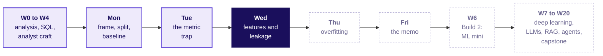

```notes
LIVE, 1 minute. Monday framed the call list and set the baseline of 0.887; Tuesday read the same
model through recall and the Rs 40 against Rs 1,200 bill. Today decides what goes into the model.
Thursday tunes on today's feature set; Build 2 moves the method to Rohan's lending book.
```

---

## S2. The week's picture, as Tuesday left it
*Past rows, the cut, the prediction moment, the outcome window*

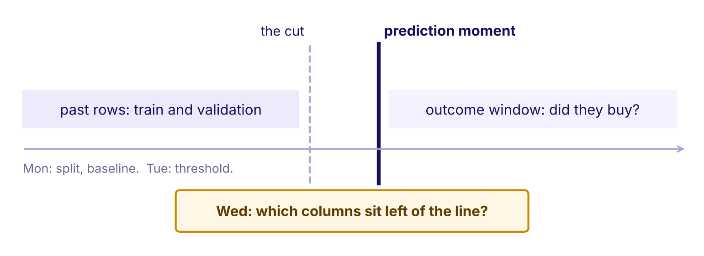

```notes
LIVE, 1 minute. This is the picture the room redraws every night. Point at the thick line: the
moment the call list is made. Today's question sits in the orange card. Ask the room to keep one
hand on that line all day: every column is either left of it or right of it.
```

---

## S3. Today's ticket: Kalpa's 0.99 and the bank's jump
*The ask, the data and the caveat, on one page*

| On the ticket | What it says |
|---|---|
| Kalpa | A junior joins `settlement_status` from the payments feed; validation hits 0.99; Marketing wants it shipped tonight |
| The bank | A junior joins the economy feed and the call log to the customer table; AUC jumps from 0.76 |
| The data | UCI Bank Marketing, 41,188 calls, 20 inputs, 11.3 percent yes |
| The ask | Ship the feature set with a reason per column and the honest score |
| Who asks | The campaign head and Kavya Nair, Kalpa's senior analyst |
| The caveat | The rows run May 2008 to November 2010 in date order |

```notes
LIVE, 3 minutes. Read the Kalpa row aloud and take a prediction before anything else: what happens
to the 0.99 once the platform lead's remark is taken seriously? Write the room's guesses on the
board; chapter 3 settles them. The bank row is the same file as Monday; the jump is measured in
case 1. Transition: the five topics that get us there.
```

---

## S4. Five topics in five chapters, then three case chapters
*The curriculum's words, the chapter, the minutes and the notebook*

| # | The topic, in the curriculum's words | Chapter | Minutes | Notebook |
|---|---|---|---|---|
| 1 | Feature engineering from the customer table: ratios, recency, counts, cohort age, basket signals | 1 Turning raw columns into signals | 22 | ch01 |
| 2 | Encoding categoricals; scaling numerics; which models care | 2 Teaching a model to read categories | 18 | ch02 |
| 3 | Leakage and the prediction-time question | 3 Answers from the future | 20 | ch03 |
| 4 | The column audit | 4 Interrogating every column | 15 | ch04 |
| 5 | Feature importance and its limits | 5 What the importance chart can't tell you | 15 | ch05 |

Cases 6, 7 and 8 apply the topics to the bank's calls in notebooks case01 to case03.

```notes
LIVE, 1 minute. Read the second column once; these are the words to search later. Each concept
chapter teaches on an invented Kalpa table, and each case chapter names the topics it applies.
A 10-minute break follows chapter 3.
```

---

## S5. Five topics, joined to what came before and after
*What each one rests on and where it is applied*

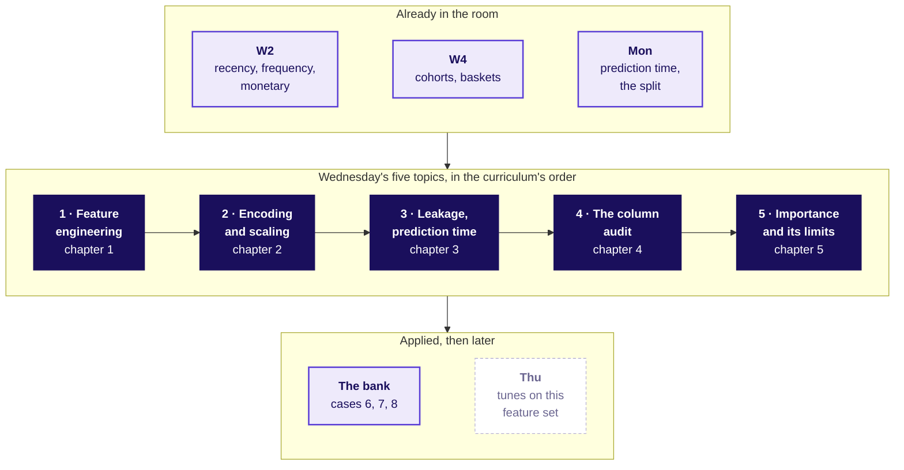

```notes
LIVE, 1 minute. Week 2 gave recency, frequency and monetary; Week 4 gave cohorts and baskets;
Monday gave prediction time. Today turns them into features, checks each against the clock, and
reads what the model does with them.
```

---

## SECTION 1: Turning raw columns into signals: what does a row know?
*Feature engineering from the customer table: ratios, recency, counts, cohort age, basket signals · also searched as: feature engineering for machine learning, RFM features*

```notes
LIVE, 30 seconds. Chapter 1, 22 minutes, notebook ch01. Eight invented Kalpa members. Laptops
stay shut until slide S8.
```

---

## S6. Which member would total spend nudge first?
*Eight invented Kalpa members on the nudge morning, 1 November 2026*

| Member | First order | Last order | Orders | Spend, Rs |
|---|---|---|---|---|
| Asha | Nov 2024 | 29 Oct 2026 | 24 | 16,800 |
| Bilal | Aug 2026 | 25 Oct 2026 | 6 | 4,200 |
| Chitra | May 2023 | 14 Mar 2026 | 30 | 19,500 |
| Dev | Oct 2026 | 30 Oct 2026 | 3 | 2,400 |
| Hari | Feb 2022 | 24 Dec 2025 | 40 | 26,000 |

(a) Asha (b) Hari (c) Dev

```notes
LIVE, 2 minutes. The table is invented. Ask for a letter, then ask the follow-up: is the top
spender the member most likely to buy in the next ninety days? Three other members (Esha, Farid,
Gauri) are in the notebook.
```

---

## S7. Answer: b, Hari, the coldest member on the table
*Total spend grows with time, so it ranks the oldest first*

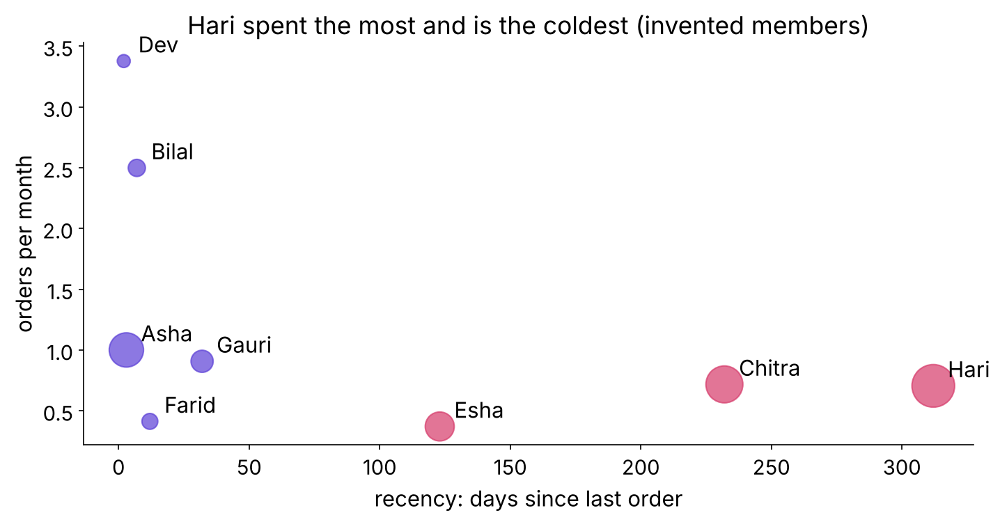

```notes
LIVE, 3 minutes. Hari's bubble is the biggest and sits far right: ten months since the last
order. A Rs 40 nudge to Hari reaches the member least likely to answer. Land: a raw total answers
"who spent most", and Marketing asked "who buys next".
```

---

## S8. Five signals, each with a reason Marketing can repeat
*Measured from the nudge morning, never from today*

| Signal | Formula | The reason |
|---|---|---|
| Recency | nudge morning - last order, in days | warm buys again |
| Count | orders in the last 90 days | habit |
| Cohort age | nudge morning - first order | new members are still deciding |
| Ratio | orders / months as a member; spend / orders | puts old and new on one scale |
| Basket signal | items / orders | weekly shop against top-up |

```notes
LIVE, 5 minutes. Count one by hand: Asha's average basket is Rs 16,800 over 24 orders, Rs 700.
Dev's recency is 2 days. Ask: which of these would you have to recompute every morning? (Recency
and cohort age.) Land: every feature is a sentence the business would say. Run notebook ch01 to
cell 4: one line of pandas per signal, measured from NUDGE, never from today.
```

---

## S9. The bank's file already holds counts and a recency
*campaign, previous, pdays and poutcome are the same five ideas*

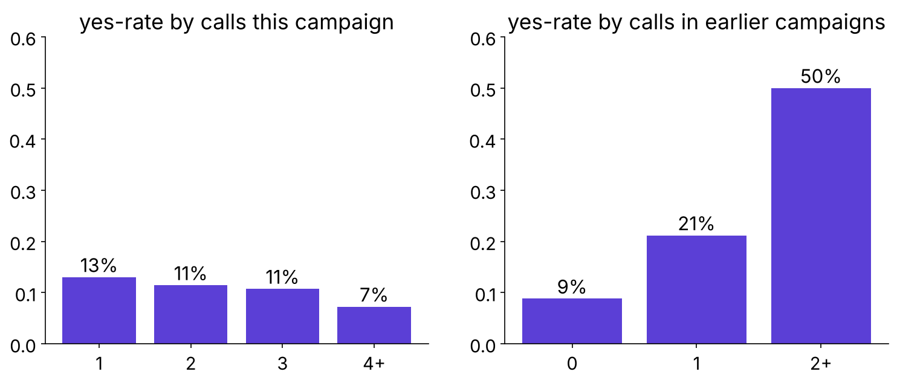

```notes
LIVE, 4 minutes. Predict first: does ringing a client more often this campaign raise the yes-rate?
It falls from 13 percent at one call to 7 percent at four or more. Earlier contact helps sharply.
pdays holds 999 for 96.3 percent of rows; case 2 splits it.
```

---

## S10. Four rules for features, each with its flip
*A rule without the condition that flips it is a slogan*

| Rule | Flips when |
|---|---|
| Measure from the prediction moment | never; computed from today it leaks |
| A ratio beats a total | everyone joined in the same window |
| Count over a fixed window | the decision is a loyalty tier, which wants lifetime |
| Every feature carries a reason | a fair test shows signal the reasons missed |

```notes
LIVE, 3 minutes. Read each rule with its flip. Interview line: "Engineer features from a customer
table and justify each." The answer names the prediction moment first. Transition: chapter 2.
```

---

## SECTION 2: Teaching a model to read categories: is Surat twice Pune?
*Encoding categoricals; scaling numerics; which models care · also searched as: one-hot encoding, standard scaling, label encoding*

```notes
LIVE, 30 seconds. Chapter 2, 18 minutes, notebook ch02. Six invented members.
```

---

## S11. Pune is 1, Surat 2, Indore 3: what does a line read?
*A logistic model multiplies the code by one weight*

| Member | City | city_code | city_Pune | city_Surat | city_Indore |
|---|---|---|---|---|---|
| A | Pune | 1 | 1 | 0 | 0 |
| B | Surat | 2 | 0 | 1 | 0 |
| C | Indore | 3 | 0 | 0 | 1 |

(a) nothing about the cities (b) Indore is as far from Surat as Surat from Pune

```notes
LIVE, 2 minutes. Take letters. Then ask who chose that order: nobody did, the alphabet or the
order of signups did.
```

---

## S12. Answer: b, an order and a distance nobody chose
*One-hot gives each city its own switch and its own weight*

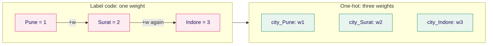

```notes
LIVE, 2 minutes. A tree splits on city_code <= 1.5 and <= 2.5, so the made-up order costs it
little. A linear model reads it as a straight line through the cities. Land: encoding is a model
decision, never a ritual.
```

---

## S13. Rupees drown visits in a distance
*A to B by hand: square root of 200 squared plus 7 squared, about 200*


```notes
LIVE, 4 minutes. Predict first: after standardising, is A's nearest neighbour still B? It becomes
C, who also visits twice. The formula is named last: z = (value - mean) / standard deviation, with
the mean and spread learned on training rows only.
```

---

## S14. Which models care, and which shrug
*The cut-first table if the room runs late*

| Model family | Category | Number | Why |
|---|---|---|---|
| Logistic, linear | one-hot | standardise | one weight per column; the penalty reads scale |
| Nearest neighbours, clustering | one-hot | standardise, decisive | distance adds raw gaps |
| Tree, forest, boosting | one-hot or an ordinal code | no need | thresholds ignore units |

```notes
LIVE, 3 minutes. Kahoot Q4 comes from this table: which family shrugs at unscaled features? A
forty-value city is still one-hot for a logistic model; replacing a city with its average outcome
comes later, because it can carry the target in.
```

---

## S15. Drill: match the encoder to the column
*Three column types, fifteen seconds each*

| Column | Options |
|---|---|
| city, 40 values, logistic model | (a) one-hot (b) code 1 to 40 (c) drop it |
| education, ordered levels, tree | (a) an ordinal code (b) a random code (c) text |
| default, yes, no or unknown | (a) one-hot with unknown kept (b) unknown as no (c) drop rows |

```notes
LIVE, 3 minutes, the mid-session drill. Letters in the chat, then the answer slide.
```

---

## S16. Answer: a, a, a, and each one has a flip
*The flip is what an interviewer asks next*

| Column | Answer | Flips when |
|---|---|---|
| city, 40 values | one-hot | a tree model, or rare cities grouped into "other" |
| education, ordered | ordinal code for a tree | a logistic model, which wants one-hot |
| default with unknown | keep unknown as a category | the business confirms unknown is noise |

```notes
LIVE, 2 minutes. In the bank's file default has 3 yes rows and 8,597 unknown: the unknown level
carries the signal. Transition: chapter 3, the question that catches the 0.99.
```

---

## SECTION 3: Answers from the future: known that morning?
*Leakage and the prediction-time question · also searched as: data leakage in machine learning, target leakage, train test contamination*

```notes
LIVE, 30 seconds. Chapter 3, 20 minutes, notebook ch03, then the explorable. Twelve invented
members.
```

---

## S17. Settled scores 12 of 12: what on the nudge morning?
*Twelve invented members; the rule says bought if settled*

| Rule | Right, of 12, on the training table |
|---|---|
| bought if settlement_status is settled | 12 |
| bought if orders_90d >= 2 | 10 |
| predict nobody buys | 6 |

On the nudge morning the settlement rule scores (a) 12 (b) 10 (c) 6

```notes
LIVE, 3 minutes. This answers the S3 prediction. Take letters. Hint only if stuck: on the nudge
morning, has anyone paid yet for an order in the next ninety days?
```

---

## S18. Answer: c, 6 of 12, the score of predicting nobody
*No payment from the coming 90 days exists that morning*

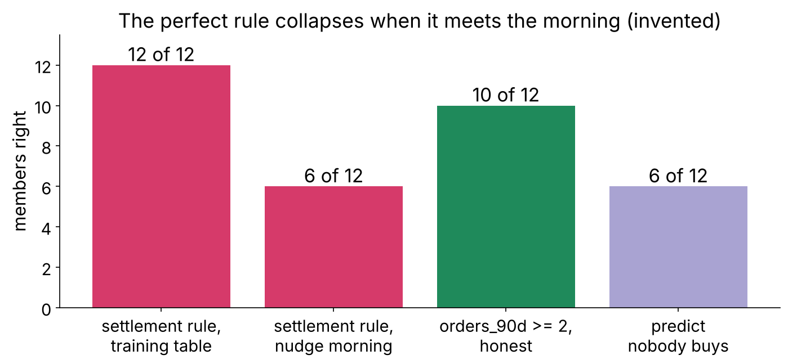

```notes
LIVE, 3 minutes. The column reads none for everyone on the nudge morning, so the rule says nobody
buys. Land: the 0.99 was measured on a table built after the outcome; the model meets a table
built before it.
```

---

## S19. One member's timeline: green known, red written after
*The nudge morning is the prediction moment*


```notes
LIVE, 3 minutes. Draw this on the board first, then show it. Each column is pinned at the moment
it is written. Settlement sits right of the line: the payments team writes the answer in its own
words.
```

---

## S20. The prediction-time question
*Asked of every column, with the system that writes it*

> "On the morning the model is used, do we know this value for this customer?"
> The prediction-time question, asked of every column

| Two more routes for the future | The fix |
|---|---|
| an encoder or scaler fitted on all rows | fit inside the pipeline, on training rows |
| rows from after the moment inside training | split by the moment; Friday does it by time |

```notes
LIVE, 2 minutes. Read the question aloud twice; Kahoot Q1 asks for it from memory, and tonight's
recap asks for it verbatim. Leakage is any input unavailable at prediction time, however innocent
it looks.
```

---

## S21. The explorable: slide the prediction moment
*Open demos/C2_W05_D03_leakage_timeline_explorer_STUDENT.html*

```timeline
label: Click 1 | title: Start after delivery | body: The payment flag is green and the score reads 30 of 30.
label: Click 2 | title: Drag to the nudge morning | body: The flag turns red, drops out, and the score falls.
label: Click 3 | title: Add a green feature | body: A feature known that morning earns its place with a reason.
```

```notes
LIVE, 4 minutes. Before click 2, ask for a number: what will 30 of 30 become? Write it down. After
the drag, land the day's line: the score fell and the model got better.
```

---

## S22. Four rules for leakage, each with its flip
*"Too good" starts the question; it is never the verdict*

| Rule | Flips when |
|---|---|
| Drop a column written after the prediction moment | never, whatever it scores |
| Suspect a jump from one new column | a known, legitimate new source explains it |
| A strong column known in time stays | never; strength alone is no evidence of a leak |
| Ship the honest score, which is lower | never ship a model that cannot run that morning |

```notes
LIVE, 2 minutes. Interview anchor [S]: what is data leakage, and how do you catch it before it
ships? 10-minute break after this slide.
```

---

## SECTION 4: Interrogating every column: keep, drop or fix?
*The column audit · also searched as: feature audit, leakage checklist, point-in-time correct features*

```notes
LIVE, 30 seconds. Chapter 4, 15 minutes, notebook ch04. Nine invented candidate columns.
```

---

## S23. Five asks of every column, written on one line
*A reviewer argues with a line, never with a feeling*

| Ask | Why |
|---|---|
| Which system writes it? | the owner knows when it changes |
| When, in days from the prediction moment? | negative means known in time |
| Is it overwritten later? | then read it as it stood that morning |
| What is its business reason? | no reason, no column |
| Verdict | keep, drop, or fix |

```notes
LIVE, 2 minutes. The solution architect's seat: is it there at prediction time? The
implementation engineer's seat: can the scoring service read it the same way every night?
```

---

## S24. How many of nine candidate columns are dropped?
*Invented candidates for Kalpa's nudge model*

| Column | Written by | Written |
|---|---|---|
| days_since_last_order, orders_90d, avg_basket_rs | orders table | last night |
| city, member_id | signup form | at signup |
| app_visits_7d | app events | last night |
| loyalty_tier | loyalty service | nightly, overwritten |
| coupon_redeemed | checkout | 3 days after the nudge |
| settlement_status | payments feed | 12 days after |

(a) 1 (b) 3 (c) 5

```notes
LIVE, 2 minutes. Take letters with one reason each.
```

---

## S25. Answer: b, three dropped and one fixed
*Two written after the nudge, one with no reason*

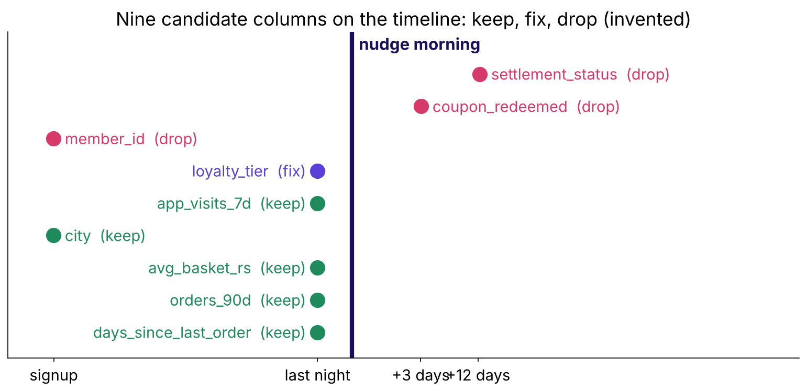

```notes
LIVE, 3 minutes. coupon_redeemed is the outcome itself. member_id is a key; if ids are issued in
signup order it smuggles cohort age, which should be engineered openly. loyalty_tier is kept with
a fix: next slide.
```

---

## S26. The as-of trap: the purchase wrote today's tier
*The warehouse keeps only the latest value*

| Member | Bought in 90 days | Tier today | Tier on the nudge morning |
|---|---|---|---|
| M04 | no | Silver | Silver |
| M07 | yes | Gold | Silver |

```notes
LIVE, 3 minutes. M07 bought, was upgraded, and today's table says Gold. A model trained on today's
tier learns "Gold buys", which the purchase wrote. Fix: a snapshot, read as of the prediction
morning. The question to the owner: is this field ever overwritten?
```

---

## S27. Drill: leak or clean, six candidates fast
*Kalpa's nudge, predicted on the nudge morning*

| # | Candidate | Your call |
|---|---|---|
| 1 | refund_requested in the 90 days after the nudge | leak or clean |
| 2 | orders in the 30 days before the nudge | leak or clean |
| 3 | delivery_rating of the order placed after the nudge | leak or clean |
| 4 | city at signup | leak or clean |
| 5 | loyalty tier read from today's table | leak or clean |
| 6 | app visits in the 7 days before the nudge | leak or clean |

```notes
LIVE, 4 minutes, the mid-session drill. Ten seconds each, letters in the chat as L or C.
```

---

## S28. Answer: leak 1, 3, 5; clean 2, 4, 6
*Each leak is written after the morning, or read from a table that was*

| # | Call | The reason, in one line |
|---|---|---|
| 1 | leak | written after the outcome window opens |
| 3 | leak | exists only once an order was placed |
| 5 | leak | today's value was overwritten after the purchase |
| 2, 4, 6 | clean | written before the nudge morning |

```notes
LIVE, 1 minute. Number 5 is the one most of the room calls clean. Transition: chapter 5.
```

---

## SECTION 5: What the importance chart can't tell you: is it rank or cause?
*Feature importance and its limits · also searched as: feature importance, permutation importance, correlation is not causation*

```notes
LIVE, 30 seconds. Chapter 5, 15 minutes, notebook ch05. Twelve invented members, a rule, and a
shuffle done by hand.
```

---

## S29. With searches shuffled, how many of 12 stay right?
*Visits and searches correlate at 0.94 in this table*

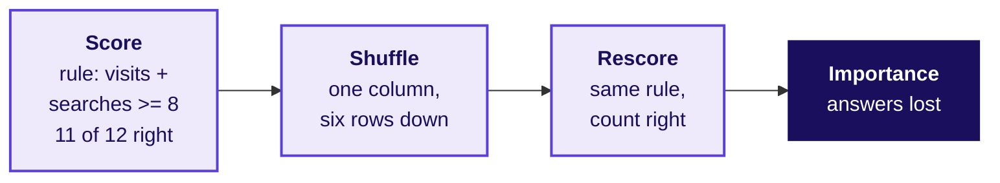

(a) about 11 (b) about 7 (c) 0

```notes
LIVE, 4 minutes. The shuffle keeps the column's values and breaks their link to each member; a big
fall means the model leans on that column, nothing more. Take letters, then run the notebook cell.
```

---

## S30. Answer: b, 7; the twins together cost 8
*Each twin alone costs little, because the other carries the signal*

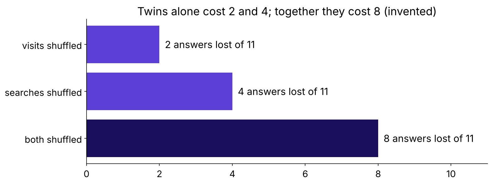

```notes
LIVE, 3 minutes. Visits alone costs 2, searches alone 4, both together 8, more than 2 + 4. Land:
twins share credit, so shuffle them as a group and read the group.
```

---

## S31. A top bar is a reliance, never a lever
*Searches are a symptom of intent*

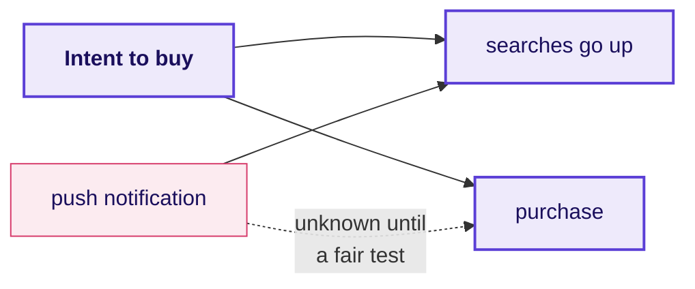

```notes
LIVE, 3 minutes. Marketing proposes pushing searches up. The chart cannot say whether that moves
purchases. Week 1's fair comparison can: push a random half, compare. Interview anchor [F]: what
does a feature importance chart prove, and what does it not?
```

---

## S32. Four rules for importance, each with its flip
*Run the audit before the chart*

| Rule | Flips when |
|---|---|
| Importance ranks reliance | the column was changed in a fair test |
| Shuffle close partners as a group | the column has no twin |
| Score importance on validation rows | never on training rows |
| Audit before the chart | never; a leak tops every chart |

```notes
LIVE, 2 minutes. Transition: the bank. Everything so far was invented; the case is real.
```

---

## SECTION 6: The junior's join: why did it jump?
*Case 1 applies: Feature engineering from the customer table: ratios, recency, counts, cohort age, basket signals · Encoding categoricals; scaling numerics; which models care · notebook case01*

```notes
LIVE, 30 seconds. Case 1, 20 minutes. Every learner runs case01 from the top; the first cell
downloads the bank's file once.
```

---

## S33. What will the economy and the call log add to 0.76?
*Validation AUC of the customer table: 0.761, measured Monday*

| Option | Economy adds | Call log adds |
|---|---|---|
| a | about 0.01 | about 0.01 |
| b | about 0.03 | about 0.14 |
| c | about 0.14 | about 0.03 |

```notes
LIVE, 3 minutes. Every learner writes a letter before running. This is the prediction the brief
promises the room: the jump is shown only after it.
```

---

## S34. Answer: b, AUC 0.761, 0.795, then 0.932
*Accuracy moves one point: 0.897 to 0.907*

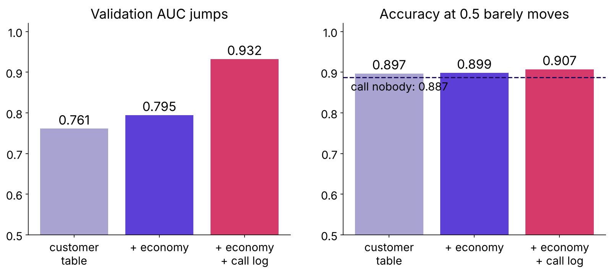

```notes
LIVE, 5 minutes. Calling nobody scores 0.887, so accuracy has no room to show the jump. Ask: a
jump of 0.14 from one column; what is your first suspicion? Hold the answer for case 2.
```

---

## S35. Read the jump in recall and rupees
*Rs 40 a call, Rs 1,200 a missed buyer, threshold 0.032*

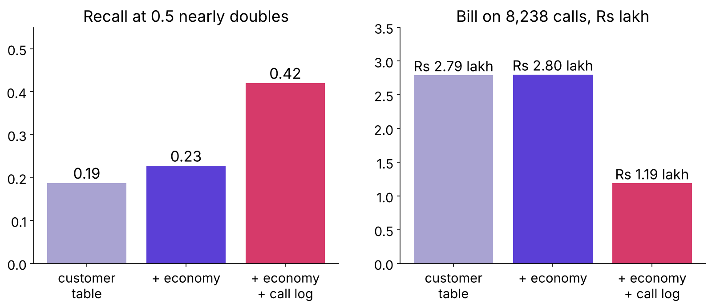

```notes
LIVE, 5 minutes. Recall at 0.5 goes 0.23 to 0.42 and the bill falls from Rs 2.80 lakh to Rs 1.19
lakh: a promise of Rs 1.61 lakh saved on 8,238 calls. That promise is what the junior would take
to the campaign head.
```

---

## S36. The scaler saw 24,712 rows and nothing else
*Encoders and scalers live inside the pipeline*

```python
scaler.n_samples_seen_          # 24712, the training rows
len(encoder.categories_[0])     # 12 job levels, unknown included
StandardScaler().fit(bank[num]) # the trap: all 41,188 rows, test included
```

```notes
LIVE, 4 minutes. The implementation engineer's seat. On this file the means differ only in the
third decimal, which is why the habit looks harmless; on a file where the future differs, it
carries the future in. Then the guided notebook, 20 minutes.
```

---

## S37. Guided: two features and three columns, together
*Notebook guided: three TODO cells, reasons said aloud*

| TODO | The room decides |
|---|---|
| 1 | the line that turns pdays = 999 into a never-contacted flag |
| 2 | the line that flags a previous success |
| 3 | known or not known that morning: duration, euribor3m, poutcome |

```notes
LIVE, 20 minutes. Pairs. Each pair says its reason aloud before typing. The worked answer sits
below the line in the same notebook; the room opens it only after the check cell runs.
```

---

## SECTION 7: Every column on the timeline: known before the call?
*Case 2 applies: Leakage and the prediction-time question · The column audit · Feature engineering from the customer table (the 999 sentinel) · notebook case02*

```notes
LIVE, 30 seconds. Case 2, 30 minutes. Never cut the audit.
```

---

## S38. How often does the shortest fifth of calls say yes?
*Calls split into five equal groups by length*

| Option | Yes-rate of the shortest fifth |
|---|---|
| a | about 11 percent, like everyone |
| b | about 0.5 percent |
| c | about 33 percent |

```notes
LIVE, 2 minutes. Letters first.
```

---

## S39. Answer: b, 0.5 percent; the longest fifth, 33
*The dataset's own note: the length is unknown before the call*

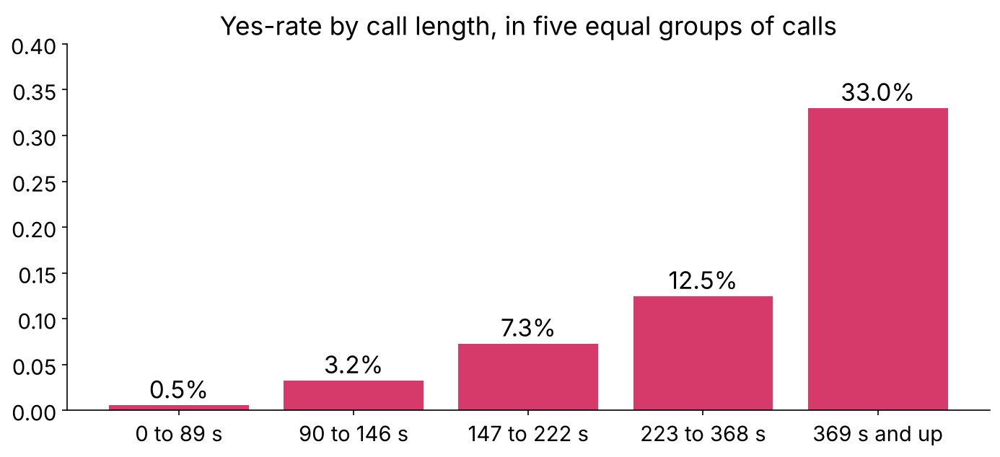

```notes
LIVE, 4 minutes. All four calls of 0 seconds ended in no. Open the UCI page and read the duration
row aloud (the trainer guide holds the exact text): the authors say the length is unknown before
dialling and the column belongs in benchmarks only. A long call is often the sale being made. Ask the prediction-time question of
duration aloud: on the morning the list is made, do we know how long tomorrow's call will last?
```

---

## S40. Twenty columns audited: one drop, three flags
*Notebook case02, the audit table*

| Columns | Written | Verdict |
|---|---|---|
| profile, credit products | before the campaign | keep |
| contact, campaign, previous, poutcome | before the call | keep |
| month, day_of_week | the day of the call | keep, flag |
| pdays | when the last campaign closed | engineer |
| economy, five columns | published by the research desk | keep, flag |
| duration | when the call ends | drop |

```notes
LIVE, 4 minutes. The quarterly and monthly indicators pass only if each figure was published
before the call; that is a question for the data owner and is not verified here. The calendar flag
is the next two slides.
```

---

## S41. What does year and month alone score?
*No client information at all*

| Option | AUC from year and month alone |
|---|---|
| a | about 0.50, a coin |
| b | about 0.65 |
| c | about 0.79 |

```notes
LIVE, 2 minutes. Letters first. Most of the room says a.
```

---

## S42. Answer: c, 0.79: the yes-rate moves with the month
*From 5 percent of calls in 2008 to 52 percent in 2010*

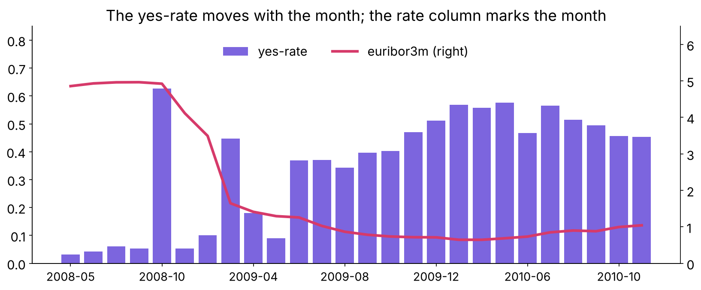

```notes
LIVE, 4 minutes. emp.var.rate and nr.employed take 10 and 11 distinct values: a stamp for the
quarter. On a random split every month sits in training and validation, so the model is scored
partly on months it has seen. Next month's list is a month it has never seen.
```

---

## S43. Inside one month the honest model ranks at 0.57
*The calendar is a second leak that looks legal*

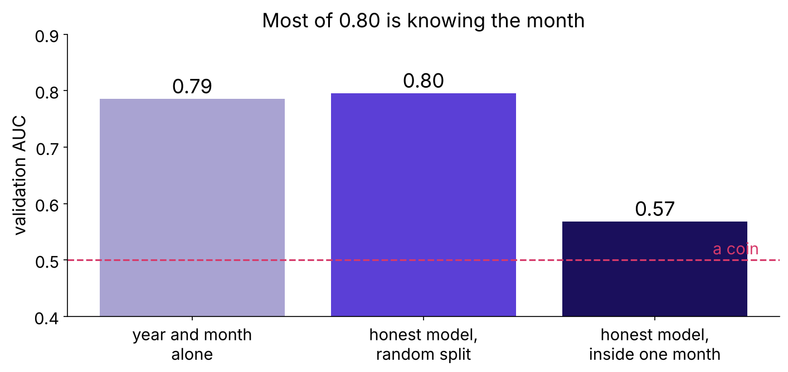

```notes
LIVE, 3 minutes. Known that morning, and still borrowing each month's yes-rate through the split.
Verdict: keep, flag, and write the caveat beside the score. Friday's split by time prices it.
```

---

## S44. poutcome = success stays; pdays splits in two
*"Too good" starts the question and never ends it*

| Column | What it shows | Verdict |
|---|---|---|
| poutcome = success | 65 percent yes, closed months before the call | keep |
| pdays | 999 in 96.3 percent of rows, a sentinel | never_contacted flag + days_since_contact |

```notes
LIVE, 3 minutes. Raw pdays has a mean of 962 days, which describes nobody. AUC barely moves after
the split; the model now reads a sentence a person can say.
```

---

## S45. The leak promised Rs 1.19 lakh; honest is Rs 2.82 lakh
*AUC 0.932 against 0.796 on the same 8,238 calls*

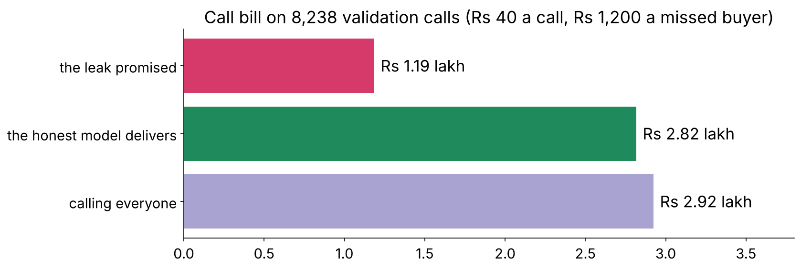

```notes
LIVE, 4 minutes. The leaked model can never deliver its promise: on the morning of the call its
best column does not exist. The honest bill sits near calling everyone at these costs (Tuesday's
lesson); under a budget its top 1,000 hold 462 buyers against 113 at random.
```

---

## S46. Kalpa's settlement_status is the same leak
*Written by the payments feed, after delivery*

| Column | Written by | Written | Verdict |
|---|---|---|---|
| orders_90d | orders table | nightly, before the nudge | keep |
| days_since_last_order | orders table | nightly, before the nudge | keep |
| settlement_status | payments feed | when the payment clears | drop |

```notes
LIVE, 2 minutes. Close the loop on S3: the 0.99 collapses because a payment can only settle for a
member who already bought. The column is the target in another team's words.
```

---

## S47. The week's picture, Wednesday state
*duration sits right of the prediction moment, in red*


```notes
LIVE, 1 minute. Tonight's self-check is to redraw this from memory. Lunch after this slide.
```

---

## SECTION 8: The sign that flipped: what does it prove?
*Case 3 applies: Feature importance and its limits · Encoding categoricals; scaling numerics; which models care · notebook case03*

```notes
LIVE, 30 seconds. Case 3, 20 minutes. Afternoon block.
```

---

## S48. Alone, euribor3m is negative; with its partners?
*The three rate columns correlate above 0.9 on training rows*

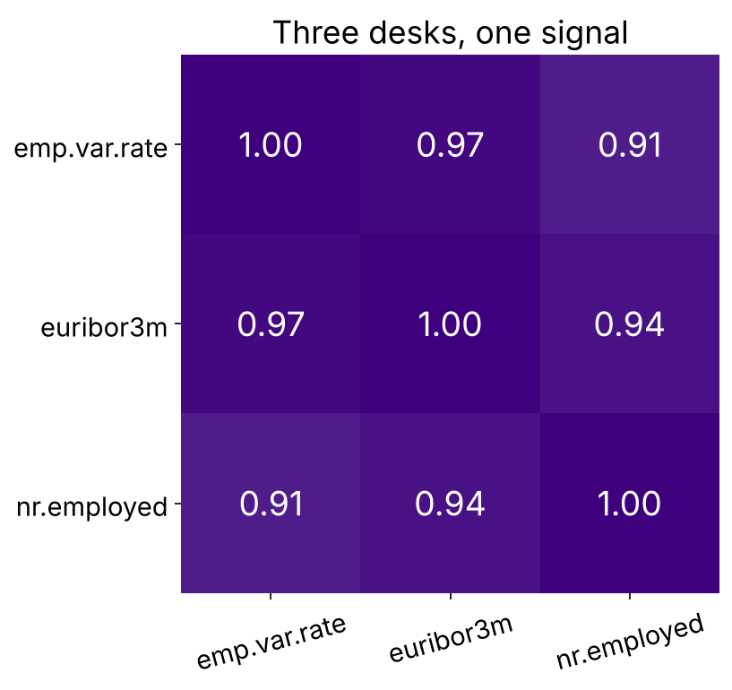

(a) stays negative and shrinks (b) turns positive (c) goes to exactly zero

```notes
LIVE, 4 minutes. Three desks, one signal: when columns move together this closely the data has
almost no row where one is high and another low. Letters first. This is the row's second discovery; let the room find it.
```

---

## S49. Answer: b, from -0.92 to +0.77 beside both partners
*Nothing about interest rates changed between the fits*


```notes
LIVE, 4 minutes. A coefficient answers "holding the others fixed", and these partners are never
held fixed in the data. Read a sign alone only when the column has no close partner. Kahoot Q5.
The faculty block, tentative, takes multicollinearity further.
```

---

## S50. emp.var.rate tops the importance chart at 0.34
*Shuffle a column on validation rows; measure the AUC lost*

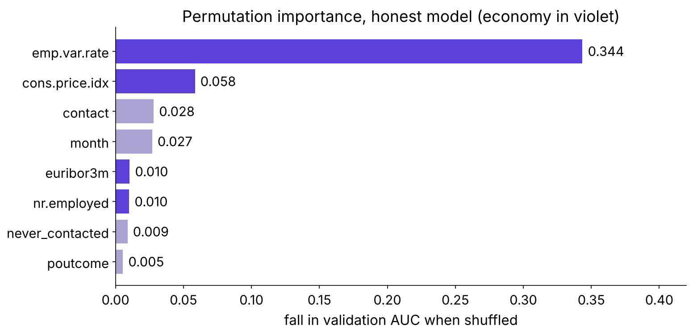

```notes
LIVE, 3 minutes. The model's whole lift above a coin is 0.30. One column costing 0.34 is costing
more than the model ever earned. Ask why before the next slide.
```

---

## S51. One twin shuffled costs more than the model earned
*Shuffled alone, it builds clients who never existed*

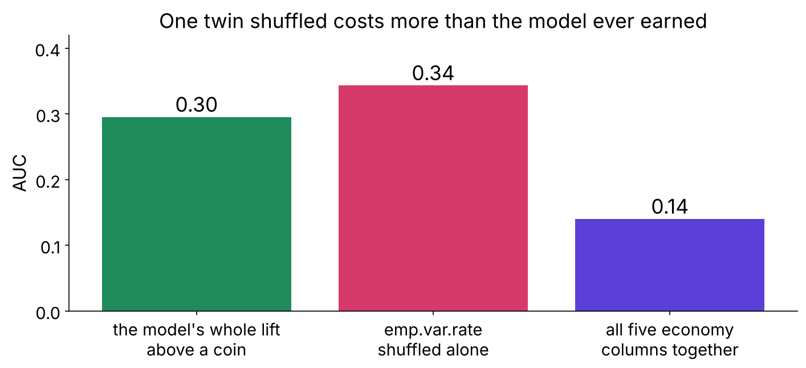

```notes
LIVE, 3 minutes. A 2010 employment rate beside a 2008 interbank rate: an impossible client. Shuffle
the five economy columns together and the cost falls to 0.14. Land: permute partners as a group.
```

---

## S52. nr.employed ranks high and only marks the quarter
*The chart ranks reliance and never proves cause*

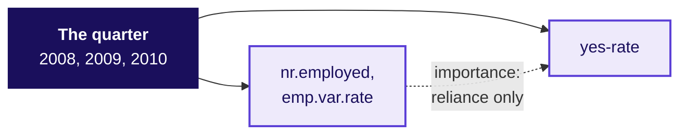

```notes
LIVE, 3 minutes. Ask first: would hiring more people in Portugal raise deposits? The same holds for contact: mobile against landline ranks third, and moving every
client to mobile would not move the yes-rate by that gap. A lever needs a fair test.
```

---

## S53. The audited feature set goes to Thursday
*20 columns, validation AUC 0.796, about 0.57 inside one month*

| Group | Verdict | Reason |
|---|---|---|
| profile, history | keep | known before the call |
| never_contacted, days_since_contact | keep, engineered | 999 is a sentinel |
| economy, five columns | keep, flag | a calendar on a random split; read as a group |
| duration | drop | written when the call ends |

```notes
LIVE, 2 minutes. Then the unguided task, 20 minutes: in a blank notebook, rebuild this set from
the raw file, write the audit table with a reason per column, and report the honest score. Target:
0.796 to the third decimal.
```

---

## S54. Four interview anchors, and the shape of a good answer
*Answers as reasoning, never as paragraphs*

| Tag | Question | The shape of a good answer |
|---|---|---|
| [S] | What is data leakage, and how do you catch it before it ships? | definition by time; the question; the owner |
| [F] | Which encoder for a forty-value categorical, and why? | ask the model family; one-hot; the flip |
| [F] | What does an importance chart prove, and what not? | reliance; twins; a fair test for cause |
| [D] | A colleague's feature lifts the score to 0.99 tonight; what do you say? | ask when it is written; retrain; both scores in rupees |

```notes
LIVE, 6 minutes. Pairs: one asks, one answers in 60 seconds, swap. The [D] answer opens with a
clarifying question: which system writes the column, and when? The model answers with follow-ups
are in the interview bank.
```

---

## S55. Quiz: five questions and Tuesday's return question
*Kahoot, ungraded, keys in the trainer guide*

| # | The question |
|---|---|
| 1 | The prediction-time question, completed from memory |
| 2 | Validation hit 0.99 after one new column; your first suspicion |
| 3 | Which encoder for a forty-value categorical |
| 4 | Which model family shrugs at unscaled features |
| 5 | A coefficient's sign flipped when a feature was added; the likeliest cause |
| R | The same model in retail and lending: why the thresholds sit at opposite ends |

```notes
LIVE, 8 minutes. Type the six into Kahoot from the trainer guide. Discuss Q2 and Q5 for a minute
each; they carry the day.
```

---

## S56. What you can now do, and what tonight holds
*Practice set two to three hours; lab with the TAs*

| Now you can | Tonight |
|---|---|
| engineer five kinds of feature, each with a reason | practice set: ten problems, eighteen self-check questions |
| encode and scale for the model family in use | practice lab: Rohan's lending file, the same audit |
| audit every column with the prediction-time question | redraw the week's picture from memory |
| say what an importance chart proves | Thursday's pre-read: overfitting, bias, variance, cross-validation |

```notes
LIVE, 4 minutes. Say the ME1 scope aloud and no more. Tomorrow tunes on today's audited feature
set, so every learner commits case03 with its outputs tonight.
```
