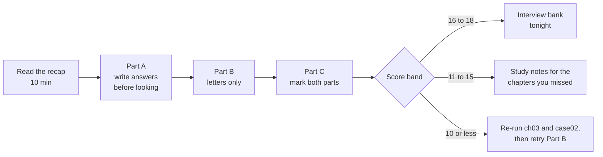
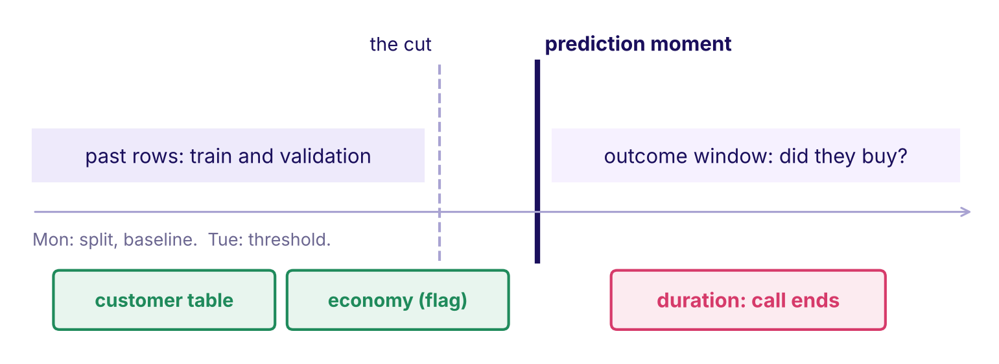
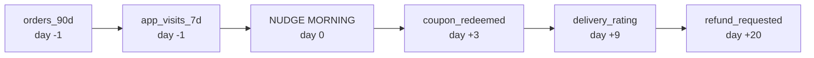
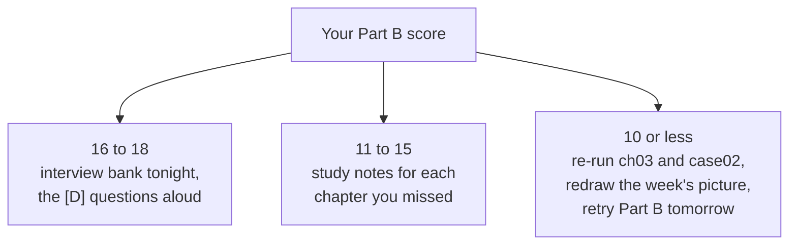
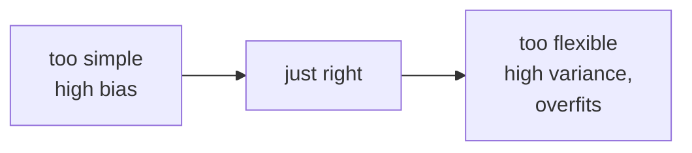

# Week 5 Wednesday practice set: what the model is allowed to know

## How do you use this set in two and a half hours?

| Part | What | Minutes |
|---|---|---|
| Recap | one page of pictures and rules | 10 |
| Part A | ten problems: three warm-ups, four medium, three interview grade | 15 + 40 + 45 = 100 |
| Part B | eighteen self-check questions | 20 |
| Part C | mark your work against the key and the model solutions | 20 |

Write every answer before opening Part C. Some scenarios leave out a fact on purpose; when one
does, the first line of a good answer is the question you would ask.

## What does the day come down to on one page?

| Idea | The rule | The condition that flips it |
|---|---|---|
| Feature engineering | turn raw dates and totals into recency, counts, ratios, cohort age and basket signals, each with a business reason | a total is fine when every member joined in the same window |
| Encoding | one-hot a category for a linear or distance model | a tree can take an ordinal code, because it splits on thresholds |
| Scaling | standardise numbers, `z = (value - mean) / standard deviation`, fitted on training rows | a tree ignores scale entirely |
| Leakage | an input the model sees in training that would not be known at the moment of prediction | none: a column written later is dropped whatever it scores |
| The prediction-time question | "On the morning the model is used, do we know this value for this customer?" | a column known in time can still leak through a random split (the calendar) |
| The column audit | for every column: who writes it, when, is it overwritten, its reason, the verdict | an overwritten field is kept only as a snapshot from the morning |
| Importance | permutation importance measures how far the score falls when a column is shuffled | it proves a lever only when the column was changed in a fair test |
| Twins | close partners share credit and can flip each other's coefficient sign | a column with no close partner can be read alone |

The bank's numbers to carry: customer table AUC 0.761, with the economy 0.795, with `duration`
0.932; honest audited set 0.796, about 0.57 inside one month; accuracy moved only from 0.897 to
0.907 while recall at 0.5 went from 0.23 to 0.42.

## Part A: ten problems

### Problem 1 (warm-up, 5 minutes): who does Kalpa nudge first?

**Seat: business owner.** Kalpa's marketing lead has budget for one Rs 40 nudge today. The nudge
morning is 1 November 2026. Two members, invented:

| Member | First order | Last order | Orders | Spend, Rs | Items |
|---|---|---|---|---|---|
| Ishaan | 1 May 2026 | 28 Oct 2026 | 12 | 6,000 | 60 |
| Neha | 1 Nov 2023 | 3 Jun 2026 | 36 | 27,000 | 72 |

1. Compute recency in days, orders per month as a member (use 30.4 days a month) and average basket for each.
2. Which member does total spend rank first, and which do recency and orders per month rank first?
3. Write the one-sentence reason you would give the marketing lead.

*Interview version: "Here is a customer table. Engineer three features and justify each."*

### Problem 2 (warm-up, 5 minutes): which encoder, which scaling?

**Seat: implementation engineer.** Kalpa's nudge model will be trained twice: once as a logistic
regression and once as a gradient-boosted tree. Three columns, invented:

| Column | Type | Example values |
|---|---|---|
| city | 40 values | Pune, Surat, Indore, ... |
| spend_90d_rs | number | 300 to 48,000 |
| tier | Silver, Gold, Platinum | ordered |

1. For each column, name the encoding and the scaling for the logistic model.
2. Which of those steps can the tree skip, and why?
3. Where in the code are the encoder and the scaler fitted, and on which rows?

*Interview version: "Which encoder for a forty-value categorical, and why?"*

### Problem 3 (warm-up, 5 minutes): which columns are on the right side of the line?

**Seat: solution architect.** Kalpa's model scores members on the nudge morning. Each column is
pinned at the day it is written, counted from that morning.

1. Which columns pass the prediction-time question?
2. `coupon_redeemed` predicts the outcome almost perfectly. Explain why in one line.
3. Name one more column you would ask the data platform lead about, and the question you would ask.

*Interview version: "What is data leakage, and how do you catch it before it ships?"*

### Problem 4 (medium, 10 minutes): the junior's overnight jump

**Seat: senior ML engineer.** The bank's call list model, validation slice of 8,238 calls, seed 42:

| Feature set | AUC | Accuracy at 0.5 | Recall at 0.5 | Buyers in the top 1,000 |
|---|---|---|---|---|
| customer table | 0.761 | 0.897 | 0.19 | 404 |
| + economy | 0.795 | 0.899 | 0.23 | 460 |
| + economy + call log (`duration`) | 0.932 | 0.907 | 0.42 | 572 |

Calling nobody scores 0.887 accuracy.

1. How much did each join add to AUC and to accuracy?
2. Why can accuracy barely move when the ranking changes this much? Use the base rate.
3. The junior says "accuracy hardly moved, so `duration` is a harmless extra". What is wrong with the argument, and what is the first thing you check?

*Interview version: "Your validation AUC rose 0.14 overnight from one column. What do you do before you celebrate?"*

### Problem 5 (medium, 10 minutes): Airbnb's first neural network

**Seat: implementation engineer.** Airbnb's search team fed their first neural network the same
features as their tree model, and the loss stopped improving midway through training. They traced
it to unnormalised features and fixed it with `(value - mean) / standard deviation` for
bell-shaped features and `log((1 + value) / (1 + median))` for power-law ones. Plotting each
feature's distribution then exposed logging bugs: for stays longer than 28 days the logged price
was the monthly price instead of the daily one (Haldar and others, arXiv 1810.09591,
https://arxiv.org/abs/1810.09591, verified 28 October 2026).

| Listing | Logged price per night, Rs (invented) |
|---|---|
| A | 3,200 |
| B | 2,800 |
| C | 96,000 |
| D | 4,100 |

1. Why did the tree model train fine on the same raw features while the neural network stalled?
2. Price per night has a long right tail. Which of the two formulas suits it, and why?
3. Listing C reads 96,000. What two explanations would you check, and which picture finds it fastest?

*Interview version: "Your model trains on raw features and the loss plateaus early. What do you look at first?"*

### Problem 6 (medium, 10 minutes): the hospital in the X-ray

**Seat: QA and tester.** Zech and colleagues trained pneumonia models on 158,323 chest X-rays from
three hospital systems. The joint model scored internal AUC 0.931 and AUC 0.815 at a hospital it
had never seen. The same network identified the hospital system of an image for 99.95 percent of
NIH images, partly from a metal token technicians place on patients. Portable inpatient films
carried 41.1 percent pneumonia against 32.8 percent in the emergency department, and ranking
images only by each hospital's prevalence reached AUC 0.861 (PLOS Medicine 2018,
https://journals.plos.org/plosmedicine/article?id=10.1371/journal.pmed.1002683, verified 28 October 2026).

1. Does "which hospital took this image" pass the prediction-time question? Answer carefully.
2. Which of Wednesday's bank columns behaves the same way, and what number showed it?
3. Design the one test that would have caught this before deployment.

*Interview version: "Your model is excellent offline and poor at a new site. What might have happened?"*

### Problem 7 (medium, 10 minutes): the audit Kavya sent back

**Seat: solution architect.** A junior's audit of Kalpa's columns, invented:

| Column | Written by | Junior's verdict |
|---|---|---|
| days_since_last_order | orders table, nightly | keep |
| loyalty_tier | loyalty service, overwritten nightly | keep |
| last_login | app service | keep |
| member_id | signup form | keep |
| refund_requested | support desk, after delivery | keep, it is strong |

1. Which verdicts would you change, and to what?
2. One of the five cannot be judged from the table. Which one, and what do you ask before you judge it?
3. Write the corrected audit line for `loyalty_tier`.

*Interview version: "Walk me through how you review a feature list before training."*

### Problem 8 (interview grade, 15 minutes): the 0.99 tonight

**Seats: business owner and senior ML engineer.** Kalpa's marketing lead messages at the end of
the day: "The junior's new column takes validation to 0.99. Ship it tonight, the campaign starts
tomorrow." The column is `settlement_status` from the payments feed. Nobody has told you when the
payments feed writes it.

1. What is the first question you ask, and to whom?
2. Suppose the answer is "after delivery, when the payment clears". Lay out what you do in the next hour, in order, and what you send the marketing lead.
3. The bank's version of this story: the leaked model promised a call bill of about Rs 1.19 lakh on 8,238 calls and the honest model costs about Rs 2.82 lakh. How do you present the lower honest number so the marketing lead sees it as a saving?
4. The team lead says you are blocking the launch. What do you offer instead of the 0.99?

*Interview version: "A colleague's feature lifts the score to 0.99 and the team wants it shipped tonight. What do you say, and how do you prove it?"*

### Problem 9 (interview grade, 15 minutes): the importance chart in the campaign review

**Seats: product manager and senior ML engineer.** The bank's honest model, validation AUC 0.796:

| Fact | Value |
|---|---|
| Fall in AUC when emp.var.rate is shuffled alone | 0.344 |
| The model's lift above a coin, 0.796 - 0.5 | about 0.30 |
| Fall when all five economy columns are shuffled together | 0.140 |
| euribor3m's coefficient alone, then beside its two partners | -0.92, then +0.77 |

1. The campaign head says: "Employment variation is the driver; we should only run campaigns when it is falling." What does the chart prove, and what does it not?
2. Explain in two sentences why one column's importance can exceed the model's whole lift.
3. What happened to euribor3m's sign, and what is the rule for reading a coefficient after this?
4. What evidence would let the campaign head's claim stand?

*Interview version: "What does a feature importance chart prove, and what does it not?"*

### Problem 10 (interview grade, 15 minutes): where do the features get computed?

**Seat: solution architect.** Kalpa wants recency, orders in 90 days, cohort age and average
basket for 500,000 members (invented) scored every night. Uber's Michelangelo platform keeps
features in a store where "the same expressions are applied at training time and at prediction
time" (Uber Engineering blog,
https://www.uber.com/blog/michelangelo-machine-learning-platform/, verified 28 October 2026).

| Option | How it works |
|---|---|
| A | compute the features in pandas inside the training notebook, and again in the scoring service's code |
| B | compute them once as SQL in the warehouse, as of each morning, and read the same table for training and scoring |
| C | train on today's warehouse values for every past nudge, since the warehouse already holds them |

1. Size each option: rows touched, where the definition lives, and what goes wrong.
2. Pick one and name the fact that would change your pick.
3. Option C hides a leak. Name it and say which chapter's trap it is.

*Interview version: "Design the feature pipeline for a nightly propensity score."*

## Part B: eighteen self-check questions

**B1.** Which sentence is the prediction-time question?

- a) Does this column raise validation AUC by a meaningful amount over the last model?
- b) Is this column free of missing values in the training table?
- c) On the morning the model is used, do we know this value for this customer?
- d) Was this column used by the previous model the team shipped?

**B2.** Kalpa predicts on the nudge morning whether a member buys within 90 days. Which column leaks?

- a) `delivery_rating` of the order placed after the nudge
- b) `orders_90d` counted up to the night before the nudge
- c) `city` recorded when the member signed up
- d) `app_visits_7d` counted over the week before the nudge

**B3.** Mark every correct option. Which models need numbers standardised to work as intended?

- a) a single decision tree grown to depth five
- b) a logistic regression with a penalty
- c) a random forest of three hundred trees
- d) a nearest-neighbours classifier

**B4.** True or false, with the reason: "In the bank's file, `poutcome = success` converts at 65 percent, so it must be a leak."

- a) True, because any level as strong as that must be carrying the answer
- b) True, because the previous campaign is part of this one
- c) False, because 65 percent is too low to be a leak
- d) False, because the earlier campaign closed months before the call

**B5.** Assertion: the bank's economic columns are known on the morning of each call. Reason: so the random-split AUC of 0.795 measures how well next month's call list will be ranked.

- a) A and R are both true, and R explains A
- b) A and R are both true, and R does not explain A
- c) A is true and R is false
- d) A is false and R is true

**B6.** Match each column to its encoding for a logistic model: (1) city with 40 values, (2) education with ordered levels, (3) default with yes, no and unknown.

- a) 1 ordinal code, 2 one-hot, 3 drop the unknown rows
- b) 1 one-hot, 2 one-hot, 3 one-hot with unknown kept
- c) 1 a code 1 to 40, 2 ordinal code, 3 unknown read as no
- d) 1 the city's average outcome, 2 one-hot, 3 one-hot

**B7.** `pdays` holds 999 for 96.3 percent of rows. What is the fix?

- a) leave it as a number, since the model will learn the scale itself
- b) replace 999 with the column's mean of about 962 days
- c) drop the column, since nearly every value is the same
- d) a never-contacted flag plus the days for the contacted rows

**B8.** What does permutation importance measure?

- a) how far the score falls when one column's values are shuffled
- b) how much the outcome changes when the column is increased by one unit
- c) how strongly the column correlates with the target alone
- d) how often a tree splits on the column during training

**B9.** Mark every correct option. An importance chart of a fitted model can tell you:

- a) which columns this model leans on when it predicts
- b) which business lever will raise the outcome if the team pushes it up
- c) a leaked column may be present, if one bar towers above the rest
- d) the causal effect of each column, ranked

**B10.** euribor3m's coefficient is -0.92 alone and +0.77 beside two partners that correlate above 0.9 with it. The likeliest cause?

- a) a bug in the scaler, fitted on the wrong rows
- b) the partners share its signal, so the split of credit is unstable
- c) interest rates truly do help deposits once employment is held fixed
- d) the target leaked into euribor3m through the split

**B11.** True or false, with the reason: "Fitting the scaler on all 41,188 rows before splitting is harmless."

- a) True, because scaling never changes which client ranks higher
- b) True, because the means differ only in the third decimal here
- c) False, because the sealed test rows then shape every feature
- d) False, because a scaler cannot be fitted on text columns

**B12.** The audit drops `duration` and AUC falls from 0.932 to 0.796. What do you tell Marketing?

- a) The model got worse, so the campaign should wait a week
- b) The drop is noise from the random split and can be ignored
- c) Both scores are fine; ship whichever one the campaign head prefers
- d) The 0.932 could never run on the morning; 0.796 is the real one

**B13.** Assertion: a model trained on today's `loyalty_tier` learns that Gold members buy. Reason: the tier is overwritten after purchases, so today's value was partly written by the outcome.

- a) A and R are both true, and R explains A
- b) A and R are both true, and R does not explain A
- c) A is true and R is false
- d) A is false and R is true

**B14.** Adding `duration` moved accuracy at 0.5 from 0.899 to 0.907 and AUC from 0.795 to 0.932. Why so little in accuracy?

- a) accuracy is the better metric here, and AUC exaggerates small changes
- b) 88.7 percent are an easy no, so accuracy has little room to move
- c) the threshold of 0.5 was chosen badly by the junior
- d) the validation slice is too small to measure accuracy

**B15.** Match each Kalpa column to its verdict: (1) `settlement_status`, (2) `loyalty_tier` overwritten nightly, (3) `orders_90d`, (4) `pdays`-style sentinel column.

- a) 1 keep, 2 drop, 3 keep, 4 drop
- b) 1 drop, 2 keep as it is, 3 fix with a snapshot, 4 keep as it is
- c) 1 fix, 2 drop, 3 keep, 4 engineer
- d) 1 drop, 2 fix (snapshot), 3 keep, 4 engineer

**B16.** Visits and searches correlate at 0.94. Shuffled alone they cost 2 and 4 answers; together 8. What follows?

- a) searches matter twice as much as visits, so drop visits
- b) the chart is wrong, since the parts must add up to the whole
- c) twins share credit, so read and shuffle them as a group
- d) the model is overfitting, since importance is unstable

**B17.** Zech's pneumonia network learned which hospital took an image. Which bank columns behave most like that shortcut?

- a) the economic columns, which mark when the call was made
- b) `duration`, which is written by the call log when the call ends
- c) `job`, which has an `unknown` level
- d) `campaign`, which counts calls in this campaign

**B18.** Mark every correct option. One column's permutation importance (0.34) exceeds the model's lift above a coin (0.30). What do you do?

- a) report the column to the campaign head as the main driver of deposits
- b) check whether the column has close partners
- c) shuffle its partners together and compare the fall
- d) read the coefficients as a group, never one by one

---

## Stop here. Part C is the key.

---

## Part C: the key and the model solutions

### What are the answers to Part A?

**Problem 1.** Ishaan: recency 4 days, member for 184 days so 6.05 months, orders per month 1.98,
average basket Rs 500. Neha: recency 151 days, member for 1,096 days so 36.1 months, orders per
month 1.00, average basket Rs 750. Total spend ranks Neha first (Rs 27,000); recency and orders
per month rank Ishaan first. The reason: "Ishaan ordered four days ago and orders twice a month;
Neha's spend is three years of history and she has not ordered in five months." *What the
interviewer listens for:* every feature measured from the nudge morning. *Common wrong answer:*
Neha, because she spent more, which ranks history instead of the next 90 days.

**Problem 2.** Logistic: city one-hot (40 columns, rare cities grouped into "other"); spend
standardised; tier one-hot (or an ordinal code if the team confirms the gaps are even, which is the
flip). The tree skips scaling entirely and can take an ordinal code for tier, since it splits on
thresholds. Both are fitted inside the pipeline on training rows only, when `fit` is called.
*Listens for:* the model family decides. *Common wrong answer:* label-encoding city 1 to 40 for
both models, which hands the logistic model an order and a distance nobody chose.

**Problem 3.** `orders_90d` and `app_visits_7d` pass; the other three are written after the
morning. `coupon_redeemed` is written when the nudge's coupon is used, which is the purchase
itself. Ask about any overwritten field, for example "is `loyalty_tier` overwritten after a
purchase, and is there a history table?" *Common wrong answer:* keeping `delivery_rating` because
"it is in the warehouse".

**Problem 4.** AUC: +0.034 for the economy, +0.137 for `duration`; accuracy: +0.002 and +0.008.
Calling nobody is right 88.7 percent of the time, so accuracy can only rise by moving buyers above
0.5, and only 11.3 percent of calls are buyers. The argument is wrong because accuracy cannot see
ranking; recall at 0.5 nearly doubled. The first check is the prediction-time question on
`duration`: it is written when the call ends. *Listens for:* doubt proportional to the jump.
*Common wrong answer:* "run cross-validation to check for overfitting", which keeps the leak in
every fold.

**Problem 5.** A tree splits on thresholds, so units do not matter; a neural network's gradient
steps are dominated by the largest-scale inputs, and training stalls. Price per night is
power-law, so `log((1 + value) / (1 + median))`. For listing C, check a currency mix-up and a
monthly price logged for a long stay (96,000 is about 30 nights at Rs 3,200); a histogram of price
finds the spike in seconds. *Common wrong answer:* standardising the price, which leaves one
listing far out in the tail.

**Problem 6.** Careful answer: the hospital is known when the image is read, so it passes the
prediction-time question as worded, and it still leaks, because inside the training data it stands
in for prevalence, which differs at a new site. It is the bank's calendar columns: known that
morning, and the year and month alone scored AUC 0.785, while inside one month the honest model
ranked at about 0.57. The test: hold out a whole hospital (in the bank, a whole later period) and
score there. *Common wrong answer:* "it fails the time question", which misses why it leaks.

**Problem 7.** `loyalty_tier`: fix, read from a snapshot as of the nudge morning. `member_id`:
drop, no business reason (if ids are issued in signup order it smuggles cohort age, which should be
engineered openly). `refund_requested`: drop, written after delivery. `last_login` cannot be judged:
ask "is it overwritten on every login, so today's value may be after the nudge, or is there an
event log I can read as of the morning?" Corrected line: `loyalty_tier | loyalty service,
overwritten nightly | fix: snapshot as of the nudge morning | perks change behaviour`.

**Problem 8.** First question, to the data platform lead: "When and by which system is
`settlement_status` written?" Then, in the hour: retrain without the column and score both; check
the column against the target (settled appears only for members who bought); write one message
with both scores, the schema note on the write time, and the rupee bill each would deliver. Present
the honest number as the campaign that can actually run tomorrow; the 0.99 model would score every
member as a non-buyer on the nudge morning, because no payment exists yet. Offer the honest model
for tomorrow and a full column audit the day after. *Listens for:* the clarifying question first,
proof in an hour, and money. *Common wrong answer:* "escalate to the senior analyst", which asks
hierarchy to settle a fact a one-hour proof settles.

**Problem 9.** The chart proves the fitted model leans on the employment rate; it says nothing
about what happens if campaigns are timed to it. One column can exceed the whole lift because
shuffling it alone builds clients who never existed (a 2010 employment rate beside a 2008 interest
rate), and the model's large opposing coefficients send them to absurd scores; shuffled with its
partners the cost falls to 0.140. euribor3m flipped from -0.92 to +0.77: with close partners, read
the group's direction, never one coefficient. The claim would stand on a fair test: run campaigns
in comparable months with and without the condition and compare. *Common wrong answer:* "the top
bar is the biggest driver".

**Problem 10.** A: every member's history pulled into memory twice, two definitions that drift
apart between training and scoring, the classic training and serving skew. B: one pass over the
orders table per night, one definition, read by both; best fit. C: touches the same rows as B and
reads today's values for past mornings, which is the as-of trap from chapter 4. Pick B; the fact
that flips it is a feature the warehouse cannot express (for example, a model-based feature), which
then needs the same code shipped to both sides. Clarifying question worth asking first: "how fresh
must the features be on the morning, last night or last hour?"

### What are the answers to Part B, with one line per option?

| Item | Key | Why each option is right or wrong |
|---|---|---|
| B1 | c | a) is a score, never a time test; b) missing values are a cleaning question; c) the question, word for word; d) history of use proves nothing about time |
| B2 | a | a) exists only after an order is placed after the nudge; b) written the night before; c) written at signup; d) counted before the nudge |
| B3 | b, d | a) a tree splits on thresholds; b) the penalty and the coefficients read scale; c) a forest is trees; d) distance adds raw gaps |
| B4 | d | a) strength alone proves nothing; b) it is a separate, earlier campaign; c) the size of the rate is irrelevant to time; d) known months before the call, so it passes |
| B5 | c | the columns are known that morning, so A is true; R is false, because a random split scores months the model has already seen, and inside one month the ranking is about 0.57 |
| B6 | b | a) an ordinal code for 40 cities invents an order; b) correct for a logistic model; c) a 1 to 40 code and unknown as no both invent facts; d) the average outcome can carry the target in, and comes later |
| B7 | d | a) the model reads 999 as a real number of days; b) a mean of 962 days describes nobody; c) the 3.7 percent contacted carry strong signal; d) the flag plus the days says it plainly |
| B8 | a | a) the definition; b) that is a causal effect, which needs an experiment; c) single-column correlation ignores the model; d) that is split counting in trees |
| B9 | a, c | a) reliance is what it measures; b) a lever needs a fair test; c) a towering bar is the first sign to run the audit; d) importance is never a causal ranking |
| B10 | b | a) a scaler shifts and stretches, it cannot flip a sign; b) correct; c) the data cannot separate the partners, so no such claim is supported; d) euribor3m is known before the call |
| B11 | c | a) and b) describe this file's small gap and miss the habit; c) correct, the test set shapes the features; d) the scaler is applied to numbers only |
| B12 | d | a) the honest model is the only one that can run; b) 0.14 is far beyond split noise; c) the 0.932 model cannot be fed on the morning; d) correct |
| B13 | a | both are true, and the overwrite is exactly why the model learns "Gold buys" |
| B14 | b | a) accuracy hides ranking on an imbalanced file; b) correct; c) the threshold is not why AUC moved; d) 8,238 rows measure accuracy fine |
| B15 | d | a) keeps the leak and drops a useful column; b) keeps the overwritten tier as is; c) a leak cannot be fixed; d) correct |
| B16 | c | a) the split of credit between twins is unstable; b) shuffles do not add up when columns share signal; c) correct; d) instability between twins is collinearity, never overfitting |
| B17 | a | a) the period, like the hospital, stands in for the base rate; b) is written after the outcome, a different leak; c) and d) are known and carry no period |
| B18 | b, c, d | a) the chart proves reliance only; b), c) and d) are the three steps that read twins honestly |

## How did you score, and what do you revisit?

Score Part B out of 18; a several-correct item counts only when every mark is right.

| Missed items | Revisit |
|---|---|
| B3, B6, B11 | chapter 2 notebook and the which-models-care table |
| B1, B2, B12, B13, B15 | chapters 3 and 4, then the explorable |
| B4, B5, B7, B14, B17 | case 2 notebook, the audit and the calendar section |
| B8, B9, B10, B16, B18 | chapter 5 and case 3 |

## Where do you read further?

| Link | What it gives you |
|---|---|
| scikit-learn, Common pitfalls: data leakage (verified 28 October 2026): https://scikit-learn.org/stable/common_pitfalls.html | leakage during preprocessing, with the pipeline fix |
| scikit-learn, Permutation feature importance (verified 28 October 2026): https://scikit-learn.org/stable/modules/permutation_importance.html | the method, and its warning on strongly correlated features |
| Kaggle Learn, Data Leakage (verified 28 October 2026): https://www.kaggle.com/code/alexisbcook/data-leakage | target leakage and train-test contamination on a worked example |
| Krish Naik, What is Data Leakage In Machine Learning? (video, verified 28 October 2026): https://www.youtube.com/watch?v=n9jz7G68pVg | the idea in one sitting |
| StatQuest, One-Hot, Label, Target and K-Fold Target Encoding (video, verified 28 October 2026): https://www.youtube.com/watch?v=589nCGeWG1w | watch the one-hot and label parts; target encoding comes later |

## What is tomorrow's ten-minute pre-read?

Thursday tunes the model on today's audited feature set. Five terms, one line each:

| Term | One line |
|---|---|
| Overfitting | a model that memorises training rows and scores far worse on new ones |
| Bias | error from a model too simple to hold the pattern |
| Variance | error from a model so flexible that it changes with every sample |
| Cross-validation | scoring a model on several held-out folds in turn, instead of one split |
| Regularisation | a penalty that keeps a model's weights small, so it cannot memorise |

