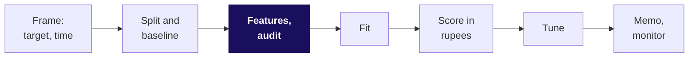

# Cheat sheet: Week 5 Wednesday, what the model is allowed to know

**The question:** on the morning the model is used, do we know this value for this customer?

| Term | Plain meaning | Rule or formula | Trap |
|---|---|---|---|
| Recency | days since the last order | `prediction morning - last order` | computed from today, it leaks |
| Ratio feature | puts old and new customers on one scale | `orders / months as a member` | a total ranks the oldest first |
| Cohort age | how long a customer has been with us | `prediction morning - first order` | an id issued in order hides it |
| One-hot | one 0 or 1 column per category | for linear and distance models | a 1, 2, 3 code invents an order |
| Standardise | put numbers on one scale | `z = (value - mean) / std`, fitted on training rows | fitting on all rows lets test rows in |
| Sentinel | a code meaning "never", such as 999 | split into a flag plus the number | its mean describes nobody |
| Leakage | an input unknown at prediction time | ask the prediction-time question | "too good" starts the check, never ends it |
| Calendar leak | a column that stamps the period | test with a split by time | known that morning and still borrowed |
| As-of trap | today's value of an overwritten field | read a snapshot from the morning | "it is in the warehouse" |
| Permutation importance | score lost when one column is shuffled | on validation rows; twins as a group | ranks reliance, never cause |
| Sign flip | a coefficient changes sign when a partner joins | read correlated columns as a group | "the new sign is the true effect" |

| When | Do this |
|---|---|
| A score jumps on one new column | find its write time before anything else |
| Logistic or distance model | one-hot and standardise inside the pipeline |
| Tree model | skip scaling; an ordinal code is fine |
| A field is overwritten nightly | ask for history and read it as of the morning |
| One importance bar towers | check for a leak, then for close partners |

**The bank's numbers to carry:** AUC 0.761, 0.795, 0.932 with `duration`; honest 0.796, about
0.57 inside one month; bill Rs 1.19 lakh promised against Rs 2.82 lakh real; euribor3m -0.92 alone,
+0.77 beside its partners.

## Everything so far, one line each

| Day | The line |
|---|---|
| W1 Mon | a number is a tree of drivers; refuse the average when one customer buys in bulk |
| W1 Tue | compare like with like, with the denominator named |
| W1 Wed | profile before you analyse; input equals clean plus rejected |
| W1 Thu | chance first: the permutation test, and correlation is not cause |
| W2 Mon to Wed | SQL from selection to window functions; joins that do not fan out |
| W2 Thu | groupby, merge and reshape build the customer table |
| W2 Fri | one number reaches the deck, recalculating live |
| W4 Mon | a metric with guardrails, so it cannot be gamed |
| W4 Tue | one slide, five minutes, three people paid to disagree |
| W4 Wed | lift: pairs beyond chance, valued in rupees |
| W4 Thu | cohorts and funnels: where the loss happens |
| W4 Fri | forecasts against a baseline that is hard to beat |
| W5 Mon | frame the target and the moment; beat the 0.887 baseline |
| W5 Tue | recall and the bill; threshold 40 / 1,240 = 0.032; precision at k under a budget |
| W5 Wed | every feature with a reason, every column with a write time, importance as reliance |

## Three things that happened

| Story | The lesson | Source, verified 28 October 2026 |
|---|---|---|
| A pneumonia network learned which hospital took an X-ray, partly from a metal token: AUC 0.931 at home, 0.815 at a new site | a column known in time can still stand in for a base rate | https://journals.plos.org/plosmedicine/article?id=10.1371/journal.pmed.1002683 (verified 28 October 2026) |
| Kaggle's 2011 social network winners re-identified the test set from a public crawl: AUC 0.981 | ask where every input comes from at prediction time | https://arxiv.org/abs/1102.4374 (verified 28 October 2026) |
| Airbnb's histograms showed monthly prices logged as nightly ones for long stays | plot every feature before you trust it | https://arxiv.org/abs/1810.09591 (verified 28 October 2026) |
