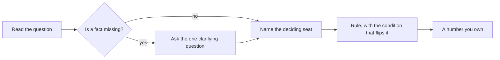

# Week 5 Wednesday interview bank: features, encoding, leakage and importance

Tags follow the curriculum's calibration for 0 to 3 year candidates in the Indian market: [S] a
staple asked everywhere, [F] frequent in product-company and global capability centre screens,
[D] a differentiator. Each answer is a scaffold to reason from: the 30-second version, the depth,
what the interviewer listens for, the common wrong answer and the two follow-ups that usually come
next. Say the numbers from your own notebook run, never these from memory.

| Section | Questions |
|---|---|
| Screening staples | 1 to 6 |
| Technical depth | 7 to 14 |
| ML case and scenario | 15 to 20 |
| Techno-functional and client-facing | 21 to 24 |
| Behavioural with a technical core | 25 and 26 |

## Screening staples

### 1. [S] What is data leakage, and how do you catch it before it ships?

- **30 seconds.** Leakage is any input the model sees in training that would not be known at the
  moment it is used, so the offline score borrows from the future. I catch it by asking of every
  column: on the morning the model is used, do we know this value for this customer?
- **Depth.** Three routes: a column written after the prediction moment (the bank's call length,
  written when the call ends), preprocessing fitted on all rows before the split, and rows from
  after the moment inside training. The audit names the writing system and the write time per column.
- **Listens for.** Leakage defined by time, and a question asked of every column.
- **Common wrong answer.** "When test rows appear in training", which reduces leakage to row overlap.
- **Follow-ups.** How do you find the write time of a column nobody documented? Can a column known
  in time still leak?

### 2. [S] What is feature engineering, and why does it matter if the model is powerful?

- **30 seconds.** Turning raw columns into signals the decision depends on: recency, counts, ratios,
  cohort age, basket signals, each with a business reason. A model only learns what its inputs make
  visible.
- **Depth.** A total ranks old customers first; a ratio such as orders per month as a member puts
  old and new on one scale. In my invented example the biggest spender was the coldest member, 312
  days since the last order.
- **Listens for.** A business reason per feature and the prediction moment as the anchor.
- **Common wrong answer.** "Creating as many features as possible and letting the model pick."
- **Follow-ups.** Which feature would you recompute every morning? When is a total better than a ratio?

### 3. [S] What is one-hot encoding, and when do you use it?

- **30 seconds.** One 0 or 1 column per category level, so a linear model gives each level its own
  weight. I use it for linear and distance models.
- **Depth.** A label code (Pune 1, Surat 2, Indore 3) makes a linear model assume an order and equal
  gaps nobody chose. Trees split on thresholds, so a code costs them little.
- **Listens for.** The model family decides.
- **Common wrong answer.** "Always label-encode, it saves columns."
- **Follow-ups.** What about 4,000 levels? What happens to a level seen only in the test rows?

### 4. [S] Why do we scale features, and which models need it?

- **30 seconds.** Standardising, `(value - mean) / standard deviation`, puts columns on one scale.
  Linear models with a penalty and distance models need it; trees do not.
- **Depth.** In a six-member example, distance on raw rupees and visits matched members by spend
  alone; after standardising, the nearest neighbour changed to the member with the same visits.
- **Listens for.** Fitted on training rows only, inside the pipeline.
- **Common wrong answer.** "Scaling improves every model."
- **Follow-ups.** Where is the scaler fitted? What changes for a power-law column?

### 5. [S] What does a feature importance chart show?

- **30 seconds.** How much a fitted model leans on each column when it predicts. It ranks reliance
  and never proves that changing a column changes the outcome.
- **Depth.** Permutation importance shuffles a column on validation rows and measures the fall in
  the score. Close partners share credit, so they are shuffled as a group.
- **Listens for.** Reliance against cause, said without prompting.
- **Common wrong answer.** "The top feature is the main driver."
- **Follow-ups.** How would you test whether the top feature is a lever? What does a towering bar suggest?

### 6. [S] What do you do with a value such as 999 in a days-since column?

- **30 seconds.** It is a sentinel meaning "never", so I split it into a flag and a number.
- **Depth.** In the bank's file 96.3 percent of `pdays` is 999; its raw mean of about 962 days
  describes nobody. A `never_contacted` flag plus `days_since_contact` for the rest reads plainly.
- **Listens for.** Spotting a sentinel before modelling.
- **Common wrong answer.** "Replace it with the mean."
- **Follow-ups.** How would you find sentinels in a new table? Does a tree need the split?

## Technical depth

### 7. [F] Which encoder for a forty-value categorical, and why?

- **30 seconds.** First I ask which model. For a logistic model, one-hot with rare levels grouped
  into "other"; for a tree, one-hot or an ordinal code both work.
- **Depth.** Forty columns are cheap. Replacing a level with its average outcome can carry the
  target into the feature unless it is computed inside each training fold, which is why it comes later.
- **Listens for.** The clarifying question about the model, and the flip.
- **Common wrong answer.** "Label-encode 1 to 40 for both models."
- **Follow-ups.** When would grouping into "other" hurt? What is the leak inside target encoding?

### 8. [F] What does a feature importance chart prove, and what does it not?

- **30 seconds.** It proves the fitted model leans on a column. It does not prove the column causes
  the outcome, and it misreads close partners.
- **Depth.** On the bank's honest model, shuffling `emp.var.rate` alone cost 0.34 AUC, more than the
  model's whole lift of about 0.30 above a coin; shuffling the five economy columns together cost
  0.14. The single shuffle built clients that never existed.
- **Listens for.** A number, and the twin problem.
- **Common wrong answer.** "Importance is the causal weight."
- **Follow-ups.** What test proves a lever? Why compute importance on validation rows?

### 9. [F] A coefficient's sign flipped when you added a feature. What happened?

- **30 seconds.** Most likely a close partner joined, and the two now share credit unstably.
- **Depth.** `euribor3m` was -0.92 alone and +0.77 beside two partners that correlate above 0.9 with
  it. A coefficient means "holding the others fixed", and partners never stay fixed in the data.
- **Listens for.** Reading the group, never the single sign.
- **Common wrong answer.** "The new feature revealed the true effect."
- **Follow-ups.** How do you check how correlated the partners are? What does a penalty do here?

### 10. [F] Why can accuracy barely move when AUC jumps?

- **30 seconds.** On an imbalanced file most answers are an easy no, so accuracy has little room.
- **Depth.** The bank's join of the call log moved AUC from 0.795 to 0.932 and accuracy from 0.899
  to 0.907, because calling nobody already scores 0.887. Recall at 0.5 nearly doubled.
- **Listens for.** The base rate named.
- **Common wrong answer.** "AUC exaggerates small changes."
- **Follow-ups.** Which metric would the campaign head read? At what base rate does accuracy stop misleading?

### 11. [F] Where do you fit the scaler and the encoder, and why does it matter?

- **30 seconds.** Inside a pipeline, fitted on training rows only, then applied to validation and test.
- **Depth.** My scaler saw 24,712 training rows. Fitting on all rows lets the sealed test rows shape
  the features; the gap is tiny on a stable file and large when the future differs.
- **Listens for.** The habit, defended even when the gap is small.
- **Common wrong answer.** "Scale first, then split, it is simpler."
- **Follow-ups.** How does cross-validation change this? What happens to a category first seen at scoring?

### 12. [F] Can a column that is known at prediction time still leak?

- **30 seconds.** Yes, through the split. If the column stamps the period and the split mixes
  periods, the model is scored on months it has already seen.
- **Depth.** The bank's year and month alone scored AUC 0.785 on a random split, and the honest model
  ranked at about 0.57 inside one month. The test is a split by time.
- **Listens for.** Leakage through the evaluation design.
- **Common wrong answer.** "If it passes the prediction-time question it is safe."
- **Follow-ups.** How would you split instead? What is the hospital version of this?

### 13. [F] How does permutation importance differ from a tree's built-in importance?

- **30 seconds.** Permutation measures the fall in a score on held-out rows; a tree's built-in
  importance counts how much its splits reduced impurity on training rows.
- **Depth.** Built-in importance favours columns with many distinct values and reflects what was
  memorised; permutation on validation rows reflects what generalises, and is model-agnostic.
- **Listens for.** Training rows against validation rows.
- **Common wrong answer.** "They measure the same thing."
- **Follow-ups.** What breaks permutation importance? What would you show a business owner?

### 14. [F] What is the as-of trap?

- **30 seconds.** Training on a field's value today when the model will see its value as of the
  prediction morning.
- **Depth.** A loyalty tier overwritten after purchases says Gold for buyers, so the model learns
  "Gold buys", which the purchase wrote. The fix is a snapshot, read as of the morning.
- **Listens for.** "Is this field overwritten?" asked of the owner.
- **Common wrong answer.** "If it is in the warehouse, it was known."
- **Follow-ups.** How do you build an as-of join? Which of your columns are overwritten?

## ML case and scenario

### 15. [D] A colleague's feature lifts the score to 0.99 and the team wants it shipped tonight. What do you say, and how do you prove it?

- **Clarifying question first.** "Which system writes this column, and when?"
- **30 seconds.** If it is written after the prediction moment, the 0.99 cannot run on the morning
  of the nudge. I prove it in an hour: retrain without it, show both scores and the write time.
- **Depth.** Kalpa's `settlement_status` is written when the payment clears, after delivery; on the
  nudge morning it reads "none" for everyone. The bank's version: the leak promised a bill of about
  Rs 1.19 lakh on 8,238 calls and the honest model costs about Rs 2.82 lakh, the one that can run.
- **Listens for.** The question, the proof, the money, and an offer for tonight.
- **Common wrong answer.** "Check for overfitting with cross-validation", which keeps the leak.
- **Follow-ups.** What do you ship tonight instead? How do you stop this happening again?

### 16. [D] Your model is excellent offline and poor live. Walk me through it.

- **Clarifying question first.** "Is live a new period, a new site or a new population?"
- **30 seconds.** I check leakage by time, then a shift between training and live data, then a
  mismatch between how features are computed at training and at scoring.
- **Depth.** Zech's pneumonia model scored 0.931 at home and 0.815 at a new hospital, having learned
  which hospital took the image. Uber's feature store applies "the same expressions" at training
  and prediction time to close the third gap.
- **Listens for.** An ordered checklist with a test for each.
- **Common wrong answer.** "Retrain on more data."
- **Follow-ups.** Which check is cheapest first? What would you monitor after launch?

### 17. [D] Walk me through your feature review before training.

- **30 seconds.** Every column gets five asks: who writes it, when, is it overwritten, its business
  reason, the verdict.
- **Depth.** In the bank's 20 inputs one column was dropped (`duration`), three groups flagged (the
  calendar columns and the economy, whose publication dates I could not verify), and `pdays`
  engineered.
- **Listens for.** A written table, the boring columns first.
- **Common wrong answer.** "I drop columns with low correlation."
- **Follow-ups.** Who signs the audit? How do you audit a column with no owner?

### 18. [D] Marketing wants a score per customer for who buys in 90 days. Design the features.

- **Clarifying question first.** "When exactly is the score used: the nudge morning, or live at login?"
- **30 seconds.** Recency, orders in a fixed window, cohort age, average basket and a category
  share, all computed as of the scoring morning.
- **Depth.** Computed once in the warehouse as SQL and read by training and scoring alike, so the
  definitions cannot drift. Everything written after the morning is excluded by construction.
- **Listens for.** The time anchor and one definition shared by both sides.
- **Common wrong answer.** A list of fifty columns with no reasons.
- **Follow-ups.** How fresh must each feature be? Which one would you drop first under a latency budget?

### 19. [D] The honest model scores 0.80, and a new data source would take it to 0.85. How do you decide?

- **Clarifying question first.** "When is the new source written, and can the scoring service read it that morning?"
- **30 seconds.** If it passes the prediction-time question and the split by time, I size the gain in
  rupees against the cost of the feed.
- **Depth.** A gain of 0.05 AUC means little until it is turned into buyers found under the budget;
  the bank's honest top 1,000 held 462 buyers against 113 at random.
- **Listens for.** Time first, money second.
- **Common wrong answer.** "Higher AUC, so yes."
- **Follow-ups.** What if the source arrives a day late? Who owns its quality?

### 20. [D] The campaign head reads the importance chart and wants to act on the top bar. What do you do?

- **30 seconds.** Say what it proves (reliance), what it does not (cause), and propose a fair test.
- **Depth.** The bank's top bars were rate columns that mark the quarter; acting on them means timing
  campaigns, which only a comparison of similar months with and without the condition can support.
- **Listens for.** A next step, never just a warning.
- **Common wrong answer.** "Agree, since the model says so."
- **Follow-ups.** How long would the test run? What would make you agree without a test?

## Techno-functional and client-facing

### 21. [F] Explain to a business owner why the score fell and the model got better.

- **30 seconds.** "The old score used a fact that only exists after the customer has already
  decided. The new model can run on the morning we send the nudge, so its number is the one we will see."
- **Depth.** Put both numbers next to the money they deliver, and say the old one could never be
  collected.
- **Listens for.** No jargon; the money.
- **Common wrong answer.** "The model got worse, but it is more correct."
- **Follow-ups.** How do you keep their trust after a lower number? What will they see next month?

### 22. [F] What changes and what stays when this pipeline moves to loan approval?

- **30 seconds.** The split discipline, the audit and the pipeline stay; the target, the costs and so
  the threshold change, and every feature is audited again.
- **Depth.** In German Credit a column named `duration` is the loan length on the form, known on day
  one, while a collections flag is written after the loan starts and fails. The name never decides.
- **Listens for.** The audit repeated in the new domain.
- **Common wrong answer.** "Everything transfers, since the model is the same."
- **Follow-ups.** Which lending column would you check first? Who in risk signs the audit?

### 23. [F] A client's data team says every column is safe because it is in the warehouse. How do you respond?

- **30 seconds.** Ask when each column is written and whether it is overwritten; the warehouse
  holds today's value, which is not the value on the prediction morning.
- **Depth.** Offer a one-page audit table they fill with their system owners; it turns an argument
  into lines they can check.
- **Listens for.** Respectful, specific, and a tool they can use.
- **Common wrong answer.** "Trust them, they own the data."
- **Follow-ups.** What if no history exists? How long does the audit take?

### 24. [F] How do you present a leak you found in a colleague's work?

- **30 seconds.** Privately first, with the write time and both scores, framed as a saved launch.
- **Depth.** One message: the column, the system that writes it, the evidence (the honest score),
  and the fix already run.
- **Listens for.** Evidence over blame.
- **Common wrong answer.** "Raise it in the team review so everyone learns."
- **Follow-ups.** What if they disagree? Who decides?

## Behavioural with a technical core

### 25. [S] Tell me about a time a stakeholder wanted a result you could not stand behind.

- **Shape.** Situation (the 0.99 and the launch date), task (protect the campaign), action (the
  one-hour proof and the honest alternative), result (the number that shipped, in rupees).
- **Listens for.** "I" statements, a number, and what changed in the team afterwards.
- **Common wrong answer.** A story with no number and no decision.
- **Follow-ups.** What would you do differently? How did the relationship hold up?

### 26. [S] Tell me about a feature you engineered and why.

- **Shape.** The decision it served, the raw columns, the definition with its time anchor, the
  check that it was known in time, and what it added (or that it added nothing and why you kept or dropped it).
- **Listens for.** A reason a business person would repeat.
- **Common wrong answer.** "I created twenty features and kept the important ones."
- **Follow-ups.** How did you validate it? Would it survive a split by time?
