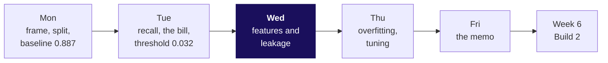
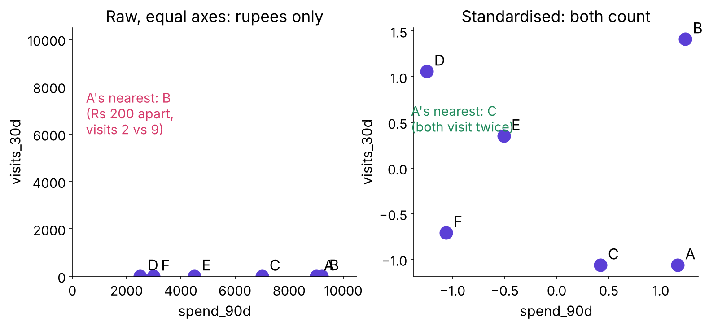
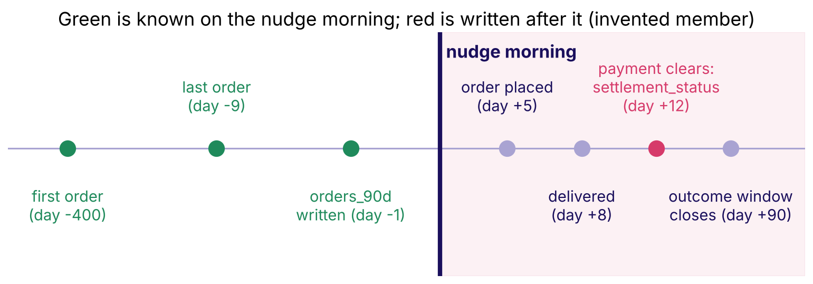
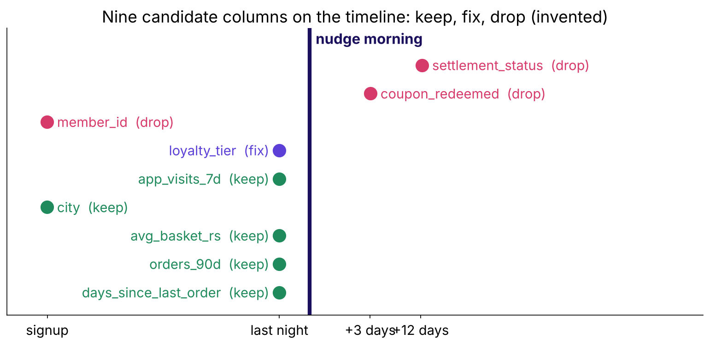
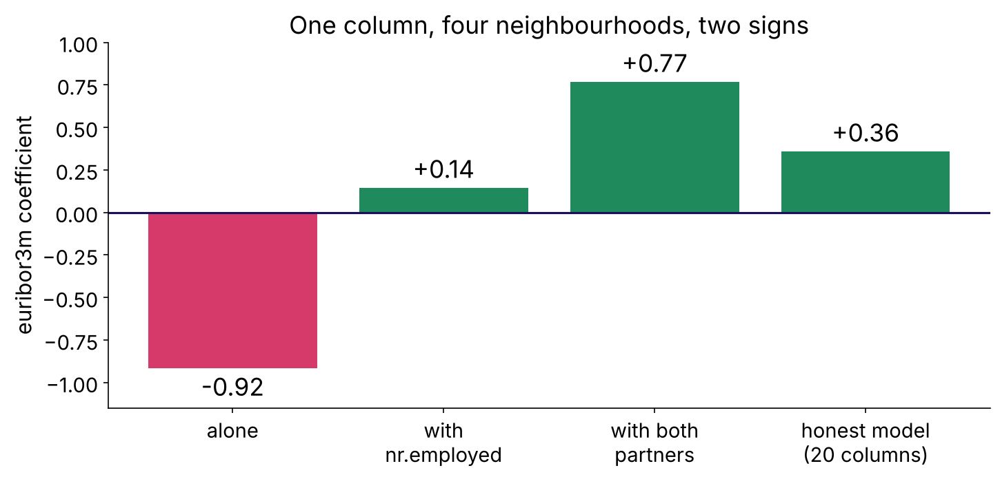

# Week 5 Wednesday study notes: what the model is allowed to know

## Where does Wednesday sit?

Monday decided what is predicted and when; Tuesday decided how to score it in rupees. Wednesday
decides what the model may read. Thursday tunes on Wednesday's audited feature set, so every
choice made today travels.

The one sentence to keep: **on the morning the model is used, do we know this value for this
customer?**

| The five topics, in the curriculum's words | The chapter |
|---|---|
| Feature engineering from the customer table: ratios, recency, counts, cohort age, basket signals | 1 Turning raw columns into signals |
| Encoding categoricals; scaling numerics; which models care | 2 Teaching a model to read categories |
| Leakage and the prediction-time question | 3 Answers from the future |
| The column audit | 4 Interrogating every column |
| Feature importance and its limits | 5 What the importance chart can't tell you |

## Chapter 1: how does a raw column become a signal?

**The idea in three lines.** A raw total grows with time, so it ranks the oldest customers first.
A signal is measured from the prediction moment and puts every customer on one scale. Each signal
carries a business reason a marketing lead would repeat.

**The worked example (invented).** On the nudge morning, 1 November 2026, Hari has the largest
total spend (Rs 26,000) and last ordered 312 days ago. Asha's average basket is Rs 16,800 over 24
orders, Rs 700; Dev's recency is 2 days and he orders 3.38 times a month as a member.

| Signal | Formula | The reason |
|---|---|---|
| Recency | nudge morning - last order, in days | warm buys again |
| Count | orders in the last 90 days | habit |
| Cohort age | nudge morning - first order | new members are still deciding |
| Ratio | orders / months as a member; spend / orders | old and new on one scale |
| Basket signal | items / orders | weekly shop against top-up |

**The trap.** `pd.Timestamp.today()` in place of the nudge morning: recency then counts days that
had not happened when the nudge went out. In the bank's file, ringing a client more often this
campaign lowers the yes-rate, from 13 percent at one call to 7 percent at four or more, which is
why each feature gets a check as well as a reason.

**The interview line.** "Every feature I build is anchored to the prediction moment and carries a
reason the business would say aloud."

## Chapter 2: how does a model read a category or a rupee?

**The idea in three lines.** A label code (Pune 1, Surat 2, Indore 3) hands a linear model an
order and equal gaps nobody chose; one-hot gives each city its own weight. Rupees drown visits in
any distance until both are standardised. Trees split on thresholds, so they shrug at both.

**The worked example (invented).** Member A against member B: spend differs by Rs 200 and visits
by 7, so the raw distance is the square root of 200 squared plus 7 squared, about 200.1, and B is
A's nearest neighbour. After `z = (value - mean) / standard deviation`, A's nearest neighbour is C,
who also visits twice a month.

| Model family | Category | Number |
|---|---|---|
| Logistic, linear | one-hot | standardise |
| Nearest neighbours, clustering | one-hot | standardise, decisive |
| Tree, forest, boosting | one-hot or an ordinal code | no need |

**The trap.** Fitting the scaler on all rows before the split. The bank's means move only in the
third decimal, which is why the habit looks harmless; the rule holds anyway, because on a file
where the future differs it carries the future in.

**The interview line.** "Encoding and scaling are decisions about the model family, made inside
the pipeline on training rows."

## Chapter 3: what is leakage, and which question catches it?

**The idea in three lines.** Leakage is any input the model sees in training that would not be
known at the moment it is used. The prediction-time question catches it when asked of every
column. A column written after the moment is dropped, however well it scores.

**The worked example (invented).** Twelve Kalpa members. "Bought if `settlement_status` is
settled" gets 12 of 12 on the training table, built after the outcome. On the nudge morning no
payment from the coming 90 days exists, the column reads "none" for everyone, and the rule falls to
6 of 12, the score of predicting nobody buys. The best honest rule, two or more orders in 90 days,
gets 10 of 12.

**The trap.** Reading "too good" as the verdict. In the bank's file `poutcome = success` converts
at 65 percent and stays, because the earlier campaign closed months before the call.

**The interview line.** "Leakage is a question about time: when is the column written, against the
moment the model runs?"

## Chapter 4: how do you audit every column?

**The idea in three lines.** Five asks per column: who writes it, when, is it overwritten, its
business reason, the verdict. Overwritten fields are read as a snapshot from the prediction
morning. Identifiers and columns with no reason are dropped.

**The worked example (invented).** Of nine candidates, `coupon_redeemed` (day +3) and
`settlement_status` (day +12) are written after the nudge, `member_id` has no reason, and
`loyalty_tier` is kept from a snapshot, because member M07 bought, was upgraded to Gold, and
today's table no longer shows the Silver of the nudge morning.

**The trap.** "If it is in the warehouse, it was known." The warehouse holds today's value.

**The interview line.** "I audit the boring columns first, with the owner, one line per column."

## Chapter 5: what can an importance chart prove?

**The idea in three lines.** Permutation importance shuffles a column and measures how far the
score falls: how much this fitted model leans on it. Close partners share credit, so they are
shuffled and read as a group. Importance names a lever only after a fair test changes the column.

**The worked example (invented).** A rule (visits plus searches of 8 or more) gets 11 of 12.
Shuffling visits costs 2 answers, searches 4, both together 8, more than the two single costs
added, because the twins correlate at 0.94.

**The trap.** Reading the top bar as the driver. Members search because they already intend to
buy; pushing searches up would not create that intent.

**The interview line.** "Importance ranks reliance. Cause needs an experiment."

## What did the bank's 41,188 calls show?

| Step | Number | What it means |
|---|---|---|
| Customer table | AUC 0.761 | Monday's model |
| + economy | AUC 0.795 | most of the gain is the calendar |
| + call log (`duration`) | AUC 0.932, accuracy only 0.899 to 0.907 | the jump that should start the doubt |
| `duration` by length | 0.5 percent yes in the shortest fifth, 33 in the longest | the call is the sale |
| Year and month alone | AUC 0.785 | the calendar leaks through a random split |
| Honest set, inside one month | AUC about 0.57 | the ranking a call list really gets |
| The bill at Rs 40 a call, Rs 1,200 a missed buyer | leak Rs 1.19 lakh, honest Rs 2.82 lakh | the promise no live list could keep |
| `euribor3m` | -0.92 alone, +0.77 beside two partners | read twins as a group |
| `emp.var.rate` shuffled alone | 0.34 AUC lost against a lift of 0.30 | the shuffle built clients who never existed |

The dataset's authors write that a call's length strongly shapes the outcome, is unknown before
dialling, and belongs in benchmarks only (UCI Bank Marketing page,
https://archive.ics.uci.edu/dataset/222/bank+marketing, verified 28 October 2026).

## Which real teams met the same problems?

| Team | What happened | Source, verified 28 October 2026 |
|---|---|---|
| Zech and others, chest X-rays, PLOS Medicine 2018 | A pneumonia model scored internal AUC 0.931 and 0.815 at a hospital it had never seen; the network identified the hospital system of 99.95 percent of NIH images, partly from a metal token, and hospital prevalence alone ranked at AUC 0.861 | https://journals.plos.org/plosmedicine/article?id=10.1371/journal.pmed.1002683 (verified 28 October 2026) |
| Kaggle IJCNN 2011 social network challenge, Narayanan, Shi and Rubinstein | The winners re-identified much of the anonymised test set from their own Flickr crawl and reached AUC 0.981, largely by looking up answers | https://arxiv.org/abs/1102.4374 (verified 28 October 2026) |
| Airbnb search, Haldar and others | Their first neural network stalled because features were not normalised; distribution plots then exposed a monthly price logged as daily for stays over 28 days | https://arxiv.org/abs/1810.09591 (verified 28 October 2026) |
| Uber Michelangelo, 2017 | UberEATS delivery time is predicted from request, seven-day and last-hour features, kept in a store where "the same expressions are applied at training time and at prediction time" | https://www.uber.com/blog/michelangelo-machine-learning-platform/ (verified 28 October 2026) |

The Zech case is the bank's calendar in another field: the hospital, like the month, is known when
the prediction is made and still stands in for a base rate that differs at the next site.

## How does each seat look at Kalpa's 0.99?

| Seat | The question | Today's answer |
|---|---|---|
| Business owner | What will the nudges cost, and what will they return? | only the honest model's bill can be collected |
| Product manager | What does the member see, and when? | a nudge on the morning, before any order |
| Solution architect (spotlight) | Is the column there on the morning, in the feed the service reads? | `settlement_status` arrives days later: drop |
| Senior ML engineer | Is the jump believable? | one column worth 0.99 is a leak until its write time is known |
| Implementation engineer (spotlight) | Where are the encoder and the scaler fitted? | inside the pipeline, on training rows only |
| QA and tester | Which test fails if a late column slips in? | an audit check that every column's write day is before the moment |

## What do you read or watch next?

| Link | Why |
|---|---|
| scikit-learn, Common pitfalls (verified 28 October 2026): https://scikit-learn.org/stable/common_pitfalls.html | leakage in preprocessing and the pipeline fix |
| scikit-learn, Permutation importance with multicollinear features (verified 28 October 2026): https://scikit-learn.org/stable/auto_examples/inspection/plot_permutation_importance_multicollinear.html | the twin problem on a real example |
| Google Machine Learning Crash Course, One-hot encoding (verified 28 October 2026): https://developers.google.com/machine-learning/crash-course/categorical-data/one-hot-encoding | encoding from zero |
| CampusX, What is Feature Engineering (video, verified 28 October 2026): https://www.youtube.com/watch?v=sluoVhT0ehg | chapter 1 as a short lecture |
| Normalized Nerd, Standardization vs Normalization (video, verified 28 October 2026): https://www.youtube.com/watch?v=sxEqtjLC0aM | chapter 2's scaling picture |
| A Data Odyssey, Permutation Feature Importance from Scratch (video, verified 28 October 2026): https://www.youtube.com/watch?v=U-iahfXlSoY | chapter 5 coded by hand |

The IITGN faculty session W5-3 (tentative) picks up from here with multicollinearity, variance
inflation and target encoding.

## Can you answer these without notes?

1. State the prediction-time question word for word.
2. Why does accuracy barely move when AUC jumps on an imbalanced file?
3. Name two ways a column known in time can still mislead a score.
4. Which model families shrug at unscaled features, and why?
5. What does a single-column importance larger than the model's lift tell you?
