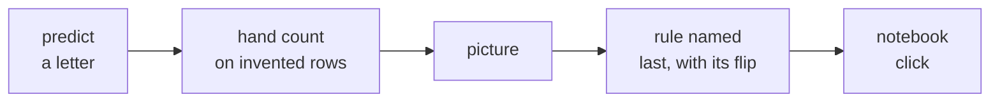

# W05 Wednesday: feature engineering and leakage, the trainer guide

## 1. The story in two lines

| Layer | The line |
|---|---|
| The real case | A Portuguese bank's 41,188 phone calls (UCI Bank Marketing): a junior joins the economy feed and the call log, AUC jumps from 0.761 to 0.932, and the jump is a column written when the call ends |
| Kalpa's decision | Marketing wants `settlement_status` (validation 0.99) shipped tonight; the room audits every column with the prediction-time question and ships the honest score instead |

## 2. The run table (240 trainer minutes, then the faculty block, tentative, then the TA lab)

| Block | Minutes | Slides | Open | What must land | Cut if late |
|---|---|---|---|---|---|
| Opening | 10 | cover to S5 | deck, explorer `#story`, `#map` | the 0.99 prediction written on the board | S1 roadmap to 30 seconds |
| Ch 1 Turning raw columns into signals | 22 | S6 to S10 | ch01, explorer `#p1` | a total ranks the coldest member first; five signals with reasons | S9 bank counts |
| Ch 2 Teaching a model to read categories | 18 | S11 to S16 | ch02, explorer `#p2` | one-hot for lines, scaling for distance, trees shrug | S14 table (the row's cut-first item) |
| Ch 3 Answers from the future | 20 | S17 to S22 | ch03, explorer `#p3` | the prediction-time question, said twice | S22 rules |
| Break | 10 | | | | |
| Ch 4 Interrogating every column | 15 | S23 to S28 | ch04, explorer `#p4` | five asks; the as-of trap | S27 and S28 drill |
| Ch 5 What the importance chart can't tell you | 15 | S29 to S32 | ch05, explorer `#p5` | twins share credit; reliance is no lever | S32 rules |
| Case 1 The junior's join | 20 | S33 to S36 | case01, explorer `#case` Ch 6 | the room predicts before the jump is shown | S36 scaler code |
| Guided | 20 | S37 | guided | two flags with reasons; duration called not known | never cut |
| Case 2 Every column on the timeline | 30 | S38 to S47 | case02, explorer `#case` Ch 7 tabs | the audit; honest 0.796; Rs 1.19 lakh promised against Rs 2.82 lakh | S44 poutcome and pdays to one line |
| Lunch | | | | | |
| Case 3 The sign that flipped | 20 | S48 to S53 | case03, explorer `#case` Ch 8 tabs | euribor3m -0.92 to +0.77; importance 0.34 above the 0.30 lift | S51 group shuffle |
| Unguided | 20 | S53 notes | blank notebook | the audited set rebuilt, 0.796 reproduced | shorten to the audit table only |
| Interview corner, Kahoot, close | 20 | S54 to S56 | explorer `#interview`, Kahoot | the [D] answer opens with a clarifying question | Kahoot to Q1, Q2, Q5 |
| IITGN faculty block W5-3 (tentative) | 120 | | | see the sync block below | |
| TA-led practice lab | about 90 | | practice lab | the same audit on German Credit | see section 8 |

## 3. Taught before, teach today, do not teach today

| Taught before | Teach today | Do not teach today |
|---|---|---|
| W2 recency, frequency, monetary; W4 cohorts and baskets | ratios, recency, counts, cohort age, basket signals, each with a reason | automated feature selection |
| Mon prediction time, the split, the baseline 0.887 | one-hot, standardising, which model families care | target encoding (the faculty block, tentative, takes it) |
| Tue recall, the bill at Rs 40 and Rs 1,200, threshold 0.032 | leakage and the prediction-time question; the column audit | embeddings |
| W1 Thursday the fair comparison | permutation importance and its limits; the sign flip | variance inflation factor (faculty block, tentative); Thursday's regularisation |

## 4. The interview anchors, asked aloud

| Tag | Question | Asked at |
|---|---|---|
| [S] | What is data leakage, and how do you catch it before it ships? | minute 70, S22 |
| [F] | Which encoder for a forty-value categorical, and why? | minute 50, S14 |
| [F] | What does a feature importance chart prove, and what does it not? | minute 105, S31; again at S52 |
| [D] | A colleague's feature lifts the score to 0.99 and the team wants it shipped tonight; what do you say, and how do you prove it? | minute 225, S54 |

## 5. How to teach each chapter

| Chapter | Draw first | Ask for a prediction | Misconception to stage | Wrong number, shown exactly, and its fix | The click | Interview line |
|---|---|---|---|---|---|---|
| 1 Signals | two members on a line from first order to the nudge morning | who does total spend nudge first? (b, Hari) | "the biggest spender is the best target" | Hari, Rs 26,000, last order 312 days ago; fix: recency and orders per month | ch01 cell 4, then the scatter; `#p1` play to recency | "Engineer features from a customer table and justify each" |
| 2 Categories | three cities on a number line, 1, 2, 3 | is Indore three times Pune? | "label encoding is neutral" | A's nearest neighbour is B at distance 200.1 on raw columns; fix: standardise, nearest becomes C | ch02 scatter pair; `#p2` Standardise | "Which encoder for forty values?" |
| 3 Future | one member's timeline with the nudge morning as a thick line | the settled rule on the nudge morning (c, 6 of 12) | "a high score means a good model" | 12 of 12 on the training table; fix: drop it, the honest rule scores 10 of 12 | `#p3`: commit, play, drag the moment to day 0 | "What is leakage?" |
| 4 Audit | the five-ask table on the board | how many of nine are dropped? (b, three) | "if it is in the warehouse, it was known" | loyalty tier Gold for M07, written by the purchase; fix: the snapshot as of the morning | ch04 timeline; `#p4` stamps | "Walk me through your feature review" |
| 5 Importance | a column of 12 values and an arrow moving each six rows down | searches shuffled: how many right? (b, 7) | "the top bar is the driver" | twins alone cost 2 and 4, together 8; fix: shuffle as a group | ch05 bars; `#p5` shuffle each twin | "What does importance prove?" |
| Case 1 | three bars with question marks | what do the two joins add? (b) | "accuracy shows improvement" | accuracy 0.899 to 0.907 while AUC goes 0.795 to 0.932 | case01 table; `#case` Ch 6 feature sets | "Your score jumped overnight" |
| Case 2 | the week's timeline with an empty slot right of the line | shortest fifth yes-rate (b, 0.5 percent); year-month AUC (c, 0.79) | "known that morning means safe" | the calendar alone scores 0.785; inside one month the honest model ranks at 0.568 | case02 within-month table; `#case` Ch 7 stamps and calendar | "Your model is great offline and poor live" |
| Case 3 | three overlapping circles for the rate columns | euribor3m's sign with partners (b, positive) | "a coefficient's sign is its effect" | emp.var.rate importance 0.344 against a model lift of 0.295; fix: group shuffle, 0.140 | case03 flip bars; `#case` Ch 8 fits and group shuffle | "A sign flipped when you added a feature" |

**The dataset's own words on `duration`**, read aloud from the UCI page (fetched 28 October 2026, https://archive.ics.uci.edu/dataset/222/bank+marketing, verified 28 October 2026), with one capital letter bracketed so this file passes the house style gate:

> last contact duration, in seconds (numeric). Important note: this attribute highly affects the output target (e.g., if duration=0 then y="no"). Yet, the duration is not known before a call is performed. Also, after the end of the call y is obviously known. [T]hus, this input should only be included for benchmark purposes and should be discarded if the intention is to have a realistic predictive model.

STUDENT files carry a paraphrase only.

**Numbers you will quote** (all from the executed notebooks; validation slice of 8,238 calls, seed 42):

| Feature set | Columns | AUC | Accuracy at 0.5 | Recall at 0.5 | Bill at 0.032 | Buyers in top 1,000 |
|---|---|---|---|---|---|---|
| Customer table | 13 | 0.761 | 0.897 | 0.19 | Rs 2.79 lakh | 404 |
| + economy | 18 | 0.795 | 0.899 | 0.23 | Rs 2.80 lakh | 460 |
| + economy + duration | 19 | 0.932 | 0.907 | 0.42 | Rs 1.19 lakh | 572 |
| Honest audited set | 20 | 0.796 | 0.899 | 0.23 | Rs 2.82 lakh | 462 |
| Year and month alone | 1 | 0.785 | | | | |

The row's planted Kalpa numbers (settlement_status at 0.99, visits and searches flipping a sign) belong to Kalpa v6 data that was never generated: say the 0.99 as Kalpa's story, and take every measured number from the bank.

## 6. The spotlight seats: the solution architect with the implementation engineer

| Seat | The question to ask in class | Where |
|---|---|---|
| Solution architect | "Is this column there, on the morning we score, in the feed the service reads?" | S23, S40, S46 |
| Implementation engineer | "Where were the encoder and the scaler fitted, and on how many rows?" | S13 notes, S36 (24,712) |

Ask one learner to hold each seat for the whole of case 2 and to interrupt when their question applies.

## 7. The quiz, ready for Kahoot (ungraded)

| # | Question | A | B | C | D | Key |
|---|---|---|---|---|---|---|
| 1 | On the morning the model is used, do we know ___? | this value for this customer | the column's average across all customers | whether this column lifts validation AUC | whether the column has missing values | A |
| 2 | Validation hit 0.99 after one new column. First suspicion? | overfitting, so run cross-validation | the column is written after the outcome | the validation set is too small to trust | the model needs a lower threshold | B |
| 3 | A forty-value city column, logistic model. Which encoder? | a single code from 1 to 40, one per city | the average outcome of each city | one-hot, rare cities grouped as other | drop the column, too many values | C |
| 4 | Which family shrugs at unscaled features? | logistic regression with a penalty | nearest neighbours | clustering by distance | decision trees and forests | D |
| 5 | A coefficient's sign flipped when a feature was added. Likeliest cause? | a bug in the one-hot encoder | a close partner column joined the model | the target leaked into the new column | too few training rows for that many columns | B |
| R | Tuesday's return: the same model in retail and lending. Why opposite thresholds? | the expensive error changed sides | lending data has more missing values | retail models are more accurate | lending base rates are always lower | A |

## 8. The practice lab run sheet for the TAs

Length: about 90 minutes. First 10 minutes: re-run `case03` on the projector from the top. Then the lab, `2_take_home_mandatory/C2_W05_D03_practice_lab_STUDENT.ipynb`; solutions in `4_trainer_only/C2_W05_D03_practice_lab_solutions_TRAINER.ipynb`.

| Step | Expected result | The three commonest wrong answers | Minutes |
|---|---|---|---|
| 1 monthly_burden | median 130 DM, mean 168 | `duration / credit_amount` (inverted); `credit_amount * duration`; dividing by 12 | 10 |
| 2 encoder | B, one-hot | A, because three levels look ordered; C, too many levels; "label encoding is fine for logistic" | 5 |
| 3 audit | duration and credit_history known; both collections columns not known | duration called not known because of Wednesday's bank; collections_flag called known "since it is in the warehouse"; months_in_arrears called known at month 0 | 15 |
| 4 AUC | 0.8043, with monthly_burden 0.8055 | AUC on training rows (about 0.84 or higher); scaler fitted on all rows; forgetting `predict_proba` and scoring labels | 20 |
| 5 SQL | bad rate 0.493, 0.390, 0.222, 0.117 | `AVG(class)` on text; grouping by bad; dropping `no checking` | 10 |
| 6 QA | scrambled target 0.424; checking_status top at 0.068 | reading 0.424 as "worse than a coin, so a bug" (it is noise on 250 rows); calling checking_status a lever; shuffling on training rows | 15 |
| Assignment and write-up | under_25 bad rate 0.409 against 0.281; AUC 0.7986, below 0.8043 | claiming a feature helps from one split; no reason given; no prediction-time line | 15 |

Cut order if the lab runs late: the assignment, then step 5. Never cut step 3 (the audit) or step 6 (QA).

## 9. Fallbacks

| If | Then |
|---|---|
| The UCI or OpenML download fails for some of the room | pair them with a neighbour whose cache filled; project the executed notebooks, which carry every output |
| Kernels die or Codespaces are slow | one notebook open at a time, kernels shut at the break; teach from the saved outputs |
| The explorable will not open | open it as a local file from the repository; it needs no network |
| The faculty block (tentative) does not run | fill the 120 minutes: the unguided audit in full (40), the two drills rerun with new candidates (20), practice set problems 1, 4 and 8 in pairs (40), the [D] mock interview in pairs with the scaffold from the interview bank (20) |

## 10. Programme sync

Posts to <!-- sync:module:W05/D3 -->Module 2: Applied Machine Learning<!-- /sync:module:W05/D3 -->.

<!-- sync:faculty-day:W05/D3 -->
**IITGN faculty block W5-3 (tentative), 120 minutes, after this row's applied core.** Faculty: to be confirmed by IIT Gandhinagar.

TOPIC: When features fight: multicollinearity and the unstable coefficient, variance inflation, scaling and distance, and target encoding with the leak it can carry.
PICKS UP WHERE THE ROW STOPS: the row stops before target encoding and automated selection.
CONNECTS TO KALPA: the two correlated features that flipped a coefficient's sign in the room's own model.
BY THE END: a learner can explain the sign flip with a picture, compute a variance inflation factor, and say which models care about scale and why.
DOES NOT REPEAT: the prediction-time question and the leak audit.
<!-- /sync:faculty-day:W05/D3 -->

The row stops where the faculty block starts: the close (S56) is the last thing the trainer runs, and the block is mentioned to the room as tentative.

ME1 runs this week as a continuous activity; say its scope aloud on Friday and state no day or slot.

## 11. The explorer, page by page

The file is `1_in_class_training_content/demos/C2_W05_D03_leakage_timeline_explorer_STUDENT.html`. Each page opens from the side menu, from its number key, or by adding its name after the address (`#p3`). Every page asks for a prediction before it shows its answer, so ask the room to commit first. Press P for presenter mode on the projector. Slide S21 pictures `#p3` at the nudge morning.

| Page | When | The clicks | What the room should see |
|---|---|---|---|
| `#story` | Opening | Play the five scenes; commit on the card | The bank's ranked columns pile violet right at 0.761, 0.795, 0.932; Kalpa's 0.99 as the twin; the call is to hold both |
| `#map` | Opening | Play the path; open a page from its box | Five topics in order, resting on recency, Monday's moment, Tuesday's bill and the fair comparison |
| `#p1` | Ch 1 | Commit; play the six steps; slide Hari's last order | Total spend ranks Hari 1 of 8; recency puts Hari 8 of 8; only recency moves with the slider |
| `#p2` | Ch 2 | Commit; play to step 3; slide one visit's worth from Rs 1; press Standardise | A's nearest neighbour flips from B to C above about Rs 284 a visit; standardising sets Rs 953 |
| `#p3` | Ch 3 | Commit; play to step 3; drag the moment from day +13 to day 0, then to day -2 | 12 of 12 on the table and 6 of 12 on the morning; at day 0 both read 10 of 12 |
| `#p4` | Ch 4 | Commit; play the five asks; stamp the nine columns, or Stamp it the audit's way | Unstamped: 29 of 30 on the table, 20 on the morning; audited: 23 and 23 |
| `#p5` | Ch 5 | Commit; play; shuffle visits, searches, then both; Shuffle again for random orders | 2, 4 and 8 answers lost; searches is a reliance, a push needs a fair test |
| `#case` Ch 6 | Case 1 | Commit; add + economy, then + call log | 404, 460, 572 buyers in the first 1,000 calls; AUC 0.761, 0.795, 0.932; the trap card on accuracy |
| `#case` Ch 7, every column | Case 2 | Commit; stamp the eight cards; then Stamp it the audit's way | Unstamped: AUC 0.932 and Rs 1.19 lakh, which cannot run; audited: 0.796, Rs 2.82 lakh, 462 |
| `#case` Ch 7, the calendar | Case 2 | Commit; switch the calendar alone, the honest model, inside one month | 0.785, 0.796 and 0.568 |
| `#case` Ch 8, the sign | Case 3 | Commit; step the four fits | euribor3m -0.92, +0.14, +0.77, +0.36 |
| `#case` Ch 8, the top bar | Case 3 | Commit; switch to the economy as a group | emp.var.rate 0.344 against a lift of 0.295; the group 0.140 |
| `#field` | After class | One control per scene; then the six seats | Zech 0.931 to 0.815; Kaggle 0.981 from a crawl; Airbnb's three forms; Uber's last-hour skew of 3.8 minutes on invented orders |
| `#interview` | Close | Per situation: the question, the order, the answer, then the model answer | The [D] answer opens with "which system writes this column, and when?" |
| `#check` | After class | Eight checks | The map with today lit, and Thursday's question |

