# Overfitting and regularisation

Week 5, Day 4. Thursday.

Kicker: WEEK 5  ·  THURSDAY  ·  GENERALISE OR MEMORISE
Header: WEEK 5  ·  THURSDAY  ·  OVERFITTING AND REGULARISATION

```notes
LIVE, 1 minute. Read the title and the kicker. Say: yesterday we made the model honest; today we
make it trustworthy on customers it has never met. Click to the opening slide.
```

---

## S1. Generalise or memorise, and the honest tuned model
*Five topics on tiny invented examples, then one real file, then one decision.*

```cards
icon: graduation-cap | eyebrow: The topics | title: Three students, ten customers | body: Past papers, a twelve-week footfall curve and twenty shoppers carry the five topics by hand. | tone: light
icon: landmark | eyebrow: The case | title: A Portuguese bank's 41,188 calls | body: UCI Bank Marketing, public data, Wednesday's honest columns. | tone: light
icon: store | eyebrow: The decision | title: Kalpa's one-campaign nudge | body: Anand's budget covers one campaign: which model ships, and what gap would change it. | tone: dark
```

```notes
LIVE, 1 minute. Three layers, same as all week: the idea on numbers small enough to check by hand,
the same idea on the bank's real file, and the decision Kalpa has to make with it. Ask: who
remembers the do-nothing score from Monday? (88.7 percent.) Keep that number in the room all day.
```

---

## S2. Thursday in the twenty weeks
*The machine learning core sits between analyst craft and Kalpa Financial's build.*

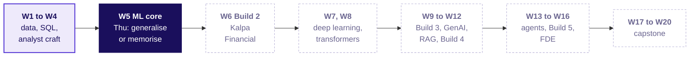

```notes
LIVE, 1 minute. Point at Week 5. Every later week that trains a model, from deep learning to the
capstone, meets today's question: does it work on rows it never saw? Build 2 next week reuses this
exact pipeline on Kalpa Financial's lending book. Transition: the week's one picture.
```

---

## S3. The week's picture, Thursday state
*Monday split it, Tuesday set the line, Wednesday removed the leak. Today fills the last panel.*

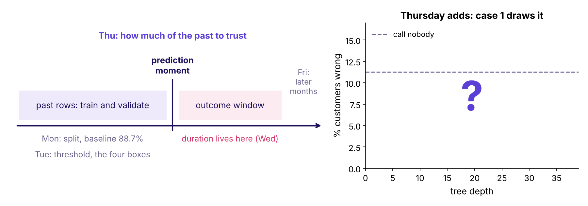

```notes
LIVE, 2 minutes. The same timeline every morning. Left: past rows we train and validate on, the
prediction moment, the outcome window where duration lived. The right panel is empty on purpose:
case 1 draws validation error against tree depth on the bank's file. Ask the room to sketch the
shape they expect, with the dashed call-nobody line, and keep the sketches for case 1.
```

---

## S4. The ticket: a tree that scored 99.6 on practice
*A teammate's tree, the room's own honest columns, one campaign of budget.*

```stats
value: 99.6% | label: training accuracy | note: the number Marketing saw first
value: ? | label: validation accuracy | note: 8,238 customers the tree never saw
value: 88.7% | label: call nobody | note: the do-nothing baseline from Monday
```

```notes
LIVE, 2 minutes. This is the destination; the topics come first. A teammate grew a decision tree
with no depth limit on Wednesday's honest feature set and posted 99.6 percent. Ask: would you book
Anand's one campaign on it? Take two answers, park them. Case 1 reveals the validation number (84.1,
below the 88.7 baseline); do not say it now. The row's story said 100 and 61; our run on public data
says 99.6 and 84.1, and we quote our run.
```

---

## S5. Five topics, five chapters, then the case
*The curriculum's words, in its order.*

| # | The topic, in the curriculum's words | Chapter | Minutes | Notebook |
|---|---|---|---|---|
| 1 | Overfitting; bias and variance through learning curves | 1 Memorising against learning | 25 | ch01 |
| 2 | Regularisation | 2 Putting brakes on the model | 20 | ch02 |
| 3 | Cross-validation | 3 Five exams instead of one | 20 | ch03 |
| 4 | Trees, ensembles, clustering: used, compared, not derived | 4 Trees, forests and groups | 15 | ch04 |
| 5 | When the simpler model wins | 5 Why the boring model often ships | 20 | ch05 |

Cases 1 to 3 then run every topic on the bank's file: notebooks case01, case02, case03.

```notes
LIVE, 1 minute. Read the five topics down the second column once; these are the words to search
by. Each chapter has one short notebook with the same name. The explorable (depth and brake sliders)
opens in chapters 1 to 3. Transition: how the five join.
```

---

## S6. How the five topics join
*Two ways to be wrong, two tools against them, one decision.*

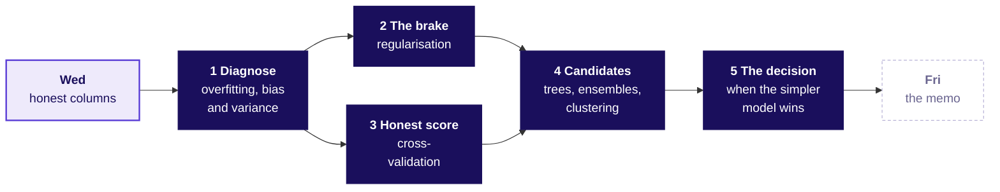

```notes
LIVE, 1 minute. Chapter 1 gives the diagnosis. Chapters 2 and 3 are the two tools: a brake for the
model, an honest average for the score. Chapter 4 brings the candidates; chapter 5 decides between
them. Friday turns the decision into the committee memo.
```

---

## SECTION 1: Memorising against learning: is 100 percent good?
*Overfitting; bias and variance through learning curves · also searched as: overfitting vs underfitting, bias variance tradeoff, learning curves*

```notes
LIVE, 25 minutes for the chapter. Notebook ch01. The misconception to stage: a perfect training
score means a ready model. The prediction to ask for: who tops the new exam.
```

---

## S7. Question: who tops the new exam?
*Five past papers. One student memorises, one learns the method, one skims. Invented.*

```cards
icon: book-open | eyebrow: Student 1 | title: The memoriser | body: Every answer by heart. Past papers: perfect. | tone: light
icon: lightbulb | eyebrow: Student 2 | title: The learner | body: Works out each method. Past papers: good. | tone: light
icon: eye | eyebrow: Student 3 | title: The skimmer | body: Reads quickly. Past papers: weak. | tone: light
```

```notes
LIVE, 3 minutes. Ask for a prediction in the chat or by raised fingers: 1, 2 or 3.
Count them aloud. Most rooms vote for the memoriser, who topped practice. Do not reveal; click.
```

---

## S8. Answer: the student who learned the method
*The memoriser's 39-point drop is the whole lesson.*


```notes
LIVE, 3 minutes. The memoriser: 100 on practice, 61 on the exam. The learner: 84 and 81. The skimmer: 58 and 56. Land
the line: practice scores reward memory; only the exam measures learning. These are the row's own
100 and 61, kept as an invented story. Ask: which student is a tree with no depth limit? (The memoriser.)
```

---

## S9. Two ways to be wrong
*Read the gap first, then the level.*

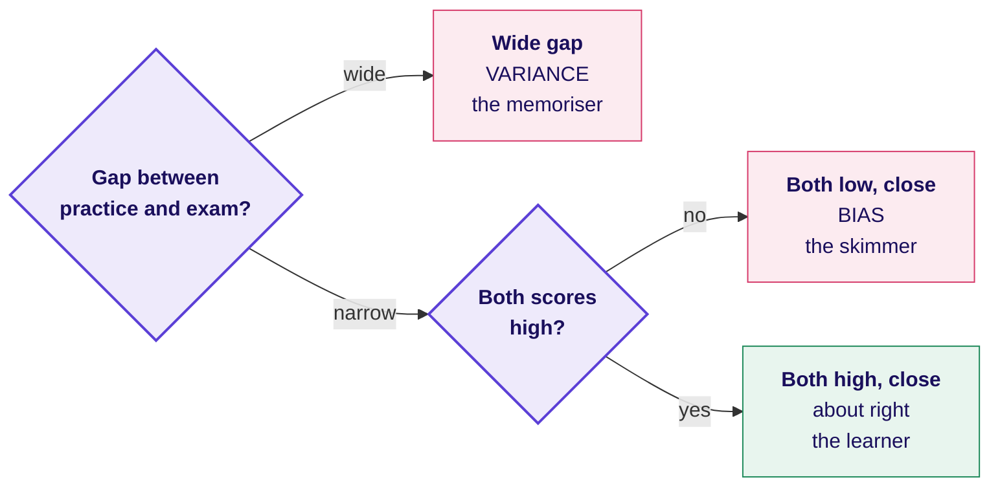

```notes
LIVE, 3 minutes. Variance: the model changes a lot when the data changes, so new data surprises it.
Bias: the model is too simple to be right anywhere. Say the order out loud: gap first, level second.
Interview line: overfitting is a gap you can measure, never a feeling.
```

---

## S10. A tree that never stops asking
*Ten invented customers, three who break the pattern.*

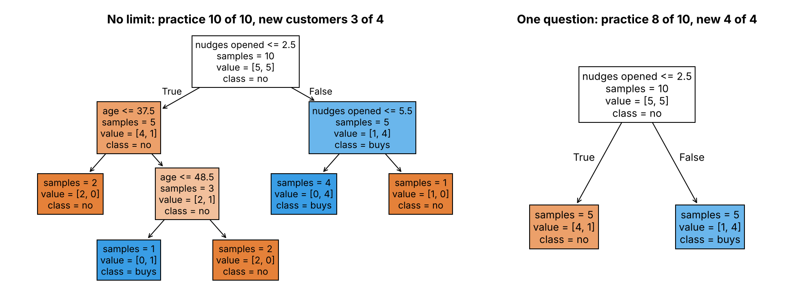

```notes
LIVE, 5 minutes. Notebook ch01, the tree cell. The pattern: opened three or more nudges, then
bought. Three customers break it. The unlimited tree writes a private rule for each awkward one: 10
of 10 on practice, 3 of 4 on new customers. One question: 8 of 10 on practice, 4 of 4 on new. Ask:
which tree learned Kalpa's customers, and which learned these ten people?
```

---

## S11. Learning curves from tiny numbers
*Add one past paper at a time; score practice and a fresh exam.*

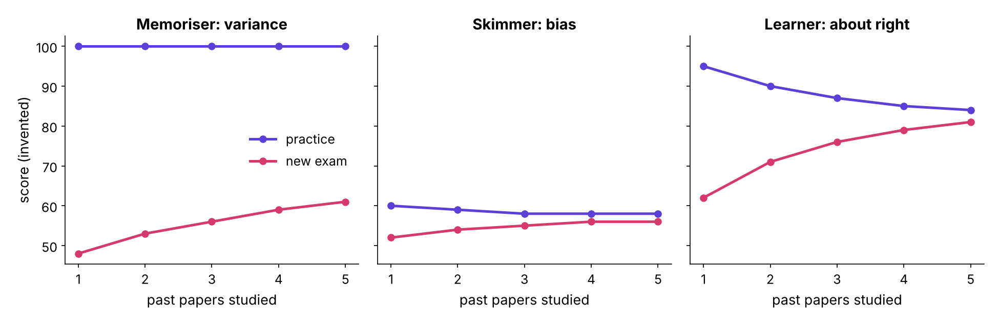

```notes
LIVE, 5 minutes. A learning curve is two lines against the amount of training. The memoriser's practice
line stays at 100 while the exam line crawls: a gap that more papers barely close. The skimmer's two lines
meet low; the learner's meet high. Explorable click: open the depth and brake explorer, default degree 12,
read the two errors, and let the room name it: memorising.
```

---

## S12. The rule, with the condition that flips it
*What each picture tells you to do next.*

| You see | It is | Do | Unless |
|---|---|---|---|
| Wide gap | variance | brake it, or add rows | the new rows carry the same noise |
| Both low, close | bias | more capacity, better columns | the columns hold no signal |
| Both high, close | about right | compare on folds | one split only: check its luck |

```notes
LIVE, 4 minutes. The flip column is the interview differentiator. More rows is the textbook cure for
variance; case 1 shows it failing on the bank's file, where the brake works. Mid-session drill 1
(15 minutes) runs after chapter 3 with four curve pairs.
```

---

## SECTION 2: Putting brakes on the model: what does a brake buy?
*Regularisation · also searched as: L1 L2 regularization, ridge regression, lasso regression*

```notes
LIVE, 20 minutes for the chapter. Notebook ch02. Misconception to stage: regularisation improves
accuracy. It trades fit on the teaching rows for stability on new ones.
```

---

## S13. Question: will the seven-bend curve predict well?
*Twelve weeks of footfall at one Kalpa store. Nine teach, three are held out. Invented.*

```stats
value: 9 | label: teaching weeks | note: the curve may pass through all of them
value: 3 | label: held-out weeks | note: weeks 4, 7 and 10
value: 7 | label: bends allowed | note: a degree-7 polynomial
```

```notes
LIVE, 2 minutes. Ask for a prediction: will the held-out error be smaller or larger than the
teaching error, and by how much? Write two guesses on the board. Click.
```

---

## S14. Answer: it threads the teaching weeks and misses
*Error 0.95 on teaching weeks, 5.28 on held-out weeks, in hundreds of visitors.*


```notes
LIVE, 4 minutes. The red curve passes near every black dot and swings past the hollow ones. The
green curve has the same seven bends with a brake: teaching error 5.74, held-out 2.90. Land it: the
brake made the fit worse where we can see and better where we cannot.
```

---

## S15. Turn the brake slowly
*Too soft: variance. Too hard: bias. The best brake sits in the middle.*

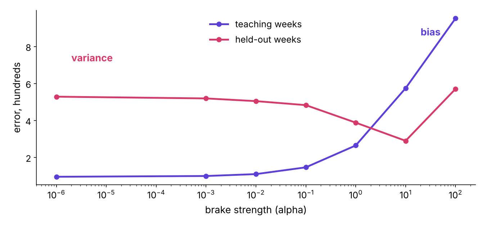

```notes
LIVE, 4 minutes. Notebook ch02, the sweep cell. Teaching error only rises as alpha grows; held-out
error falls to 2.90 at alpha 10 and climbs to 5.70 at 100. Explorable click: back at degree 12, drag
the brake up and watch validation settle near the degree-3 value. Choose alpha on held-out rows,
never on the teaching rows, because the teaching error always votes for no brake.
```

---

## S16. The formula, named last
*The misfit plus a price on big coefficients.*

```
ridge (L2):  minimise  misfit + alpha * (sum of squared coefficients)
lasso (L1):  minimise  misfit + alpha * (sum of absolute coefficients)

scikit-learn LogisticRegression:  C = 1 / alpha
small C  =  strong brake
```

```notes
LIVE, 4 minutes. Name the formula only now, as the shorthand for what the picture showed. Stage the
trap: C looks like a strength and behaves like its opposite; a learner who sets C = 100 to brake
harder has switched the brake off.
The geometry of why L1 lands on zero belongs to the tentative IITGN faculty session.
```

---

## S17. L1 switches columns off; trees brake differently
*Same idea, different knobs.*

| Model | The brake | What it does |
|---|---|---|
| Linear, logistic | L2 (ridge) | shrinks every coefficient a little |
| Linear, logistic | L1 (lasso) | sets weak coefficients to exactly zero |
| Decision tree | max_depth | caps the questions in a row |
| Decision tree | min_samples_leaf | each answer must cover enough customers |

```notes
LIVE, 3 minutes. On the footfall curve L1 kept 1 to 3 of the 7 bends. A tree has no coefficients,
so its brakes have other names; case 1 turns max_depth on the bank's file. Interview line:
regularisation trades a little bias for a lot less variance.
```

---

## SECTION 3: Five exams instead of one: is one split enough?
*Cross-validation · also searched as: k-fold cross validation, cross validation explained*

```notes
LIVE, 20 minutes for the chapter. Notebook ch03. Misconception to stage: one validation score is the
model's score.
```

---

## S18. Question: does a different deal change the score?
*Twenty invented shoppers. Five sit the exam, fifteen teach. Re-deal five times.*

```stats
value: 20 | label: shoppers | note: visits last month, bought in the sale
value: 5 | label: in each exam | note: dealt at random
value: 5 | label: deals | note: same model every time
```

```notes
LIVE, 2 minutes. Prediction: how far apart will five exam scores land? Ask for a number between 0
and 100 points. Click.
```

---

## S19. Answer: from 40 to 80 percent, on luck alone
*Scores on five deals: 60, 60, 80, 40, 60.*


```notes
LIVE, 3 minutes. Same model, same customers, a 40-point swing. A five-customer exam is mostly luck.
Ask: which of these would you have put on a slide? Whichever you picked, you picked luck.
```

---

## S20. Five folds: every customer sits the exam once
*Average the five scores; quote the spread beside the mean.*

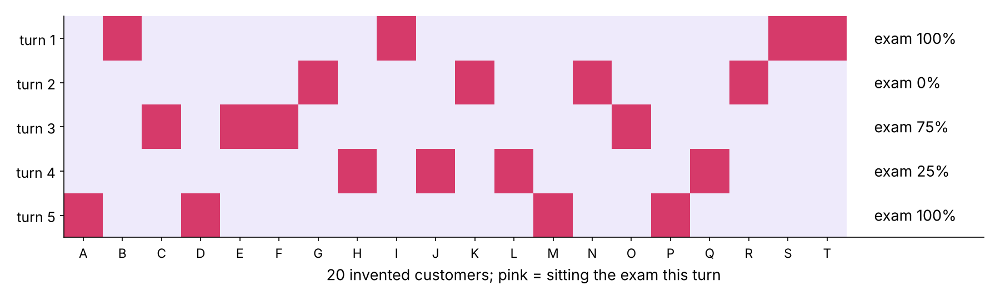

```notes
LIVE, 5 minutes. Notebook ch03, the fold grid. Each row is one turn; pink cells sit the exam. Every
customer is examined exactly once and teaches four times. The mean is the score; the spread is the
size of the luck. Explorable click: press reshuffle five times and watch the validation number jump
while the mean of five holds.
```

---

## S21. Everything that learns stays inside the folds
*The scaler, the gap-filler, the encoder: fitted on the teaching folds only.*

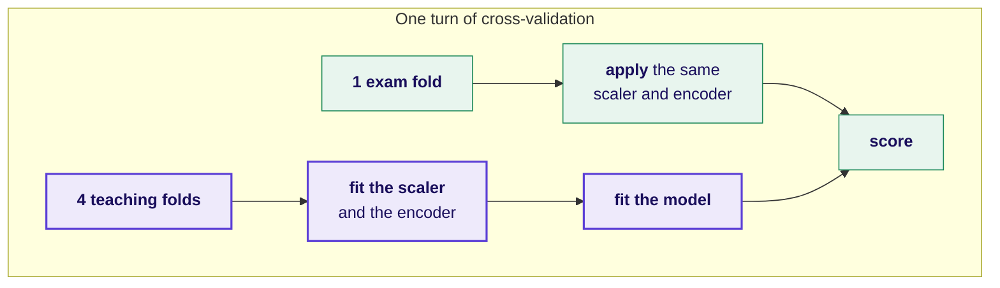

```notes
LIVE, 4 minutes. In the notebook the mean visits of all 20 shoppers is 4.10; of the 16 teaching
shoppers, 3.81. The first number has seen the exam. A scikit-learn Pipeline keeps the second, which
is why every case notebook wraps the scaler and the encoder in one.
```

---

## S22. Rows in time order: write the caveat
*Shuffled folds mix early and late months. Friday tests what that hides.*

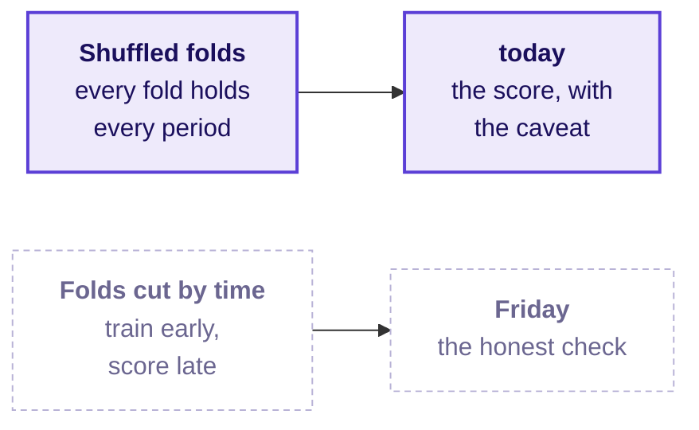

```notes
LIVE, 3 minutes. The bank's file is sorted from May 2008 to November 2010. Today's folds shuffle, so
every number carries the caveat "random folds, mixed periods". Search term for later: time series
split. Do not run the time split today; Friday owns it. Then mid-session drill 1, 15 minutes: four
curve pairs on the explorable's strip, the room names each in under a minute.
```

---

## SECTION 4: Trees, forests and groups: which tool, and when?
*Trees, ensembles, clustering: used, compared, not derived · also searched as: decision tree, random forest, gradient boosting, k-means clustering*

```notes
LIVE, 15 minutes for the chapter. Notebook ch04. Recognition depth only: what each does to a tree's
weakness and what it costs to explain. Internals and boosting mathematics are out of scope today.
```

---

## S23. A tree is twenty questions
*Twelve invented shoppers; two questions decide who joins the loyalty plan.*

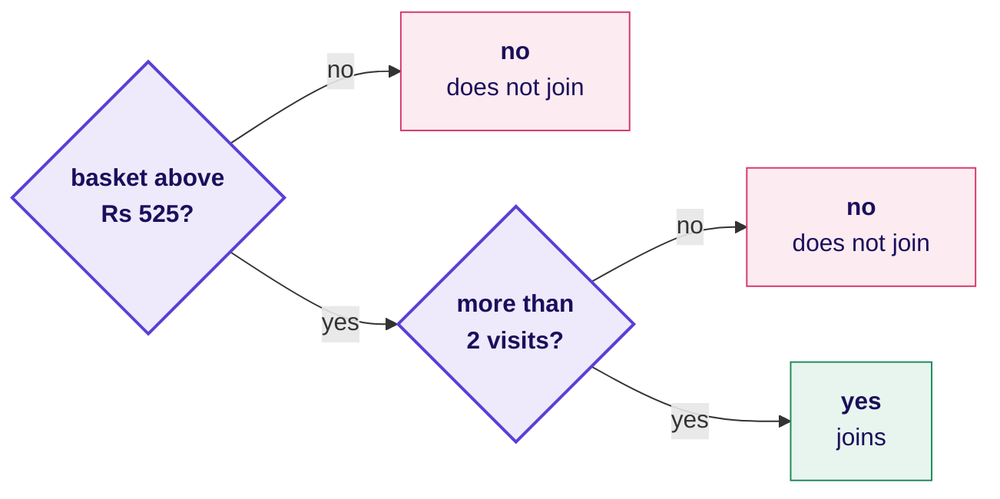

```notes
LIVE, 3 minutes. Ask the room to predict the first question before showing it. Anyone can read this
tree aloud to Marketing, which is its strength. Its weakness is chapter 1: let it grow and it
memorises.
```

---

## S24. A forest votes
*Many trees on resampled rows; the majority answers. Five of them, on a newcomer.*

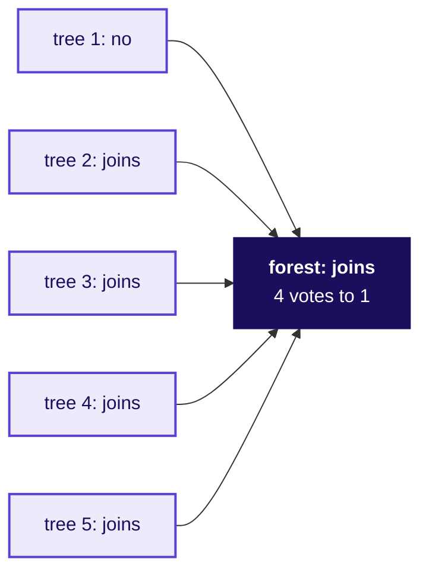

```notes
LIVE, 2 minutes. Notebook ch04: five forest trees vote on a newcomer with 7 visits and a Rs 1,000
basket; four say joins. Each tree saw a different resample of the twelve shoppers, so their wobbles
differ and the vote averages them away: a forest lowers variance.
```

---

## S24a. A booster corrects
*Small trees in a chain, each aimed at what is still wrong.*

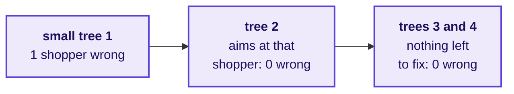

```notes
LIVE, 2 minutes. The booster's mistakes on the twelve shoppers fall from 1 to 0 after round two. It
chips away at what is still wrong (bias). Neither ensemble is free to explain: 100 small trees mean
200 to 280 leaves to read. Internals and boosting mathematics are for later.
```

---

## S25. Clustering: groups, no answers
*k-means groups shoppers by distance. It predicts nothing.*

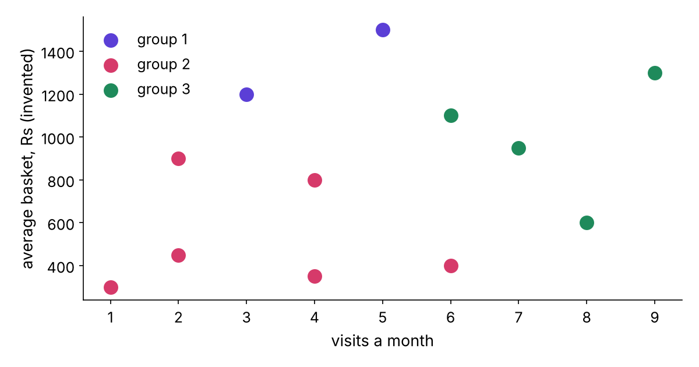

```notes
LIVE, 2 minutes. CUT FIRST if late: this slide and its one notebook cell. Clustering needs no
answer column; Marketing uses it to name segments. It never tells you who will buy.
```

---

## S26. Which tool, and when
*Reach for the one whose weakness your decision can afford.*

| Tool | Reach for it when | Watch out |
|---|---|---|
| One tree | a committee must read the rule | deep trees memorise |
| Random forest | one tree wobbles | still must beat the simple model |
| Gradient boosting | the last points of ranking pay | more to monitor and explain |
| Logistic regression | a cost rule needs probabilities | misses interactions you do not build |
| k-means | you need segments, no answer column | groups, never predicts |

```notes
LIVE, 3 minutes. Read one row per tool. Interview line: a forest lowers a tree's variance by
averaging, and it still has to beat the baseline and the simpler model on the same folds.
```

---

## SECTION 5: Why the boring model often ships: when does simple win?
*When the simpler model wins · also searched as: model selection, Occam's razor machine learning, interpretable vs black box*

```notes
LIVE, 20 minutes for the chapter. Notebook ch05. Misconception to stage: the highest score ships.
This is the recommendation the room resists and the interviewer rewards.
```

---

## S27. Two tests a complex model must pass
*Is the gap real? Is it worth what it costs?*

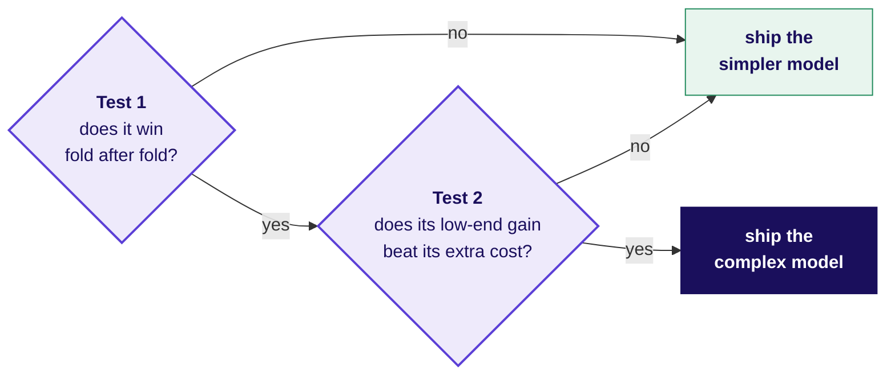

```notes
LIVE, 3 minutes. Two different questions. A lead can be real and still not worth having. Write both
tests on the board; they stay up through case 3.
```

---

## S28. Test 1: join each fold's two scores
*Invented: the complex model wins four folds and ties one.*

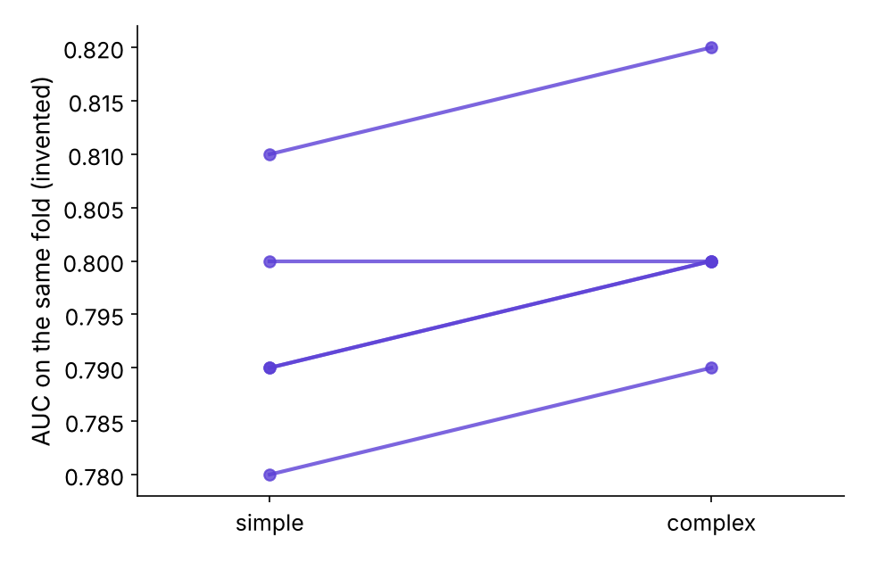

```notes
LIVE, 4 minutes. Means 0.794 and 0.802. Comparing the two means alone hides how hard each fold was;
joining each fold's two scores shows the complex model ahead on four folds, level on one. So test 1
passes. Now ask: so it ships? Click.
```

---

## S29. Test 2: the gain at the low end against the cost
*Invented: 30 to 70 extra buyers, Rs 1,200 margin each, Rs 60,000 extra cost.*

```
gain at the low end   = 30 buyers * Rs 1,200 = Rs 36,000
extra cost            = Rs 60,000 a campaign
break-even            = 60,000 / 1,200 = 50 extra buyers
ships?                  36,000 > 60,000  ->  no
```

```notes
LIVE, 5 minutes. Read the low end, never the best case, so a wide range cannot sneak a model
through. The extra cost is what the complex model adds: a second pipeline to run and monitor,
explanations a committee can check, a longer review when it drifts. Ask: who in Kalpa owns that
number? (The platform team, with Anand.) If it fell to Rs 30,000, the complex model would ship.
```

---

## S30. Pneumonia: the readable model shipped
*Five published models within 0.02 AUC; readability decided.*

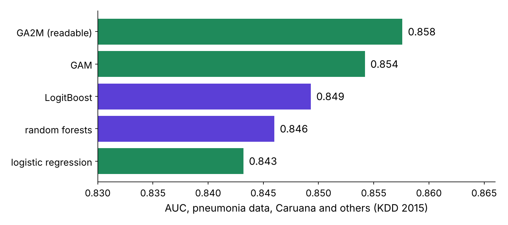

```notes
LIVE, 5 minutes. Caruana and others, KDD 2015, verified 28 October 2026. In the 1990s a neural net
scored 0.86 against logistic regression's 0.77, and a rule learner on the same data found "asthma
lowers risk", because asthmatics were sent straight to intensive care. The team went forward only
with models it could read, even at lower AUC. On the 2015 data the readable GA2M sat within 0.02 of
the black boxes, and the asthma term could be fixed by hand. Ask: what would the neural net have
done to asthmatic patients?
```

---

## S31. The flip, said both ways
*Every rule today comes with the fact that reverses it.*

| The simpler model ships when | The complex model ships when |
|---|---|
| its gap to the complex one is not real across folds | it wins fold after fold |
| the complex model's low-end gain is below its extra cost | that gain clears the extra cost |
| someone must read and repair it | the decision needs an interaction only it captures |

```notes
LIVE, 3 minutes. Say both columns. Interview line: I recommend the simpler model and I name the gap,
in rupees, at which I would switch. Transition: the bank's file, and the tree from the ticket.
```

---

## SECTION 6: The tree that aced practice: what did it learn?
*Case 1 applies: Overfitting; bias and variance through learning curves · Regularisation · Trees, ensembles, clustering · also searched as: overfitting decision tree, max_depth, learning curve scikit-learn*

```notes
LIVE, 30 minutes for the case chapter, including the guided read. Notebook case01. Everyone runs it;
one notebook open at a time.
```

---

## S32. Wednesday's honest columns, the week's split
*Customer table, economy, the never-contacted flag. No duration. Test sealed.*

```stats
value: 24,712 | label: training customers | note: the model learns here
value: 8,238 | label: validation customers | note: we choose here
value: 8,238 | label: test, sealed | note: opened once, on Friday
```

```notes
LIVE, 2 minutes. Run the first four cells: 41,188 calls, 11.27 percent said yes, 10 number columns
and 10 category columns. The envelope stays on the wall. Call nobody: right for 7,310 of 8,238
validation customers, 88.7 percent.
```

---

## S33. Question: what will the unlimited tree score?
*On the 24,712 it learned from, and on 8,238 it never saw.*

```stats
value: ? | label: training accuracy | note: write it down
value: ? | label: validation accuracy | note: write it down
value: 88.7% | label: call nobody | note: the line to beat
```

```notes
LIVE, 2 minutes. Everyone writes two numbers before running the cell. Ask three learners to read
theirs aloud.
```

---

## S34. Answer: 99.6 on practice, 84.1 on the exam
*Below the 88.7 percent of calling nobody.*

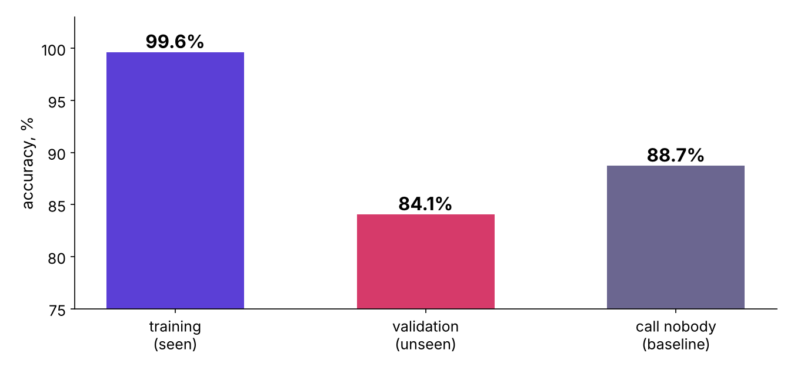

```notes
LIVE, 4 minutes. The trap, shown exactly: 99.6 percent is the number a teammate posts, and a
Marketing lead who sees it books the campaign. The check that catches it is the validation number
beside the baseline. The fix is the brake. Land the line: this tree is the memoriser.
```

---

## S35. What the tree memorised
*37 questions deep, 3,662 leaves: one leaf per 6.7 customers.*

```stats
value: 3,662 | label: leaves | note: final answers in the tree
value: 1,709 | label: hold one customer | note: a private rule each
value: 63% | label: hold one or two | note: 2,323 of 3,662 leaves
```

```notes
LIVE, 3 minutes. Notebook step 4. A leaf holding one customer is that customer's private rule. It
will fire for next quarter's customer only by coincidence.
```

---

## S36. The depth curve: the U on real data
*Lowest validation error at depth 3; no limit ends at 15.9 percent.*

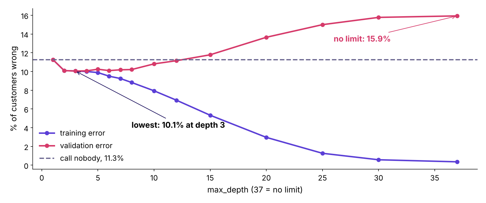

```notes
LIVE, 5 minutes. Notebook step 5. Training error falls all the way to 0.4 percent. Validation error
falls from 11.3 to about 10.1, stays flat to depth 8, then climbs past the dashed line by depth 15.
The left arm is bias, the right arm is variance, the bottom is the brake setting. This is Thursday's
addition to the week's picture.
```

---

## S37. Three trees, three learning curves
*Stump, no limit, depth 6 with leaf 50: five folds each.*


```notes
LIVE, 4 minutes. Stump: both lines at 11.3, the baseline, close together: bias. No limit: training
near 0, held out near 16.5: a 16-point gap. Depth 6, leaf 50: 9.8 and 10.1, close and low.
```

---

## S38. More rows did not close the gap; the brake did
*The unlimited tree's gap at 988 rows and at 19,769 rows.*

| Unlimited tree | 988 rows | 19,769 rows |
|---|---|---|
| Training error | 0.1% | 0.3% |
| Held-out error | 16.9% | 16.5% |
| Gap | 16.8 points | 16.2 points |

Depth 6, leaf 50, at 19,769 rows: gap 0.2 points.

```notes
LIVE, 3 minutes. The flip of chapter 1's rule, on real data. Twenty times more customers moved the
gap by half a point, because the tree memorises noise and more rows bring more noise. The brake
closed it. Interview line: more data is the cure for variance only when the model is learning
signal it lacked.
```

---

## S39. Guided: three mystery models
*Name each side and prescribe one fix. Then one cross-validation, together.*

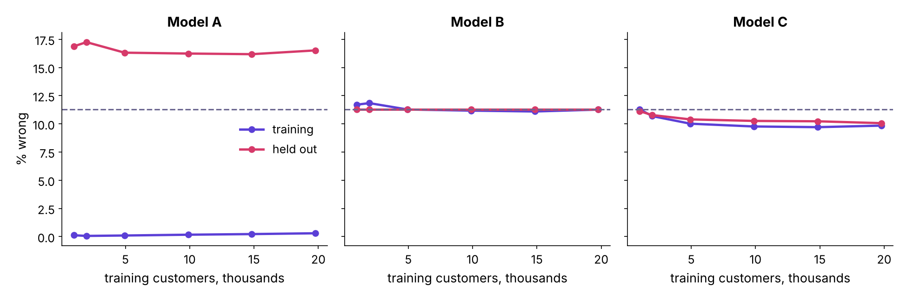

```notes
LIVE, 15 minutes. Guided notebook. YOUR TURN 1: each learner writes bias, variance or about right
for A, B, C, plus one fix. YOUR TURN 2: run five-fold cross-validation, then k = 3 and k = 10. The
answer cell is last: A variance whose gap is still closing (a tree capped at depth 12, so more rows
help it, unlike the unlimited tree), B bias from a brake set far too hard (logistic at C = 0.0001), C
about right (logistic at C = 0.1). End of block one.
```

---

## SECTION 7: Five exams on the bank's file: can we trust 0.79?
*Case 2 applies: Regularisation · Cross-validation · also searched as: k-fold cross validation scikit-learn, Pipeline data leakage, logistic regression C regularization*

```notes
LIVE, 20 minutes for the case chapter. Notebook case02, building on case 1's honest set, now in the
logistic model.
```

---

## S40. Five deals against five folds
*Bigger exams, smaller luck: deals swing 0.004 AUC, folds 0.03.*

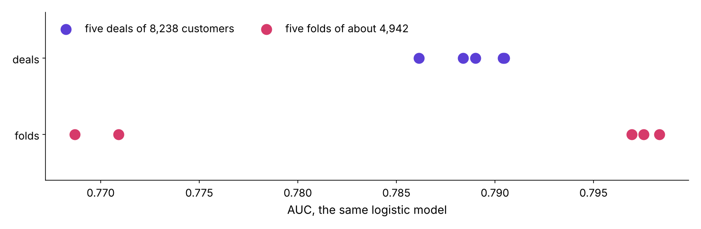

```notes
LIVE, 4 minutes. Notebook steps 1 and 2. Five re-deals of 8,238 validation customers move AUC
between 0.786 and 0.790. Five folds of about 4,942 customers each run from 0.769 to 0.798: mean
0.786, spread 0.014. The smaller the exam, the bigger the luck, which is why a score is quoted with
its spread.
```

---

## S41. The scaler goes inside the Pipeline
*Each fold learns its means from its own teaching folds.*

```python
model = Pipeline([("prep", prep()),          # scaler + one-hot, fitted per fold
                  ("model", LogisticRegression(C=0.1, max_iter=3000))])
scores = cross_val_score(model, X_train, y_train, cv=folds, scoring="roc_auc")
```

```notes
LIVE, 3 minutes. Read the three lines. prep() holds the scaler and the one-hot encoder, so
cross_val_score refits them inside every turn.
```

---

## S42. Question: what did scaling first cost here?
*Scale all 24,712 rows, then cross-validate.*

```stats
value: 0.78648 | label: scaler inside | note: the right way
value: ? | label: scaler before | note: predict it
```

```notes
LIVE, 2 minutes. Prediction: bigger, smaller, or the same? By how much? Most rooms expect a visible
jump. Click.
```

---

## S43. Answer: 0.00003, and the rule still binds
*A scaler learns two numbers per column. Target-aware steps leak far more.*

| Step before the split | What it learns | Leak here |
|---|---|---|
| Scaler | mean, spread | 0.00003 AUC |
| Filling gaps with a mean | mean | small |
| Choosing columns by their link to y | the answers | large |
| Encoding a category by its yes rate | the answers | large |

```notes
LIVE, 3 minutes. Honest number: on this file, with 24,712 rows, the scaler leak is invisible. Say
why the habit stays: the next step someone adds before the split may learn from the answers. Rule:
everything that learns goes inside the Pipeline.
```

---

## S44. Sweep C: the logistic model barely needs a brake
*Strong brake underfits; from C = 0.01 up, nothing changes.*

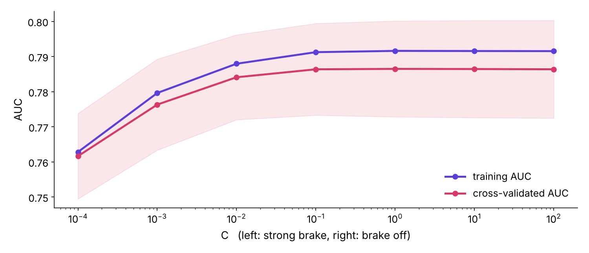

```notes
LIVE, 4 minutes. C = 0.0001: AUC 0.762, bias. From C = 0.01: about 0.786 cross-validated and 0.79
on training, flat and close. With 24,712 rows and 63 columns the logistic model has little room to
memorise, so little variance to brake. The tree had room for 3,662 leaves. The flip: the practice
lab's 1,000 lending rows, where the brake matters.
```

---

## S45. L1: 20 of 63 columns, within 0.002 AUC
*The brake that also chooses columns.*

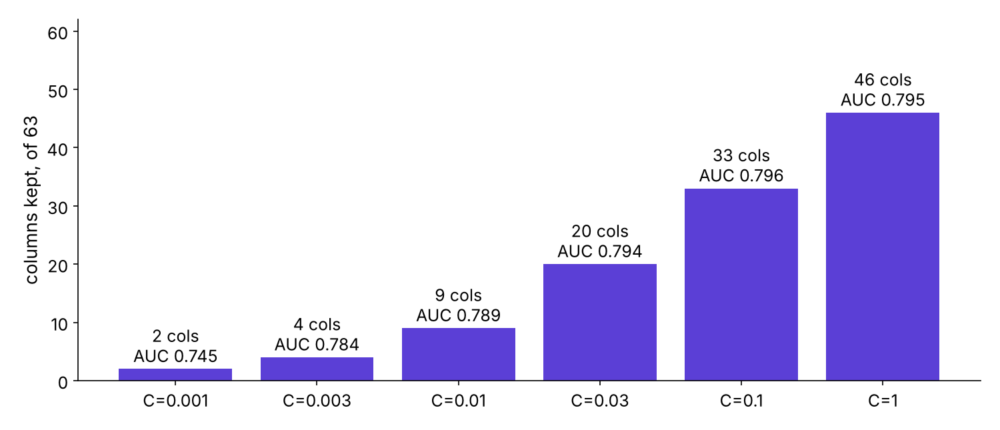

```notes
LIVE, 4 minutes. At C = 0.03, 20 columns survive with validation AUC 0.794, against 0.795 with 45
columns at C = 1. A shorter model is cheaper to explain and to monitor, which is chapter 5's argument
arriving early. Caveat: when columns move together, L1 keeps one of them almost by chance.
```

---

## SECTION 8: The three-way race: which model ships?
*Case 3 applies: Cross-validation · Trees, ensembles, clustering · When the simpler model wins · also searched as: random forest vs gradient boosting, model comparison cross validation, precision at k*

```notes
LIVE, 25 minutes for the case chapter, with mid-session drill 2 inside it. Notebook case03. This is
also the row's unguided exercise: the room runs it and writes the provisional call.
```

---

## S46. Four candidates on the same five folds
*Boosting 0.793, forest 0.791, logistic 0.786, tuned tree 0.782.*

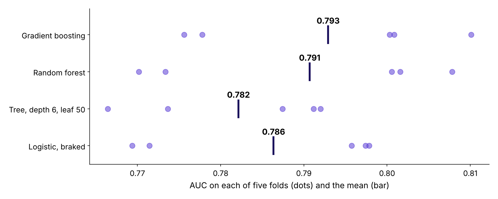

```notes
LIVE, 4 minutes. The tree was tuned with a plain loop over depth and leaf size on the same folds:
depth 6, leaf 50. Ask the room to predict the order before showing. Every model's five dots
overlap the others'. Validation AUC: logistic 0.796, tree 0.790, forest 0.803, boosting 0.804.
```

---

## S47. Test 1: boosting wins every fold, by a little
*Fold by fold: +0.007, +0.007, +0.003, +0.014, +0.003 AUC.*

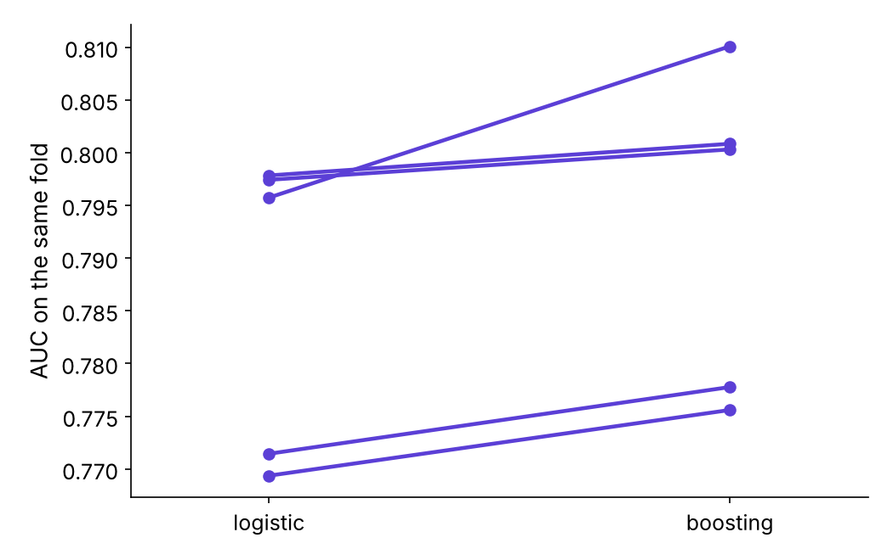

```notes
LIVE, 3 minutes. Test 1 passes: the lead is real, about 0.007 AUC. Now test 2, in rupees.
```

---

## S48. At the cost threshold, all four nudge nearly everyone
*Bills at 40 / 1,240 = 0.032 sit within about 2 percent.*

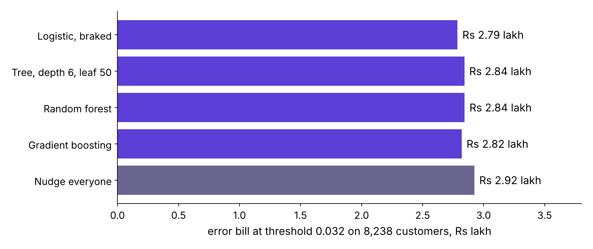

```notes
LIVE, 4 minutes. Tuesday's threshold: act when P(buy) beats 0.032. Logistic Rs 2.79 lakh, boosting
Rs 2.82 lakh, nudge everyone Rs 2.92 lakh on 8,238 customers. At Rs 40 against Rs 1,200 a model
barely matters; the budget is where ranking pays.
```

---

## S49. Under the budget: buyers in the top 1,000
*5,000 nudges for 41,188 customers is the top 12 percent: 1,000 of 8,238.*

| Model | Buyers in top 1,000 | Precision | Campaign value |
|---|---|---|---|
| Logistic, braked | 465 | 46.5% | Rs 5.18 lakh |
| Tree, depth 6, leaf 50 | 469 | 46.9% | Rs 5.23 lakh |
| Random forest | 476 | 47.6% | Rs 5.31 lakh |
| Gradient boosting | 472 | 47.2% | Rs 5.26 lakh |
| A random 1,000 | about 113 | 11.3% | |

```notes
LIVE, 3 minutes. Every model is four times better than random. Between models: 7 buyers per 1,000
nudges between logistic and boosting on validation. Value = buyers x Rs 1,200 minus 1,000 x Rs 40.
```

---

## S50. Test 2: the low end against the extra cost
*Extra buyers per 5,000 nudges, fold by fold: 0, 133, 100, 92, 125.*

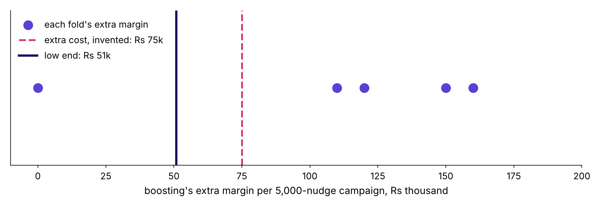

```notes
LIVE, 5 minutes. Mean 90 extra buyers, spread 48, low end 42 buyers, Rs 50,939 a campaign. The extra
cost is invented at Rs 75,000 because Kalpa's platform team has not priced it; that is the
clarifying question to ask. Break-even: Rs 75,000 / Rs 1,200 = 62.5, so 63 extra buyers at the low end. Mid-session drill 2 (15
minutes): three score gaps, simpler or complex, defend one.
```

---

## S51. The provisional call
*Friday turns it into the committee memo.*

| Part | With your numbers |
|---|---|
| Claim | ship the braked logistic model for the first campaign |
| Evidence | boosting leads by 0.007 AUC; bills within 2 percent; low-end gain Rs 51k |
| Caveat | folds mix 2008 to 2010; Friday scores the late months |
| Action | switch when the low end clears the priced extra cost |

```notes
LIVE, 3 minutes. Each learner writes this in their own words in the case notebook's last cell. Say
it to a room that saw 99.6: the 99.6 was the tree memorising last quarter's customers; the 84.1 is
what next quarter would have seen; this model protects Anand's one campaign.
```

---

## S52. The QA seat: what breaks it, which split, segment
*Today's spotlight. Three checks before anyone trusts 0.786.*

| Check | How | A pass looks like |
|---|---|---|
| Shuffle the answers | cross-validate with y shuffled | AUC falls to about 0.5 |
| Change the split | folds cut by time (Friday) | the score holds |
| Break it by segment | score each segment apart | no segment below the baseline |

```notes
LIVE, 3 minutes. The tester asks how to break the model, not whether it works. A shuffled-answer run
that stays above 0.5 means something leaks. The time split and the segment table are Friday's
checks; today, name them. The practice lab runs the shuffle test.
```

---

## S53. Interview corner
*The row's four anchors, each with the shape of a good answer.*

| Tag | Question | A good answer's shape |
|---|---|---|
| [S] | Overfitting: what, detect, fix? | gap, curves, brake or rows, and when rows fail |
| [S] | Bias against variance, plain words | too simple anywhere; too sensitive to the draw |
| [F] | Why cross-validation, not one split? | split luck, mean with spread, same folds |
| [D] | Tuned model wins by a point, ten times harder to explain | two tests, rupees, the flip, the 99.6 named |

```notes
LIVE, 4 minutes. [S] staple asked everywhere, [F] frequent in GCC and product screens, [D] a
differentiator. Pick one learner per question; 30 seconds each. The interview bank carries the model
answers and the two follow-ups.
```

---

## S54. Quiz: five questions and the return question
*Kahoot, ungraded.*

| # | Question |
|---|---|
| 1 | Train 99.6, validation 84.1, baseline 88.7: name it |
| 2 | Which curve pair says high bias? |
| 3 | Cross-validation averages away what? |
| 4 | The tuned tree beats logistic by 0.4 points: recommend which? |
| 5 | Regularisation trades what for what? |
| R | Wednesday: the leak went, the score fell; why is the model better? |

```notes
LIVE, 8 minutes. Keys and options are in the trainer guide. Question 4 is the trap: 0.4 points is
inside the fold spread and is worth no extra cost.
```

---

## S54a. The week's picture, Thursday filled in
*Redraw it from memory tonight: the U, the baseline line, the depth you chose.*

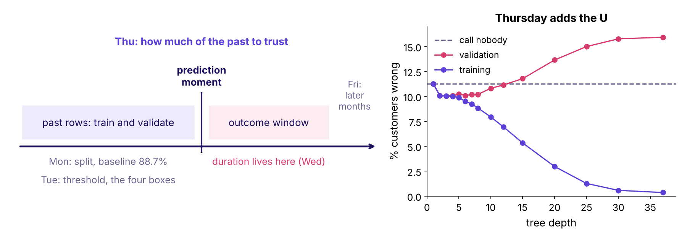

```notes
LIVE, 1 minute. Hold the room's sketches from the opening against the real U. Friday adds the last
panel: what happens to the score in the later months.
```

---

## S55. What you can do now, tonight, tomorrow
*Two to three hours of practice set; the lab runs with the TAs.*

```cards
icon: circle-check | eyebrow: Now | title: Diagnose, brake, cross-validate | body: Read two curves, choose a brake on held-out rows, quote a score with its spread, run both tests. | tone: light
icon: notebook-pen | eyebrow: Tonight | title: Practice set and lab | body: Ten problems, eighteen self-checks; rerun the race with one column removed. | tone: light
icon: file-text | eyebrow: Friday | title: The committee memo | body: Train early, score late; open the envelope once; reread Tuesday's metric memo. | tone: dark
```

```notes
LIVE, 2 minutes. Close on the week's picture: redraw the U from memory tonight.
The tentative IITGN faculty session follows with the bias-variance decomposition and the penalty shapes.
```
