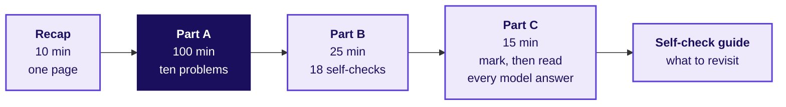
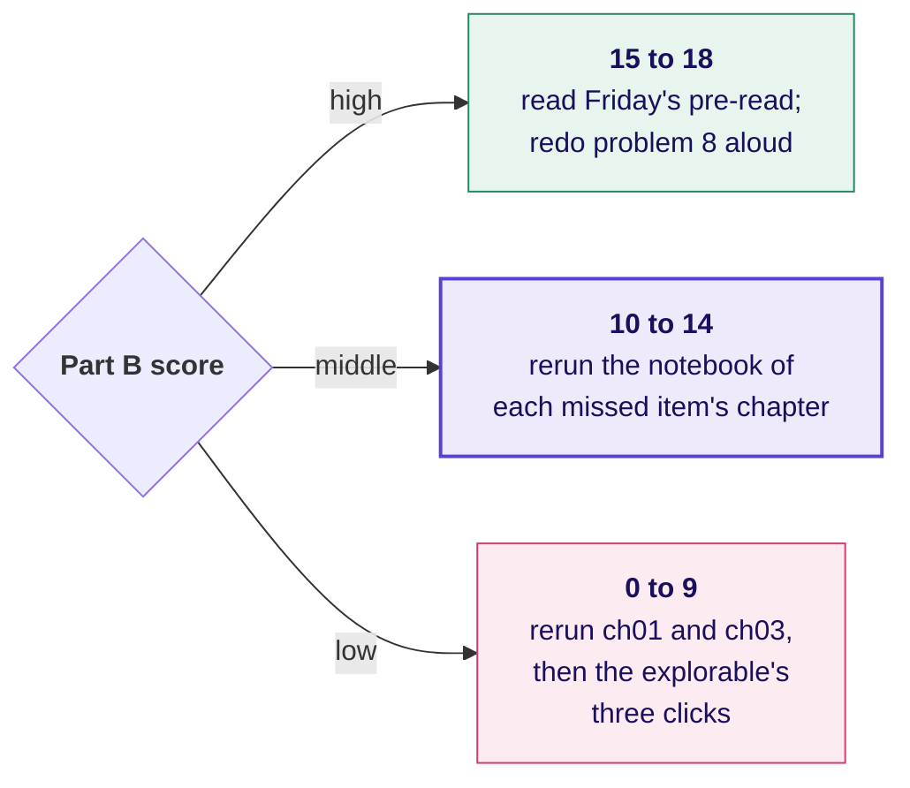
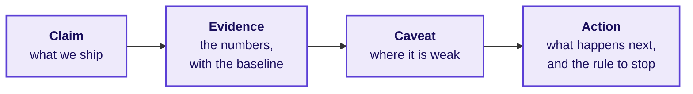

# Practice set: generalise or memorise

Week 5, Thursday. Overfitting, regularisation, cross-validation, trees and ensembles, and when the simpler model wins.

## How to use it

Two and a half hours, in one sitting or two. Work Parts A and B with the notebooks closed, then open Part C and mark yourself.



| Part | Problems | Minutes each | Minutes in all |
|---|---|---|---|
| A, warm-ups | 1 to 3 | about 5 | 15 |
| A, medium | 4 to 7 | about 10 | 40 |
| A, interview grade | 8 to 10 | about 15 | 45 |
| B, self-checks | 18 items | about 1.5 | 25 |
| Recap, marking and reading | | | 25 |

Every problem names the seat it is answered from: business owner, product manager, solution architect, senior ML engineer, implementation engineer, or QA and tester. Some problems leave a fact out on purpose; a strong answer opens by asking for it.

<div class="page-break"></div>

## Recap: the day on one page


| Idea | In one line | The rule | When it flips |
|---|---|---|---|
| Overfitting (variance) | the model learned its training rows, so new rows surprise it | read the gap between training and validation first | a gap that more rows close was variance from too little data |
| Underfitting (bias) | the model is too simple to be right anywhere | both curves high and close means bias | a brake makes bias worse |
| Learning curves | training and held-out error as the training rows grow | gap = variance, level = bias | when noise is what the model memorises, more rows do not close the gap |
| Regularisation | a price on big coefficients or deep trees | choose its strength on held-out rows | on a model with little room to memorise, it only adds bias |
| L1 and L2 | L2 shrinks every coefficient; L1 sets weak ones to zero | in scikit-learn's logistic model, small C is a strong brake | when columns move together, L1 keeps one almost by chance |
| Cross-validation | every row sits the exam once; the score is a mean with a spread | everything that learns goes inside the folds | rows in time order need folds cut by time |
| Trees and ensembles | a forest averages trees; boosting chains small trees that fix errors | compare every candidate on the same folds | the ensemble costs more to explain and monitor |
| The simpler model wins | two tests: is the gap real, is it worth its cost | read the low end of the gain against the extra cost | the complex model ships when its low-end gain clears its cost |

```
ridge (L2):  minimise  misfit + alpha * (sum of squared coefficients)
lasso (L1):  minimise  misfit + alpha * (sum of absolute coefficients)
LogisticRegression in scikit-learn:  C = 1 / alpha, so small C = strong brake
complex model ships when:  (extra buyers at the low end) * (margin per buyer) > extra cost
```

<div class="page-break"></div>

## Part A: ten problems

### Problem 1 (warm-up, about 5 minutes): Kalpa Retail's churn model

**Seat:** QA and tester.

A Kalpa Retail analyst trains a churn model and posts the first line of this output in the team channel. All numbers are invented.

```
training accuracy            98.2%
validation accuracy          79.4%
predict "nobody churns"      82.0%   (the baseline)
```

1. Name what happened, using all three numbers.
2. Which number goes on Marketing's slide, and what sentence goes beside it?
3. Name the first fix you would try and the number that would tell you it worked.

*Interview question, rewritten around the exhibit:* "Your model scores 98 percent in training. What do you check before you tell anyone?"

### Problem 2 (warm-up, about 5 minutes): two learning curves at Kalpa Logistics

**Seat:** senior ML engineer.

Kalpa Logistics predicts late deliveries. Error is the share of deliveries the model gets wrong; calling every delivery on time is wrong 22 percent of the time. Invented.

| Training rows | 1,000 | 5,000 | 20,000 |
|---|---|---|---|
| Model P, training error | 4% | 5% | 5% |
| Model P, held-out error | 24% | 23% | 23% |
| Model Q, training error | 21% | 22% | 22% |
| Model Q, held-out error | 23% | 22% | 22% |

1. Which model carries bias and which carries variance? Say what you read first.
2. The operations head offers 80,000 more rows. Will they help P? Will they help Q?
3. Give one fix for each model.

*Interview question:* "Here are your learning curves. Do you ask for more data?"

### Problem 3 (warm-up, about 5 minutes): the brake turned the wrong way

**Seat:** implementation engineer.

A teammate on Kalpa Financial's loan model writes in a code review: "The model overfits, so I raised C to 100 to brake harder." The run log, invented:

```
C = 0.01   total size of coefficients  0.8   cross-validated AUC 0.781
C = 1      total size of coefficients  3.9   cross-validated AUC 0.774
C = 100    total size of coefficients  9.6   cross-validated AUC 0.760
```

1. What did raising C to 100 do to the brake? Use the middle column.
2. Which C would you keep, and why?
3. Write the one-line review comment.

*Interview question:* "In scikit-learn's LogisticRegression, what does C control, and which direction brakes harder?"

<div class="page-break"></div>

### Problem 4 (medium, about 10 minutes): the bank's depth curve

**Seat:** senior ML engineer, then the business owner.

This is your own run from case 1 on UCI Bank Marketing, the honest feature set, 24,712 training and 8,238 validation customers. Calling nobody is wrong for 11.3 percent of validation customers.

| max_depth | Training error | Validation error | Validation AUC |
|---|---|---|---|
| 1 | 11.3% | 11.3% | 0.699 |
| 3 | 10.1% | 10.1% | 0.751 |
| 6 | 9.5% | 10.1% | 0.780 |
| 10 | 7.9% | 10.8% | 0.733 |
| 15 | 5.3% | 11.8% | 0.608 |
| no limit (37) | 0.4% | 15.9% | 0.622 |

1. Which depth would you carry forward, and which two columns did you read to choose it?
2. Marketing's lead asks for the unlimited tree "because it scored 99.6 percent". Reply in two sentences.
3. Under what condition would a deeper tree become the right choice?
4. Depth 3 and depth 6 tie on validation error. Which column breaks the tie for a campaign that calls the top 12 percent, and why that one?

*Interview question:* "How do you choose a tree's depth, and what do you tell someone who wants the deepest tree?"

### Problem 5 (medium, about 10 minutes): a cross-validation that leaks

**Seat:** implementation engineer.

A junior on Rohan's lending team at Kalpa Financial reports a cross-validated AUC of 0.83 from this code. Rohan's book has 1,000 applications. Invented.

```python
X["income"] = X["income"].fillna(X["income"].mean())        # step 1, on all 1,000 rows
top10 = X.corrwith(y).abs().nlargest(10).index               # step 2, on all 1,000 rows
X = (X[top10] - X[top10].mean()) / X[top10].std()            # step 3, on all 1,000 rows
scores = cross_val_score(LogisticRegression(), X, y, cv=5, scoring="roc_auc")
print(scores.mean())                                          # 0.83
```

1. Which of the three steps learn from rows that later sit in an exam fold?
2. Which leak is likely the largest, and why that one?
3. Say, in words, how the code should be ordered so nothing leaks.
4. After the fix, will the score most likely rise, fall or stay? Say what you would tell Rohan about the 0.83.

*Interview question:* "Your cross-validated AUC dropped when you moved preprocessing into a Pipeline. Which number do you report, and how do you explain the drop?"

### Problem 6 (medium, about 10 minutes): Airbnb's listing IDs

**Seat:** senior ML engineer.

Airbnb's search team described trying a learned vector for every listing ID (Haldar and others, "Applying Deep Learning To Airbnb Search", arXiv 1810.09591, verified 28 October 2026). In their words, as published:

| What they reported | Quote |
|---|---|
| The result | "in the different variations we tried, listing ids mostly led to overfitting" |
| The picture | their Figure 5 shows training NDCG climbing toward 1 while test NDCG stays flat |
| The reason | "Even the most popular listing can be booked at most 365 times in an entire year." |

1. Name the disease in today's words, and say what the two curves of Figure 5 would look like as learning curves.
2. Why does "at most 365 bookings a year" matter? Think of labels per thing learned.
3. Name two brakes you could try before dropping the feature.
4. Kalpa Retail wants a store-ID column in a store-level sales model. When would that column be safe, and when would it overfit?

*Interview question:* "Why can an ID column overfit, and when is it safe to use one?"

### Problem 7 (medium, about 10 minutes): readmissions at Kalpa Health

**Seat:** business owner, with the clinical lead.

Kalpa Health predicts which patients return to hospital within 30 days, so a nurse can call them. Two models on the same five folds; all numbers invented.

| Fold | 1 | 2 | 3 | 4 | 5 |
|---|---|---|---|---|---|
| Logistic, braked | 0.712 | 0.735 | 0.701 | 0.744 | 0.728 |
| Gradient boosting | 0.719 | 0.731 | 0.716 | 0.752 | 0.733 |

Under the calling budget, boosting catches between 12 and 30 more returning patients per 10,000 a quarter across the folds. Each catch saves about Rs 18,000. Running and explaining boosting costs Rs 4,00,000 more a quarter.

1. Compute each model's mean AUC and the five paired gaps.
2. Run test 1: is the gap real?
3. Run test 2 with the low end of the range, and find the break-even number of extra catches.
4. Which seat decides, and what would the clinical lead add to the decision?

*Interview question:* "Your complex model wins on average. Walk me through how you decide whether it ships."

<div class="page-break"></div>

### Problem 8 (interview grade, about 15 minutes): the room that saw 99.6

**Seat:** business owner and QA.

Kalpa's Marketing team saw the unlimited tree's 99.6 percent last week. This week the tuned boosting model beats the braked logistic model by one point of AUC (0.81 against 0.80, invented), and the committee says boosting takes ten times longer to explain. Anand's budget covers one campaign of 5,000 nudges.


1. Before you recommend anything, what do you ask for? Name the facts the scenario leaves out.
2. Using the exhibit from case 3 as your evidence, run test 1.
3. Write the recommendation for both outcomes of test 2, each in one sentence with its number.
4. Write the two sentences you say to the room that saw 99.6 percent.

*Interview question (the row's differentiator):* "Your tuned model beats a simpler one by a point and costs ten times more to explain. Which ships, and how do you say it to a team that saw the 100 percent?"

### Problem 9 (interview grade, about 15 minutes): Google Flu Trends

**Seat:** solution architect.

Lazer, Kennedy, King and Vespignani analysed Google Flu Trends in Science (14 March 2014; Harvard open-access copy verified 28 October 2026).

| What the paper reports | Quote |
|---|---|
| The method | "find the best matches among 50 million search terms to fit 1152 data points" |
| The warning sign | developers weeded out terms "strongly correlated to the CDC data, such as those regarding high school basketball" |
| The verdict | "the initial version of GFT was part flu detector, part winter detector" |
| The miss | it "completely missed the nonseasonal 2009 influenza A-H1N1 pandemic" |

1. In today's words, why do 50 million candidates and 1,152 points produce winners by chance?
2. Which of today's tools would have flagged the basketball terms, and how exactly would you cut the folds?
3. Kalpa Retail's demand team has 104 weekly sales points and wants to pick 30 of 20,000 search-trend series (invented). Design the check in three steps.
4. Which seat owns that check, and what goes in the model card?

*Interview question:* "How would you know that your feature selection overfit?"

### Problem 10 (interview grade, about 15 minutes): Rohan's lending book

**Seat:** QA and the business owner.

Your own run on German Credit (OpenML credit-g, 1,000 applications, 30 percent bad), the practice lab's 800 training applications and five folds. Approving a bad loan costs five times refusing a good one.

| Model | Five-fold AUC | Spread | Fold by fold |
|---|---|---|---|
| Tree, no depth limit | 0.618 | 0.013 | |
| Tree, depth 5 | 0.709 | 0.053 | |
| Logistic, C = 100 (brake off) | 0.756 | 0.059 | |
| Logistic, C = 0.1 | 0.784 | 0.050 | 0.824, 0.820, 0.786, 0.687, 0.802 |
| Random forest, 300 trees | 0.791 | 0.042 | 0.822, 0.805, 0.784, 0.712, 0.830 |
| Gradient boosting | 0.780 | 0.039 | 0.807, 0.780, 0.794, 0.704, 0.812 |

1. The brake moved AUC from 0.756 to 0.784 here and barely moved it on the bank's file. Why?
2. Run test 1 for the forest against logistic at C = 0.1.
3. Rohan must give a refused applicant a reason. Which model ships, and what would change it?
4. Before anyone trusts 0.784, which QA check runs first, and what result would worry you?

*Interview question:* "A lending regulator asks why an applicant was refused. Which model do you ship, and what do you give up?"

<div class="page-break"></div>

## Part B: eighteen self-checks

Write your answers as a string such as `1C 2A ...`. Items 5, 10 and 16 have more than one correct option.

**1.** A model scores 97 percent on training and 85 percent on validation; calling nobody scores 89 percent. Which reading is right?

- A) Underfitting, because 85 is the lower number
- B) A leak, because 97 is suspiciously high
- C) Overfitting, read from the gap and baseline
- D) Fine, because 85 percent is a good score

**2.** Two learning curves sit close together and both stay level with the baseline as rows grow. What do you change first?

- A) Add capacity or better columns
- B) Collect ten times more rows
- C) Raise the regularisation strength
- D) Switch to a smaller validation set

**3.** In scikit-learn's LogisticRegression, a learner wants a stronger brake. What do they do with C?

- A) Raise C, since C names the strength
- B) Leave C and set max_depth lower instead
- C) Raise C and add more training rows
- D) Lower C, since C is one over alpha

**4.** Which statement about L1 regularisation is right?

- A) It shrinks every coefficient by the same amount
- B) It can set weak coefficients exactly to zero
- C) It only works on decision trees
- D) It always raises validation accuracy

**5.** Which of these must be fitted inside each training fold? Mark every correct option.

- A) The scaler's means and spreads
- B) The list of column names
- C) The choice of top columns by their link to y
- D) The random seed used to cut the five folds apart

**6.** Five deals of one split give AUCs from 0.786 to 0.790; five folds give 0.769 to 0.798. Why do the folds spread more?

- A) The folds used a worse model
- B) Cross-validation always adds noise
- C) The deals were cut by time
- D) Each fold's exam holds fewer rows

**7.** True or false, with the reason: "Twenty times more training rows always closes an overfit tree's gap."

- A) True, because more rows always reduce variance
- B) False, as noise is what the tree memorises
- C) True, because the tree grows fewer leaves
- D) False, because more rows always raise bias

**8.** On the bank's file, boosting beats braked logistic on all five folds by 0.003 to 0.014 AUC. What does that settle?

- A) Test 1 only: the gap is real
- B) That boosting should ship
- C) That logistic overfits
- D) Nothing, since 0.014 is small

**9.** A random forest of 100 trees replaces one deep tree. What does the forest mainly reduce?

- A) The bias of a model that is too simple
- B) The cost of explaining the model
- C) The variance one deep tree carries
- D) The need for a validation set

**10.** Which facts would make the complex model the right call? Mark every correct option.

- A) It wins one of the five folds by a wide margin
- B) Its low-end gain beats its extra cost
- C) Its mean is higher by any amount
- D) It wins fold after fold, beyond the noise

**11.** Assertion: an unlimited tree can score below the call-nobody baseline on validation. Reason: its leaves fit individual training customers, so they misfire on new ones.

- A) Both true, and the reason explains the assertion
- B) Both true; the reason does not explain the assertion
- C) The assertion is true and the reason is false
- D) The assertion is false and the reason is true

**12.** k-means puts Kalpa's shoppers into three groups. What can Marketing use it for?

- A) Predicting who buys in the sale
- B) Choosing the threshold for a nudge
- C) Measuring a model's variance
- D) Naming segments to plan around

**13.** Scaling all rows before cross-validation moved the bank's AUC by 0.00003. What is the right lesson?

- A) Leaks never matter on large files
- B) Keep the habit; target steps leak more
- C) Scale before the split to save time
- D) Report the leaky score, since it is equal

**14.** Match each picture to its name. Pictures: (1) training 0.3% wrong, held out 16.5% wrong; (2) both 11.3% wrong, on the baseline; (3) training 9.8%, held out 10.1%. Names: (a) about right, (b) variance, (c) bias.

- A) 1a, 2b, 3c
- B) 1c, 2b, 3a
- C) 1b, 2c, 3a
- D) 1b, 2a, 3c

**15.** Which question does cross-validation answer?

- A) How much of a score is split luck?
- B) Which columns cause the outcome we see?
- C) What threshold minimises the bill?
- D) Whether the data has a leak

**16.** A brake is turned from off to strong on a deep tree. Which of these can happen? Mark every correct option.

- A) Training error rises
- B) Validation error falls, then rises
- C) Training error keeps falling as the brake tightens
- D) The tree has fewer leaves

**17.** Assertion: a forest needs no comparison against the simple model, since averaging prevents overfitting. Reason: a forest averages many trees grown on resampled rows.

- A) Both true, and the reason explains the assertion
- B) Both true; the reason does not explain the assertion
- C) The assertion is false and the reason is true
- D) Both false

**18.** Match each tool to the job it fits best. Tools: (1) one shallow tree, (2) gradient boosting, (3) logistic regression. Jobs: (a) probabilities a cost rule can trust, (b) a rule a committee reads aloud, (c) the last points of ranking when they pay.

- A) 1a, 2c, 3b
- B) 1b, 2c, 3a
- C) 1c, 2b, 3a
- D) 1b, 2a, 3c

<div class="page-break"></div>

---

**Stop here.** Everything below is the key. Mark Parts A and B before you read on.

---

## Part C: answers and model solutions

### Key to Part B

`1C 2A 3D 4B 5AC 6D 7B 8A 9C 10BD 11A 12D 13B 14C 15A 16ABD 17C 18B`

| Item | Why the key is right | Why each other option tempts |
|---|---|---|
| 1 | C: 97 against 85 is a 12-point gap, and 85 sits below the 89 of doing nothing | A reads a low level as bias; B confuses a high training score with a leak; D ignores the baseline |
| 2 | A: close curves at the baseline mean bias, so the model needs capacity or signal | B is the cure for variance; C makes bias worse; D changes nothing about the model |
| 3 | D: C is one over the penalty, so a smaller C brakes harder | A is the letter's trap; B names a tree's brake; C turns the brake off and adds rows |
| 4 | B: L1's absolute-value penalty sets weak coefficients to zero | A describes neither penalty; C is wrong, L1 is for linear models; D forgets the bias side |
| 5 | A and C learn from the rows, so both go inside the folds | B and D learn nothing from the data |
| 6 | D: five folds of about 4,942 rows each against exams of 8,238, and smaller exams carry more luck | A: the model was the same; B: averaging removes luck from the mean; C: both were shuffled |
| 7 | B: on the bank's file the gap stayed near 16 points from 988 to 19,769 rows | A is the textbook rule without its flip; C and D are false mechanics |
| 8 | A: winning every fold makes the gap real; whether it is worth its cost is test 2 | B skips test 2; C reverses the finding; D confuses small with unreal |
| 9 | C: averaging many trees cancels the wobble of one | A is what boosting chips at; B is backwards, a forest costs more to explain; D: it still needs validation |
| 10 | B and D are the two tests | A is one lucky fold; C ignores the spread and the cost |
| 11 | A: both are true and the leaves explain it (99.6 against 84.1, below 88.7) | B, C, D misread one half |
| 12 | D: clustering names groups and predicts nothing | A and B need a model with an answer column; C is a learning-curve question |
| 13 | B: a scaler learns two numbers per column; selection and target encoding learn the answers | A, C and D draw the wrong rule from one small number |
| 14 | C: 1 has a wide gap, 2 sits at the baseline, 3 is low and close | A, B and D swap names |
| 15 | A: the spread across folds is the size of the split's luck | B is causality; C is Tuesday's threshold; D is Wednesday's audit |
| 16 | A, B and D: a brake raises training error, gives a U on validation and prunes leaves | C: a brake never lowers training error |
| 17 | C: the reason describes a forest correctly, and the assertion is false: on the bank's file the forest still had to be raced against logistic | A and B accept the false assertion; D rejects a true reason |
| 18 | B: a shallow tree reads aloud, boosting earns ranking points, logistic gives usable probabilities | A, C and D swap jobs |

### Model solutions to Part A

**Problem 1.**
1. Overfitting: 98.2 on training against 79.4 on validation is a 19-point gap, and 79.4 is below the 82.0 of predicting that nobody churns, so the model is worse than doing nothing on new customers.
2. 79.4, with the sentence: "On customers it has not seen, the model is right 79 percent of the time, below the 82 percent of assuming nobody churns, so it is not ready."
3. A brake (a shallower tree or a stronger penalty), and the sign it worked is validation accuracy above 82.0 with the gap under a few points.

*What the interviewer listens for:* you name the baseline before the fix. *The common wrong answer:* "98 percent is great, ship it", or "underfitting, since validation is low".

**Problem 2.**
1. Read the gap first. P has an 18-point gap that stays as rows grow: variance. Q's two curves meet at 22 percent, the same as calling every delivery on time: bias.
2. P: unlikely; from 1,000 to 20,000 rows its held-out error moved one point, so its gap is not about too few rows. Q: no; it already sits on its training curve.
3. P: a brake (shallower tree, larger minimum leaf, stronger penalty). Q: more capacity or better columns, such as the driver's route history.

*Interviewer's follow-ups:* "And if P's held-out error had fallen from 24 to 15 percent with more rows?" (then more rows is the cheaper fix). "What would you check first if Q sat below the baseline?" (a bug in the target or the split).

**Problem 3.**
1. It switched the brake off: the coefficients grew from 0.8 to 9.6 in total size, and cross-validated AUC fell from 0.781 to 0.760.
2. C = 0.01, the highest cross-validated AUC with the smallest coefficients; check C = 0.003 and 0.03 around it.
3. "In LogisticRegression C is the inverse of the penalty, so C = 100 removes the brake; use C = 0.01, chosen by cross-validation."

*The common wrong answer:* reading C as strength because of its name.

**Problem 4.**
1. Depth 6: validation error ties the best (10.1 percent) and validation AUC is the highest (0.780). Read validation error and validation AUC, never the training column.
2. "The 99.6 is the tree remembering last quarter's customers; on new ones it is wrong 15.9 percent of the time, worse than calling nobody at 11.3. Depth 6 is wrong 10.1 percent of the time and ranks customers best, which is what a campaign needs."
3. When many more rows arrive and validation error at deeper settings keeps falling, or when a cross-validated depth curve shows its minimum moving deeper.
4. AUC breaks the tie, 0.780 against 0.751, because a top-12-percent campaign depends on ranking customers, which accuracy at 0.5 does not measure.

*What the interviewer listens for:* the baseline in your answer to Marketing, and the switch from accuracy to ranking once the decision is a budget.

**Problem 5.**
1. All three: the mean in step 1, the correlations in step 2, and the means and spreads in step 3 are computed on all 1,000 rows, including every exam fold.
2. Step 2, because it chooses columns using the answers y of the exam rows; the model is graded on rows that helped choose its inputs. Steps 1 and 3 learn only from the inputs.
3. Put the gap-filler, the column selector and the scaler into one Pipeline with the model, and pass the Pipeline to `cross_val_score`, so each turn fits them on the four teaching folds only.
4. Most likely it falls. Tell Rohan the 0.83 is optimistic by an unknown amount and that the fixed run is the number to plan with.

*Interviewer's follow-up:* "And if the score did not fall?" (then the selection happened to pick the same columns in every fold; the habit still holds).

**Problem 6.**
1. Overfitting, variance: as learning curves, the training curve climbs toward perfect while the held-out curve stays flat, a gap that does not close.
2. A listing booked at most 365 times a year gives at most a few hundred labels to learn a whole vector from, so each vector can store memory of its own bookings and little else.
3. A stronger penalty on the vectors (L2), smaller vectors, or a minimum count of bookings before a listing gets its own vector, with the rest sharing one.
4. Safe when each store has thousands of labelled rows and the model is checked on held-out weeks; it overfits when stores have few rows, or when new stores appear that the ID has never seen.

*The common wrong answer:* "IDs are always useless." They are useful when each ID has enough labels.

**Problem 7.**
1. Logistic: (0.712 + 0.735 + 0.701 + 0.744 + 0.728) / 5 = 0.724. Boosting: (0.719 + 0.731 + 0.716 + 0.752 + 0.733) / 5 = 0.730. Paired gaps: +0.007, -0.004, +0.015, +0.008, +0.005.
2. Boosting wins four folds and loses one by 0.004: a lead, and a weak one.
3. Low end: 12 x Rs 18,000 = Rs 2,16,000 against Rs 4,00,000 of extra cost, so boosting does not ship. Break-even: 4,00,000 / 18,000 = 22.2, so 23 extra catches at the low end.
4. The business owner decides on cost; the clinical lead adds that a nurse must understand why a patient was flagged, which favours the model that can be read (the pneumonia case: a readable model within 0.02 AUC was the one shipped).

**Problem 8.**
1. Ask first: is the one point stable across the same five folds, and what does it add in buyers under the 5,000-nudge budget against what boosting costs to run, monitor and explain? The scenario gives neither the fold spread nor any rupee figure.
2. From case 3, boosting beats logistic on all five folds by 0.003 to 0.014 AUC, so test 1 passes: the lead is real.
3. If boosting's low-end gain (about 42 extra buyers, Rs 51,000 a campaign) is below its extra cost, ship logistic for the first campaign. If its low-end gain clears the extra cost, ship boosting and fund its monitoring.
4. "The 99.6 percent was the tree memorising last quarter's customers; on new customers it was worse than calling nobody. The model we recommend is right on customers it has never seen, and we will switch to the more complex one the day its extra buyers pay for it."

*Interviewer's follow-ups:* "And if the CMO insists on the higher AUC?" (show the bill and the break-even). "What would you monitor after launch?" (the hit rate in the top 5,000 against validation precision).

**Problem 9.**
1. With 50 million candidates and only 1,152 points, some terms will match the flu curve by coincidence; the more candidates you try, the better the best coincidence looks, and the selection step overfits even if each model is simple.
2. Cross-validation with folds cut by season (train on some winters, test on a held-out winter) or a held-out non-seasonal year: basketball terms match winters and fail on an off-season outbreak such as 2009. L1 with a strong penalty would also keep fewer terms.
3. (1) Seal the last 26 weeks. (2) Inside folds cut by time, run the whole selection (choose 30 of 20,000) on the teaching weeks only and score the held-out weeks. (3) Compare against a seasonal baseline (last year's same week); keep the model only if it beats the baseline on every held-out stretch.
4. The solution architect owns where selection runs in the pipeline; the model card records how many candidates were tried and the held-out stretch.

**Problem 10.**
1. Rohan's book has 800 training rows and about 60 one-hot columns, so the logistic model has room to memorise; on the bank's 24,712 rows with 63 columns it had little variance to remove.
2. Forest minus logistic, fold by fold: -0.002, -0.015, -0.002, +0.025, +0.028. The forest wins two folds of five, so test 1 fails: the 0.007 lead in the mean is not real.
3. Logistic at C = 0.1: it ties the forest, gives a reason per applicant from its coefficients, and gives probabilities the 1-in-6 cost threshold can use. It would change if a larger book showed the forest winning fold after fold by more than the spread, and a reason could still be given.
4. The shuffled-answer test: cross-validate with y shuffled. Our run fell from 0.784 to 0.461, which passes; a score that stayed well above 0.5 would mean something leaks.

*The common wrong answer:* "the forest, since 0.791 is the highest mean".

<div class="page-break"></div>

## Self-check guide



| Items missed | Chapter to revisit |
|---|---|
| 1, 2, 7, 11, 14 | chapter 1 and case 1 |
| 3, 4, 16 | chapter 2 and case 2 |
| 5, 6, 13, 15 | chapter 3 and case 2 |
| 9, 12, 17, 18 | chapter 4 |
| 8, 10 | chapter 5 and case 3 |

For Part A, score each problem out of the number of its parts. Any problem where you missed the clarifying question or the flip condition is worth redoing aloud tomorrow morning.

## Links to study

- scikit-learn user guide, cross-validation (verified 28 October 2026): https://scikit-learn.org/stable/modules/cross_validation.html
- scikit-learn user guide, validation and learning curves (verified 28 October 2026): https://scikit-learn.org/stable/modules/learning_curve.html
- StatQuest, Machine Learning Fundamentals: Bias and Variance, as listed on the StatQuest video index (verified 28 October 2026): https://youtu.be/EuBBz3bI-aA
- StatQuest, Machine Learning Fundamentals: Cross Validation, as listed on the StatQuest video index (verified 28 October 2026): https://youtu.be/fSytzGwwBVw
- MLU-Explain, Bias Variance Tradeoff, an interactive page (verified 28 October 2026): https://mlu-explain.github.io/bias-variance/

## Tomorrow's ten-minute pre-read: model justification



| Term | One line |
|---|---|
| Model justification | the memo a committee reads: claim, evidence, caveat, action |
| Error bill | what the model's mistakes cost in rupees at the chosen threshold |
| Staleness | a model going out of date as the world it learned from moves on |
| Monitoring rule | the number, its limit and its owner that say when to retrain or stop |
| Transfer paragraph | what changes and what stays when the model moves to a new business |
