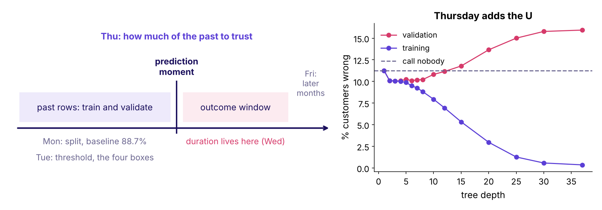
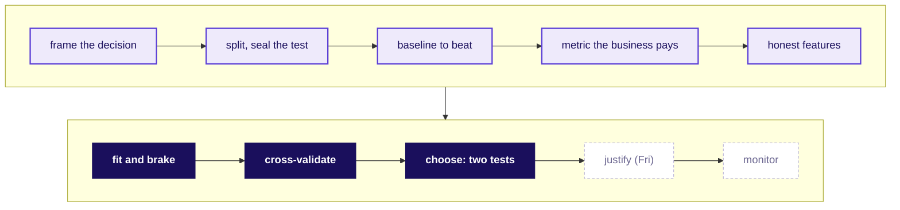

# Cheat sheet: generalise or memorise

Week 5, Thursday. Redraw the picture from memory before you read the rest.

## The ML process, today lit

## Today's hard terms

| Term | Plain meaning | Rule or formula | Trap |
|---|---|---|---|
| Overfitting (variance) | learned the training rows, surprised by new ones | gap = validation error minus training error | reading 99.6 on training as ready |
| Underfitting (bias) | too simple to be right anywhere | both errors high and close, near the baseline | blaming the data and adding rows |
| Learning curve | training and held-out error as rows grow | wide gap: brake; close and high: capacity | more rows do not close a gap made of noise |

| Term | Plain meaning | Rule or formula | Trap |
|---|---|---|---|
| Regularisation | a price on big coefficients; for trees, max_depth and min_samples_leaf | `misfit + alpha * size of coefficients`, strength chosen on folds | it helps only if there was variance |
| L2 and L1 | L2 shrinks every coefficient; L1 sets weak ones to zero | squared sizes; absolute sizes | with twin columns L1 keeps one almost by chance |
| C in LogisticRegression | the brake knob, inverted | `C = 1 / alpha`; small C = strong brake | C = 100 switches the brake off |
| K-fold cross-validation | k exams; every row sits one; a Pipeline fits each turn | report the mean and the spread | a scaler or selector fitted before the folds |

| Term | Plain meaning | Rule or formula | Trap |
|---|---|---|---|
| Random forest and boosting | many trees vote; small trees in a chain fix errors | lowers variance; earns the last ranking points | still overfit; cost more to explain |
| k-means | groups by distance, no answer column | scale first, choose k by use | it never predicts |
| The two tests | is the gap real; is it worth it | wins fold after fold; `low-end gain x margin > extra cost` | deciding on the mean or the best fold |

**When to use what.** Read training and validation together with the baseline; brake a wide gap and add capacity to two close, high curves; cross-validate whenever a decision rests on a gap; cut folds by time when the model will score the future; ship the simpler model unless the complex one wins fold after fold and its low-end gain clears its cost.

## Everything so far, one line each

| When | What it gave you |
|---|---|
| Week 1 | Python through data: the revenue tree, descriptive statistics, profile and reconcile before trusting, real or noise, the one-page note |
| Week 2 | SQL and pandas: queries, joins that keep booked and collected apart, window functions, the customer table, Excel for the leadership deck |
| Build 1 | Kalpa Health: profile, clean, reconcile, and the headline claim |
| Week 4 | analyst craft: the metric and its gaming, one slide for three people, lift beyond chance, cohorts and funnels, a forecast against a hard baseline |
| W5 Mon | frame the prediction, split it, beat 88.7% for calling nobody |
| W5 Tue | the metric trap: four boxes, the threshold from Rs 40 against Rs 1,200, the budget |
| W5 Wed | only what is known before the call: `duration` out, AUC 0.93 back to about 0.80 |
| W5 Thu | generalise or memorise: the gap, the brake, five exams, two tests |

## Three that stick

- Airbnb: a learned vector per listing "mostly led to overfitting", since a listing is booked at most 365 times a year (arXiv 1810.09591, verified 28 October 2026).
- Google Flu Trends chose from 50 million search terms to fit 1,152 points and kept high school basketball terms (Science 2014, verified 28 October 2026).
- A pneumonia model learned that asthma lowers risk; the readable model let doctors see and fix it (Caruana and others, KDD 2015, verified 28 October 2026).
