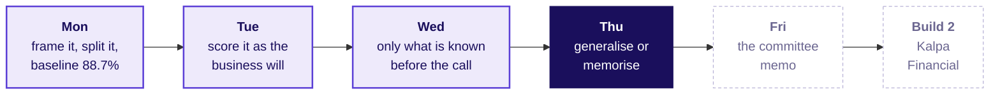
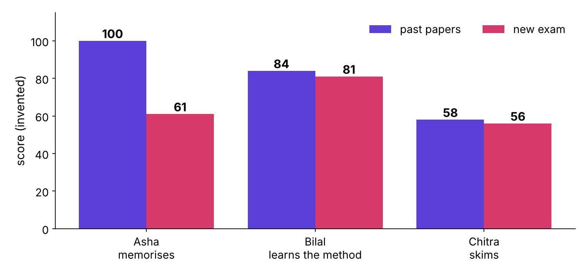
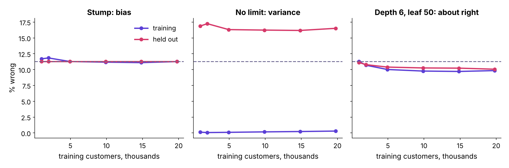
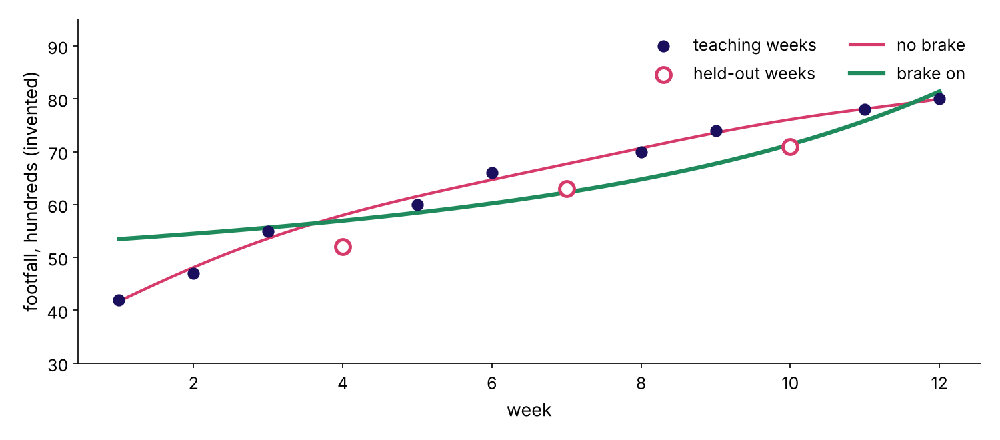
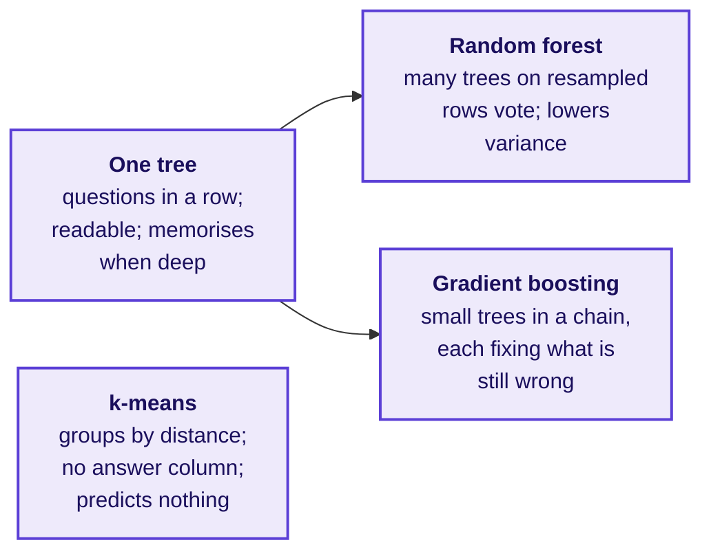
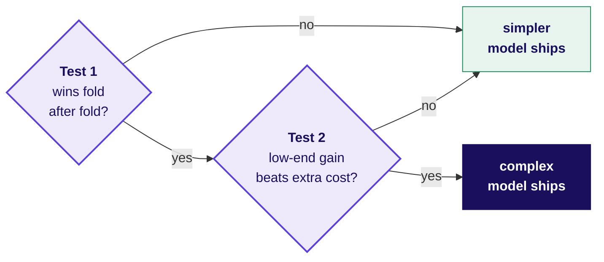

# Study notes: generalise or memorise

Week 5, Thursday. Overfitting and regularisation, and the honest tuned model.

## Where today sits



Monday gave the bank's call list a split and a baseline to beat, Tuesday scored it the way the business pays for mistakes, and Wednesday removed `duration`, the column written after the call ends. Today asks whether the honest model works on customers it has never seen, and which model Kalpa's single campaign should run. Friday turns the answer into a memo.

**The case all day.** UCI Bank Marketing: a Portuguese bank's 41,188 calls, 11.27 percent of whom said yes, public under CC BY 4.0. Kalpa's Marketing team is copying the method for its own nudge, at Rs 40 a nudge against Rs 1,200 of margin per buyer, and Anand's budget covers one campaign of 5,000 nudges.

<div class="page-break"></div>

## 1. Memorising against learning

*Overfitting; bias and variance through learning curves*



**The idea in three lines.** A model that learns its training rows too closely scores well on them and badly on new rows: that gap is variance, and a model with a large gap is overfitting. A model too simple to be right anywhere has two low scores close together: that is bias. Read the gap first, then the level, and always put the baseline beside both.

**Worked example (invented).** Asha memorises five past papers and scores 100 on them and 61 on the new exam; Bilal learns the method and scores 84 and 81; Chitra skims and scores 58 and 56. Asha is variance, Chitra is bias, Bilal is about right. On the bank's real file, a tree with no depth limit scored 99.6 percent on its 24,712 training customers and 84.1 percent on 8,238 validation customers, below the 88.7 percent of calling nobody.



**Learning curves.** Two lines against the number of training rows: error on the rows learned from, and on held-out rows. The stump's two lines sit together at the baseline (bias). The unlimited tree's training error is near zero and its held-out error near 16.5 percent (variance). Depth 6 with at least 50 customers per leaf sits at 9.8 and 10.1 (about right).

**The trap.** "More data cures overfitting." The unlimited tree's gap was 16.8 points at 988 rows and 16.2 at 19,769, because the tree memorises noise and more rows bring more noise. The brake closed it.

**Interview line.** "Overfitting is a gap I can measure between training and validation, with the baseline beside both; I read learning curves to decide between a brake and more data."

<div class="page-break"></div>

## 2. Putting brakes on the model

*Regularisation*



**The idea in three lines.** Regularisation adds a price on large coefficients (or deep trees) to the error the model minimises. It trades a little fit on the training rows for a lot of stability on new rows. Its strength is chosen on held-out rows, because the training rows always prefer no brake.

**Worked example (invented).** Twelve weeks of footfall at one Kalpa store, nine teaching and three held out. A seven-bend curve with no brake: error 0.95 on teaching weeks and 5.28 on held-out weeks (hundreds of visitors). With a brake at alpha 10: 5.74 and 2.90. At alpha 100 both errors rise: too much brake is bias.

```
ridge (L2):  minimise  misfit + alpha * (sum of squared coefficients)
lasso (L1):  minimise  misfit + alpha * (sum of absolute coefficients)
scikit-learn LogisticRegression:  C = 1 / alpha, so small C = strong brake
```

| Model | Its brakes |
|---|---|
| Linear or logistic | L2 shrinks every coefficient; L1 sets weak ones to zero and so chooses columns |
| Decision tree | max_depth caps the questions in a row; min_samples_leaf makes each answer cover enough customers |

**On the bank's file.** Sweeping C for the logistic model: C = 0.0001 underfits (0.762 under five folds); from C = 0.01 upward the cross-validated AUC sits flat near 0.786. With 24,712 rows and 63 one-hot columns the logistic model had little room to memorise. On German Credit's 800 training applications the brake mattered: C = 0.1 scored 0.784 and C = 100 scored 0.756. L1 at C = 0.03 kept 20 of 63 columns within 0.002 AUC.

**The trap.** Setting C = 100 "to brake harder" switches the brake off.

**Interview line.** "Regularisation trades a little bias for less variance; I choose its strength by cross-validation, and I know it only helps a model that had variance to remove."

<div class="page-break"></div>

## 3. Five exams instead of one

*Cross-validation*


**The idea in three lines.** One split's score carries the luck of which rows sat the exam. K-fold cross-validation gives every row one turn in the exam and reports the mean with its spread. Everything that learns from data (scalers, gap-fillers, encoders, column choosers) is fitted inside each turn, on the teaching folds only, which a scikit-learn `Pipeline` does for you.

**Worked example.** Twenty invented shoppers, five in each exam: five deals scored 60, 60, 80, 40 and 60 percent. On the bank's file, five deals of 8,238 validation customers moved AUC by only 0.004, while five folds of about 4,942 customers moved it by 0.03 (mean 0.786, spread 0.014). The smaller the exam, the bigger the luck.

**What leaked, and how much.** Scaling all 24,712 rows before the folds moved the bank's AUC by 0.00003, because a scaler learns only a mean and a spread. Steps that learn from the answers, such as choosing columns by their link to `y` or encoding a category by its yes rate, leak far more, so the habit holds everywhere.

**The trap.** Rows in this file run from May 2008 to November 2010, and shuffled folds mix the periods. Every cross-validated number today carries that caveat; Friday tests what happens when the model is trained on early months and scored on late ones.

**Interview line.** "Cross-validation removes split luck from the score and tells me how big the luck was; I compare models on the same folds."

<div class="page-break"></div>

## 4. Trees, forests and groups

*Trees, ensembles, clustering: used, compared, not derived*



**The idea in three lines.** A tree is a chain of questions anyone can read aloud, and when it grows without limit it memorises. A forest averages many trees to lower that variance; boosting chains small trees to chip away at the errors that remain. Both cost more to explain and monitor, and both still have to beat the baseline and the simpler model on the same folds.

**Worked example.** Twelve invented shoppers: a two-question tree (basket above Rs 525, then more than two visits) decides who joins the loyalty plan; five forest trees vote four to one on a newcomer; 100 small trees mean 200 to 280 leaves a reviewer would have to read. On the bank's file, under five folds: tuned tree 0.782, braked logistic 0.786, forest 0.791, boosting 0.793.

**The trap.** "A forest cannot overfit." Averaging lowers variance; it gives no immunity, and a forest learns a leak as happily as one tree.

**Interview line.** "A forest lowers a deep tree's variance by averaging; it still has to win on the same folds and earn its explanation cost."

## 5. Why the boring model often ships

*When the simpler model wins*



**The idea in three lines.** A complex model ships only when its lead is real (it wins fold after fold on the same folds) and worth having (its gain at the low end of the fold range beats what it costs to run, monitor and explain). Otherwise the simpler model ships, with the gap at which you would switch written down. A rule without its flip condition is half an answer.

**Worked example on the bank's file.** Boosting beat braked logistic on all five folds by 0.003 to 0.014 AUC, so test 1 passed. At Tuesday's cost threshold of 0.032, all four models nudge nearly everyone and their bills sit within about 2 percent (logistic Rs 2.79 lakh, boosting Rs 2.82 lakh, nudging everyone Rs 2.92 lakh on 8,238 customers). Under the 5,000-nudge budget, boosting found 0 to 133 extra buyers per campaign across folds: mean 90, low end 42, worth about Rs 51,000. Against an extra cost assumed at Rs 75,000 per campaign, test 2 fails and the braked logistic model ships. Break-even: Rs 75,000 / Rs 1,200 = 62.5, so 63 extra buyers at the low end.

**The trap.** Reading the mean gap, or the best fold, as the decision.

**Interview line.** "I recommend the simpler model and I name, in rupees, the gap at which I would switch."

<div class="page-break"></div>

## Three cases from the field

| Case | What happened | The lesson | Source, checked |
|---|---|---|---|
| Airbnb search, listing IDs | A learned vector per listing "mostly led to overfitting": training quality climbed toward perfect while test quality stayed flat, since "even the most popular listing can be booked at most 365 times in an entire year". The first deep model to ship was a single hidden layer of 32 units that proved booking neutral against the existing boosted trees. | Few labels per thing learned means memory; start simple and prove the pipeline. | Haldar and others, arXiv 1810.09591, verified 28 October 2026 |
| Pneumonia risk, Caruana and others | A neural net scored AUC 0.86 against logistic regression's 0.77, yet a rule learner on the same data found "asthma lowers risk", because asthmatics went straight to intensive care. The team went forward only with models it could read. In 2015, readable and black-box models sat within 0.02 AUC (0.843 to 0.858). | A small AUC gap does not buy an unreadable model when someone must check and repair it. | KDD 2015 paper, Microsoft Research copy, verified 28 October 2026 |
| Google Flu Trends | 50 million candidate search terms were fitted to 1,152 data points; terms about high school basketball made the cut, and the model "completely missed" the 2009 pandemic. | Choosing among many candidates overfits too; select inside folds cut by time. | Lazer and others, Science 2014, Harvard open-access copy, verified 28 October 2026 |

## The six seats on today's case

| Seat | What they ask of the 99.6 percent tree | What today gives them |
|---|---|---|
| Business owner (Anand) | Will the one campaign pay? | the bill at the threshold and the buyers in the top 5,000 |
| Product manager | What do customers experience when it is wrong? | nudges wasted on the uninterested, buyers left out |
| Solution architect | Where does selection and scaling run? | inside a Pipeline, inside the folds |
| Senior ML engineer | Which side of the trade is it on? | the depth curve, the learning curves, the brake |
| Implementation engineer | Is the comparison fair? | same folds, same columns, scores read fold by fold |
| QA and tester (today's spotlight) | What breaks it, which split, which segment? | the shuffled-answer test; the time split and the segment table come Friday |

## Check yourself, without writing

1. Cover the recap table in the practice set and say the flip condition of every rule.
2. Redraw the U of validation error against depth, with the baseline line, from memory.
3. Say the two tests for a complex model in one breath, with today's rupee numbers.

## Read next

- scikit-learn user guide, cross-validation (verified 28 October 2026): https://scikit-learn.org/stable/modules/cross_validation.html
- StatQuest, Machine Learning Fundamentals: Bias and Variance, as listed on the StatQuest video index (verified 28 October 2026): https://youtu.be/EuBBz3bI-aA
- MLU-Explain, Cross-Validation, an interactive page (verified 28 October 2026): https://mlu-explain.github.io/cross-validation/
