# Model justification: the committee memo

Week 5, Day 5. Friday.

Header: WEEK 5  ·  FRIDAY  ·  MODEL JUSTIFICATION

Quote: Which model, why that one, what it will cost us when it is wrong, how we will know it is going stale, and what you would need to run it for Rohan instead.

Who: Meera Raghavan, CEO, Kalpa Retail

```notes
LIVE, 2 minutes. Read Meera's brief aloud, slowly, once. Five questions, five chapters. The
committee meets Monday: Meera, Anand, the marketing lead, and Rohan from Kalpa Financial. Ask the
room to write down, in one word each, what each of the four will push on. Keep the papers; the
pair challenge at the end uses them. Transition: what today builds.
```

---

## S1. Friday turns the week's model into one memo
*Topics on a gym's calls, the case on a bank's 41,188 calls, the lab on loans.*

```cards
icon: dumbbell | eyebrow: The topics | title: A gym in Indore, invented | body: Twenty lapsed members, two models, Rs 30 a call, Rs 900 a missed return. | tone: light
icon: landmark | eyebrow: The case | title: UCI Bank Marketing | body: The week's file: three near-tie models, a time split, a sealed test slice. | tone: light
icon: scale | eyebrow: The lab | title: Rohan's loan book | body: German Credit's documented 5 : 1 matrix, then Kalpa's 20 : 1. | tone: dark
```

```notes
LIVE, 1 minute. Three worlds, one method. The gym is small enough to count by hand; the bank is
the week's data; the lending book is where Build 2 starts next week. Transition: where Friday
sits in the programme.
```

---

## S2. Week 5 of 20: the model meets its committee
*Monday framed it, Tuesday priced it, Wednesday cleaned it, Thursday chose it.*

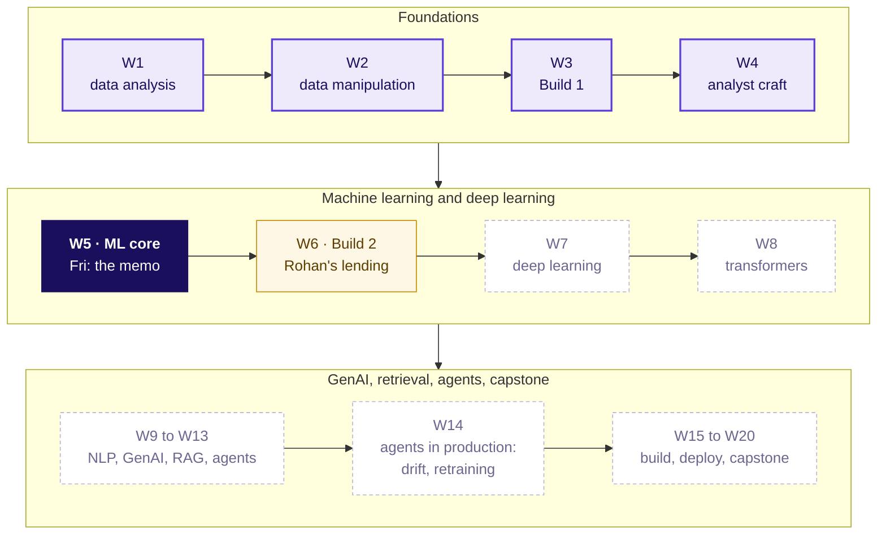

```notes
LIVE, 1 minute. Week 5 lit. Build 2 next week is Rohan's business, which is why he sits on
Monday's committee. Point at Week 14: drift detection and retraining pipelines are taught there;
today names them and stops. Transition: the one picture the week has grown.
```

---

## S3. The week's picture: Friday adds the last panel
*Each day drew one more piece of the same timeline.*

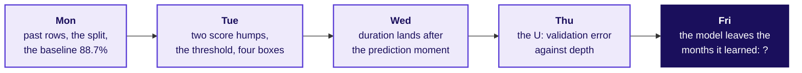

```notes
LIVE, 1 minute. Ask the room to redraw Monday to Thursday on paper in one minute, from memory:
that is the nightly self-check. Friday's panel stays a question mark until chapter 7, when the room
trains on the early months and scores the late ones. Transition: the ticket.
```

---

## S4. The ticket: four people, four pushes, one memo
*Due Monday: which model, its bill, its staleness rule, what transfers.*

| Seat at the table | What they push on |
|---|---|
| Meera, CEO, Kalpa Retail | One page: which model, and why |
| Marketing lead | "Use the higher-scoring model" |
| Anand, Finance | "What does wrong cost, in rupees?" |
| Rohan, head of risk, Kalpa Financial | "What carries over to my loans?" |

```notes
LIVE, 4 minutes. Compare with the one-word lists from the cover. The product manager is today's
spotlight seat: the person who reads the memo after the meeting and runs the list every month.
Ask: what does the product manager do with the memo on Tuesday morning? (Runs the 1,000-call list
and owns the monitoring rule.) Transition: the five topics that answer the four pushes.
```

---

## S5. Five topics, five chapters, then three case chapters
*The curriculum's words, in the curriculum's order.*

| # | The topic | Chapter | Min | Notebook |
|---|---|---|---|---|
| 1 | The model justification: claim, evidence, caveat, action | Selling a model to people who don't care about AUC | 15 | ch01 |
| 2 | The error bill in rupees under the chosen threshold | What will mistakes cost us | 15 | ch02 |
| 3 | Staleness: the monitoring rule and the weakest segment | When the model goes stale | 15 | ch03 |
| 4 | The transfer paragraph: what changes, what stays, what would leak | Moving the model to lending | 11 | ch04 |
| 5 | Reading the memo aloud under challenge | Defending it in the room | 10 | ch05 |

```notes
LIVE, 1 minute. Read the second column once: these are the words to search later. Chapters 6, 7
and 8 apply them to the bank's file (case01, case02, case03), then the guided memo and the pair
challenge. Transition: how the five join.
```

---

## S6. Five topics, one memo
*Each topic writes one part of Monday's page.*

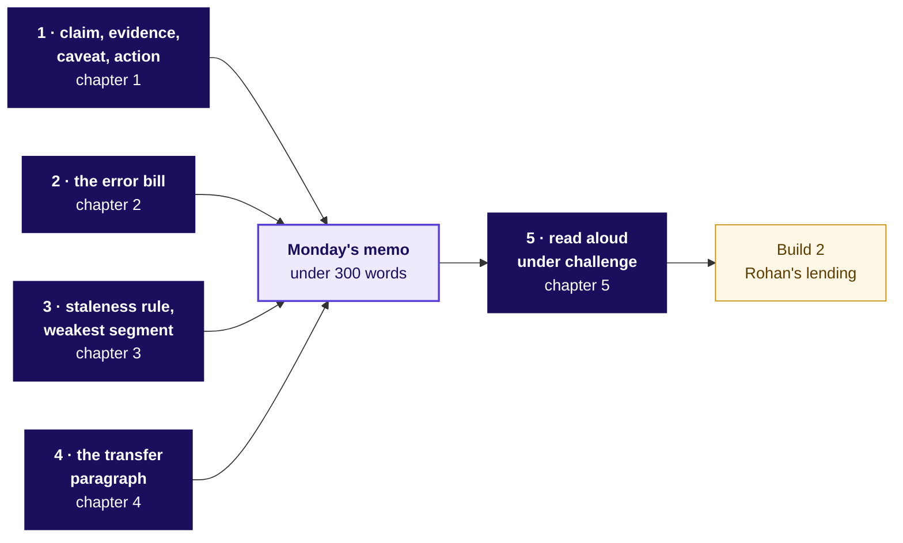

```notes
LIVE, 1 minute. The memo is the module's closing artifact and Build 2's starting point. Every box
feeds one part of it; chapter 5 is how it survives the room. Transition: chapter 1.
```

---

## SECTION 1: Selling a model to people who don't care about AUC: what does the room hear?
*The model justification: claim, evidence, caveat, action · also searched as: presenting ML results to stakeholders, model justification*

```notes
LIVE, 15 minutes for the chapter. Notebook ch01 at the end. Who needs the answer: the gym's owner,
who pays for the calls and has never heard of AUC.
```

---

## S7. Which opening line gets the calls approved?
*A gym owner, 20 lapsed members, two models (invented). Pick one opening.*

| | The option |
|---|---|
| a | "Model B's AUC is 0.85 against A's 0.80." |
| b | "A's top 6 bring back 4 of 5 returners for Rs 180." |
| c | "Model A is a logistic regression on two columns." |
| d | "Here is the confusion matrix at 0.5." |

```notes
LIVE, 3 minutes. The misconception first: most of the room picks a, because AUC is the number
they were taught to report. Letter cards up, one minute with a neighbour, vote again. Do not open
the notebook yet. Transition: the reveal.
```

---

## S8. Answer: b. The owner hears members and rupees
*Model A's ranking of the 20 members; green came back.*

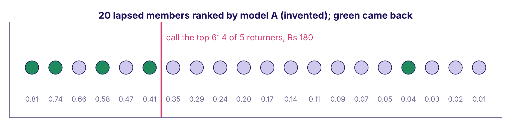

Calling nobody loses Rs 4,500. A's top 6 and B's top 6 each find 4 of 5: a bill of Rs 960 either way.

```notes
LIVE, 3 minutes. Read the dots left to right. Both models put the same four returners in their
top six, so the higher AUC buys nothing this week. Land: a model is justified in the reader's
units. Transition: what AUC is, in one sentence.
```

---

## S9. AUC is the share of pairs ranked the right way
*5 returners x 15 non-returners = 75 pairs to check.*

```python
pairs = [(r, n) for r in returners for n in non_returners]
right = sum(r.score > n.score for r, n in pairs)
print(right, "of", len(pairs))   # A: 60 of 75 = 0.80
                                 # B: 64 of 75 = 0.85
```

```notes
LIVE, 3 minutes. StatQuest style: pick one returner and one non-returner; did the returner score
higher? Do three pairs aloud from the ranking. AUC is that, over all 75. B ranks four more pairs
right and still finds the same four people in six calls. Notebook ch01 counts it by hand and checks
it against scikit-learn. Transition: the four parts.
```

---

## S10. Four parts, each carrying a number
*Week 1's four-part note, at model scale.*

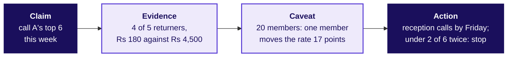

**The rule.** Lead with the decision and its rupees. **It flips** when the reader is the ML lead reviewing the method.

```notes
LIVE, 4 minutes. Each box answers one of Meera's questions: which model (claim), why (evidence
against a baseline, in rupees), when it is wrong (caveat: when it breaks, where it is weakest),
what happens next (action, with the rule that stops it). Run notebook ch01 now, 3 minutes: the
hand count, the rupee table, the memo with a check that every part carries a number.
Transition: chapter 2 prices every mistake.
```

---

## SECTION 2: What will mistakes cost us: what does wrong cost?
*The error bill in rupees under the chosen threshold · also searched as: cost-benefit analysis of a model, expected cost*

```notes
LIVE, 15 minutes for the chapter. Notebook ch02 and the explorable's bill panel. Who needs the
answer: Finance, who signs the calling budget.
```

---

## S11. At 0.5, model A calls 4. Cheaper or dearer?
*A wasted call costs Rs 30. A missed returner costs Rs 900.*

| Option | The bill is smaller at |
|---|---|
| a | 0.5, since it makes 16 fewer calls |
| b | calling all 20 |
| c | neither: they are equal |
| d | cannot tell without the AUC |

**Question.** Which bill is smaller?

```notes
LIVE, 2 minutes. Prediction first, written down. Most pick a: fewer calls feels cheaper.
Transition: the sweep.
```

---

## S12. Answer: b. The default costs five times more
*Rs 1,830 at 0.5, Rs 450 calling everyone, Rs 360 at the cheapest cut.*

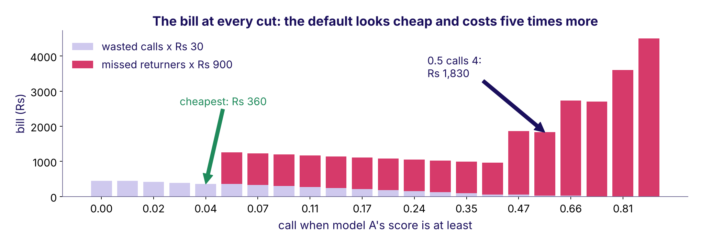

```notes
LIVE, 4 minutes. Read the bars from the right: every cut to the right of the cheapest one adds a
Rs 900 miss. The trap, exactly: "0.5 only makes 4 calls, so it is cheap"; the decision it misleads
is a budget signed for Rs 120 of calls that loses Rs 1,800 of returners. The check: price both
mistakes. Transition: what the bill counts.
```

---

## S13. The bill counts the two mistakes, never the hits
*A returner who is called pays for the call. That is the gain.*

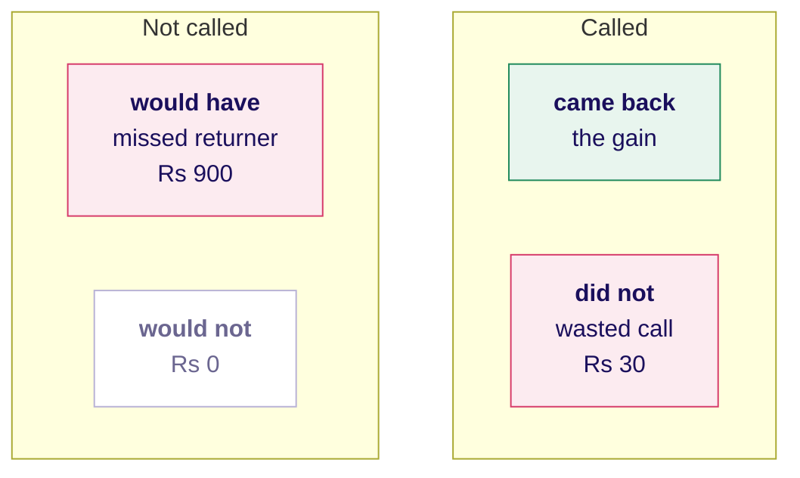

`bill = wasted calls x Rs 30 + missed returners x Rs 900`

```notes
LIVE, 3 minutes. Tuesday's four boxes with a price tag on two of them. The commonest slip in the
take-home: counting the called returners as a cost. They are what the bill is set against.
Transition: where the bill is smallest.
```

---

## S14. The cut, named last: 30 / (30 + 900) = 0.032
*Call when the chance of a return beats the cost ratio.*

```python
# one member with chance p of returning
cost_if_skipped = p * 900
cost_if_called  = (1 - p) * 30
call = p * 900 > (1 - p) * 30      # same as p > 30 / 930 = 0.032
```

**It flips** when scores are not honest probabilities, or a budget caps the calls.

```notes
LIVE, 3 minutes. Krish Naik style: three lines, each read aloud. The formula and the sweep call the
same 17 members (notebook ch02 checks it). Open the explorable now: it opens at 0.5 on the bank's
real counts. Ask for a prediction of the bill, then drag to 0.03. Transition: what happens to the
bill when the months change.
```

---

## SECTION 3: When the model goes stale: how will we know?
*Staleness: the monitoring rule and the weakest segment · also searched as: model drift, model monitoring*

```notes
LIVE, 15 minutes for the chapter. CUT FIRST if late: slide S17's band arithmetic. Who needs the
answer: the gym's owner and the front-desk manager who runs the calls.
```

---

## S15. A rival gym closed in July. When does the rule fire?
*Rule: alarm when real sits over 5 points from promised, two months running.*

| Month | Apr | May | Jun | Jul | Aug | Sep |
|---|---|---|---|---|---|---|
| Promised | 12% | 12% | 13% | 12% | 12% | 13% |
| Real, of 200 calls | 12% | 11% | 14% | 20% | 22% | 25% |

**Question.** a) April b) July c) August d) never, since the scores did not change

```notes
LIVE, 2 minutes. Invented numbers. Predict on paper. Transition: the reveal.
```

---

## S16. Answer: c. August, the second month over the line
*One month over is a warning. Two in a row is the rule.*

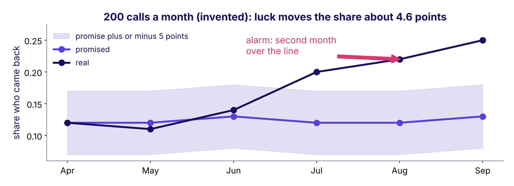

```notes
LIVE, 3 minutes. July alone could be luck. The common wrong answer to "how will you know it is
stale" is "retrain every month": a calendar fires when nothing changed and waits a month when
something has. Transition: what a rule needs.
```

---

## S17. A rule has four parts someone else can check
*Number, ceiling, window, owner.*

```cards
icon: gauge | eyebrow: The number | title: Real against promised | body: The share of called members who return, against the model's promise. | tone: light
icon: ruler | eyebrow: The ceiling | title: 5 points | body: Just above luck: 2 x sqrt(0.12 x 0.88 / 200) = 4.6 points. | tone: light
icon: calendar | eyebrow: The window | title: Two months running | body: One month can be luck. | tone: light
icon: user-check | eyebrow: The owner | title: Front-desk manager | body: Pauses the list and sends it back. | tone: dark
```

```notes
LIVE, 4 minutes. The ceiling is Week 1's sample-size rule: luck moves a share by about two standard
errors. CUT FIRST if late: skip the arithmetic and keep the four cards. Drift detection methods and
retraining pipelines are named here and taught from Week 14. Transition: the weakest segment.
```

---

## S18. The weakest segment needs its band beside it
*September by plan type (invented): a gap means nothing without its group size.*

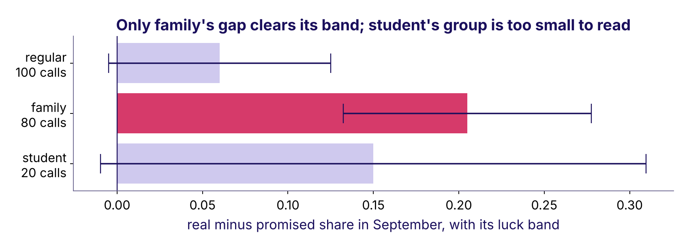

```notes
LIVE, 3 minutes. Student shows a wide gap on 20 calls; its band is 16 points, so it cannot be read.
Family's gap clears its band on 80 calls. The Week 1 sample-size reason, again. Run notebook ch03,
3 minutes. Transition: moving the machinery to a lender.
```

---

## SECTION 4: Moving the model to lending: what carries over?
*The transfer paragraph: what changes, what stays, what would leak · also searched as: domain transfer, credit risk model*

```notes
LIVE, 11 minutes for the chapter. Notebook ch04. Who needs the answer: a head of risk at a lender,
which on Monday is Rohan.
```

---

## S19. A lender's two mistakes: Rs 40,000 or Rs 2,000
*A two-wheeler lender in Nagpur, invented: a default costs Rs 40,000, a good applicant turned away Rs 2,000.*

| | The option |
|---|---|
| a | 0.50 |
| b | 0.05 |
| c | 0.95 |
| d | 0.032, the gym's cut |

**Question.** Which cut?

```notes
LIVE, 2 minutes. Prediction on paper. The trap is b or d: copying the formula without asking
which mistake is now the expensive one. Transition: the reveal.
```

---

## S20. Answer: c. The expensive mistake changed sides
*40,000 / (40,000 + 2,000) = 0.952, on P(repay).*

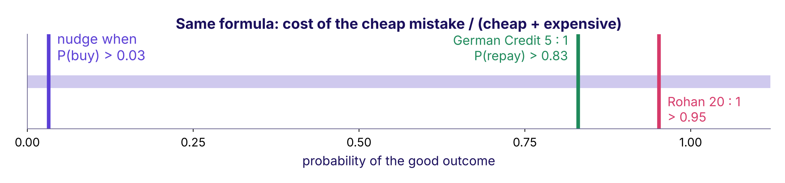

```notes
LIVE, 3 minutes. Say both on the same quantity: nudge when P(buy) is above 0.03; lend when
P(repay) is above 0.95. Same formula: the cost of the cheap mistake over the sum. At 0.5 the
invented lender approves 9 and two defaults cost Rs 80,000; at 0.952 it approves 3 and turns away
4 good applicants for Rs 8,000. Transition: the three columns of the transfer.
```

---

## S21. What changes, what stays, what would leak
*The transfer paragraph is these three columns in sentences.*

| Changes | Stays | Would leak |
|---|---|---|
| The target: came back becomes repaid | Split first, seal the test, beat a baseline | Anything written after approval |
| The costs, so the cut: 0.03 to 0.95 | The four boxes and the bill | An EMI bounce in month two |
| The moment: the call becomes the approval | The four-part memo | A collections flag |
| The weakest segment, found again | The rule's four parts | Never judged by its name |

```notes
LIVE, 4 minutes. The week's interview move: same pipeline, the other side's costs, the opposite
threshold, and the one feature that would leak. Transition: how to tell a leak.
```

---

## S22. A column's name is never the test; its time stamp is
*Each column with the day it is written, counted from the approval.*

| Column (invented lender) | Written | Known at approval |
|---|---|---|
| monthly_income | 30 days before | yes |
| bureau_score | 2 days before | yes |
| loan_term_months | at approval | yes |
| emi_bounce_month2 | 60 days after | no: leaks |
| collections_flag | 90 days after | no: leaks |

```notes
LIVE, 2 minutes. Wednesday's prediction-time question, in a lender's data. Run notebook ch04 in
the remaining minute or set it for the break. Transition: the memo in the room.
```

---

## SECTION 5: Defending it in the room: what will they push on?
*Reading the memo aloud under challenge · also searched as: ML case interview, stakeholder pushback*

```notes
LIVE, 10 minutes for the chapter. Notebook ch05. Who needs the answer: everyone in Monday's room,
each with a reason to push.
```

---

## S23. "B scores 0.05 higher. Use B." Your one line?
*The gym again: same four returners in each model's top six.*

| | The option |
|---|---|
| a | "A is better, trust me." |
| b | "AUC measures ranking quality across all pairs." |
| c | "Both find the same 4 in 6 calls: worth Rs 0 this week; B ships if it finds more next month." |
| d | "We can use both." |

**Question.** Which answer?

```notes
LIVE, 2 minutes. Vote with letter cards. Transition: the reveal.
```

---

## S24. Answer: c. A number, the reason, the flip
*B ranks 4 more pairs right of 75, and finds nobody extra.*

| | Model A | Model B |
|---|---|---|
| AUC | 0.80 | 0.85 |
| Returners in the top 6 | 4 | 4 |
| Rupee gap this week | Rs 0 | Rs 0 |
| Columns to maintain | 2 | 40 |

```notes
LIVE, 2 minutes. Option b explains the metric to someone who asked for a decision. The good answer
carries three things: the number in the reader's units, the reason, and the condition that would
flip the call. Transition: does it fit in ninety seconds.
```

---

## S25. Ninety seconds: the memo and one choice of yours
*The gym memo aloud at 140 words a minute.*

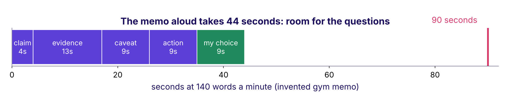

```notes
LIVE, 2 minutes. 140 words a minute is an assumed pace; each learner times themselves once. The
fifth part, "my choice", is the hiring manager's point: one decision you made differently from the
class, with its reason. Transition: who pushes on what.
```

---

## S26. Each seat pushes on one thing; answer it with a number
*The pushes to rehearse before Monday.*

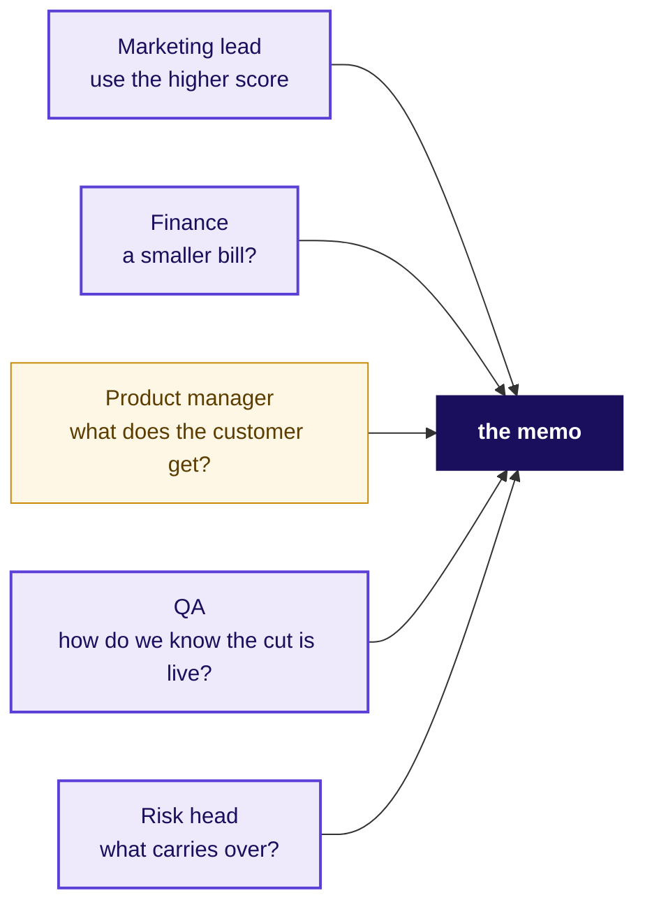

```notes
LIVE, 3 minutes. The product manager is today's spotlight: the one who runs the list after the
meeting and owns the rule's alarm. Ask the room: what does the PM need from the memo that Meera
does not? (The operating point as one number, the monthly check, and who to call when it fires.)
Run notebook ch05, 1 minute. Transition: the case.
```

---

## SECTION 6: The bill for the near-tie: which model, what cost?
*Applies the model justification and the error bill in rupees under the chosen threshold · notebook case01*

```notes
LIVE, 25 minutes for the chapter. Notebook case01 on the projector, the room following. The
first cell downloads about 1 MB; if the network is slow, pair learners and project the executed
outputs.
```

---

## S27. Thursday handed over three models within 0.02 of AUC
*Fitted on 24,712 rows, compared on 8,238; the test slice still sealed.*

| Model | Validation AUC | Mean score |
|---|---|---|
| Logistic (regularised) | 0.795 | 0.114 |
| Tuned tree (depth 7, leaves of 20) | 0.787 | 0.114 |
| Boosting | 0.803 | 0.113 |

**Question.** At the cost cut of 0.032, which has the smallest bill? a) boosting b) the tree c) logistic d) all within 1 percent

```notes
LIVE, 4 minutes. Run the first three cells: the pipeline, the checks, the three fits. Numbers are
from this run on Wednesday's honest columns; Thursday's own run may differ in the third decimal.
Predict on paper. Transition: the reveal.
```

---

## S28. Answer: d. All three tie with calling everyone
*Rs 40 against Rs 1,200 makes every model call nine in ten.*

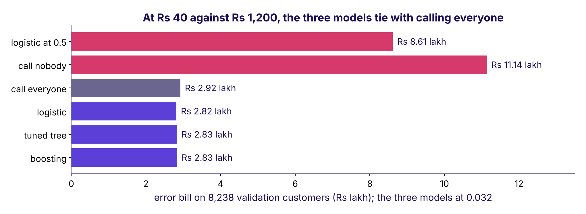

```notes
LIVE, 5 minutes. The trap, exactly: "boosting has the best AUC, so it saves the most". At 0.032 its
bill is the largest of the three (Rs 2.832 lakh against logistic's Rs 2.817 lakh). The decision it
misleads: paying for a forty-step model for nothing. The check: price both mistakes for each model.
Land: at this cost ratio the model barely matters; the budget is where it earns its keep.
Transition: the budget.
```

---

## S29. Under 1,000 calls the model finds 4x random
*Rank the 8,238, call the top 1,000.*

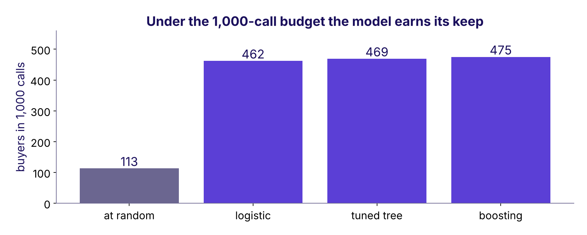

```notes
LIVE, 4 minutes. The budget binds: the cost cut would call about 7,400. Precision at k, Tuesday's
idea, carries the decision. Boosting finds 13 more than logistic. Each extra buyer is worth
Rs 1,240 on the bill (a call stops being wasted and a buyer stops being missed): Rs 16,120.
Transition: is 13 real?
```

---

## S30. Is 13 more buyers real? Resample and count again
*300 resamples of the validation customers, the gap recounted each time.*

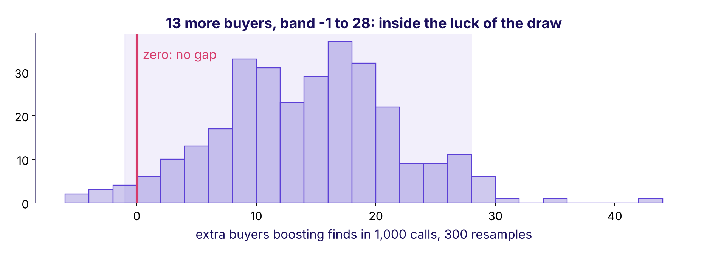

```notes
LIVE, 5 minutes. A paired bootstrap: Week 1's permutation idea run on a model comparison. The 95
percent band runs from about -1 to 28, so it reaches zero: a tie on this slice. The flip, said out
loud: boosting ships if a fresh month shows its lead clear of zero. Transition: the memo's first
two parts.
```

---

## S31. The claim and the evidence, from your own run
*Every number traces to case01.*

| Part | The line |
|---|---|
| Claim | Call the 1,000 customers the logistic model ranks highest (score above 0.245) |
| Evidence | 462 buyers in 1,000 calls against about 113 at random |
| Evidence | Boosting finds 13 more; the band reaches zero, so the simpler model is recommended |
| Evidence | Without the budget, any model's bill sits within 4 percent of calling everyone |

```notes
LIVE, 3 minutes. The simpler model is recommended when it ties, and the memo says why out loud.
These two parts are what the guided notebook rebuilds in pairs. Transition: what the bill looks
like next year.
```

---

## SECTION 7: Train early, score late: what breaks?
*Applies the error bill under the chosen threshold, and staleness: the monitoring rule and the weakest segment · notebook case02*

```notes
LIVE, 30 minutes for the chapter. Notebook case02. Who needs the answer: the product manager who
runs the list after Monday, and Anand, whose budget assumed this month looks like last month.
```

---

## S32. Two ways to hold rows out; one asks about next year
*The file runs in date order, May 2008 to November 2010.*

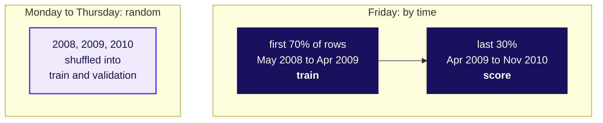

```notes
LIVE, 3 minutes. The file has a month and no year; the notebook rebuilds the year by counting each
time the month goes backwards, and checks it. Deployment is always the second picture: trained on
the past, used on the future. Transition: predict.
```

---

## S33. Trained early: what happens on the late months?
*Predict before the cell runs.*

| | The option |
|---|---|
| a | AUC holds near 0.80 and nothing else moves |
| b | AUC dips; the promise stays near the old rate while the real rate climbs |
| c | the model refuses to score new months |
| d | the promise climbs with the real rate |

**Question.** Which one?

```notes
LIVE, 2 minutes. Letter cards. Run the time-split cell only after the vote. Transition: the reveal.
```

---

## S34. Answer: b. Real 25 in 100; the promise stays 16
*The real rate went from 6 to 25 in 100. AUC fell from 0.80 to 0.66, and never mentions the promise.*

| | Rows | Real buying rate | Model's promise |
|---|---|---|---|
| Trained on, May 2008 to Apr 2009 | 28,831 | 5.6% | 5.6% |
| Scored on, Apr 2009 to Nov 2010 | 12,357 | 24.6% | 15.9% |

```notes
LIVE, 4 minutes. AUC only asks whether buyers rank above non-buyers. The bill is computed from the
promise, so the promise is what breaks: calibration. Many would still call 0.66 usable; that is the
trap. Transition: the picture.
```

---

## S35. The promise sags below reality after training
*Friday's panel of the week's picture.*

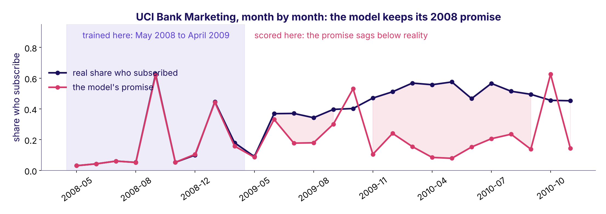

```notes
LIVE, 4 minutes. In the shaded months the lines sit on top of each other because the model learned
them. Right of the shade the rose line stays low while the real line climbs. This is the panel the
week's picture was waiting for. Explorable: the monitor panel replays these months. Transition: what
it cost.
```

---

## S36. The stale model costs more than no model at all
*12,357 late customers at the cost cut of 0.032.*

| Bill on the late customers | Rs lakh |
|---|---|
| Planned, from validation per customer | 4.23 |
| Ran up by the stale model | 4.62 |
| Calling everyone, no model | 3.73 |

231 customers scored below 0.032; 79 of them bought.

```notes
LIVE, 4 minutes. The trap, exactly: "AUC 0.66 still beats random, keep it running". It costs about
Rs 89,000 more than calling every customer. The 231 people it promised less than 1 in 31 bought at
about one in three. The check that catches it: the promise against reality, month by month.
Transition: the rule.
```

---

## S37. The rule would have fired in August 2009
*Top 12 percent each month; ceiling 10 points, since ~100 calls swing ~9.*

| Month | Called | Promised | Real | Over 10 points |
|---|---|---|---|---|
| 2009-05 | 703 | 13.6% | 14.2% | no |
| 2009-06 | 87 | 45.1% | 46.0% | no |
| 2009-07 | 22 | 32.4% | 54.5% | yes |
| 2009-08 | 93 | 31.6% | 44.1% | yes: alarm |

```notes
LIVE, 4 minutes. The four parts on real data: the number (real against promised among the called),
the ceiling (10 points, because 2 x sqrt(0.3 x 0.7 / 100) is about 9), the window (two months),
the owner (Kavya pauses the list). CUT FIRST if late: the ceiling's arithmetic. Transition: where
today's model is weakest.
```

---

## S38. Weakest where the band is narrow enough to read
*AUC inside each job group, with 200 resamples' band.*

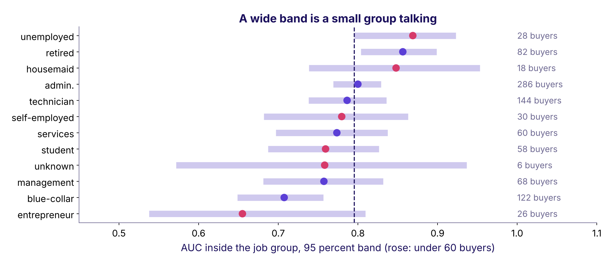

```notes
LIVE, 4 minutes. Entrepreneur reads lowest, 0.655, on 26 buyers with a band from about 0.54 to
0.81: a small group talking. Blue-collar, 0.707 on 122 buyers, is the weakest reading we can trust;
telephone contacts rank worse than mobile ones, 0.721 against 0.779. That sentence goes in the
caveat. Transition: what a stale forecast cost a real company.
```

---

## S39. Zillow Offers: the bill for a stale forecast
*Its 8-K and shareholder letter, 2 November 2021.*

```stats
value: $304.4M | label: inventory write-down | note: recorded for Q3 2021
value: 25% | label: of the workforce | note: the expected reduction from the wind-down
value: 3 to 6 | label: months ahead | note: how far the home price forecast had to reach
```

```notes
LIVE, 3 minutes. Zillow's letter: "We have been unable to accurately forecast future home prices at
different times in both directions." The forecast had to be right three to six months out, and the
world moved. Bridge to Kalpa: the same rule, the promise against reality, catches it. Sources:
the 8-K, https://www.sec.gov/Archives/edgar/data/1617640/000161764021000085/z-20211102.htm (verified 28 October 2026)
Exhibit 99.3, https://www.sec.gov/Archives/edgar/data/1617640/000161764021000085/exhibit993.htm (verified 28 October 2026)
Transition: Rohan.
```

---

## SECTION 8: Lending, and the envelope: what transfers?
*Applies the transfer paragraph, the model justification, and reading the memo aloud under challenge · notebook case03*

```notes
LIVE, 22 minutes for the chapter. Notebook case03. Who needs the answer: Rohan, and the whole
committee, which hears one number from data nobody has touched.
```

---

## S40. German Credit documents its own cost matrix
*1,000 applicants, Hamburg 1994: 700 good, 300 bad.*

| Actual, then predicted | Predicted good | Predicted bad |
|---|---|---|
| Good | 0 | 1 |
| Bad | 5 | 0 |

**Question.** Approve when P(repay) is above: a) 0.50 b) 0.17 c) 0.83 d) 0.03

```notes
LIVE, 3 minutes. Read the matrix as the dataset's documentation states it: a bad customer classed
as good costs 5, a good one classed as bad costs 1. Prediction on paper; b is the slip of putting
the ratio on the wrong side. Transition: the reveal.
```

---

## S41. Answer: c. Lend above 0.83; Rohan's line is 0.95
*300 validation applicants: cost 266 at 0.5, 160 at 0.83. Rohan's 20 : 1 moves the line to 0.95.*

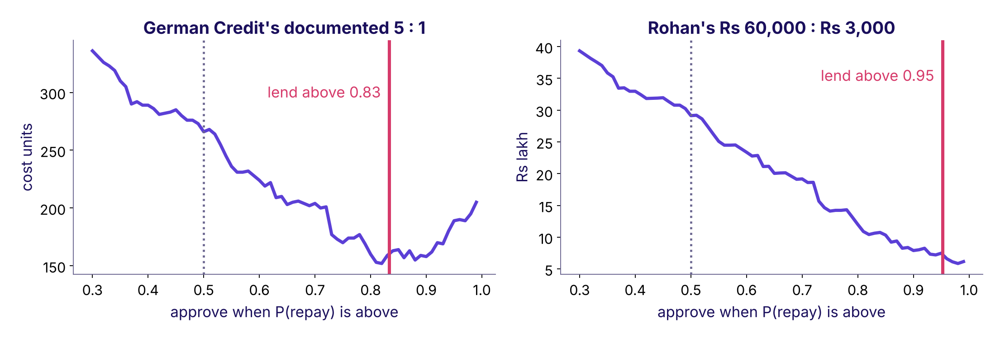

```notes
LIVE, 4 minutes. At 0.5 the model approves 226 and 47 bad loans cost 235 units; at 0.83 it
approves 128, 13 bad loans and 95 good applicants turned away cost 160. About 40 percent cheaper.
Rohan's 20 : 1 moves the line to 0.95. Same quantity on both sides: nudge when P(buy) is above
0.03, lend when P(repay) is above 0.83 or 0.95. Transition: the name trap.
```

---

## S42. German Credit's duration is a loan term: keep it
*Wednesday dropped the bank's duration. This one stays.*

| | Bank Marketing `duration` | German Credit `duration` |
|---|---|---|
| What it measures | the call's length, seconds | the loan's term, 4 to 72 months |
| Written | after the call ends | on the application form |
| Known at decision | no: leaks | yes: keep |

```notes
LIVE, 3 minutes. The prediction-time question decides, never the name. In Rohan's feed, the leak
would be days past due or a collections flag, both written after approval. Transition: the envelope.
```

---

## S43. The envelope, opened once: the sealed number agrees
*Chosen on validation, scored once on 8,238 untouched customers.*

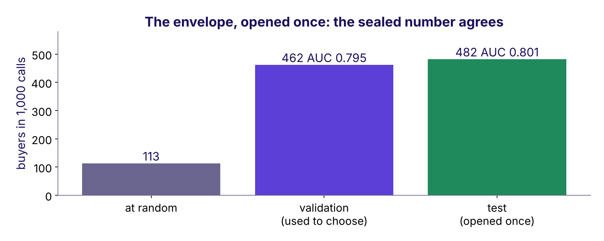

```notes
LIVE, 5 minutes. Take the card marked TEST SET down from the wall and open it in front of the room.
Run the cell once. Test AUC 0.801 against 0.795 on validation; 482 buyers in the top 1,000. That
number goes in the memo whatever it says. A second look, or a reselection after it, would make it a
validation number. Transition: the whole memo.
```

---

## S44. The memo, 206 words, every line from a run
*Claim, evidence, caveat, action, transfer.*

| Part | The line, shortened |
|---|---|
| Claim | Call the top 1,000 by the logistic score in each list of about 8,000 |
| Evidence | 482 buyers in 1,000 on the sealed test, against 113 at random; boosting's lead is a tie |
| Caveat | Trained to April 2009, it promised 16 in 100 when 25 bought; weakest on blue-collar and telephone |
| Action | Monthly list; over 10 points from the promise two months running, Kavya pauses it |
| Transfer | Pipeline, test, baseline, bill stay; target, costs, cut change: lend above 0.95; post-approval columns leak |

```notes
LIVE, 4 minutes. Notebook case03's last cell prints the full memo and checks it is under 300 words.
Tonight's WRITE task is the learner's own version, with their own numbers. Transition: your
ninety seconds.
```

---

## S45. Your ninety seconds: walk me through a model you built
*Rehearse in pairs; your partner times and pushes once.*

```timeline
label: 10 s | title: Claim | body: The model, the operating point.
label: 25 s | title: Evidence | body: Against a baseline, in buyers or rupees.
label: 20 s | title: Caveat | body: When it goes stale; where it is weakest.
label: 15 s | title: Action | body: Who runs it, and the rule.
label: 20 s | title: My choice | body: One thing you did differently, and why.
```

```notes
LIVE, inside the 65-minute practice block. Each learner rehearses with their own numbers and one
choice they made differently from the class (a different budget, a different ceiling, a segment by
contact instead of job). The partner plays one seat from S26 and pushes once. Never cut this.
Transition: the interview corner.
```

---

## S46. Interview corner: four questions, four answer shapes
*Tags: [S] staple, [F] frequent in product screens, [D] differentiator.*

| Tag | The question | The shape of a good answer |
|---|---|---|
| [S] | Walk me through a model you built and why you chose it | Claim, evidence against a baseline, caveat, action, one choice of yours |
| [F] | How would you know your model has gone stale? | Number, ceiling, window, owner; promise against reality |
| [F] | What would change if this moved to a lending business? | Target, costs, cut change; split and bill stay; post-decision columns leak |
| [D] | The committee wants the higher score; you recommend the simpler one | The gap in buyers and rupees, its band, the condition that flips it |

```notes
LIVE, 5 minutes. Read each question aloud and ask one learner for the first sentence only. The
interview bank carries model answers with the two follow-ups each one draws. Transition: the quiz.
```

---

## S47. Quiz 1 and 2: the parts, and the bill's two numbers
*Kahoot, ungraded.*

| Q | The question |
|---|---|
| 1 | Which list gives the four parts of a model justification, in order? |
| 2 | The error bill under the chosen threshold is computed from which two counts? |

```notes
LIVE, Kahoot 10 minutes for all six. Options and keys are in the trainer guide, ready to type.
```

---

## S48. Quiz 3 and 4: the rule, and the leak in lending
*Kahoot, ungraded.*

| Q | The question |
|---|---|
| 3 | Which sentence is a staleness rule someone else could check? |
| 4 | Which column would leak in the lending version, and why? |

```notes
LIVE. Keys in the trainer guide.
```

---

## S49. Quiz 5 and the return question from Thursday
*Kahoot, ungraded.*

| Q | The question |
|---|---|
| 5 | The committee wants the 0.4-point winner. Your one-line answer? |
| Return | Train 100, validation 61: name it and prescribe. |

```notes
LIVE. Q5 is the trap: the 0.4-point gap means nothing until it is sized against its band and priced.
Keys in the trainer guide.
```

---

## S50. What you can now do
*Five things, each with a number you own.*

| You can | From |
|---|---|
| Write a model justification in four parts, every part with a number | Chapter 1, case01 |
| Compute the error bill at any cut and under a budget | Chapter 2, case01 |
| Write a staleness rule with its ceiling, window and owner | Chapter 3, case02 |
| Write the transfer paragraph for a lending business | Chapter 4, case03 |
| Defend the memo in ninety seconds under one push | Chapter 5, the pair challenge |

```notes
LIVE, 2 minutes. Read the left column as "I can". Transition: tonight and tomorrow.
```

---

## S51. Tonight, and tomorrow
*Saturday is revision, the recap paper and the ME1 window.*

| When | What | Minutes |
|---|---|---|
| Tonight | The practice set, ten problems and the MCQs, self-checked | 150 |
| Tonight | WRITE: your memo, final, under 300 words | inside the set |
| Lab | The practice lab with the TAs: Rohan's memo on German Credit | lab |
| Saturday | Revision and the recap paper; reread the week's five artifacts | the day |

ME1 covers statistics, data manipulation, analyst technique and the ML core.

```notes
LIVE, 3 minutes. Say ME1's scope aloud and nothing more: no day, no slot, no scoring. ME1 runs this
week as a continuous activity. RECAP task: the three questions Rohan would ask, and your answers.
Close on the week's picture, complete (S35), and ask for it redrawn from memory tonight.
```
